# Sytue Suite (Sytue One)

**Autor:** Daniel Delgado Ramos ([thinkddr](https://github.com/thinkddr))  
**Licencia:** [Apache-2.0](LICENSE) · **Repositorio público:** [github.com/thinkddr/sytue-suite](https://github.com/thinkddr/sytue-suite)

**Sytue Suite** es una suite colaborativa, de productividad, gestión empresarial (ERP) y
plataforma cloud (PaaS) **100 % europea y soberana**, desarrollada desde cero
(*clean-room* sobre estándares abiertos) bajo licencia **Apache-2.0**: identidad y SSO,
correo, archivos, documentos, hojas de cálculo, presentaciones, PDF, calendario,
contactos, chat y videollamadas, notas, fotos, vídeo, creador de webs, bases de datos,
ERP y PaaS, con **una sola cuenta y una sola experiencia**.


---

## Instalar en 3 comandos

Necesitas **Docker** (con 12 GB de memoria para la suite completa; ~8 GB la versión «Ofimática») y
[**mkcert**](https://github.com/FiloSottile/mkcert#installation). Después:

```bash
git clone https://github.com/thinkddr/sytue-suite.git
cd sytue-suite
./sytue-deploy
```

Pulsa Enter en cada pregunta. El asistente comprueba los requisitos, genera todas las
contraseñas y claves (ninguna viene en el repositorio), construye y arranca la suite, crea
tu administrador y verifica que todo responde. Al terminar, entra en
**https://one.sytue.localhost** con las credenciales que te muestra.

Guía completa, credenciales, día a día y solución de problemas: **[`QUICKSTART.md`](QUICKSTART.md)**.

> En local todavía no se incluye el servidor de mensajería cifrada (Matrix) del que
> dependen las apps con datos cifrados en el dispositivo: hoy funcionan Admin, Web, Cloud
> y Cast. Detalle en [`QUICKSTART.md` § 3](QUICKSTART.md#3-entrar).

---

## Requisitos mínimos para desplegar en un servidor

Hay dos formas de instalar, y cada una tiene su sitio:

- **`./sytue-deploy`** (Docker Compose) monta la suite en **un solo equipo** bajo
  `https://*.sytue.localhost`, escuchando solo en `127.0.0.1`. Sirve para probarla,
  enseñarla o desarrollar; **no publica nada en Internet**.
- **`./sytue-deploy --mode helm`** (Kubernetes) es la instalación para un **servidor
  accesible con tu dominio**. Un único servidor con [k3s](https://k3s.io) basta para
  empezar. Guía: [`docs/operations.md` §1.3](docs/operations.md#13-prod-en-scaleway-terraform--helm).

| | Prueba en un equipo (Compose) | Servidor pequeño (k3s, 1 nodo) | Producción para clientes |
| --- | --- | --- | --- |
| **Para qué** | Evaluar y desarrollar | Uso propio o piloto con carga ligera | Servicio a terceros |
| **CPU** | 4 núcleos | 6 núcleos x86-64 | 12–16 núcleos (24–32 recomendados) |
| **RAM** | 12 GB asignados a Docker (16 GB en el equipo) | 8 GB sin Sytue Cloud · 16 GB con Cloud | 64 GB ECC (128 GB recomendados) |
| **Disco** | 30 GB libres (imágenes y caché de compilación) | 80 GB SSD; construye las imágenes en otra máquina | 2 × 1,92 TB NVMe enterprise en RAID 1 + backup en otro equipo |
| **Sistema** | macOS, Linux o Windows con WSL 2 | Linux x86-64 (Debian 12 / Ubuntu 24.04 o similar) | Linux x86-64, nodo dedicado |
| **Red** | Ninguna (todo local) | IPv4 pública fija, sin CGNAT | 1 Gbit/s simétrico, IPv4 fija (IPv6 recomendada) |

Además, para un servidor:

- **Kubernetes 1.31 o superior** con [cert-manager](https://cert-manager.io/docs/installation/)
  instalado. En k3s, instálalo con `--disable traefik`: el chart trae su propio Traefik.
- **Servicios externos**: PostgreSQL 16 o superior y almacenamiento compatible con S3
  (pueden correr en la misma máquina), y un registro de imágenes donde publicar la suite.
- **DNS**: un registro comodín `*.tu-dominio` (A/AAAA) apuntando al servidor. Para el
  correo, además `MX`, el PTR (rDNS) de la IP hacia `mx.tu-dominio`, SPF, DKIM y DMARC.
- **Puertos abiertos**: `80` y `443/TCP` (web y certificados); `25`, `465`, `587` y
  `993/TCP` (correo; el proveedor debe permitir el 25); `3478/UDP`, `5349/TCP`, `7881/TCP`
  y `7882/UDP` (videollamadas).
- **Copias de seguridad** en un equipo distinto del servidor: un solo servidor es un
  único punto de fallo, y RAID no sustituye a un backup.

Las cifras del servidor pequeño son el suelo medido para que todo arranque sin quedarse
sin memoria (en reposo, la suite sin Sytue Cloud ocupa unos 4,4 GB); cada compilación de
Sytue Cloud pide 2 CPU y 4 GB más mientras dura. La capacidad real depende sobre todo de
las videollamadas simultáneas, el volumen de correo y las compilaciones: mídela antes de
comprometer un nivel de servicio.

---

## Capturas de pantalla

> Todas las capturas usan una organización de demostración con datos ficticios (dominios reservados `.test`/`.example`).

### Aplicaciones web

| Sytue Mail | Sytue Drive |
| --- | --- |
| 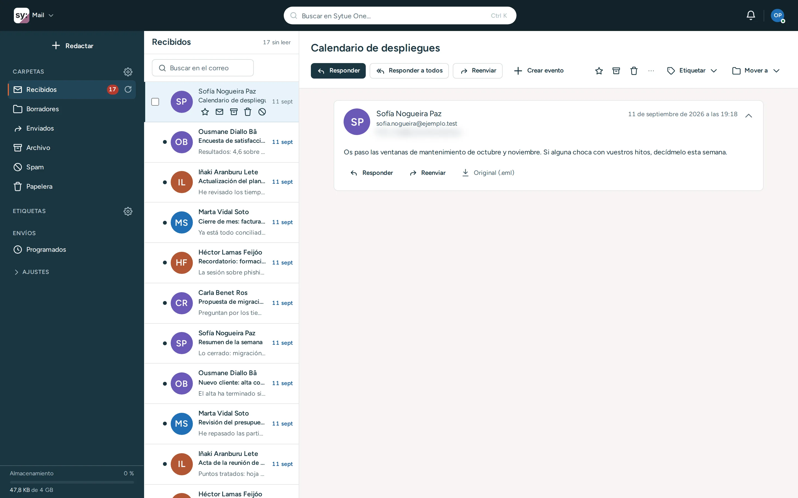 | 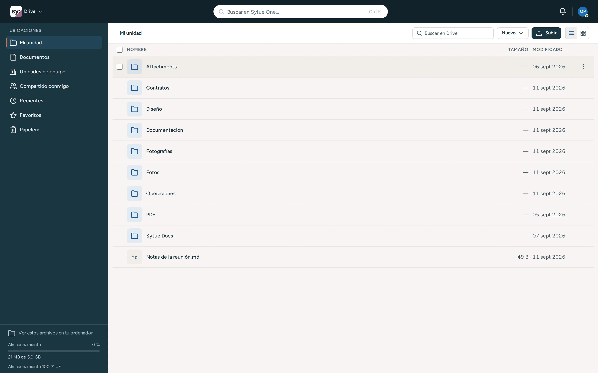 |
| **SyDocus — documentos** | **SyCalcus — hojas de cálculo** |
|  | 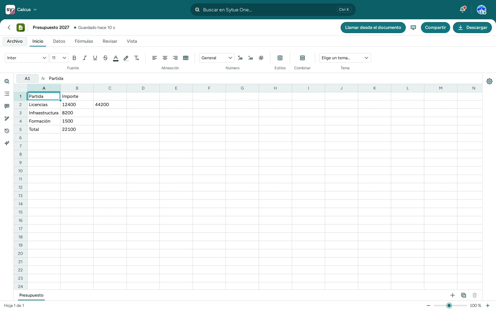 |
| **SyDiapos — presentaciones** | **SyCertiPDF — edición y firma de PDF** |
| 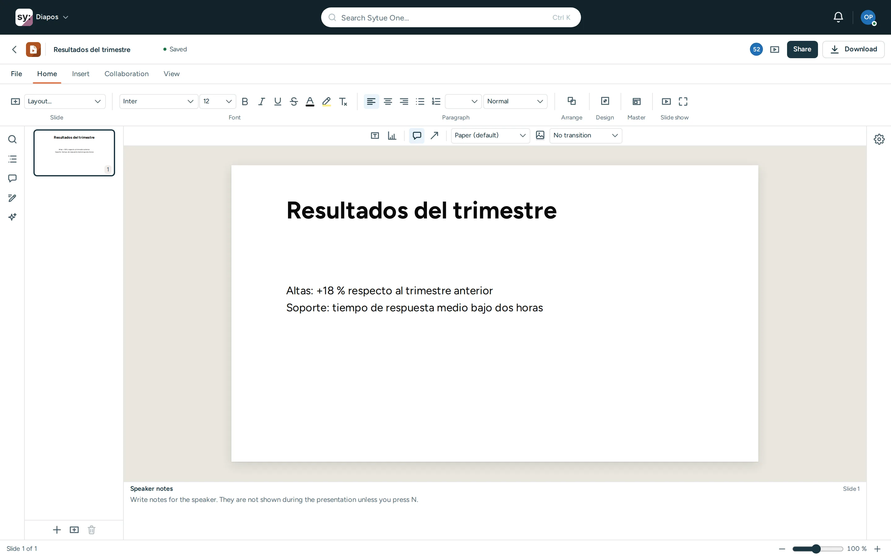 | 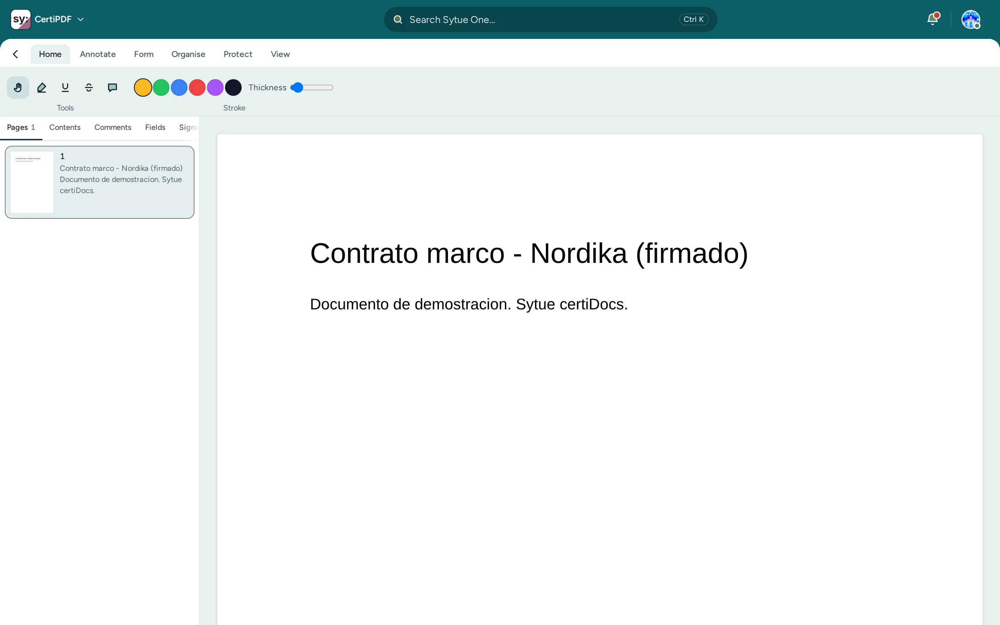 |
| **Sytue Calendar** | **Sytue Contacts** |
| 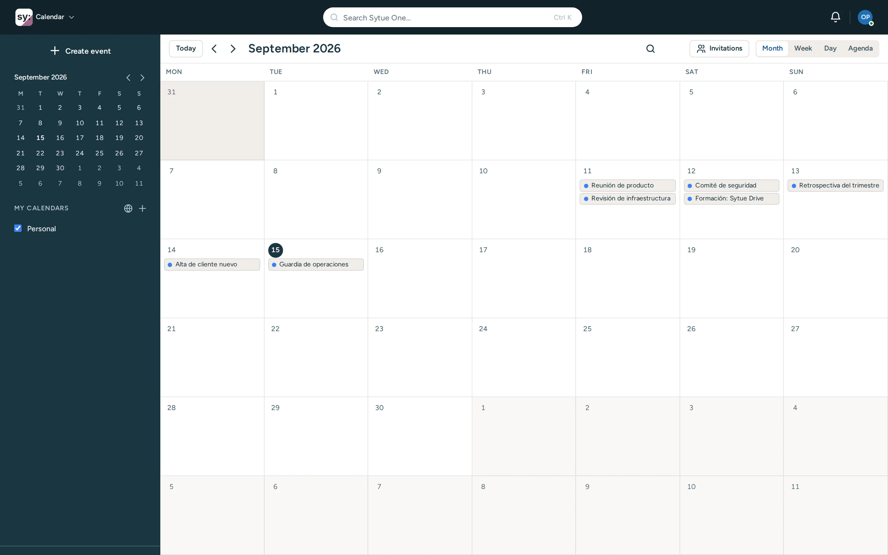 | 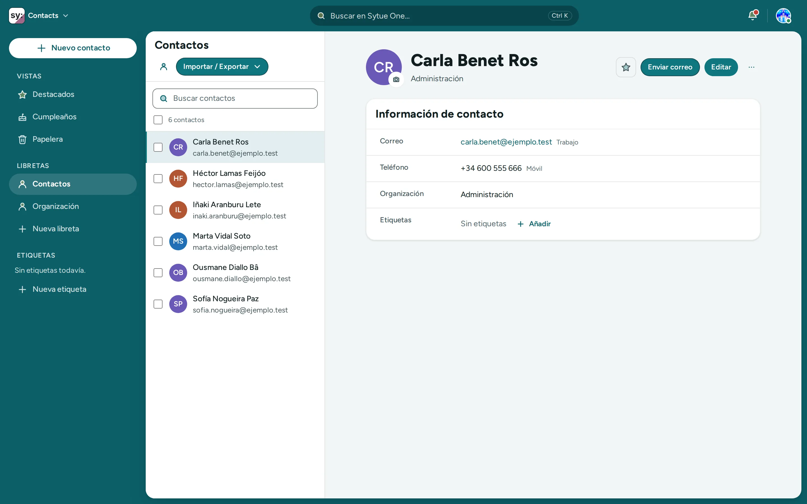 |
| **Sytue Photos** | **Sytue ID — cuenta y seguridad** |
| 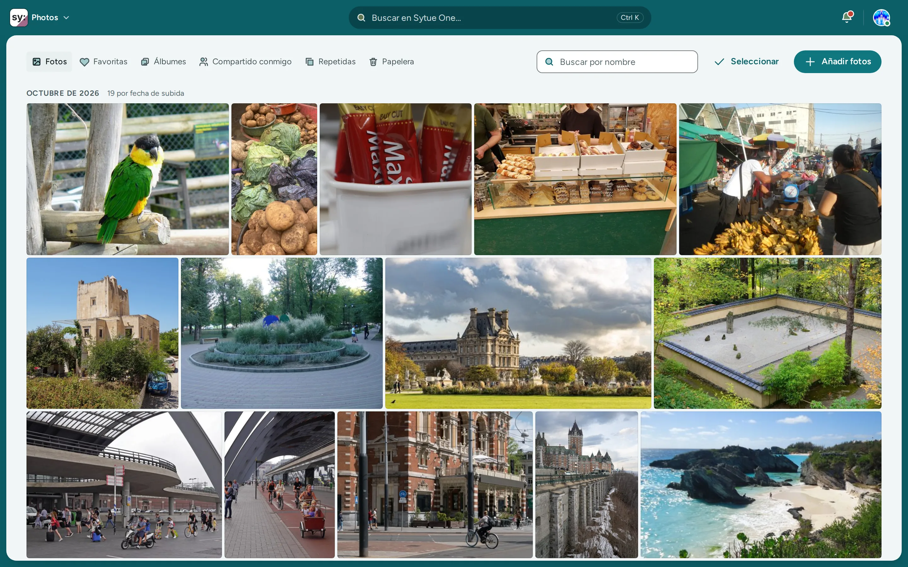 | 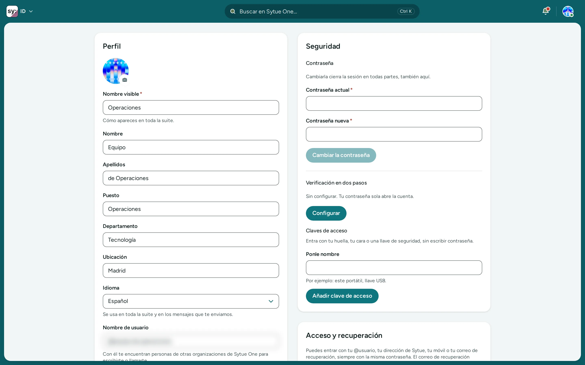 |
| **Sytue Web — creador de sitios** | **Sytue Hub — app nativa** |
| 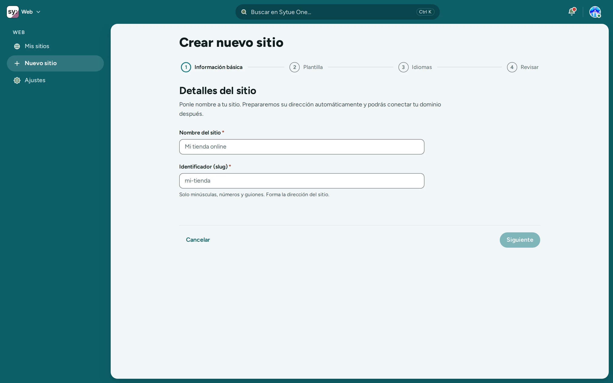 |  |

### Aplicaciones nativas (Fyne · macOS, Windows, Linux)

| Sytue Rooms | SyERP |
| --- | --- |
| 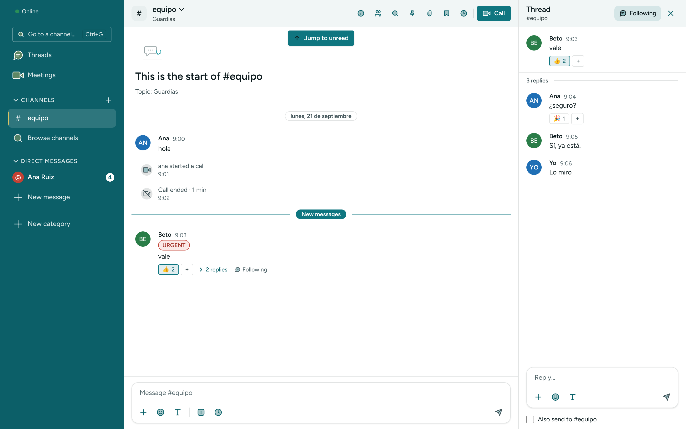 |  |
| **Sytue Cast** | **Sytue Bases** |
| 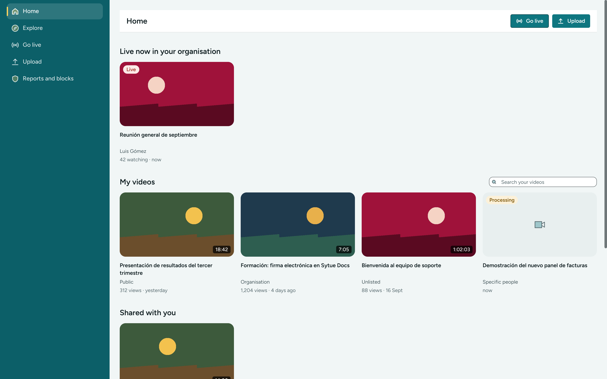 |  |
| **Sytue Notepads** | **Móvil (iOS / Android): Mail y Rooms** |
|  |   |

---

## Qué incluye

| Producto | Qué hace | Dirección |
| --- | --- | --- |
| **Sytue One** | Portal y lanzador de la suite | `one.<dominio>` |
| **Sytue ID** | Identidad: SSO (OIDC/OAuth2), MFA, Passkeys, SCIM 2.0, acceso condicional | `id.<dominio>` |
| **Sytue Admin** | Administración de la organización, políticas e integraciones | `admin.<dominio>` |
| **Sytue Mail** | Correo con JMAP, IMAP, SMTP, DKIM y filtros Sieve | `mail.<dominio>` |
| **Sytue Drive** | Archivos, carpetas, enlaces compartidos y WebDAV | `drive.<dominio>` |
| **SyDocus · SyCalcus · SyDiapos · SyCertiPDF** | Documentos, hojas de cálculo, presentaciones y PDF con firma eIDAS | `docus.` · `calcus.` · `diapos.` · `certipdf.<dominio>` |
| **Sytue Calendar · Contacts** | Calendarios (CalDAV, iMIP) y contactos (CardDAV) | `calendar.` · `contacts.<dominio>` |
| **Sytue Rooms** | Chat por canales e hilos, cifrado de extremo a extremo y videollamadas | `rooms.<dominio>` |
| **Sytue Notepads · Photos** | Notas sincronizadas y galería de fotos | `notes.` · `photos.<dominio>` |
| **SyERP** | Facturación, contabilidad, inventario, TPV, RR. HH., proyectos y VeriFactu | `erp.<dominio>` |
| **Sytue Cast** | Vídeo bajo demanda y directos (HLS) | `cast.<dominio>` |
| **Sytue Web · Bases** | Creador de webs y tiendas; bases de datos colaborativas | `pages.` · `bases.<dominio>` |
| **Sytue Cloud** | PaaS: despliegues desde Git, PostgreSQL y PostgREST, analítica sin cookies | `cloud.<dominio>` |
| **Integration Gateway** | Conectores con Google, Microsoft 365, Slack, Zoom y ~50 servicios más (solo con Helm) | `admin.<dominio>/admin/apps` |

Además, 15 aplicaciones nativas (Fyne) para macOS, Windows, Linux, Android e iOS en
[`apps/fyne/`](apps/fyne/). Integraciones con terceros paso a paso:
[`docs/operations.md` §1.12](docs/operations.md#112-integraciones).

**Stack**: Go (16 servicios, `services/`) · Astro + Preact (`apps/frontend/`) · Fyne ·
PostgreSQL 18 con Row-Level Security · S3 · Dragonfly · LiveKit (WebRTC) · Traefik 3 +
cert-manager. Versiones exactas en [`docs/CONVENTIONS.md` §3](docs/CONVENTIONS.md#3-versiones-y-stack--politica-ultima-estable--cadena-de-suministro).

---

## Comandos habituales

```bash
./sytue-deploy     # instalar, actualizar o reparar (reutiliza tu configuración)
make dev-ps        # estado de los servicios
make dev-logs SVC=id  # logs de un servicio
make dev-down      # parar (conserva los datos)
make dev-up        # arrancar de nuevo
make help          # todos los comandos (compilación, tests, Helm…)
```

---

## Documentación

| Documento | Contenido |
| --- | --- |
| [`QUICKSTART.md`](QUICKSTART.md) | Instalación paso a paso, credenciales y solución de problemas |
| [`docs/operations.md`](docs/operations.md) | Despliegue (Compose y Helm), variables, integraciones, backups y operación |
| [`docs/CONVENTIONS.md`](docs/CONVENTIONS.md) | Contrato canónico: stack, puertos, dominios y licencias |
| [`docs/architecture.md`](docs/architecture.md) | Arquitectura, SSO, Hub, Cloud, Integration Gateway y clientes nativos |
| [`docs/security.md`](docs/security.md) | Seguridad, RGPD y política *clean-room* |
| [`docs/README.md`](docs/README.md) | Índice de toda la documentación |

---

## Licencia y autoría

Distribuido bajo la licencia **Apache License 2.0**.  
Copyright © 2026 **Daniel Delgado Ramos ([thinkddr](https://github.com/thinkddr))**. Consulta [`LICENSE`](LICENSE) y [`NOTICE`](NOTICE) para más detalles.
