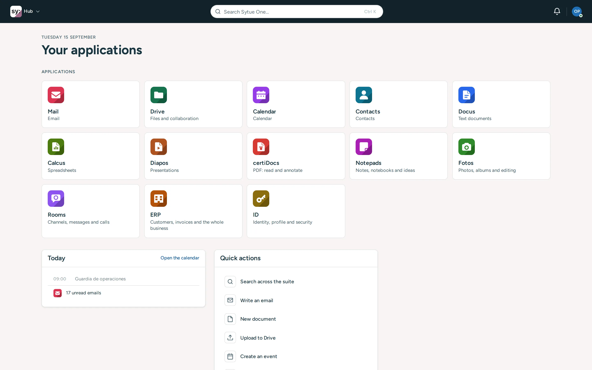
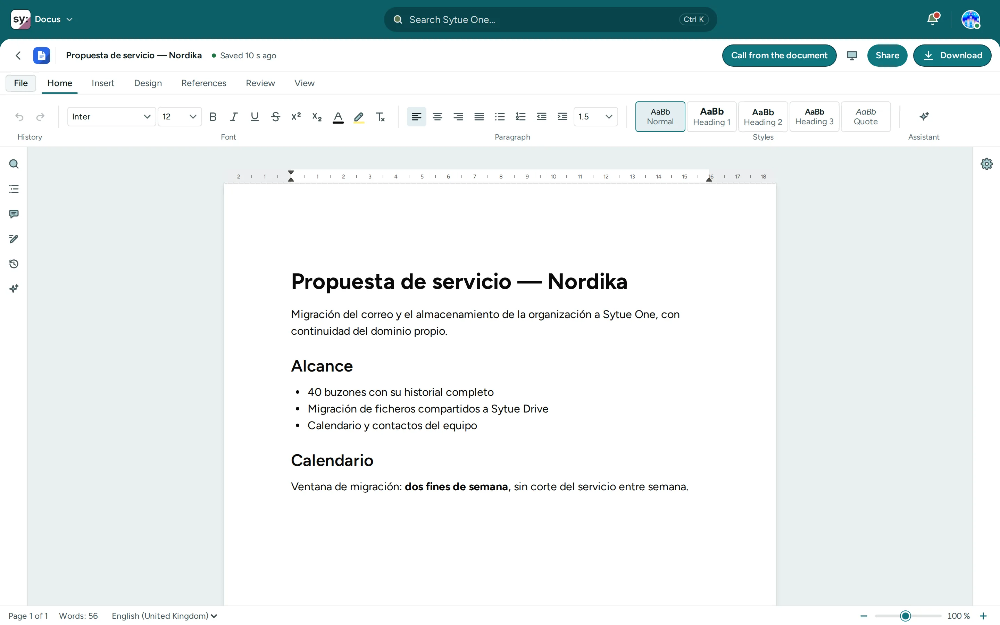
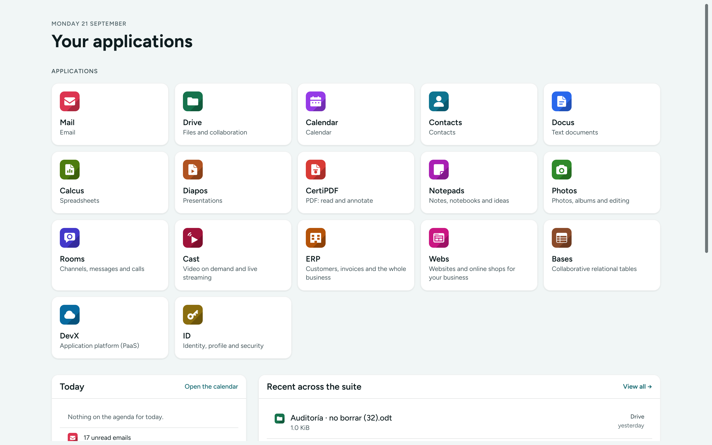
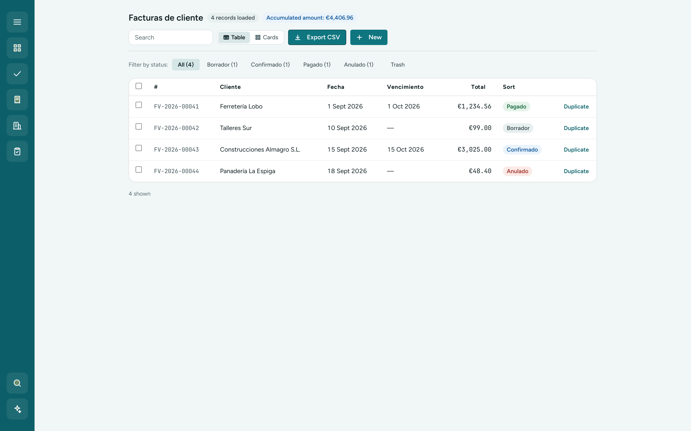
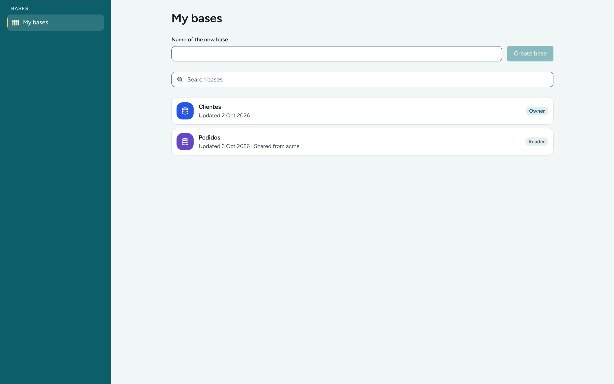
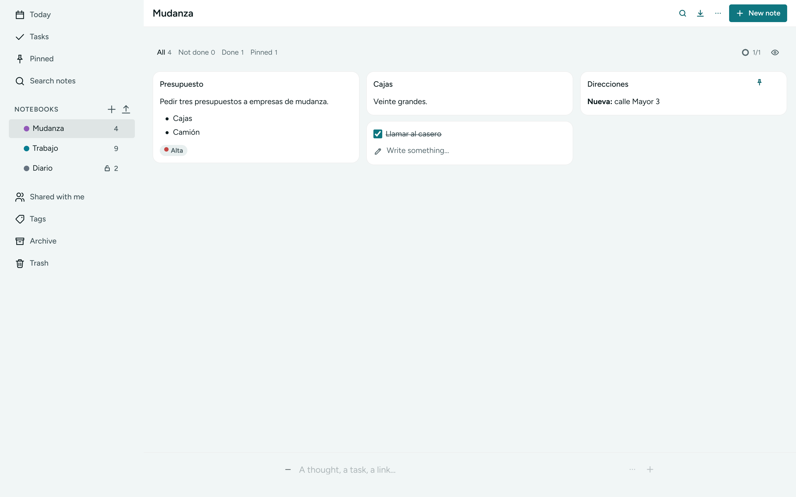
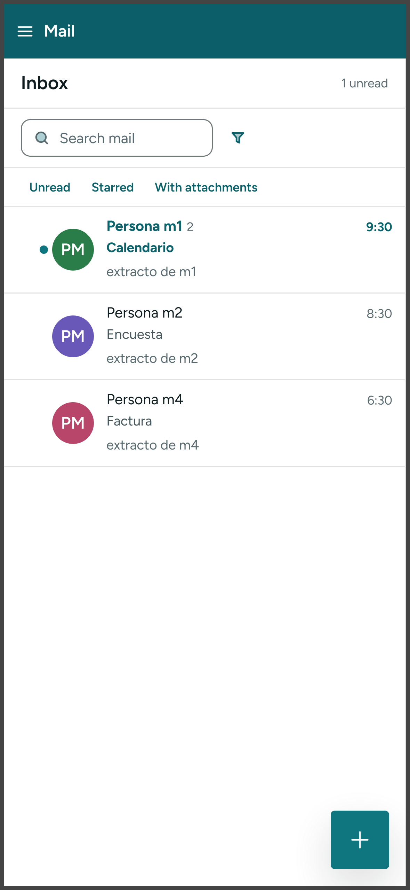
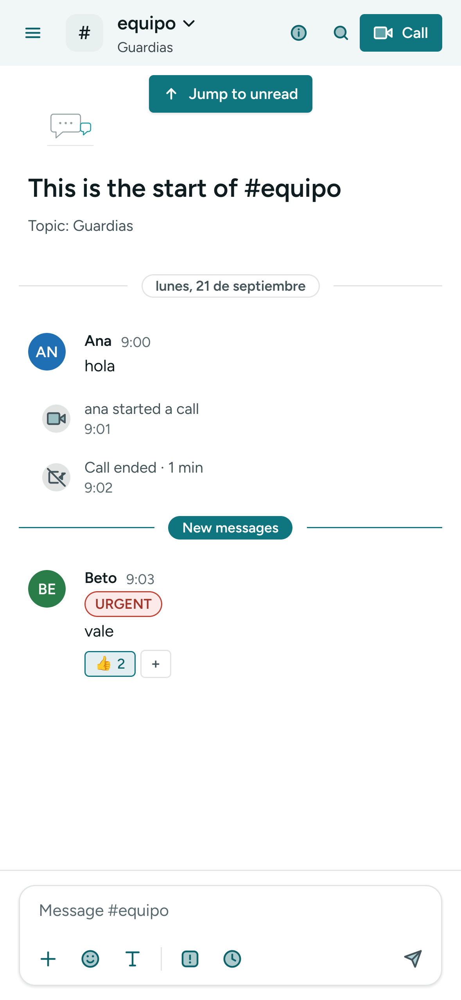

# Sytue Suite (Sytue One)

**Author:** Daniel Delgado Ramos ([thinkddr](https://github.com/thinkddr))  
**License:** [Apache-2.0](LICENSE) · **Public repository:** [github.com/thinkddr/sytue-suite](https://github.com/thinkddr/sytue-suite)

**Sytue Suite** is a **100 % European and sovereign** collaboration, productivity,
business management (ERP) and cloud platform (PaaS) suite, built from scratch
(*clean-room* on open standards) under the **Apache-2.0** license: identity and SSO,
email, files, documents, spreadsheets, presentations, PDF, calendar,
contacts, chat and video calls, notes, photos, video, website builder, databases,
ERP and PaaS, with **a single account and a single experience**.



---

<a id="instalar-en-3-comandos"></a>
## Install in 3 commands

You need **Docker** (with 4 GB of memory; 8 GB for the first build) and
[**mkcert**](https://github.com/FiloSottile/mkcert#installation). Then:

```bash
git clone https://github.com/thinkddr/sytue-suite.git
cd sytue-suite
./sytue-deploy
```

Press Enter at every question. The wizard checks the requirements, generates all the
passwords and keys (none ship in the repository), builds and starts the suite, creates
your administrator and verifies that everything responds. When it finishes, sign in at
**https://one.sytue.localhost** with the credentials it shows you.

Full guide, credentials, day-to-day use and troubleshooting: **[`QUICKSTART.md`](QUICKSTART.md)**.

> The local setup does not yet include the encrypted messaging server (Matrix) that
> the apps with on-device encrypted data depend on: today Admin, Web, Cloud
> and Cast work. Details in [`QUICKSTART.md` § 3](QUICKSTART.md#3-entrar).

---

<a id="requisitos-mínimos-para-desplegar-en-un-servidor"></a>
## Minimum requirements to deploy on a server

The same wizard installs the suite in four ways:

| Mode | Command | What for |
| --- | --- | --- |
| **On your computer** | `./sytue-deploy` | Try, demo or develop on `https://*.sytue.localhost` (only `127.0.0.1`) |
| **Single server** | `./sytue-deploy --mode servidor --domain suite.tuempresa.eu` | The whole suite on **one machine with Docker** and your domain, with **Let's Encrypt** certificates (or `--tls interno` for a local network) |
| **Single container** | `docker run --privileged … sytue-suite` ([`deploy/todo-en-uno`](deploy/todo-en-uno/Dockerfile)) | The same as the single server, but in **one container and one volume** (Docker inside Docker) |
| **Cluster** | `./sytue-deploy --mode helm` | Kubernetes with your registry, PostgreSQL and S3 ([`docs/operations.md` §1.3](docs/operations.md#13-despliegue-en-kubernetes-con-helm-avanzado)) |

On the server and in the single container you also choose **who uses it**: `--usuarios uno`
(only your account, no public sign-up) or `--usuarios varios` (a team: you invite people from
Sytue Admin and, with `--registro-abierto`, anyone can create an account). You can change it
whenever you want by running the wizard again, without touching the data.

**Optional add-ons** (they do not take features away from the other apps): ERP (`--sin-erp`),
DevX (`--sin-devx`), SMS verification (`--sms-sweego-key`) and end-to-end
encryption with Matrix (`SYTUE_CIFRADO_E2E=activado` with a Matrix server; without it, data
is stored encrypted on the server).

Single server or single container up and running:

```bash
# DNS: *.suite.tuempresa.eu → IP del servidor. Puertos abiertos: 80 y 443/TCP (web),
# 7881/TCP y 50000-50100/UDP (videollamadas).
./sytue-deploy --mode servidor --domain suite.tuempresa.eu --acme-email tu@tuempresa.eu

# O todo en un contenedor:
docker build -f deploy/todo-en-uno/Dockerfile -t sytue-suite .
docker run -d --name sytue --privileged --restart unless-stopped \
  -p 80:80 -p 443:443 -p 7881:7881 -p 50000-50100:50000-50100/udp -v sytue-datos:/datos -e SYTUE_DOMINIO=suite.tuempresa.eu \
  -e SYTUE_ACME_EMAIL=tu@tuempresa.eu -e SYTUE_USUARIOS=varios sytue-suite
```

| | On your computer | Single server / single container | Small server (k3s, 1 node) | Production for customers |
| --- | --- | --- | --- | --- |
| **What for** | Evaluating and developing | Own use, an SME or a pilot | Pilot with a light load and Sytue Cloud | Service to third parties |
| **CPU** | 4 cores | 4 x86-64 or ARM64 cores | 6 x86-64 cores | 12–16 cores (24–32 recommended) |
| **RAM** | 4 GB for Docker (the full suite uses ~1.4 GB); 8 GB for the first build | 4 GB (8 GB for the first build) | 8 GB without Sytue Cloud · 16 GB with Cloud | 64 GB ECC (128 GB recommended) |
| **Disk** | 30 GB free (images and build cache) | 40 GB SSD + your data | 80 GB SSD; build the images on another machine | 2 × 1.92 TB enterprise NVMe in RAID 1 + backup on another machine |
| **System** | macOS, Linux or Windows with WSL 2 | Linux with Docker 25+ | Linux x86-64 (Debian 12 / Ubuntu 24.04 or similar) | Linux x86-64, dedicated node |
| **Network** | None (everything local) | Public IPv4 (or a local network with `--tls interno`); 80 and 443 open | Fixed public IPv4, no CGNAT | 1 Gbit/s symmetric, fixed IPv4 (IPv6 recommended) |

In addition, for a cluster (`--mode helm`):

- **Kubernetes 1.31 or later** with [cert-manager](https://cert-manager.io/docs/installation/)
  installed. On k3s, install it with `--disable traefik`: the chart brings its own Traefik.
- **External services**: PostgreSQL 16 or later and S3-compatible storage
  (they can run on the same machine), and an image registry to publish the suite to.
- **DNS**: a wildcard record `*.tu-dominio` (A/AAAA) pointing to the server. For
  email, also `MX`, the IP's PTR (rDNS) pointing to `mx.tu-dominio`, SPF, DKIM and DMARC.
- **Open ports**: `80` and `443/TCP` (web and certificates); `25`, `465`, `587` and
  `993/TCP` (email; the provider must allow port 25); `3478/UDP`, `5349/TCP`, `7881/TCP`
  and `7882/UDP` (video calls).
- **Backups** on a machine other than the server: a single server is a
  single point of failure, and RAID is not a substitute for a backup.

The small-server figures are the measured floor for everything to start without running
out of memory (at rest, the suite without Sytue Cloud takes about 4.4 GB); each
Sytue Cloud build requests 2 more CPUs and 4 GB more while it lasts. Real capacity depends
mostly on simultaneous video calls, email volume and builds: measure it before
committing to a service level.

---

<a id="capturas-de-pantalla"></a>
## Screenshots

> All screenshots use a demo organization with fictitious data (reserved domains `.test`/`.example`). The interface is shown in English; the demo content itself (emails, notes, file names) is in Spanish.

<a id="aplicaciones-web"></a>
### Web applications

| Sytue Mail | Sytue Drive |
| --- | --- |
|  |  |
| **SyDocus — documents** | **SyCalcus — spreadsheets** |
|  |  |
| **SyDiapos — presentations** | **SyCertiPDF — PDF editing and signing** |
|  |  |
| **Sytue Calendar** | **Sytue Contacts** |
|  |  |
| **Sytue Photos** | **Sytue ID — account and security** |
|  |  |
| **Sytue Web — site builder** | **Sytue Hub — native app** |
|  |  |

<a id="aplicaciones-nativas-fyne--macos-windows-linux"></a>
### Native applications (Fyne · macOS, Windows, Linux)

| Sytue Rooms | SyERP |
| --- | --- |
|  |  |
| **Sytue Cast** | **Sytue Bases** |
|  |  |
| **Sytue Notepads** | **Mobile (iOS / Android): Mail and Rooms** |
|  |   |

---

<a id="qué-incluye"></a>
## What is included

| Product | What it does | Address |
| --- | --- | --- |
| **Sytue One** | Portal and launcher of the suite | `one.<dominio>` |
| **Sytue ID** | Identity: SSO (OIDC/OAuth2), MFA, Passkeys, SCIM 2.0, conditional access | `id.<dominio>` |
| **Sytue Admin** | Organization administration, policies and integrations | `admin.<dominio>` |
| **Sytue Mail** | Email with JMAP, IMAP, SMTP, DKIM and Sieve filters | `mail.<dominio>` |
| **Sytue Drive** | Files, folders, shared links and WebDAV | `drive.<dominio>` |
| **SyDocus · SyCalcus · SyDiapos · SyCertiPDF** | Documents, spreadsheets, presentations and PDF with eIDAS signatures | `docus.` · `calcus.` · `diapos.` · `certipdf.<dominio>` |
| **Sytue Calendar · Contacts** | Calendars (CalDAV, iMIP) and contacts (CardDAV) | `calendar.` · `contacts.<dominio>` |
| **Sytue Rooms** | Chat by channels and threads, end-to-end encryption and video calls | `rooms.<dominio>` |
| **Sytue Notepads · Photos** | Synced notes and photo gallery | `notes.` · `photos.<dominio>` |
| **SyERP** | Invoicing, accounting, inventory, POS, HR, projects and VeriFactu | `erp.<dominio>` |
| **Sytue Cast** | Video on demand and live streams (HLS) | `cast.<dominio>` |
| **Sytue Web · Bases** | Website and store builder; collaborative databases | `pages.` · `bases.<dominio>` |
| **Sytue Cloud** | PaaS: deployments from Git, PostgreSQL and PostgREST, cookieless analytics | `cloud.<dominio>` |
| **Integration Gateway** | Connectors for Google, Microsoft 365, Slack, Zoom and ~50 more services (Helm only) | `admin.<dominio>/admin/apps` |

In addition, 15 native applications (Fyne) for macOS, Windows, Linux, Android and iOS in
[`apps/fyne/`](apps/fyne/). Step-by-step third-party integrations:
[`docs/operations.md` §1.12](docs/operations.md#112-integraciones).

**Stack**: Go (16 services, `services/`) · Astro + Preact (`apps/frontend/`) · Fyne ·
PostgreSQL 18 with Row-Level Security · S3 · Dragonfly · LiveKit (WebRTC) · Traefik 3 +
cert-manager. Exact versions in [`docs/CONVENTIONS.md` §3](docs/CONVENTIONS.md#3-versiones-y-stack--politica-ultima-estable--cadena-de-suministro).

---

<a id="comandos-habituales"></a>
## Common commands

```bash
./sytue-deploy     # instalar, actualizar o reparar (reutiliza tu configuración)
make dev-ps        # estado de los servicios
make dev-logs SVC=id  # logs de un servicio
make dev-down      # parar (conserva los datos)
make dev-up        # arrancar de nuevo
make help          # todos los comandos (compilación, tests, Helm…)
```

---

<a id="documentación"></a>
## Documentation

| Document | Contents |
| --- | --- |
| [`QUICKSTART.md`](QUICKSTART.md) | Step-by-step installation, credentials and troubleshooting |
| [`docs/operations.md`](docs/operations.md) | Deployment (Compose and Helm), variables, integrations, backups and operations |
| [`docs/CONVENTIONS.md`](docs/CONVENTIONS.md) | Canonical contract: stack, ports, domains and licenses |
| [`docs/architecture.md`](docs/architecture.md) | Architecture, SSO, Hub, Cloud, Integration Gateway and native clients |
| [`docs/security.md`](docs/security.md) | Security, GDPR and *clean-room* policy |
| [`docs/README.md`](docs/README.md) | Index of all the documentation |

---

<a id="licencia-y-autoría"></a>
## License and authorship

Distributed under the **Apache License 2.0**.  
Copyright © 2026 **Daniel Delgado Ramos ([thinkddr](https://github.com/thinkddr))**. See [`LICENSE`](LICENSE) and [`NOTICE`](NOTICE) for details.
