../../docs/architecture.md 2132ms
<!-- SPDX-License-Identifier: Apache-2.0 -->
<!-- Copyright (c) 2026 Daniel Delgado Ramos -->

# Arquitectura — Sytue One

Cómo encaja la suite, de la visión al detalle de cada capa transversal:

1. **[Arquitectura de la suite](#1-arquitectura-de-la-suite)** — visión, mapa de componentes,
   diagramas C4, flujos (SSO, intents, deploy), multi-tenancy y topología.
2. **[Integración seamless](#2-integracion-seamless-shell--hub)** — Sytue Shell + Sytue Hub.
3. **[Sytue DevX (PaaS)](#3-sytue-cloud-paas)** — producto y arquitectura interna.
   El ancla sigue siendo `#3-sytue-cloud-paas`: la clave técnica es `cloud`.
4. **[Integration Gateway](#4-integration-gateway-saliente)** — interoperabilidad **saliente**
   con el SaaS del cliente (BYO-SaaS).
5. **[Capa de compatibilidad](#5-capa-de-compatibilidad-entrante)** — Sytue como _drop-in_
   **entrante** de Google y Microsoft.
6. **[Identidad enterprise](#6-identidad-enterprise-y-cumplimiento)** — federación, acceso
   condicional, PIM, grupos dinámicos, retención legal y eDiscovery.
7. **[Migración de nombres v4](#migracion-nombres-v4)** — qué se renombró (Hub, Admin, DevX,
   CertiPDF, WorkHub), qué claves técnicas se quedan y por qué, con la prueba de cada fila.
8. **[Capacidades nativas](#capacidades-nativas)** — qué hace la suite en Gio con el sistema
   operativo en cada plataforma, con permiso, datos, retención, fallback y prueba de cada una.
9. **[Conversión Astro + Preact → Fyne](#astro-fyne)** — compilación a Go nativo y contrato de
   fidelidad medido por estado, ventana y escala.
10. **[La ofimática, una app por producto](#ofimatica-una-app-por-producto)** — Docus, Calcus,
    Diapos y CertiPDF con app, host y client propios sobre el paquete `@sytue/office` y un
    único servicio de documentos.

> El **qué** normativo (nombres, dominios, puertos, versiones) está en
> [`CONVENTIONS.md`](CONVENTIONS.md); el **porqué** de cada decisión, en
> [`decisions.md`](decisions.md).

---

<a id="1-arquitectura-de-la-suite"></a>

## 1. Arquitectura de la suite

> Documento de arquitectura de **Sytue One**. La **fuente de verdad** de nombres, dominios,
> puertos, versiones, clients OIDC y licencias es [`docs/CONVENTIONS.md`](./CONVENTIONS.md) (v4).
> Este documento **no** redefine el contrato: lo ilustra y lo desarrolla en diagramas.

<a id="11-vision"></a>

### 1.1 Visión

**Sytue One** es una suite de productividad y nube soberana, **100 % europea** (Scaleway, solo
regiones UE) y construida como **producto propietario y original de Sytue** (© Sytue,
licencia comercial). Reúne identidad, archivos, ofimática, correo, calendario, contactos, chat,
videollamadas y una PaaS bajo una **única experiencia** con el lenguaje visual de la marca Sytue.

Principios nucleares (ver `CONVENTIONS.md §0`):

1. **Stack único y total: `Go + Astro + Preact + PostgreSQL`.** Todo backend en **Go**;
   toda superficie web en **Astro + Preact** (islands); el **único datastore** es
   **PostgreSQL** (estado, colas y caché sobre Postgres — **sin Redis/Valkey**). Blobs grandes
   en **Object Storage S3** (Scaleway en prod, MinIO en dev).
2. **Sytue-native, clean-room y propietario.** **No** se despliega ningún motor de terceros AGPL
   (Keycloak, Nextcloud, OnlyOffice, Mattermost, Stalwart quedan **fuera**). Cada producto es una
   reimplementación **clean-room** sobre **estándares abiertos** (OIDC, WebDAV/CalDAV/CardDAV,
   SMTP/IMAP/JMAP, CRDT/OT, WebRTC) con **librerías Go permisivas** (MIT/BSD/Apache-2.0).
3. **Diseño primero y transversal.** Un solo design system (`@sytue/ui`) + shell común
   (`@sytue/shell`) montados en **todas** las superficies. Cero UI ad-hoc.
4. **Sytue ID es la pieza nuclear.** Servicio Go propio (OIDC/OAuth2/PKCE, JWKS, SCIM,
   MFA/WebAuthn). Cada servicio valida sus JWT vía JWKS.
5. **Soberanía 100 % UE.** Regiones UE de Scaleway y gate independiente de origen UE para producto,
   infraestructura y tooling; GitHub es la única excepción temporal durante su migración.

**Única pieza de aplicación de terceros en el runtime de cliente:** **LiveKit** (Apache-2.0, Go)
como **SFU de medios WebRTC** de _Sytue Rooms_. No es un motor de producto: solo transporta
audio/vídeo; la lógica de salas/señalización es un servicio Go propio.

El SFU **avisa** al BFF de Meet por `POST /webhooks/livekit` (firma HMAC con el `api_secret`,
verificada en `services/rooms/internal/media/livekit`): de ahí salen el cierre de la sala en PostgreSQL
y la tarjeta de «la reunión ha terminado» que Rooms publica en el canal de origen. Ese aviso
viaja por el **Service interno** del clúster, nunca por el Ingress. Hasta la corrección de
2026-07-28 **ninguno de los dos entornos lo configuraba** —ni el chart ni el compose fijaban
`webhook.urls`—, así que Meet montaba y verificaba el endpoint sin recibir un solo evento: las
salas quedaban abiertas para siempre y Rooms no se enteraba de nada. El chart ahora **falla al
renderizar** si se habilita sin `webhook.apiKey`, porque un SFU que no notifica es un fallo
silencioso y esos son los que sobreviven.

Entornos en **paridad**: DEV = local (Docker Compose, `*.sytue.localhost`, mkcert),
PROD/BASE = Scaleway (Terraform + Helm/Kapsule). Misma arquitectura lógica parametrizada por entorno.

<a id="12-mapa-de-componentes"></a>

### 1.2 Mapa de componentes

Cada producto es un **servicio Go propio** (capas `internal/{http,domain,store}`, `pgx`+`sqlc`,
migraciones, `chi`, `slog`) bajo el módulo único `git.sytue.eu/sytue/one`, con su **frontend Astro+Preact**.

| Producto                      | Frontend (Astro+Preact)                        | Backend Go — estándar/protocolo                                                                                                                                     | Client OIDC (BFF)                  | Subdominio                             | Puerto dev              |
| ----------------------------- | ---------------------------------------------- | ------------------------------------------------------------------------------------------------------------------------------------------------------------------- | ---------------------------------- | -------------------------------------- | ----------------------- |
| **Sytue One**                 | Portal/lanzador                                | — (usa Sytue ID + Hub)                                                                                                                                              | `sytue-one`                        | `one.sytue.eu`                         | FE 4321                 |
| **Sytue ID**                  | Login/cuenta                                   | OIDC/OAuth2/PKCE, JWKS, SCIM, MFA/WebAuthn (`ory/fosite`/`zitadel/oidc`)                                                                                            | — (es el IdP)                      | `id.sytue.eu`                          | 8081                    |
| **Sytue Drive**               | Cliente propio                                 | WebDAV + REST; PG + S3                                                                                                                                              | `sytue-drive`                      | `drive.sytue.eu`                       | 8082 (+WebDAV)          |
| **Sytue Docs**                | Editor propio                                  | Modelo documental + colab CRDT/OT (WS); PG + S3                                                                                                                     | `sytue-docs`                       | `docs.sytue.eu`                        | 8083 (+WS)              |
| **Sytue Mail**                | Cliente propio                                 | SMTP/IMAP/JMAP; PG + S3 (blobs)                                                                                                                                     | `sytue-mail`                       | `mail.sytue.eu`, `mx.sytue.eu`         | 8086 (HTTP/JMAP)        |
| **Sytue Calendar**            | Cliente propio                                 | CalDAV + REST; PG                                                                                                                                                   | `sytue-calendar`                   | `calendar.sytue.eu`                    | 8087 (+CalDAV)          |
| **Sytue Contacts**            | Cliente propio                                 | CardDAV + REST; PG                                                                                                                                                  | `sytue-contacts`                   | `contacts.sytue.eu`                    | 8088 (+CardDAV)         |
| **Sytue Notepads**            | Cliente propio                                 | Modelo propio + REST; cifrado E2E en el navegador; PG                                                                                                               | `sytue-notes`                      | `notes.sytue.eu`                       | 8089                    |
| **Sytue Rooms**               | Cliente propio (+ LiveKit web SDK)             | WebSocket + REST y salas/señalización en un servicio; **LiveKit** solo transporta medios; PG                                                                        | `sytue-rooms`                      | `rooms.sytue.eu` (SFU en `rooms-sfu.`) | 8085 (+WS)              |
| **Sytue Cloud**               | Dashboard                                      | Control plane (deploy/build/servicios) + PostgREST; PG + S3                                                                                                         | `sytue-cloud` (+`sytue-cloud-api`) | `cloud.sytue.eu`                       | API 8090 / builder 8091 |
| **Sytue Admin**               | Admin/tenants                                  | Admin API sobre Sytue ID + Hub                                                                                                                                      | `sytue-console`                    | `admin.sytue.eu`                       | FE 4322                 |
| **Sytue Hub**                 | — (backend de la shell)                        | Búsqueda/notificaciones/presencia/intents; PG                                                                                                                       | `sytue-hub`                        | `hub.sytue.eu`                         | 8092                    |
| **Sytue Integration Gateway** | — (Console «Integraciones» + tiles del portal) | Pasarela única de egress a SaaS de terceros (SSO/SCIM/datos/embed/DLP); PG                                                                                          | `sytue-gateway`                    | interno                                | 8093                    |
| **Sytue OCR**                 | — (herramienta «Reconocer texto» de Sytue PDF) | Reconocimiento con **Tesseract 5** (Apache-2.0) DENTRO de la imagen; stateless, sin PG y **sin egress**. Solo lo llama Sytue Docs ([ADR-0034](./decisions.md#0034)) | `sytue-ocr`                        | interno, **sin ingress**               | 8096                    |
| Sitio público                 | Marketing                                      | —                                                                                                                                                                   | —                                  | `sytue.eu`, `www.sytue.eu`             | FE 4324                 |

> **No hay federación de motores.** Cada servicio Go valida directamente los JWT de Sytue ID
> (JWKS). Un alta en Sytue ID = acceso a toda la suite (tenancy en §10), sin SCIM hacia motores
> de terceros (ya no existen).

#### 2.1 Interoperabilidad con terceros — dos lados, dos ubicaciones

La suite es cerrada hacia dentro (servicios propios, sin motores de terceros) y **abierta hacia
fuera** por dos caminos deliberadamente distintos:

| Lado         | Qué es                                                                                                                                                                                                                                                                                                                                                       | Dónde vive                          | Doc                                                                                                        |
| ------------ | ------------------------------------------------------------------------------------------------------------------------------------------------------------------------------------------------------------------------------------------------------------------------------------------------------------------------------------------------------------ | ----------------------------------- | ---------------------------------------------------------------------------------------------------------- |
| **Saliente** | Sytue llama al SaaS que la organización ya tiene (M365, Google Workspace, Salesforce, Jira, Odoo…). **Un solo servicio** concentra el egress: un único cliente HTTP con SSRF + rate-limit + auditoría + DLP + inyección de auth.                                                                                                                             | `services/integrations` (**:8093**) | [`architecture.md#4-integration-gateway-saliente`](./architecture.md#4-integration-gateway-saliente)       |
| **Entrante** | Sytue **emula** las APIs de los grandes fabricantes para que integraciones ya escritas para Slack/Teams/Google/Microsoft funcionen sin cambios. **Adaptadores por servicio** (`internal/compat/`), no una pasarela compartida: cada emulación traduce al dominio del servicio dueño del dato. Entregado hoy: `services/rooms` habla Slack y Microsoft Teams. | `services/<svc>/internal/compat/`   | [`architecture.md#5-capa-de-compatibilidad-entrante`](./architecture.md#5-capa-de-compatibilidad-entrante) |

Las funciones de identidad enterprise y cumplimiento que sostienen ambos lados (SAML IdP
saliente, DCR, acceso condicional, PIM, legal hold, auditoría unificada) se documentan en
[`architecture.md#6-identidad-enterprise-y-cumplimiento`](./architecture.md#6-identidad-enterprise-y-cumplimiento).

<a id="13-diagrama-de-contexto-c4--nivel-1-system-context"></a>

### 1.3 Diagrama de contexto C4 — Nivel 1 (System Context)

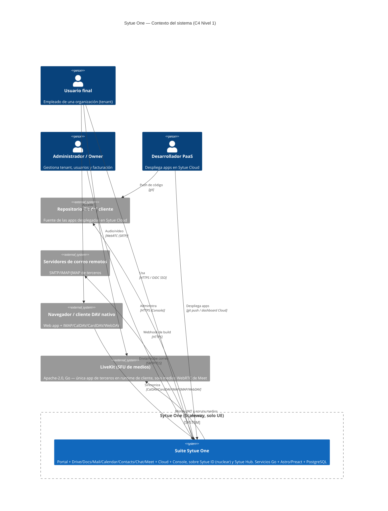

<a id="14-diagrama-de-contenedores-c4--nivel-2-containers"></a>

### 1.4 Diagrama de contenedores C4 — Nivel 2 (Containers)

Todos los contenedores de backend son **binarios Go propios** (un binario por servicio,
`services/<svc>/cmd/<svc>/main.go`). El único datastore es PostgreSQL; los blobs van a S3.

```mermaid
C4Container
  title Sytue One — Contenedores (C4 Nivel 2)

  Person(user, "Usuario", "Tenant")

  System_Boundary(sytue, "Sytue One — Scaleway UE") {

    Container_Boundary(front, "Frontend (Astro + Preact · @sytue/shell + @sytue/ui + @sytue/auth)") {
      Container(portal, "Sytue One (portal)", "Astro/Preact + BFF", "Lanzador · one.sytue.eu")
      Container(drive, "Sytue Drive", "Astro/Preact + BFF", "drive.sytue.eu")
      Container(docs, "Sytue Docs", "Astro/Preact (editor propio) + BFF", "docs.sytue.eu")
      Container(mail, "Sytue Mail", "Astro/Preact + BFF", "mail.sytue.eu")
      Container(cal, "Sytue Calendar", "Astro/Preact + BFF", "calendar.sytue.eu")
      Container(contacts, "Sytue Contacts", "Astro/Preact + BFF", "contacts.sytue.eu")
      Container(notes, "Sytue Notepads", "Astro/Preact + BFF", "notes.sytue.eu")
      Container(roomsfe, "Sytue Rooms", "Astro/Preact + BFF + LiveKit web SDK", "rooms.sytue.eu")
      Container(cloudui, "Sytue Cloud Dashboard", "Astro/Preact + BFF", "cloud.sytue.eu")
      Container(console, "Sytue Admin", "Astro/Preact + BFF", "admin.sytue.eu")
    }

    Container(idp, "Sytue ID", "Go (ory/fosite o zitadel/oidc)", "OIDC/PKCE, JWKS, SCIM, MFA/WebAuthn · id.sytue.eu :8081")
    Container(hub, "Sytue Hub", "Go (chi, WS/SSE)", "Búsqueda federada, notificaciones, presencia, intents · hub.sytue.eu :8092")

    Container_Boundary(svcs, "Servicios de producto (Go · git.sytue.eu/sytue/one)") {
      Container(drivesvc, "Drive svc", "Go", "WebDAV + REST · :8082")
      Container(docssvc, "Docs svc", "Go", "CRDT/OT colab WS + REST · :8083")
      Container(mailsvc, "Mail svc", "Go", "SMTP/IMAP/JMAP · :8086 / 25,465,587,993")
      Container(calsvc, "Calendar svc", "Go", "CalDAV + REST · :8087")
      Container(consvc, "Contacts svc", "Go", "CardDAV + REST · :8088")
      Container(roomssvc, "Rooms svc", "Go", "WebSocket + REST + salas/señalización · :8085")
      Container(intsvc, "Integration Gateway", "Go", "Egress único a SaaS de terceros: SSRF+rate-limit+auditoría+DLP+auth · :8093")
    }

    Container_Boundary(paas, "Sytue Cloud (PaaS — Go)") {
      Container(paasapi, "Cloud API / control plane", "Go + PostgREST", ":8090")
      Container(builder, "Builder", "Kaniko rootless Jobs", ":8091")
    }

    Container(livekit, "LiveKit (SFU)", "Apache-2.0, Go", "Solo medios WebRTC de Meet · 7880/7881/UDP mux 7882")

    ContainerDb(pg, "PostgreSQL", "RDB", "ÚNICO datastore: estado + colas + caché de TODOS los servicios y tenants (esquema/RLS)")
    ContainerDb(s3, "Object Storage (S3)", "Scaleway / MinIO", "Blobs Drive/Mail/Docs, backups, LOGS de build, tfstate")
  }

  System_Ext(saas, "SaaS del cliente (BYO-SaaS)", "Microsoft 365, Google Workspace, Salesforce, Jira, Odoo, Slack… — cuenta del propio cliente")
  System_Ext(bots, "Integraciones de terceros ya existentes", "Bots/CI escritos para webhooks de Slack o Teams")

  Rel(user, portal, "SSO", "HTTPS/OIDC")
  Rel(portal, idp, "Autentica", "OIDC/PKCE (BFF)")

  Rel(drive, drivesvc, "Archivos", "REST/WebDAV")
  Rel(docs, docssvc, "Edición colaborativa", "WS (CRDT/OT)")
  Rel(mail, mailsvc, "Lee/envía", "JMAP/REST")
  Rel(cal, calsvc, "Eventos", "CalDAV/REST")
  Rel(contacts, consvc, "Contactos", "CardDAV/REST")
  Rel(roomsfe, roomssvc, "Mensajería y señalización de sala", "WS/REST")
  Rel(roomsfe, livekit, "Audio/vídeo", "WebRTC")
  Rel(roomssvc, livekit, "Mintea JWT (API key/secret)", "tras validar OIDC")
  Rel(cloudui, paasapi, "Gestiona proyectos", "HTTPS")
  Rel(console, idp, "Admin API", "HTTPS")
  Rel(console, hub, "Tenants/eventos", "HTTPS")

  Rel(drivesvc, idp, "Valida JWT", "JWKS")
  Rel(mailsvc, idp, "Valida JWT", "JWKS")
  Rel(hub, idp, "Valida JWT", "JWKS")
  Rel(hub, drivesvc, "Búsqueda federada", "REST")
  Rel(hub, mailsvc, "Búsqueda federada", "REST/JMAP")
  Rel(hub, roomssvc, "Búsqueda/notif", "REST")
  Rel(hub, calsvc, "Búsqueda", "REST")
  Rel(hub, consvc, "Búsqueda", "REST")
  Rel(hub, intsvc, "Búsqueda federada sobre SaaS conectados", "REST")

  Rel(console, intsvc, "Conectar/gobernar aplicaciones", "HTTPS")
  Rel(intsvc, idp, "Valida JWT + materializa SP SAML / client OIDC", "JWKS + admin API")
  Rel(intsvc, saas, "ÚNICA salida a terceros: SSO/SCIM/datos/embed", "HTTPS (SSRF-safe + DLP + auditoría)")
  Rel(intsvc, pg, "Instancias, secretos sellados, auditoría de egress", "SQL (RLS por org)")
  Rel(bots, roomssvc, "Webhooks en dialecto Slack/Teams (capa compat)", "HTTPS")

  Rel(idp, pg, "Persistencia", "SQL (pgx)")
  Rel(hub, pg, "Estado/colas/presencia", "SQL (LISTEN/NOTIFY)")
  Rel(drivesvc, pg, "Metadatos", "SQL")
  Rel(drivesvc, s3, "Blobs", "S3")
  Rel(mailsvc, pg, "Metadatos", "SQL")
  Rel(mailsvc, s3, "Blobs", "S3")
  Rel(docssvc, s3, "Documentos", "S3")
  Rel(paasapi, pg, "Sytue Postgres", "SQL/PostgREST")
  Rel(builder, s3, "Build cache/artefactos", "S3")

  UpdateLayoutConfig($c4ShapeInRow="3", $c4BoundaryInRow="2")
```

<a id="15-flujo-sso--oidc--pkce-contra-sytue-id-bff--cookie-de-dominio"></a>

### 1.5 Flujo SSO — OIDC + PKCE contra Sytue ID (cookies host-only)

Cada superficie tiene un **BFF confidencial** (endpoints Astro de `@sytue/auth`) con su client
OIDC. Tras el intercambio de código, cada BFF emite una **cookie host-only `__Host-`**, httpOnly.
Sytue ID conserva también su sesión host-only y autoriza silenciosamente el client de la siguiente
app, por lo que se cambia de subdominio **sin volver a introducir credenciales**. Ninguna cookie de
autenticación alcanza las publicaciones Cloud bajo `*.apps/preview.sytue.eu`. Ningún secreto vive
en el cliente. Cada servicio Go valida el access token vía **JWKS**.

```mermaid
sequenceDiagram
  autonumber
  actor U as Usuario (navegador)
  participant App as Superficie Sytue (mail.sytue.eu)
  participant BFF as BFF Astro (@sytue/auth · client sytue-mail)
  participant ID as Sytue ID (servicio Go · id.sytue.eu)
  participant Svc as Mail svc (Go · valida JWKS)

  U->>App: GET /inbox (sin sesión)
  App->>BFF: comprueba cookie host-only de Mail
  BFF-->>U: 302 → /auth/login (genera code_verifier + code_challenge S256, state, nonce)
  U->>ID: GET /authorize?client_id=sytue-mail&code_challenge=...&scope=openid
  alt usuario no autenticado
    ID-->>U: Login (UI Sytue, es_ES) + MFA/WebAuthn si admin/owner
    U->>ID: Credenciales + 2º factor
  else SSO activo (sesión Sytue ID)
    ID-->>U: Reutiliza sesión (login único)
  end
  ID-->>U: 302 redirect_uri?code=AUTH_CODE&state=...
  U->>BFF: GET /auth/callback?code=AUTH_CODE
  BFF->>ID: POST /token (code + code_verifier + client_secret confidencial)
  ID-->>BFF: id_token + access_token (JWT) + refresh_token
  BFF->>ID: GET /.well-known/openid-configuration + JWKS (cacheado)
  BFF->>BFF: valida nonce/claims/firma; crea sesión server-side
  BFF-->>U: Set-Cookie __Host- host-only, httpOnly
  U->>App: GET /inbox (con cookie)
  App->>BFF: solicita datos (proxy con Bearer)
  BFF->>Svc: GET /jmap (Authorization: Bearer access_token)
  Svc->>Svc: valida firma JWT vía JWKS de Sytue ID + claims tenant/rol
  Svc-->>BFF: Mensajes
  BFF-->>U: Inbox renderizado (@sytue/shell + @sytue/ui)

  note over U,ID: Al abrir Drive, su BFF hace OAuth y la sesión host-only de Sytue ID evita repetir credenciales
```

<a id="16-flujo-de-un-intent-del-hub-cross-app-crear-evento-desde-un-correo"></a>

### 1.6 Flujo de un intent del Hub (cross-app: "crear evento desde un correo")

`@sytue/shell` (front) consume el **Sytue Hub** (servicio Go) para búsqueda federada,
notificaciones en tiempo real (SSE/WS sobre PostgreSQL LISTEN/NOTIFY) e **intents cross-app**.
El Hub orquesta llamadas a los servicios Go correspondientes, autorizando siempre con el JWT de
Sytue ID (validado vía JWKS).

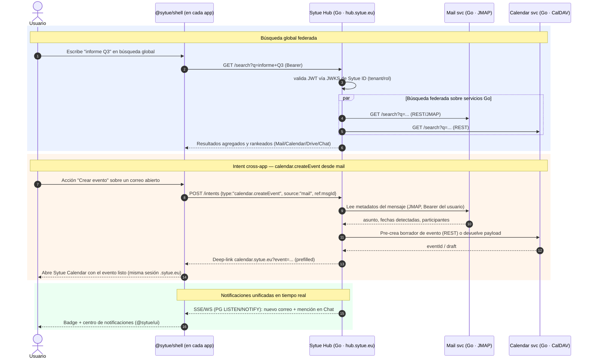

<a id="17-flujo-de-despliegue-del-paas-sytue-cloud"></a>

### 1.7 Flujo de despliegue del PaaS (Sytue Cloud)

`git push` → webhook → **build Kaniko** (Job rootless) → **Scaleway Registry** → deploy (Serverless
Containers o namespace Kapsule) → URL con **TLS automático** (cert-manager / Let's Encrypt).
Previews por PR, promoción a prod y rollback. Todo el control plane es **Go**; el estado vive en
**PostgreSQL** y los artefactos (logs de build, backups) en **S3**. Los builds NO tienen caché
de capas todavía: ver la nota bajo el diagrama.

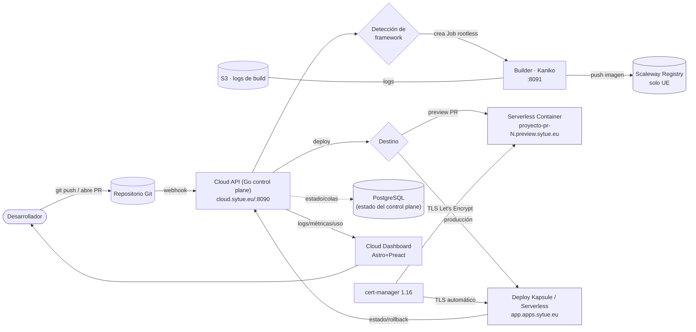

> **Sin caché de capas (estado real).** Cada build se hace desde cero. No es un olvido:
> la fase que ejecuta el código del usuario (los scripts de los buildpacks, o Kaniko con
> `--no-push`) corre **sin credencial de registry** a propósito, para que ese código no
> pueda exfiltrarla — el push lo hace un contenedor aparte que sí la tiene. Una caché
> remota exigiría que esa fase pudiera leer y escribir la imagen de caché, es decir,
> darle una credencial. La salida es una credencial ACOTADA solo a la imagen de caché del
> tenant, que depende del IAM del registry (infraestructura). Ver `PENDIENTES.md`.
> Mientras tanto, el coste se paga en `build_minutes`, que se factura al cliente.

#### 7.1 Servicios gestionados (Sytue Postgres / PostgREST / Storage / Functions / Cron)

Crear un servicio inyecta automáticamente sus credenciales en los deployments del proyecto
(estilo Vercel/Supabase). Todo sobre **PostgreSQL** y **S3**, en UE.

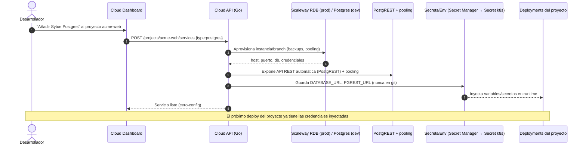

<a id="18-modelo-multi-tenant"></a>

### 1.8 Modelo multi-tenant

`Organización (tenant) → Workspace → Usuarios`. Cada tenant se proyecta de forma consistente:
**grupo `org/<slug>` en Sytue ID ⇄ namespace `tenant-<slug>` en Kapsule ⇄ datos por tenant en
PostgreSQL (esquema/RLS) ⇄ prefijos S3 dedicados**. No hay motores: el aislamiento por tenant lo
imponen Sytue ID (claims), las **RLS de PostgreSQL** y los prefijos S3.

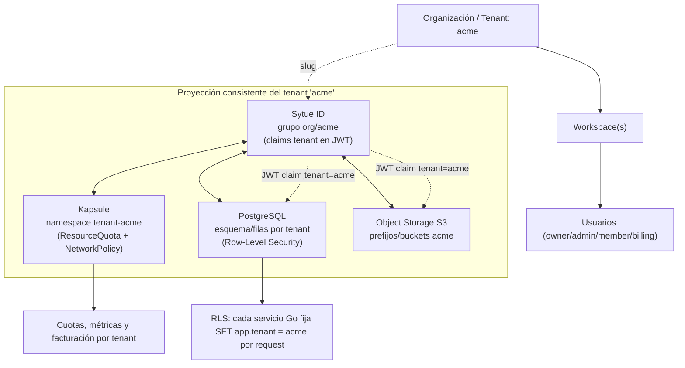

<a id="19-topologia-en-scaleway-prodbase"></a>

### 1.9 Topología en Scaleway (PROD/BASE)

Región principal `fr-par` (zonas `fr-par-1/2/3`), DR `nl-ams`. **Solo regiones UE.** Aprovisionado
con Terraform (módulos `network`, `kapsule`, `database`, `object-storage`, `registry`, `dns`,
`secrets`, `loadbalancer`, `livekit`) y desplegado con el umbrella chart Helm `sytue-one` (solo
servicios Go + LiveKit + Traefik). **Sin Valkey/Redis. Sin charts de motores AGPL.**

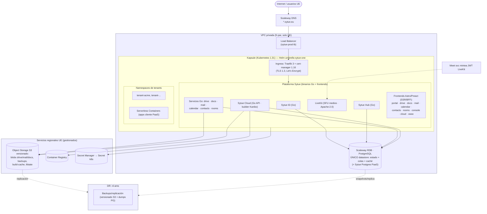

<a id="19a-workers-ci-y-sfu-de-rooms-separados"></a>

#### 1.9a Workers de CI y SFU de Rooms separados

Los medios WebRTC y la ejecución de CI son cargas incompatibles: un build de
contenedor agota disco, CPU y memoria de forma transitoria; el SFU necesita
latencia y jitter predecibles. Por eso son dos instancias distintas en
`fr-par-1`:

| Función               | Instancia           | Capacidad                               | Responsabilidad                                                                 |
| --------------------- | ------------------- | --------------------------------------- | ------------------------------------------------------------------------------- |
| Medios de Sytue Rooms | `sytue-rooms-sfu`   | No ejecuta CI                           | Transporte WebRTC de Rooms; no recibe runners ni cachés de build.               |
| Worker de CI          | `sytue-rooms-media` | 6 vCPU ARM64, 24 GiB RAM, raíz de 72 GB | Tres daemons Forgejo Runner, todos con etiqueta `docker`, capacidad 1 cada uno. |

Los tres runners comparten host por eficiencia, pero no estado: cada uno tiene
directorio de trabajo, fichero de registro, token y unidad systemd propios. Su
capacidad individual es **1**, de modo que una sola ejecución no puede tomar
tres jobs pesados; el paralelismo máximo del host es tres. El runner anterior del
SFU está deshabilitado: los jobs de CI no vuelven a competir con los medios.

Los secretos de registro viven exclusivamente en ficheros de modo `0640`,
propiedad `root:sytue-runner`, fuera del repositorio y fuera de los workspaces.
El acceso administrativo al worker usa una clave SSH ED25519 dedicada, no
contraseñas. El socket Docker real queda para la orquestación y limpieza interna
del daemon; los jobs montan exclusivamente el puente Unix del proxy de API con
lista explícita de operaciones. El runner permite solo esa ruta y la impone una
vez; el proxy conserva la lista de operaciones. El detalle operativo está en
`.github/RUNNERS.md`.

<a id="110-dev-local-compose-vs-prod-scaleway-helm--paridad"></a>

### 1.10 Dev local (Compose) vs Prod Scaleway (Helm) — paridad

Misma arquitectura lógica (dominios, clients OIDC, variables); cambian endpoints y escala. DEV se
levanta con un solo comando (`make dev-up`) bajo `*.sytue.localhost` con TLS mkcert. **No hay
Valkey/Redis ni motores AGPL en ningún entorno.**

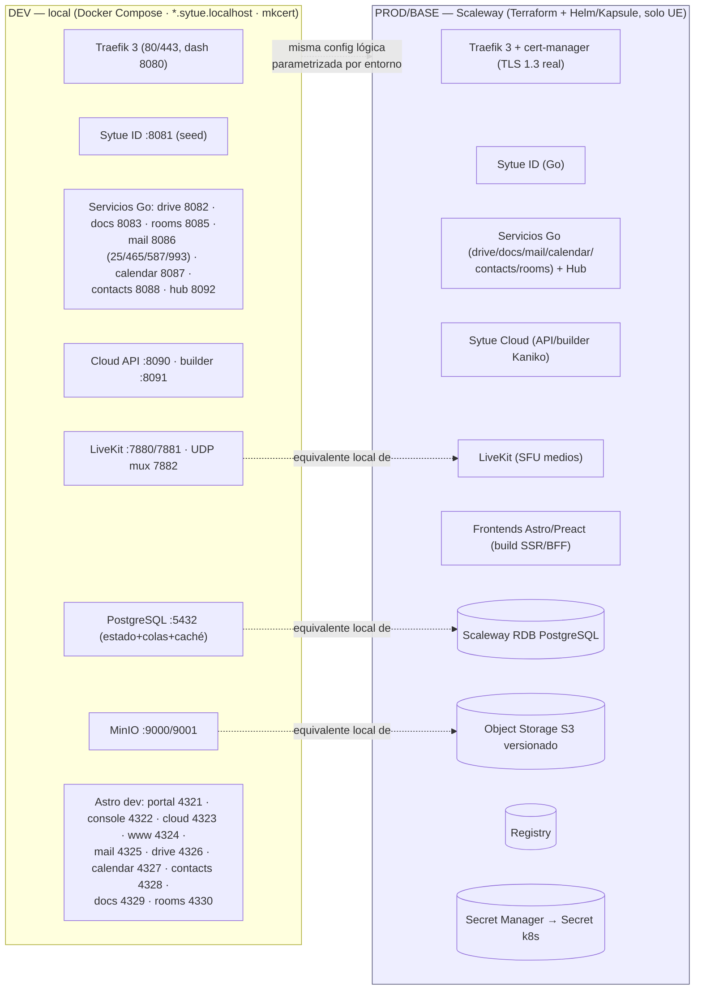

<a id="111-decisiones-de-arquitectura-transversales"></a>

### 1.11 Decisiones de arquitectura transversales

- **Stack único Go + Astro/Preact + PostgreSQL.** Backend 100 % Go (módulo `git.sytue.eu/sytue/one`,
  un binario por servicio, capas `internal/{http,domain,store}`, `pgx`+`sqlc`, `chi`, `slog`,
  migraciones `goose`/`golang-migrate`, Dockerfile multi-stage `golang:1.23` → `distroless/static`).
  PostgreSQL como único datastore (estado + colas con `riverqueue`/`pgmq`/LISTEN-NOTIFY + caché).
  **Sin Redis/Valkey.**
- **Sytue-native, clean-room, propietario.** Cada producto es obra original de Sytue (© Sytue)
  sobre estándares abiertos y librerías permisivas (MIT/BSD/Apache); **prohibido** copiar/portar
  código AGPL. Sin motores de terceros (Keycloak/Nextcloud/OnlyOffice/Mattermost/Stalwart fuera).
- **Sytue ID nuclear.** Servicio Go propio (OIDC/PKCE, JWKS, SCIM, MFA/WebAuthn). Cada servicio
  valida los JWT vía JWKS; sin introspección a motores externos. Un alta = acceso a toda la suite.
- **LiveKit, única app de terceros en el runtime de cliente.** Solo SFU de medios WebRTC de Meet
  (Apache-2.0). El BFF/servicio Meet mintea el JWT de LiveKit tras validar OIDC; la lógica de salas
  es propia.
- **Diseño primero.** Toda superficie monta `@sytue/shell` y usa `@sytue/ui`. Cero UI ad-hoc.
  **Toda configuración es guiada** (estilo Apple/Vercel/DigitalOcean, nunca Google Cloud/AWS):
  primitivas obligatorias `Wizard`/`SettingsShell`/`FieldHint`/`ReviewSummary`/`ChoiceCard` de
  `@sytue/ui` — ver [`design.md#2-sistema-de-diseno` §8](./design.md#2-sistema-de-diseno).
- **Una sola puerta de salida a terceros.** Todo el egress hacia SaaS de clientes pasa por
  `services/integrations`, que es la **única fábrica** de cliente HTTP de egress (SSRF-safe +
  rate-limit + auditoría + DLP + inyección de auth). Ningún driver ve un token: la seguridad es
  estructural, no una convención. Ver [`architecture.md#4-integration-gateway-saliente`](./architecture.md#4-integration-gateway-saliente).
- **Compatibilidad por servicio, no por pasarela.** La emulación de APIs de terceros
  (Slack/Teams hoy; OIDC-issuer, WOPI y Graph/Google como plan) vive en `internal/compat/` del
  servicio dueño del dato, porque traduce a **su** dominio y **su** autorización. La traducción
  es pura y nunca decide destino ni autorización. Ver [`architecture.md#5-capa-de-compatibilidad-entrante`](./architecture.md#5-capa-de-compatibilidad-entrante).
- **Multi-tenant por RLS.** Aislamiento con grupo `org/<slug>` en Sytue ID ⇄ namespace
  `tenant-<slug>` ⇄ RLS de PostgreSQL ⇄ prefijos S3.
- **Soberanía 100 % UE.** Solo regiones UE de Scaleway; secretos en Secret Manager,
  nunca en git; cifrado en reposo y TLS 1.3 en tránsito.
- **Paridad dev/prod.** Compose (local) ⇄ Helm/Kapsule (Scaleway), misma config lógica.

> Referencias relacionadas: [`docs/CONVENTIONS.md`](./CONVENTIONS.md),
> [`docs/security.md#1-seguridad-y-rgpd`](./security.md#1-seguridad-y-rgpd),
> [`docs/CONVENTIONS.md#16-naming-dominios-y-dns-anexo-normativo`](./CONVENTIONS.md#16-naming-dominios-y-dns-anexo-normativo),
> [`docs/design.md#2-sistema-de-diseno`](./design.md#2-sistema-de-diseno), [`docs/architecture.md#2-integracion-seamless-shell--hub`](./architecture.md#2-integracion-seamless-shell--hub),
> [`docs/architecture.md#4-integration-gateway-saliente`](./architecture.md#4-integration-gateway-saliente),
> [`docs/architecture.md#5-capa-de-compatibilidad-entrante`](./architecture.md#5-capa-de-compatibilidad-entrante),
> [`docs/architecture.md#6-identidad-enterprise-y-cumplimiento`](./architecture.md#6-identidad-enterprise-y-cumplimiento),
> [`docs/security.md#5-licencias-propiedad-y-cumplimiento`](./security.md#5-licencias-propiedad-y-cumplimiento), [`docs/security.md#4-politica-de-reimplementacion-clean-room`](./security.md#4-politica-de-reimplementacion-clean-room).

---

<a id="2-integracion-seamless-shell--hub"></a>

## 2. Integración seamless (Shell + Hub)

> Diseño de la experiencia unificada (estilo Google Workspace) para toda la suite **Sytue One**.
> Tres piezas sostienen la integración: **Sytue ID** (IdP propio en Go, nuclear), **Sytue Shell**
> (`@sytue/shell`, capa de UI común montada en cada app) y **Sytue Hub** (servicio Go,
> `hub.sytue.eu`, backend de integración). Fuente de verdad de nombres/dominios/puertos/versiones:
> [`docs/CONVENTIONS.md`](./CONVENTIONS.md) (**v4 "Sytue Native"**).
>
> **Alcance: integración INTERNA de la suite.** La integración con software de **terceros**
> tiene sus propios documentos:
> [`architecture.md#4-integration-gateway-saliente`](./architecture.md#4-integration-gateway-saliente) (saliente: conectar el SaaS que el
> cliente ya usa) y [`architecture.md#5-capa-de-compatibilidad-entrante`](./architecture.md#5-capa-de-compatibilidad-entrante) (entrante: que las
> integraciones escritas para Slack/Teams/Google/Microsoft funcionen contra Sytue sin cambios).

<a id="20-objetivo"></a>

### 2.0 Objetivo

Que Mail, Drive, Calendar, Contacts, Docs, Chat, Meet, Cloud y Console **se sientan como una
sola aplicación**: un único login, una topbar común, un conmutador de apps, una búsqueda que
cruza todos los productos, un centro de notificaciones unificado, presencia compartida y
**acciones cruzadas** (adjuntar de Drive en Mail, crear evento desde un correo, compartir en
Chat). La identidad y la autorización **nunca** se duplican: todo cuelga de **Sytue ID**.

**Sin motores de terceros.** En v4 no hay Nextcloud, Stalwart, Mattermost ni OnlyOffice: cada
producto es un **servicio Go propio** (clean-room sobre estándares abiertos). El Hub federa sobre
**los servicios Go**, no sobre motores. Única app de terceros en el runtime de cliente:
**LiveKit** (Apache-2.0), SFU de medios de _Sytue Rooms_. **Sin Redis/Valkey:** todo el estado
(presencia, suscripciones, colas)
vive en **PostgreSQL** (`LISTEN/NOTIFY`, tablas).

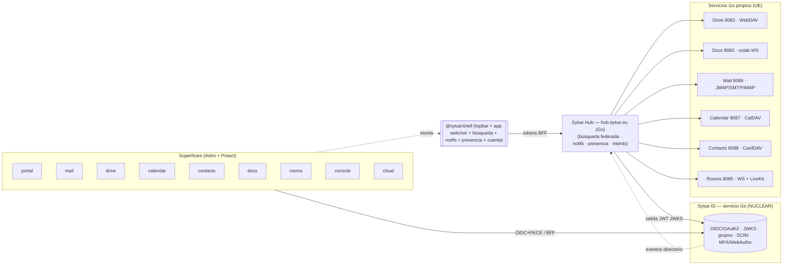

---

<a id="21-el-idp-es-la-pieza-nuclear-sytue-id--servicio-go"></a>

### 2.1 El IdP es la pieza nuclear (Sytue ID — servicio Go)

**Sytue ID** (`id.sytue.eu`, puerto dev `8081`) es un **servicio Go propio** que implementa
**OIDC/OAuth2** (Authorization Code + PKCE, refresh, **JWKS**, discovery), **SAML** (opcional),
**SCIM** y **MFA/WebAuthn**, sobre librerías Apache-2.0 (`ory/fosite` / `zitadel/oidc`). Estado en
**PostgreSQL**. Es la **columna vertebral**: ningún producto gestiona credenciales propias; cada
servicio Go **valida los JWT de Sytue ID vía JWKS** (middleware `authn` de `platform/pkg`).

#### 1.1 SSO y tokens (OIDC + PKCE + BFF)

Cada superficie tiene un **client OIDC confidencial** (BFF, endpoints Astro) — ver §8 de
CONVENTIONS: `sytue-one`, `sytue-console`, `sytue-cloud` (+ `sytue-cloud-api`), `sytue-mail`,
`sytue-drive`, `sytue-calendar`, `sytue-contacts`, `sytue-docs`, `sytue-rooms`,
`sytue-hub`. El flujo:

1. El navegador llega a `<app>.sytue.eu`; el BFF de Astro inicia **Authorization Code + PKCE**
   contra Sytue ID (`@sytue/auth`).
2. Sytue ID autentica (tema `sytue`, es_ES; **MFA/WebAuthn obligatorio para `admin`/`owner`**).
3. El BFF intercambia el `code` por tokens (`access` + `refresh` + `id`), **nunca expuestos al
   cliente**: se guardan server-side y se emite una **cookie host-only `__Host-`**, httpOnly.
4. Saltar de `mail.` a `drive.` **no re-pide credenciales**: la sesión host-only de Sytue ID ya
   está establecida (silent re-auth) y cada BFF crea su propia sesión, sin compartir cookies con
   publicaciones de usuario.

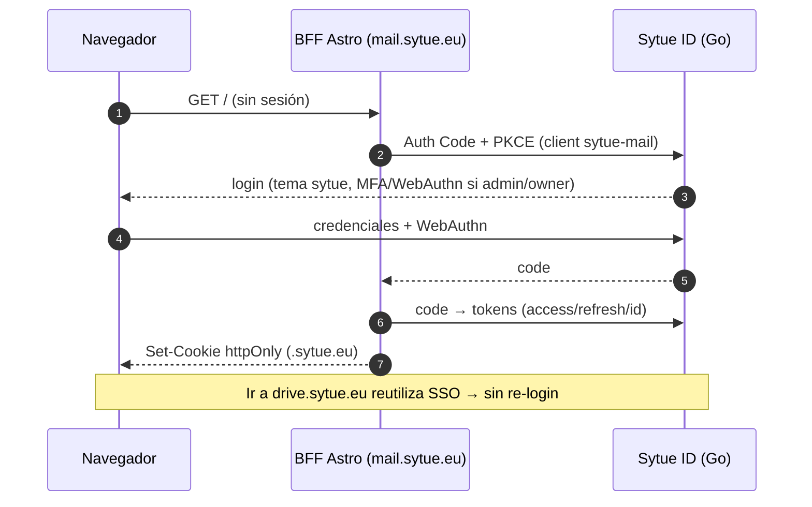

#### 1.1.1 «Mi cuenta» — self-service del usuario (`/account`)

Panel server-rendered del propio IdP (sin framework ni build de frontend), con una tarjeta por
área. Lo enlaza el menú de cuenta de la Shell.

| Tarjeta               | Qué permite                                                                | Notas                                                                                                                          |
| --------------------- | -------------------------------------------------------------------------- | ------------------------------------------------------------------------------------------------------------------------------ |
| **Perfil**            | Nombre, apellidos, **puesto**, **departamento**, **ubicación**, **idioma** | Puesto/departamento alimentan las reglas de **grupos dinámicos** (mig 0021): editarlos puede cambiar a qué grupos se pertenece |
| **Tu cuenta**         | Correo, organizaciones (por nombre), sesión actual, alta                   | Solo lectura                                                                                                                   |
| **Seguridad**         | Contraseña y TOTP + códigos de recuperación                                | —                                                                                                                              |
| **Claves de acceso**  | Alta y baja de **passkeys** desde el navegador                             | Única parte con JS: `navigator.credentials.create()` no tiene equivalente en HTML                                              |
| **Sesiones activas**  | Dispositivo, **IP**, método y caducidad; cerrar una o todas las demás      | —                                                                                                                              |
| **Accesos recientes** | Sesiones ya terminadas con su IP, distinguiendo cerradas de caducadas      | Últimas 50; el registro permanente es la auditoría                                                                             |

| **Accesos recientes** con **ubicación** | País y ciudad aproximados de cada IP | Opcional: se resuelve contra `geoip_networks` (mig 0037); tabla vacía ⇒ no se muestra |

**Idiomas.** El IdP se sirve en los cinco idiomas de producto con un catálogo en
Go (`services/id/internal/i18n`), no con una librería: es un binario sin build de
frontend, no puede consumir el i18n de Astro, y las alternativas traen ficheros
que cargar en runtime y una dependencia más para un conjunto de cadenas que cabe
en un fichero. La negociación es la misma que en el resto de la plataforma
—cookie `sytue_locale` > `Accept-Language` > inglés— y un test comprueba que
ninguna clave se queda sin traducir.

Decisiones que conviene no deshacer:

- **`SetProfile` enumera columnas** en vez de reutilizar `UpdateUser`, que reescribe el registro
  entero. Por esa vía un formulario de perfil serviría para verificarse el correo o reactivar una
  cuenta suspendida: esas columnas simplemente no aparecen en el SQL del self-service.
- **Alta de passkey por dos vías, un solo handler.** `/api/v1/me/webauthn/*` (Bearer) y
  `/account/passkeys/*` (cookie) comparten código; la vía cookie exige `Origin` permitido. Duplicar
  la verificación de attestation era la alternativa.
- **No se quita la última passkey** si es el único segundo factor: dejaría `mfa_enabled` sin nada
  detrás y la siguiente app que exija MFA daría un paso imposible.
- **El idioma se propaga** a la suite por la cookie `sytue_locale` (compartida y legible por JS, a
  diferencia de la de sesión, que es host-only `__Host-`). Es una preferencia, no una credencial.
- **El idioma llega explícito** a cada plantilla en lugar de sacarlo de la petición al
  pintar: así el `lang` del documento y el texto no acaban en idiomas distintos, que es lo
  que rompe a un lector de pantalla. Y el mensaje de error del acceso por passkey viaja en un
  `data-` del HTML, no dentro del script, porque el sha256 del script entra en la CSP y un
  texto por idioma serían cinco hashes que mantener.
- **La ubicación se resuelve en PostgreSQL**, no con una librería GeoIP ni con un servicio
  externo: ninguna IP de usuario sale de nuestra infraestructura. Una sola consulta por lista,
  no una por fila. Ver `deploy/geoip/` para la carga y la atribución CC BY que exige la fuente.
- **La CSP no lleva `unsafe-inline`:** cada hoja y cada script van en su propio bloque y su sha256
  se calcula en runtime de la misma constante que se sirve (`cspStyleHashes`/`cspScriptHashes`).
  Añadir una hoja obliga a listarla ahí, o el navegador sirve la página sin estilos.

#### 1.2 Autorización, grupos y tenancy

- **Grupos** `org/<slug>` por organización (tenant); **roles** `owner`, `admin`, `member`,
  `billing`. Estos claims viajan en el `access_token` y los consumen tanto las apps (vía BFF)
  como el Hub y cada servicio Go.
- Mapeo de grupos a recursos: **namespaces** Kapsule `tenant-<slug>`, **esquema/filas por tenant
  en PostgreSQL con RLS**, prefijos/buckets S3. Cada servicio Go aplica RLS y autoriza por rol.
- El Hub usa el `access_token` del usuario para acotar **toda** búsqueda y acción al tenant y
  roles del solicitante (sin escaladas cruzadas entre organizaciones).

#### 1.3 Aprovisionamiento (un alta = toda la suite)

Sytue ID es la **fuente de identidad**. Un alta **no** se "proyecta" a motores (ya no existen):
gracias a los **claims de tenant/rol** del token, una cuenta nueva tiene **acceso inmediato** a
todos los servicios Go. Detalles:

- **Provisión "lazy" por servicio:** en la primera petición autenticada, cada servicio Go
  crea/resuelve (idempotente) el registro local del usuario dentro de su esquema de tenant, a
  partir de los claims del JWT.
- **Eventos de directorio:** altas/bajas/cambios de grupo se publican como **eventos** que
  **Sytue Hub** consume y reenvía a los servicios que requieren acción proactiva (p. ej. crear el
  buzón en **Sytue Mail**). Transporte interno por PostgreSQL (`events`) y SCIM 2.0 para
  directorios externos del cliente. Detalle en §4.3.
- **Baja inmediata:** desactivación/borrado en Sytue ID → revocación de refresh/sesiones; los
  `access_token` de vida corta expiran solos y los servicios consultan estado/introspección para
  revocación inmediata (ver `docs/security.md#1-seguridad-y-rgpd` §4.4).

---

<a id="22-sytue-shell-sytueshell--la-capa-de-ui-comun"></a>

### 2.2 Sytue Shell (`@sytue/shell`) — la capa de UI común

La Shell es el paquete Preact que **se monta en CADA app** (portal, console, cloud-dashboard,
mail, drive, calendar, contacts, docs, rooms, www). Garantiza que el cromo (chrome) sea
idéntico en toda la suite — estética **Sytue** con componentes de `@sytue/ui`. Las apps **no**
crean variantes del cromo.

Composición de la Shell:

| Pieza                        | Función                                                                | Origen de datos                        |
| ---------------------------- | ---------------------------------------------------------------------- | -------------------------------------- |
| **TopBar**                   | Barra superior global: logo Sytue, contexto de app, controles globales | `@sytue/ui` (`TopBar`)                 |
| **App Switcher**             | Grid de **9 puntos** que lanza a cualquier producto de la suite        | catálogo estático + permisos del token |
| **Búsqueda global**          | Input + panel de resultados federados, agrupados por producto          | `GET hub/search`                       |
| **Centro de notificaciones** | Bandeja unificada (Mail/Chat/Calendar/Drive/Cloud) en tiempo real      | `hub/notifications` (SSE/WS)           |
| **Presencia**                | Estado del usuario y de contactos (online/ausente/ocupado)             | `hub/presence` (WS)                    |
| **Menú de cuenta**           | Perfil, organización activa, tema claro/oscuro, cerrar sesión          | `@sytue/auth` + cuenta Sytue ID        |

```tsx
// apps/frontend/apps/mail/src/layouts/AppLayout.astro  (patrón idéntico en toda app)
---
import { SytueShell } from "@sytue/shell";
import { requireSession } from "@sytue/auth/server"; // resuelve la cookie host-only en el BFF
const session = await requireSession(Astro);        // redirige a OIDC si no hay sesión
// Con `roles:`/`perms:`, quien no pasa recibe un 403 que es una PÁGINA (identidad
// Graphite & Brass, idioma negociado y enlace al portal), no un texto plano: la
// pinta el propio guard, así que cubre de una vez las 25 páginas protegidas.
---
<html lang="es" data-theme={session.prefs.theme}>
  <body>
    <SytueShell
      client:load
      app="mail"                          {/* marca la celda activa del app switcher */}
      user={session.profile}              {/* nombre/avatar/org del id_token */}
      tenant={session.activeTenant}        {/* org/<slug> activo */}
      hubBaseUrl="/_hub"                   {/* el BFF proxya a hub.sytue.eu con el token */}
    />
    <main><slot /></main>
  </body>
</html>
```

> El cliente **nunca** habla directo con `hub.sytue.eu`: la Shell llama a `/_hub/*` del BFF de
> la propia app, que adjunta el `access_token` (server-side) y reenvía al Hub. Así no hay
> tokens en el navegador y se respeta la cookie httpOnly.

#### 2.1 App Switcher (grid 9 puntos)

Catálogo canónico (orden y subdominios fijados en CONVENTIONS §1). La Shell **filtra** las
celdas según los grupos/roles del usuario (p. ej. Console solo para `admin`/`owner`).

| 1 Portal (`one.`)            | 2 Mail (`mail.`)             | 3 Drive (`drive.`)   |
| ---------------------------- | ---------------------------- | -------------------- |
| **4 Calendar** (`calendar.`) | **5 Contacts** (`contacts.`) | **6 Docs** (`docs.`) |
| **7 Rooms** (`rooms.`)       | **8 Cloud** (`cloud.`)       | **9 Hub** (`hub.`)   |

> Console (`console.`) aparece como entrada adicional bajo el menú de cuenta para roles admin.

---

<a id="23-sytue-hub-hubsytueeu--backend-de-integracion-go"></a>

### 2.3 Sytue Hub (`hub.sytue.eu`) — backend de integración (Go)

Servicio **Go propio** (módulo `git.sytue.eu/sytue/one`, `services/hub`, puerto dev **8092**;
router `chi`, `pgx`/`sqlc`, `slog`). **Autoriza toda petición validando el JWT de Sytue ID** vía
**JWKS** (middleware `authn` de `platform/pkg`) y acota por tenant + roles. No duplica datos de
negocio: orquesta los **servicios Go** y mantiene estado efímero (presencia, suscripciones) en
**PostgreSQL** (tablas + `LISTEN/NOTIFY`) — **sin Redis/Valkey**.

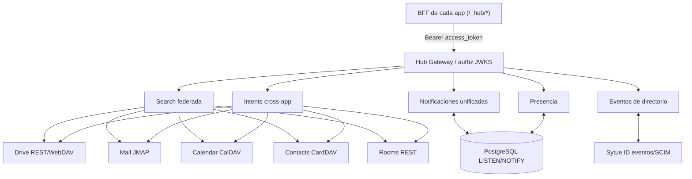

#### 3.1 Búsqueda federada

`GET /search?q=<texto>&scope=all|mail|drive|docs|calendar|contacts|chat&limit=N`

El Hub abre consultas **en paralelo** a cada servicio Go con el contexto del usuario (token
propagado o token de servicio acotado por tenant), normaliza a un esquema común y devuelve
resultados agrupados por producto con un `deeplink` a la app destino.

- **Drive** → Sytue Drive (API REST / WebDAV `SEARCH`).
- **Mail** → Sytue Mail (JMAP `Email/query`).
- **Docs** → Sytue Docs (API REST de búsqueda documental).
- **Calendar** → Sytue Calendar (CalDAV `calendar-query`).
- **Contacts** → Sytue Contacts (CardDAV `addressbook-query`).
- **Chat** → Sytue Rooms (API REST de búsqueda de mensajes/usuarios).

```jsonc
// Respuesta normalizada (extracto)
{
  "query": "informe Q2",
  "groups": [
    {
      "product": "drive",
      "items": [
        {
          "id": "f_8821",
          "title": "Informe Q2.xlsx",
          "snippet": "…ventas Q2…",
          "icon": "spreadsheet",
          "deeplink": "https://drive.sytue.eu/f/8821",
        },
      ],
    },
    {
      "product": "mail",
      "items": [
        {
          "id": "m_4410",
          "title": "RE: Informe Q2",
          "snippet": "adjunto el informe…",
          "deeplink": "https://mail.sytue.eu/message/4410",
        },
      ],
    },
  ],
}
```

#### 3.2 Notificaciones unificadas (SSE / WebSocket)

Canal **único** por usuario: el BFF abre `GET /notifications/stream` (SSE) o `WS /notifications`.
El Hub se suscribe a los eventos de cada servicio Go (WS de Chat, push JMAP de Mail, hooks de
Drive/Docs/Calendar, eventos de Cloud) y los **multiplexa por PostgreSQL `LISTEN/NOTIFY`** hacia
el cliente, con un esquema común. La Shell pinta la bandeja y el badge de no-leídos.

```jsonc
{
  "type": "notification",
  "product": "chat",
  "title": "Ana en #lanzamiento",
  "body": "¿Revisamos el informe?",
  "ts": "2026-06-30T10:12:00Z",
  "deeplink": "https://rooms.sytue.eu/...",
  "unread": true,
}
```

#### 3.3 Presencia

WebSocket `WS /presence`. El Hub agrega presencia de Sytue Rooms y heartbeats de la Shell,
guarda el último estado en **PostgreSQL** (tabla con TTL lógico + limpieza periódica) y difunde
cambios por `LISTEN/NOTIFY` a los suscriptores que comparten tenant. Estados:
`online` · `away` · `dnd` · `offline`.

#### 3.4 Intents cross-app

API de **acciones cruzadas** que conecta productos sin que el usuario salga de su flujo. La
Shell expone los intents disponibles según contexto; cada intent se resuelve server-side contra
los servicios Go con el token del usuario.

| Intent                 | Origen → Destino  | Efecto                                                   |
| ---------------------- | ----------------- | -------------------------------------------------------- |
| `drive.attachToMail`   | Drive → Mail      | Adjunta archivo (o enlace de compartición) a un borrador |
| `mail.createEvent`     | Mail → Calendar   | Crea evento desde un correo (asistentes = remitentes)    |
| `*.shareToChat`        | cualquiera → Chat | Comparte enlace/recurso en un canal o DM                 |
| `mail.saveToDrive`     | Mail → Drive      | Guarda adjuntos en una carpeta de Drive                  |
| `contacts.composeMail` | Contacts → Mail   | Abre borrador dirigido a un contacto                     |
| `calendar.startMeet`   | Calendar → Meet   | Crea/abre una reunión para el evento                     |

`POST /intents/<name>` con payload tipado; respuesta incluye `deeplink` para que la Shell
redirija a la app destino con el resultado ya creado.

#### 3.5 Eventos de directorio (un alta = toda la suite)

Endpoint/consumidor interno de **eventos de Sytue ID** (alta/baja/cambios de grupo) y **SCIM 2.0**
para directorios externos del cliente. El Hub reenvía a los servicios Go que requieren acción
proactiva (p. ej. crear buzón en Mail). Transporte interno por PostgreSQL (`events`); accesible
solo desde la red interna/mTLS, nunca expuesto a Internet (ver §1.3 y §4.3).

---

<a id="24-diagramas-de-secuencia-de-intents"></a>

### 2.4 Diagramas de secuencia de intents

> Esta sección detalla **dos intents** cross-app (los más representativos) con su secuencia
> completa sobre los servicios Go. El resto de intents de §3.4 siguen el mismo patrón
> (Shell → BFF `/_hub/*` → Hub → servicios Go → `deeplink`).

#### 4.1 Intent A — Adjuntar de Drive en Mail (`drive.attachToMail`)

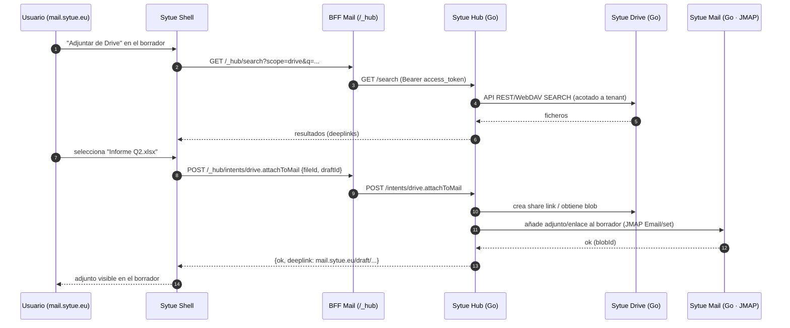

#### 4.2 Intent B — Crear evento desde un correo (`mail.createEvent`)

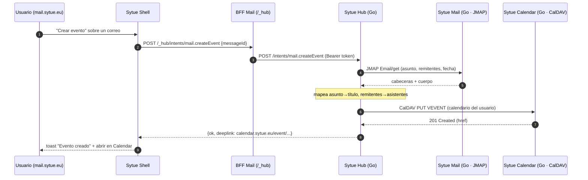

> Aprovisionamiento (alta en Sytue ID → toda la suite) y el resto de intents se describen como
> patrón en §1.3 y §3.4; no son "intents de usuario" sino flujo de directorio/eventos.

---

<a id="25-como-cada-app-monta-la-shell-y-consume-el-hub"></a>

### 2.5 Cómo cada app monta la Shell y consume el Hub

Patrón único para **todas** las superficies (sin excepciones de UI ad-hoc):

1. **Auth/BFF.** La app usa `@sytue/auth`: `requireSession()` en el layout resuelve la cookie
   httpOnly `.sytue.eu`; si no hay sesión, inicia OIDC+PKCE con su client (`sytue-<app>`). Los
   tokens viven **solo** en el servidor.
2. **Shell.** El layout monta `<SytueShell app="<app>" .../>` de `@sytue/shell`, que aporta
   topbar, app switcher (9 puntos), búsqueda global, notificaciones, presencia y cuenta — todo
   con componentes y tokens de `@sytue/ui` (estética Sytue, claro/oscuro, WCAG AA).
3. **Proxy del Hub.** La app expone endpoints BFF `/_hub/*` (Astro) que **adjuntan el
   `access_token`** y reenvían a `hub.sytue.eu`. La Shell y la app consumen el Hub **solo** por
   ahí (búsqueda, notifs stream, presencia WS, intents).
4. **Datos del servicio propio.** Para su dominio, la app usa los SDK de `@sytue/api-clients`
   (SDKs a los **servicios Go**: id/drive/docs/mail/calendar/contacts/rooms/hub/cloud +
   LiveKit web SDK para Meet) — también vía BFF.

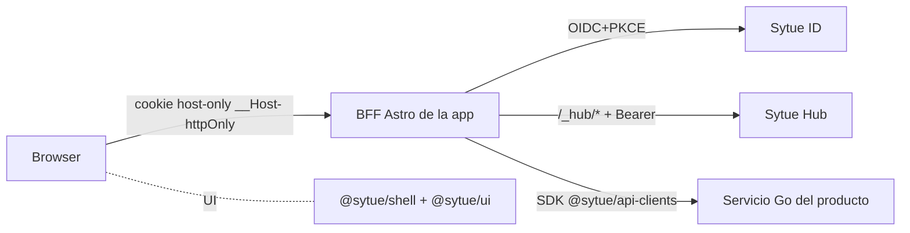

| App                    | Client OIDC                         | Servicio Go propio (vía `@sytue/api-clients`)             | Consumo del Hub                                                                           |
| ---------------------- | ----------------------------------- | --------------------------------------------------------- | ----------------------------------------------------------------------------------------- |
| portal (`one.`)        | `sytue-one`                         | —                                                         | search, notifs, presencia, switcher                                                       |
| mail (`mail.`)         | `sytue-mail`                        | Sytue Mail (JMAP/SMTP/IMAP)                               | search + intents (attachFromDrive, createEvent, saveToDrive, shareToChat)                 |
| drive (`drive.`)       | `sytue-drive`                       | Sytue Drive (REST/WebDAV)                                 | search + intents (attachToMail, shareToChat)                                              |
| calendar (`calendar.`) | `sytue-calendar`                    | Sytue Calendar (CalDAV)                                   | search + intents (startMeet)                                                              |
| contacts (`contacts.`) | `sytue-contacts`                    | Sytue Contacts (CardDAV)                                  | search + intents (composeMail)                                                            |
| notes (`notes.`)       | `sytue-notes`                       | Sytue Notepads (REST propio)                              | search (solo lo que su dueño deja en el índice) + referencia cruzada con Calendar y Rooms |
| docs (`docs.`)         | `sytue-docs`                        | Sytue Docs (editor propio + colab WS)                     | search + intents (shareToChat)                                                            |
| rooms (`rooms.`)       | `sytue-rooms`                       | Sytue Rooms (WS/REST + señalización; LiveKit para medios) | search + presencia + notifs + intents (shareToChat, startMeet)                            |
| console (`console.`)   | `sytue-console`                     | Sytue ID Admin/SCIM + Hub                                 | gestión SCIM/tenants, auditoría                                                           |
| cloud (`cloud.`)       | `sytue-cloud` (+ `sytue-cloud-api`) | Sytue Cloud (control plane + PostgREST)                   | notifs de deploys                                                                         |

> **Nota de paridad dev/prod:** en dev (`*.sytue.localhost`, TLS mkcert) los endpoints apuntan
> a los puertos de Compose (Sytue ID `8081`, Hub `8092`, Drive `8082`, Docs `8083`, Chat `8085`,
> Mail `8086`, Calendar `8087`, Contacts `8088`, Rooms `8085`, PostgreSQL `5432`, etc.); en prod a
> los subdominios `*.sytue.eu`. Cambian los endpoints, no la arquitectura. **Sin puertos de
> Redis/Valkey** (estado en PostgreSQL).

---

<a id="26-seguridad-de-la-integracion"></a>

### 2.6 Seguridad de la integración

- **Sin tokens en el cliente.** Solo cookies host-only `__Host-` httpOnly; los `access_token` viven en
  el BFF. El Hub valida cada llamada contra Sytue ID (**JWKS**, client `sytue-hub`).
- **Acotado por tenant + rol** en cada respuesta del Hub (sin fuga entre organizaciones); cada
  servicio Go aplica además **RLS en PostgreSQL** por tenant.
- **Eventos de directorio / SCIM** en red interna/mTLS; nunca expuestos a Internet.
- **100% UE:** Hub y servicios Go en Scaleway (regiones UE). Estado efímero (presencia,
  suscripciones) en **PostgreSQL UE** — sin Redis/Valkey.
- **Auditoría** de búsquedas, intents y eventos (Hub + Sytue ID + servicios), conforme a
  `docs/security.md#1-seguridad-y-rgpd`.

> Referencias cruzadas: identidad §8 y tenancy §9 de CONVENTIONS; design system en
> `docs/design.md#2-sistema-de-diseno`; arquitectura en `docs/architecture.md`; seguridad/RGPD en
> `docs/security.md#1-seguridad-y-rgpd`.

---

<a id="3-sytue-cloud-paas"></a>

## 3. Sytue DevX (PaaS)

> Documento de producto y arquitectura de **Sytue Cloud**, el PaaS de la suite Sytue One.
> Fuente de verdad: [`docs/CONVENTIONS.md`](./CONVENTIONS.md) (§1, §9, §14, §15). Cualquier
> nombre, dominio, puerto, versión o licencia debe coincidir con el contrato canónico.
>
> - **Subdominio del panel:** `cloud.sytue.eu` · **API:** client OIDC `sytue-cloud` (+ `sytue-cloud-api`)
> - **Frontend:** Astro + Preact (app `cloud-dashboard`), monta `@sytue/shell` y usa `@sytue/ui`
> - **Backend:** servicio Go propio (`services/cloud/`: `api/`, `builder/`, `controller/`) + PostgREST
> - **Licencia código propio:** propietaria (© Sytue, SPDX `MIT`) · **Soberanía:** 100 % UE sobre Scaleway (solo regiones UE)

<a id="31-que-es-sytue-cloud"></a>

### 3.1 Qué es Sytue DevX

Sytue Cloud es un **PaaS soberano** que combina lo mejor de tres referencias, pero **más
simple e intuitivo que Google Cloud**:

- La **inmediatez de Vercel** para desplegar: conectar un repositorio, build automático,
  preview por cada PR, promover a producción y rollback — con dominios y TLS automáticos.
- Los **servicios gestionados de Supabase**: una base de datos Postgres con API REST
  instantánea, explorador/editor visual, almacenamiento de objetos, cache, funciones, cron
  y autenticación gestionada.
- La **amplitud de Google Cloud** pero **sin su complejidad**: pocas pantallas, lenguaje
  claro, cero-config por defecto, sin jerga cloud (nada de IAM bindings, VPC peerings ni
  service accounts que el usuario tenga que entender para empezar).

**Principio rector:** _el camino feliz no necesita configuración._ Un desarrollador conecta
su repo y, en minutos, tiene una app en producción con su base de datos conectada. La
plataforma toma decisiones sensatas por defecto y solo expone configuración cuando hace falta.

Todo el motor es **FOSS y reside íntegramente en la UE** (Scaleway, regiones `fr-par`/`nl-ams`).
No hay proveedores US ni transferencias de datos personales fuera de la UE.

<a id="32-modelo-conceptual"></a>

### 3.2 Modelo conceptual

```
Organización (tenant)  →  Proyecto  →  { Deployments, Servicios gestionados, Dominios }
```

- **Organización (tenant):** unidad de facturación y aislamiento. Mapea 1:1 con el grupo
  de **Sytue ID** `org/<slug>` y el namespace Kapsule `tenant-<slug>` (ver §9 del contrato).
- **Proyecto:** la unidad de trabajo central (DX _project-centric_ estilo Vercel). Agrupa
  un repositorio, sus deployments (prod + previews), los servicios gestionados que consume
  y los dominios asociados. Casi toda la UI gira en torno al proyecto.
- **Deployment:** una versión construida y desplegada del proyecto (de un commit/rama).
  Puede ser **producción** (`<app>.apps.sytue.eu`) o **preview** (`<proyecto>-pr-<n>.preview.sytue.eu`).
- **Servicio gestionado:** Postgres, Storage, Cache/Queue, Functions, Cron, Auth — provisionado
  con un clic y **conectado automáticamente** a los deployments del proyecto (ver §5).

#### Roles y autorización

Los roles vienen del IdP nuclear (**Sytue ID**, servicio Go): `owner`, `admin`, `member`,
`billing`. Sytue Cloud no gestiona credenciales propias; toda autenticación es OIDC+PKCE
contra Sytue ID a través del BFF (`@sytue/auth`). El acceso a un proyecto se deriva de la
pertenencia al grupo `org/<tenant>` y del rol.

<a id="33-developer-experience-el-flujo-de-deploy-estilo-vercel"></a>

### 3.3 Developer Experience: el flujo de deploy (estilo Vercel)

El ciclo completo, **sin configuración obligatoria**:

1. **Conectar repositorio.** Se conecta un repo Git (auto-alojado o de un proveedor con
   licencia libre). Sytue Cloud registra un webhook para reaccionar a `push` y a la apertura
   de PRs.
2. **Detección de framework.** Al primer build, el `builder` inspecciona el repo y detecta el
   framework (Astro, Next/Node, Vite/SPA estática, contenedor con `Dockerfile`, etc.) e infiere
   los comandos de build, el directorio de salida y el runtime. Todo es **sobreescribible**
   pero rara vez hace falta.
3. **Build automático con Kaniko.** Cada push dispara un build reproducible y **rootless** con
   **Kaniko** (Job de Kubernetes en Kapsule, sin demonio Docker). La imagen resultante se
   publica en **Scaleway Container Registry** (UE). Cache de build en bucket S3 (`build-cache`).
4. **Preview por PR.** Cada PR genera un deployment de preview aislado en
   `https://<proyecto>-pr-<n>.preview.sytue.eu`, con su propia URL y TLS automático. El estado
   del build/preview se reporta de vuelta al PR.
5. **Promover a producción.** Al fusionar (o con un botón **Promote** en el panel) el
   deployment pasa a producción en `https://<app>.apps.sytue.eu`. La promoción es **atómica**:
   el tráfico cambia de golpe a la nueva versión.
6. **Rollback instantáneo.** Cada deployment de producción anterior queda inmutable y listo;
   un clic en **Rollback** reactiva una versión previa sin reconstruir (cambio de routing).
7. **Dominios + TLS automáticos.** Las URLs `.apps.sytue.eu` y `.preview.sytue.eu` funcionan
   sin configurar nada. Para un **dominio propio**, el usuario apunta un `CNAME` a
   `ingress.sytue.eu`; la plataforma emite y renueva el certificado automáticamente
   (cert-manager 1.16 + Traefik 3, TLS 1.3).

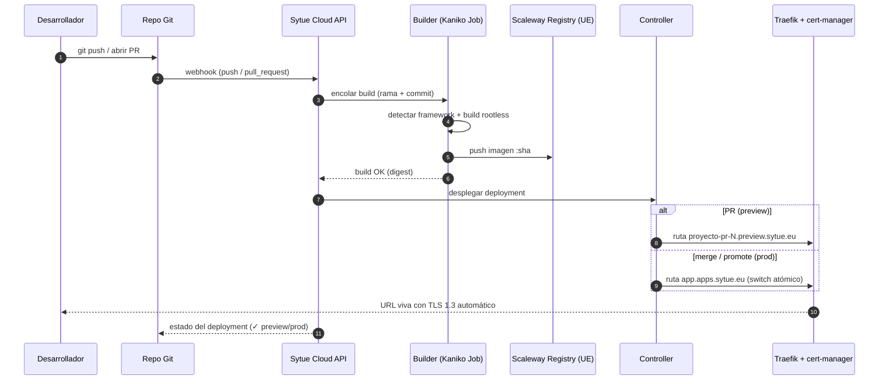

#### Plantillas de proyecto

El catálogo de plantillas (`GET /api/v1/templates`, pantalla **Plantillas** del panel) es la
puerta de entrada de quien todavía no tiene un proyecto. Persigue la sensación de un
«1-Click» de DigitalOcean, pero **no comparte su implementación**: un 1-Click de DO es una
imagen de máquina virtual, y aquí no hay máquinas que arrancar. Una plantilla de Sytue Cloud
es un **manifiesto JSON declarativo** embebido en el binario
(`services/cloud/internal/domain/templates/*.json`), no una imagen de disco ni un repositorio
que clonemos y afirmemos desplegable.

El catálogo es **global y de solo lectura**, igual que los tamaños de instancia o el
tarifario: vive en ficheros embebidos, no en una tabla. Añadir una plantilla es añadir un
fichero — sin migración, sin CRUD, sin RLS.

**Invariante de seguridad — una plantilla NO puede expresar configuración de pod.** El
esquema es una lista _blanca_ cerrada y se decodifica con `DisallowUnknownFields`, así que
`securityContext`, `hostNetwork`, `capabilities`, `volumes`, `nodeSelector` o `command` no se
filtran con una lista negra —que habría que ampliar cada vez que Kubernetes añade un campo—
sino por no estar en la lista. El PodSpec lo sigue escribiendo el controlador. «Seguro por
defecto» es así el **suelo estructural**: ninguna plantilla puede bajarlo, ni por error ni a
propósito. Un manifiesto inválido revienta el arranque en vez de degradar en silencio.

Cada variable de entorno declara **de dónde sale su valor**, y ahí está la promesa de
producto:

| `origin`       | Quién aporta el valor                                                                                                                    |
| -------------- | ---------------------------------------------------------------------------------------------------------------------------------------- |
| `value`        | Literal del manifiesto. **Nunca puede ser secreto**: vive en el repositorio en claro para siempre (es un error de carga declararlo así). |
| `ask`          | Lo pide el asistente. Idealmente cero o uno por plantilla: cada pregunta es un paso más entre el usuario y su app.                       |
| `generate`     | **Secreto aleatorio que genera la plataforma** y se guarda cifrado. `secret` se fuerza a verdadero al parsear: el fichero no vota.       |
| `from_service` | Lo inyecta el controlador desde el servicio gestionado (§3.5). Solo se declara.                                                          |

Es decir: **el usuario nunca inventa una contraseña**. Es a la vez lo más fácil (no hay nada
que teclear) y lo más seguro (no hay contraseña humana que adivinar ni reutilizar).

La **licencia es obligatoria** y se valida contra una allowlist permisiva (MIT, Apache-2.0,
BSD-2/3-Clause, ISC, MPL-2.0). Eso convierte «nada de AGPL ni source-available» en un gate
mecánico del test de carga, y no en una revisión humana que se olvida.

> **Pendiente:** el alta atómica (`POST /api/v1/projects:from-template`) todavía no está. Hoy
> crear proyecto + servicios + variables son varias peticiones no transaccionales, así que un
> fallo a mitad deja el proyecto a medias.

<a id="34-catalogo-de-servicios-gestionados"></a>

### 3.4 Catálogo de servicios gestionados

Todos los servicios son **FOSS** y se ejecutan **en la UE**. En **dev** tienen equivalente
local en Docker Compose (paridad dev/prod, §15 del contrato); en **prod** usan servicios
gestionados de Scaleway donde aplica.

| Servicio              | Qué hace                                                         | Motor (prod / dev)                                   | Notas                                                                               |
| --------------------- | ---------------------------------------------------------------- | ---------------------------------------------------- | ----------------------------------------------------------------------------------- |
| **Sytue Postgres**    | Base de datos relacional con **API REST automática**             | Postgres 18 — Scaleway RDB (prod) / contenedor (dev) | PostgREST (roles `authenticator`/`web_anon`), pooling PgBouncer, backups, branching |
| **Sytue DB Studio**   | Explorador de tablas, editor SQL y generador de API/credenciales | Sobre la instancia Postgres del proyecto             | Estilo Supabase **con diseño Sytue**, embebido en el panel                          |
| **Sytue Storage**     | Buckets de objetos S3 por proyecto                               | Object Storage (prod) / MinIO (dev)                  | Versionado, cifrado en reposo, URLs firmadas                                        |
| **Sytue Cache/Queue** | Cache y colas en memoria                                         | **Valkey 7** (BSD; reemplaza Redis)                  | Inyecta `VALKEY_URL`                                                                |
| **Sytue Functions**   | Serverless (handlers HTTP/eventos)                               | Runtime propio sobre contenedores                    | Mismo pipeline Kaniko                                                               |
| **Sytue Cron**        | Tareas programadas                                               | Controller (CronJobs Kapsule)                        | Dispara Functions o endpoints                                                       |
| **Secrets/Env**       | Variables y secretos por proyecto/entorno                        | Scaleway Secret Manager → Secret de Kubernetes       | **Nunca en git**; cifrados en reposo                                                |
| **Auth gestionada**   | Autenticación para apps de cliente (opcional)                    | **Sytue ID** (servicio Go; realm por proyecto)       | Coherente con el IdP nuclear                                                        |

#### 4.1 Sytue Postgres (+ PostgREST)

El servicio estrella, estilo Supabase. Al crearlo el usuario obtiene:

- **Una base de datos Postgres 18 gestionada** (Scaleway RDB en prod, contenedor en dev),
  cifrada en reposo y solo accesible desde la red del tenant.
- **API REST automática vía PostgREST:** cada tabla/vista se expone como endpoint REST sin
  escribir backend. Las credenciales y la URL de la API se inyectan en el proyecto.
  PostgREST **nunca** entra como dueño de la base: conecta con un rol propio
  (`authenticator`, LOGIN NOINHERIT y sin privilegios) y resuelve las peticiones **sin JWT**
  a `web_anon` (NOLOGIN, con `USAGE` sobre `public` y nada más). Es decir, **por defecto no se
  publica nada**: lo que deba ser legible sin autenticar lo concede el cliente
  explícitamente (`GRANT SELECT … TO web_anon`). Antes el rol anónimo era el dueño de la base,
  así que la ruta sin token tenía CRUD completo y el JWT no defendía nada.
- **Pooling con PgBouncer** delante de la instancia, para soportar muchas conexiones cortas
  (típico de serverless/Functions) sin agotar la base.
- **Backups** automáticos (dumps a bucket S3 aparte, versionado) y restauración puntual.
- **Branching de datos:** crear una copia de la base para una rama/PR, de modo que un preview
  trabaje contra datos aislados sin tocar producción.

#### 4.2 Sytue DB Studio

Explorador y editor visual **embebido en el dashboard** (no es una app aparte): vista de
tablas con edición de filas, editor SQL con historial, diseñador de esquema, y un
**generador de API/credenciales** que muestra los endpoints PostgREST y las claves para
consumir la base desde la app. Mismo lenguaje visual Sytue (`@sytue/ui`, 100% Sytue-native),
modo claro/oscuro y accesibilidad WCAG AA.

#### 4.3 Resto de servicios

- **Sytue Storage** — buckets S3 por proyecto (Object Storage UE en prod, MinIO en dev),
  con versionado y cifrado en reposo; expone endpoint S3-compatible y claves de acceso.
- **Sytue Cache/Queue** — Valkey 7 gestionado para cache y colas ligeras.
- **Sytue Functions** — funciones serverless que comparten el pipeline de build (Kaniko) y se
  enrutan por la plataforma; ideales para webhooks, jobs cortos y APIs ligeras.
- **Sytue Cron** — tareas programadas que invocan Functions o endpoints del proyecto.
- **Secrets/Env** — gestión de variables de entorno y secretos por proyecto y por entorno
  (producción vs. preview), respaldada por Scaleway Secret Manager. Los
  secretos **nunca** se almacenan en git ni se muestran tras crearlos.
- **Auth gestionada** — opcional para las apps de cliente: respaldada por **Sytue ID** (servicio
  Go propio; un realm por proyecto), el mismo IdP nuclear de la suite. Da login/registro a la app
  del cliente sin que el desarrollador monte su propio sistema de identidad.

<a id="35-conexion-cero-friccion-inyeccion-de-credenciales"></a>

### 3.5 Conexión cero-fricción (inyección de credenciales)

El diferencial estilo Vercel/Supabase: **crear un servicio lo conecta automáticamente** a los
deployments del proyecto. No hay que copiar cadenas de conexión a mano.

- Al provisionar **Sytue Postgres**, la plataforma inyecta variables como `DATABASE_URL`,
  `POSTGREST_URL` y las claves de API en el entorno de cada deployment del proyecto (prod y
  previews), gestionadas como secretos.
- Lo mismo con **Storage** (`S3_ENDPOINT`, `S3_BUCKET`, claves), **Cache/Queue** (`VALKEY_URL`)
  y **Auth** (issuer/cliente OIDC).
- Las credenciales viven como **Secrets/Env** del proyecto (Secret Manager → Secret de Kubernetes),
  se rotan desde el panel y **nunca** se exponen en el cliente ni se guardan en git.
- Los **previews** reciben, si procede, credenciales hacia recursos aislados (p. ej. una rama
  de datos de Postgres) para no contaminar producción.

**Y de ahí sale el SDK.** `@sytue/cloud`
([`packages/cloud`](../apps/frontend/packages/cloud/README.md)) no se configura: LEE ese entorno.
Por eso su primera línea útil es la primera línea —`sytue.table('posts').all()`— sin URL que
copiar del panel ni clave que pegar en un `.env`. Ese paso es donde abandona quien está
empezando, y de paso la forma más habitual de que una credencial acabe en un commit; aquí no
existe. Encima de PostgREST, pero sin mencionarlo: los verbos son `add`, `update`, `remove`,
`find`, `all`. `update` y `remove` **exigen el identificador de la fila**, así que no hay forma de
vaciar una tabla por accidente. Y los errores traducen el SQLSTATE a un siguiente paso («no existe
la tabla «postss», revisa el nombre o créala…»), en los cinco idiomas —el mensaje ES la función,
y en un idioma que no entiendes deja de existir—.

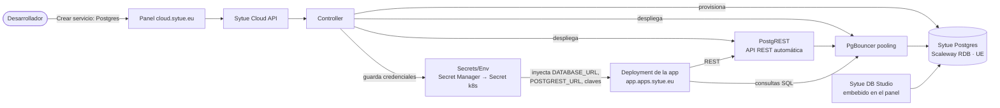

#### Coste óptimo: medir de verdad antes de aconsejar

La promesa es que el cliente **siempre pague lo mínimo con el rendimiento óptimo**, y que lo
resuelva con un clic. Para que eso no sea un adorno hacía falta cerrar un hueco de origen: el
medidor de facturación registra `réplicas × memoria CONFIGURADA × horas`, es decir, **cobra por
lo que se pidió, no por lo que se gasta**, así que no existía ni un dato de utilización real con
el que recomendar nada.

- **El sensor** (`internal/controller/rightsizing.go`) muestrea `metrics.k8s.io` cada 15 min y
  guarda un máximo por proyecto y cubo en `resource_samples`. Entre réplicas se queda con el
  **máximo, no la media**: el límite de memoria se aplica por pod, así que promediar escondería
  justo el pod que está a punto de morir por OOM. Sin `metrics-server` es un no-op: las
  recomendaciones se quedan, con razón, en «sin datos suficientes».
- **El criterio** (`internal/domain/rightsizing.go`) es una función **pura**, y por eso su
  política se puede probar de verdad. Tres reglas la gobiernan:
  1. **Sin datos suficientes no hay recomendación** — un estado explícito, nunca una tibia.
  2. **Bajar exige mucha más evidencia que subir.** Subir se propone con 6 h de observación
     porque protege el servicio; bajar pide tres días, porque equivocarse cuesta una caída.
  3. **Percentil 95 para el régimen y MÁXIMO para el riesgo.** El p95 ignora por definición el
     5 % más alto, así que una app con una sola ráfaga parecería caber holgada en un tamaño
     menor — y se caería al primer pico. Bajar exige además que el pico observado quepa.
- **No hay endpoint de «aplicar»**: aplicar la recomendación es `PATCH /projects/{id}`, que ya
  valida, audita y respeta la cuota. El «1 clic» vive en la interfaz, no en un verbo nuevo de la
  API que pudiera saltarse alguna de las tres.

Cuando el régimen cabría pero el pico no, se dice con un motivo propio (`peak_blocks_downgrade`)
en vez de callarlo: la diferencia entre «no puedes ahorrar» y «no puedes ahorrar **por esto**» es
lo que el cliente necesita para decidir.

**Los primeros días, el hueco lo cubren las apps comparables.** Exigir tres días de histórico
propio deja sin consejo justo la ventana en la que el cliente eligió tamaño a ciegas y casi
siempre se pasó. `internal/domain/benchmark.go` agrega el consumo por **cohorte** —framework +
servicios + tamaño— y lo publica en `sizing_benchmarks`, una tabla **sin columna `tenant`** porque
ninguna fila pertenece a nadie: cada una resume **5 empresas distintas como mínimo**, contadas por
inquilino y no por proyecto (con proyectos, a un solo cliente le bastaría con crear cinco para
«anonimizarse» a sí mismo).

El umbral se aplica **al publicar y no al consultar** —una cohorte que no llega no se escribe, así
que el camino de lectura no puede filtrarla mal— y está replicado como `CHECK (tenants >= 5)` en
la migración `0029` a propósito: bajarlo obliga a tocar las dos mitades. Solo se publican
porcentajes sobre el límite del tamaño, nunca cifras absolutas. Cada recálculo **reemplaza la
tabla entera**: una cohorte que hoy reúne cuatro empresas desaparece, mientras que con `upsert`
seguiría publicada para siempre con las cifras del día en que sí llegó al umbral.

Sobre la recomendación, la cohorte tiene dos límites duros: **el histórico propio siempre gana**
(solo rellena `insufficient_data`) y **nunca propone subir ni baja más de un escalón** —subir por
el consumo de terceros es cobrarle más a alguien de quien no sabemos nada, y saltar dos tamaños
con cero datos propios es una apuesta—. La razón que llega a la pantalla es
`cohort_over_provisioned`, distinta de `over_provisioned` para que la interfaz no pueda decir
«hemos medido tu app» cuando lo medido son las de otros; el texto nombra cuántas empresas hay
detrás. Ver [ADR 0028](./decisions.md#0028).

<a id="36-pantallas-del-dashboard-cloudsytueeu"></a>

### 3.6 Pantallas del dashboard (`cloud.sytue.eu`)

Diseño Sytue, moderno y 100% native: **sidebar izquierdo** + **topbar** (`@sytue/shell`: app
switcher de 9 puntos, búsqueda global, notificaciones, presencia, cuenta) + área de contenido.
Pocas pantallas, acciones evidentes, lenguaje claro.

- **Overview del proyecto** — estado del último deployment de producción, URL en vivo,
  actividad reciente, atajos a logs y a los servicios conectados.
- **Deployments** — lista de deployments (prod + previews) con commit, rama, estado y
  duración del build; acciones **Promote** y **Rollback**; enlace al PR de origen.
- **Servicios** — catálogo (Postgres, Storage, Cache/Queue, Functions, Cron, Auth) y los
  servicios ya creados, con su estado y un botón de **crear** que provisiona e inyecta
  credenciales sin más pasos.
- **DB Studio** — explorador de tablas, editor SQL y generador de API (sección embebida del
  servicio Sytue Postgres).
- **Storage** — navegador de buckets/objetos del proyecto.
- **Logs** — logs de build y de runtime por deployment, en streaming, con filtros.
- **Settings / Env** — variables de entorno y secretos por entorno (prod vs. preview),
  framework y comandos de build, dominios propios.
- **Alta de proyecto: crear el repositorio** — la vía para quien todavía no tiene ninguno.
  Cloud le crea uno en **Sytue Git** copiando el esqueleto del stack —un repositorio
  PLANTILLA de la forja, declarado en `starter_repo`, no un árbol de ficheros dentro del
  binario— y aplica encima la plantilla de ajustes con `ApplyTemplate`. La credencial es una
  aplicación **OAuth2 registrada en la forja**, no un token de administrador: lo que Cloud
  puede hacer es exactamente lo que ese usuario consiente, y él lo revoca desde su cuenta. El
  token se usa para crear el repositorio y **se descarta** —ni tabla, ni cifrado en reposo, ni
  refresco—. La intención viaja por la caché efímera y el `state` es un identificador opaco:
  autocontenido lo escribiría el navegador, y con él se elegiría el tenant.
- **Alta de proyecto: repositorio existente** — pegar la URL del repositorio basta: el control-plane lo MIRA por la
  API de su forja (`GET /inspect-repo` → `builder.InspectRepo`) y deduce framework, estrategia,
  comandos y directorio de salida, que es lo que el formulario preguntaba y está escrito en el
  repo. Se enseña la prueba —«Astro, por `astro.config.mjs`»— y un botón para ponerlo a mano:
  acertar el 95 % de las veces deja atrapado al 5 % si no hay forma de cambiarlo. Nunca falla el
  alta: forja desconocida, repositorio privado o servidor caído devuelven `detected:false` y se
  pregunta como antes. La petición sale hacia un host que escribe el usuario, así que va acotada
  por dos puertas independientes —allowlist de forjas y guardián de SSRF—.
- **Dominios** — añadir dominio propio con instrucciones de `CNAME` → `ingress.sytue.eu`,
  verificación y estado del certificado TLS.
- **Observabilidad simple** — uso, métricas y consumo por proyecto, en lenguaje claro, sin
  jerga cloud, base para la facturación por tenant.
- **Apps** — catálogo de productos open-source que se levantan JUNTO a la del cliente (caché,
  buscador, cola, CMS) con **selección múltiple**: se eligen varios y arrancan juntos. Se conectan
  en dos direcciones y ninguna la cablea el usuario: `exports` declara qué variables recibe la APP
  DEL CLIENTE (`VALKEY_URL`, `MEILI_URL`…) e `integrations` qué recibe una app del catálogo de OTRA
  cuando conviven en el proyecto, con la URL de la documentación oficial que lo respalda
  ([ADR 0032](./decisions.md#0032)). Funciona en cualquier orden: dar de alta o borrar una app
  **reencola** las que se integran con ella, porque un servicio `ready` no se reconcilia solo.
  El cliente **elige del catálogo; no escribe una imagen** ([ADR 0029](./decisions.md#0029)): digest
  fijado, registro de la UE, licencia comprobada y límites obligatorios. Entran permisivas y
  copyleft fuerte —la imagen corre sin modificar, y el digest idéntico al del origen lo demuestra—,
  con el enlace al fuente obligatorio; nunca «source available». Se despliegan bajo PodSecurity
  `restricted` —sin privilegios, raíz de solo lectura, UID no-root del manifiesto—, y **publicarlas
  en internet lo decide el catálogo** (`web_port`), no el cliente: un CMS tiene su hostname con TLS,
  el panel de administración de una cola no lo tiene y no hay casilla que marcar.
- **Analítica** — visitas de la app, activables con un clic y **sin tocar el código**. Es una
  sección de este panel y no una app aparte ([ADR 0026](./decisions.md#0026)): activar es dar de
  alta el hostname, porque la ruta `/_sytue` ya la publica el control-plane en el Ingress del
  proyecto. La etiqueta `<script>` la inyecta la propia build en todo el HTML que Sytue Cloud
  construye (`builder.analyticsInjectStep`, frameworks astro/static/node), así que está siempre; el
  interruptor es el colector, que devuelve **404 en `/_sytue/s.js`** mientras el hostname no esté
  dado de alta. Al revés —inyectar solo cuando está activa— convertiría «activar la analítica» en
  «reconstruir y redesplegar». Con imagen propia (Dockerfile o Go) el HTML no pasa por nuestras
  manos y el panel ofrece la línea para pegarla. Solo se puede reclamar
  un host **propio** —la URL de producción o un dominio **verificado**—, y la comprobación exige
  control-plane vivo: el host es único global en Analytics, así que quien lo registra primero deja
  al dueño real sin poder medirlo. La cifra de visitantes se enseña siempre etiquetada como **suma
  de únicos diarios**, que es lo que la arquitectura permite calcular.

<a id="37-principios-de-simplicidad"></a>

### 3.7 Principios de simplicidad

1. **Cero-config por defecto.** El camino feliz no pide configuración; la detección de
   framework y los valores sensatos cubren el caso común.
2. **Project-centric.** Casi todo se hace desde el proyecto; pocas pantallas, navegación plana.
3. **Lenguaje claro, sin jerga cloud.** "Conectar repo", "Promover", "Rollback", "Crear base de
   datos" — no IAM, VPC peering ni service accounts.
4. **Conexión automática.** Crear un servicio lo conecta solo; no hay copia manual de
   credenciales.
5. **Coherencia visual total.** Mismo design system que el resto de la suite (`@sytue/ui` +
   `@sytue/shell`), claro/oscuro y WCAG AA; nada de UI ad-hoc.
6. **Soberanía y seguridad por defecto.** Solo UE; TLS 1.3; cifrado en reposo; secretos en
   Secret Manager y se materializan directamente en Kubernetes, nunca en git.
7. **Paridad dev/prod.** Cada servicio gestionado tiene equivalente local (Postgres + PostgREST
   - MinIO + Valkey en Compose), de modo que lo que funciona en local funciona en Scaleway.

<a id="38-arquitectura-interna-resumen"></a>

### 3.8 Arquitectura interna (resumen)

`services/cloud/` (Go, propietario © Sytue):

- **`api/`** — API de control de la plataforma (proyectos, deployments, servicios, dominios,
  env/secretos). Autoriza con tokens de **Sytue ID** (clients `sytue-cloud` / `sytue-cloud-api`).
  Puerto dev `8090`.
- **`builder/`** — orquesta builds: recibe webhooks, detecta framework y lanza Jobs **Kaniko**
  (rootless) que publican imágenes en Scaleway Registry. Puerto dev `8091`.
- **`controller/`** — reconcilia el estado deseado en Kapsule: despliega contenidos
  (Serverless Containers o namespace del tenant), provisiona servicios gestionados, gestiona
  rutas de Traefik, TLS (cert-manager) y CronJobs.

Frontend: app `cloud-dashboard` (Astro + Preact) en `apps/frontend/apps/`, puerto dev
`4323`, montando `@sytue/shell` y `@sytue/ui`, con SSO OAuth y cookie host-only del BFF.

<a id="39-referencias"></a>

### 3.9 Referencias

- Contrato canónico: [`docs/CONVENTIONS.md`](./CONVENTIONS.md) (§1, §6, §9, §14, §15).
- Arquitectura general: `docs/architecture.md` · Seguridad/RGPD: `docs/security.md#1-seguridad-y-rgpd`.
- Diseño: `docs/design.md#2-sistema-de-diseno` · Integración: `docs/architecture.md#2-integracion-seamless-shell--hub`.

---

<a id="4-integration-gateway-saliente"></a>

## 4. Integration Gateway (saliente)

> **Qué es.** La **pasarela única** por la que Sytue habla con el software de terceros que
> la organización ya usa (Microsoft 365, Google Workspace, Salesforce, Jira, Odoo…):
> `services/integrations`, puerto dev **8093**, subdominio interno del mismo módulo Go
> `git.sytue.eu/sytue/one`. Es el lado **saliente** de la interoperabilidad; el lado
> **entrante** —que Sytue se haga pasar por Slack/Teams/Google/Microsoft para que las
> integraciones ya escritas funcionen sin cambios— vive en
> [`architecture.md#5-capa-de-compatibilidad-entrante`](./architecture.md#5-capa-de-compatibilidad-entrante).
>
> **No confundir con** [`architecture.md#2-integracion-seamless-shell--hub`](./architecture.md#2-integracion-seamless-shell--hub), que describe la integración
> _interna_ de la suite (shell común, SSO, búsqueda federada, intents cross-app). Este doc
> es el SoT de la integración con **terceros**.
>
> Nombres, puertos y versiones: [`CONVENTIONS.md`](./CONVENTIONS.md) (§6 registra el puerto
> 8093).

---

<a id="40-objetivo-y-modelo-de-negocio-byo-saas"></a>

### 4.0 Objetivo y modelo de negocio (BYO-SaaS)

Una organización que adopta Sytue **no tira** el resto de su parque de SaaS. El gateway
existe para que Sytue sea el **centro** de ese parque en vez de una isla más:

- **Un alta en Sytue ID = acceso a todo**, también al SaaS de terceros (Sytue actúa de IdP
  saliente: SAML/OIDC).
- **BYO-SaaS** (_bring your own SaaS_): Sytue **no revende** la licencia de Salesforce ni de
  Microsoft 365. El cliente aporta su propia cuenta/tenant; Sytue aporta la **identidad, el
  aprovisionamiento, los datos, la incrustación y la gobernanza** sobre ella. El SaaS
  conectado aparece en la suite como **un producto Sytue más** (tile en el lanzador).
- **Una sola puerta de salida.** Ninguna otra parte de la suite llama a un tercero por su
  cuenta: si sale de Sytue hacia Internet en nombre de una organización, sale por aquí y
  queda auditado.

**Directiva de producto (permanente).** Toda superficie de configuración de esta pasarela
—como la del resto de la suite— se implementa con **UX guiada estilo Apple + Vercel +
DigitalOcean**: limpia, paso a paso, en lenguaje llano, para que un administrador básico
conecte una aplicación **sin leer documentación**. Nunca la densidad de Google Cloud/AWS ni
un «muro de formulario». Las primitivas obligatorias están en `@sytue/ui`; ver
[`design.md#2-sistema-de-diseno` §8](./design.md#2-sistema-de-diseno).

---

<a id="41-enforcement-central-por-construccion"></a>

### 4.1 Enforcement CENTRAL por construcción

La garantía de seguridad no es una convención («acuérdate de usar el cliente seguro») sino
una **imposibilidad estructural**: en `services/integrations` hay **una sola fábrica** de
`*http.Client` de egress —`policy.BuildRuntime` (`internal/policy/policy.go`)— y un driver
**solo** recibe el `Runtime` que ella construye. Un driver no puede fabricar el suyo porque
nunca ve credenciales con las que autenticarse.

Cada petición saliente atraviesa, en este orden, dentro de un único `http.RoundTripper`:

| #   | Etapa                   | Implementación                                                            | Qué garantiza                                                                                                                                                            |
| --- | ----------------------- | ------------------------------------------------------------------------- | ------------------------------------------------------------------------------------------------------------------------------------------------------------------------ |
| 1   | **SSRF-safe**           | `ssrfhttp.ValidateURL` + `ssrfhttp.Transport()` (`platform/pkg/ssrfhttp`) | Doble barrera: revalidación de la URL antes de conectar y _dial_ a IP ya validada. Jamás un host interno/link-local.                                                     |
| 2   | **Rate-limit**          | `httpx.RateLimiter`, clave `org:instance`                                 | Presupuesto de egress por instancia, compartido entre réplicas (estado en PostgreSQL). Excedido ⇒ `ErrRateLimited`.                                                      |
| 3   | **Auditoría**           | `egress_audit` vía `AuditSink`                                            | Una fila por petición: host, método, status, bytes, latencia. `Authorization` se persiste como `REDACTED`; **nunca** el token ni el cuerpo.                              |
| 4   | **Política / DLP (L5)** | `policy.Engine.Hook`                                                      | Evalúa `allow \| warn \| block` **antes** de conectar. Un `block` no llega a salir (y por eso no deja fila en `egress_audit`: su única evidencia es `policy_decisions`). |
| 5   | **Inyección de auth**   | clon de la petición + `Authorization: Bearer …` del vault                 | **El driver nunca ve el token.** La `Instance` que recibe lleva `Secrets` vacío.                                                                                         |

Además, el cliente resultante **no sigue redirects que cambien de host**: como la auth se
inyecta en cada salto, un redirect cross-host filtraría el Bearer. Máximo 5 saltos (config.),
cada uno revalidado contra SSRF. Timeout por petición 15 s por defecto.

> La auditoría es _best-effort_ y con contexto propio (5 s): la petición ya salió, romper la
> respuesta por un fallo de escritura no aporta. Escritura síncrona por egress — marcada en
> el código como techo conocido (batch/async si el volumen aprieta).

---

<a id="42-contrato-de-conector-capacidades-opcionales"></a>

### 4.2 Contrato de conector: capacidades opcionales

`internal/connector/connector.go` define la superficie mínima. Un driver implementa **solo
lo que su SaaS soporta**; el núcleo detecta el resto por _type assertion_ (mismo idiom que
`services/hub`). Nada monolítico, ninguna interfaz gigante con métodos que devuelven
«no soportado».

| Interfaz           | Obligatoria | Firma (resumen)                                          | Uso                                                                                                     |
| ------------------ | ----------- | -------------------------------------------------------- | ------------------------------------------------------------------------------------------------------- |
| `Driver`           | **Sí**      | `Kind() string`, `Test(ctx, inst, rt) error`             | Identidad del driver + verificación extremo a extremo de la conexión.                                   |
| `Provisioner`      | No          | `Sync(ctx, inst, rt) error`                              | Aprovisionamiento (L2). Lo implementa el driver SCIM saliente.                                          |
| `TabularSource`    | No          | `Query(ctx, inst, rt, spec) (Table, error)`              | Datos (L3) hacia Sytue Sheets. Mismo _shape_ `{columns, rows}` que `services/docs/internal/connectors`. |
| `EmbedBroker`      | No          | `EmbedToken(ctx, inst, rt, req) (Embed, error)`          | Incrustación (L4): mint server-side de un token de vida corta.                                          |
| `EventSink`        | No          | `HandleWebhook(ctx, inst, rt, body, headers) error`      | Webhooks entrantes del tercero, ya autenticados por el núcleo.                                          |
| `SearchCapability` | No          | `Search(ctx, inst, rt, q, limit) ([]ExternalHit, error)` | Búsqueda federada: resultados normalizados a `ExternalHit`.                                             |

El `Registry` indexa por `Kind` y admite **alias** de plantilla, porque el despacho real es
por `template_key` de la instancia y no siempre coincide con el `Kind` del driver que la
sirve (`jira-cloud → jira`, `microsoft365 → graph`, `google-workspace → gws`).

---

<a id="43-catalogo-declarativo-manifiesto--semillas"></a>

#### Autenticación hacia el SaaS: OAuth 2.0 preferente

**Política de producto: toda integración se autentica por OAuth 2.0 siempre que el SaaS lo
permita.** Un token estático no caduca, no se acota por scope, no se revoca sin regenerarlo
a mano y obliga al administrador a ir a fabricarlo al panel del tercero — lo contrario del
1-click que exige el §8 del [diseño](./design.md). Token estático o Basic solo cuando el
SaaS no ofrezca otra cosa, y diciéndolo.

Orden de preferencia al añadir o tocar un driver:

1. **authorization_code + refresh** (3LO) — cuando hay que actuar en nombre de la
   organización y el proveedor exige consentimiento;
2. **client_credentials** (2LO) — app-to-app;
3. **JWT bearer** (RFC 7523) — cuentas de servicio;
4. token estático — último recurso, justificado en el manifiesto.

Estado (2026-07-28): `graph` usa client_credentials contra Entra y `gws` JWT bearer con
delegación a nivel de dominio. `jira` y `servicenow` van con Basic, y `salesforce`,
`odata`, `odoo`, `databricks` y `powerbi` con un token que pega el administrador. Los
cinco últimos —salvo `odata`, que es un protocolo genérico contra servidores arbitrarios
del cliente— tienen OAuth disponible en su SaaS y son los candidatos naturales.

**`internal/oauth2` es el único sitio que mintea tokens.** Cachea por clave —organización,
instancia y, si el proveedor los distingue, sujeto delegado y scope— con margen de
renovación, y expone `Forget` para tirar un token revocado antes de tiempo. Antes cada
driver repetía el POST, el parseo y el tratamiento de error, y ninguno cacheaba: Microsoft
Graph pedía un token nuevo **en cada consulta**.

El canje **sale por `Runtime.HTTP`**, la única puerta de egress: pedir un token es tráfico
saliente hacia un tercero como cualquier otro, así que pasa por destino SSRF-safe,
rate-limit por organización, auditoría y política, en vez de abrir una puerta paralela. El
`client_secret` viaja en el cuerpo del formulario, que la auditoría no persiste.

#### Despacho POR CAPACIDAD, no por plantilla

El manifiesto nombra, para cada capacidad, el **Kind del driver** que la sirve:
`"provisioning": "scim"` y `"data": "jira"` no son etiquetas descriptivas — son claves del
registro. Una instancia usa **varios drivers a la vez**, cada uno con su credencial: Jira
aprovisiona por SCIM y consulta por JQL con tokens distintos.

Durante mucho tiempo los seis puntos de despacho resolvían el driver por `template_key`, así
que cada instancia solo podía tener uno. Lo que eso causaba, medido antes del arreglo:

- **El aprovisionamiento no funcionaba en NINGUNA plantilla** aunque 14 lo declaraban:
  `POST /instances/{id}/sync` devolvía 400 siempre. Peor: `Activate` encolaba el primer sync,
  que moría tras 8 reintentos en el outbox **en silencio**, mientras la interfaz prometía
  «altas y bajas automáticas».
- Las tres plantillas que sí resolvían (vía `Registry.Alias`) lo hacían al driver de **datos**,
  que no implementa `Provisioner`.
- `POST /instances/{id}/test` fallaba en las 12 plantillas sin driver homónimo.

Hoy `Manifest.DriverFor(capacidad)` resuelve cada una por separado y `Registry.Alias` ya no
existe: era el parche que ocultaba el defecto. El catálogo **no carga** si declara una
capacidad que nadie puede servir — `provisioning: "scim"` exige `scim_base_url` y `secret`—, y
un test recorre las 18 semillas contra el registro real del servicio.

`POST /test` prueba **cada capacidad** y devuelve un resultado por capacidad; una conexión
solo-SSO responde `200` con la lista vacía en vez del antiguo 400: no hay credencial saliente
que verificar, y el inicio de sesión lo prueba el propio SP/client creado en Sytue ID.

La cabecera `Authorization` que un driver ya haya fijado **gana** sobre el bearer del vault
(Jira y ServiceNow componen Basic). Antes se pisaba, así que en cuanto una instancia guardaba
un `bearer` para otra de sus capacidades, sus consultas devolvían 401.

### 4.3 Catálogo declarativo: manifiesto + semillas

Añadir un SaaS al catálogo es **añadir un fichero**, sin migración ni código:
`services/integrations/db/seeds/templates/<clave>.json`. El fichero lleva `key`, `tier` y un
`manifest` que `internal/manifest` **valida en el arranque** (una semilla mal escrita es un
error de arranque, no un catálogo silenciosamente roto).

Campos del manifiesto (`internal/manifest/schema.go`):

| Campo                             | Valores                    | Nota                                                                                                    |
| --------------------------------- | -------------------------- | ------------------------------------------------------------------------------------------------------- |
| `name`, `description`, `category` | texto                      | Presentación del tile «como producto Sytue».                                                            |
| `color`                           | `#hex` o `var(--token)`    | Acento del tile; se valida el formato.                                                                  |
| `icon`                            | **SVG inline**             | Curado en el repo. Nunca _hotlink_ a un tercero.                                                        |
| `identity.kind`                   | `saml` \| `oidc` \| `none` | SAML exige `entity_id` + `acs_url`; OIDC exige ≥1 `redirect_uri`.                                       |
| `provisioning`                    | `scim` \| `none`           | `scim` agenda el sync saliente al activar.                                                              |
| `data`                            | `Kind` del driver tabular  | `""` si la app no expone datos.                                                                         |
| `embed`                           | booleano                   | Reservado para `EmbedBroker`: hoy se valida, no se actúa.                                               |
| `launch.kind`                     | `initiate` \| `url`        | `initiate` = SSO SAML IdP-initiated (URL emitida por Sytue ID); `url` = plantilla directa.              |
| `fields`                          | **máximo 3**               | Un alta 1-click no pide un formulario largo: subdominio/host/instancia y poco más.                      |
| `secret`                          | `{label, help}`            | El **único** secreto write-only que aporta el admin; viaja aparte (`PUT /secrets`) y jamás se devuelve. |

Invariantes duras del esquema: `DisallowUnknownFields` (un campo desconocido es un error),
claves de campo `^[a-z][a-z0-9_]{0,30}$` (nunca colisionan con las claves internas del
gateway, prefijadas con `_`), y **toda plantilla `{campo}` de una URL debe referenciar un
campo declarado** — no se deja un placeholder sin resolver en una petición saliente.

---

<a id="44-los-cinco-niveles-de-integracion-l1l5"></a>

### 4.4 Los cinco niveles de integración (L1–L5)

| Nivel                      | Qué resuelve                                                                                                                                                                                                                                                                                     | Dónde vive                                                                                                                                                        | Estado        |
| -------------------------- | ------------------------------------------------------------------------------------------------------------------------------------------------------------------------------------------------------------------------------------------------------------------------------------------------ | ----------------------------------------------------------------------------------------------------------------------------------------------------------------- | ------------- |
| **L1 — SSO**               | Sytue ID como IdP saliente: **SAML 2.0 IdP** (`/saml/idp/metadata`, `/saml/idp/sso`, `/saml/idp/initiate/{spID}`, `/saml/idp/slo`), **clients OIDC por organización** y **Dynamic Client Registration RFC 7591** (`POST /oauth2/register` con _initial access token_ de 24 h, PKCE obligatorio). | `services/id` (`internal/saml/idp.go`, `internal/http/dcr.go`, mig `0017_outbound_identity`)                                                                      | **Entregado** |
| **L2 — Aprovisionamiento** | **SCIM 2.0 saliente** (RFC 7643/7644): crea/actualiza/desactiva usuarios y grupos _en_ el SaaS. Reconcile **idempotente por diff**, adopta recursos preexistentes por `userName eq` en vez de duplicarlos y **desactiva, nunca borra**.                                                          | `services/integrations/internal/scimout`, tablas `scim_map` + `sync_runs` (mig `0002_scim_out`)                                                                   | **Entregado** |
| **L3 — Datos**             | Los datos del SaaS entran en **Sytue Sheets** como origen tabular.                                                                                                                                                                                                                               | 9 drivers (§5) + `POST /instances/{id}/data/query`; consumo en `services/docs/internal/connectors/gateway.go` (`KindGateway`)                                     | **Entregado** |
| **L4 — Incrustación**      | Un informe de **Power BI** vive dentro de un documento de **Sytue Docs**, con token minteado **server-side** (app-owns-data), TTL corto, entregado por canal seguro (server→BFF→`postMessage`); nunca en query string ni persistido en el navegador.                                             | `internal/driver/powerbi/powerbi_embed.go`, `POST /instances/{id}/embed/token`; bloque de editor en `apps/frontend/packages/office/src/editor/canvas/embedDom.ts` | **Entregado** |
| **L5 — Gobernanza**        | Reglas de política/DLP evaluadas **dentro** del único RoundTripper + auditoría de egress + bitácora de decisiones + export.                                                                                                                                                                      | `internal/policy/engine.go`, tablas `policies` + `policy_decisions` (mig `0003_governance`)                                                                       | **Entregado** |

#### 4.1 Alcance honesto de la DLP (L5)

Las reglas casan por **metadatos** del egress —`api_family` (= `template_key`), `host` (exacto
o sufijo `.dominio.com`), `method`, `path_prefix`— combinados en AND; campos vacíos son
comodín. Esa parte es la **garantía dura**.

`body_contains` es un extra _best-effort_: substring sobre un **prefijo acotado a 64 KiB** del
cuerpo, solo si alguna regla lo pide y el cuerpo es re-leíble. **No** es inspección profunda:
sin descompresión, sin parseo, sin regex (y por tanto sin ReDoS). La clasificación de
contenido real es trabajo futuro y está marcada como tal en el código.

Un `block` devuelve **403** al usuario («lo prohíbe tu organización»), no un error de red.

---

<a id="45-drivers-y-catalogo-de-saas-conectables"></a>

### 4.5 Drivers y catálogo de SaaS conectables

#### 5.1 Drivers registrados (10 `Kind`)

`services/integrations/cmd/integrations/main.go`:

| Kind         | Protocolo/API                | Capacidades                         |
| ------------ | ---------------------------- | ----------------------------------- |
| `scim`       | SCIM 2.0 saliente            | `Provisioner`                       |
| `odata`      | OData v4 (SAP y compatibles) | `TabularSource`                     |
| `odoo`       | Odoo JSON-RPC                | `TabularSource`                     |
| `databricks` | Databricks SQL Statement API | `TabularSource`                     |
| `powerbi`    | Power BI (DAX + embed)       | `TabularSource`, `EmbedBroker`      |
| `graph`      | Microsoft Graph              | `TabularSource`, `SearchCapability` |
| `gws`        | Google Workspace Directory   | `TabularSource`, `SearchCapability` |
| `salesforce` | SOQL                         | `TabularSource`, `SearchCapability` |
| `servicenow` | Table API                    | `TabularSource`, `SearchCapability` |
| `jira`       | JQL                          | `TabularSource`, `SearchCapability` |

#### 5.2 Catálogo 1-click — **34 plantillas** (`db/seeds/templates/*.json`)

| Clave                     | Nombre                       | Categoría            | Tier | Identidad | SCIM | Datos        | Lanzamiento |
| ------------------------- | ---------------------------- | -------------------- | ---- | --------- | ---- | ------------ | ----------- |
| `github-enterprise`       | GitHub Enterprise            | Ingeniería           | 1    | OIDC      | —    | —            | url         |
| `jira-cloud`              | Jira Cloud                   | Ingeniería           | 1    | SAML      | ✓    | `jira`       | initiate    |
| `odoo`                    | Odoo                         | ERP                  | 1    | OIDC      | —    | `odoo`       | url         |
| `salesforce`              | Salesforce                   | CRM                  | 1    | SAML      | ✓    | `salesforce` | initiate    |
| `asana`                   | Asana                        | Gestión de proyectos | 2    | SAML      | ✓    | —            | url         |
| `aws-iam-identity-center` | AWS IAM Identity Center      | Identidad            | 2    | SAML      | ✓    | —            | initiate    |
| `box`                     | Box                          | Almacenamiento       | 2    | SAML      | ✓    | —            | url         |
| `confluence`              | Confluence Cloud             | Documentación        | 2    | SAML      | ✓    | —            | url         |
| `dropbox`                 | Dropbox Business             | Almacenamiento       | 2    | SAML      | ✓    | —            | url         |
| `google-workspace`        | Google Workspace             | Productividad        | 2    | SAML      | —    | `gws`        | initiate    |
| `microsoft365`            | Microsoft 365                | Productividad        | 2    | —         | —    | `graph`      | url         |
| `miro`                    | Miro                         | Colaboración         | 2    | SAML      | ✓    | —            | url         |
| `notion`                  | Notion                       | Productividad        | 2    | SAML      | ✓    | —            | url         |
| `servicenow`              | ServiceNow                   | Gestión de servicios | 2    | SAML      | ✓    | `servicenow` | initiate    |
| `slack`                   | Slack                        | Comunicación         | 2    | SAML      | ✓    | —            | initiate    |
| `snowflake`               | Snowflake                    | Datos                | 2    | SAML      | ✓    | —            | initiate    |
| `tableau`                 | Tableau Cloud                | Análisis             | 2    | SAML      | ✓    | —            | initiate    |
| `zoom`                    | Zoom                         | Comunicación         | 2    | SAML      | ✓    | —            | initiate    |
| `gitlab`                  | GitLab.com (grupo)           | Ingeniería           | 2    | SAML      | —    | —            | url         |
| `saml-generica`           | Aplicación SAML (cualquiera) | Identidad            | 2    | SAML      | —    | —            | initiate    |

> La tabla lista las plantillas con identidad SAML/OIDC de la primera hornada; el resto
> (`airtable`, `azure`, `databricks`, `docusign`, `github`, `github-com`, `hubspot`,
> `microsoft-teams`, `monday`, `odata`, `okta`, `powerbi`, `sytue`, `trello`, `zendesk`)
> está en `db/seeds/templates/` y en el test de semillas, que es la lista que manda.
>
> **`saml-generica` es la plantilla que cierra el catálogo**: un SaaS sin ficha propia
> entra igual pegando su Entity ID y su ACS. Con ella, «entrar con Sytue» funciona
> para cualquier servicio que hable SAML 2.0 — lo que una organización espera de su
> cuenta de Google Workspace o de Microsoft, sin que Google ni Microsoft vean nada.

> **Gap conocido.** Los drivers `powerbi`, `databricks` y `odata` **no tienen plantilla de
> semilla** todavía, y el catálogo solo se puebla desde `db/seeds/` (no hay endpoint de alta
> de plantillas). Hasta que se añadan sus ficheros, no se puede crear una instancia de esos
> tres desde el catálogo, aunque el driver esté cableado y probado. El bloque de embed de
> Docs ya filtra por `template_key === 'powerbi'`.

#### 5.3 Activación 1-click y materialización

`POST /instances/{id}/activate` **materializa** la instancia según su manifiesto
(`internal/manifest/materialize.go` + `internal/directory/idapps.go`):

1. Da de alta la identidad **saliente** en Sytue ID: SP SAML (`idp_initiated=true`,
   `enabled=true`) o client OIDC vía DCR, usando el mismo token `client_credentials` del
   client `sytue-gateway` que ya se cachea por organización.
2. Resuelve la **URL de lanzamiento** del tile (`initiate_url` de Sytue ID, o la plantilla
   `{campo}` del manifiesto ya renderizada).
3. Si la plantilla aprovisiona, **agenda el primer sync SCIM**.

Es **idempotente** (reactivar no recrea el SP/client) y **transaccional de facto**: si la
persistencia falla tras crear el recurso en Sytue ID, se **revierte** — no deja huérfanos.
Las credenciales generadas se devuelven **una sola vez**. `POST /deactivate` lo revierte.

---

<a id="46-los-saas-conectados-como-productos-sytue"></a>

> **Alcance honesto del aprovisionamiento (2026-07-28).** Solo `slack` y
> `aws-iam-identity-center` declaran SCIM: la raíz de Slack es conocida y la de AWS la aporta
> el propio admin en un campo. Las otras 12 pasaron a `provisioning: "none"` — **nunca
> funcionaron**, y escribir su URL SCIM sin verificarla contra la documentación del fabricante
> habría cambiado un fallo ruidoso por uno silencioso. Rehabilitar una es **añadir
> `scim_base_url` a su JSON**, sin tocar código: el validador y el test de semillas dicen si la
> declaración es servible.

### 4.6 Los SaaS conectados como productos Sytue

| Superficie                              | Fichero                                                                        | Qué muestra                                                                                                                                                                                                                  |
| --------------------------------------- | ------------------------------------------------------------------------------ | ---------------------------------------------------------------------------------------------------------------------------------------------------------------------------------------------------------------------------- |
| **Console → «Integraciones»**           | `apps/frontend/apps/console/src/pages/apps.astro` + `components/AppsPanel.tsx` | Dos secciones: instancias conectadas (abrir/probar/sincronizar/desactivar) y catálogo de lo que se puede conectar. Gate: rol `admin\|owner` + permiso `apps.manage`.                                                         |
| **Asistente «Conectar una aplicación»** | `components/ConnectAppWizard.tsx`                                              | 6 pasos: elegir → explicar qué se activará → configurar → **probar la conexión** → revisar → hecho. La instancia borrador se crea al probar y **se borra al cancelar** (sin instancias huérfanas). El secreto es write-only. |
| **Portal → «Mis apps»**                 | `apps/frontend/apps/portal/src/components/Launcher.tsx` (sección «Conectadas») | Tiles de las apps activas, con icono y color del manifiesto, junto a los productos Sytue nativos.                                                                                                                            |

El backend de los tiles es `GET /api/v1/my-apps` (`internal/http/handlers_myapps.go`): cruza
las instancias activas con el catálogo en memoria, acotado por RLS. El BFF del portal
(`src/pages/api/my-apps.ts`) resuelve la cookie de sesión a Bearer server-side y **degrada a
lista vacía con 200** si el gateway no responde: un gateway caído no rompe el lanzador.

---

<a id="47-busqueda-federada-el-saas-conectado-aparece-en-sytue-hub"></a>

### 4.7 Búsqueda federada: el SaaS conectado aparece en Sytue Hub

La búsqueda unificada de la suite incluye el contenido de los SaaS conectados **sin código
por-origen en el frontend**:

```
Shell/portal → BFF /_hub/* → Hub GET /api/v1/search
                                   └─ fan-out a drive · mail · calendar · contacts · rooms · integrations
                                                                                        │
                                        Gateway GET /api/v1/search ────────────────────┘
                                                   └─ fan-out concurrente a las instancias activas
                                                      cuyo driver implementa SearchCapability
```

- **Hub (Go).** `services/hub/internal/connectors/integrations.go` llama al gateway
  propagando el Bearer del usuario y mapea `{hits:[{title,url,snippet,kind,source}]}` al
  `domain.SearchHit` canónico. Registrado en `cmd/hub/main.go` junto al resto de conectores;
  `SourceIntegrations = "integrations"` forma parte de `AllSources()`. Config
  `INTEGRATIONS_BASE_URL` (por defecto `http://integrations:8093`).
- **Gateway.** `GET /api/v1/search?q=&connections=&limit=` con fan-out concurrente acotado y
  **degradación por conector** (un SaaS lento o caído no tumba la búsqueda).
- **Consumidores.** `packages/shell/src/GlobalSearch.tsx` y `apps/portal/src/pages/buscar.astro`
  reciben los resultados sin cambios.

> **Pendiente cosmético (verificado).** `integrations` no es un `ProductKey` del design
> system: `productColor` y `SOURCE_ALIAS` no lo mapean, así que el grupo de resultados se
> etiqueta literalmente «integrations» y sin icono. Los resultados **sí** aparecen.

---

<a id="48-modelo-de-datos-y-aislamiento"></a>

### 4.8 Modelo de datos y aislamiento

Todo el estado durable en PostgreSQL, con **RLS deny-by-default por organización**
(`org_id` = slug, comparado con `current_setting('app.tenant', true)`), `ENABLE` + `FORCE`
y un rol de aplicación **no superusuario** (`integrations_app`).

| Migración         | Tablas                                                                                                        | Nota                                                                                                                                                                                  |
| ----------------- | ------------------------------------------------------------------------------------------------------------- | ------------------------------------------------------------------------------------------------------------------------------------------------------------------------------------- |
| `0001_core`       | `app_templates`, `app_instances`, `instance_secrets`, `egress_audit`, `events_outbox`, `platform_rate_limits` | `app_templates` es catálogo **global** (sin RLS: público a cualquier autenticado). `instance_secrets` guarda AES-256-GCM (`encv1`), abierto solo en memoria al fabricar el `Runtime`. |
| `0002_scim_out`   | `scim_map`, `sync_runs`                                                                                       | Correlación local↔remoto y bitácora de reconciliaciones (keyset por instancia).                                                                                                       |
| `0003_governance` | `policies`, `policy_decisions`                                                                                | Reglas (condición `jsonb` compilada en Go) y bitácora append-only de decisiones `block`/`warn`, correlacionada por `X-Request-Id`. Solo metadatos.                                    |

El relay del outbox procesa los trabajos de reconciliación SCIM encolados por
`POST /instances/{id}/sync`, con backoff/reintentos y _exactly-once_ entre réplicas por
`FOR UPDATE SKIP LOCKED`.

---

<a id="49-api-http-internalhttproutergo"></a>

### 4.9 API HTTP (`internal/http/router.go`)

Toda la API exige **JWT de Sytue ID** con organización activa (`RequireAuth` +
`RequireTenant`, que fija el tenant de RLS).

**«lista»** (NEG-06, decidido por el dueño el 2026-10-16): consultar sale con la credencial de
la organización, así que lo hacen los administradores, quien creó la conexión y las personas o
grupos de su lista; los demás reciben 403 `connection_not_allowed`. Las conexiones anteriores a
la lista no guardaban creador y quedaron solo para los administradores. «Traerse lo suyo»
(`/migrations/self`) no pasa por la lista: solo lee los datos de quien llama.

| Método y ruta                                                                      | Autorización                | Qué hace                                                                                                   |
| ---------------------------------------------------------------------------------- | --------------------------- | ---------------------------------------------------------------------------------------------------------- |
| `GET /api/v1/templates`                                                            | miembro                     | Catálogo de plantillas instalables.                                                                        |
| `GET /api/v1/my-apps`                                                              | miembro                     | Tiles de apps conectadas para el lanzador.                                                                 |
| `GET /api/v1/instances` · `GET /api/v1/instances/{id}`                             | miembro                     | Instancias de la organización.                                                                             |
| `GET /api/v1/instances/{id}/sync-runs`                                             | miembro                     | Historial de reconciliaciones.                                                                             |
| `GET /api/v1/search`                                                               | miembro                     | Búsqueda federada sobre los SaaS conectados, solo en las conexiones que quien busca puede consultar.       |
| `POST /api/v1/instances/{id}/data/query`                                           | lista                       | **L3**: consulta tabular (POST por llevar la spec en el cuerpo; es una lectura).                           |
| `POST /api/v1/instances/{id}/embed/token`                                          | lista                       | **L4**: mint del artefacto de embed. Se gobierna _quién_ mintea, no el contenido.                          |
| `GET`/`PUT /api/v1/instances/{id}/readers`                                         | owner/admin o quien la creó | Quién puede consultar la conexión (NEG-06): personas por `sub` y grupos por nombre.                        |
| `POST /api/v1/instances` · `PATCH`/`DELETE /instances/{id}`                        | owner/admin                 | Alta y gestión de instancias.                                                                              |
| `PUT /api/v1/instances/{id}/secrets`                                               | owner/admin                 | Secreto write-only (nunca se devuelve).                                                                    |
| `POST /api/v1/instances/{id}/test`                                                 | owner/admin                 | Verificación extremo a extremo (`Driver.Test`).                                                            |
| `POST /api/v1/instances/{id}/sync`                                                 | owner/admin                 | Encola la reconciliación SCIM.                                                                             |
| `POST /api/v1/instances/{id}/activate` · `/deactivate`                             | owner/admin                 | Materialización 1-click y su reverso.                                                                      |
| `GET /api/v1/admin/egress-audit` (`?format=csv`)                                   | owner/admin                 | Registro de egress + export.                                                                               |
| `GET /api/v1/admin/policy-decisions`                                               | owner/admin                 | Bitácora de bloqueos/avisos.                                                                               |
| `GET`/`POST /api/v1/admin/policies` · `PATCH`/`DELETE /api/v1/admin/policies/{id}` | owner/admin                 | CRUD de reglas de política (el _enforcement_ vive en el RoundTripper; esto es su plano de administración). |

Health/readiness estándar de `httpx` (checker de PostgreSQL). El binario admite
`integrations migrate` y `integrations healthcheck`.

---

<a id="410-reutilizacion-inversa"></a>

### 4.10 Reutilización inversa

Los drivers de esta pasarela hablan Microsoft Graph, Google Directory, SOQL, JQL, Table API,
OData… **contra terceros**. Cuando la [capa de compatibilidad](./architecture.md#5-capa-de-compatibilidad-entrante)
exponga esas mismas APIs **desde** Sytue (API-compat Graph/Google, ola futura), los mismos
drivers servirán para apuntar a la propia Sytue — y se convierten en la prueba de conformidad
más honesta que existe de esa emulación.

---

### 4.11 Despliegue

| Entorno        | Cómo                                                                                                        | Estado                        |
| -------------- | ----------------------------------------------------------------------------------------------------------- | ----------------------------- |
| Dev            | `deploy/compose/docker-compose.yml` (servicio `integrations`, `:8093`, host `integrations.sytue.localhost`) | Desde el principio            |
| Helm / Kapsule | `deploy/helm/charts/integrations/` + subchart `integrations` del umbrella (`integrations.sytue.eu`)         | **Añadido**; antes NO existía |

Hasta que se añadió el chart, este servicio **solo se podía levantar en compose**: no había
subchart ni entrada en el umbrella, así que todo el lado saliente (las 18 plantillas, SCIM,
datos hacia Sheets, incrustación y gobernanza) era código correcto e indesplegable en
producción. Lo destapó el test de `platform/pkg/ingressroutes` al no encontrar el chart.

Notas del chart, para no repetir los fallos de sus vecinos:

- **El Ingress publica `/`**, no una lista de prefijos: `integrations.sytue.eu` no tiene SPA
  propio — el host entero es la API, que consume el BFF de Sytue Admin. Por eso este servicio
  no puede sufrir el fallo de «ruta montada y no enrutada» que sí sufrieron `/hooks` y
  `/compat`.
- **`SYTUE_INTEGRATIONS_KEY_ENCRYPTION_KEY` es obligatoria en la práctica**: sin ella el
  servicio arranca sano pero responde `503` a toda escritura de secretos. Es deliberado —
  antes que guardar en claro la credencial de un tercero, no guardarla.
- **`SYTUE_INTEGRATIONS_OPERATOR_TOKEN` es opcional**: sin ella `PUT /operator/delegated-client`
  ni se monta.
- **La NetworkPolicy deja salir a `:443` de Internet** —es su función— pero **excluye los
  rangos privados** (RFC 1918, link-local, loopback). El filtro SSRF de `platform/pkg/ssrfhttp`
  sigue siendo la primera barrera; esta es la segunda, en la red, por si un día un driver
  esquivara el RoundTripper.

---

<a id="412-asistentes-de-migracion-un-login-y-lo-trae-todo"></a>

### 4.12 Asistentes de migración: un login y lo trae todo

`services/integrations/internal/migrate` es el **on-ramp de adopción**: trae a Sytue lo que
la organización tiene en el SaaS que deja. Hay dos caminos y comparten motor:

- **Manual** (`POST /migrations`) — un administrador dice de qué cuenta a qué cuenta y qué
  contenido. Sigue existiendo: es el control fino y el único camino de Microsoft 365.
- **Automático** (`GET /instances/{id}/migration-plan` + `POST /migrations/auto`) — lo único
  que se pide es **iniciar sesión en el origen**. A partir de ahí se le pregunta al ORIGEN
  quién eres, qué tienes y hasta dónde llega tu credencial (`migrate.Discover`), y al
  **directorio de Sytue** en qué cuenta aterriza cada cuenta del origen. Hoy cubre
  **Microsoft 365**, **Google** y **GitHub.com**.

**Por qué el plan va antes que el lanzamiento.** El descubrimiento se enseña —cuántos
repositorios, para quién, qué NO se trae, qué cuentas no se saben emparejar— y solo después
se encolan los trabajos. `POST /migrations/auto` **vuelve a calcular el plan en el servidor**:
lo que se copia lo deciden el origen y el directorio, nunca el cuerpo que manda el navegador.

**El emparejamiento no adivina.** Correo exacto y, si no, la parte local dentro del
directorio de la organización — y solo si identifica a UNA persona. Lo ambiguo sale como
`unmatched` y no se migra: copiar el Drive de alguien en el buzón de otra persona no tiene
deshacer.

#### Alcance real de cada origen

| Origen            | Qué trae                                                                                                                                                | Adónde                                                                                                | Alcance de un login                                                                                                                                                                                                                                                                                                                 |
| ----------------- | ------------------------------------------------------------------------------------------------------------------------------------------------------- | ----------------------------------------------------------------------------------------------------- | ----------------------------------------------------------------------------------------------------------------------------------------------------------------------------------------------------------------------------------------------------------------------------------------------------------------------------------- |
| **Microsoft 365** | OneDrive · contactos · equipos, canales y miembros de Teams · ficheros de SharePoint e historial de cada canal                                          | Sytue Drive · Sytue Contacts · **Sytue Rooms**                                                        | **La cuenta que autoriza**. Ampliar a toda la organización es aquí más barato que en Google: un administrador aprueba UNA pantalla (`migrate.AdminConsentURL`, consentimiento de administrador de Entra) y la misma aplicación pasa a tener permisos de aplicación. Sin cuentas de servicio ni claves que pegar.                    |
| **Google**        | Ficheros de Drive · documentos nativos (Documentos, Hojas, Presentaciones) · contactos · Gmail · Calendar · **aplicaciones de Google Cloud y Firebase** | Sytue Drive · **Sytue Docs** · Sytue Contacts · **Sytue Mail** · **Sytue Calendar** · **Sytue Cloud** | **La cuenta que autoriza**. Un token de usuario de Google no abre el contenido de otras personas: para toda la organización hace falta una cuenta de servicio con **delegación a nivel de dominio**, y el asistente lleva a la pantalla de Google que la concede con cliente y permisos ya rellenos (`migrate.DelegationSetupURL`). |
| **GitHub.com**    | Repositorios con su historia, ramas, etiquetas, issues, pull requests, wiki y releases · gists                                                          | **Sytue Git** · Sytue Drive                                                                           | Todo lo que alcanza la cuenta que autoriza: lo suyo, donde colabora y lo de sus organizaciones.                                                                                                                                                                                                                                     |

#### Microsoft Teams: qué va a Rooms y qué va a Drive

Teams son dos cosas y se migran a dos sitios, por una razón concreta:

- **La estructura** (equipos, canales y miembros) se recrea en **Sytue Rooms** para poder
  seguir trabajando el primer día. Rooms identifica a cada persona por su **sujeto de Sytue
  ID**, así que las membresías se resuelven contra el directorio: quien no tenga cuenta aquí
  se queda fuera **con su motivo**, en vez de convertirse en un miembro fantasma que nunca
  coincidiría con quien inicia sesión.
- **El contenido** (ficheros de SharePoint del canal + historial de conversación) va a
  **Sytue Drive**, una carpeta por equipo y canal. El historial viaja como **transcripción
  fiel** con el autor y la fecha ORIGINALES dentro.

Por qué el historial no se republica en Rooms: su API publica un mensaje como **quien lo
escribe ahora** —no acepta autor ni fecha de origen—, así que volcarlo allí falsificaría una
de las dos cosas. Un archivo honesto vale más que un timeline inventado. Los canales
compartidos con otras organizaciones tampoco se copian: su contenido no es de esta.

El árbol de Teams se expone como un **árbol sintético** (equipo → canal → ficheros) que
recorre el MISMO runner que copia un Drive normal — igual que los gists de GitHub. No hay una
segunda implementación del recorrido, y la transcripción se genera **mientras se sube**
(`io.Pipe`): un canal con años de conversación no tiene por qué caber en memoria.

La importación de un repositorio **la ejecuta la forja**, no este proceso: una llamada a
`POST /api/v1/repos/migrate` de Sytue Git por repositorio, con el token de administrador de
la forja y la cabecera `Sudo` de la persona destino —el repositorio acaba siendo suyo, no de
una cuenta de servicio compartida—. Reimplementar aquí la importación habría significado
reescribir también la traducción de issues y PRs entre dos forjas. Requiere `GIT_URL` +
`SYTUE_INTEGRATIONS_GIT_TOKEN`; sin ellos, el contenido de tipo `repos` se rechaza con un
motivo legible en vez de fallar a media copia. Los equipos requieren `ROOMS_URL`, con el
mismo criterio.

#### Google Cloud y Firebase: qué llega a Sytue Cloud y qué no

Una aplicación no son sus datos: es su **definición** (imagen, variables, escala, dominios) y
lo que guarda al lado. Eso es exactamente lo que se migra, y lo que no, se dice:

- **Cloud Run y Firebase Hosting → proyectos de Sytue Cloud.** Cada servicio llega como un
  proyecto con sus variables de entorno, su tamaño de instancia —traducido al del catálogo
  que cubre sus límites, **redondeando hacia arriba**: quedarse corto convierte una migración
  en una caída de rendimiento que nadie relaciona con la mudanza— y sus dominios propios,
  listos para apuntar el DNS cuando la organización decida.
- **Las variables que venían de Secret Manager llegan COMO SECRETO y vacías**, con el nombre
  del secreto de origen en el motivo. El valor no se copia: una migración no debe convertirse
  en un volcado de secretos, y una variable que existe pero está vacía se diagnostica en un
  minuto; una que no existe, no.
- **Cloud Storage y Firebase Storage → Storage del proyecto**, objeto a objeto en streaming.
  Los buckets en clase ARCHIVE **no** se copian: rescatar cada objeto tarda horas y se factura
  aparte, así que esa decisión (y esa factura) es de quien es dueño de los datos.
- **Cloud Scheduler → tareas programadas de Sytue Cloud**, con su horario, su URL y su cuerpo.
  Esto exigió **paridad nueva en Sytue Cloud**: hasta ahora un cron tenía que ejecutar una
  imagen del propio proyecto, y la inmensa mayoría de las tareas programadas del mundo solo
  llaman a una URL. Ahora un servicio `cron` acepta `url`/`method`/`body` y corre con la
  imagen de plataforma; la URL pasa por el **mismo filtro anti-SSRF** que un webhook de deploy.
- **Las imágenes de contenedor NO se copian.** Sytue Cloud construye desde el repositorio del
  proyecto: se conecta y el primer despliegue las reemplaza. Copiar gigabytes de imágenes por
  los que Google cobra salida, para reemplazarlas al primer `git push`, sería pagar dos veces
  por lo mismo.
- **Las bases de datos NO se copian, y se enumeran.** Cloud SQL, Firestore y BigQuery salen en
  el informe una por una con lo que hay que hacer con cada una (Postgres → aprovisionar Sytue
  Postgres y restaurar; Firestore → exportar y decidir el modelo). Copiarlas por una API de
  control es imposible y fingirlo sería peor: hay que parar la escritura en algún momento, y
  eso lo decide quien es dueño de los datos, no un asistente.

Google no tiene una API única de plataforma —cada producto vive en su host— y **Cloud Run
rechaza el comodín de región**, así que el descubrimiento barre región por región (empezando
por Europa) y una región sin la API habilitada, que responde 403, no aborta el barrido. La
conexión puede acotar las regiones para no hacer veinte peticiones inútiles.

#### Irse también es un asistente

El mismo motor va en las dos direcciones (`direction` = `in` | `out`). Un trabajo de
SALIDA lee de Sytue —`migrate.NewSytueSource`, que implementa el mismo `Source` que
Google o Microsoft— y escribe en el tercero, con las mismas garantías: idempotencia por
`migration_map`, reanudación por cursor y honestidad sobre lo que no viaja. No hay un
segundo recorrido del árbol ni una segunda paginación.

Está a la vista, en el mismo panel y en dos clics, y no por generosidad: **una plataforma
de la que no puedes salir no es soberana, es otra jaula con la bandera cambiada**. Lo que
retiene a un cliente es que el producto sea mejor, no que sus datos estén secuestrados.

- **A Google Workspace y a Microsoft 365, ficheros y contactos.** En Google el scope pedido
  es `drive.file`, el mínimo que permite crear: da acceso SOLO a lo que crea Sytue, no a
  treinta años de ficheros ajenos. En Microsoft, `Files.ReadWrite` y `Contacts.ReadWrite`.
  Todo aterriza en una carpeta **«Sytue»** del Drive o del OneDrive de destino, que se
  reutiliza al reanudar (Drive admite nombres repetidos: sin buscarla antes, un corte de red
  dejaría dos árboles a medias; OneDrive no, y la carpeta que ya está se reutiliza).
- **Los permisos de escritura se piden APARTE.** El manifiesto los declara en
  `oauth.write_scopes` y solo se piden con `oauth/start` y `purpose: "out"` —el botón
  «Autorizar escritura» del asistente de salida—: quien conecta para traer sus datos no
  concede permiso para escribir en su cuenta.
- **Los ficheros grandes van por sesión de subida.** Hasta 250 MB, la subida simple de
  Graph; por encima, trozos de 10 MiB (Graph exige múltiplos de 320 KiB) a la URL
  pre-autenticada que da la sesión, en otro host. Esas peticiones van con
  `policy.SinCredencial`: la pasarela no les inyecta el token de la instancia. Una
  transferencia así no cabe en `EGRESS_TIMEOUT` (15 s), así que los trabajos de migración
  usan `MIGRATION_EGRESS_TIMEOUT` (1 h, en las dos direcciones).
- **Es una COPIA:** de Sytue no se borra nada. Quien decide borrar es la organización, y lo
  hace desde su sitio.
- **Lo propio sale sin delegación** (`POST /api/v1/migrations/self/out`, «Llevarme mi
  contenido»). Integrations abre con el token de quien lo lanza las MISMAS entregas de
  portabilidad que la copia de «Tus datos» —todas a la vez, mientras el token vale, como
  Hub— y las copia en segundo plano (`migrate.RunEntregas`). Vale igual para una cuenta
  personal, un owner o un admin. El trabajo se reconoce por `direction = out` y
  `source_user` vacío: no pasa por el outbox (el worker no tendría el token), relanzarlo
  reutiliza el trabajo y su mapa, y un apagado lo cierra diciendo que se interrumpió. Lo de
  OTRAS personas sigue exigiendo el client delegable de la organización.
- **Correo y agenda, también.** Gmail: `messages.import` del .eml tal cual, con la etiqueta
  de su buzón (la de sistema si la hay, si no «Sytue/<ruta>»). Google Calendar: un
  calendario secundario por cada uno de Sytue (`calendar.app.created`: la app solo toca lo
  que crea) y `events.import` con su iCalUID, que no envía invitaciones. Outlook no importa
  MIME como correo recibido: se crea desde sus partes con `PR_MESSAGE_FLAGS = 1` y sus
  fechas, y si los adjuntos no caben en los 4 MB de la petición llega como borrador con
  todo. En Outlook los asistentes van en la descripción (crear un evento con asistentes les
  manda la invitación) y las repeticiones que no representa (BYSETPOS, RDATE…) se omiten
  con su motivo. Un 401/403 del destino (`ErrSinPermiso`) para el trabajo en vez de fallar
  en cada elemento.
- Para poder llevarse la agenda entera hizo falta **paridad nueva en Sytue Contacts**:
  `GET /api/v1/contacts/all` (paginado). La búsqueda exigía un término y el listado por
  libreta cortaba en 500 sin decirlo, así que una exportación se quedaba corta en silencio.

#### Lo de cada persona y lo compartido

`MigrationDomain.PerPerson()` separa las dos cosas: el Drive y la agenda son de **cada
persona** (un trabajo por cabeza), y los equipos de Teams son **de la organización** (un solo
trabajo, a nombre de quien lanza). Crear los equipos una vez por empleado copiaría los mismos
canales tantas veces como plantilla haya.

#### Lo que no cambia

Idempotencia (`migration_map`), reanudación por cursor y **honestidad**: lo que no se puede
copiar se registra con su motivo (`skip_reason`) y aparece en el informe. Un fallo definitivo
del destino (`migrate.ErrUnimportable`: repositorio vacío, ruta ya ocupada) se registra como
omisión en vez de reintentarse para siempre. Todo el egress al origen sale por `Runtime.HTTP`
—SSRF, rate-limit, auditoría y política—; la escritura en Sytue va por la API pública de cada
servicio.

#### Consentimiento y vuelta

`POST /instances/{id}/oauth/start` acepta `return_to` (`apps` | `migrations`), que viaja
**sellado dentro del `state`** y se vuelve a validar contra esa allowlist al construir el
`Location` de vuelta: el destino de un redirect no se construye con datos «de confianza».
Así el asistente devuelve a la persona a la pantalla desde la que empezó, ya conectada.

---

<a id="411-referencias"></a>

### 4.13 Referencias

- [`architecture.md#5-capa-de-compatibilidad-entrante`](./architecture.md#5-capa-de-compatibilidad-entrante) — el lado entrante (drop-in Google/Microsoft).
- [`architecture.md#6-identidad-enterprise-y-cumplimiento`](./architecture.md#6-identidad-enterprise-y-cumplimiento) — identidad enterprise y cumplimiento (L1 inbound, acceso condicional, PIM, legal hold).
- [`architecture.md#2-integracion-seamless-shell--hub`](./architecture.md#2-integracion-seamless-shell--hub) — integración interna de la suite (shell, SSO, intents).
- [`design.md#2-sistema-de-diseno` §8](./design.md#2-sistema-de-diseno) — el estándar obligatorio de UX de configuración.
- [`security.md#1-seguridad-y-rgpd`](./security.md#1-seguridad-y-rgpd) · [`security.md#2-modelo-de-amenazas-stride-por-servicio`](./security.md#2-modelo-de-amenazas-stride-por-servicio) — postura de seguridad y amenazas.

---

<a id="45-libertad-de-eleccion-sustitucion-de-producto"></a>

### 4.5 Libertad de elección — sustituir un producto de la suite

> **Objetivo.** Que una organización pueda decidir, producto a producto, quién lo sirve:
> el nativo de Sytue o una aplicación conectada. Google Sheets en vez de Sytue Sheets,
> Microsoft Teams en vez de Rooms, Azure en vez de Cloud. Es la diferencia entre una
> suite que exige adoptarla entera y una en la que se entra por donde se quiera.

**Qué significa hoy, y qué no.** Conviene decirlo antes que nada, porque la palabra
«sustituir» promete mucho más de lo que hay:

| Nivel  | Qué hace                                                                                                                               | Estado                                                       |
| ------ | -------------------------------------------------------------------------------------------------------------------------------------- | ------------------------------------------------------------ |
| **L1** | El lanzador, el conmutador y los accesos rápidos abren el sustituto en lugar del producto Sytue.                                       | **Entregado** (`0125799`, `0e09fef`, `c5d0cf0`)              |
| **L2** | Handoff por documento: «abre ESTE fichero allí». Requiere que el proveedor publique una URL por documento **y** que el dato viva allí. | Declarado en el manifiesto (`document_url`); sin uso todavía |
| **L3** | Federación del dato: la búsqueda del Hub, los adjuntos y las notificaciones consultan al sustituto.                                    | No empezado                                                  |

**Lo que se puede sustituir lo declara la PLANTILLA, no una preferencia de organización**
(`manifest.substitutes`). Solo se ofrece como sustituto de hojas de cálculo algo que de
verdad las edite; sin eso, el catálogo dejaría poner Slack como sustituto de Sytue Mail y
el lanzador llevaría el correo a un sitio donde no hay correo. La lista de productos
válidos es CERRADA: una errata en una semilla («sheet») haría que la sustitución no se
ofreciera jamás y nadie sabría por qué.

**Modelo de datos** (`product_substitutions`, mig. 0007 de integrations):

- **Una fila por producto.** Sustituir es elegir, no acumular: con dos sustitutos el
  lanzador tendría que desempatar y «¿dónde se abre esto?» dejaría de tener respuesta
  única.
- **La ausencia de fila ES el estado por defecto** («lo sirve Sytue»). Modelarlo con una
  fila obligaría a sembrar una por producto y organización.
- `ON DELETE CASCADE`: al borrar la conexión el producto vuelve al nativo, en vez de
  dejar el lanzador apuntando a algo que ya no existe.
- Una sustitución que apunta a una conexión **desactivada no se sirve**: el producto
  vuelve al nativo. Es lo único que deja a la persona con una aplicación que funciona.

**Dos endpoints, a propósito.** `GET /substitutions` monta las alternativas y lo pide una
pantalla de administración; `GET /substitutions/resolved` lo pide CADA carga de shell de
cada usuario y devuelve lo mínimo. Escribir es owner/admin: cambia lo que ve toda la
organización, no una preferencia personal.

**Trampa que obligó a cambiar la forma del dato.** Los accesos rápidos del portal
construían su destino concatenando una ruta de Sytue (`/new/document`) al host del
producto. Sobre un sustituto eso da un enlace ROTO — Google Docs no tiene
`/new/document`—, así que la acción guarda por separado el producto y la ruta, y con
sustituto lleva a la aplicación elegida sin la ruta. Se pierde el intent; es lo peor que
puede pasar sin mentir.

**UX** (`apps/console/src/components/AppMap.tsx`): la información es un mapeo bipartito
—aplicaciones conectadas ↔ productos— y se pinta como tal, con conectores entre columnas.
El arrastre es un ATAJO: la interacción real es un botón por producto que abre su lista
de alternativas, operable con teclado. Cada opción declara lo que hace **y lo que no**
(«abre la aplicación y también cada documento» frente a «abre la aplicación; los
documentos siguen en Sytue»), porque esa diferencia es real y el usuario no tiene por qué
deducirla.

---

<a id="5-capa-de-compatibilidad-entrante"></a>

## 5. Capa de compatibilidad (entrante)

> **Objetivo.** Que los productos Sytue **expongan las APIs y protocolos de los grandes
> fabricantes**, de modo que una integración de terceros ya escrita para Slack, Teams,
> Microsoft 365 o Google Workspace funcione contra Sytue **sin cambiar una línea**.
>
> Es el lado **ENTRANTE** de la interoperabilidad. El lado **saliente** —Sytue llamando al
> SaaS del cliente— vive en [`architecture.md#4-integration-gateway-saliente`](./architecture.md#4-integration-gateway-saliente). La
> integración _interna_ de la suite está en [`architecture.md#2-integracion-seamless-shell--hub`](./architecture.md#2-integracion-seamless-shell--hub).
>
> Nombres, puertos y versiones: [`CONVENTIONS.md`](./CONVENTIONS.md).

---

<a id="51-por-que-existe"></a>

### 5.1 Por qué existe

El coste real de cambiar de suite no es migrar los datos: es **rehacer las decenas de
integraciones** que la organización tiene montadas (el bot que avisa al canal, el CI que
publica el resultado del _build_, el ERP que sincroniza usuarios, el cliente de correo del
móvil). Si Sytue habla el dialecto que esas integraciones ya emiten, el coste de cambio se
acerca a cero: se pega otra URL y sigue funcionando.

Listón declarado: **integración de nivel Google SaaS, funcionalidad de nivel Microsoft o
superior**.

---

<a id="52-decision-de-arquitectura-adaptadores-por-servicio"></a>

### 5.2 Decisión de arquitectura: adaptadores POR SERVICIO

**Un paquete `internal/compat/` dentro del servicio dueño del dato — no una pasarela
entrante compartida.**

Motivo: cada emulación traduce a las **APIs internas del servicio que posee el dato**. Un
webhook estilo Slack termina publicando un mensaje en un canal de Rooms; una llamada WOPI
termina bloqueando y guardando un fichero de Drive; un `Email/query` estilo Graph termina en
el JMAP de Mail. Un intermediario compartido tendría que reimplementar la autorización y el
modelo de cada servicio para poder traducir — es decir, sería una segunda copia de cada
servicio.

Consecuencias del criterio:

|                             | Adaptador por servicio (**adoptado**)   | Pasarela entrante compartida (descartado)         |
| --------------------------- | --------------------------------------- | ------------------------------------------------- |
| Autorización                | La del servicio, sin duplicar           | Habría que reimplementarla o delegarla dos veces  |
| Modelo de datos             | Traduce directamente al dominio interno | Necesita un modelo intermedio propio              |
| Radio de fallo              | Acotado a un servicio                   | Un fallo tumba toda la interoperabilidad entrante |
| Coste de añadir un dialecto | Un paquete puro, testeable sin red      | Cambios coordinados en dos despliegues            |

Contrapartida aceptada: si dos servicios tuvieran que emular el **mismo** dialecto habría
duplicación. No ocurre hoy y no se anticipa: los dialectos se reparten por dominio.

**Invariante de diseño del adaptador.** La traducción es **pura**: entra un `[]byte`, sale
texto/estructura. Sin red, sin base de datos, sin contexto. La traducción **no decide destino
ni autorización** — eso sigue siendo del servicio.

---

<a id="53-principio-rector-honesto-es-pegable"></a>

### 5.3 Principio rector honesto: «¿es pegable?»

La emulación funciona **donde el tercero te deja pegar una URL**, y no funciona donde el
endpoint está clavado al fabricante. Es el criterio que decide la prioridad de cada ola.

| Funciona (endpoint configurable)                      | No funciona (endpoint clavado)                           |
| ----------------------------------------------------- | -------------------------------------------------------- |
| Webhooks entrantes y salientes                        | Apps móviles que solo hablan con `googleapis.com`        |
| _Issuer_ OIDC / metadata SAML configurable            | SDK con el host del fabricante compilado dentro          |
| Servidores DAV/IMAP/SMTP/JMAP en el cliente           | Integraciones que exigen la consola OAuth del fabricante |
| «Base URL» / «self-hosted instance» en la integración | Superficies que validan el dominio del emisor            |

No se persigue lo segundo. Perseguirlo produce emulaciones a medias que fallan de forma
sutil, que es peor que no ofrecerlas.

---

<a id="54-lo-que-ya-cubre-el-estandar-abierto-verificado-en-codigo"></a>

### 5.4 Lo que ya cubre el estándar abierto (verificado en código)

Antes de emular a nadie, buena parte de la interoperabilidad **ya está resuelta por
estándares**, porque cada producto Sytue es una reimplementación clean-room sobre ellos.
Un cliente nativo (Thunderbird, Apple Mail, el Calendario de iOS, un cliente WebDAV) se
conecta hoy sin capa de compatibilidad ninguna:

| Producto     | Estándar                                                 | Implementación                       | Ruta / puerto                                                                                                          |
| ------------ | -------------------------------------------------------- | ------------------------------------ | ---------------------------------------------------------------------------------------------------------------------- |
| **Mail**     | **JMAP** (RFC 8620/8621)                                 | `services/mail/internal/jmap`        | `GET /.well-known/jmap`, `GET /jmap/session`, `POST /jmap`, upload/download de blobs                                   |
| **Mail**     | **IMAP4 (IMAPS)**                                        | `services/mail/internal/imap`        | `:993` — **solo arranca si hay TLS configurado**; sin TLS queda deshabilitado y así se registra en el log              |
| **Mail**     | **SMTP** (submission + MX)                               | `services/mail/internal/smtp`        | `:587` submission, `:25` MX, `:465` SMTPS (también condicionado a TLS)                                                 |
| **Drive**    | **WebDAV** (RFC 4918)                                    | `services/drive/internal/webdav`     | `/dav` (tras `RequireAuth` + tenant)                                                                                   |
| **Calendar** | **CalDAV** (RFC 4791) + **iCalendar**                    | `services/calendar/internal/caldav`  | `/dav` (prefijo configurable)                                                                                          |
| **Contacts** | **CardDAV** (RFC 6352)                                   | `services/contacts/internal/carddav` | `/dav`                                                                                                                 |
| **ID**       | **OIDC/OAuth2** + **SAML 2.0** (SP e IdP) + **SCIM 2.0** | `services/id`                        | ver [`architecture.md#6-identidad-enterprise-y-cumplimiento`](./architecture.md#6-identidad-enterprise-y-cumplimiento) |

#### 4.1 Autodescubrimiento: escribir solo la dirección y que se configure solo

Los estándares de arriba solo sirven si el cliente **encuentra** el servidor. Esa capa está
entregada (commit `a66f695` + esta ola de exposición):

| Endpoint                                                                                        | Servicio                            | Cliente que lo consulta                        | Estado                                                                |
| ----------------------------------------------------------------------------------------------- | ----------------------------------- | ---------------------------------------------- | --------------------------------------------------------------------- |
| `GET /.well-known/autoconfig/mail/config-v1.1.xml` y `GET /mail/config-v1.1.xml?emailaddress=…` | `services/mail/internal/autoconfig` | Thunderbird y compatibles                      | Servido y **enrutado** en `mail.`, `autoconfig.` y `autodiscover.`    |
| `POST\|GET /autodiscover/autodiscover.xml` (+ `/Autodiscover/Autodiscover.xml`)                 | `services/mail/internal/autoconfig` | Outlook (POX Autodiscover)                     | Ídem                                                                  |
| `GET /.well-known/caldav` → `301 /dav/`                                                         | `services/calendar`                 | Apple Calendario, Thunderbird, DAVx5           | Enrutado en `calendar.<dominio>`                                      |
| `GET /.well-known/carddav` → `301 /dav/`                                                        | `services/contacts`                 | Apple Contactos, DAVx5                         | Enrutado en `contacts.<dominio>`                                      |
| `GET /account/apple.mobileconfig` (con sesión)                                                  | `services/id`                       | iOS/macOS                                      | Enlazado desde `/account` y desde el asistente del portal             |
| `GET /.well-known/sytue-clients.json`                                                           | `services/id`                       | Asistente «Conectar tus dispositivos» (portal) | Coordenadas públicas (servidor/puerto/URLs DAV); sin datos de usuario |

Requiere los registros DNS de [`CONVENTIONS.md#16-naming-dominios-y-dns-anexo-normativo` §3.4.7](./CONVENTIONS.md#16-naming-dominios-y-dns-anexo-normativo)
(`imap.`, `smtp.`, `autoconfig.`, `autodiscover.` y los SRV `_imaps`, `_submissions`,
`_autodiscover`, `_caldavs`, `_carddavs`). Sin ellos los endpoints existen pero nadie los
encuentra.

**No se emula Exchange/ActiveSync.** Autodiscover se usa para entregar una configuración
**IMAP/SMTP**, que es lo que Sytue sirve; no hay EWS ni EAS.

Matices verificados que conviene no maquillar:

- **Suscripción a calendarios externos (ICS) sí; publicación ICS pública no.** Existe
  `DecodeICSFeed` + `POST /api/v1/subscriptions` y `POST /api/v1/calendars/{id}/refresh`;
  el ICS se sirve **por CalDAV**, no hay endpoint público de publicación.
- **iTIP sí, iMIP no.** `services/calendar` construye `REQUEST`/`CANCEL` iTIP y los deposita
  en una bandeja interna de _scheduling_; la entrega **externa por correo (iMIP)** no tiene
  consumidor todavía. Las invitaciones intra-suite funcionan; las invitaciones a asistentes
  de otra organización por correo, no.

---

<a id="55-entregado--ola-1-sytue-rooms-habla-slack-y-microsoft-teams"></a>

### 5.5 Entregado — Ola 1: Sytue Rooms habla Slack y Microsoft Teams

`services/rooms/internal/compat/` (`compat.go`, `slack.go`, `teams.go`) — commit `52ac71f`.

Una herramienta configurada con «un webhook de Slack» o «un webhook de Teams» publica en un
canal de **Sytue Rooms** cambiando **solo la URL**.

#### 5.1 Autodetección del dialecto por la FORMA del cuerpo

`compat.Detect(contentType, body)` — sin heurísticas frágiles ni cabeceras propietarias:

| Señal                                                                                                                                                                 | Dialecto                                           |
| --------------------------------------------------------------------------------------------------------------------------------------------------------------------- | -------------------------------------------------- |
| `Content-Type: application/x-www-form-urlencoded`                                                                                                                     | **Slack** (solo Slack postea `payload={json}` así) |
| Claves `@type`, `@context`, `themeColor`, `sections`, o `{"type":"message"\|"adaptivecard"}`                                                                          | **Teams**                                          |
| Claves `attachments`, `blocks`, `channel`, `username`, `icon_emoji`, `icon_url`, `mrkdwn`, `unfurl_*`, `thread_ts`, `response_type`, `link_names`, `as_user`, `parse` | **Slack**                                          |
| Cualquier otra cosa, incluido `{"text":"…"}` a secas                                                                                                                  | **Nativo**                                         |

El sesgo es deliberado: el payload nativo de hoy sigue cayendo en «nativo» y se procesa
**exactamente igual que antes**. Cero regresión sobre los webhooks ya creados.

#### 5.2 Qué se traduce

| Dialecto  | Formatos aceptados                                                                                                                                                                                                                | Traducción                                                                                                                                     |
| --------- | --------------------------------------------------------------------------------------------------------------------------------------------------------------------------------------------------------------------------------- | ---------------------------------------------------------------------------------------------------------------------------------------------- |
| **Slack** | `text`, `attachments` (fallback/pretext/title+title_link/text/fields/footer), **Block Kit** (`blocks`), **mrkdwn**, cuerpo JSON o `payload=` form                                                                                 | Texto Markdown de Rooms. Como el Markdown de Rooms usa **autolinks** (no `[texto](url)`), un enlace mrkdwn se rinde como «texto (url)».        |
| **Teams** | **MessageCard** legacy (`@type`, `title`, `text`, `sections[].activityTitle/facts`) y el envoltorio **Adaptive Card** (`attachments[].contentType: application/vnd.microsoft.card.adaptive`), además de la Adaptive Card «pelada» | Texto Markdown de Rooms. Lo que no tiene equivalente (imágenes, acciones, columnas con estilo) **degrada a texto legible; nunca es un error**. |

#### 5.3 Rutas y _acks_

| Ruta                        | Comportamiento                                                                             |
| --------------------------- | ------------------------------------------------------------------------------------------ |
| `POST /hooks/{token}`       | URL universal: **autodetecta** el dialecto.                                                |
| `POST /hooks/slack/{token}` | **Fuerza** Slack. Para emisores que mandan solo `{"text":…}` pero esperan el ack de Slack. |
| `POST /hooks/teams/{token}` | **Fuerza** Teams.                                                                          |

Los _acks_ importan: muchos emisores marcan la entrega como fallida si el cuerpo del 200 no
es el que esperan. Sytue devuelve el literal exacto — `ok` para Slack, `1` para Teams
(`text/plain`); el dialecto nativo mantiene su JSON de siempre. Un cuerpo no interpretable
degrada a **400**, nunca a 500.

#### 5.4 Seguridad

Tres invariantes, todas verificadas en el código:

1. **El token de la ruta es la única autorización.** El endpoint es público (fuera del grupo
   `/api/v1` autenticado) y **rate-limitado por token + IP**, cross-réplica sobre PostgreSQL,
   para acotar el sondeo de tokens.
2. **El `channel` del payload NO puede desviar el mensaje.** Slack permite redirigir con ese
   campo; en Rooms el canal lo fija el webhook. El campo ni siquiera se declara en la
   estructura de decodificación — declararlo invitaría a usarlo. Igual con
   `username`/`icon_*`: la identidad del mensaje es la del webhook, no la que diga el emisor.
3. **La traducción es pura**: no decide destino ni autorización.

#### 5.5 Salientes

`services/rooms/internal/service/outgoing.go` + migración `0017_webhook_dialect` (columna
`dialect` en `outgoing_webhooks`). Un webhook saliente en dialecto **Slack** emite el POST
`form-urlencoded` de un _Outgoing Webhook_ de Slack y sabe leer la respuesta estilo Slack
(`{text, response_type, attachments, blocks}` → texto), de modo que **un bot escrito para
Slack funciona sin tocarlo**. Vacío o `sytue` ⇒ comportamiento nativo histórico.

> **Alcance honesto.** El saliente admite `sytue` y `slack`; **no hay dialecto Teams
> saliente**. El entrante sí soporta ambos.

#### 5.5.0 El modal «Apps e integraciones» (2026-10-21)

Dos pestañas, igual en la web (`IntegrationsModal.tsx`) y en Fyne (`integraciones.go`),
con un único selector de canal encima:

- **Apps**: Slack, Microsoft Teams, Google Chat y WhatsApp, cada una con su asistente de
  consentimiento (`AppConnectionsWizard`, `WhatsAppConnectionsWizard`), y debajo UNA lista
  con lo conectado —puentes del canal, también los antiguos de URL pegada, y números de
  WhatsApp— con «Desconectar». Los botones solo los ve un owner/admin de la
  **organización**, que es lo que exige `/api/app-connections`; a un admin de equipo se le
  dice en una línea quién conecta las apps, en vez de dejarle chocar con un 403.
- **Desarrolladores**: bots, comandos y webhooks entrantes y salientes, con un solo
  formulario (selector de tipo) y una sola lista.

Retirado: la pestaña «WhatsApp» duplicada, el alta manual de puentes pegando una URL (la
vuelta la cubre el webhook entrante con su alias de proveedor), el alta manual de WhatsApp
con token y secreto (`POST /whatsapp`, cliente web, BFF, núcleo y Fyne) y la tarjeta de
Google Meet de organización: Meet es personal, en «Canales externos». Las filas ya
guardadas —puentes por URL, números dados de alta a mano— siguen funcionando y se pueden
desconectar desde la lista.

#### 5.5.1 Puentes de canal (Slack, Microsoft Teams, Google Chat)

`services/rooms/internal/service/bridges.go` + migración `0033_puentes`. Un canal se
conecta con un canal de Slack, Teams o Google Chat desde el asistente de la pestaña
«Apps» (consentimiento OAuth, admin de la organización). Los puentes antiguos, creados
pegando el webhook entrante del otro lado, siguen entregando con estos formatos:

| Plataforma  | URL aceptada (lista blanca)                                                                 | Formato                                                                                                                                                 |
| ----------- | ------------------------------------------------------------------------------------------- | ------------------------------------------------------------------------------------------------------------------------------------------------------- |
| Slack       | `https://hooks.slack.com/…`                                                                 | `{"text":"*Autor*: mensaje"}` con `&`, `<` y `>` escapados                                                                                              |
| Teams       | `*.webhook.office.com`, `*.logic.azure.com`, `*.powerplatform.com` (conectores y Workflows) | Tarjeta adaptable (autor y cuerpo con `wrap`)                                                                                                           |
| Google Chat | `https://chat.googleapis.com/v1/spaces/…`                                                   | `{"text", "thread.threadKey"}` con `messageReplyOption=REPLY_MESSAGE_FALLBACK_TO_NEW_THREAD`: las respuestas de un hilo de Rooms quedan en un hilo allí |

- Al conectar se manda un **mensaje de prueba** (`✅ #canal`); si el otro lado no lo acepta,
  422 con su respuesta y no se guarda.
- La URL se guarda **cifrada** (`encv1:`) y no vuelve por la API; la lista enseña
  `host/…abcd` y el último error de entrega (solo se escribe cuando cambia).
- Se entrega desde el mismo consumidor exactly-once que los salientes, best-effort y sin
  reintentar el evento. Solo mensajes de persona: lo que entra por un webhook (autor
  `hook:`) no vuelve a salir, así que conectar los dos sentidos no produce eco.
- **La vuelta** es el webhook entrante del canal con su alias de proveedor, alimentado desde
  un flujo del otro lado (Workflow Builder de Slack, Power Automate, Apps Script).
- Tope de 5 puentes por canal. No se espejan ediciones, borrados ni adjuntos.

#### 5.5.2 WhatsApp Business (Cloud API de Meta)

`services/rooms/internal/service/whatsapp.go` + migración `0034_whatsapp`. Un número de
WhatsApp Business se conecta a un **equipo** (tarjeta WhatsApp de la pestaña «Apps», admin
de la organización):

- **Alta guiada:** elegir equipo, autorizar en Meta con Embedded Signup v4, seleccionar
  un número real y confirmar. El SDK se carga tras continuar expresamente; su botón abre
  Meta desde el gesto del usuario. El gateway canjea el código de inmediato, valida la
  aplicación y los WABA concedidos y conserva las credenciales cifradas. El navegador no
  recibe tokens ni secretos de aplicación. Un número que Meta todavía no haya registrado
  solicita el PIN de seis cifras en el asistente.
- **Activación:** Rooms comprueba administración y pertenencia al equipo antes de pedir
  credenciales al gateway interno. La cuenta se guarda pendiente para contestar el desafío
  de Meta; no aparece conectada ni acepta conversaciones hasta terminar registro,
  suscripción y override oficial del callback del número. Si algo falla se elimina la cuenta
  pendiente y se puede reintentar sin sobrescribir una conexión activa. El alta manual
  (`POST /whatsapp` con token y secreto) se retiró el 2026-10-21; los números ya dados de
  alta así siguen funcionando. El asistente no pide copiar tokens, URLs ni secretos.
- **Entrada:** `GET` responde la verificación de Meta; `POST` exige `X-Hub-Signature-256`
  (HMAC del cuerpo con el secreto de la app) y descarta los `wamid` ya vistos (Meta entrega
  al menos una vez; se anotan DESPUÉS de publicar para no perder un mensaje si algo falla
  antes). Cada cliente (`wa_id`) tiene UN canal público en el equipo, con el equipo dentro,
  que se reabre como canal nuevo si se archiva. Fotos, audios y documentos llegan como aviso
  con su pie; la ubicación, con enlace a OpenStreetMap.
- **Salida:** lo que una persona escribe en ese canal va al cliente por Graph
  (`/{phone_number_id}/messages`) como `*Nombre*: texto`. Si Meta lo rechaza —la ventana de
  24 h desde el último mensaje del cliente, típicamente—, el canal recibe el aviso con su
  explicación. Lo que entra del cliente lleva autor `hook:` y no vuelve a salir.
- **No hay todavía** plantillas (escribir primero o fuera de las 24 h) ni adjuntos en ninguno
  de los dos sentidos. `WHATSAPP_GRAPH_URL` fija la versión de Graph (`v23.0` por defecto).

En los mensajes, un enlace de **Zoom, Google Meet, Teams o Webex** se pinta como tarjeta
«Reunión de … · Unirse» en vez de vista previa (`MeetingLinkCard`), con el mismo
reconocedor de hosts que «Unirse con un enlace».

---

<a id="56-plan--olas-siguientes-no-implementadas"></a>

### 5.6 Plan — olas siguientes (NO implementadas)

Ordenadas por el criterio «¿es pegable?» de §3. De estas, **W3 (WOPI) ya está
entregada en su mitad de lectura** — ver el estado verificado más abajo—; el resto
no existe todavía en el código.

| Ola                                                  | Qué                                                                                                                                                | Por qué es pegable                                                                                                          | Habilita                                                                                                                                                                                                       |
| ---------------------------------------------------- | -------------------------------------------------------------------------------------------------------------------------------------------------- | --------------------------------------------------------------------------------------------------------------------------- | -------------------------------------------------------------------------------------------------------------------------------------------------------------------------------------------------------------- |
| **W2 — ID como issuer OIDC/OAuth compatible**        | Que una integración que hoy ofrece «Iniciar sesión con Google/Microsoft» pueda apuntar su _issuer_/metadata a Sytue ID                             | Casi toda integración enterprise permite un IdP OIDC/SAML genérico con URL configurable; Sytue ID **ya es** IdP OIDC y SAML | Sustituir «Login with Google» por «Login with Sytue» sin tocar la app de terceros                                                                                                                              |
| **W3 — WOPI en Docs/Drive** _(entregada la lectura)_ | Protocolo WOPI (_Web Application Open Platform Interface_) para que un host WOPI abra y guarde ficheros de Sytue Drive con el editor de Sytue Docs | El _WOPI discovery_ y la _host URL_ son configurables por definición                                                        | Integración con hosts documentales de terceros; ruta de migración desde Office Online/OnlyOffice                                                                                                               |
| **W4 — API-compat Graph / Google**                   | Subconjunto de Microsoft Graph y de las APIs de Google Workspace servido **por** Sytue (Mail/Drive/Calendar/Contacts)                              | Muchas integraciones B2B permiten _base URL_ configurable o son código propio del cliente                                   | Que integraciones escritas contra Graph/Google apunten a Sytue; **y** reutilizar los drivers del [gateway](./architecture.md#4-integration-gateway-saliente) contra la propia Sytue como prueba de conformidad |
| **W5 — iMIP**                                        | Consumidor que entregue por SMTP los iTIP que Calendar ya produce                                                                                  | Es correo: siempre «pegable»                                                                                                | Invitaciones de calendario a asistentes externos                                                                                                                                                               |

**Estado actual verificado (2026-08-13):** WOPI **sí está en el código, y por los dos
lados**. Sytue Drive es el HOST desde la migración `0016_wopi_locks`
(`services/drive/internal/http/handlers_wopi.go`: CheckFileInfo, GetFile, PutFile y
bloqueos) y Sytue Docs es el CLIENTE desde `services/docs/internal/wopi/`
(catálogo `discovery.xml`, cliente HTTP con la barrera SSRF de la plataforma) más
`internal/http/wopi_bridge.go` y la pantalla `/wopi/editor` de la app Astro.
Implementación propia sobre `net/http`, sin una línea portada de ningún motor.

Lo que **sí falta** para dar W3 por cerrada: el catálogo anuncia hoy solo `view`
—la constante `anunciarEdicion` está apagada— porque el ciclo
`Lock`/`PutFile`/`Unlock` desde el editor no existe todavía; sin él, anunciar
`edit` sería mandar a alguien a escribir en algo que no conserva nada. Tampoco
está la _proof key_ (capa opcional del protocolo: se declara el tipo y no se
emite, a propósito).

De W4 (Gmail/Outlook en `services/mail`) y W5 sigue sin haber nada. **W2 está
entregada para Google** (2026-09-14): ver §5.6.1.

<a id="561-cuenta-de-google-emulada"></a>

#### 5.6.1 Cuenta de Google emulada (Sytue ID)

Una app escrita para Google se registra en Sytue Admin («Registrar una aplicación que
entre con Sytue» › «Acceso a datos como una cuenta de Google») marcando Calendar, Drive y
Contactos (lectura o lectura y escritura) y el directorio (usuarios, grupos). Después pide
los permisos de Google y recibe los datos de Sytue; **Google no participa en nada**.

- **Scopes.** `domain.GoogleScopes` es la lista cerrada de scopes de Google que se
  sirven. Solo los concede la consola (un administrador los elige); el registro dinámico
  sigue limitado al login, porque ahí los scopes los elige la propia app.
- **Token.** Con algún scope de API de Google, el access token lleva la audiencia extra
  `sytue-googleapis` DETRÁS del client (quien busca el client toma la primera entrada que
  no es el resource server). Es la audiencia que abren las rutas `/compat/google` de los
  productos. Sin ella —login a secas—, nada cambia. El ID token lleva `hd` (el primer
  dominio verificado de una organización; una cuenta personal no lo lleva).
- **`/compat/google` en Sytue ID.**
  - `/.well-known/openid-configuration`: el discovery de siempre, pero con el auth y el userinfo de abajo.
  - `/o/oauth2/v2/auth`: traduce `access_type=offline` → `offline_access` y `userinfo.email|profile` → `email|profile`, y sigue al authorize de siempre.
  - `oauth2/v3/userinfo`, `oauth2/v2/userinfo` y `userinfo/v2/me`: los formatos de Google, con `hd`. Solo aceptan Bearer: un token en la URL acabaría en los registros de cualquier proxy del camino.
  - `oauth2/v3/tokeninfo`: formato de Google, números como cadena y `aud`/`azp` = client.
- **Directory API (Admin SDK), solo lectura:** `users` (paginado con `pageToken`,
  `query` simplificado a subcadena, `users/{id|dirección}`), `groups` (`userKey` para los de
  una persona), `groups/{id}` y `groups/{id}/members`. Hacen falta las tres cosas a la vez:
  el scope, que quien inició sesión sea owner/admin, y que la app esté registrada en ESA
  organización. `primaryEmail` es el buzón de la organización. Los grupos van **sin
  `email`**: no tienen dirección, y una inventada mandaría correo a un buzón que no existe.
- **Productos.** Calendar, Contacts y Drive montan `/compat/google` con
  `authn.RequireGoogleAPIs(lectura, escritura)`: además de los tokens de la suite, aceptan
  los de apps con la audiencia `sytue-googleapis`, y a esas les exigen un scope de lectura o
  de escritura en GET/HEAD y uno de escritura en lo demás (`calendar(.events)(.readonly)`,
  `contacts(.readonly)`, `drive(.readonly)`). `/api/v1` y `/compat/graph` no la aceptan.
  Sin `drive.file` ni `drive.metadata.readonly`: Drive no sabe qué ficheros creó cada app, y
  conceder más de lo pedido no es emular.
- **Escritura emulada.**
  - **Calendar:** `events.update` (PUT, reemplaza con el mismo UID), `events.patch` (mezcla por campo de primer nivel sobre el evento actual) y `events.delete`, que solo avisa a los invitados con `sendUpdates=all`, como Google (`service.DeleteEventNotifying`). Una ocurrencia suelta de una serie da 400.
  - **People:** `people:createContact` (en la libreta por defecto), `people/{id}:updateContact` (solo los `updatePersonFields`, con el `etag` como precondición) y `:deleteContact`, sobre names, emailAddresses, phoneNumbers y organizations. Otro campo da 400 por su nombre.
  - **Drive:** `files.create` sin contenido (carpeta con el mimeType de carpeta; si no, fichero vacío), `files.update` (`name` renombra, `addParents` mueve y `removeParents` tiene que ser el padre actual) y `files.copy`.
- **Pendiente:** la Gmail API y una base única estilo `www.googleapis.com` (hoy es una base
  por producto, que el portal enseña en «Conectar dispositivos › APIs»).

---

<a id="57-criterios-de-aceptacion-de-una-emulacion"></a>

### 5.7 Criterios de aceptación de una emulación

Para que un adaptador de compatibilidad se dé por entregado:

1. **Cliente real sin modificar.** La prueba no es un test unitario del traductor, sino la
   herramienta de terceros funcionando con solo cambiar la URL.
2. **El nativo intacto.** Cero regresión sobre el formato propio de Sytue (verificado por
   test: el payload nativo no pasa por el traductor).
3. **Ack literal.** El cuerpo y el `Content-Type` que el cliente del fabricante espera.
4. **Degradar, nunca romper.** Lo que no tenga equivalente se rinde como texto legible;
   basura ⇒ 400, jamás 500.
5. **La traducción no autoriza.** Autorización, destino e identidad los sigue fijando el
   servicio; ningún campo del payload puede redirigir ni suplantar.
6. **Traductor puro y testeado sin red** (`[]byte` → estructura).
7. **UX de configuración guiada.** La pantalla donde el administrador obtiene o pega la URL
   cumple el estándar obligatorio de [`design.md#2-sistema-de-diseno` §8](./design.md#2-sistema-de-diseno).

---

<a id="58-referencias"></a>

### 5.8 Referencias

- [`architecture.md#4-integration-gateway-saliente`](./architecture.md#4-integration-gateway-saliente) — interoperabilidad saliente (BYO-SaaS, L1–L5).
- [`architecture.md#6-identidad-enterprise-y-cumplimiento`](./architecture.md#6-identidad-enterprise-y-cumplimiento) — OIDC/SAML/SCIM de Sytue ID, base de la ola W2.
- [`architecture.md`](./architecture.md) — mapa de servicios.
- [`security.md#4-politica-de-reimplementacion-clean-room`](./security.md#4-politica-de-reimplementacion-clean-room) — emular un **protocolo/formato público** es legítimo; copiar código o documentación no pública, no. Toda emulación se implementa a partir de la especificación abierta o del comportamiento observable.

---

<a id="6-identidad-enterprise-y-cumplimiento"></a>

## 6. Identidad enterprise y cumplimiento

> **Qué cubre.** Las capacidades que una organización grande exige antes de firmar:
> federación de identidad, control de acceso condicional, administración delegada,
> elevación de privilegios _just-in-time_, grupos dinámicos, dispositivos de confianza,
> retención legal, eDiscovery y auditoría unificada con export SIEM.
>
> **SoT de estas funciones.** `docs/security.md#1-seguridad-y-rgpd` describe la _postura_ de seguridad y
> el cumplimiento RGPD; **este documento** describe las _funciones_ enterprise, dónde viven y
> qué hacen exactamente. Ante duda sobre una función concreta, manda este doc; sobre la
> postura, manda `security.md#1-seguridad-y-rgpd`.
>
> Relacionados: [`architecture.md#4-integration-gateway-saliente`](./architecture.md#4-integration-gateway-saliente) (identidad **saliente**
> hacia el SaaS del cliente), [`architecture.md#5-capa-de-compatibilidad-entrante`](./architecture.md#5-capa-de-compatibilidad-entrante) (Sytue como
> IdP _drop-in_), [`roadmap.md#3-paridad-panorama-y-backlog-transversal`](./roadmap.md#3-paridad-panorama-y-backlog-transversal) (paridad vs Okta / Entra ID).

---

<a id="61-panorama"></a>

### 6.1 Panorama

| Capacidad                                                             | Servicio                                                          | Migración                                      | Estado                                                       |
| --------------------------------------------------------------------- | ----------------------------------------------------------------- | ---------------------------------------------- | ------------------------------------------------------------ |
| Federación **OIDC** upstream (Sytue como RP/broker)                   | `id`                                                              | `0015_federated_oidc`                          | Entregado                                                    |
| **SAML 2.0** como SP (IdP del cliente → Sytue)                        | `id`                                                              | `0016_federated_saml`                          | Entregado                                                    |
| **SAML 2.0 IdP saliente** + clients OIDC por org + **DCR** (RFC 7591) | `id`                                                              | `0017_outbound_identity`                       | Entregado                                                    |
| **SCIM 2.0 entrante** (usuarios + grupos)                             | `id`                                                              | —                                              | Entregado                                                    |
| **Acceso Condicional**                                                | `id`                                                              | `0018_access_policies`                         | Entregado                                                    |
| **Roles personalizados / admin delegada** (claim `perms`)             | `id`                                                              | `0019_custom_roles`                            | Entregado                                                    |
| **PIM** — elevación _just-in-time_                                    | `id`                                                              | `0020_pim`                                     | Entregado                                                    |
| **Grupos dinámicos** por reglas de atributos                          | `id`                                                              | `0021_dynamic_groups`                          | Entregado                                                    |
| **Dispositivos de confianza**                                         | `id`                                                              | `0022_trusted_devices`                         | Entregado                                                    |
| **Legal hold + eDiscovery** de correo                                 | `mail`                                                            | `0009_legal_hold`                              | Entregado                                                    |
| **Legal hold + eDiscovery** de ficheros                               | `drive`                                                           | `0012_legal_hold`                              | Entregado                                                    |
| **Auditoría unificada + export SIEM**                                 | Console (agrega `id`+`mail`+`drive`+`integrations`) + `id` (push) | `0029_audit_sink`                              | Entregado (**pull** CSV/JSON **y push** al SIEM del cliente) |
| Buzones compartidos y delegación                                      | `mail`                                                            | `0008_shared_mailboxes`                        | Entregado                                                    |
| Salas y recursos reservables                                          | `calendar`                                                        | `0008_resources`, `0009_delegate_permission`   | Entregado                                                    |
| Unidades de equipo (_team drives_)                                    | `drive`                                                           | `0010_team_drives`, `0011_team_drives_archive` | Entregado                                                    |

**Directiva de producto (permanente).** Todas estas superficies de administración se
construyen con **UX guiada estilo Apple + Vercel + DigitalOcean** — limpia, paso a paso, en
lenguaje llano, para que un administrador configure **sin documentación**. Ver
[`design.md#2-sistema-de-diseno` §8](./design.md#2-sistema-de-diseno):
ahí está el inventario de qué superficies ya cumplen y cuáles siguen siendo formularios planos.

---

<a id="62-federacion-de-identidad"></a>

### 6.2 Federación de identidad

#### 2.1 Entrante — el IdP del cliente autentica en Sytue

| Modo              | Paquete                                             | Rutas                                                                                                                                        |
| ----------------- | --------------------------------------------------- | -------------------------------------------------------------------------------------------------------------------------------------------- |
| **OIDC upstream** | `internal/federation`, `internal/http/federated.go` | `GET /federated/{id}/start`, `GET /federated/{id}/callback`, `GET\|POST /login/sso`                                                          |
| **SAML 2.0 (SP)** | `internal/saml/saml.go`, `internal/http/saml.go`    | `GET /saml/{id}/metadata`, `GET /saml/{id}/login`, `POST /saml/{id}/acs`                                                                     |
| Administración    | `internal/http/admin_sso.go` (permiso `sso.manage`) | `GET\|POST /api/v1/admin/sso/providers`, `GET\|PATCH\|DELETE /api/v1/admin/sso/providers/{id}`, `POST /api/v1/admin/sso/providers/{id}/test` |

El alta se hace con el **asistente «Conectar proveedor de identidad»**
(`apps/frontend/apps/console/src/components/ConnectIdpWizard.tsx`): tipo → qué cambiará para
tu equipo → configurar → **probar** → revisar → hecho. El proveedor se crea **deshabilitado**
en el paso de prueba y **se borra si el admin cancela**; el paso final muestra los valores que
el administrador debe pegar en _su_ proveedor.

#### 2.2 Saliente — Sytue autentica en el SaaS del cliente

| Modo                 | Paquete                                                                           | Rutas                                                                                                                                    |
| -------------------- | --------------------------------------------------------------------------------- | ---------------------------------------------------------------------------------------------------------------------------------------- |
| **SAML 2.0 IdP**     | `internal/saml/idp.go`, `internal/http/saml_idp.go`, `internal/store/outbound.go` | `GET /saml/idp/metadata`, `GET\|POST /saml/idp/sso`, `GET /saml/idp/initiate/{spID}`, `POST /saml/idp/slo`                               |
| Administración de SP | `internal/http/admin_apps.go` (permiso `apps.manage`)                             | `GET\|POST /api/v1/admin/apps/saml-sps`, `GET\|PATCH\|DELETE /api/v1/admin/apps/saml-sps/{id}`                                           |
| **DCR** (RFC 7591)   | `internal/http/dcr.go`                                                            | `POST /oauth2/register` (Bearer = _initial access token_, TTL 24 h, rate-limitado); alta de tokens: `POST /api/v1/admin/apps/dcr-tokens` |

Clave de firma **RSA-2048 por organización**, sellada en reposo (`saml_idp_keys`). El DCR
restringe _scopes_ a `openid`, `profile`, `email`, `offline_access` y **exige PKCE**.

Los clients OIDC llevan `org_id` + `managed_by` (`static` | `dcr` | `admin`). El CRUD admin
por organización **sí existe** (`GET|POST /api/v1/admin/apps/oidc-clients`,
`POST .../{id}/rotate-secret`, `DELETE .../{id}`) y lo consume la Console con el asistente
`RegisterOidcAppWizard.tsx`; la nota de «gap» que había aquí llevaba desde entonces sin
revisar. Un client puede nacer también por DCR o ser estático del arranque.

**Superficie en la Console (2026-08-11).** Los SP SAML se administran desde Ajustes → SSO
(`SsoPanel.tsx`), junto a los clients OIDC: la tabla lista `entity_id` y `acs_url`, el
interruptor corta o restablece la federación sin perder la configuración, y un modal copia los
datos del IdP (entity ID, metadata, SSO, SLO y, solo si el SP acepta SSO iniciado por el IdP,
la URL de arranque). Las rutas BFF viven en
`apps/frontend/apps/console/src/pages/api/admin/apps/`: `saml-sps.ts` y `saml-sps/[id].ts`.
Antes de esto el CRUD no tenía **ningún** consumidor en el
frontend, así que los SP que creaba `integrations` al activar una plantilla quedaban
invisibles. Sigue sin haber alta MANUAL desde la Console (pide certificado PEM, formato de
NameID y mapeo de atributos); el backend la soporta y está anotada en `PENDIENTES.md`.

Este es el **L1** del [Integration Gateway](./architecture.md#4-integration-gateway-saliente),
que lo materializa en 1 clic desde el manifiesto de cada plantilla del catálogo.

#### 2.3 SCIM 2.0 entrante

`internal/scim/` — usuarios y grupos, con los recursos de descubrimiento del estándar.

```
GET  /scim/v2/ServiceProviderConfig · /ResourceTypes · /Schemas
GET|POST /scim/v2/Users     · GET|PUT|PATCH|DELETE /scim/v2/Users/{id}
GET|POST /scim/v2/Groups    · GET|PUT|PATCH|DELETE /scim/v2/Groups/{id}
```

Autorización por Bearer estático (`requireSCIMAuth`), acotado a la organización de
`SCIM_ORG_SLUG`.

---

<a id="63-acceso-condicional-mig-0018accesspolicies"></a>

### 6.3 Acceso Condicional (mig. `0018_access_policies`)

Reglas por organización que se evalúan **en el login**, antes de emitir sesión.

- **Motor puro:** `internal/domain/accesspolicy.go` (`EvaluateAccess`). **Cableado y
  enforcement:** `internal/http/access.go`, con la verja en `createSession`
  (`internal/http/session.go`) — el **único punto de creación de sesión** de todos los métodos
  de login (contraseña, passkey, OIDC federado, SAML). No hay camino que lo esquive.
- **Administración:** `internal/http/admin_accesspolicy.go`, permiso `access_policies.manage`.

| Condición (nombre real del campo)           | Qué evalúa                                                                 |
| ------------------------------------------- | -------------------------------------------------------------------------- |
| `include_users` / `include_groups`          | A quién alcanza la regla                                                   |
| `exclude_users` / `exclude_groups`          | Exenciones (**break-glass**: no quedarse fuera de la propia organización)  |
| `ip_ranges` + `ip_negate`                   | CIDR con `net/netip`; `ip_negate` invierte («fuera de la red corporativa») |
| `client_ids`                                | Aplicación/superficie concreta                                             |
| `require_trusted_device`                    | Solo se aplica si el dispositivo **no** es de confianza (§7)               |
| `days_mask` + `start_minute` / `end_minute` | Ventana horaria **en UTC**; admite cruzar medianoche                       |
| `enabled`, `priority`                       | Retirar una regla sin borrarla; orden estable                              |

**Acciones:** `allow`, `require_mfa`, `block`. **Gana la más restrictiva**; sin políticas ⇒
`allow` (una organización que no configura nada no se autobloquea).

**Superficie de administración:** `AccessPolicyPanel.tsx` + `AccessPolicyWizard.tsx` — cuatro
pasos en lenguaje llano (a quién / en qué situaciones / qué debe ocurrir / revisar), donde el
paso de revisión **traduce la regla completa a una frase en español** y advierte a quién
dejaría fuera.

---

<a id="64-roles-personalizados-y-administracion-delegada-mig-0019customroles"></a>

### 6.4 Roles personalizados y administración delegada (mig. `0019_custom_roles`)

Permisos granulares en vez del binomio `admin`/`member`. Catálogo cerrado en
`internal/domain/roles.go`:

`users.manage` · `users.read` · `sso.manage` · `apps.manage` · `access_policies.manage` ·
`groups.manage` · `audit.view` · `billing.manage` · **`roles.manage` (no delegable)**

- **Claim `perms`** en el **access token** (nunca en el ID token), calculado en
  `buildTokens` → `domain.EffectivePerms(directos, activaciones, ahora)`. Anunciado en
  `claims_supported` del _discovery_ y devuelto por la introspección RFC 7662.
- **Middleware `requirePermission`** en `internal/http/middleware.go`: es el gate real de cada
  ruta admin, no una comprobación de rol repartida por los handlers.
- **Rutas:** `GET|POST /api/v1/admin/roles`, `GET|PATCH|DELETE /api/v1/admin/roles/{id}`,
  `POST /api/v1/admin/roles/{id}/members`, `DELETE /api/v1/admin/roles/{id}/members/{userID}`
  — todas bajo `owner`/`admin`, porque `roles.manage` **no se delega** (quien puede crear
  roles puede crearse a sí mismo cualquier permiso).

---

<a id="65-pim--elevacion-just-in-time-mig-0020pim"></a>

### 6.5 PIM — elevación _just-in-time_ (mig. `0020_pim`)

Nadie es administrador permanente: se es **elegible** y se **activa** el rol el rato que dure
la tarea.

| Pieza                                   | Detalle                                                                                                                                                                                                                              |
| --------------------------------------- | ------------------------------------------------------------------------------------------------------------------------------------------------------------------------------------------------------------------------------------ |
| **Elegibilidad** (`role_eligibilities`) | Usuario + rol (personalizado **o** built-in `owner`/`admin`), `requires_approval`, `max_duration_minutes` (1–1440, por defecto 60).                                                                                                  |
| **Activación** (`role_activations`)     | Estados `pending`, `active`, `revoked`, `denied`, `expired`. **Justificación obligatoria.** La duración pedida debe ser `>0` y `<= max`: si se pasa, **400 explícito**, no recorte silencioso.                                       |
| **Sin aprobación**                      | Fila `active` directa con `expires_at = ahora + duración`.                                                                                                                                                                           |
| **Con aprobación**                      | Fila `pending` sin ventana hasta que un admin aprueba; entonces `[ahora, ahora+duración]`.                                                                                                                                           |
| **Caducidad**                           | **Perezosa**: se evalúa contra `now` en cada emisión de token, sin barrendero. Los permisos elevados se materializan en el **siguiente** access token (TTL 15 min por defecto), que es también la latencia máxima de una revocación. |
| **Elevación built-in**                  | Solo `owner`/`admin`, y concede el conjunto delegable — es decir, **todo menos `roles.manage`**.                                                                                                                                     |

Rutas propias: `GET /api/v1/me/pim`, `POST /api/v1/me/pim/activate`, `POST /api/v1/me/pim/deactivate`.
Rutas admin: `GET|POST /api/v1/admin/pim/eligibilities`, `DELETE …/{id}`,
`GET /api/v1/admin/pim/activations`, `POST …/{id}/approve`, `POST …/{id}/deny`.

---

<a id="66-grupos-dinamicos-mig-0021dynamicgroups"></a>

### 6.6 Grupos dinámicos (mig. `0021_dynamic_groups`)

Membresía por **regla de atributos** en vez de por lista manual. La migración no crea tablas:
añade `groups.membership_rule jsonb` y los atributos `users.department`, `users.title`,
`users.location`.

- **Regla** (`internal/domain/dynamicgroup.go`): `{match: "all"|"any", conditions:[…]}`.
  Operadores `eq`, `ne`, `contains`, `starts_with`, `in`. Atributos `email`, `name`,
  `department`, `title`, `location`. Comparación _case-insensitive_ y con recorte de espacios.
  Límites: ≤50 condiciones, valor ≤256 caracteres, ≤100 valores en un `in`.
- **Materialización.** El resultado se escribe en `group_members`, la tabla de siempre. Por eso
  el claim `groups` del JWT y la lectura SCIM **no cambian**, y el _share_ por grupo de Drive
  funciona con grupos dinámicos sin tocar nada.
- **Rutas:** `membership_rule` en `POST /api/v1/admin/groups` y `PATCH …/{id}`;
  `POST /api/v1/admin/groups/preview` (previsualizar miembros antes de guardar, permiso
  `groups.manage`); `PATCH /api/v1/admin/users/{id}/profile` fija departamento/puesto/ubicación
  (permiso `users.manage`).

> **Techos verificados (documentados, no ocultos).** (1) La reevaluación es **por disparador**:
> recálculo completo al crear/editar la regla y reevaluación por usuario al cambiar sus
> atributos, ambos en la misma transacción. **No hay barrendero periódico.** (2) El SCIM
> entrante **no escribe** `department`/`title`/`location` todavía (solo la ruta admin de
> perfil), así que un usuario aprovisionado por SCIM no alimenta aún reglas sobre esos tres
> atributos.

---

<a id="67-dispositivos-de-confianza-mig-0022trusteddevices"></a>

### 6.7 Dispositivos de confianza (mig. `0022_trusted_devices`)

| Pieza                               | Detalle                                                                                                                                                                                                                          |
| ----------------------------------- | -------------------------------------------------------------------------------------------------------------------------------------------------------------------------------------------------------------------------------- |
| **Identificación**                  | Cookie `sytue_device`, `httpOnly`, firmada con HMAC, TTL 365 días; la clave se deriva de la KEK del servicio. `device_id = HMAC(clave, user_id ‖ secreto_del_navegador)` ⇒ estable por (usuario, navegador) y globalmente único. |
| **Enrolamiento**                    | `registerDevice` se invoca desde `createSession` — de nuevo el **único** punto de creación de sesión, así que cubre contraseña, passkey, OIDC federado y SAML sin código por método.                                             |
| **Confianza**                       | Los dispositivos nacen `trusted=false`. Solo el **dispositivo actual** puede marcarse de confianza, y con prueba de posesión de la cookie.                                                                                       |
| **Rutas**                           | Usuario: `GET /api/v1/me/devices`, `POST /api/v1/me/devices/{id}/trust`, `DELETE /api/v1/me/devices/{id}`. Admin: `GET /api/v1/admin/devices` (`users.read`), `DELETE /api/v1/admin/devices/{id}` (`users.manage`).              |
| **Enganche con Acceso Condicional** | La consulta del dispositivo solo se hace si alguna política la necesita (`PoliciesNeedDevice`); la condición `require_trusted_device` se aplica **solo cuando el dispositivo NO es de confianza**.                               |

> **Decisión explícita:** un error de base de datos al resolver el dispositivo se trata como
> _dispositivo de confianza_ (**fail-open**). Es deliberado —una caída del store de
> dispositivos no debe dejar a la organización fuera de su suite— y hay que tenerlo presente
> al modelar amenazas.

---

<a id="68-cumplimiento-retencion-legal-y-ediscovery"></a>

### 6.8 Cumplimiento: retención legal y eDiscovery

Mismo diseño en Mail (`0009_legal_hold`) y Drive (`0012_legal_hold`): dos tablas por servicio,
`legal_holds` (con `subject` NULL = retención de toda la organización, `reason`, `case_ref`,
`created_by`, `released_at`/`released_by`) y `audit_log`.

|               | Mail                                                                    | Drive                                                                                     |
| ------------- | ----------------------------------------------------------------------- | ----------------------------------------------------------------------------------------- |
| Paquetes      | `internal/jmap/ediscovery.go`, `internal/store/legalhold.go`            | `internal/http/handlers_compliance.go`, `internal/store/legalhold.go`, `internal/trashgc` |
| Export        | `GET /api/v1/admin/ediscovery/export` → **`application/mbox`** (mboxrd) | `GET /api/v1/admin/ediscovery/export` → **zip**                                           |
| Cómo preserva | `PurgeDeleted` y la cascada de `DeleteMailbox` excluyen lo retenido     | El purgado y el GC automático de papelera saltan los ficheros retenidos                   |

Rutas comunes (rol `owner`/`admin`, **revalidado dentro del handler**, no solo en el router):

```
POST /api/v1/admin/legal-holds
GET  /api/v1/admin/legal-holds          (?include_released=true)
POST /api/v1/admin/legal-holds/{holdID}/release
POST /api/v1/admin/ediscovery/search
GET  /api/v1/admin/ediscovery/export
GET  /api/v1/admin/audit-log            (keyset + action/actor/since/until/limit/cursor, ?format=csv)
```

Propiedades verificadas:

- **No destructivo.** La retención **solo bloquea el borrado físico**: el usuario sigue
  pudiendo archivar o mandar a la papelera, y su vista no cambia. Liberar la retención
  devuelve el contenido al ciclo normal de purgado. No hay copia paralela ni sello por
  fichero: la exclusión se evalúa **dinámicamente** en la consulta de purgado.
- **Aislamiento por organización.** RLS `ENABLE` + `FORCE` con política sobre
  `current_setting('app.tenant')`. En Mail **no hay política de bypass**; además la consulta de
  purgado lleva el predicado `tenant = $2` explícito como defensa en profundidad frente a un
  rol `BYPASSRLS`. En Drive existe una política `legal_holds_maintenance` acotada a
  `app.maintenance = 'on'` para que el GC de papelera (que barre entre tenants) pueda **leer**
  las retenciones; el aislamiento se preserva con el predicado `h.tenant = <tenant de la fila>`
  en cada consulta.
- **Auditoría de la propia herramienta.** Cada acción privilegiada escribe en `audit_log`:
  `legalhold.create`, `legalhold.release`, `ediscovery.search`, `ediscovery.export`. Quien
  investiga queda registrado.

---

<a id="69-auditoria-unificada-y-export-siem"></a>

### 6.9 Auditoría unificada y export SIEM

La Console **agrega** los registros de los cuatro servicios que los producen y los normaliza a
un esquema común `{ ts, service, actor, action, target, detail }`.

| Origen         | Endpoint del servicio                                                                  |
| -------------- | -------------------------------------------------------------------------------------- |
| `id`           | `GET /api/v1/admin/audit`, `GET /api/v1/admin/audit/export.csv` (permiso `audit.view`) |
| `mail`         | `GET /api/v1/admin/audit-log`                                                          |
| `drive`        | `GET /api/v1/admin/audit-log`                                                          |
| `integrations` | `GET /api/v1/admin/egress-audit` (`?format=csv`), `GET /api/v1/admin/policy-decisions` |

Agregador y superficie (`apps/frontend/apps/console/`):

| Pieza                                 | Ruta                                                                                                    |
| ------------------------------------- | ------------------------------------------------------------------------------------------------------- |
| Agregación + normalización + CSV/JSON | `src/lib/audit-siem.ts` (`loadUnifiedAudit`, `parseAuditFilters`, `toCsv`, `toJson`)                    |
| Consulta                              | `GET /api/admin/siem-audit`                                                                             |
| Export                                | `GET /api/admin/siem-audit/export.csv` · `GET /api/admin/siem-audit/export.json`                        |
| Filtros (todas)                       | `?service=&action=&actor=&since=&until=&limit=`                                                         |
| UI                                    | `src/pages/audit.astro` (`UnifiedAuditPanel.tsx`), `src/pages/compliance.astro` (`CompliancePanel.tsx`) |

El fan-out es **best-effort con estado por origen**: si `mail` no responde, la vista muestra el
resto y señala qué origen falló, en vez de fallar entera. Gate: `roles: ['admin','owner']`.

> **Alcance honesto.** Hoy el modelo es **pull**: consulta y descarga en **CSV** y **JSON**.
> **No** hay envío en tiempo real ni formatos de transporte SIEM (`NDJSON`, `CEF`, `syslog`,
> HEC, OTLP) — está marcado en el código como ola posterior. Un SIEM se alimenta hoy
> programando la descarga de los endpoints de export.

---

<a id="610-colaboracion-enterprise-en-los-productos"></a>

### 6.10 Colaboración enterprise en los productos

| Función                              | Servicio   | Detalle                                                                                                                                                                                                                                                                                                                                     |
| ------------------------------------ | ---------- | ------------------------------------------------------------------------------------------------------------------------------------------------------------------------------------------------------------------------------------------------------------------------------------------------------------------------------------------- |
| **Buzones compartidos y delegación** | `mail`     | Tabla `mailbox_acl` (mig. `0008_shared_mailboxes`). Rutas `GET\|POST /api/v1/shared-mailboxes`, `…/{accountID}/mailboxes`, `…/{accountID}/mailboxes/{mailboxID}/messages`, `GET\|POST …/{accountID}/grants`, `GET\|POST /api/v1/delegation`. El _send-as_ / _on-behalf_ se verifica **en el servidor** al enviar.                           |
| **Salas y recursos**                 | `calendar` | Tabla `calendar_resources` (mig. `0008_resources`) + nivel de permiso «delegado» en `calendar_shares` (mig. `0009_delegate_permission`). Rutas `GET\|POST /api/v1/resources`, `GET\|PATCH\|DELETE /api/v1/resources/{id}`, `POST /api/v1/resources/{id}/book`, `DELETE /api/v1/resources/{id}/book?source_uid=`.                            |
| **Unidades de equipo**               | `drive`    | Tablas `team_drives` + `team_drive_members`, y `team_drive_id` en `folders`/`files` (mig. `0010_team_drives`); archivado en `0011_team_drives_archive`. Roles `viewer < editor < manager`, **deny-by-default**: quien no es miembro recibe **404** (sin filtrar la existencia); rol insuficiente, 403. 12 rutas bajo `/api/v1/team-drives`. |

---

<a id="611-pendientes"></a>

### 6.11 Pendientes

| Pendiente                                                                                            | Impacto                                                                     |
| ---------------------------------------------------------------------------------------------------- | --------------------------------------------------------------------------- |
| Export SIEM en **push**/streaming (NDJSON, CEF, syslog, HEC, OTLP)                                   | Integración con SOC en tiempo real                                          |
| Reevaluación **programada** de grupos dinámicos                                                      | Hoy solo por disparador (regla o atributo)                                  |
| SCIM entrante que escriba `department`/`title`/`location`                                            | Cierra el círculo entre aprovisionamiento externo y grupos dinámicos        |
| CRUD admin de clients OIDC por organización                                                          | Hoy solo DCR o estáticos                                                    |
| Etiquetas de sensibilidad y políticas de retención-purga automáticas                                 | Cumplimiento avanzado (más allá del legal hold manual)                      |
| Elevar a asistente guiado los paneles de Grupos, Roles, PIM, Cumplimiento, Gobernanza y Dispositivos | Ver [`design.md#2-sistema-de-diseno` §8.4](./design.md#2-sistema-de-diseno) |
| Auditoría de seguridad **externa** del IdP                                                           | Obligatoria antes de producción (`CONVENTIONS.md` §0.7)                     |

---

<a id="112-almacenamiento-de-objetos"></a>

### 1.12 Almacenamiento de objetos: compresión, deduplicación y archivado

Medido en el piloto (SeaweedFS, 2026-09-13) sobre los volúmenes reales: el correo comprime
un **36-71 %** con gzip, Docs un **79 %**, Drive un 5 % y Fotos un 1 %. Y Mail guardaba **una
copia por destinatario** —el mismo boletín en cien buzones eran cien objetos— y nunca borraba
un blob de S3. De ahí las tres piezas, todas en `platform/pkg/objectstore`:

| Pieza                       | Dónde                                                    | Qué hace                                                                                                                                                                                                                                                   |
| --------------------------- | -------------------------------------------------------- | ---------------------------------------------------------------------------------------------------------------------------------------------------------------------------------------------------------------------------------------------------------- |
| **Compresión transparente** | `PutOptions.Comprimir`                                   | gzip al guardar, marcado en un metadato de usuario (`sytue-codificacion`); `Get` descomprime sin que quien lee lo sepa. Solo si sale más pequeño. Para objetos acotados que no se sirvan por URL prefirmada: Mail (todo `.eml`) y Docs, no Drive ni Fotos. |
| **Espacio compartido**      | `PrefijoCompartido` (`shared/`)                          | Claves fuera del prefijo por organización, direccionadas por SHA-256. Solo se alcanzan a través de una fila bajo RLS que apunte a ellas; el nombre es el hash del contenido.                                                                               |
| **Archivado por edad**      | `infra/terraform/modules/object-storage` (`transitions`) | Regla de ciclo de vida por bucket: correo a ONEZONE_IA a los 365 días (lectura inmediata, más barato), copias de seguridad a GLACIER a los 30.                                                                                                             |

**Mail** (`internal/blobs`, migración 0017 `blob_refs`): el `.eml` se guarda una vez por
contenido (`shared/mensajes/<sha256>.eml`, comprimido) y cada fila de `messages` que lo usa
cuenta una referencia, sumada en la MISMA transacción que su insert. La purga física
(`PurgeDeleted`) resta y devuelve las claves que ya no usa nadie. El orden reserva → subida →
«listo» evita que un segundo buzón apunte a un objeto a medio escribir. La cuota que ve la
persona sigue siendo el tamaño lógico.

**Drive** (`service/compartir.go`, migración 0022): cada subida —por el servicio o prefirmada,
a la que ahora se le calcula el hash leyendo el objeto una vez— se MUEVE a `shared/drive/<sha256>`
con una copia del lado del servidor; si ya existía, se descarta la propia. Las filas de `files`
y `file_versions` no cambian: apuntan a una `storage_key`. Lo que cambia es el borrado: una
clave compartida no se quita al purgar una fila (otra organización puede usarla y bajo RLS no
se puede saber); se anota en `blobs_candidatos` y el barrido de mantenimiento, que ve todas
las organizaciones por la política `app.maintenance`, la borra pasados 15 minutos si ninguna
fila la usa. Reutilizar una clave retira antes su candidatura, y esa retirada espera a que el
barrido suelte la fila: lo que se comprueba después es lo que hay.

`blob_refs` y `blobs_candidatos` no llevan columna `tenant` a propósito —un hash y un
contador no son datos de nadie— y por eso quedan fuera del invariante de RLS forzada.

---

<a id="7-syerp"></a>

## 7. SyERP (Sytue ERP)

`services/syerp` (Go, :8098) + `apps/frontend/apps/erp` (Astro/Preact, `/erp`). Se muestra
como **ERP** en la suite; la clave `erp` y el client OIDC `sytue-syerp` no cambian.

### 7.1 El núcleo es un catálogo

Treinta y tres módulos y sesenta y dos modelos declarados en
`internal/catalogo/modulos/*.json`: campos, tipos, estados, columnas de lista y, para
los documentos que llevan libro, el asiento (`contable`). **No hay código por módulo**:
una API genérica (`/api/v1/{modelo}`) y una interfaz genérica sirven a todos. Los
rótulos viven en `terminos.json` en los cinco idiomas y un campo sin rótulo no arranca.
Dinero en céntimos enteros; partida doble con cuadre e inmutabilidad impuestos por
triggers de PostgreSQL; RLS por organización.

### 7.2 Onboarding y calendario de obligaciones

`internal/obligaciones/paises/<CC>.json` declara, para los treinta y un países de la UE, del EEE
(Noruega, Islandia, Liechtenstein) y Suiza — los veintisiete de la
Unión, las formas jurídicas, los portales y las obligaciones fiscales, contables,
laborales y mercantiles con su periodicidad, sus plazos (una mini-gramática de dos
formas: fecha fija «MM-DD[+N]» y relativa al fin del periodo «DD[+n]»), el margen
recomendado, la sanción en cifras y, cuando el libro la puede calcular, la regla de
cálculo (prefijos de cuenta). El asistente (`Onboarding.tsx`) recoge país, forma, datos
del emisor y cinco interruptores (IVA, IVA mensual, empleados, intracomunitario,
alquiler) en la tabla `organizacion`; de ahí salen:

- `GET /obligaciones?anio=` — el calendario del año, con rótulos traducidos y, por fila,
  lo que falta en el ERP para presentarla (`pendientes`, ver §7.5);
- `GET /obligaciones/ics` — ese año y el siguiente en iCalendar, cada obligación en «tu
  fecha» con aviso una semana antes y la víspera, más una **revisión semanal** cada lunes
  a las nueve. Se importa, no se suscribe: los calendarios suscritos descartan las alarmas;
- `GET /obligaciones/calculo?clave=&periodo=` — la cifra sacada del libro (IVA neto del
  trimestre, base del pago fraccionado) y, en la interfaz, el recargo estimado de un mes
  de retraso.

**Los veintisiete de la UE, Noruega e Islandia están verificados** (`verificado: true`): cada
plazo se contrastó con la fuente oficial de su país —la ley (gesetze-im-internet, el Moniteur
belge en ejustice), el calendario o la página de la administración (service-public, Agenzia
delle Entrate, Portal das Finanças, belastingdienst, usp.gv.at, revenue.ie, podatki,
skatteverket, skat.dk, vero.fi, financnisprava, ANAF, NAV, AADE, financnasprava,
porezna-uprava, FURS, NRA, VMI, VID, EMTA, guichet.lu, MTCA, gov.cy, el skattekalender de
skatteetaten y el skattadagatal de skatturinn)— y el test guarda la lista de los revisados.
**Liechtenstein y Suiza son orientativos**: el portal de Liechtenstein no responde a un bot,
y en Suiza los impuestos directos los fija cada cantón (la nota de cada obligación lo dice;
el IVA federal y la AHV sí están contrastados con la ESTV y ahv-iv.ch). Donde la ley dice
«último día hábil» (Grecia, Eslovenia) la regla `ultimo_habil` retrocede al viernes en vez de
correr al lunes. El resto es orientativo y la interfaz lo dice en cada pantalla. Los
regímenes especiales no se modelan, y los festivos solo en **España** (§7.5). La
**presentación** se hace en el portal de cada administración, enlazado en cada fila; la de
España con el certificado de la empresa es la fase 2 de §7.5.

### 7.3 Interoperabilidad con otros ERP

| Vía                                                                                                                     | Sentido          | Qué                                                                                                                                                                                                                                                                                                                                                              |
| ----------------------------------------------------------------------------------------------------------------------- | ---------------- | ---------------------------------------------------------------------------------------------------------------------------------------------------------------------------------------------------------------------------------------------------------------------------------------------------------------------------------------------------------------- |
| CSV                                                                                                                     | entrada y salida | `GET /{modelo}/export` y `POST /{modelo}/importar`: mismas columnas, cabecera por clave o por rótulo, separador autodetectado, importes «1.234,56», relaciones por nombre, actualización por `externo_id`                                                                                                                                                        |
| UBL 2.1 (EN 16931 / Peppol BIS 3)                                                                                       | salida           | `GET /{modelo}/{id}/ubl` para las facturas emitidas: lo que entienden SAP, Dynamics, Sage, Odoo, Holded y las plataformas Peppol                                                                                                                                                                                                                                 |
| Facturae 3.2.2                                                                                                          | salida           | `GET /{modelo}/{id}/facturae` para las facturas emitidas de una organización española, sin firmar (la firma XAdES es del emisor), con las líneas y sus tipos reales de IVA y los tres centros DIR3 del receptor si se informan; compatible con el XSD oficial. Exige NIF, dirección y CP español de cinco cifras en las dos partes y lo dice todo junto si falta |
| Factura electrónica recibida (UBL 2.1 Invoice/CreditNote, UN/CEFACT CII —Factur-X, ZUGFeRD, XRechnung—, Facturae 3.2.x) | entrada          | el mismo `POST /{modelo}/importar` con un XML, en los modelos que `recibe` (facturas de proveedor): proveedor por NIF (con o sin prefijo de país) o alta nueva, importes a céntimos, abonos en negativo, idempotente por `NIF/número`; rechaza otra divisa y facturas a nombre de otro NIF                                                                       |
| Odoo (JSON-RPC)                                                                                                         | entrada          | `POST /importar/odoo` por el Integration Gateway (driver `odoo`): contactos, productos, facturas emitidas y oportunidades, idempotente por id de origen                                                                                                                                                                                                          |
| Microsoft Dynamics 365 Business Central (OData v4)                                                                      | entrada          | `POST /importar/business-central` por el driver `odata` con el consentimiento de Microsoft: clientes (empresa y persona), proveedores, artículos (bienes y servicios) y facturas de venta y compra con su estado                                                                                                                                                 |
| Holded (REST)                                                                                                           | entrada          | `POST /importar/holded` por el driver `holded` (API key): contactos, productos y facturas emitidas y recibidas; fechas Unix a AAAA-MM-DD en el driver                                                                                                                                                                                                            |
| Salesforce (SOQL)                                                                                                       | entrada          | `POST /importar/salesforce`: cuentas, contactos y oportunidades                                                                                                                                                                                                                                                                                                  |
| Stripe                                                                                                                  | entrada          | webhook firmado: cobros → asiento de cobro                                                                                                                                                                                                                                                                                                                       |
| Norma 43 (Cuaderno 43 de la AEB)                                                                                        | entrada          | el mismo `POST /linea_extracto/importar` con el extracto de cualquier banco español: cada movimiento es una tarea (§7.5), idempotente por huella                                                                                                                                                                                                                 |

No hay importación de SEPA (pain.001/camt.053) ni exportación DATEV todavía: el plan de cuentas es el PGC español y DATEV espera SKR03/SKR04.

### 7.4 Sytue AI en el ERP

Un botón «Sytue AI» en la barra lateral, presente en todas las pantallas, y un botón
en cada ficha. Como el ERP no tiene código por módulo, las dos cosas valen para los
treinta y tres módulos a la vez.

- **Informes pedidos en una frase** (`internal/ia`): «ventas por mes de este año y las
  facturas pendientes por cliente». El resultado es un **tablero** (cifras, barras y
  tablas, que se guardan en `tableros`) o un **Excel** con una hoja por parte. Los dos
  usan la misma estructura: un tablero se descarga como Excel.
  - `POST /ia/informe` pide la propuesta al modelo de calidad (`reasoning_effort: high`).
  - `POST /informes/datos` y `POST /informes/excel` ejecutan esa propuesta.
  - Van en dos peticiones porque el modelo tarda unos diez segundos y cada petición
    tiene treinta. Además, así se ve qué va a salir antes de guardarlo.
- **La IA no ve los datos.** Recibe las fuentes y sus campos: claves, tipos, rótulos
  y valores de las selecciones. Devuelve una consulta: filtros (con fechas relativas
  como `inicio_mes`, que se resuelven al abrir el tablero), agrupación, medida,
  orden y límite.
- **La consulta la valida y la ejecuta el servicio.** Las partes con campos inventados
  se descartan. No se genera SQL: la consulta se aplica en memoria sobre las filas que
  ya salen del store con su RLS, con los importes en céntimos enteros hasta el final.
- **Fuentes**:
  - los modelos de los módulos encendidos y los apuntes del libro diario;
  - listados de otras apps leídos con el token de quien pide, así que cada app aplica
    sus permisos: personas y grupos de Sytue ID (quien puede administrar personas),
    canales de Rooms (administración), salas y equipos de Calendar, y la agenda de
    Contacts de quien pide.
  - Una fuente sin permiso sale como parte avisada, no como error del informe.
  - Topes: `EXPORT_MAX_FILAS` por modelo y 10.000 filas por listado de otra app. Lo
    calculado sobre una fuente cortada se marca «recortado».
- **El Excel** es SpreadsheetML escrito aquí: cabecera fija, números como números,
  importes con dos decimales, fechas de verdad y texto en línea, que Excel no evalúa
  como fórmula. No reutiliza el exportador de Docs: aquel reproduce una hoja editada
  y esto vuelca tablas.
- **Rellenar una ficha** (`POST /{modelo}/ia/rellenar`): se pega un correo o un pedido
  y el modelo interactivo devuelve los campos. Cada campo pasa por la validación de
  guardar (`domain.ValorDeCampo`) y lo que no la pasa se deja vacío. Las relaciones se
  buscan por nombre. No se guarda nada: la ficha la revisa la persona.
- Llama a Sytue AI con `platform/pkg/asistente`, el mismo cliente que usa el intérprete
  de búsqueda del Hub, y con el token de la persona: gasto, presupuesto y límites son
  suyos.

### 7.5 España sin gestoría: banco, obligaciones guiadas y presentación

Pensado para quien lleva un negocio **sin saber de impuestos, contabilidad ni informática**.
La interfaz no habla de cuentas ni de asientos: pregunta «¿es esta factura?» y «¿qué es
esto?», dice qué falta y cuándo, y el criterio de gestoría va dentro del código y del dato.
Decisión y alternativas en [ADR-0042](decisions.md#0042).

#### Fase 1 — lo que hay

**El banco como tareas** (`internal/banca`, `store/banca.go`, `http/banca.go`, `Banco.tsx`).

- Entra por **Norma 43**, que dan todos los bancos españoles desde su banca de empresas y
  que no pide contrato ni licencia. El lector valida los totales del registro 33 y el
  recuento del 88: un fichero cortado se rechaza entero. Lee ISO-8859-1 (el BFF reenvía el
  cuerpo en bytes para no romper las «Ñ»).
- Cada cuenta del banco crea su subcuenta de tesorería (572001, 572002…) y cada
  movimiento, una `linea_extracto` **pendiente**. La huella (fecha, valor, importe,
  conceptos y número de orden entre idénticos) hace que subir dos veces un periodo no
  duplique nada, ni resucite lo borrado.
- Al subirlo, el servicio **casa solo** lo que no tiene duda: mismo importe al céntimo,
  fecha razonable (de una semana antes de la factura a cuatro meses tras su vencimiento),
  algo que lo confirme en el concepto (número de factura, NIF o nombre) y ninguna otra
  igual de probable; y solo contra facturas ya confirmadas. Con solo el importe, propone.
- Justifica solo lo que **se explica solo**: cargos de la Agencia Tributaria o de la
  Tesorería de la Seguridad Social y comisiones que el banco llama comisión.
- Lo demás espera en «Banco» con tres salidas: la factura propuesta, **añadir la factura**
  (quién y qué IVA; la fecha y el total salen del movimiento) u **otra factura**, o **no
  lleva factura** con un motivo en palabras llanas. Todo se puede deshacer: el asiento
  queda anulado en el libro y la factura vuelve a pendiente.
- Justificar escribe el asiento del banco con la línea como origen (el índice único por
  documento impide asentarla dos veces), marca la factura pagada y concilia la línea, en
  una transacción. Contrapartidas: la factura (430/400); sin factura, 626 comisiones,
  662/769 intereses, 475/470 Hacienda, 476 (sociedad) o 642 (autónomo) Seguridad Social,
  465 nómina, 572 traspaso, 520 préstamo, 550 (autónomo) o 551 (sociedad) titular o
  socios y 555 lo que no se sabe.

**Obligaciones guiadas** (`paises/ES.json`, `habiles.go`).

- **Días inhábiles oficiales** de la resolución anual del BOE (2026: BOE-A-2025-23702),
  nacionales y por comunidad; la comunidad sale del código postal. Un año sin resolución
  publicada usa las fiestas fijas y el Viernes Santo, y la fila lo dice.
- **Límite legal**: si cae en inhábil pasa al siguiente hábil (art. 30.5 de la Ley
  39/2015), contando solo lo nacional.
- **Domiciliación**: el último día para presentar domiciliando es el más tardío entre
  cinco naturales y tres hábiles antes del límite. Contrastado con los ejemplos de la
  Agencia Tributaria para 2026 (303 del 4T: 30 → 27 de enero; 200: 27 → 22 de julio).
- **«Tu fecha»**: cuatro días hábiles antes del último día útil (el de domiciliación si
  se puede domiciliar), contando también los festivos de la comunidad. Es la fecha que se
  enseña, por la que se ordena y en la que va el evento del calendario.
- **Territorios**: en País Vasco y Navarra el IVA, el IRPF y Sociedades son forales; en
  Canarias, Ceuta y Melilla no hay IVA (IGIC, IPSI). Esas obligaciones no salen allí y la
  pantalla lo explica.
- **Guía por obligación**, en castellano llano: qué es, qué necesitas, pasos y qué pasa
  si llega tarde. Dieciocho obligaciones, con el 184 de las comunidades de bienes.
- **Lo que falta** (`store.Pendientes`, una consulta por año): movimientos sin
  justificar y facturas o nóminas sin llevar al libro, por mes, sumados en el periodo de
  cada obligación.
- **El 130** se calcula como el formulario: el 20 % del resultado acumulado desde enero
  menos lo pagado en los trimestres anteriores (`PagoFraccionado`).
- La portada enseña «Esta semana» (movimientos sin justificar) y las próximas en «tu fecha»
  con lo que les falta.

#### Fase 2 — presentar por ti (diseño, no construido)

1. **VeriFactu primero**, porque es obligatorio para el propio producto: Sytue ERP emite
   facturas y desde el **1 de enero de 2027** (contribuyentes del Impuesto sobre
   Sociedades) y el **1 de julio de 2027** (el resto) todo sistema de facturación tiene que
   cumplir el Reglamento de sistemas informáticos de facturación (RD 1007/2023, Orden
   HAC/1177/2024, fechas del RDL 15/2025): registro encadenado con huella, QR en la
   factura, remisión a la Agencia Tributaria y declaración responsable del fabricante. En
   el País Vasco rige TicketBAI.
2. **Certificado de la empresa**. Se sube el .p12/.pfx; se comprueba que trae clave
   privada, que no ha caducado y que el NIF del certificado es el de la organización; se
   guarda sellado con `keycrypto` y no sale del servicio; aviso treinta días antes de
   caducar; se borra cuando se quiera. Custodiarlo exige consentimiento expreso y un
   mandato por escrito que diga para qué se usa.
3. **Presentación en la Agencia Tributaria** por el servicio de presentación directa
   (PresBasicaDos, mTLS con el certificado): JSON con modelo, ejercicio, periodo, NRC y el
   fichero F01 del diseño de registro; devuelve CSV, justificante e importe. Cada fichero
   se valida antes con ServaliDos en preproducción. Orden: 303, 130, 111 y 115; las
   informativas (390, 347, 349, 190, 180) después. El 303 necesita bases y cuotas por tipo
   de IVA, así que la factura tiene que guardar el tipo de cada línea antes.
4. **Conformidad y mandato**. En «tu fecha» se enseña el borrador en palabras llanas y
   se pregunta «¿lo presento?». Quien quiera firma un **mandato permanente**: «si no
   contesto, preséntalo el último día con lo que haya». Queda registrado quién lo firmó,
   cuándo y con qué texto, se puede revocar y cada presentación se avisa con su
   justificante al momento. Se presenta el último día de domiciliación si sale a pagar y,
   si no, el día límite.
5. **Avisos fuera de la app**: el correo de los diez días antes ya sale con un buzón de
   servicio (§7.6); el aviso semanal sigue en el calendario .ics y el push del Hub, pendiente.

#### Fase 3 — el resto de administraciones (diseño)

- **Banco automático** por PSD2 (información de cuentas) con un proveedor con licencia:
  los movimientos entran por el mismo casado. El proveedor es una decisión de contrato,
  precio y privacidad pendiente, y su flujo de datos va al aviso de la integración.
- **Notificaciones (DEHú)**: las sociedades están obligadas a recibirlas por vía
  electrónica y se dan por rechazadas a los diez días naturales sin abrir (arts. 14.2 y
  43.2 de la Ley 39/2015). Con el certificado, consulta diaria y aviso «Hacienda te ha
  escrito».
- **Seguridad Social** (RED/SILTRA, autorización RED), **SEPE** (contrat@) y **Registro
  Mercantil** (depósito de cuentas y legalización de libros por registradores.org).

#### Cautelas de gestoría que la interfaz tiene que decir

- Una autoliquidación presentada **no se anula**: se corrige con una complementaria o una
  rectificación. Presentar a tiempo con lo que haya y corregir por iniciativa propia solo
  cuesta el recargo del art. 27 LGT sobre la diferencia; no presentar lleva a
  requerimiento y sanción (art. 191).
- Fuera del alcance, y dicho en la pantalla cuando aplica: haciendas forales, IGIC e IPSI,
  módulos (131), recargo de equivalencia, SII, OSS (369), no residentes, operaciones
  vinculadas y altas censales (036/037).

### 7.6 El ERP de toda la organización: permisos, tareas, documentos y Sytue AI que crea

El ERP es una app compartida por toda la organización: cada persona ve lo que su nivel le
abre en cada módulo, cada registro lleva sus tareas y sus documentos, y Sytue AI crea
registros pedidos en una frase. Decisión y alternativas en [ADR-0043](decisions.md#0043).

**Permisos por módulo, al estilo de Odoo** (`internal/permisos`, `http/permisos.go`, tabla
`permisos`).

- Cuatro niveles por módulo: sin acceso, lectura, usuario y administrador. Owner y admin de
  la organización son administradores en todo.
- Defecto por módulo: contabilidad, facturación, nóminas, RRHH, ausencias, evaluaciones,
  reclutamiento, consolidación, gastos y obligaciones empiezan cerrados para los miembros;
  el resto, en usuario. Solo se guarda lo distinto del defecto, así que cambiar un defecto
  alcanza a quien nadie tocó.
- Lo aplica el servicio: el CRUD genérico (`exigirModelo`: leer pide lectura y escribir,
  usuario), banco, libro y balance (contabilidad), obligaciones, búsqueda, resumen, las
  fuentes de los informes de IA y anular asientos (administrador de contabilidad). La
  interfaz solo esconde lo que daría 403.
- Se administra en **Sytue Admin → Permisos del ERP** (`apps/console/src/pages/erp.astro`):
  las personas del directorio de Sytue ID con sus niveles, guardados en el ERP con el token
  de la sesión. `GET /mis-permisos` apunta a quien entra (correo, nombre y roles) para
  saber a quién avisar.

**Tareas y documentos en cualquier registro** (tablas `actividades` y `adjuntos`,
`Seguimiento.tsx`, `Tareas.tsx`).

- Tareas con tipo (subir documento, pedir documento, llamada, correo, reunión o tarea),
  vencimiento y responsable, colgadas de cualquier registro o de una obligación
  (`modelo = obligacion`, registro `clave:periodo:documento`). La vista «Tareas» separa
  vencidas, hoy y próximas; la barra lateral y la portada cuentan las de hoy.
- Los documentos van en Postgres (`bytea`, CHECK de 10 MiB) y heredan RLS y copia de
  seguridad. Se aceptan por el tipo **detectado** en el contenido (PDF, JPEG, PNG, WebP y el
  XML de la factura electrónica), con `nosniff`; solo el PDF y las imágenes se abren en la
  pestaña y lo demás se descarga. Subir un documento cierra las tareas «subir documento» de
  su registro.
- Donde se sube, se dice qué tiene que llevar: la factura (`paises/ES.json →
requisitos_factura`, del Reglamento de facturación: completa, simplificada y de proveedor
  extranjero) y cada documento de cada obligación (`documentos`: justificante de
  presentación, contrato de alquiler, cuentas y acta, recibos).

**Sytue AI que crea registros** (`ia/acciones.go`, `http/ia_acciones.go`, pestaña «Crear
registros» del panel).

- `POST /ia/acciones`: Gemma 4 (`reasoning_effort: high`) recibe la petición, el esquema de
  los modelos en los que la persona puede escribir y los datos fiscales de la organización,
  y devuelve hasta diez pasos que se citan entre sí (`$p1`). El servicio busca lo que ya
  existe (por NIF o nombre), valida cada paso como un alta normal y comprueba en internet
  lo comprobable. Devuelve el plan con lo que falta y los avisos; no guarda nada.
- `POST /ia/acciones/crear`: con la confirmación, todo se crea en **una transacción**
  (`CrearVarios`): o entran todos o ninguno. Cada documento con factura (contable y que no
  es un cobro) deja la tarea «sube la factura» con vencimiento hoy (Europe/Madrid) y un
  aviso en el Hub.
- Las reglas de IVA van en la instrucción: con el total pagado, base = total / 1,21; un
  servicio de fuera de España, sin IVA y con el aviso de inversión del sujeto pasivo. Las
  cifras se ven en el plan antes de crear.
- **Internet** (`internal/web`), desde el servicio y con el cliente de barrera SSRF: el
  NIF-IVA europeo contra el **VIES** de la Comisión Europea (un NIF español no, porque el
  VIES solo conoce a los operadores intracomunitarios), las páginas propuestas por HEAD o
  GET y el dominio de un correo por MX. Lo que no se confirma se vacía y se avisa. Es la
  excepción documentada a «la salida va por el gateway»: servicio público de la UE, sin
  credenciales, y el modelo no navega. Sale el NIF-IVA del proveedor, una petición a la web
  del proveedor y una consulta DNS; nada de la organización ni de sus movimientos.

**Pistas de factura en el banco** (`ia/pistas.go`, `POST /banco/pistas`).

- Al abrir «Banco», los cargos sin pista (quince por vez) van a Gemma 4 con fecha, concepto e
  importe. Devuelve quién cobró y, si es un pago en línea, la página de sus facturas; si no,
  el correo al que pedirla. Se comprueban como arriba y se guardan en la línea (`empresa`,
  `web`, `url_factura`, `email_facturas`). Lo que no contesta se marca para no volver a
  preguntarlo.
- La fila dice «Descarga la factura en su web» o «Pide la factura a …». Lo segundo abre
  **Sytue Mail** con el correo escrito (destinatario, asunto, el cargo y los datos fiscales
  de la organización) por el intent `?action=compose&to=&subject=&body=`.
- «Añadir factura» acepta el PDF; sin él, deja la tarea de subirlo hoy.

**Aviso por correo diez días antes** (`internal/avisos`, `platform/pkg/correo`).

- Cada treinta minutos desde las 8:00 (Europe/Madrid) recorre las organizaciones con perfil
  (`TenantsConPerfil`, en mantenimiento para leer entre tenants) y avisa de las obligaciones
  cuya «tu fecha» cae dentro de diez días. `avisos_enviados` reclama cada envío (una vez por
  obligación y periodo, aunque haya varias réplicas) y lo libera si no salió ninguno.
- Destinatarios: quien tiene lectura o más en Obligaciones y los owner/admin que han entrado
  en el ERP. El correo dice tu fecha, la de domiciliación, el plazo legal, qué es, qué falta,
  cómo se hace y el enlace.
- Por defecto sale por el MSA de Sytue Mail (`<release>-mail-mx:587`, STARTTLS obligatorio
  con credenciales) con un buzón de servicio. En private-production sale **directo por el
  relé propio** (`mx-out.<dominio>:587`) con su usuario SASL `erp` y remitente
  `no-reply@<dominio>` (`deploy/mail-relay/README.md` §5). La credencial va en el secreto
  `sytue-syerp` (`smtp-user`, `smtp-password`; `SYERP_SMTP_PASSWORD` en `.secrets.env`).
  Sin credencial o sin remitente, el planificador no arranca y el resto sigue igual.

**Historial de cada registro, como el de Odoo** (migración 0011, `store/historial.go`,
`HistorialRegistro` en `Seguimiento.tsx`).

- Lo escribe **un trigger** sobre `records`: la creación, cada cambio de campo con su valor de
  antes y de después (el estado va como un campo más), la papelera y la vuelta. Así entra todo lo
  que cambia un registro —la ficha, un lote, una importación, el banco o Sytue AI— sin que un
  camino nuevo se lo salte. Guardar sin cambiar nada no deja rastro.
- Quién actúa lo apunta el servicio en `app.sub` al abrir la transacción de los métodos que
  escriben registros (`escritura`); lo que hace el propio servicio sin sesión queda firmado por
  «Sytue». El nombre sale de `usuarios`.
- Las notas del equipo (`POST /{modelo}/{id}/historial`) van en la misma lista, con la misma RLS.
  La ficha pinta los valores con el formato de cada campo y el nombre de las relaciones.

**Rellenar la ficha con el PDF de la factura** (`RellenarFicha`, `textoDePDF`). «Rellenar con
Sytue AI» acepta, además de un texto pegado, el PDF de la factura: el servicio lo lee con Sytue PDF
(`POST {DOCS_BASE_URL}/api/v1/pdf/text`, con el token de quien pide), lo pone en orden de lectura
y sigue como con el texto. Un escaneo sin capa de texto se dice, no se adivina: el OCR es de Sytue
PDF y no está en todos los despliegues.

**Obligaciones siempre activo.** Tras el asistente no es un módulo que se enciende o apaga: sale
fijo en la portada («siempre activo») y en la barra lateral para quien tiene permiso.

**Con el resto de la suite**: Sytue ID (directorio y roles), Sytue Admin (permisos), Hub (aviso
de la tarea creada), Mail (pedir facturas) y Sytue AI (planes y pistas con el token de quien pide).

### 7.7 VERI*FACTU: cada factura, registrada en la Agencia Tributaria al emitirla

Sytue ERP es un sistema informático de facturación **solo VERI\*FACTU** (RD 1007/2023, Orden
HAC/1177/2024): cada factura de venta que emite deja un registro de facturación encadenado con
el anterior, que se envía a la Agencia Tributaria, y la factura lleva el QR con el que el cliente
la comprueba. Obligatorio para las sociedades desde el 1-1-2027 y para el resto desde el
1-7-2027; hasta entonces, voluntario. Decisión y alternativas en [ADR-0044](decisions.md#0044).

**El paquete** (`services/syerp/internal/verifactu`), sin base de datos ni HTTP del ERP:

- **Huella** SHA-256 de la especificación v0.1.2, probada con sus tres ejemplos oficiales.
- **Registros** de alta y de anulación escritos en el orden exacto del XSD
  (`SuministroInformacion.xsd`), validados antes de generarse: lo que no pasa se diría en la
  AEAT, y un registro generado ya no se borra. `RefExterna` lleva el id del registro y casa
  cada línea de la respuesta.
- **Envío** SOAP 1.1 con el certificado cualificado por TLS mutuo, a las direcciones de
  pruebas o de producción (y las de certificado de sello). Lee la respuesta por línea
  (`Correcto`, `AceptadoConErrores`, `Incorrecto`), toma como buena la del duplicado cuando la
  AEAT ya tenía el registro, y distingue el Fault de cliente (hay que corregir) del de servidor
  y la red (se repite).
- **QR** con la URL de cotejo en el orden de la especificación v0.5.0, pintado con
  `platform/pkg/qr` (nivel M).

**En el almacén** (migración 0010, `store/verifactu.go`):

- El registro se genera **en la misma transacción** que saca la factura del borrador, por
  cualquiera de sus caminos: cambiar el estado, en lote, llevarla al libro o cobrarla por Stripe.
  Anularla genera su anulación. Solo las facturas emitidas aquí: las que llegan ya emitidas de
  otro sistema (importadas o sincronizadas, con `externo_id`) las registró quien las emitió.
- **Una cadena por organización** (`verifactu_instalacion`, fijado al activar): un cerrojo por
  organización serializa a quien genera y `UNIQUE (tenant, instalacion, huella_anterior)` impide
  bifurcarla aunque falle el cerrojo.
- **Lo que la ley no deja deshacer lo impide la base**: un trigger rechaza cambiar o borrar un
  registro (solo se anota lo que contestó la AEAT) y otro rechaza que una factura con registro
  vuelva a borrador, vaya a la papelera, cambie de número, se anule sin su anulación o reviva
  anulada, y que cambien los datos que van en el registro salvo tras un rechazo. Las notas y el
  vencimiento sí cambian. El NIF de la organización queda fijo mientras VERI*FACTU esté activo.
- La factura dice lo que falta **antes** de emitirse: NIF del cliente (NIF-IVA si es de la UE),
  un IVA que corresponda a un tipo vigente sobre la base, y el régimen si no lleva IVA
  (`regimen_iva`: exenta, exportación, entrega a la UE, servicio a empresa extranjera o inversión
  del sujeto pasivo). Una rectificativa es otra factura con `rectifica` (R1, por diferencias).

**Envío** (`cmd/syerp`, `ReclamarLoteVerifactu`, `GuardarRespuestaVerifactu`): cada 30 s mira
qué organizaciones tienen pendientes (lectura de mantenimiento). El control de flujo de la AEAT
vive en `organizacion.verifactu_proximo_envio`, con el reloj de la base, así que vale para todas
las réplicas: se envía cuando ha pasado el tiempo que marcó la última respuesta o hay mil
registros. El alta y la anulación de una misma factura van en envíos distintos. Un rechazo o una
aceptación con errores deja una tarea en la factura; un envío fallido deja el motivo y espera más
cada vez, hasta una hora.

**Corregir**: «Volver a enviar» (`POST /factura_venta/{id}/verifactu/subsanar`) genera la
subsanación con los datos de ahora de la factura y su cliente: alta por rechazo
(`Subsanacion=S`, `RechazoPrevio=X`) si la AEAT nunca la aceptó, subsanación si la aceptó con
errores, y la anulación que corresponda si lo rechazado fue una anulación.

**En la interfaz** (`Verifactu.tsx`): una tarjeta en «Facturas de cliente» que explica qué es, lo
activa (owner o admin; dice por qué no se puede si no se puede: País Vasco y Navarra usan
TicketBAI, Canarias, Ceuta y Melilla aún no, falta el perfil o el certificado) y cuenta
pendientes, aceptadas con errores y rechazadas; el estado de cada factura con su CSV, «Comprobar en
la Agencia Tributaria» y «Volver a enviar»; y la **factura imprimible**
(`GET /factura_venta/{id}/imprimir`, HTML para imprimir o guardar en PDF) con «QR tributario:»,
el QR a 35 mm y «VERI*FACTU» arriba. La Facturae lleva la URL del QR en
`InvoiceAdditionalInformation` y la UBL, en la nota. La **declaración responsable** está en
`GET /verifactu/declaracion` y todos los registros se descargan en `GET /verifactu/exportar`.

**Operación.** Sin certificado no se envía nada y nadie puede activarlo. El certificado va en el
secreto `sytue-syerp` (`verifactu-cert-pem`, `verifactu-key-pem`), `config.verifactu.entorno`
elige `pruebas` o `produccion` y `config.verifactu.sello` las direcciones del certificado de sello.
En producción, además, la declaración responsable tiene que estar suscrita
(`verifactu.DeclaracionFecha`), versión a versión.

<a id="erp-ventas-tpv-procesos"></a>

### 7.8 Ventas, TPV y procesos asistidos (2026-10-03)

El TPV utiliza precios finales en céntimos y tipos de IVA declarados en Productos;
no deduce el IVA de un precio sin configurar. La cesta muestra el impuesto por tipo,
permite abrir caja y elegir cliente, registrar efectivo o un pago ya realizado en
el terminal bancario, imprimir la factura y generar un presupuesto con sus líneas.
El registro de tarjeta no inicia un cargo bancario. Las altas rápidas reutilizan el
formulario del catálogo: crear un producto, cliente u objeto relacionado conserva
el borrador de origen, también al encadenar relaciones. Cada acción aplica los
permisos del módulo de destino y sus verbos efectivos.

`POST /tpv/cobrar` confirma factura, líneas, asientos, estado pagado y totales de caja
en una transacción. Conserva los controles de cierre contable, aprobación y
VERI*FACTU. La operación y su huella impiden duplicados y rechazan reutilizar una
clave con otra cesta. La web guarda la petición antes del envío en `@sytue/offline`,
acotada por organización y persona, para recuperar el mismo cobro tras una respuesta
perdida o una recarga. Sin cliente se limita a 400 EUR (factura simplificada general);
los cobros en efectivo deben ser inferiores a 1.000 EUR. Esta primera versión cubre
IVA peninsular y balear con cuota positiva; no interpreta excepciones de efectivo,
IGIC, IPSI ni exenciones. [Límite de efectivo, Ley 7/2012 art. 7](https://www.boe.es/buscar/act.php?id=BOE-A-2012-13416).

`POST /tpv/presupuesto` guarda la cesta como presupuesto sin emitir ni cobrar. Un
presupuesto aceptado pasa a pedido y un pedido confirmado o entregado a factura en
borrador mediante `POST /{modelo}/{id}/convertir`; los reintentos devuelven el mismo
documento y las líneas conservan producto, cantidad, precio final y tipo de IVA.
Los pedidos antiguos sin precio final o tipo deben completarse antes de convertir.
Facturae 3.2.2 conserva el desglose por tipos y exige los tres códigos DIR3 juntos;
la firma XAdES y el envío a FACe siguen siendo pasos del emisor en el portal oficial.
[Formato oficial Facturae](https://www.facturae.gob.es/formato/ultima-version).

El calendario abre un proceso de preparación, revisión de cifras, presentación y
archivo del justificante. El progreso persiste por organización, obligación y período
(migración 0099). Los pendientes se resuelven con acciones reales del banco y de las
facturas, usando sus permisos; el servidor comprueba la preparación al avanzar.
Terminar exige referencia y todos los justificantes requeridos. Borrar el último
archivo requerido devuelve el proceso al paso de archivo. «Justificante archivado»
expresa lo guardado en el ERP; la aceptación administrativa se consulta en el portal.
El asistente prepara datos y coordina las tareas, pero todavía no firma ni envía
modelos tributarios en nombre de la organización.

El asistente de facturas lee un PDF con el lector ya existente o un XML de compra
mediante `POST /factura_compra/asistencia/leer`. La lectura XML exige EUR, NIF
receptor coincidente, un único documento y permisos sobre Facturación y Contactos;
no crea ni contabiliza nada. La revisión utiliza la ficha común, incluida el alta
del proveedor, y conserva el original como adjunto. Los reintentos de adjuntos
conservan la factura creada. Proveedor/número identifican las compras de origen:
el lector recupera la existente y las escrituras comparten un cerrojo por identidad
para evitar carreras. La confirmación contable es explícita; las ventas nuevas
utilizan el conector VERI*FACTU existente cuando está activo. Un XML de venta
histórico no se vuelve a emitir desde este asistente.

En España se factura la operación y, en general, el anticipo. El pago posterior de
una factura emitida se registra vinculando el movimiento a esa factura, sin emitir
otra por el mismo cobro. Banco conserva la elección entre factura existente, una
operación pendiente de facturar y un movimiento que tiene otro motivo contable.
[Obligación de facturar, AEAT](https://sede.agenciatributaria.gob.es/Sede/iva/facturacion-registro/facturacion-iva/obligacion-facturar.html).

---

<a id="docs-en-drive"></a>

## Un documento de Sytue Docs vive en el Sytue Drive de su dueño

Diseño y estado de la unificación del almacenamiento de Sytue Docs y Sytue Drive.
Revisión del 2026-09-06.

### 1. De qué se partía (y qué había ya hecho)

Los dos servicios guardaban lo mismo —«un archivo de una persona»— en dos sitios
que no se conocían:

|             | Sytue Docs                                  | Sytue Drive                             |
| ----------- | ------------------------------------------- | --------------------------------------- |
| Metadatos   | `documents` (PostgreSQL propio)             | `files` / `folders` (PostgreSQL propio) |
| Contenido   | log CRDT `doc_operations` + `doc_snapshots` | blob en S3, `storage_key`               |
| Blobs en S3 | bucket `docs-blobs`, claves `docs/<id>/…`   | bucket `drive`, clave opaca             |
| Cuota       | **ninguna**: un documento no gastaba nada   | `quotas.used_bytes`, por tenant         |
| Versiones   | `doc_versions` sobre snapshots CRDT         | `file_versions` sobre blobs             |
| Permisos    | `doc_permissions` + enlaces                 | `shares` + RLS de tenant                |

Consecuencia para quien usa la suite: un documento creado en Docs **no existía en
su unidad**. No aparecía al buscar en Drive, no se descargaba desde donde busca
sus cosas, no contaba en el espacio que la unidad decía tener libre, y las dos
papeleras eran dos papeleras.

#### 1.1 Qué encontramos en la migración `0006_origen_en_drive`

**No está abandonada: está entera, y es la mitad del puente en el sentido
contrario.** Añade `documents.source_ref` (`drive:<uuid>`) y un índice único
parcial sobre `(tenant, owner_sub, source_ref)`. Está cableada de punta a punta:
`store/documents.go` (INSERT con `ON CONFLICT` sobre ese índice, o sea creación
idempotente), `domain.CreateDocumentParams` / `ListFilter`, `POST|GET
/api/v1/documents`, el `DocsClient` de TypeScript (`create({sourceRef})`,
`bySource()`) y el editor (`useDocument.ts`, `Ribbon.tsx`).

Lo que sí encontramos a medias es su **superficie**:

- `apps/frontend/packages/office/src/pages/open-from-drive.ts` —el único sitio que
  ponía anclas— **ya no lo enlaza ninguna interfaz**: su propio encabezado lo
  dice. Desde que Drive abre ficheros por WOPI (`/wopi/view`), ver un `.docx` ya
  no crea ningún documento.
- Por tanto `POST /api/save-to-drive` y la entrada «Guardar en Sytue Drive» del
  menú del editor, que solo se pintan `if (ctx.sourceRef)`, estaban escritas,
  probadas… y **fuera del alcance de prácticamente todos los documentos**.
- El otro camino, WOPI en modo edición, sigue apagado a conciencia:
  `internal/wopi/discovery.go`, `anunciarEdicion = false`. El ciclo de guardado
  contra el host (`Lock → PutFile → Unlock`) existe en `internal/http/wopi_save.go`;
  lo que falta es que el lienzo del editor acepte un modelo suelto, sin documento
  de servicio ni sesión de colaboración detrás.

O sea: existía el camino de vuelta a Drive y casi ningún documento podía tomarlo.
**Esta ola no inventa el ancla: le da documentos a los que anclarse.**

### 2. Lo implementado

Al crear un documento, Docs crea **antes** su fichero en la unidad de quien lo
crea, y el documento nace anclado a él.

- `services/docs/internal/drive/` — cliente HTTP de la API pública de Drive
  (stdlib, sin dependencias nuevas). Asegura la carpeta `Sytue Docs/` bajo la
  raíz, elige un nombre libre y sube los bytes.
- `services/docs/internal/http/hogar_en_drive.go` — el porqué y el pegamento.
- `services/docs/internal/http/documents.go` — `createDocument` pasa por ahí
  cuando la petición **no** trae ya un `source_ref`.
- `SYTUE_DOCS_DRIVE_URL` en la config, en el chart y en compose.

#### 2.1 Decisiones, con lo que se descartó

**Se propaga el JWT de quien pide, no un secreto de servicio.** Drive aplica su
propia autorización y su RLS, y Docs no puede escribir en la unidad de nadie más
allá de lo que esa persona ya podía. Es el patrón que Sytue Rooms usa para
resolver adjuntos (`services/rooms/internal/service/drive.go`). _Descartado:_ un
secreto interno compartido —habría convertido a Docs en escritor omnipotente
sobre todas las unidades del tenant.

**El fichero se crea ANTES que el documento.** Al revés, un fallo de Drive
dejaría un documento sin ancla **para siempre**: nadie vuelve a pasar por ese
código para un documento ya creado, no habría botón de guardar y quedaría
invisible en la unidad sin que nada lo delatara. _Precio aceptado:_ si la
creación del documento falla después, queda un fichero vacío huérfano —con su
nombre, en su carpeta, visible, y la persona lo borra—. Un documento fantasma no
se puede ni ver.

**ODF (`.odt` / `.ods` / `.odp`), no OOXML.** Es el estándar abierto, es lo que
corresponde a una suite soberana y es un formato que el catálogo WOPI de Docs ya
anuncia, así que el fichero se puede volver a abrir desde Drive sin salir de
Sytue. _Descartado:_ `.docx` —igual de válido técnicamente, peor por defecto—; y
un formato propio `.sydoc` —un fichero que solo abre quien lo escribió no es
«tener tus archivos», es tenerlos secuestrados con otra estética—.

**Se sube el documento vacío de verdad, no cero bytes.** Cuesta unos kilobytes y
evita que quien descargue su documento recién creado se encuentre con un fichero
que «no se puede abrir».

**El nombre se desambigua (`Sin título (2).odt`).** En Drive, subir con un nombre
existente **sustituye** el fichero (nueva versión del mismo id). Sin sufijo, el
segundo «Sin título» del día habría recibido el mismo id de fichero, los dos
documentos habrían compartido `source_ref` y —por el índice único de la 0006— el
segundo «Nuevo documento» habría abierto el primero. Un documento que se come a
otro es mucho peor que un paréntesis en el nombre.

**Una carpeta `Sytue Docs/` en «Mi unidad» de cada persona.** En Drive, «Mi unidad»
es privada de cada persona (migración 0032: raíz personal única por `(tenant, owner_sub)`,
políticas RLS restrictivas `folders_scope_isolation` y `files_scope_isolation` con
`app.owner_sub`, y predicado SQL explícito por `owner_sub`): la constante
`CarpetaDocumentos` (`"Sytue Docs"`) cuelga de la raíz personal de su dueño y el
fichero nace con su `owner_sub`.

**El CRDT sigue siendo la fuente de verdad de la edición.** El fichero de Drive
es la materialización del documento, no su estado vivo. _Descartado:_ mover el
contenido a Drive y leerlo de allí en cada apertura —es exactamente lo que hace
el camino WOPI, y cuesta la edición colaborativa: no se puede fusionar un `.odt`,
y sin log de operaciones no hay convergencia, ni presencia, ni comentarios
anclados. La unificación real del _contenido_ pasa por terminar el lienzo de
WOPI (§4), no por matar el CRDT.

#### 2.2 La cuota: sí, cambia, y a propósito

Un documento **ya consume cuota**. El medidor es el de Drive y no hay uno nuevo:
`reserveQuota` en `services/drive/internal/store/store.go`, sobre la tabla
`quotas`, **por tenant** (no por persona) y con `DEFAULT_QUOTA_GB` = 10 por
defecto. Cuenta el `delta` de bytes, así que reescribir el mismo fichero solo
suma la diferencia.

Con la unidad llena, Drive responde 507, **el documento no se crea** y el 507
llega tal cual a quien lo pidió. Callarlo y crear el documento igual habría dejado
justo el estado que esta ola viene a eliminar: un documento sin fichero. Lo que
cuesta un documento vacío son unos kilobytes; el riesgo real no es el tamaño sino
que una organización al 100 % de cuota deja de poder crear documentos, cuando
antes podía. **Está dicho aquí porque es un cambio de comportamiento observable,
no un detalle de implementación.**

Pendiente menor: el BFF (`apps/frontend/packages/office/src/pages/api/create.ts`)
traduce cualquier fallo del servicio a `create_failed` (502), así que el 507 no
llega a la pantalla con su mensaje. Arreglarlo bien pide además el texto
traducido en los cinco idiomas del editor, que está fuera del alcance de esta ola.

### 3. Los datos que ya existían

**No se migran en esta ola, y no por olvido.** Los documentos anteriores siguen
sin `source_ref`, sin fichero en la unidad y funcionando exactamente igual que
antes: nada de lo que se ha tocado los lee ni los escribe. El riesgo de esta ola
para los datos existentes es, por diseño, **cero**.

Plan para migrarlos, cuando se decida:

1. **Recorrido, no migración SQL.** Hace falta exportar cada documento (leer su
   CRDT, serializar a ODF) y subirlo a Drive con la identidad de su dueño. Nada
   de eso se puede hacer desde un `.up.sql`: es un trabajo de servicio.
2. **Idempotente por construcción.** `UPDATE documents SET source_ref=… WHERE id=$1
AND source_ref IS NULL`, y el índice único de la 0006 rechaza el duplicado si
   dos pasadas se cruzan. Reejecutar el trabajo es seguro.
3. **La cuota es el obstáculo real, no el código.** Materializar el histórico de
   una organización puede meterla de golpe en 507 y romper sus subidas normales.
   El trabajo tiene que ir por tenant, comprobar el hueco **antes** y parar
   —informando— en vez de llenar la unidad de nadie por sorpresa.
4. **La identidad, el otro obstáculo.** El trabajo no tiene el JWT de cada dueño.
   O se hace con un token de servicio acotado a esta operación (y entonces hay que
   diseñar ese privilegio con cuidado, ver §2.1), o se materializa **de forma
   perezosa**: la primera vez que alguien abre un documento antiguo, se le crea su
   fichero con su propia sesión. La segunda opción no necesita privilegios nuevos,
   reparte la cuota en el tiempo y solo materializa lo que alguien usa de verdad.
   Es la que recomienda este documento.

### 4. Lo que queda

- **Sincronizar el contenido.** Hoy el fichero se escribe al crear y se reescribe
  cuando la persona pulsa «Guardar en Sytue Drive» —que ahora se ofrece en todos
  los documentos, porque todos tienen ancla—. Entre medias, el fichero se queda
  atrás. El paso natural es mover ese guardado al servidor (colgarlo de
  `createExport` en `internal/http/exports.go`, donde ya se serializa el
  documento) para que valga también fuera del editor; hay que resolver antes que
  el BFF no suba dos veces los mismos bytes y deje dos versiones por guardado.
- **Renombrar en cascada.** Renombrar el documento no renombra el fichero. La
  papelera ya va junta: ver §5.
- **La otra dirección.** Editar el `.odt` desde Drive (WOPI `edit`) sigue apagado
  a la espera del lienzo suelto. Cuando se encienda, ese fichero y este serán
  literalmente el mismo, y la unificación estará terminada de verdad.
- **El código muerto de la 0006.** `open-from-drive.ts` no lo enlaza nadie: o se
  le da nombre y sitio en la interfaz («hacerme una copia editable») o se borra
  junto con la mitad de `save-to-drive.ts` que solo servía a ese viaje.

<a id="docs-en-drive-papelera"></a>

### 5. Una sola papelera (2026-09-28)

Decidido por el dueño: tirar, restaurar o purgar un documento hace lo mismo con su
`.odt/.ods/.odp`, en los dos sentidos, y Docs tiene su vista «Papelera» (web y
Fyne) con restaurar y vaciar.

- **Docs → Drive.** Borrar, restaurar y purgar llaman a Drive ANTES de tocar el
  documento (`services/docs/internal/http/papelera.go`), por
  `POST /internal/docs/files/{id}`. Drive solo actúa sobre un fichero de «Mi
  unidad» DEL DUEÑO del documento y con el formato de su tipo, solo purga lo que ya
  está en su papelera, y la purga la para una retención legal sobre esa persona
  aunque el documento no tenga fichero.
- **Drive → Docs.** Un disparador sobre `files` (Drive, mig 0027) apunta en
  `docs_sync_pending` qué fichero de Docs entró o salió de la papelera o se purgó,
  por cualquier camino (uno a uno, en lote, con su carpeta, la auto-purga).
  `internal/docssync` entrega a Docs el ESTADO actual (`/internal/drive/files`);
  lo que falla se aplaza con espera creciente y a las 48 veces se registra y se
  descarta. Desde Drive **nada se borra para siempre en Docs**: el contenido del
  documento lo vacía su dueño desde la papelera de Docs.
- **Idempotente y sin carreras**: las dos mitades aplican estados, no eventos. El
  rebote (Docs tira → Drive tira → la cola avisa a Docs) no hace nada.
- **Caduca a los 30 días**, como Drive (contados desde el 29/09/2026 como pronto): Docs
  purga cada hora lo caducado pasando por Drive; el fichero, si sigue en la papelera de
  Drive, se purga con él; si sigue vivo, el documento se queda; una retención legal lo
  para siempre.
- **Lo borrado antes de esta unificación** se reconcilia una vez con
  `docs reconciliar-papelera` ([operations.md](operations.md#reconciliar-papelera)).
- **Fuera**: las unidades de equipo y los adjuntos de canal, y los documentos
  abiertos desde el fichero de otra persona. Las dos puertas usan un secreto propio
  (`sytue-docs-drive-internal`), no el de la suite: borran.

---

<a id="certidocs-sustituto-docusign"></a>

## Sytue CertiPDF: Sustituto Integral Soberano de DocuSign (eIDAS y Costes UE)

### 1. Resumen Ejecutivo y Propuesta de Valor

**Sytue certiDocs** es la plataforma de firma electrónica y certificación documental de la suite **Sytue One**, diseñada específicamente para proporcionar una alternativa **100% soberana, legalmente vinculante bajo el Reglamento (UE) Nº 910/2014 (eIDAS)** y con un coste por transacción entre un **95% y un 99% inferior al de DocuSign**.

A diferencia de DocuSign —cuya sede central reside en Estados Unidos y cuyos servicios están sujetos a la legislación extraterritorial estadounidense (_CLOUD Act_ y _FISA 702_)—, Sytue certiDocs opera con **sede social, capital e infraestructura radicados exclusivamente en la Unión Europea** (centros de datos de Scaleway en París y Ámsterdam, u OVHcloud en Roubaix y Fráncfort).

---

### 2. Comparativa Detallada de Costes: DocuSign vs. Sytue certiDocs

#### 2.1. Desglose de Precios por Transacción y Modalidad de Firma

| Concepto / Tipo de Firma                                     | DocuSign (EE.UU.)                                                     | Sytue certiDocs (UE Soberana)                                                         | Ahorro Relativo                                   |
| :----------------------------------------------------------- | :-------------------------------------------------------------------- | :------------------------------------------------------------------------------------ | :------------------------------------------------ |
| **Modelo de Licenciamiento**                                 | Suscripción fija: 23 € - 38 €/usuario/mes (limitado a 100 sobres/año) | Incluido en la infraestructura de la suite Sytue One                                  | **Sin coste por usuario ni límites artificiales** |
| **Firma con Certificado Local (DNIe, FNMT, Almacén del SO)** | No soportado nativamente (requiere add-ons corporativos opacos)       | **0,00 €** (utiliza directamente el almacén del SO y la clave privada del usuario)    | **Coste marginal 0 € (100% de ahorro)**           |
| **Sellado de Tiempo Cualificado (TSA RFC 3161 eIDAS)**       | Cobrado dentro de planes Enterprise personalizados ($1-$2 extra)      | **0,005 € - 0,015 €** por documento (vía QTSP europeo: Uanataca, Camerfirma, EDICOM)  | **>95% más económico**                            |
| **Firma Avanzada (AES) con OTP SMS**                         | 1,00 € - 2,50 € por sobre                                             | **0,03 € - 0,05 €** (SMS operador europeo) o **0,00 €** (Push 2FA / TOTP en Sytue ID) | **>97% más económico**                            |
| **Firma Cualificada en Nube (QES Cloud HSM)**                | 3,00 € - 7,00 € por firma transaccional                               | **0,80 € - 1,50 €** por emisión de certificado cualificado efímero                    | **>75% más económico**                            |
| **Custodia Probatoria / Audit Trail (10 años)**              | Coste de almacenamiento extra tras agotar cuota                       | **< 0,0002 €** por documento/año (Scaleway Object Storage Standard/Glacier)           | **Prácticamente negligible (<0,01 € por década)** |
| **Coste Medio por Sobre Completo (3 firmantes)**             | **4,50 € - 9,50 €**                                                   | **0,02 € - 0,15 €**                                                                   | **>98% de reducción de costes**                   |

---

#### 2.2. Simulación de Coste Anual por Volumen de Firmas

- **Pequeña/Mediana Empresa (1.000 sobres/año, 5 usuarios)**:
  - **DocuSign**: 5 licencias Business Pro (2.280 €) + excedentes = **~2.780 €/año (~2,78 €/sobre)**.
  - **Sytue certiDocs**: 1.000 sellos TSA (10 €) + 300 SMS OTP (12 €) + custodia (<1 €) = **23 €/año (0,023 €/sobre)**.
  - **Ahorro neto: 2.757 €/año (99,1% de ahorro)**.
- **Empresa Mediana / Gestoría (10.000 sobres/año, 25 usuarios)**:
  - **DocuSign**: Plan Enterprise / API = **~18.500 €/año (~1,85 €/sobre)**.
  - **Sytue certiDocs**: 10.000 sellos TSA (100 €) + 4.000 SMS OTP (160 €) + cloud (~15 €) = **275 €/año (0,027 €/sobre)**.
  - **Ahorro neto: 18.225 €/año (98,5% de ahorro)**.
- **Gran Corporación / Sector Público (50.000 sobres/año, 100 usuarios)**:
  - **DocuSign**: Contrato corporativo con módulo QES = **75.000 € - 120.000 €/año**.
  - **Sytue certiDocs**: Microservicio dedicado + sellos QTSP + Sytue ID 2FA = **~1.200 €/año (0,024 €/sobre)**.
  - **Ahorro neto: >73.000 €/año (>98% de ahorro)**.

---

### 3. Arquitectura Técnica de Reemplazo

DocuSign estructura sus operaciones alrededor del ciclo de vida del _Envelope_ (sobre), la colocación visual de campos de firma y la emisión de un _Certificate of Completion_. Sytue certiDocs implementa una arquitectura modular idéntica en funcionalidad, pero superior en seguridad criptográfica y privacidad:

```
┌─────────────────────────────────────────────────────────────────────────────┐
│                       CICLO DE VIDA EN SYTUE CERTIDOCS                      │
└─────────────────────────────────────────────────────────────────────────────┘
                                      │
           1. PREPARACIÓN DEL SOBRE (Documentos + Destinatarios)
                                      │
                     ┌────────────────┴────────────────┐
                     ▼                                 ▼
             Flujo Secuencial                  Flujo Paralelo
          (Firmante A -> B -> C)            (Todos a la vez)
                                      │
           2. COLOCACIÓN DE CAMPOS Y METADATOS
              - Firma digital / Iniciales / Rúbrica
              - Fecha automática (UTC ISO-8601)
              - Campos de texto, NIF/CIF, cargo y empresa
              - Casillas de verificación (Checkboxes obligatorios)
                                      │
           3. AUTENTICACIÓN DEL FIRMANTE
              - Certificado del SO (DNIe, FNMT, Smartcard, Keychain) -> QES
              - Sytue ID OIDC + 2FA TOTP -> AES
              - Enlace seguro de un solo uso + SMS OTP -> AES
                                      │
           4. FIRMA CRIPTOGRÁFICA Y SELLADO DE TIEMPO
              - Hash SHA-256 del documento antes de la firma
              - Cifrado asimétrico RSA-4096 / ECDSA P-256
              - Sello de tiempo cualificado TSA RFC 3161 (eIDAS)
              - Hash SHA-256 resultante y encadenamiento PAdES-LTV
                                      │
           5. GENERACIÓN DEL FOLIO NOTARIAL / AUDIT TRAIL
              - Documento probatorio anexo con trazabilidad forense:
                IP, User-Agent, geo-IP, marcas temporales, huellas SHA-256.
              - Sellado conjunto con firma corporativa del servidor.
                                      │
           6. CUSTODIA PROBATORIA EN LA NUBE SOBERANA
              - Almacenamiento inalterable (WORM) en Scaleway Object Storage.
              - Disponibilidad inmediata en la suite (certiDocs, Drive, ERP).
```

---

### 4. Niveles de Firma y Cumplimiento eIDAS (Reglamento UE 910/2014)

1. **Firma Electrónica Simple (SES)**: Aceptación de términos y condiciones con rúbrica táctil/ratón, asociada al correo electrónico verificado, dirección IP y marca temporal del servidor.
2. **Firma Electrónica Avanzada (AES)**: Cumple Art. 26 eIDAS (vinculación unívoca, control exclusivo, detección de cambios con SHA-256/RSA-4096). Doble factor (OTP SMS o Push Sytue ID), captura biométrica de trazo y sello de tiempo cualificado.
3. **Firma Electrónica Cualificada (QES)**: Efectos jurídicos idénticos a los de una firma manuscrita en toda la UE (Art. 25.2 eIDAS). Soporte directo de certificados instalados en el almacén del SO (DNIe, FNMT, smartcards) y Cloud HSM con APIs CSC.

---

### 5. Folio de Evidencias / Audit Trail Criptográfico

Cada sobre completado genera un **Certificado de Custodia y Auditoría Forense** que incluye:

- Identificador Global Único (UUIDv4) inalterable.
- Huella Criptográfica Inicial y Final (SHA-256).
- Registro Cronológico de Eventos (`SOBRE_CREADO`, `CORREO_ENTREGADO`, `DOCUMENTO_VISUALIZADO`, `OTP_VALIDADO`, `FIRMA_APLICADA`, `SELLO_TIEMPO_EMITIDO`).
- Datos del Certificado (Subject CN, Issuer CA, Serie, Validez, Algoritmo).
- Sellado de Tiempo Cualificado (TSA RFC 3161) emitido por una autoridad cualificada de la lista de confianza de la UE (LOTL).

<a id="gioweb"></a>

## El frente en Gio para la web: `services/gioweb` + `apps/gio/cmd/web`

> **Retirado del repositorio el 2026-09-23** ([ADR 0045](decisions.md#0045)): la interfaz nativa
> es Fyne y `sytue.com` es un 301 a sytue.eu. Lo de abajo describe cómo era.

La suite en Gio ([ADR 0045](decisions.md#0045)) llega al navegador como UN WebAssembly y UN
servicio Go que lo sirve y le guarda la sesión. Comparte con el frente de Astro todo lo demás
—Sytue ID, los servicios, los datos—: una nota escrita en un frente se lee en el otro.

```
navegador ──(cookie __Host- httpOnly)──▶ gioweb ──(Authorization: Bearer)──▶ notes, drive, mail…
   │  main.wasm, /auth/session                │  por dentro del clúster: http://<release>-<svc>
   └─ /svc/<producto>/api/…  ─────────────────┘
   └─ /svc/rooms/ws (WebSocket, solo con el Origin de este sitio)
```

| Pieza       | Dónde                                | Qué hace                                                                                                                                                                                                                                                                                                                                                                                                                                                                                                                                                                                                                                            |
| ----------- | ------------------------------------ | --------------------------------------------------------------------------------------------------------------------------------------------------------------------------------------------------------------------------------------------------------------------------------------------------------------------------------------------------------------------------------------------------------------------------------------------------------------------------------------------------------------------------------------------------------------------------------------------------------------------------------------------------- |
| Shell       | `apps/gio/internal/suite`            | Barra, conmutador de apps y la app abierta. La MISMA en web, escritorio y móvil; lo que cambia lo inyecta cada `cmd/` en un `Entorno` (URL de los servicios, sesión, ficheros)                                                                                                                                                                                                                                                                                                                                                                                                                                                                      |
| Lanzador    | `apps/gio/apps/portal`               | La casa de la suite: todas las apps del catálogo de `apps.ts`. Las que ya viven en Gio se abren dentro; las demás, en la suite actual (`https://<host>.<apex>`), y se dice cuáles. Enseña si el servidor contesta                                                                                                                                                                                                                                                                                                                                                                                                                                   |
| Entrada web | `apps/gio/cmd/web` (`//go:build js`) | Pregunta `/auth/session`, manda a `/auth/login` si no hay nadie, negocia idioma y tema con el navegador, firma las escrituras con `X-CSRF-Token` y usa el selector y las descargas del navegador                                                                                                                                                                                                                                                                                                                                                                                                                                                    |
| BFF         | `services/gioweb`                    | OIDC confidencial + PKCE + state + nonce contra Sytue ID (cliente `sytue-gio`, migración 0070); sesión SELLADA (AES-256-GCM, el nombre de la cookie como dato asociado) en `__Host-sytue_gio`; proxy cerrado `/svc/<producto>/api/…`; estático precomprimido El tiempo real de Rooms (`/svc/rooms/ws`) pasa por el mismo proxy y es la ÚNICA ruta fuera de `/api/` (`tiempoReal`, otra lista cerrada): a un WebSocket lo autentica la cookie y no puede llevar la cabecera de CSRF, así que se exige que el `Origin` sea el de este sitio, y al servicio se le quita —lo compararía con su host y con el de la organización, y este no es ninguno—. |

**Lo que garantiza y por qué.**

- **Ningún token baja al navegador.** `/auth/session` devuelve quién ha entrado y nada más. Es
  más estricto que el BFF de Astro y sale gratis: como todo va al mismo origen, los servicios no
  necesitan CORS nuevo ni saber que existe un segundo dominio.
- **El proxy es una lista cerrada**: solo productos conocidos y solo bajo `/api/`, con la ruta
  normalizada. `/svc/notes/metrics` o `/svc/notes/api/../admin` son un 404 que no sale de aquí. Al
  servicio no le llegan ni la cookie ni el token de CSRF del navegador, y sus `Set-Cookie` no
  vuelven.
- **Una renovación por refresh token, y con memoria de un minuto.** Sytue ID rota el refresh
  token: ocho peticiones en paralelo con el access caducado no pueden gastarlo ocho veces.
- **Un host canónico.** La cookie `__Host-` es de UN host y el `redirect_uri` de OIDC es literal;
  quien llega por un alias recibe un 308 al canónico antes de empezar nada. Las sondas quedan fuera.
- **Salir cierra en los dos sitios, y en los dos sentidos.** «Salir» desde Gio pasa por el
  `end_session` de Sytue ID. Y al revés: cuando se sale desde Sytue ID (o desde la suite de
  Astro), su barrido de cierre pide `/auth/logout?scope=local` a cada superficie —como imagen—
  y `gioweb` lo atiende borrando su cookie sin redirigir, que es el contrato de `@sytue/auth`.
  Eso vale mientras el frente vive en `gio.sytue.eu`; `sytue.com` es OTRO sitio y el barrido no
  lo alcanza: allí la sesión cae al caducar el access token (minutos), porque el refresh ya
  está revocado.
- **El host del frente tiene que estar en la CSP de Sytue ID** (`sytueOperatedExtraProdCSV`, en
  `platform/pkg/config`): `form-action` cubre la cadena de redirecciones del login, y sin el
  host ahí Chrome la corta y no se puede entrar, con un aviso en la consola por toda pista.
  `gio.sytue.eu` y `sytue.com` ya están; otro dominio hay que añadirlo antes de encenderlo.
- **CSP sin script en línea** y con `'wasm-unsafe-eval'`, que es el permiso mínimo para compilar
  WebAssembly y no abre `eval`. `scripts/captura/web.mjs` arranca la página con ESA política
  —leída de `server.go`, no copiada— y falla si algo se bloquea.

**La imagen es una** (`services/gioweb/Dockerfile`): binario y WebAssembly se construyen juntos
para que la página y quien le guarda la sesión sean siempre de la misma versión. El `.wasm` pesa
~25 MB y va precomprimido con brotli al lado; comprimirlo en cada petición sería CPU tirada.

**Lo que todavía no hace**, a propósito: accesibilidad del lienzo (el espejo semántico del
[ADR 0045](decisions.md#0045), partida 2), y subidas y descargas que no pasen por memoria.

---

<a id="migracion-nombres-v4"></a>

## Migración de nombres v4: qué se renombró y qué NO

La iteración v4 (2026-09-21) fijó la **nomenclatura canónica**: `console` es **Sytue Admin**,
`portal` es **Sytue Hub**, `cloud` es **Sytue DevX**, certiDocs es **Sytue CertiPDF** y lo que se
llamaba «Sytue Docs» como suite ofimática es **Sytue WorkHub**. `docs/` —esta documentación— no se
renombra.

**Hub ≠ WorkHub**, y es la distinción que el nombre viejo borraba. _Sytue Hub_ es la **entrada
común**: lanzador, búsqueda federada, notificaciones, presencia, cuenta e intents. _Sytue WorkHub_
es la **suite ofimática**: Docus, Calcus, Diapos, CertiPDF, Photos y Notepads. Llamar «Docs» a las
dos —y además al editor de texto— es lo que hacía falta deshacer.

### Lo que cambió es el NOMBRE, no la clave

Una clave de producto (`one`, `console`, `cloud`, `pdf`, `docs`) no es una etiqueta: es el
subdominio, el `client_id` de OIDC, el nombre del chart, el prefijo del ingress y lo que hay dentro
de los enlaces que la gente ya tiene guardados. Renombrarla no arregla nada de lo que el encargo
pide —cómo se llaman las cosas— y rompe producción. Así que **cambió el nombre visible en todas
partes y la clave técnica se quedó**, con su razón anotada abajo.

La fuente de verdad es **un solo catálogo**: `apps/frontend/packages/ui/src/lib/apps.ts`
(`CATALOGO_ORDENADO`). Tuvo un espejo en la suite en Gio que un test comparaba campo a campo, y
se fue con ella el 2026-09-23. Por producto lleva clave técnica, nombre visible
v4, suite (Hub / WorkHub / autónomo), ruta, disponibilidad real y si tiene app nativa. De ahí beben
`www`, el lanzador, los bundles y los instaladores.

### Tabla de migración

| Referencia legacy                                          | Significado real                                                                                                      | Destino v4                                                                                                       | Compatibilidad temporal                                                                      | Condición de retirada                                                                                                                                                                                                                                   | Prueba                                                                                   |
| ---------------------------------------------------------- | --------------------------------------------------------------------------------------------------------------------- | ---------------------------------------------------------------------------------------------------------------- | -------------------------------------------------------------------------------------------- | ------------------------------------------------------------------------------------------------------------------------------------------------------------------------------------------------------------------------------------------------------- | ---------------------------------------------------------------------------------------- |
| Nombre «Sytue Console»                                     | Gobierno de la organización                                                                                           | **Sytue Admin**                                                                                                  | Ninguna: era solo nombre                                                                     | Retirado el 2026-09-09                                                                                                                                                                                                                                  | `apps.test.ts` › «los nombres v4… los legacy no vuelven»                                 |
| Host `console.<apex>`                                      | Host viejo de Admin                                                                                                   | `admin.<apex>`                                                                                                   | 301 de Traefik, ya **retirado**                                                              | Cumplida el 2026-09-11                                                                                                                                                                                                                                  | `appDomains.console` apunta a `admin.*` (`appurl.test.ts`)                               |
| Clave `console`                                            | client_id `sytue-console`, `appDomains`, permisos, chart                                                              | **Se queda**                                                                                                     | —                                                                                            | **No se retira.** Haría falta: cliente OIDC nuevo en Sytue ID, migración de los `grants` existentes, cambio de ingress y de `values.yaml`, y reescribir los permisos delegados que la citan                                                             | `apps.test.ts` › «la clave técnica NO cambió»                                            |
| Nombre «portal» / «Sytue One» como portal                  | Entrada común                                                                                                         | **Sytue Hub**                                                                                                    | Ninguna: era solo nombre                                                                     | Retirado el 2026-09-09                                                                                                                                                                                                                                  | `apps.test.ts`, `TestElCatalogoEsElDeLaWeb`                                              |
| Ruta `/portal`                                             | Entrada común en el frente Gio                                                                                        | `/` (Hub)                                                                                                        | **308** en `services/gioweb` (`entradaLegado`)                                               | 90 días sin peticiones a `/portal` en los registros del frontal                                                                                                                                                                                         | `TestLosNombresViejosDeLaEntradaLlevanAlHub`                                             |
| Ruta `/one`                                                | Clave técnica de la entrada                                                                                           | `/` (Hub)                                                                                                        | **308** en `services/gioweb`                                                                 | Igual que `/portal`                                                                                                                                                                                                                                     | `TestLosNombresViejosDeLaEntradaLlevanAlHub`                                             |
| Clave `one` + directorio `apps/frontend/apps/portal`       | Subdominio `one.*`, client_id `sytue-one`, prefijo `/one` del host de organización                                    | **Se queda**                                                                                                     | —                                                                                            | **No se retira.** Haría falta: subdominio y certificado nuevos, cliente OIDC nuevo, y romper todos los enlaces `<slug>.sytue.eu/one/…` ya repartidos                                                                                                    | `apps.test.ts` › «la clave técnica NO cambió»                                            |
| Raíz desnuda `/docs`                                       | Entrada general, antes de que «Docs» fuera la ofimática                                                               | `/` (Hub)                                                                                                        | **308** en `services/gioweb`, **solo la raíz**                                               | Igual que `/portal`                                                                                                                                                                                                                                     | `TestLosNombresViejosDeLaEntradaLlevanAlHub` (incluye que `/docs/<algo>` NO se redirige) |
| `/docs/<recurso>`                                          | Recurso de la suite ofimática                                                                                         | Lo abre su producto según tipo, tenant y autorización                                                            | No es un alias: es la ruta viva                                                              | —                                                                                                                                                                                                                                                       | `TestLosNombresViejosDeLaEntradaLlevanAlHub`                                             |
| Nombre «Sytue Docs» (suite)                                | Suite ofimática                                                                                                       | **Sytue WorkHub**                                                                                                | Ninguna                                                                                      | Retirado en la v4                                                                                                                                                                                                                                       | `apps.test.ts` › «Sytue Docs no nombra nada»; `TestWorkHubEsLaSuiteOfimatica`            |
| Nombre «Sytue Docs» (editor de texto)                      | Documento de texto                                                                                                    | **Sytue Docus**                                                                                                  | Ninguna                                                                                      | Retirado el 2026-09-09                                                                                                                                                                                                                                  | `TestElCatalogoEsElDeLaWeb`                                                              |
| Clave `docs` + host `docs.<apex>`                          | Hasta el 2026-10-12, el despliegue compartido de Docus/Calcus/Diapos/CertiPDF bajo `/docs`                            | La clave `docs` es **Docus** (`docus.<apex>/docus`); `docs.<apex>` queda solo para la **API** del servicio       | **Ninguna**: `docs.<apex>/docs` desaparece sin redirecciones ([ADR 0076](decisions.md#0076)) | Cumplida al retirar `apps/frontend/apps/docs`                                                                                                                                                                                                           | `appurl.test.ts` › «host y prefijo propios»                                              |
| Nombre «Sytue certiDocs»                                   | PDF certificado, firma y verificación                                                                                 | **Sytue CertiPDF**                                                                                               | Ninguna: no había ninguna URL ni clave con esa cadena                                        | Retirado en la v4                                                                                                                                                                                                                                       | `apps.test.ts` › «los legacy no vuelven»                                                 |
| Clave `pdf`                                                | Token de color, esquema nativo `sytue-pdf`, `ProductoDocs`, bundle nativo                                             | **Se queda**; su web es `certipdf.<apex>/certipdf` (estudio en `/certipdf/<org>/pdf?path=…`) desde el 2026-10-12 | —                                                                                            | **No se retira.** La ruta `/docs/pdf` ya no existe ([ADR 0076](decisions.md#0076))                                                                                                                                                                      | `appurl.test.ts`, `TestElCatalogoEsElDeLaWeb`                                            |
| Nombre «Sytue Cloud»                                       | PaaS, despliegues y operaciones                                                                                       | **Sytue DevX**                                                                                                   | Ninguna                                                                                      | Retirado en la v4                                                                                                                                                                                                                                       | `apps.test.ts`; `TestElCatalogoEsElDeLaWeb`                                              |
| Clave `cloud` + host `cloud.<apex>`                        | client_id `sytue-cloud`, charts `cloud-api`/`cloud-builder`/`cloud-controller`, `apps.<dominio>`, `preview.<dominio>` | **Se queda**                                                                                                     | —                                                                                            | **No se retira.** Haría falta: cliente OIDC nuevo, tres charts renombrados con sus `Chart.lock`, dominios de apps y previews de clientes ya desplegadas, y el registro de imágenes                                                                      | `apps.test.ts` › «la clave técnica NO cambió»                                            |
| Carpeta `Sytue Docs/` en Drive (`drive.CarpetaDocumentos`) | **DATO, no nombre**: la carpeta real donde vive el fichero de cada documento, en la unidad de cada organización       | **Se queda**                                                                                                     | —                                                                                            | **No se retira.** Parece marca y es una clave: renombrarla dejaría huérfanas las carpetas ya creadas y los documentos anclados a ellas. Haría falta una migración que renombre la carpeta de cada organización y reancle sus ficheros, con vuelta atrás | `services/docs/internal/drive/cliente_test.go`, `hogar_en_drive_test.go`                 |
| `nombre: "Sytue Docs"` en el descubrimiento WOPI           | Nombre de la app que anuncia el servidor WOPI a un host externo                                                       | **Se queda**                                                                                                     | —                                                                                            | **No se retira** sin mirar antes qué hosts WOPI tienen ya ese nombre guardado en sus asociaciones de fichero                                                                                                                                            | `services/docs/internal/wopi`                                                            |
| Clave `hub` como `source`                                  | Servicio transversal de búsqueda, avisos y presencia                                                                  | Se **presenta** como Sytue Hub                                                                                   | `SOURCE_ALIAS` (`hub` → `one`) en `apps.ts`                                                  | Cuando el conector del Hub deje de emitir `source: "hub"`                                                                                                                                                                                               | `apps.test.ts` › `appForKey('hub')`                                                      |
| Claves `chat` y `meet`                                     | Unificados en Rooms                                                                                                   | **Sytue Rooms**                                                                                                  | `SOURCE_ALIAS` + 301 de Traefik en `chat.*`/`meet.*`                                         | Cuando el conector del Hub deje de emitir `source: "chat"`                                                                                                                                                                                              | `apps.test.ts` › `appForKey('chat')`                                                     |

**Cómo se lee la columna «Prueba».** Cada fila deja un test que falla si el alias desaparece antes
de tiempo **o** si el nombre visible vuelve al legacy. Los de nombre comparan por igualdad contra la
lista completa, no por pertenencia: añadir un producto sin nombrarlo también los rompe.

**Disponibilidad.** El catálogo distingue `disponible`, `piloto`, `beta`, `desarrollo` y
`no-disponible`, y no es decoración: `www` no puede prometer lo que no hay. Hoy DevX está en
`desarrollo` —salió del sitio público el 2026-09-15 «mientras dure la fase piloto» y el umbrella
solo lo instala con `CLOUD_ENABLED`—, y `nativa` no es una opinión: un test la compara con las
apps que de verdad se empaquetan, las de `apps/fyne/cmd/*/FyneApp.toml`.

---

<a id="capacidades-nativas"></a>

## Capacidades nativas por producto y plataforma

> **Esta matriz es de la suite en Gio y del escritorio de Wails, retirados el 2026-09-23.** La
> de las apps de Fyne está por hacer; hasta entonces, lo de abajo describe lo que había.

La matriz que pide el encargo v4 §5: **producto × plataforma × capacidad × caso de uso ×
permiso × datos tratados × retención × fallback × prueba**. Está aquí, y no en un documento
nuevo, porque `docs/` son diez ficheros y esto es una pieza del sistema.

**Cómo se lee, y por qué es corta.** Solo hay filas de lo que la suite en Gio hace **hoy**,
comprobado leyendo `apps/gio` y `apps/desktop` el 2026-09-21. Lo que sería útil y no está
—arrastrar y soltar, portapapeles enriquecido, cámara, segundo plano, atajos globales,
ventanas múltiples, proveedor de ficheros del sistema— **no tiene fila**: una
matriz de capacidades deseadas es exactamente la «tarjeta sin acción» que el gate anti-slop
bloquea en la interfaz, y no va a entrar por la puerta de atrás en la documentación. Lo
pendiente vive en [`roadmap.md`](roadmap.md) §«Gio».

**La columna «Permiso» dice «ninguno» casi siempre, y no es descuido.** Es el principio del
encargo v4 §4 —ningún permiso del sistema al arrancar «por si acaso»— cumplido por
construcción: el selector de ficheros va por el diálogo del sistema (Windows y macOS), el
portal de escritorio (Linux), el Storage Access Framework (Android) y el document picker
(iOS), y en los cuatro **elige la persona, fichero a fichero**, así que no hay permiso que
pedir.

**La excepción son los avisos, y son tres permisos** —`POST_NOTIFICATIONS`,
`FOREGROUND_SERVICE` y `FOREGROUND_SERVICE_SPECIAL_USE`—, todos de la misma capacidad: avisar
con la app cerrada ([ADR 0047](decisions.md#0047)). El de avisar **no se pide al arrancar**: se
pide al abrir la campana, que es donde la pantalla ya explica para qué. En Android todo eso se
verifica **dos veces, desde distinto sitio**:

- `apps/nucleo/sistema` › `TestElManifiestoNoGanaPermisosQueNadieUsa` mira las **dos
  vías** por las que un permiso puede llegar al manifiesto: los imports de
  `gioui.org/app/permission/*` en todo `apps/gio` —hoy ninguno— y la línea `PERMISOS_AVISOS`
  de `empaquetar-movil.sh`. Las compara **por igualdad** con las listas justificadas, así que
  también se pone en rojo cuando sobra una justificación que ya no usa nadie. Corre en
  `go test ./...`, o sea en el hook de pre-push, sin SDK ni teléfono.
- `empaquetar-movil.sh` lee con `aapt2` el APK recién construido y **falla** si el manifiesto
  trae un permiso de más **o si le falta uno** de los que deben estar —sin
  `POST_NOTIFICATIONS` Android descarta el aviso sin decir nada, que es un fallo mudo—, y
  también si no encuentra el `<service>`. Necesita el SDK y un APK, así que se entera más
  tarde, pero mira el artefacto de verdad.

Los dos se han visto en rojo el 2026-09-21 añadiendo a mano un `import _
"gioui.org/app/permission/camera"` a `cmd/movil`: el test lo señaló por fichero y el APK salió
con `android.permission.CAMERA`, que es la prueba de que el import y el manifiesto son la misma
cosa. En el móvil los catorce productos son **el mismo binario**, así que un import en cualquier
rincón se lo pone a los catorce.

### Lo que hay

| Producto       | Plataforma                              | Capacidad                                                                                                                                       | Caso de uso                                                                                                                                                                                                               | Permiso                                                                                                                                                              | Datos tratados                                                                                                                                 | Retención                                                                                    | Fallback                                                                                                                                                                                                                                                                                                                                                                              | Prueba                                                                                                                                                                                                                                                                                                |
| -------------- | --------------------------------------- | ----------------------------------------------------------------------------------------------------------------------------------------------- | ------------------------------------------------------------------------------------------------------------------------------------------------------------------------------------------------------------------------- | -------------------------------------------------------------------------------------------------------------------------------------------------------------------- | ---------------------------------------------------------------------------------------------------------------------------------------------- | -------------------------------------------------------------------------------------------- | ------------------------------------------------------------------------------------------------------------------------------------------------------------------------------------------------------------------------------------------------------------------------------------------------------------------------------------------------------------------------------------- | ----------------------------------------------------------------------------------------------------------------------------------------------------------------------------------------------------------------------------------------------------------------------------------------------------- |
| Toda la suite  | macOS · Windows · Linux                 | **Aviso del sistema** (`beeep`: centro de notificaciones, tostada, D-Bus)                                                                       | Un aviso del Hub llega con la ventana detrás o minimizada                                                                                                                                                                 | Ninguno que pidamos; macOS pregunta al usuario la primera vez, y su «no» solo apaga el aviso                                                                         | Título y texto del aviso, tal y como los da el Hub — nunca el cuerpo del correo ni el contenido del documento                                  | Ninguna: no se escribe nada en disco                                                         | La campana de la barra sigue contando y marcando: el aviso no se pierde, solo no interrumpe                                                                                                                                                                                                                                                                                           | `apps/gio/apps/avisos` › `TestLaCampanaCuentaYAvisaSoloDeLoNuevo` (avisa una vez por aviso nuevo, no por sondeo)                                                                                                                                                                                      |
| Toda la suite  | macOS                                   | **Badge del icono del Dock**                                                                                                                    | Saber cuántos avisos quedan sin leer sin volver a la ventana                                                                                                                                                              | Ninguno                                                                                                                                                              | Un número (99+ como tope)                                                                                                                      | Ninguna                                                                                      | Fuera de macOS `setPlatformBadge` no hace nada: la cuenta se ve en la campana                                                                                                                                                                                                                                                                                                         | `apps/gio/internal/suite` › `TestElBadgeSoloSeDiceCuandoCambia`                                                                                                                                                                                                                                       |
| Toda la suite  | macOS · Windows · Linux                 | **Selector de ficheros del sistema** (`gioui.org/x/explorer`)                                                                                   | Subir a Drive, adjuntar en Mail, abrir un PDF en CertiPDF                                                                                                                                                                 | Ninguno: el diálogo lo abre la persona y solo se lee lo que marca                                                                                                    | El fichero elegido, en camino hacia el servicio                                                                                                | No se copia a ningún sitio local                                                             | Sin selector (`Archivos.Elegir` a nil) el botón de subir **no se ofrece**, en vez de fallar al pulsarlo                                                                                                                                                                                                                                                                               | `apps/gio/apps/drive` (la vista trata «cancelado» como «no ha elegido nada»)                                                                                                                                                                                                                          |
| Toda la suite  | macOS · Windows · Linux                 | **Selector de VARIOS ficheros** (`explorer.ChooseFiles`)                                                                                        | Subir una carpeta de fotos a Drive sin repetir el diálogo veinte veces                                                                                                                                                    | Ninguno: marca la persona                                                                                                                                            | Los ficheros elegidos, de camino al servicio                                                                                                   | No se copian a ningún sitio local                                                            | **macOS no lo trae** (explorer devuelve `ErrNotAvailable`): allí `elegirVariosCon` cae al selector de UNO. Sin ese escalón, «Subir archivos» no subiría nada en macOS                                                                                                                                                                                                                 | `apps/gio/apps/drive` › `TestSubirVarios`; el escalón de macOS es `elegirVariosCon` en `escritorio.go`                                                                                                                                                                                                |
| Toda la suite  | macOS · Windows · Linux                 | **Diálogo «Guardar» del sistema** (`explorer.CreateFile`)                                                                                       | «Descargar» de Drive, un adjunto de Mail, una foto, el ZIP del RGPD, una factura, un PDF: se elige dónde va, como pide el v4 §6                                                                                           | Ninguno: se escribe **solo** en la ruta que la persona acaba de señalar, una vez. No queda carpeta autorizada ni permiso persistente                                 | El fichero que se guarda, y su ruta mientras el aviso está en pantalla                                                                         | La que decida la persona: es su fichero. La suite no se queda con la ruta más allá del aviso | Dos, y ninguna pierde el fichero: cancelar devuelve ruta vacía sin error y no pasa nada; **sin diálogo** (Linux sin `xdg-desktop-portal`) se baja a la carpeta de descargas del sistema, como un navegador                                                                                                                                                                            | `apps/nucleo/ficheros` › `TestGuardar` (no pisa lo que ya había: le pone sufijo); la cancelación, en `apps/gio/apps/pdf` › `TestImprimirSoloLoQueSeAcabaDeGuardar`                                                                                                                                    |
| Toda la suite  | macOS · Windows · Linux                 | **Carpeta de descargas del SISTEMA** (`ficheros.Carpeta`)                                                                                       | Dónde cae lo que se guarda cuando no hay diálogo                                                                                                                                                                          | Ninguno                                                                                                                                                              | El fichero descargado                                                                                                                          | La que decida la persona: es su carpeta                                                      | Sin configuración queda `~/Downloads`                                                                                                                                                                                                                                                                                                                                                 | `apps/nucleo/ficheros` › `TestDescargasDe`, `TestCarpetaMiraLaConfiguracion`. Se preguntan `XDG_DOWNLOAD_DIR` y `user-dirs.dirs` (Linux), `FOLDERID_Downloads` (Windows) y `~/Downloads` (macOS): componerla a mano creaba un `~/Downloads` vacío al lado del `~/Descargas` real, medido en el piloto |
| Sytue Drive    | macOS · Windows · Linux                 | **Enseñar en el gestor de ficheros** (`ficheros.Revelar`)                                                                                       | Acabas de descargar algo y quieres verlo donde ha quedado: el «↓ /ruta» del aviso es lo que se pulsa                                                                                                                      | Ninguno. **Solo** se le pasa una ruta que ha devuelto `Guardar`, así que no es una puerta para recorrer el disco (v4 §5 veta el acceso total al sistema de ficheros) | Una ruta, la del último fichero guardado                                                                                                       | Se olvida al cerrar el aviso, al cambiar de carpeta y al recargar                            | Tres escalones en Linux: `org.freedesktop.FileManager1` por D-Bus → abrir la carpeta con `xdg-open` → `ErrNoDisponible`, y entonces el botón deja de pintarse en vez de enseñar un error sobre una descarga que ha ido bien                                                                                                                                                           | `apps/nucleo/ficheros` › `TestNoDisponibleSeDistingueDeUnFallo`, `TestNoSeLePasaAlSistemaLoQueNoEsUnFichero`                                                                                                                                                                                          |
| Sytue CertiPDF | Windows                                 | **Impresión nativa** (verbo `print` del shell, `ShellExecuteW`)                                                                                 | Imprimir el PDF que se acaba de descargar sin salir a buscarlo                                                                                                                                                            | Ninguno: el manejador registrado para el tipo enseña SU diálogo, con las impresoras del equipo                                                                       | El fichero que se acaba de guardar, y nada más                                                                                                 | Ninguna: el fichero ya es de la persona                                                      | Un tipo sin verbo `print` registrado devuelve error y el botón se retira                                                                                                                                                                                                                                                                                                              | `apps/gio/apps/pdf` › `TestImprimirSoloLoQueSeAcabaDeGuardar` (la ruta solo puede ser la de la última descarga)                                                                                                                                                                                       |
| Sytue CertiPDF | macOS · Linux                           | **Impresión por el visor del sistema**                                                                                                          | Lo mismo, donde no hay verbo «imprimir» del escritorio                                                                                                                                                                    | Ninguno                                                                                                                                                              | Igual que arriba                                                                                                                               | Ninguna                                                                                      | **Es el fallback, y es el camino normal**: se abre en el visor asociado (Vista Previa, Evince, Okular), donde ⌘P y Ctrl+P son el diálogo nativo. Mandarlo con `lp` a la impresora por defecto sin preguntar sería peor: imprimir es irreversible y gasta papel de alguien. El siguiente escalón en Linux es `org.freedesktop.portal.Print`, anotado en `sistema_linux.go` y sin hacer | La misma; el visor lo elige el sistema y no se puede simular sin escritorio                                                                                                                                                                                                                           |
| Toda la suite  | Android · iOS                           | **Selector y «guardar como» del sistema** (SAF · document picker)                                                                               | Lo mismo que arriba, en el móvil                                                                                                                                                                                          | Ninguno, por diseño del SAF                                                                                                                                          | El fichero elegido                                                                                                                             | No se copia                                                                                  | Sin proveedor de documentos, el botón no se ofrece                                                                                                                                                                                                                                                                                                                                    | Sin prueba automática: se compila y se empaqueta, pero abrir el diálogo pide un teléfono (ver «Lo que falta»)                                                                                                                                                                                         |
| Toda la suite  | macOS · Windows · Linux · Android · iOS | **Deep link por esquema propio** (`sytue-mail://…`; lo declara `-schemes` de gogio en móvil y el instalador o `register_*.go` en escritorio)    | Un enlace «abrir en la aplicación» abre el producto correcto                                                                                                                                                              | Ninguno                                                                                                                                                              | Del enlace **solo** sale una clave del catálogo: ni una URL, ni un identificador, ni un parámetro                                              | Ninguna                                                                                      | Si ese producto todavía no vive en Gio, abre el lanzador, que lo ofrece en la suite actual                                                                                                                                                                                                                                                                                            | `apps/gio/internal/suite` › `TestEnlaceA`, `TestTodoEsquemaEmpaquetadoLlevaASuProducto`; `apps/desktop/shell` › `TestResolveDeepLink_rechazaLoAjeno`, `TestCadaAppAbreUnProductoDelCatalogoDeGio`                                                                                                     |
| Toda la suite  | macOS                                   | **Apple Event de apertura de URL** (`app.URLEvent`)                                                                                             | En macOS el sistema no pasa el enlace por `argv`: lo manda como evento, y sin atenderlo un deep link no hacía nada                                                                                                        | Ninguno                                                                                                                                                              | Igual que la fila anterior                                                                                                                     | Ninguna                                                                                      | Si el evento no llega, la app abre por su manifiesto                                                                                                                                                                                                                                                                                                                                  | La misma frontera (`TestEnlaceA`); el evento lo entrega el SO y no se puede simular sin ventana                                                                                                                                                                                                       |
| Toda la suite  | macOS · Windows · Linux                 | **Navegador del sistema para iniciar sesión** (Authorization Code + PKCE con vuelta al loopback, cliente público `sytue-desktop`)               | Entrar sin escribir la contraseña dentro de la app, que es lo que permite MFA y claves de acceso                                                                                                                          | Ninguno                                                                                                                                                              | El código de autorización, en la vuelta a `127.0.0.1:8921`; el `state` se compara en tiempo constante                                          | Los tokens, mientras dure la sesión                                                          | Si el puerto está ocupado se dice cuál y por qué; si el navegador no vuelve en tres minutos, se corta                                                                                                                                                                                                                                                                                 | `apps/nucleo/auth` › `TestLoginPorLoopback`, `TestLoginRechazaUnaVueltaAjena`, `TestLoginSeCancela`, `TestDiscoveryDeOtroEmisor`                                                                                                                                                                      |
| Toda la suite  | macOS · Windows · Linux                 | **Llavero del sistema** (Keychain · Credential Manager · Secret Service)                                                                        | Que reabrir la app no obligue a entrar otra vez                                                                                                                                                                           | Ninguno                                                                                                                                                              | **Solo** el refresh token y el `sub`; el access token no se guarda (dura minutos y no cabría en Windows, que admite 2560 bytes por credencial) | Hasta que se cierra sesión, que borra la entrada                                             | Sin llavero, la sesión dura lo que dure el proceso. **No hay repuesto en disco a propósito**: un refresh token en claro es peor que volver a entrar                                                                                                                                                                                                                                   | `apps/nucleo/auth` › `TestLlavero`, `TestCompartidaRenuevaConLoGuardado` (quince binarios, una sola entrada: la rotación no se pisa)                                                                                                                                                                  |
| Toda la suite  | macOS · Windows · Linux                 | **Atajos de teclado de ventana** (⌘/Ctrl+1…9 producto, ⌘/Ctrl+0 lanzador, ⌘/Ctrl+Mayús+N avisos)                                                | Cambiar de producto sin la fila de teselas de la web, que en una app nativa no pinta nada                                                                                                                                 | Ninguno                                                                                                                                                              | Ninguno                                                                                                                                        | Ninguna                                                                                      | Sin teclado, el lanzador entero está a un botón del cromo nativo                                                                                                                                                                                                                                                                                                                      | `apps/gio/internal/suite` › `TestLosAtajosCambianDeProducto`                                                                                                                                                                                                                                          |
| Toda la suite  | Android                                 | **Tecla ATRÁS del sistema** (`key.NameBack`)                                                                                                    | Salir de dentro hacia fuera: cajón → detalle → avisos → lanzador                                                                                                                                                          | Ninguno                                                                                                                                                              | Ninguno                                                                                                                                        | Ninguna                                                                                      | En el lanzador no hace nada y el sistema se lleva la app al fondo, que es lo que allí se espera                                                                                                                                                                                                                                                                                       | `apps/gio/internal/suite` › `TestLaTeclaAtrasVuelveHaciaFuera`                                                                                                                                                                                                                                        |
| Toda la suite  | Android                                 | **Idioma del usuario** (`nucleo/sistema.Idioma`, JNI a `java.util.Locale.getDefault().toLanguageTag()`)                                         | Que la app hable el idioma del teléfono. En Android **no hay variables de entorno**: `LANG` y `LC_ALL` llegan vacías, y leerlas como único origen dejaba los catorce paquetes en inglés con veintiséis idiomas publicados | Ninguno: `Locale` es lo que el sistema le cuenta a cualquier app                                                                                                     | Una etiqueta BCP 47 («es-ES»), en memoria                                                                                                      | Ninguna                                                                                      | Si el JNI falla o no hay sistema al que preguntar, se cae a `LC_ALL`/`LANG` y de ahí al inglés: la app arranca igual                                                                                                                                                                                                                                                                  | `apps/nucleo/sistema` › `TestElIdiomaSaleDelSistemaYSiNoDelEntorno` (la rama del entorno; la del JNI necesita teléfono)                                                                                                                                                                               |
| Toda la suite  | Android                                 | **Tema claro/oscuro del sistema** (`nucleo/sistema.Oscuro`, JNI a `Configuration.uiMode`)                                                       | El móvil en modo noche y la app en blanco es la queja más barata de evitar. Es la misma pregunta que `prefers-color-scheme` en la web                                                                                     | Ninguno                                                                                                                                                              | Un booleano                                                                                                                                    | Ninguna                                                                                      | `Oscuro` devuelve además si lo SABE; cuando no, decide quien llama (la web se lo pregunta a `matchMedia`) y el escritorio se queda en claro                                                                                                                                                                                                                                           | `apps/nucleo/sistema` › `TestSinSistemaNoSeInventaUnTema`                                                                                                                                                                                                                                             |
| Toda la suite  | Android                                 | **Aviso del sistema con la app CERRADA** (`nucleo/sistema.Avisar`, JNI a `NotificationManager` con cuarenta líneas de Java que no deciden nada) | Que un correo o una mención se vea sin tener la app delante. Es lo ÚNICO que `apps/mobile/rooms` hacía y la suite en Gio no                                                                                               | `POST_NOTIFICATIONS`. Se pide **al abrir la campana**, no al arrancar: ahí la pantalla es la explicación (v4 §5). Justificado por escrito en `permisosDelManifiesto` | El título y el texto que ya da el Hub —nunca el cuerpo del correo ni el contenido del documento—, la URL de destino y el número de no leídos   | Ninguna: no se escribe nada en disco                                                         | Si dice que no, la campana de la barra **sigue contando y marcando**; lo que se pierde es la interrupción. Y el aviso se toca: lleva a su producto por el mismo camino que un deep link                                                                                                                                                                                               | `apps/gio/apps/avisos` › `TestElFlujoAvisaUnaVezYLlevaElBadge` (la decisión); `apps/nucleo/sistema` › `TestElServicioQueSeDeclaraEsElQueArrancaGo` (que el nombre y la firma JNI no diverjan). En el APK: `aapt2 dump badging`                                                                        |
| Toda la suite  | Android                                 | **Servicio en primer plano con el SSE del Hub** (`eu.sytue.gio.Avisos`, `foregroundServiceType="specialUse"`)                                   | Mantener vivo el proceso —y con él el flujo SSE— cuando la app está cerrada. Es el diseño del [ADR 0039](decisions.md#0039): sin FCM, sin Play Services y sin ningún identificador fuera de la UE                         | `FOREGROUND_SERVICE` y `FOREGROUND_SERVICE_SPECIAL_USE`                                                                                                              | Ninguno nuevo: es la MISMA conexión autenticada que con la app abierta                                                                         | Mientras haya sesión; `Salir` lo apaga (`sistema.Callar`)                                    | Una notificación permanente y silenciosa, que es el trato: nada se queda escuchando a tu espalda sin decirlo. Si Android mata el proceso, el servicio **no** resucita solo (`START_NOT_STICKY`): se vuelve a encender al abrir la app, porque resucitarlo sin el Go que lo alimenta sería una notificación delante de una conexión que no existe                                      | Verificado en el APK: el manifiesto declara el `<service>` y `classes.dex` trae `Leu/sytue/gio/Avisos;`. **No ejecutado en un teléfono** (ver «Lo que falta»)                                                                                                                                         |
| Toda la suite  | Android                                 | **Badge del icono del lanzador**                                                                                                                | Cuántos avisos quedan sin leer, sin abrir nada                                                                                                                                                                            | El del aviso: en Android el badge **no tiene API propia**, es el `setNumber` de una notificación                                                                     | Un número                                                                                                                                      | Ninguna                                                                                      | Sin permiso de avisos no hay notificación y por tanto no hay badge: la cuenta se ve en la campana. El lanzador puede además no pintarlo (lo decide él)                                                                                                                                                                                                                                | `apps/gio/apps/avisos` › `TestElFlujoAvisaUnaVezYLlevaElBadge` comprueba que el número que sale es el total del momento; es el mismo que `Entorno.Badge` lleva al Dock en macOS                                                                                                                       |
| Toda la suite  | Android · Web                           | **Barra de estado y de navegación** (`app.StatusColor`, `app.NavigationColor`, desde `ventana.Correr`)                                          | Que el grafito del cromo siga hacia arriba en vez de cortarse en una franja blanca. Es lo que daba `@capacitor/status-bar` en el envoltorio de Rooms                                                                      | Ninguno                                                                                                                                                              | Ninguno                                                                                                                                        | Ninguna                                                                                      | En escritorio Gio ignora las dos opciones, así que no hay que preguntar por la plataforma                                                                                                                                                                                                                                                                                             | Sale de los tokens (`topbar-bg`, `bg`), que ya tienen su propio gate de contraste; el color en pantalla pide un teléfono                                                                                                                                                                              |
| Toda la suite  | Android                                 | **Teclado en pantalla** (`windowSoftInputMode="adjustResize"` de gogio + `app.NewContext`, que descuenta `FrameEvent.Insets`)                   | Escribir en un campo que está abajo sin que el teclado lo tape. Es lo que daba `@capacitor/keyboard` con `resize: "native"`                                                                                               | Ninguno                                                                                                                                                              | Ninguno                                                                                                                                        | Ninguna                                                                                      | No hay repuesto ni hace falta: lo trae el manifiesto que escribe gogio, no código nuestro                                                                                                                                                                                                                                                                                             | Verificado en el APK: `aapt2 dump xmltree` da `windowSoftInputMode=0x10` (adjustResize)                                                                                                                                                                                                               |
| Toda la suite  | Android                                 | **Pantalla de arranque** (tema `Theme.GioApp` de gogio + `SplashScreen` de Android 12)                                                          | No enseñar un rectángulo vacío mientras carga. Es lo que daba `@capacitor/splash-screen`                                                                                                                                  | Ninguno                                                                                                                                                              | Ninguno                                                                                                                                        | Ninguna                                                                                      | Por debajo de Android 12 se ve el `windowBackground` del tema, sin icono                                                                                                                                                                                                                                                                                                              | Verificado en el APK (la actividad declara `android:theme="@style/Theme.GioApp"`). **El color es blanco y no se puede cambiar**: gogio lo fija en su plantilla de `themes.xml` y no admite una nuestra                                                                                                |
| Toda la suite  | Linux                                   | **Entrada `.desktop`** (`register_linux.go`)                                                                                                    | Que el escritorio conozca la app, su nombre y su icono                                                                                                                                                                    | Ninguno: se escribe en `~/.local/share/applications`, sin root                                                                                                       | La ruta del binario y la lista de extensiones                                                                                                  | Se reescribe idéntica en cada arranque y se corrige sola si el binario se mueve              | Si no se puede escribir, la app funciona igual: se pierde el icono                                                                                                                                                                                                                                                                                                                    | `apps/desktop/shell/manifiestos_test.go`. **La `MimeType=` de esa entrada NO es una capacidad todavía**: ver «Lo que falta»                                                                                                                                                                           |
| Sytue Rooms    | macOS · Windows · Linux                 | **Bandeja del sistema, badge, autoarranque y actualización**                                                                                    | Una app de mensajería tiene que seguir ahí con la ventana cerrada                                                                                                                                                         | Autoarranque: lo activa la persona y se puede quitar                                                                                                                 | No leídos y menciones (un número)                                                                                                              | La preferencia de autoarranque, en el registro de Windows, `LaunchAgents` o `autostart`      | Sin bandeja, la app es una ventana normal                                                                                                                                                                                                                                                                                                                                             | `apps/desktop/rooms` › `TestParseUnread`, `TestTrustedDownloadURL`                                                                                                                                                                                                                                    |

**Rooms es la excepción de la tabla, y está dicho**: sigue siendo un binario aparte
(`apps/desktop/rooms`, con su propio `go.mod`) y es el único producto con bandeja, autoarranque
y actualizador. No se ha unificado con la suite en Gio en esta iteración.

**Y en el móvil sigue en Capacitor (`apps/mobile/rooms`), aunque ya no por los avisos.** De los
cuatro plugins nativos que usa, la suite en Gio cubre **los cuatro** desde el 2026-09-21: barra
de estado, teclado y splash (en la tabla de arriba, más los deep links y la tecla ATRÁS, que
Capacitor resolvía en `www/native.js`) y ahora también `@capacitor/push-notifications` y su
badge, con el SSE del Hub en vez de FCM ([ADR 0047](decisions.md#0047)). Ese era el motivo por
el que el envoltorio no se podía apagar, y ya no lo es.

**Lo que queda para apagarlo son las llamadas**, no los avisos: `apps/mobile/rooms` no tiene ni
una línea de WebRTC —las hace el navegador embebido—, y eso es otra iteración
([ADR 0046](decisions.md#0046)). Y la decisión de retirarlo debería esperar además a ver los
avisos funcionando en un teléfono de verdad, que es lo que todavía no ha pasado (justo debajo).

### Lo que falta, y qué lo bloquea

Sin tabla, porque no son capacidades: son bloqueos concretos con nombre.

- **Sesión en el móvil.** La app móvil (`apps/gio/cmd/movil`) abre, navega y enseña sus
  estados, pero **no tiene sesión**. Iniciarla pide abrir el navegador del sistema, y en
  Android eso es un `Intent` por JNI que no está escrito; el redirect al loopback del cliente
  `sytue-desktop` tampoco sirve en iOS. Hace falta un **cliente OIDC propio del móvil en Sytue
  ID**: público, PKCE, con redirect al esquema de cada app (`sytue-mail://auth/callback`), que
  es justo lo que `-schemes` ya declara en el paquete. Es una migración de `services/id`.
- **Almacén seguro en el móvil.** `go-keyring` no cubre Android ni iOS. Hasta que se use
  Android Keystore o iOS Keychain, la sesión del móvil vive **en memoria**: se pierde al cerrar
  la app, y eso es lo correcto — un refresh token en claro sería peor.
- **Android: construido y verificado; iOS no.** Desde el 2026-09-21 el piloto tiene JDK, SDK
  y NDK, y `cmd/movil` se compila de verdad: **catorce APK en 1 min 14 s**, con el paquete
  correcto (`eu.sytue.<paquete>`, `eu.sytue.one` el lanzador), el esquema de cada producto y
  **solo el permiso `INTERNET`**. Lo publica el job `android-suite` de `release-mobile.yml` en
  cuanto ops fije `ANDROID_SDK_ROOT`, `ANDROID_NDK_HOME` y el keystore; hasta entonces se
  autofiltra y lo dice. **iOS sigue sin compilar**: no hay Mac en git.gay y su flujo vive en
  `codemagic.yaml`, a la espera de una membresía del Apple Developer Program. Las filas de
  `movil` en `paridad.ts` siguen en `planificado` hasta que alguien lo ejecute en un teléfono:
  que un APK se construya y declare lo que debe no es lo mismo que verlo funcionar. Y no hay
  dónde ejecutarlo: **ni dispositivo ni emulador**, porque el piloto no tiene `/dev/kvm` y
  montar uno en la máquina que sirve producción no compensa.
- **Avisos y badge en Android: HECHO, con el empaquetador parcheado, y sin ver en un
  teléfono.** Hasta el 2026-09-21 este era el bloqueo grande y lo ponía **gogio 0.10.0**: su
  tabla `AndroidPermissions` no da `POST_NOTIFICATIONS` —y el paquete
  `gioui.org/app/permission/notification` no existe, o sea que no hay import que lo active—,
  y su plantilla de manifiesto no tiene hueco para un `<service>`. Con `targetSdkVersion 35`
  eso significa que Android **descarta la notificación sin decir nada**.

  Lo desbloquea `apps/desktop/scripts/gogio-avisos.patch`: **doce líneas** que abren dos
  huecos genéricos —`-permissions` y `-appmanifest`— en vez de una bandera por caso, para
  poder mandarlo aguas arriba. No hay fork: `gogio-sytue.sh` coge de la caché de módulos la
  versión que fija `versions.env`, parchea en un temporal y compila. El porqué y el reparto
  Go/Java están en el [ADR 0047](decisions.md#0047).

  **Lo verificado es el ARTEFACTO, y conviene decirlo así.** El APK se construye en el piloto
  y `aapt2` confirma los tres permisos y ninguno más, el `<service>` con
  `foregroundServiceType` `specialUse` y la clase en `classes.dex`. **Nadie lo ha visto sonar
  en un teléfono**: no hay dispositivo ni emulador, porque el piloto no tiene `/dev/kvm`.
  Queda por ver en un aparato: que el permiso se conceda y la notificación aparezca, que el
  servicio sobreviva a cerrar la app desde el conmutador de tareas, que el lanzador pinte el
  badge —lo decide él— y que tocar el aviso abra el producto correcto.

- **APNs «solo despertar» en iOS: dos bloqueos, no uno.** El conocido es la cuenta del **Apple
  Developer Program** (99 USD/año, más un D-U-N-S para empresa), que no existe. El que no
  estaba escrito es que el **`Info.plist` que genera gogio no lleva `UIBackgroundModes`**, así
  que un `content-available` no despertaría a la app aunque llegara. Los _entitlements_ sí
  saldrían del perfil de aprovisionamiento (gogio los saca de ahí con `PlistBuddy`), o sea que
  `aps-environment` no es problema. El cuerpo del envío ya está decidido y cerrado por el lado
  del servidor: la constante `{"aps":{"content-available":1}}` de `services/rooms`, que
  `TestAPNSNoMandaNadaMasQueElDespertar` impide ampliar. **Camino escrito y NO EJECUTADO**: no
  se ha construido un `.ipa`, ni enviado un push, ni probado en un iPhone.
- **Drive en el sistema de ficheros.** El montaje FUSE existe como binario suelto
  (`apps/desktop/cmd/sytue-drive-fuse`) y **no hay nada en la interfaz que lo lance** desde que
  se fue la shell de Fyne. El proveedor de ficheros de macOS y el SAF de Android, ni empezados.
- **Menú de ventana.** Gio no da menú de aplicación ni de ventana en ninguna plataforma, así
  que «Salir» y la cuenta siguen en el cromo nativo en vez de en un menú. No es una decisión
  de diseño: es el techo de la biblioteca, y está anotado en `apps/gio/internal/suite/nativo.go`.
- **Arrastrar y soltar desde el sistema.** No se puede con Gio 0.10.2, y no es cuestión de
  escribirlo: `gioui.org/io/transfer` funciona **solo dentro de la ventana** —quien emite
  `transfer.DataEvent` es `io/input/pointer.go`—, y de los cinco backends de escritorio
  ninguno entrega un soltar del sistema operativo. Medido leyendo la biblioteca el
  2026-09-21: en Wayland el `gio_onDataDeviceDrop` del `wl_data_device` es **una función
  vacía**, y en macOS, Windows y X11 no hay `draggingEntered`, ni `IDropTarget`, ni XDND.
  El único `transfer.DataEvent` que sale de un backend está en `os_ios.go`. El fallback es
  el que ya hay y es nativo: el selector del sistema, ahora también de varios ficheros.
  Subirlo pide parchear Gio, no escribir código nuestro.
- **Portapapeles enriquecido** (texto con formato, imágenes, ficheros). Tampoco se puede con
  Gio 0.10.2: `WriteClipboard(mime string, s []byte)` **ignora el `mime`** en macOS,
  Windows, X11 y Wayland —los cuatro escriben la cadena y ya—, y al leer solo se piden tipos
  de texto plano (`clipboardMimeTypes`). Así que el portapapeles de la suite es texto, y lo
  que se copia hoy —el enlace de «Compartir»— es exactamente lo que cabe. El lado bueno es
  que la prohibición del v4 §5 se cumple **por construcción**: Gio solo lee el portapapeles
  cuando una vista lo pide con `clipboard.ReadCmd`, así que no hay lectura global ni
  persistente que quitar.
- **Asociaciones de tipo de fichero y «Abrir con…».** Está a medias y hay que decirlo: la
  entrada `.desktop` de Linux declara `MimeType=application/pdf`, pero **el fichero se tira**
  — `productoInicial` pasa `os.Args[1:]` por `resolveDeepLink`, que solo entiende URLs de su
  esquema, así que «Abrir con Sytue PDF» abre Sytue PDF vacío. macOS no lo declara siquiera
  (el `Info.plist` no trae `CFBundleDocumentTypes`) y Windows registra el esquema pero no la
  extensión. Falta la tubería entera: ruta del `argv` → producto → abrir ese fichero. No se
  ha hecho en esta iteración porque toca `apps/desktop/shell`, y porque la parte de Windows
  —escribir en `HKCU\Software\Classes`— mal hecha y sin poder probarla **secuestra** la
  asociación de PDF de quien la instale; la forma aditiva y segura es `OpenWithProgids`.
- **Iconos de documento y vistas previas del explorador.** Fuera de alcance por coste: en
  macOS es una extensión de QuickLook y en Windows un manejador de vista previa en COM, dos
  binarios más que firmar, instalar y mantener por producto. El v4 §5 pide además
  justificación explícita para instalar extensiones del sistema, y hoy no la hay.
- **Observar carpetas y sincronizar.** La sincronización de Drive no existe en Gio: sigue
  siendo el binario FUSE suelto de la fila de arriba. Sin sincronización no hay carpeta que
  observar, y observar por observar es justo el permiso «por si acaso» que el v4 §4 prohíbe.

<a id="pages-arquitectura"></a>

## Sytue Web: publicación separada y contrato de exportación

Sytue Web tiene dos superficies: el BFF autenticado en `web.<dominio>/web` y las webs de clientes.
El BFF convierte el IR validado con `@sytue/pages-render`; `pages sitios` solo lee la publicación
inmutable de S3 por `Host`. El API `/api/v1` no sale al borde: `/_pages/v1` es el contrato público
versionado que usan las islas permitidas y las exportaciones de código. El mapa host→versión no
contiene rutas de tenant y se actualiza después de validar el conjunto de ficheros.

Los dominios propios entran por la segunda IP del frontal. Caddy consulta a Sytue Web antes de emitir
TLS y Traefik solo acepta la petición marcada por ese borde; `sites.<dominio>` y `*.sites.<dominio>`
se crean como pareja para no dejar sitios publicados en NXDOMAIN. Analytics es un servicio de la
suite, no una dependencia de Cloud: Sytue Web se degrada sin analítica, no sin publicación.

<a id="coedicion-ofimatica"></a>

## Coedición de Calcus y Diapos: `base_seq` y fusión a tres bandas

Calcus y Diapos guardan el modelo entero en un registro LWW (`doc:sheet`, `doc:slides`), así que
dos personas que tocaban celdas o diapositivas distintas a la vez perdían lo de quien guardó
primero. Se resuelve en dos piezas, que solo valen juntas:

- **El servidor serializa** (`store.AppendOps`, `comprobarBase`). `POST /ops` admite `base_seq`,
  la seq hasta la que quien guarda conoce el registro; si otra persona escribió alguna de las
  claves `set` del lote después, contesta `409` sin persistir nada. La comprobación va bajo el
  mismo bloqueo de fila que asigna la seq, así que no hay ventana. El historial del registro es
  lineal y todos acaban viendo la última versión. **Sin `base_seq` la escritura es LWW
  incondicional**, como siempre: es lo que mandan Fyne (`apps/nucleo/api`), Sytue Web y los
  documentos de texto, que se coeditan por carácter (RGA) y no necesitan esto.
- **El cliente fusiona antes de mandar** (`editor/state/fusion.ts`). Guarda el ancestro común de
  lo que enseña el editor y de lo último que sabe del servidor, y manda
  `fusionar3(ancestro, local, servidor)`; tras un `409` relee y vuelve a fusionar. La fusión va
  por rutas estables (claves de `cells`, `id` o `name` de las listas); si los dos cambiaron la
  misma hoja del árbol, gana lo propio. `fusion.test.ts` lo comprueba con un servidor simulado y
  escrituras en orden aleatorio.

**Convive con la protección de hoja** (permisos-1): el servidor comprueba primero la
base y después la protección, las dos dentro de la transacción. Un lote rechazado por protección
(`403 protected` o `protection_password`) no escribe nada, y el cliente (`adoptarServidor`) hace
que el modelo de fusión vuelva a partir de lo que tiene el servidor, para que ni la base ni el
ancestro de antes contaminen el siguiente guardado.

**Auditoría por operación** (`GET /api/v1/documents/{id}/audit?before_seq=&limit=`, solo el
**propietario**: editores y lectores reciben `403`). Cada operación ya guarda `author_sub`, tipo y
hora en `doc_operations`; la API las resume sin salir del servidor con contenido: grupos por
(autor, tipo, nombre de la clave, minuto) con `seq_desde`, `seq_hasta`, `count` y `at`. El valor
de lo escrito no se lee de la base de datos. Se pagina **por operaciones** (`limit` = operaciones
que resume la página, 500 por defecto y 5000 como tope; `next_before_seq` para la siguiente), lo
que impide perder grupos que se entrelazan en el tiempo; un grupo cortado por el borde de la
página sale en dos entradas contiguas. No usa `platform/pkg/auditlog`: ese paquete es la lectura
admin del `audit_log` de compliance (filtra en memoria una ventana de 500 filas), y esto es el
registro por documento, que puede tener millones de operaciones.

<a id="plantillas-organizacion"></a>

## Plantillas y temas de Docus, Calcus y Diapos

Tres piezas que se apoyan una en otra (ROADMAP-OFFICE `plantillas-1`): la **biblioteca de
plantillas de la organización**, los **temas comunes** con la **marca** de la organización, y
abrir/descargar **plantillas de Office y OpenDocument**. La galería embebida de Sytue (veintitrés
modelos en 26 idiomas, `services/docs/internal/plantillas/`: cuatro documentos, diez hojas y
nueve presentaciones) sigue siendo la base.

**La marca vive en Docs, no en Drive.** Una plantilla de la organización es un documento de
Docs marcado como tal (`doc_org_templates`, migración 0020): Drive solo guarda ficheros, y
«Mi unidad» es privada de cada persona (migración 0032), mientras que una plantilla debe
verse en toda la organización sin copiar ficheros a unidades de equipo. Marcar un documento no copia nada, y quitar la marca no borra el documento
ni sus versiones.

- **Quién puede qué.** Marcar y quitar la marca: quien administra la organización (rol `owner`
  o `admin`) **y**, para marcar, poder editar el documento (la primera versión es una
  instantánea de su contenido). Publicar una versión nueva: quien edita el documento, sin que
  haga falta administrar. La ven y la usan todos los miembros del _tenant_ (RLS por `tenant`); otra
  organización no ve nada, y un lector del documento no puede marcarlo ni publicarlo.
- **Versiones.** Una versión es una instantánea del documento (`doc_versions`) numerada en
  `doc_org_template_log`; mientras no se publique otra, los miembros reciben la última publicada
  aunque el documento se siga editando. Quien usa la plantilla puede elegir otra versión
  (`template_version`). Quitar y volver a marcar sigue la numeración.
- **Registro.** El mismo `doc_org_template_log` es la auditoría (`marked`, `published`,
  `renamed`, `unmarked`, `used`, con quién y cuándo; `GET /org-templates/{id}/log`, solo
  administradores). No lleva clave foránea al documento: sobrevive a que se purgue.
- **Usarla** es `POST /documents {template: "org:<id>", template_version?}`: el servidor copia el
  contenido de la versión elegida (`State.Diff` desde un estado vacío, sin la contraseña de
  protección) a un documento NUEVO de quien la usa. No se copian permisos, comentarios ni
  versiones. La galería (`GET /templates`) devuelve las de la organización en `org_templates`.

**Temas comunes y marca.** `domain.CatalogoTemas()` reutiliza los presets de Diapos
(`slideThemePresets`: mismos ids y colores) y les añade un acento, la tinta sobre él y las
tipografías de títulos y cuerpo; `TestCatalogoTemasCubreLosPresetsDeDiapos` falla si Diapos
añade uno y aquí no. La **marca** (`doc_org_brand`, migración 0021: nombre, fondo, tinta,
acento y tipografías) es un tema más (`id: marca`), la cambia quien administra
(`PUT /brand`) y **cada guardado es una versión nueva**; las anteriores se conservan y un
documento puede aplicar la que quiera (`brand_version`). El **logotipo** de la organización vive en
Sytue ID y va con la marca (abajo).

**El logotipo va con la marca** (`internal/logoorg`, `domain/tema_logo.go`). Docs no lo guarda:
lo pide a Sytue ID servidor a servidor, al endpoint que ID ya publica sin sesión
(`GET {SYTUE_DOCS_ID_BASE_URL}/branding/{slug}/logo.png`), que sirve un PNG reencuadrado y
recodificado por ID, nunca el fichero subido. **Sytue ID no se ha tocado.** Decisiones de
seguridad:

- **Sin credenciales.** Es el mismo recurso público que pinta la barra de cada app: no viaja
  token alguno, así que no hay audiencia que equivocar ni secreto que filtrar (el test comprueba
  que la petición no lleva `Authorization` ni `Cookie`).
- **Solo el de la propia organización.** El slug sale de `tenancy` (la sesión), nunca de la
  petición; se valida contra `^[a-z0-9](?:[a-z0-9-]{0,61}[a-z0-9])?$` antes de componer la URL y
  la caché va por slug (`TestSlugHostilNoSalePorLaRed`, `TestCadaOrganizacionSuLogo`,
  `TestLogoDeLaOrganizacionConLaMarca`).
- **Adónde.** A la base configurada y sin seguir redirecciones (un 3xx es un fallo).
- **Qué entra.** `image/png`, hasta 512 KiB y 4 megapíxeles (se mira la cabecera antes de
  decodificar). Se **decodifica y se vuelve a codificar** aquí: lo que se incrusta son píxeles
  propios. Un SVG —con guiones o sin ellos—, un HTML o un PNG con cola no sobreviven, diga lo
  que diga el `Content-Type` (`TestSoloEntraUnPNG`).
- **Caché con versión.** En memoria por organización, cinco minutos, revalidada con el `ETag` de
  ID (su hash); si ID no responde se sirve la última copia buena. La versión que ve el documento
  es el hash de lo incrustado (`data-logo-marca`, `logo` en el tema). Si no hay logo o no se
  puede traer, la marca se aplica igual, sin logo.

Dónde va: en un **documento**, un párrafo con la imagen al principio (48 px de alto, 240 de
ancho como mucho); en una **presentación**, una caja de imagen `logo-marca` en la esquina de la
portada; en una **hoja no se incrusta**, porque el modelo de la hoja no tiene imágenes (pendiente:
añadirlas a Calcus). Se pone al crear con la marca y al aplicarla; cambia cuando cambia el logo;
se quita con cualquier otro tema; y «Actualizar a la marca vigente» lo nombra en su diff
(`scope: logo`).

**Aplicar un tema no destruye el contenido** (`domain.AplicarTema`, `temas_comunes_test.go`):

| Tipo         | Qué cambia                                                                                                        | Qué respeta                                                                                                |
| ------------ | ----------------------------------------------------------------------------------------------------------------- | ---------------------------------------------------------------------------------------------------------- |
| Documento    | color y fuente de los títulos, relleno y tinta de la cabecera de tabla, fuente del cuerpo, como atributos `style` | el texto; lo que el autor fijó a mano (no se pisa)                                                         |
| Hoja         | relleno, tinta y fuente de la primera fila con contenido de cada hoja                                             | celdas, fórmulas, gráficos y todo campo del modelo que el servidor no conoce (se edita como JSON genérico) |
| Presentación | `theme` y, para la marca, un tema propio `custom-marca`                                                           | diapositivas y los temas propios del autor                                                                 |

Lo que pone el tema se anota en `data-tema="<id>:<propiedades>"` (documentos), para cambiarlo o
quitarlo después deshaciendo **solo** lo suyo; el tema `papel` quita lo de otro. Aplicar el mismo
tema dos veces da el mismo resultado y no escribe nada. Se aplica al crear (`POST /documents
{theme}`, solo con plantilla) y a un documento que ya existe (`POST /documents/{id}/theme`,
editor): antes de escribir deja una versión «Antes del tema …», así que restaurarla lo deshace, y
la escritura pasa por la misma puerta que cualquier edición (la protección de hojas y secciones se
cumple).

**Actualizar a la marca vigente** (migración entre versiones de marca de un documento ya creado).
El mismo `POST /documents/{id}/theme` admite `preview: true`: devuelve `changes`, el diff legible
de lo que cambiaría (`domain.PrevisualizarTema`), **sin escribir ni dejar versión**. El diff sale
de comparar el contenido con el resultado de `AplicarTema`, la misma función que escribe, así que
lo que se lee es lo que se aplica. Cada línea lleva un ámbito (`headings`, `table_headers`,
`body_font`, `sheet_header` con el nombre de la hoja, `slide_theme`), cuántos sitios y el valor de
partida y el de llegada; la web lo traduce (`theme.change.*`) y lo enseña en el diálogo de la
cinta antes de aplicar. El punto de restauración de la marca se llama «Antes de la marca vN» (N
es la versión que se aplica). Es idempotente (una segunda previsualización sale vacía) y
reversible de dos maneras: restaurando esa versión o reaplicando la marca anterior con
`brand_version`, que reproduce el contenido byte a byte (`TestMigrarMarcaEntreVersiones`, con
documento, hoja y presentación). El documento no guarda qué versión de la marca lleva: no hace
falta, porque el diff se calcula contra su contenido real.

**Bloques reutilizables** (`plantillas.ListarBloques`, `GET /blocks?kind=`, `GET /blocks/{clave}`).
Piezas que se insertan desde la cinta en un documento que ya existe, con la misma máquina de
modelos con huecos y textos en 26 idiomas que la galería (`plantillas/bloques/`):

| Tipo         | Bloques de Sytue                                         | Qué es un bloque                                                                        | Cómo se inserta                                                                 |
| ------------ | -------------------------------------------------------- | --------------------------------------------------------------------------------------- | ------------------------------------------------------------------------------- |
| Documento    | portada, tabla de firmas, cuadro de resumen, pie legal   | un fragmento del HTML del editor                                                        | donde estaba el caret (`insertHTML`, con su deshacer)                           |
| Hoja         | cabecera de informe, bloque de totales, gráfico de marca | `{cells, formats, styles, charts}` con las referencias contadas desde su propia esquina | en la celda activa: referencias, fórmulas y rango del gráfico desplazados       |
| Presentación | agenda, comparativa, cierre                              | UNA diapositiva `{id, boxes}`                                                           | detrás de la diapositiva actual, con ids nuevos (insertarlo dos veces no choca) |

- **Versionados con la marca.** Sin `theme`, el servicio viste el bloque con la marca vigente de
  la organización (`brand_version` elige otra; `theme=papel` lo pide neutro; sin marca sale
  neutro). En un documento es `aplicarTemaTexto` sobre el fragmento; en una hoja, las celdas que
  el bloque declara de marca (estilo con `tema`) y el color del gráfico (`colors`); una
  diapositiva hereda el tema de su presentación. `AplicarTema` sobre la hoja alcanza después a
  esas celdas estén donde estén, así que «Actualizar a la marca vigente» también actualiza los
  bloques ya insertados. Techo: el color de un gráfico ya insertado no se migra (el editor no
  guarda de dónde salió), y «papel» borra la marca de las celdas de bloque junto con su color.
- **Los de la organización** son documentos de su biblioteca (`doc_org_templates`) con
  `es_bloque` (migración 0023, una columna y no una tabla: mismas versiones publicadas, mismo
  registro `used`, mismo RLS por _tenant_). Se marcan desde el menú Archivo («Guardar como
  bloque de la organización», quien administra), no salen en la galería de «Crear nuevo» y se
  piden como `org:<id>` (`version` elige una publicada). Lo que se inserta es el HTML entero del
  documento, la primera diapositiva o las celdas de la primera hoja (`domain.ExtraerBloque`).
  **El HTML pasa por el saneado del importador** antes de salir: es el documento de otra persona
  y va a insertarse en el de quien lo pide (`TestExtraerBloqueSaneaElHTML`,
  `TestBloquesReutilizables`).
- **En la cinta** (`ribbon/BloquesGroup.tsx`): pestaña Insertar en Docus y Diapos (comando
  `bloque`) y Datos en Calcus (`bloquehoja`), los dos con su fila en el registro
  (`apps/nucleo/office/comandos.json`). Lo que llega se sanea otra vez en el cliente al
  colocarlo (`sheets/bloque.ts`, `slides/bloque.ts`). La app nativa aún no los ofrece.

**Plantillas de Office y OpenDocument.** `.dotx .xltx .potx` y `.ott .ots .otp` (y las variantes
con macros, que se leen sin ejecutarlas) se importan con el mismo lector que su documento y
`ImportResult.Template` lo dice, por extensión o por lo que declara el paquete: abrir una
plantilla desde Drive crea un documento **nuevo** cada vez, sin anclarlo al fichero. Al descargar,
`ComoPlantilla` cambia solo el tipo declarado del paquete (`[Content_Types].xml` o el `mimetype`
y el manifiesto de ODF). Las apps nativas (`apps/nucleo/api/abrir.go`) aún no declaran estas
extensiones al sistema.

<a id="scripts-usuario"></a>

## Scripts de usuario de Docus, Calcus, Diapos y Bases

Decisión y razonamiento de seguridad en el [ADR 0069](decisions.md#0069) y en
[security.md](security.md#scripts-usuario). Piezas:

- **Almacén (`services/docs`)**: tablas `doc_scripts`, `doc_script_versions` (inmutables) y `doc_script_runs` (migración
  `0022`, RLS por organización). Rutas bajo `/api/v1/scripts`, `/api/v1/script-runs` y `/documents/{id}/script-runs`
  (`internal/http/scripts.go`); reglas puras en `internal/domain/scripts.go` (manifiesto, cuotas, quién ejecuta qué).
- **Runtime común (cliente)**, en `apps/frontend/packages/scripts` (`@sytue/scripts`): `sandbox.ts` (iframe
  `sandbox="allow-scripts"` sin `allow-same-origin`, CSP `default-src 'none'`, Worker dentro; genera `sytue.v1` a partir de
  la superficie que le da el producto), `protocolo.ts` (mensajes validados contra la lista de operaciones del producto),
  `ejecutor.ts` (límites y terminación forzosa) y `consentimiento.ts` (el recuerdo de lo consentido). Lo importan Docs y
  Bases; no se copia.
- **Lo de Docs**, en `apps/frontend/packages/office/src/editor/scripts/`: su superficie (`protocolo.ts`), `api.ts`
  (`sytue.v1.*` → registro común de comandos con los validadores de las macros), `manifiesto.ts` (espejo de
  `domain.ParseManifiesto`) y `anfitrion.ts` (valida el manifiesto y despacha por el editor).
- **Lo de Bases**: servidor en `services/bases` (tablas `base_scripts`, `base_script_versions` y `base_script_runs`,
  migración `0030`; rutas bajo `/api/v1/bases/{id}/scripts` y `/script-runs`; `internal/{domain,store,http}/scripts.go`) y
  web en `apps/frontend/apps/bases/src/lib/scripts/` (`superficie.ts`, espejo de `domain.OperacionesDeScript`;
  `manifiesto.ts`; `anfitrion.ts`, que traduce cada llamada a una petición de la API y confina el script a su base) con
  el panel `components/PanelScripts.tsx`. [ADR 0068](decisions.md#0068).
- **Reglas comunes del servidor** en `platform/pkg/guiones`: cotas, cuotas fijas, estados, quién ejecuta cuál y el hash.
- Pruebas en navegador real: `test/e2e/scripts-sandbox.mjs` (`PRODUCTO=bases` para los casos de Bases;
  `SABOTAJE=csp|same-origin|tiempo` para verlas fallar).
- **Fyne**: fuera de alcance de esta entrega.

<a id="pdf-accesible"></a>

## PDF accesible (PDF/UA-1) de lo que Sytue exporta

Desde el 2026-10-04 «Descargar como PDF» produce un PDF **etiquetado y conforme a PDF/UA-1**
(ISO 14289-1) por defecto. Solo se etiqueta lo que Sytue exporta, donde la estructura se conoce;
un PDF ajeno no se reetiqueta (habría que adivinar el orden de lectura).

| Pieza                    | Dónde                                            | Qué hace                                                                                                                                                                                                |
| ------------------------ | ------------------------------------------------ | ------------------------------------------------------------------------------------------------------------------------------------------------------------------------------------------------------- |
| Fuentes                  | `platform/pkg/pdffuente`                         | Subconjunto TrueType incrustado: `Type0` Identity-H › `CIDFontType2` con `/W` y `/ToUnicode`. Figtree (marca) y Liberation Sans (reserva: griego y cirílico), las dos SIL OFL 1.1 y con `fsType` 0      |
| Escritor                 | `platform/pkg/pdfdoc`                            | Maqueta con las métricas reales; contenido marcado (MCID), árbol de estructura, `ParentTree`, artefactos (reglas, bordes, número de página), `/Lang`, `MarkInfo`, `DisplayDocTitle`, XMP `pdfuaid:part` |
| Tablas e imágenes        | `pdfdoc/tabla.go`, `pdfdoc/imagen.go`            | `Table › TR › TH/TD` con `Scope`, `ColSpan`, `RowSpan`; `Figure` con `/Alt`, y la imagen sin alt como artefacto contado                                                                                 |
| Mapeo de Docus           | `services/docs/internal/domain/export_pdf_ua.go` | `ExportPDFAccesible`: del modelo que ya usa DOCX/ODT a `pdfdoc`; devuelve un `InformePDF` (imágenes sin alt, perdidas, caracteres sin glifo)                                                            |
| Petición                 | `services/docs/internal/http/exports.go`         | `POST …/exports {format:"pdf", accessible?}`; sin el campo, accesible. El idioma del documento es el de `Accept-Language`                                                                               |
| Interruptor              | `apps/nucleo/office/catalog.json` (`option`)     | «PDF accesible» en Archivo, web (`Ribbon.tsx`, `localStorage`) y Fyne (`editor/archivo.go`); apagado pide el PDF simple de `pdfsimple`                                                                  |
| Comprobación de CertiPDF | `domain/pdfarchivo.go`                           | `ComprobarArchivo` añade `declara_pdfua` (MarkInfo, DisplayDocTitle y `pdfuaid:part=1`)                                                                                                                 |
| Validación               | `platform/pkg/pdfdoc/uacheck`                    | Verificador estructural propio (siempre) y veraPDF como control externo (`SYTUE_VERAPDF`, solo desarrollo/CI; `scripts/verapdf-instalar.sh`)                                                            |

Límites declarados: sin justificado (Identity-H no admite `Tw`), sin kerning, escrituras no
europeas sustituidas por «?» y contadas, listas dentro de una celda sin `L`/`LI`, cabeceras de
tabla que no se repiten al pasar de página. `pdfsimple` sigue igual para Notepads y para el PDF
con el interruptor apagado.

<a id="fidelidad-ofimatica"></a>

## Fidelidad OOXML/ODF de Docus, Calcus y Diapos

Abrir un fichero de fuera (`domain.Import`) y descargarlo (`domain.Export`) son dos
traducciones entre el formato y el modelo del editor (`doc:html`, `doc:sheet`, `doc:slides`),
y cada una pierde lo que no sabe traducir. Esta sección es la **medida** de esas pérdidas, no
una lista de deseos: la escribe `TestMatrizDeFidelidad`
(`services/docs/internal/domain/fidelidad_test.go`), que falla si lo medido y lo escrito no
coinciden.

**Cómo se mide.** El corpus está en `services/docs/internal/domain/testdata/fidelidad/`:

- `fuentes/*.fodt|fods|fodp`: documento, hoja y presentación en ODF plano, escritos a mano
  con contenido inventado, y de ellos salen con LibreOffice los ficheros de `libreoffice/`
  (`generar.sh`, en el contenedor de los agentes del frontal).
- `office/*`: los mismos contenidos con el sabor de Microsoft (identificadores de estilo
  traducidos de Word, fórmulas compartidas de Excel, marcadores que heredan la posición del
  patrón en PowerPoint…), en XML escrito a mano que el test empaqueta al vuelo.

Cada fichero se importa, se exporta al mismo formato y se vuelve a importar. Cada
característica tiene sus **sondas** sobre el modelo: la columna «import» dice cuántas se
cumplen al abrir el fichero (todas, «completa»; ninguna, «perdida»; si no, «parcial») y
«export», cuántas de esas siguen cumpliéndose tras guardar y volver a abrir («—» si no había
nada que conservar). Para regenerarla tras un cambio, en el frontal:

```sh
SYTUE_FIDELIDAD_ESCRIBIR=1 go test ./services/docs/internal/domain -run TestMatrizDeFidelidad
```

**Lo que la matriz de Diapos mide poco.** Los medios (vídeo y audio, con su póster, su bucle y
su reproducción automática) y los subtítulos WebVTT solo están en la muestra con sabor de
PowerPoint (un vídeo con su pista, fila «Vídeo y subtítulos»): un vídeo no cabe en un `.fodp`
escrito a mano y Impress no guarda pistas. El resto se mide con paquetes propios
(`slides_subtitulos_test.go`, `pptx_fiel_test.go`, `import_odp_fiel_test.go`) y la batería de
`export_fidelity_test.go` (paquete íntegro, punto fijo del viaje de ida y vuelta, texto que
rompe XML, entrada hostil); además LibreOffice abre y pinta cada paquete exportado
(`soffice --convert-to pdf`). Cómo se llevan los tres rasgos del editor que ODF y OOXML no
traen igual:

- **Subtítulos** (`tracks` de una caja `media`): en el `.pptx`, partes `ppt/media/subtitlesN.vtt`
  con la relación de subtítulos de Office y una extensión propia (`p:ext`) que dice el idioma
  y cuál es la de por defecto; en el `.odp`, elementos `sytue:track` dentro del `draw:plugin`.
  LibreOffice los ignora sin romper el fichero (medido: lo abre, lo pinta y lo guarda).
  Al **importar** se leen además las pistas de otras herramientas: en un `.pptx`, cualquier
  `.vtt` que la diapositiva cite por relación (la forma de PowerPoint: la pista cuelga de la
  diapositiva y no del medio; si hay más de un medio no se sabe de cuál es y no se importa) o que
  viaje junto al fichero del medio con su mismo nombre; en un `.odp`, el `clip.vtt` o
  `clip.es.vtt` que el paquete ponga junto a `clip.mp4`. El `.vtt` de PowerPoint no dice su
  idioma: se toma del nombre del fichero (`captions_fr-CA.vtt`), si no del `lang` del texto de la
  diapositiva y, si tampoco, queda `und` («idioma desconocido» en el panel). Dos pistas sin
  idioma de un mismo medio colisionan y se queda la primera.
- **Temas propios** (`themes`): se escriben como el tema del paquete (`dk1`/`lt1` y la fuente
  del cuerpo; `style:display-name` de la página maestra en ODF) y se leen de él. Un fondo, una
  tinta o una fuente que no son los de ningún tema del editor ni el papel blanco de siempre
  quedan como un tema propio de la presentación.
- **Diseños** (`master.layouts`, y `layout` en cada diapositiva): `slideLayout` de PowerPoint
  en el `.pptx` (el diseño en blanco no es un diseño del modelo) y
  `style:presentation-page-layout` con id y nombre propios en el `.odp`. Los esquemas de
  página de LibreOffice (`AL1T0`, `AL2T1`…, sin id propio) se importan como diseños de Sytue: id
  `lo-<esquema>`, la geometría de sus marcadores (título, subtítulo, contenido, objeto, gráfico,
  tabla; los de notas, folleto y pie no son cajas de la diapositiva) y el nombre de su
  composición, el mismo idioma que los de serie («Título», «Título y subtítulo», «Título y
  contenido», «Dos columnas»; repetidos, con un número). Medido en Impress 7.4: al guardar un
  `.odp` de Sytue, LibreOffice reduce cada diseño a su esquema estándar más próximo y no
  conserva el nombre propio; al convertir un `.pptx` a `.odp` no convierte los diseños.

<a id="validar-con-powerpoint"></a>

**Validar con PowerPoint real (procedimiento manual).** Lo que se mide aquí lo ha abierto
LibreOffice 7.4 (`soffice` en el contenedor de los agentes): el `.pptx` y el `.odp` exportados
con medios, subtítulos y diseños se abren, se pintan a PDF y se guardan de nuevo con el vídeo y
las diapositivas intactas. No hay PowerPoint en ningún entorno de los agentes, así que lo
siguiente queda sin medir y es para quien tenga uno (Windows o Mac, 365 o 2019 en adelante):

1. En Sytue Diapos, crear una presentación con una diapositiva con un vídeo `.mp4` corto, un
   audio, una pista de subtítulos en español y otra en inglés (panel «Subtítulos»), un diseño
   propio y una transición. Descargar como `.pptx`.
2. Abrir el `.pptx` en PowerPoint. Debe abrir **sin** el aviso «PowerPoint encontró un problema
   con el contenido… reparar». Si lo da, anotar el texto exacto y qué diapositiva.
3. Reproducir el vídeo en modo presentación: se ve el póster, arranca, el audio suena. Las pistas
   de subtítulos **no** aparecerán en el menú «Subtítulos» de PowerPoint (la extensión es de
   Sytue y PowerPoint la ignora; es lo esperado hasta que se escriba el vínculo propio de
   PowerPoint). Si aparecen, mejor: anotar el idioma que les pone.
4. En PowerPoint, «Insertar subtítulos» al vídeo con un `.vtt` propio, guardar con otro nombre y
   subirlo a Sytue Diapos (Drive → Abrir con Diapos). Debe aparecer la pista en el panel
   «Subtítulos»; anotar en qué parte del paquete la puso PowerPoint
   (`unzip -l fichero.pptx | grep -i -E "vtt|media"` y `ppt/slides/_rels/slide1.xml.rels`) y qué
   idioma tiene en el panel: de ahí sale si la lectura de `readTracks` (`slides_subtitulos.go`)
   necesita ajustarse.
5. Comprobar que los diseños propios salen en «Diseño» de PowerPoint con su nombre y sus
   marcadores, y que cada diapositiva conserva el suyo.

Lo que se vea distinto va a una incidencia con el `.pptx` adjunto, y si es una pérdida real se
añade al corpus de `testdata/fidelidad/office/presentacion-powerpoint` (el `.pptx` de PowerPoint
se desempaqueta allí) para que la matriz la mida.

<a id="corpus-terceros"></a>

**Ficheros reales de terceros (.xlsx y .pptx).** La matriz de arriba mide ficheros escritos a mano;
esta, ficheros de verdad: los que publican como ficheros de prueba proyectos con licencia
Apache-2.0, MIT o BSD (Apache POI y Tika, XlsxWriter, Open XML SDK y PowerTools, ClosedXML,
calamine, excelize, exceljs, PhpSpreadsheet, ExcelDataReader, xlnt, python-pptx, ShapeCrawler…;
nunca GPL ni AGPL). Los trae `testdata/corpus-terceros/traer.sh` (~230 MB, no van al repositorio)
y los mide `TestCorpusTerceros` (`corpus_terceros_test.go`, se salta sin `SYTUE_CORPUS_TERCEROS`):
cada fichero se importa por `domain.Import` en un proceso aparte con reloj y tope de memoria y
se compara con lo que dice su paquete. `SYTUE_CORPUS_MODELOS` deja además el modelo de cada uno,
que `test/e2e/correr-importados.sh` pinta en el banco de pruebas del editor para ponerlo al lado
del PDF que saca LibreOffice del original (como caja negra, §4 de security.md).

```sh
SYTUE_CORPUS_TERCEROS=/ruta/corpus SYTUE_CORPUS_SALIDA=/ruta/salida \
  go test ./services/docs/internal/domain -run '^TestCorpusTerceros$' -timeout 180m
```

Medido el 2026-10-15 sobre 3530 .xlsx y 501 .pptx, con el importador de antes de la serie
(#612, #615, #622, #628, #632, #667, #670) y con el de después:

| .xlsx (en los ficheros que se abren)    | Antes                      | Después                    |
| --------------------------------------- | -------------------------- | -------------------------- |
| Se abren                                | 3418                       | 3425                       |
| Celdas con valor                        | 417 557 / 460 981 (90,6 %) | 450 640 / 452 930 (99,5 %) |
| Celdas con relleno                      | 43 623 / 50 434 (86,5 %)   | 52 123 / 52 127 (99,99 %)  |
| Celdas con color de letra               | 8 664 / 9 470 (91,5 %)     | 8 985 / 9 482 (94,8 %)     |
| Hojas con color de pestaña (todas)      | 0 / 122                    | 120 / 122                  |
| Reglas condicionales con relleno        | 427 / 512                  | 448 / 512                  |
| Celdas con borde de color               | 0 / 7 638                  | 7 638 / 7 638              |
| Celdas con borde de otro trazo          | 0 / 17 939                 | 17 939 / 17 939            |
| Reglas condicionales con color de letra | 0 / 227                    | 227 / 227                  |

Las tres últimas filas se midieron el 2026-10-16 sobre el corpus de ese día (3521 .xlsx), en los
ficheros que se abren enteros. Un borde de color es uno que no es «auto» ni negro (el negro es el
de serie del editor); otro trazo, uno que no es el fino (medio, grueso, discontinuo, de puntos o
doble). Cuentan también los lados `start` y `end`, los nombres de ISO 29500 para la izquierda y la
derecha que escribe PhpSpreadsheet, que se perdían enteros. En el modelo cada lado lleva ahora su
color y su trazo (`tc`… y `ts`…, opcionales: un borde de antes se ve como siempre), y una regla
condicional, su color de letra (`textColor`): con él llegan también las reglas que solo cambian la
letra, que antes se descartaban. Los escriben también los exportadores (.xlsx y .ods), la web los
pinta con su CSS y Calcus nativo, con su color, su grosor y sus segmentos (discontinuo, de puntos y
doble).

El color de la pestaña va y vuelve también por .ods: el exportador escribe un estilo de tabla con
`tableooo:tab-color`, el atributo que escribe y lee LibreOffice (comprobado con él como caja negra
en `TestPestanaPorLibreOffice`), y el importador lee el `tab-color` del estilo de cada tabla, con
ese espacio de nombres o con otro. De las 110 hojas con pestaña de color de los .xlsx del corpus
(43 ficheros), tras ir y volver por .ods llegaban 0; ahora llegan las 110.

| .pptx                                               | Antes                      | Después                    |
| --------------------------------------------------- | -------------------------- | -------------------------- |
| Se abren                                            | 487 / 501                  | 487 / 501                  |
| Caracteres de texto de las formas                   | 199 009 / 237 202 (83,9 %) | 236 642 / 237 202 (99,8 %) |
| Diapositivas con fondo de color propio o del diseño | 9 / 28                     | 23 / 28                    |
| Diapositivas con fondo de imagen                    | 0 / 52                     | 52 / 52                    |
| Formas con relleno (el suyo o el de su estilo)      | 2 953 / 4 897 (60,3 %)     | 4 845 / 4 897 (98,9 %)     |
| Celdas de tabla que se ven rellenas                 | 0 / 1 103                  | 1 103 / 1 103              |
| Tramos resaltados                                   | 0 / 9                      | 9 / 9                      |
| Párrafos de marcadores con su tamaño heredado       | 0 / 1 742                  | 1 719 / 1 742 (98,7 %)     |
| Párrafos de marcadores con su alineación heredada   | 0 / 685                    | 669 / 685 (97,7 %)         |
| Párrafos de marcadores con su color heredado        | 8 / 632 (1,3 %)            | 619 / 632 (97,9 %)         |
| Formas de los diseños que no son marcadores         | 0 / 217                    | 217 / 217 (100 %)          |

Las tres filas de los marcadores, la de las tablas y la de los diseños se midieron el 2026-10-16
sobre el corpus de ese día (491 .pptx). La de las tablas cuenta celda a celda las que se ven rellenas: su relleno
propio o el de la parte de su estilo de tabla que le toca, sin las cubiertas por una combinación
(se ve la de su origen). La medida anterior daba 1 292 de 1 834 porque contaba como rellenas las
celdas de «Sin estilo, cuadrícula» (`a:fill/a:noFill`: solo pone bordes) y las cubiertas, que en
el modelo no existen: no faltaba ningún relleno.
Solo cuentan lo que se ve distinto de lo que el editor pinta sin más: un tamaño que no es el de
un párrafo, una alineación que no es a la izquierda, un color que no es la tinta del tema.

**El texto de los marcadores** (`pptx_marcadores.go`). Un párrafo de PowerPoint casi nunca dice su
formato: lo hereda, según su nivel, de la lista de estilos de su forma, de la del marcador en el
diseño y en el patrón, de la del patrón para su clase de texto (título, cuerpo u otro) y de la de
la presentación. Llegan el tamaño, la alineación y el color; el tamaño, en px del escenario del
editor (960 de ancho), escalado con el ancho de la diapositiva como la geometría (en una de 10
pulgadas, 4:3 o la de Google, 18 pt son 24 px) y con lo que encogió el ajuste automático
(`normAutofit`). El exportador hace la cuenta al revés y escribe el tamaño de cada tramo, así que
«Guardar en Drive» ya no devuelve todo a 20 pt. Cada diapositiva hereda de su patrón, no del
primero: 27 ficheros del corpus tienen varios, y 181 diapositivas usaban otro.

**Las formas de los diseños** (`slides_disenos.go`, `import_imagenes.go`). Lo que un diseño lleva además de sus
marcadores —una franja, un logo, una línea, un texto fijo— se guarda una vez en el diseño
(`layouts[].decor`, sus líneas en `layouts[].connectors` y `hideMaster` si el diseño tapa las formas
del patrón), no en cada diapositiva, que repetiría sus imágenes, y se pinta debajo de cada
diapositiva que lo lleva, en la web y en Diapos nativo. Al guardar vuelven al diseño: en .pptx a su
`p:sldLayout`, y en .odp a una página maestra por diseño, reutilizando el mismo fichero en `ppt/media/`
y `Pictures/` cuando una imagen se repite entre diseños o diapositivas. Los tres campos son opcionales: un
documento de antes se pinta como siempre. Al editar un diseño (en la web y en Fyne con `EditarDiseno`),
tanto las formas de `decor` como los marcadores de `boxes` se eligen, mueven, cambian de color, insertan
y borran sobre el mismo lienzo, repartiéndose de vuelta entre `decor` y `boxes` al guardar. Con ellas,
tres arreglos que tocaban lo mismo: una forma oculta (`hidden`, como las que deja think-cell) ya no se
pinta en ninguna parte, y había 48 en los diseños del corpus, 35 en los patrones y 1 en una diapositiva;
los .pptx en OOXML estricto traen sus diseños, que el patrón cita con el `r:id` de Strict, otro espacio
de nombres; y las imágenes TIFF y EMF (con contenido vectorial o mapa de bits dentro de su `rclBounds`)
se convierten a PNG acotado al importar, llegando a 217 / 217 con el patrón del modelo (y 359 / 361
contando todos los patrones, donde las 2 restantes son `a:graphicFrame` en un diseño).

**Los diseños de otros patrones** (`disenoDeOtroPatron`). El modelo tiene un patrón, y una
presentación puede tener varios. Una diapositiva de otro patrón trae su diseño a la lista de
diseños, con las formas de su patrón debajo de las del diseño y tapando las del patrón del
modelo. Llegan solo los que usa alguna diapositiva. Si un diseño ya se llama igual, su nombre
lleva detrás el del patrón, que es el de su tema («Título · Oscuro»). Lo decidió el dueño el
2026-10-16. Con un solo patrón, el modelo no cambia: es el mismo, byte a byte, en los 464
ficheros del corpus que no usan otro, y de 165 formas se pasa a 215.

Lo que no se abre, y por qué: 42 .xlsx y 2 .pptx cifrados o binarios (CFB); 21 ZIP rotos; 2
ZIP sin libro ni hojas (`EmptyZipFile.xlsx` de ExcelDataReader, que solo llevan `test.txt` con
`"test empty zip file"` para probar el rechazo de un archivo que no es una hoja de cálculo); y
1 .xlsx que no cabe en un documento ni sin filas (una prueba de un CVE de ClosedXML: lo que no
cabe son sus objetos).

**La parte principal, donde diga el paquete.** El libro de un .xlsx es la parte que nombra la
relación officeDocument de `_rels/.rels`, no siempre `xl/workbook.xml`: hay libros con ella en la
raíz del paquete (xlnt, calamine, PhpSpreadsheet) o como `xl/workbook2.xml` (con destino absoluto,
el Open XML SDK), y sus cadenas, sus estilos y su tema van donde dicen las relaciones del libro
(`partePrincipal` en `import.go`, la que ya usaba Docus para los .docx de Word en la web). Los
nombres de parte de OPC no distinguen mayúsculas, y si la principal solo está con otra caja
(`xl/WorkBook.xml` citada como `xl/workbook.xml`), el paquete se alinea con los nombres que lo
citan (`alinearCaja`). Si además falta el propio `xl/workbook.xml` pero el paquete conserva las
relaciones del libro (`xl/_rels/workbook.xml.rels`) o las hojas en `xl/worksheets/sheetN.xml`
(como `missing-bits.xlsx` de exceljs), `abrirLibroXlsx` reconstruye la lista de hojas a partir de
ellas y lee las celdas presentes. Se abren así 7 de los 9 que no se abrían (quedando fuera solo
los dos `EmptyZipFile.xlsx`): de los 3521 .xlsx, se abren 3455 en vez de 3448.

<a id="libros-recortados"></a>

**Un libro o documento que no cabe se abre recortado, como copia aparte.** Decisión del dueño
(2026-10-16 para .xlsx; extendido el 2026-10-21 a .ods, .docx y .pptx). El
documento es un solo valor que se siembra y se guarda en una operación de menos de 1 MiB (900 KB
útiles), y un libro de 10 000 filas no cabe ni con un modelo más compacto: de los 33 .xlsx del
corpus que no cabían, 17 necesitaban entre 0,9 y 2,1 MB, 7 entre 2,3 y 4,8 y 9 entre 8 y 57. Ahora
se abren con las primeras N filas de cada hoja, la N más alta con la que caben, y una hoja «Aviso»
delante (en el idioma de quien abre) que dice cuántas filas, cuáles de las hojas están recortadas
y que el original no se ha tocado (`recortarLibro` en `import_presupuesto.go`). La importación
marca el resultado (`truncated`), y `/open-from-drive` lo abre como documento aparte, sin anclarlo
al fichero, como una plantilla: sin ancla no hay «Guardar en Drive», así que guardar no puede
sobrescribir el original con la copia recortada. En el corpus se abren 32 de los 33, en menos de
4 s el más lento y sin pasar de 290 MB. En un .ods se separa cada `<table:table>` de `content.xml`
y se salta el resto de sus filas por bytes, igual que en un .xlsx (`partirCuerpoODS` y
`ultimoCierreXML`); y un .docx o un .pptx que supera el presupuesto se abre también recortado con
el aviso delante (`recortarDocx` y `recortarPptx`).

**Memoria de la importación.** El tope de lo sembrado se comprobaba al final, con el modelo ya
entero en memoria: un .xlsx de 14 MB llegaba a 1,5 GB antes de fallar por tamaño, el peor del
corpus agotaba los 4 GiB, y con .docx, .odt, .pptx, .odp y .ods de unos cientos de KB pasaba
igual. Ahora cada importación lleva un presupuesto, uno para los seis formatos
(`import_presupuesto.go`): el decodificador de la parte con el contenido le carga el texto que lee,
las hojas le cargan además cada celda que colocan, y en cuanto pasa del doble de lo que cabe la
lectura termina y sale `ErrDemasiadoGrande`. El ZIP se olfatea sin descomprimirlo entero (antes
se descomprimía dos veces) y cada parte se lee de una vez en un búfer de su tamaño. Memoria máxima
del proceso que importa, solo la importación:

| Fichero                                                  | Antes               | Después   |
| -------------------------------------------------------- | ------------------- | --------- |
| `huge.xlsx` de exceljs (14 MB, 80 MB de XML)             | 1471 MB             | 175 MB    |
| `large_sheet_large_sharedstrings` de tealeg (7 MB)       | sin memoria (4 GiB) | 154 MB    |
| `poc-shared-strings.xlsx` de POI                         | sin memoria (4 GiB) | 23 MB     |
| `LIBRE_OFFICE-116306-0.xlsx` de POI (2,9 MB)             | 697 MB              | 97 MB     |
| `testRecordSizeExceeded.xlsx` de Tika (pasa de 100 MB)   | 331 MB              | 28 MB     |
| .docx, .odt, .pptx, .odp y .ods de prueba (30-55 MB XML) | 325-595 MB          | 82-134 MB |

Lo que queda es el paquete descomprimido, que `readZip` tiene entero (hasta 100 MB), y un modelo
acotado por el presupuesto. `TestImportarGrandeCortaAlConvertir` falla si un formato vuelve a pasar
de eso, y `TestPresupuestoNoCortaLoQueCabe`, si el corte rechaza algo que habría cabido.

Lo que el modelo no tiene y se pierde o se aproxima, por cuánto se ve: los degradados y las
tramas llegan con su color medio; las viñetas que un marcador hereda (llegan las que dice el
párrafo); los gráficos y los objetos incrustados de Diapos; la disposición de un
SmartArt sin dibujo compuesto (llega su texto como lista); y una tabla de diapositiva se guarda en
.pptx/.odp como texto, celda a celda. De Numbers y Keynote hay muy pocas muestras con licencia
libre (8 .xlsx con la firma de Numbers, ninguna de Keynote): están sin medir de verdad.

<a id="segmentadores-excel"></a>

**Segmentadores de Excel (importar sí, exportar x14 no).** `import_sheet_segmentadores.go` lee
los segmentadores de tabla y de tabla dinámica de un `.xlsx` de Excel (`slicerCaches` del libro,
`slicerList` de la hoja, `slicers/*.xml`, `tableSlicerCache`, el dibujo con `sle:slicer`) y los
lleva a `Slicer` (qué columna o campo segmentan y dónde está la tarjeta; la selección ya vive en
el autofiltro de la tabla o en los elementos ocultos de la dinámica, que se importan por su
lado). Los `Slicer_*` con `#N/A` de `definedNames` no se importan como nombres. Entrada hostil:
tope de 100 por libro, 1 MiB por parte, y una caché sin tabla, una columna fuera de la tabla o
una dinámica inexistente descartan ese segmentador y nada más. Los fixtures están escritos a
mano según [MS-XLSX] (`import_sheet_segmentadores_test.go`), no salen de ningún Excel.

La exportación sigue siendo SOLO la extensión propia `urn:sytue:calcus`: Excel no entiende los
segmentadores de Sytue y no se escribe `x14:slicerCache` porque aquí no hay forma de validarlo
(no hay Excel y los XSD de las extensiones de [MS-XLSX] no se distribuyen como esquema
utilizable); un `.xlsx` con una extensión mal formada se «repara» sin avisar y se llevaría el
libro por delante. **Procedimiento manual para quien tenga Excel:** abrir en Excel un `.xlsx`
con segmentadores hecho por Excel, importarlo en Calcus (los dos segmentadores deben salir
sobre la columna y el campo correctos y en la posición de la tarjeta) y comparar con el
original; si en algún caso no coincide, adjuntar el `.xlsx` a una incidencia y añadirlo como
fixture. La escritura x14 se abrirá cuando alguien pueda confirmar que Excel abre el resultado
sin reparar.

**Formato de hoja (estilos, formato condicional y validaciones).** El modelo de Calcus
(`SheetData.styles`, `condFormats`, `validations`) viaja a los dos formatos con código propio
(`sheet_formato.go`, `export_sheet_formato.go`, `import_sheet_formato.go`,
`export_ods_formato.go`, `import_ods.go`) y vuelve sin pérdidas en lo que el editor sabe
pintar. Lo que conviene saber:

- **Negrita, cursiva y alineación** no están en `styles`: viven en el HTML de la celda (el
  envoltorio canónico `<div style="text-align…"><b><i>`), así que el export las saca de ahí
  y el import las vuelve a envolver.
- **XLSX.** Fuentes, rellenos, bordes y combinaciones (`cellXfs`) se escriben una sola vez.
  Al leer se resuelven los colores `rgb`, de tema con tinte (HLS, como Excel; puede diferir
  un nivel por el redondeo) e indexados, y el tipo de letra solo se conserva si es de los
  seis que el editor sabe pintar y distinto del de base del libro. Las reglas salen como
  `cfRule` (`cellIs`, `containsText`, `expression`, `top10`, `duplicateValues`,
  `uniqueValues`, `dataBar`, `colorScale`, `iconSet`) con su `dxf`; al leer, `between`,
  `beginsWith` y compañía pasan a regla de fórmula, y una regla que solo cambia el color de
  la letra (sin relleno) se descarta porque el editor no la puede pintar.
- **ODS.** Los estilos de celda son automáticos (`content.xml`); las condiciones son
  `calcext:conditional-format`, y sus estilos van con nombre en `styles.xml`, porque
  LibreOffice solo los resuelve ahí. Las validaciones son `table:content-validation` antes de
  las tablas y cada celda las nombra: un rango enorme se acota a 20.000 celdas al exportar,
  y al leer las celdas se vuelven a agrupar en rangos. En `between` LibreOffice escribe y
  lee la coma, no el punto y coma.
- **Anchos y altos.** `SheetData.colWidths` y `rowHeights` guardan, en px de maqueta con el
  índice 0-based como clave, solo lo que se aparta de la rejilla de serie (96 × 24 px). El XLSX
  los escribe en `<cols>` (ancho en caracteres: `(px − 5) / 7`, el dígito de Calibri 11) y en
  `<row ht customHeight>` (puntos), y declara la rejilla de serie en `sheetFormatPr`; el ODS,
  en estilos de columna y de fila (pulgadas). Al leer solo cuentan los anchos con
  `customWidth` y los altos con `customHeight`/`use-optimal-row-height="false"`, y un
  `<col min max>` se expande hasta 1.024 columnas. LibreOffice mide el ancho de Excel con la
  fuente que tenga (en el contenedor de los agentes no es Calibri), así que lo que escribe
  Calc en `.xlsx` puede diferir unos píxeles de lo que dibuja. La rejilla de Calcus las respeta
  (`rejilla.ts`: posiciones acumuladas y búsqueda por bisección; sin medidas propias, la
  geometría es la de paso fijo de siempre). Los gráficos flotantes se anclan a la rejilla de
  serie. El lienzo nativo (Fyne) no las pinta, pero las conserva al guardar.
- **Fechas, formatos de número y fórmulas compartidas.** Una fecha del editor sale de ODS como
  `office:value-type="date"` con su `office:date-value`, y al leer los `date-value` y
  `time-value` vuelven a número de serie. Los estilos de datos de ODF (`number-style`,
  `percentage-style`, `currency-style`, `date-style`, `time-style`) se pasan a su código de
  Excel y de ahí a los presets del editor con el mismo clasificador que el .xlsx (el editor no
  guarda máscaras propias); una celda hereda el estilo por defecto de su columna
  (`table:default-cell-style-name`), que es como Calc escribe un formato de columna entera. LibreOffice
  no escribe estilo para la moneda por defecto: una celda `currency` sin estilo se lee como
  moneda con dos decimales. En .xlsx, una fórmula compartida (`t="shared"`) lleva el texto solo
  en la celda maestra; las demás lo heredan con las referencias relativas desplazadas
  (`ShiftRefs`) y, si se saldrían de la hoja, quedan sin fórmula.
- **Esquema, escenarios y celdas combinadas.** `rowGroups` y `colGroups` salen de XLSX como
  `outlineLevel` por fila y columna (con `hidden` y `collapsed` en el resumen) y de ODS como
  `table-row-group` y `table-column-group` anidados con `display="false"` y `visibility="collapse"` (lo único
  que LibreOffice honra al leer); al volver, cada nivel es el tramo contiguo de unidades con ese nivel o más, y
  los grupos que se cruzan (que ODF no admite) se descartan. Los escenarios son `<scenarios>` en XLSX y, en
  ODS, una hoja oculta por escenario tras su hoja con un `table:scenario` y los valores en las mismas
  celdas; esas hojas no son hojas del editor. `merges` (rangos A1 de más de una celda sin solaparse) es
  `<mergeCells>` y `number-columns-spanned` con `covered-table-cell`; la rejilla de Calcus pinta el ancla
  ocupando el rango (con el teclado se salta entera) y las inserciones y borrados de filas y columnas
  las siguen, igual que los anchos y altos. Techos: 5.000 combinadas, 2.000 grupos, 200 escenarios.
- **Segmentaciones.** Siguen yendo como elemento propio (`sytue`) en el `.xlsx` y el `.ods`: las nativas
  de Excel (`x14:slicer`, con su caché y su dibujo) no se escriben ni se leen todavía, porque ningún
  entorno de pruebas de aquí abre Excel y un `.xlsx` mal formado se «repara» sin avisar.
- **Techos.** Una lista de validación de más de 255 caracteres se recorta (Excel no admite
  más en el literal). Las listas que apuntan a un rango se leen resueltas, con los valores
  de las celdas. Las validaciones y los formatos condicionales de la extensión `x14` de
  Excel (entre hojas) no se leen. El estilo por columna o fila entera (`<col style>`,
  `<row s>`) no se expande. La protección de celda (`locked`, `hidden`) es de la pista de
  protección y no se traduce aquí.
- **Entradas hostiles.** Topes por hoja (20.000 estilos, 2.000 reglas, 2.000 validaciones),
  rangos fuera de la rejilla de Excel descartados y repeticiones de ODF acotadas
  (`TestFormatoHostil`).

<!-- matriz-fidelidad:inicio (generada: no editar a mano) -->

**Documento (Docus)** (import / export):

| Característica         | DOCX · Word         | DOCX · LibreOffice  | ODT · LibreOffice   |
| ---------------------- | ------------------- | ------------------- | ------------------- |
| Títulos y cita         | completa / completa | completa / completa | completa / completa |
| Formato de carácter    | completa / completa | completa / completa | completa / completa |
| Alineación             | completa / completa | completa / completa | completa / completa |
| Enlaces                | completa / completa | completa / completa | completa / completa |
| Listas                 | completa / completa | completa / completa | completa / completa |
| Tablas                 | completa / completa | completa / completa | completa / completa |
| Imágenes               | completa / completa | completa / completa | completa / completa |
| Cabecera y pie         | completa / completa | completa / completa | completa / completa |
| Notas al pie y finales | completa / completa | completa / completa | completa / completa |
| Comentarios            | completa / completa | completa / completa | completa / completa |
| Control de cambios     | completa / completa | completa / completa | completa / completa |

**Hoja de cálculo (Calcus)** (import / export):

| Característica      | XLSX · Excel        | XLSX · LibreOffice  | ODS · LibreOffice   |
| ------------------- | ------------------- | ------------------- | ------------------- |
| Tipos de valor      | completa / completa | completa / completa | completa / completa |
| Fórmulas            | completa / completa | completa / completa | completa / completa |
| Formatos de número  | completa / completa | completa / completa | completa / completa |
| Estilo de celda     | completa / completa | completa / completa | completa / completa |
| Celdas combinadas   | completa / completa | completa / completa | completa / completa |
| Anchos y altos      | completa / completa | completa / completa | completa / completa |
| Validación de datos | completa / completa | completa / completa | completa / completa |
| Formato condicional | completa / completa | completa / completa | completa / completa |
| Esquema (agrupar)   | completa / completa | completa / completa | completa / completa |
| Autofiltro          | completa / completa | completa / completa | completa / completa |
| Escenarios          | completa / completa | completa / completa | completa / completa |
| Tablas              | completa / completa | completa / completa | completa / completa |
| Nombres definidos   | completa / completa | completa / completa | completa / completa |
| Varias hojas        | completa / completa | completa / completa | completa / completa |

**Presentación (Diapos)** (import / export):

| Característica                 | PPTX · PowerPoint   | PPTX · LibreOffice  | ODP · LibreOffice   |
| ------------------------------ | ------------------- | ------------------- | ------------------- |
| Texto                          | completa / completa | completa / completa | completa / completa |
| Formas                         | completa / completa | completa / completa | completa / completa |
| Imágenes                       | completa / completa | completa / completa | completa / completa |
| Notas del ponente              | completa / completa | completa / completa | completa / completa |
| Tema y patrón                  | completa / completa | completa / completa | completa / completa |
| Transiciones                   | completa / completa | completa / completa | completa / completa |
| Fondo y patrón por diapositiva | completa / completa | completa / completa | completa / completa |
| Animaciones                    | completa / completa | completa / completa | completa / completa |
| Conectores                     | completa / completa | completa / completa | completa / completa |
| Diseños                        | completa / completa | completa / completa | completa / completa |
| Vídeo y subtítulos             | completa / completa | perdida / —         | perdida / —         |
| Tamaño de diapositiva          | completa / completa | completa / completa | completa / completa |

Pérdidas:

- Vídeo y subtítulos: las muestras de LibreOffice no llevan vídeo: Impress no guarda pistas de subtítulos de un vídeo, y un .vtt que viaja con él solo se lee si el paquete lo pone junto al medio con su mismo nombre.

<!-- matriz-fidelidad:fin -->

<a id="corpus-docx"></a>

#### Corpus de .docx reales

La matriz mide documentos escritos a propósito; los de verdad traen otra cosa. `TestCorpusDocx`
(`services/docs/internal/domain/corpus_docx_test.go`) importa una carpeta de `.docx` ajenos y
cuenta cuántos fallan, cuántos pierden texto (las letras de `document.xml`, sin el respaldo de
`mc:AlternateContent`, que no llegan al HTML; más del 1 %) y qué propiedades se leen y no se
traducen, por el número de ficheros que las llevan. El corpus no vive en el repositorio:

```sh
SYTUE_CORPUS_DOCX=/ruta/al/corpus go test ./services/docs/internal/domain -run TestCorpusDocx -v
```

Medido el 2026-10-14 con 883 ficheros de licencia permisiva: los de prueba de Apache POI (134),
python-docx (45), mammoth.js (17), Open-XML-SDK (422) y docx4j (213) —Word 2007 a 365 de Windows
y de Mac, Outlook, LibreOffice, OnlyOffice y Word en la web— y 52 plantillas de Pages exportadas
a `.docx`. «Antes» es `main` antes de #617; «después», con #617 y lo que le siguió.

|                               | Antes | Después |
| ----------------------------- | ----- | ------- |
| Fallan al importar            | 21    | 19      |
| Pierden más del 1 % del texto | 168   | 7       |

Los 19 que fallan son ficheros cifrados con contraseña, ZIP truncados o rotos a propósito (los de
fuzzing de POI) y uno que no cabe en un documento; ninguno es un `.docx` válido que se abra en
Word. Los 7 que pierden texto son casos sueltos (un elemento desconocido de prueba, campos
anidados). Eran 17: diez eran ecuaciones (`m:oMath`), que el editor no tiene y que ahora entran
como texto en el formato lineal que se teclea en Word para escribirlas («(a+b)/2», «x^(n+1)»,
«√(b^2-4ac)», «∑_(i=1)^n a_i», «■(1&0@0&1)»), en Cambria Math; una ecuación aparte
(`m:oMathPara`) va en su párrafo con su alineación, centrada si no dice otra
(`import_docx_omml.go`).

Propiedades que se leen y no se traducen, por ficheros (las 24 más frecuentes antes):

| Propiedad                                           | Antes | Después |
| --------------------------------------------------- | ----- | ------- |
| rPr/rFonts (tipografía)                             | 791   | 0       |
| rPr/sz (tamaño)                                     | 791   | 0       |
| tblPr/tblInd (sangría de tabla)                     | 779   | 0       |
| tblPr/tblCellMar (márgenes de celda)                | 729   | 0       |
| pPr/spacing (espaciado e interlineado)              | 648   | 0       |
| rPr/b, i, u, color en estilos                       | 366   | 0       |
| pPr/jc en estilos                                   | 297   | 0       |
| pPr/ind (sangrías)                                  | 283   | 0       |
| pPr/tabs (paradas de tabulación propias)            | 257   | 0       |
| pPr/pBdr (bordes de párrafo)                        | 212   | 0       |
| rPr/spacing (espaciado entre letras)                | 201   | 0       |
| pPr/numPr en estilos (listas)                       | 167   | 0       |
| pPr/contextualSpacing                               | 161   | 0       |
| tblPr/tblBorders                                    | 154   | 0       |
| tcPr/tcW y tblW (anchos)                            | 138   | 0       |
| rPr/vertAlign (superíndice y subíndice)             | 121   | 0       |
| pPr/shd y rPr/shd (sombreado)                       | 100   | 0       |
| rPr/caps y smallCaps                                | 87    | 0       |
| pPr/framePr (marcos de texto)                       | 72    | 0       |
| style/tblStylePr (formato condicional de tabla)     | 72    | 0       |
| rPr/bdr y position                                  | 66    | 0       |
| rPr/textOutline y textFill (efectos de Office 2010) | 61    | 66      |
| tcPr/shd y tcBorders                                | 55    | 0       |
| rPr/highlight                                       | 40    | 0       |

«Después» cuenta también encabezados, pies y notas, que antes no se miraban: por eso alguna fila
crece. En los ficheros de Pages, `w14:textFill` repite el color de `w:color` y no se pierde nada.
Lo que queda de esta lista son efectos de letra (contorno, relieve, sombra) que el editor no
pinta.

Los marcos de texto (`framePr`) y los cuadros de texto anclados (`wp:anchor` con `wps:txbx`) van
en un `div[data-marco]` con lo que llevan dentro (los párrafos seguidos con el mismo marco, o el
texto del cuadro), en el sitio de su ancla (`import_docx_marcos.go`). Si se colocan respecto a su
párrafo o a su línea, el `div` flota a su lado, con su ancho, su posición en horizontal y su
distancia al texto: las etiquetas de la columna izquierda de un currículum de Pages quedan junto a
su texto, y la capitular de una novela, al principio de su párrafo. Si se colocan respecto a la
página (el encabezado de una plantilla de Pages, anclado donde toque), el `div` va en su propio
renglón: no se mete entre las líneas de al lado. La posición en vertical no se lee. El marco
neutro que Pages escribe en `pPrDefault` (sin ancho, sin alto y a la izquierda) no es un marco.
La exportación devuelve cada marco como `framePr`. En rico el marco no impide editar: sus párrafos
se editan en el flujo y su `float` no se pinta. Eran 85 ficheros con `framePr`; 52 llevaban solo
el neutro de Pages.

El formato condicional de las tablas con estilo (`tblStylePr`: fila de encabezado, fila de totales y
bandas de las «Tablas de cuadrícula» de Word) se aplica según el `tblLook` de cada tabla (sin él,
el 04A0 de Word): a cada celda, el sombreado y los bordes de sus partes, y a su texto, la letra y
el párrafo (incluidas `lastRow`, `swCell` y `seCell`). El orden entre partes es el de LibreOffice
usado como referencia: bandas de filas, de columnas, primera y última columna, primera y última fila
y esquinas.

La página (tamaño, márgenes y color del papel) es del documento y no de la vista: va en una capa
vacía al principio del folio, `div[data-sytue-page]` con `data-width`, `data-height` y
`data-margins` (arriba, derecha, abajo, izquierda) en px y `data-color`. La escriben el importador
(`pgSz`, `pgMar` y `w:background`), la cinta de la web (`pagedecor.ts`: `paginaHtml` y
`leerPagina`) y rico (`GuardarPagina`); la lee la exportación, que sin capa escribe el A4 con
96 px que se ve al editar. Un documento sin capa —todo lo importado antes— se abre como siempre.
De los 857 `.docx` legibles del corpus, 815 dicen su papel: 434 son carta, 297 A4, 20 apaisados y
64 de otro tamaño; 420 no tienen 2,54 cm de margen izquierdo y 16 traen color de página. Antes
todos se abrían en A4 con 96 px.

La ida y vuelta Docus → `.docx` → Docus se mide con `TestCorpusDocxIdaYVuelta`, en el mismo
fichero y con la misma variable: importa cada fichero, lo exporta y vuelve a importar lo
exportado. Una declaración de CSS se pierde si vuelve menos veces de las que fue (que vuelva en
otro elemento no cuenta: el color de un párrafo vuelve en sus tramos y se ve igual). La
exportación (`export_docx_formato.go`) lee el CSS del editor —el de cada bloque para su `pPr`, el
heredable de bloques y tramos para su `rPr`, el de celdas y tablas para `tcPr` y `tblPr`— y lo
escribe en el orden del esquema; además `settings.xml` (tabulador por defecto), `fontTable.xml`
(la genérica de cada fuente) y una lista por cada viñeta propia. Sus estilos reflejan el folio del
editor (12 pt, interlineado 1,5, títulos de 24, 18 y 14 pt).

| Ida y vuelta (858 ficheros)       | Antes | Después |
| --------------------------------- | ----- | ------- |
| Vuelven idénticos                 | 2     | 263     |
| Cambia el texto                   | 41    | 2       |
| Pierden font-family               | 828   | 2       |
| Pierden font-size                 | 772   | 5       |
| Pierden margin-bottom             | 667   | 0       |
| Pierden line-height               | 651   | 0       |
| Pierden margin-top                | 196   | 4       |
| Pierden color                     | 181   | 2       |
| Pierden width                     | 146   | 0       |
| Pierden padding                   | 142   | 0       |
| Pierden margin-left               | 102   | 0       |
| Pierden letter-spacing            | 95    | 0       |
| Pierden border-bottom             | 91    | 0       |
| Pierden background-color          | 88    | 0       |
| Pierden tab-size y white-space    | 72    | 0       |
| Pierden border-top                | 69    | 0       |
| Pierden text-transform            | 66    | 1       |
| Pierden text-indent               | 63    | 0       |
| Pierden border-left, border-right | 54    | 0       |
| Pierden margin-right              | 43    | 0       |
| Pierden --sytue-tabs              | 41    | 0       |
| Pierden font-weight               | 39    | 0       |
| Pierden border                    | 37    | 0       |
| Pierden list-style-type           | 29    | 0       |
| Pierden vertical-align            | 26    | 0       |
| Pierden display                   | 11    | 0       |
| Pierden font-variant              | 9     | 0       |

De los 858, 595 no vuelven idénticos sobre todo por el orden de las declaraciones y porque el
color de un párrafo vuelve en sus tramos. Los dos en los que cambia el texto lo hacen en el valor
guardado de un campo (un número de página) o en un espacio no separable dentro de una tabla.

Las paradas de tabulación propias (`w:tabs`, con su herencia de estilos y sus «clear») van en el
`style` del párrafo como `--sytue-tabs: 189.33px right, 213.33px left dot`, en px desde el borde
del texto; la sangría francesa es una parada más. CSS solo sabe de `tab-size`, así que las coloca
quien pinta: rico en su maqueta y la web con `canvas/tabulaciones.ts`, que envuelve cada
tabulador en un `<span>` vivo con su hueco y lo retira del HTML que se guarda. En el corpus las
llevan 41 ficheros y 990 párrafos con tabulador; la plantilla de currículum de Pages, que antes
amontonaba etiqueta y dato, sale con las columnas de la referencia de LibreOffice.

<a id="corpus-certipdf"></a>

#### Compatibilidad de CertiPDF con un corpus de PDF ajenos

`scripts/certipdf-compat` mide cada función de CertiPDF contra PDF que no hemos escrito nosotros.
La mitad de CertiPDF es `pdfcompat_medida_test.go` (abrir, pintar, texto, formulario, anotar,
censurar, editar, girar, firmar y verificar, un fichero por proceso); la vara de medir son
herramientas ajenas usadas como caja negra —se ejecutan sus binarios, no se lee su código
(§4 de `docs/security.md`)—: Poppler para la referencia de pintado y de texto, qpdf `--check` y
pypdf para lo que sale, pyHanko y `pdfsig` para las firmas, y veraPDF para lo que era PDF/A. Todo
en el frontal; nada contra producción.

```sh
scripts/certipdf-compat/corpus.sh /srv/agentes/tmp/certipdf-corpus      # corpus y herramientas
medir.py --corpus fuentes --salida medida/<etiqueta> --binario domain.test --herramientas herramientas
poppler.py medida/<etiqueta>                                             # errores NUEVOS de Poppler
informe.py medida/antes/resultados.jsonl medida/despues/resultados.jsonl --capturas capturas
```

El corpus (4.848 ficheros): `test/pdfs` de pdf.js (990, los del repositorio), PDFBox (172), qpdf
(628), veraPDF-corpus (2.906, CC BY 4.0), 58 PDF públicos de la UE (BOE de 2009 a 2026, AEAT,
e-Justice, FNMT, Consejo) y 94 generados (cifrados RC4 y AES con y sin contraseña de usuario,
linealizados, con referencias en flujo y dañadas, PAdES B-B a B-LTA, caducado y revocado). «Antes»
es `main` del 2026-10-12.

Las antiguas cifras de «Antes» contaban como fallo de una salida cualquier queja de Poppler, aunque
la entrada ya la provocara; desde el 2026-10-15 solo cuentan los errores **nuevos** (`poppler.py`),
así que se recalcularon. «Después» es `main` del 2026-10-15 con las PR #655 (texto por el intérprete,
edición y CFF), #656 (guardar sin perder y no romper firmas), #657 (censura de trazados) y #658.

| Medida                                                        | Antes (12/10) | Después (15/10) | 16/10    | 17/10    |
| ------------------------------------------------------------- | ------------- | --------------- | -------- | -------- |
| Abrir                                                         | 98,4 %        | 98,4 %          | 98,7 %   | 98,8 %   |
| Abrir, donde Poppler abre                                     | 99,7 %        | 99,7 %          | 99,9 %   | 99,96 %  |
| Sin pánico                                                    | 100 %         | 100 %           | 100 %    | 100 %    |
| Pintar bien (páginas, contra Poppler)                         | 92,0 %        | 92,3 %          | 92,9 %   | 93,5 %   |
| Extraer el texto completo (≥ 95 % de las palabras de Poppler) | 25,6 %        | 80,3 %          | 91,1 %   | 96,0 %   |
| Buscar (≥ 95 % de las palabras)                               | 29,1 %        | 85,5 %          | 92,8 %   | 97,1 %   |
| Rellenar el formulario                                        | 69,8 %        | 69,8 %          | 93,0 %   | 93,0 %   |
| Anotar                                                        | 99,4 %        | 99,6 %          | 99,4 %   | 99,4 %   |
| Censurar                                                      | 89,6 %        | 91,2 %          | 93,6 %   | 94,0 %   |
| Editar texto                                                  | 81,7 %        | 85,0 %          | 96,9 %   | 96,4 %   |
| Girar páginas                                                 | 99,1 %        | 99,5 %          | 99,2 %   | 99,2 %   |
| Firmar (validada por pyHanko y Poppler)                       | 98,7 %        | 98,7 %          | 98,4 %   | 99,3 %   |
| Anotar o rellenar un PDF firmado sin romper la firma          | 0 de 37       | 33 de 37        | 33 de 33 | 33 de 33 |
| Salidas válidas (qpdf, pypdf y Poppler)                       | 97,9 %        | 99,0 %          | 99,2 %   | 99,2 %   |
| Salidas sin pérdidas (sin lo que se quita a propósito)        | 43,3 %        | 84,9 %          | 99,8 %   | 99,8 %   |
| Salidas sin pérdidas, contándolo todo                         | 41,0 %        | 82,6 %          | 83,3 %   | 83,3 %   |
| Salidas que siguen siendo PDF/A                               | 15,4 %        | 24,0 %          | 73,3 %   | 86,2 %   |

La columna del 17/10 es `main` de esa mañana (`medida/despues3`), con todas las PR de la tabla de
abajo hasta #880. Editar baja de 96,9 a 96,4 % porque ahora se intenta en más ficheros (1.993 frente a
1.980), no porque falle donde antes acertaba.

La columna del 16/10 es `main` de esa mañana (`medida/despues2`, las 4.848 otra vez), antes de las
PR de texto del día, que van en la tabla de abajo. Desde esa medida, texto y buscar aplican el
**desempate**: cuando CertiPDF no llega al 95 % de Poppler se lee el fichero también con pypdf
(BSD, como caja negra), y si pypdf coincide con CertiPDF (≥ 95 % de sus palabras) y no con Poppler
(< 95 %), dos lectores de tres dicen lo mismo y el que falla es la referencia: el fichero cuenta a
favor. Es lo que el dueño pidió («si acertamos donde la referencia falla, cuenta a favor») con una
prueba que no depende de nuestro criterio. El informe lista esos ficheros uno a uno; en el 16/10
fueron 19 (texto 89,1 → 91,1 %): palabras con letras espaciadas que Poppler junta (los
`GlyphLayoutDIN91379`), texto girado que Poppler trocea (`issue2948`, `issue9949`) o palabras que
Poppler parte (`issue7492`, `bug946506`). Donde los tres lectores fallan, que dos coincidan no
prueba nada y el fichero se excluye a mano en `SIN_DESEMPATE` con su motivo (`XiaoBiaoSong`: chino
en GBK con una fuente simple, basura en los tres).

Lo que se quita a propósito no cuenta como pérdida: el XMP y el /Info siempre (`claveQueNoViaja`);
al censurar, todo lo del catálogo que puede repetir lo tapado —estructura, índice, /Names,
formulario, capas y firmas— (`catalogoSinTexto`), y el /DSS al reescribir un firmado.

Después de esa medida, cada PR mide su pieza sobre el subconjunto que mueve:

| PR   | Pieza                                                                              | Medida                                                          |
| ---- | ---------------------------------------------------------------------------------- | --------------------------------------------------------------- |
| #689 | Abrir sin `%PDF-`, árbol hondo, sin /Pages, solo adjuntos cifrados, predictor TIFF | Abrir 98,37 → 98,74 %; donde Poppler abre 99,71 → 99,94 %       |
| #693 | Type 1 incrustadas y acentuados de CFF                                             | Páginas con Type 1/Type1C 80,3 → 87,4 %; pintar 92,69 → 92,99 % |
| #695 | Rellenar con /NeedAppearances                                                      | Rellenar 69,8 → 79,2 %                                          |
| #705 | El texto incluye las apariencias de las anotaciones                                | Texto completo 80,3 → 89,1 %; buscar 85,5 → 91,6 %              |
| #711 | Radios: solo el widget del estado elegido; /Opt por valor                          | Rellenar 79,2 → 93,3 %                                          |
| #718 | Editar cuenta los fragmentos igual que al listarlos                                | Editar 89,3 → 97,9 % en su subconjunto                          |
| #721 | Medida: certificados P1/P2 imposibles; editar sin intento no cuenta                | Firmados sin romper 33 de 33                                    |
| #727 | PDF/A: solo la marca, si cumple; «a» → «b» al censurar; aviso                      | Siguen siendo PDF/A 23,9 → 72,8 %                               |
| #739 | Medida: glifo entero que cruza la zona; marca PDF/A vigente                        | Censurar 91,2 → ~93,7 %                                         |
| #740 | PDF/A en firmados anexados, en lo enlazado y en CMYK                               | PDF/A honestas 99,1 → 100 %; siguen 72,8 → 74,0 %               |
| #746 | Censurar conserva los campos de fuera de la zona                                   | Censurar en formularios 96,8 → 97,9 %                           |
| #779 | CMaps no Identity, /ToUnicode «Identity», cmap de la TrueType, zlib con suma mala  | Texto completo 841 → 849 de 944; buscar 830 → 839 de 906        |
| #788 | Codificaciones simples: MacRoman, estándar, propia, ZapfDingbats, nombres de Adobe | Texto completo 849 → 863 de 944; buscar 839 → 847 de 906        |
| #821 | Medida: desempate con pypdf donde Poppler falla (texto y buscar)                   | Texto completo 89,1 → 91,1 %; buscar 91,7 → 92,8 %              |
| #824 | Medida: en firmar no cuenta lo que los lectores ya rechazaban de la entrada        | Firmar 98,4 → 99,3 %                                            |
| #825 | Verificar: CMS sin atributos firmados se acepta; serie negativa con su motivo      | Verificar 49 → 50 de 53 (contra pyHanko)                        |
| #828 | Árabe y hebreo en orden de lectura                                                 | Texto completo 863 → 869 de 944; buscar 847 → 851 de 906        |
| #831 | /NeedAppearances: campos redibujados desde /V; texto libre sin /AP                 | En 564 formularios: texto 89,2 → 95,5 %; buscar 90,6 → 97,1 %   |
| #832 | Editar avisa cuando la fuente no dice qué letras usa                               | Mensaje propio en vez de «no tiene la letra «​»»                |
| #833 | Censura: hueco de TJ ≤ 32 000 y espacio de color calibrado de la imagen            | PDF/A honestas 99,8 → 100 % (las 6 salidas deshonestas, a 0)    |
| #837 | JBIG2: operadores de composición, página, MMR, longitud desconocida y símbolos     | 24 imágenes de prueba idénticas a `pdfimages`                   |
| #838 | PDF/A anotado: texto libre y sello con Liberation Sans incrustada                  | Anotados que siguen siendo PDF/A: 0 → 99 de 184                 |
| #856 | Verificar lee firmas CMS en BER                                                    | Verificar 50 → 51 de 53                                         |
| #859 | JBIG2: regiones de refinamiento e intermedias (sin TPGRON)                         | Páginas JBIG2 bien pintadas 41 → 63 de 98                       |
| #888 | JBIG2: predicción típica del refinamiento (TPGRON), de la norma T.88               | 3 imágenes `*-tpgron`: 9,7–42,9 % de píxeles distintos → 0 %    |
| #889 | JBIG2: semitonos y diccionario de patrones                                         | Imágenes idénticas a `pdfimages` 53 → 62 de 98                  |
| #891 | JBIG2: Huffman, símbolos agregados y refinados, contextos retenidos                | Páginas JBIG2 bien pintadas 63 → 87 de 98                       |
| #893 | Medida: páginas JBIG2 que Poppler pinta mal (abajo, una a una)                     | Páginas JBIG2 bien pintadas 87 → 97 de 98                       |

<a id="corpus-certipdf-jbig2"></a>

##### JBIG2: donde la referencia falla

Las 98 imágenes JBIG2 de pdf.js (`bitmap-*.pdf`) codifican la MISMA imagen de 399×400 de maneras
distintas, y Poppler y CertiPDF la sacan idéntica de `bitmap-symbol.pdf`. Esa «imagen común» es la
prueba: en estas CertiPDF da la imagen común píxel a píxel y Poppler 22.12 no
(`herramientas/jbig2-cruce.py` en el frontal). Las del pintado cuentan como bien pintadas
(`PINTADO_FALLA_POPPLER` en `informe.py`); las demás ya salían bien pintadas y solo difieren de
`pdfimages`:

| Fichero                                                       | Poppler frente a la imagen común     | Cuenta en el pintado |
| ------------------------------------------------------------- | ------------------------------------ | -------------------- |
| `bitmap-halftone-skip-grid.pdf` y sus `-template1`, `2` y `3` | En blanco (falta el 6,86 % de tinta) | Sí                   |
| `bitmap-halftone-skip-dummy.pdf`                              | En blanco                            | Sí                   |
| `bitmap-symbol-context-reuse.pdf`                             | En blanco                            | Sí                   |
| `bitmap-symbol-symhuffB5B3-texthuffB7B9B12.pdf`               | En blanco                            | Sí                   |
| `bitmap-symbol-symhuffuncompressed-texthuff.pdf`              | En blanco                            | Sí                   |
| `bitmap-refine-tpgron.pdf`                                    | 7,91 % de píxeles distintos          | Sí                   |
| `bitmap-refine-template1-tpgron.pdf`                          | 7,70 %                               | Sí                   |
| `bitmap-refine-customat-tpgron.pdf`                           | 0,96 %                               | Ya salía bien        |
| `bitmap-halftone-composite.pdf`                               | 0,65 %                               | Ya salía bien        |
| `bitmap-composite-and-xnor-halftone.pdf`                      | 1,98 %                               | Ya salía bien        |
| `bitmap-symbol-symhuff-texthuff.pdf`                          | 0,01 %                               | Ya salía bien        |
| `bitmap-symbol-symhuff-texthuffB10B13.pdf`                    | 0,01 %                               | Ya salía bien        |
| `bitmap-symbol-symhuffcustom-texthuffcustom.pdf`              | 0,01 %                               | Ya salía bien        |
| `bitmap-symbol-symhuffrefine-textrefine.pdf`                  | 0,01 %                               | Ya salía bien        |
| `bitmap-symbol-symhuffrefineseveral.pdf`                      | 0,01 %                               | Ya salía bien        |

`jbig2_file_header.pdf` (una imagen distinta, de 128×96, con la cabecera de un `.jb2` suelto dentro
del PDF) NO cuenta a favor: Poppler la pinta en blanco con «Unknown segment type in JBIG2 stream» y
CertiPDF la decodifica, pero no hay un segundo decodificador que diga que la nuestra es la buena.
Sigue contando como mal pintada.

<a id="corpus-certipdf-imposibles"></a>

##### Lo imposible

Un fichero cuenta como imposible solo si la referencia tampoco saca nada de él y CertiPDF lo dice
con un error explicado (nunca un documento vacío ni un fallo mudo):

| Fichero                                             | CertiPDF                                                                     | Poppler                                                                  |
| --------------------------------------------------- | ---------------------------------------------------------------------------- | ------------------------------------------------------------------------ |
| qpdf `fuzz-16214.pdf`                               | «estructura ilegible: el trailer no tiene /Root»                             | 1 página 612×792 en blanco, 1 byte de texto                              |
| pdf.js `poppler-937-0-fuzzed.pdf`                   | «el documento no declara ninguna página»                                     | 1 página de 0×0, en blanco, sin texto                                    |
| pdf.js `PDFBOX-4352-0.pdf`                          | «está cifrado y no se puede leer» (/Encrypt roto: `E<` en vez de `<<`)       | 1 página en blanco, 1 byte de texto                                      |
| Sytue `certificacion-p1*.pdf` y `-p2*.pdf` (anotar) | «una firma de certificación no admite anotaciones» y pide confirmación (409) | pyHanko: anotar rompe la certificación DocMDP P1/P2; la norma lo prohíbe |

En extracción de texto quedan además ficheros del corpus donde ningún lector puede coincidir con
Poppler porque el PDF no declara qué letras usa o porque el propio `pdftotext` trocea o desordena
el texto:

- **Sin `/ToUnicode` ni codificación en la fuente** (solo índices de glifo o códigos privados; tanto
  Poppler como pypdf vuelcan bytes de control o PUA y CertiPDF emite `U+200B`): `TAMReview.pdf`
  (`/F1` Cambria con `/g18…/g821` sin `/ToUnicode`), `ThuluthFeatures.pdf`, `bug1146106.pdf`,
  `complex_ttf_font.pdf` y `issue13916.pdf`. En `XiaoBiaoSong.pdf` el texto chino está en GBK sobre
  una fuente simple declarada WinAnsi (los tres lectores dan basura).
- **Tabla `xref` con desplazamientos erróneos**: en `issue19802.pdf`, `7 0 R` (`/ToUnicode`) apunta
  al byte 4696 (donde aún sigue la tabla `/W` de `6 0 obj`); Poppler y pypdf no encuentran la CMap y
  vuelcan los códigos sumados +29 (`ÄOHFM\x01QJEJï…`), mientras que CertiPDF indexa los objetos al
  abrir, descomprime la CMap (de 316 pares) y extrae el texto real («Àngel pidió a Änne un
  Æbleskiver…»).
- **Donde `pdftotext` trocea, invierte o pierde texto** (y pypdf tampoco llega al 95 % para
  desempatar): `Type3WordSpacing.pdf` (repite sílabas `baba`/`abab` por la escala de `/FontMatrix`),
  `test80b1.pdf` y `test80b2.pdf` (escribe `dalas`, `evif`, `atled`, `tnahpele` al revés por la CTM
  espejada), `custom-render-demo.pdf`, `PDFBOX-6049-ExpectedResult.pdf`, `rotated.pdf` y
  `issue9949.pdf` (parte las palabras giradas letra a letra), `issue12810.pdf` (`FM PD PD F IT ED R
O` en vez de `PDFM PDF EDITOR`), `bug1157493.pdf` (`n e t : " h o s t "` letra a letra),
  `issue18117.pdf` (omite los ideogramas CJK del plano 2 en UTF-8),
  `GlyphLayoutLigaturesAndKerning*.pdf` (descoloca las vocales del tailandés y el bengalí),
  `ControlCharacters.pdf` (descarta los caracteres de control `0x01..0x1F` que el propio test de
  PDFBox pone entre las letras) y `veraPDF 6-3-8-t01-fail-a.pdf` (test deliberadamente inválido de
  PDF/A con `U+FFFD` en `/ToUnicode`).

<a id="calcus-filtros"></a>

### Calcus: filtros por condición y vistas de filtro

El autofiltro de una hoja (`SheetData.autofilter`) guarda, por columna, los **valores
excluidos** (`excl`) y desde ahora una **condición** (`cond`: mayor/menor/igual/distinto, entre
y no entre, contiene/no contiene/empieza/termina, vacías, N superiores/inferiores —también en
porcentaje—, por encima/debajo de la media y por color manual de relleno o de texto). Valores
y condición son dos maneras de filtrar la misma columna: elegir una quita la otra. La
semántica vive en `packages/office/src/editor/sheets/filtro.ts` y se repite, con la misma tabla de
casos, en `services/docs/internal/domain/sheet_filtro.go` (`TestPasaCondicion` y
`sheets-filtro.test.ts`): si una cambia, cambia la otra.

Una **vista de filtro** es una foto con nombre de esos criterios y es **de una persona**: se
guarda en el servidor, una fila por documento y persona (`doc_vistas_filtro`, migración 0018;
`GET`/`PUT /documents/{id}/filter-views`, BFF `/api/filter-views`), y nunca entra en el modelo
compartido. La ruta no lleva `sub`: el servicio usa el de la sesión, así que nadie lee ni escribe
las vistas de otra persona —ni siquiera el propietario del documento—; basta el rol `viewer`
(filtrar es ver) y el servidor acota el tamaño (64 KiB, 256 hojas, 50 vistas por hoja). Mientras
hay una activa, esa persona ve el filtro de la vista (filas, `SUBTOTAL`, segmentadores) y los demás
siguen viendo el compartido. «Aplicar a todos» es la única vía a lo compartido: escribe los
criterios de la vista en el autofiltro con el permiso `autoFilter` de la hoja protegida; cambiar
de vista no pide ninguno, porque no escribe nada.

**Migración desde localStorage, sin pérdida.** Las vistas antiguas vivían en el navegador
(`sytue:docs:filterviews:<sub>:<doc>`). Ese almacén es ahora el buzón de salida: cada cambio se
escribe primero en local y la copia solo se borra cuando el servidor confirma, y al abrir el
documento lo que haya pendiente se une, id a id, con lo del servidor (manda el servidor en un
conflicto) y se sube. No hay paso de migración aparte que pueda quedarse a medias
(`vistasFiltroSync.ts`, `vistas-filtro-sync.test.ts`). Techo: último gana por persona, y una
vista borrada en un dispositivo puede reaparecer desde el buzón de otro que estuvo sin red; y se
guardan por columna absoluta (si otra persona inserta una columna no se desplazan).

**XLSX.** El autofiltro de hoja sale como `<autoFilter>` con un `<filterColumn>` por columna
(`customFilters`, `top10`, `dynamicFilter`, `filters`), el nombre reservado
`_xlnm._FilterDatabase` (LibreOffice lo necesita para ver los embudos) y las filas que el filtro
esconde con `hidden="1"`, porque Excel no reaplica el filtro al abrir. Sobre una tabla, el filtro
va en la propia tabla y no se escribe un segundo `<autoFilter>` solapado. Al importar, las
condiciones con equivalente vuelven al editor y las listas de valores se convierten en excluidos
(solo literales; las columnas de fechas agrupadas no se tocan). Sin equivalente: el filtro por
color (pide un `dxf` en `styles.xml` y el export aún no escribe estilos de celda) y el filtro de
ODS (el filtro por color no tiene operador en Calc). El autofiltro de ODS es un `table:database-range`
anónimo con un `table:filter` de condiciones unidas por «y»: las listas de valores salen como Calc las escribe
(«igual a» con la lista de lo que se ve en `table:filter-set-item`), «entre» como dos condiciones y las filas
filtradas con `table:visibility="filter"`; el «fuera de un intervalo» (que Excel resuelve con «o») y «por encima de la
media» no se escriben, y el «N superiores» de un `.ods` ajeno lo lee LibreOffice como «mayor o igual».

<a id="calcus-compatibilidad"></a>

### Calcus: compatibilidad medida con una fuente independiente

El catálogo de funciones (`packages/formula/src/catalogo.ts`) va por versiones —la 4 es la de
2026-10-04, con 509 funciones: añade los cuatro cupones irregulares y los diez nombres del
suavizado exponencial— y cada una declara desde qué versión existe, si Excel la tiene
desde 2019 o solo en 365 (`compat`), un ejemplo comprobable y, si no hace lo mismo que Excel,
una `nota`. Lo nuevo de la versión 3 son las 29 funciones de Excel que faltaban y tienen
semántica clara: `STDEVPA`, `VARPA`, `BINOM.DIST.RANGE`, `FVSCHEDULE`, `TBILLPRICE`,
`TBILLYIELD`, `TBILLEQ`, `PRICEMAT`, `YIELDMAT`, `AMORLINC`, `AMORDEGRC`, las siete «B»
(`LEFTB`, `RIGHTB`, `MIDB`, `LENB`, `FINDB`, `SEARCHB`, `REPLACEB`), `ASC`, `DBCS`, `JIS`,
`PHONETIC`, `ENCODEURL`, `BAHTTEXT`, `AREAS`, `FORMULATEXT`, `SHEET`, `SHEETS` y `CELL` (con
los tipos que no dependen del formato de la celda). Cada una está en el motor de TypeScript
y en el espejo de Go (`apps/nucleo/formula/fn_compat.go`).

**Cómo se mide.** Un motor que se prueba a sí mismo solo demuestra que es coherente. El corpus
(`packages/formula/compat/corpus.ts`: unos datos fijos y 628 fórmulas, al menos una por
función) se calcula con **LibreOffice** —una implementación sin una línea en común con la
nuestra— y lo que contestó se guarda en `esperado-libreoffice.json`:

```bash
cd apps/frontend/packages/formula
bun compat/libreoffice.ts   # escribe un .xlsx, `soffice --headless --convert-to csv` y lee el CSV (hace falta soffice)
bun compat/comparar.ts      # informe: igual / difiere / sin contraste
```

Lo contrastan los DOS motores con el mismo JSON y la misma lista de divergencias:
`compat/compat.test.ts` (TypeScript) y `apps/nucleo/formula/compat_test.go` (Go). Las
divergencias están en `compat/divergencias.json`, cada una con su motivo, y se vigilan por
**igualdad**: una fórmula que difiere sin estar declarada hace fallar el test, y una declarada
que ya no difiere también (hay que borrar su entrada). Se verificó invirtiendo a mano una
divergencia declarada.

**Resultado con LibreOffice 7.4.7** (el del contenedor de pruebas): de 628 fórmulas, **558
coinciden**, **25 difieren** (todas declaradas) y 45 no se pueden contrastar porque LibreOffice 7.4
no tiene la función (las de Excel 365 —`XLOOKUP`, `FILTER`, `LET`, `LAMBDA`…, que llegaron a
LibreOffice 24.8— y unas pocas más, como `BAHTTEXT`, `BINOM.DIST.RANGE` o `PHONETIC`; esas se
comprueban con los ejemplos de la documentación de Microsoft del catálogo).

**Lo que la medida encontró y se corrigió** (la primera pasada daba 42 divergencias):

- **Constantes matriciales** (`{1,2;3,4}`): el motor no las tenía (`PROB`, `FVSCHEDULE` y
  `FREQUENCY` con una daban `#NAME?`). Ahora se parsean, derraman y se re-escriben al copiar.
- **Un desbordamiento** (`1E+308*10`) daba ∞ en vez de `#NUM!`.
- **`0,1+0,2=0,3`** daba FALSO: Excel compara con 15 cifras significativas.
- **`PRICE`, `YIELD`, `DURATION` y `MDURATION`** usaban un bono simple (periodos enteros, sin
  base ni cupón devengado) y solo acertaban con la liquidación en fecha de cupón. Ahora usan el
  calendario de cupones (`COUPDAYBS`, `COUPDAYS`, `COUPDAYSNC`, `COUPNUM`) y dan los ejemplos de
  la documentación de Excel (94,634362; 0,065; 5,993775; 5,73567) con las cinco bases.
- **`ROMAN`** ignoraba el argumento de forma: ahora tiene las formas 0 a 4. Se comprobó contra
  LibreOffice con los 19.995 casos (`compat/romano-exhaustivo.ts`), sin una diferencia.
- **`erf` y la familia normal** (`ERF`, `ERFC`, `GAUSS`, `NORM.DIST`, `NORM.INV`, `LOGNORM.DIST`,
  `Z.TEST`…) llegaban a 1e-7 (`ERF(0)` daba −3e-8 y `NORM.S.DIST(0)`, 0,5000000005). Ahora
  comparten una `erf` de doble precisión (`functions/erf.ts` y `erf.go`) y coinciden con
  LibreOffice a 1e-9.

**Las 25 divergencias que quedan**, por de quién es la diferencia:

- **LibreOffice difiere de Excel y Calcus hace lo de Excel (22).** LibreOffice cuenta como número
  el lógico guardado en una celda (`SUM`, `AVERAGE` y `COUNT` de un rango con `TRUE`), concatena
  `TRUE` como `1`, redondea `PERCENTRANK` donde Excel trunca, no convierte el espacio en `ASC` y
  `JIS`, separa la hoja con `.` en `ADDRESS` y, en `DURATION` y `MDURATION` con las bases 1 y 3,
  calcula la fracción de año con la base en vez de con los periodos de cupón (el ejemplo
  documentado de Excel, 5,993775, es el de los periodos de cupón). Otras siete son de la
  matemática: `BESSELK(1,5; 1)` (Calcus 0,27738780045684, el valor exacto de la serie en 50
  cifras; LibreOffice 0,27738780360, a 3,1e-9: su aproximación es polinómica) y los seis
  casos de cupones irregulares de abajo.
- **Cupones irregulares (`ODDFPRICE`, `ODDFYIELD`, `ODDLPRICE`, `ODDLYIELD`, seis casos).**
  LibreOffice 7.4 devuelve `#VALUE!` en `ODDFPRICE` y `ODDFYIELD` con cualquier argumento
  (se probaron periodo corto y largo, frecuencias 1, 2 y 4, las cinco bases y los ejemplos de
  Microsoft), así que ahí la referencia son los ejemplos de la documentación de Microsoft
  (113,597717 y 7,72 %, que Calcus da) y las identidades (con la emisión un periodo regular
  antes, el precio es exactamente el de `PRICE` en las bases 0, 1 y 4; y el rendimiento invierte
  al precio). En `ODDLPRICE` y `ODDLYIELD` LibreOffice sí contesta, y con las bases 0, 2, 3 y 4
  coinciden a 1e-9, incluidos los ejemplos de Microsoft (99,87829 y 4,52 %) y los periodos
  largos; con la base 1 (real/real) LibreOffice mide con `YEARFRAC` y no con los días del
  periodo de cupón, y difiere en la séptima cifra del precio (1,4e-7 relativo) y la quinta del
  rendimiento (4,2e-5).
- **Texto escrito como argumento (2, antes «decididas»):** `SUM(1;"2")` y `SUM(A1:A2;"2")`. Excel
  convierte a número el texto escrito en la fórmula y da `#VALUE!` si no es numérico, y Calcus
  ahora también (3 y 12; `AVERAGE`, `MIN`, `MAX`, `PRODUCT` y demás agregados igual), porque el
  argumento sabe si es un texto entre comillas o el resultado de un operador (`Arg.literal`) y
  no una referencia ni una llamada. LibreOffice da `#VALUE!`. `COUNT("1";1;TRUE)` da 3 en los
  tres y ha dejado de ser una divergencia. Lo que queda distinto de Excel, a propósito: el texto
  que devuelve una función (`SUM(LEFT("12";1))`) se sigue ignorando, porque el motor no distingue
  las que en Excel devuelven una referencia (`INDEX`, `OFFSET`), cuyo texto Excel ignora.
- **Sin referencia (1):** `TBILLEQ` a más de 182 días. La documentación de Excel solo da la
  fórmula hasta ese plazo; Calcus resuelve la ecuación del rendimiento equivalente a un bono
  (como la especificación OpenFormula) y LibreOffice aplica la fórmula corta a todos los
  plazos (0,100035 contra 0,098312 en 290 días, un 1,7 %), de modo que no es una referencia
  para ese tramo ni hay un Excel con el que decidir.

**Suavizado exponencial (`FORECAST.ETS` y familia, catálogo v4).** Diez nombres para cinco
funciones: los de Excel (`FORECAST.ETS`, `.CONFINT`, `.SEASONALITY`, `.STAT`) y los de LibreOffice
(`.ADD`, `.MULT`, `.PI.ADD`, `.PI.MULT`, `.STAT.ADD`, `.STAT.MULT`; el modelo multiplicativo solo
existe en LibreOffice). La implementación es propia (`functions/ets.ts` y su espejo
`apps/nucleo/formula/fn_ets.go`): Holt-Winters con tendencia aditiva y estación aditiva o
multiplicativa, periodo automático por autocorrelación de la serie sin tendencia, y parámetros
que minimizan el error cuadrático a un paso con una rejilla de 0,1 y una búsqueda por patrones
hasta 1e-4. Es **determinista** —sin azar ni semillas: la misma entrada da el mismo resultado— y
solo usa suma, resta, producto, cociente y raíz, de modo que TypeScript y Go coinciden a 1e-9
(80 vectores comunes en `calcus.json`). Las reglas de datos son las que documenta Microsoft: la
línea de tiempo no tiene que venir ordenada, pero sí tener paso constante (también mensual: el
mismo día de cada mes); los huecos se completan por interpolación (`data_completion` 1) o con
ceros (0); los instantes repetidos se agregan (0/1 media, 2 cuenta, 3 cuenta, 4 máximo, 5
mediana, 6 mínimo, 7 suma); tamaños distintos dan `#N/A`; texto, `#VALUE!`; y paso no constante,
menos de tres puntos, objetivo no posterior al histórico, estacionalidad fuera de 0..8760 o con
menos de dos periodos de datos, confianza fuera de (0, 1) o tipo de estadística fuera de 1..8,
`#NUM!`.

Ni Excel ni LibreOffice publican su optimizador, y Microsoft no publica ningún resultado
numérico de estas funciones (solo sintaxis, reglas y errores), así que aquí **no** se exige
1e-9. El corpus (`compat/ets-corpus.ts`: diez series sintéticas —tendencia, estacional aditiva y
multiplicativa, ruido, huecos, duplicados, fechas mensuales, paso semanal, desordenada y corta—
y 286 fórmulas) se calcula con LibreOffice 7.4.7 (`bun compat/ets-libreoffice.ts`) y se compara
(`bun compat/ets-comparar.ts`) con una **tolerancia relativa por familia**, declarada con su
motivo en `compat/ets-divergencias.json` y vigilada por igualdad en los dos motores
(`compat/ets.test.ts` y `ets_compat_test.go`):

| familia                    | tolerancia    | medido contra LibreOffice 7.4.7                     |
| -------------------------- | ------------- | --------------------------------------------------- |
| pronóstico                 | 2 %           | mediana 0,35 %; máximo con todo por defecto, 1,79 % |
| intervalo                  | ×2 (orden)    | mediana 30 %; máximo 89 %                           |
| periodo estacional         | exacto        | igual en 6 de 10 series                             |
| alfa, beta, gamma          | no se compara | mínimo plano: no son comparables                    |
| MASE, SMAPE, MAE, RMSE     | ×2 (orden)    | mediana 18 %; máximo 90 %                           |
| paso de la línea de tiempo | exacto        | igual en las 20                                     |

Pronóstico por serie, con todo por defecto (diferencia relativa, mediana y máximo): tendencia
0,38 % y 0,52 %; aditiva 0,66 % y 0,90 %; multiplicativa 0,07 % y 0,26 %; ruido 0,44 % y 0,47 %;
huecos 0,42 % y 1,15 %; duplicados 0,77 % y 1,79 %; mensual 0,30 % y 1,31 %; semanal 0,31 % y
1,79 %; desordenada 0,34 % y 0,66 %; corta 0,00 % y 0,20 %.

De las 286 fórmulas, 207 quedan dentro de tolerancia, 60 no se comparan (los parámetros) y **19
divergen, todas declaradas**: cuatro periodos (LibreOffice da 11, 14 y 11 en series sin
estacionalidad y 20 en la semanal de periodo 4; Calcus 6, 1, 1 y 4), ocho pronósticos fuera de
modelo (estacionalidad 0 o equivocada sobre una serie estacional, ruido puro o huecos como
ceros: el mínimo es plano y cada optimizador acaba en otro sitio), dos de agregación `COUNT`
(LibreOffice devuelve un valor de la serie original, no el pronóstico de los recuentos) y cinco
errores donde Calcus sigue a Microsoft y LibreOffice no (`#N/A` por tamaños, `#NUM!` por objetivo
dentro del histórico, por confianza 0 o 1 y por estadística 9).

**El intervalo de LibreOffice no es determinista**: sale de una simulación y el mismo fichero da
valores un ±15 % distintos en cada ejecución (0,484, 0,527 y 0,600 en tres seguidas), así que el
JSON guarda la media, el mínimo y el máximo de 25 ejecuciones y no sirve de referencia exacta.
El de Calcus es analítico —la varianza del error a h pasos de Hyndman para el modelo aditivo,
σ²·(1 + Σ c_j²)— y lo que se valida son sus propiedades (`functions/ets.test.ts`): crece con el
horizonte y con la confianza, es simétrico (no cambia al invertir ni al desplazar la serie) y,
sobre 150 series sintéticas con ruido gaussiano conocido, el intervalo del 95 % contiene el
valor real entre el 90 % y el 99,5 % de las veces y el del 80 % entre el 72 % y el 90 %. Con
estación multiplicativa la misma fórmula es una aproximación.

**Lo que no está** (y por qué): `GETPIVOTDATA` y
`RTD` (dependen de tablas dinámicas y de servidores COM), `INFO` (datos del sistema),
`IMAGE`, `WEBSERVICE` y `FILTERXML` (salen a la red o a un navegador: una hoja no debe hacer
peticiones por su cuenta) y los tipos de `CELL` que dependen del formato.

<a id="calcus-rendimiento"></a>

### Calcus: rendimiento del motor con 10.000 y 100.000 celdas

El benchmark es `apps/frontend/packages/formula/bench/calcus.ts` (`bun run bench` en el
paquete). Una hoja de `n` celdas con cuatro columnas —un literal `A`, `B = A*1,21`,
`C = IF(B>100,1,0)` y un acumulado `D = D(i-1)+B(i)`, que es una cadena de `n/4` dependencias—
y cuatro resúmenes al pie (`SUM`, `COUNTIF`, `AVERAGE` y un `VLOOKUP` sobre las cuatro columnas).
Cada escenario se repite y se publica la **mediana**:

- `carga`: escribir todas las celdas (parseo y grafo de dependencias), sin calcular.
- `calculo-completo`: leer todo tras cargar, en frío. `recalculo-completo`: `recalc()`.
- `edicion-suelta`: una celda que nada lee. `edicion-con-volatil` y `…-volatiles-muchas`: lo
  mismo con una `NOW()` y con una `RAND()` por cada cien celdas.
- `edicion-cascada`: cambiar `A1`, de la que cuelga toda la cadena `D`, leyendo lo que ve el
  editor (60 filas y los resúmenes). `…-completa`: leyéndolo todo.
- Además de los milisegundos, cuántas fórmulas evaluó de verdad el motor (`evaluadas`): es lo
  que comprueba `bench/calcus.test.ts`, que sí es un test y falla.

**Qué se publica: la CPU, no el reloj.** La máquina de pruebas se comparte (los agentes del
frontal): con la carga media en 35–50 sobre 6 núcleos, la carga de 100.000 celdas tardó 3.530 ms
de reloj de pared en una pasada (carga 50) y 4.464 ms en otra (carga 35), y la CPU del proceso
de esta última fue de 1.238 ms. Por eso el script saca las dos columnas y la que se compara
entre ejecuciones es `cpu ms`.

Medido el 2026-10-02 en el frontal (Neoverse-N1 × 6, aarch64, VM de Scaleway; Bun 1.4.2;
mediana de 5 repeticiones; carga media 35):

| escenario                    |  celdas | cpu ms | pared ms | evaluadas |
| ---------------------------- | ------: | -----: | -------: | --------: |
| carga                        |  10.004 |  120,5 |    593,8 |         0 |
| calculo-completo             |  10.004 |  156,2 |    603,3 |     7.504 |
| recalculo-completo           |  10.004 |   57,7 |    234,0 |     7.504 |
| edicion-suelta               |  10.004 |    0,3 |      0,3 |         0 |
| edicion-cascada              |  10.004 |   29,0 |    188,0 |     2.506 |
| edicion-cascada-completa     |  10.004 |   36,6 |    378,7 |     2.506 |
| edicion-con-volatil          |  10.004 |    0,4 |      0,4 |         1 |
| edicion-con-volatiles-muchas |  10.004 |    0,7 |      0,7 |       100 |
| carga                        | 100.004 | 1238,1 |   4463,9 |         0 |
| calculo-completo             | 100.004 |  530,4 |   2322,2 |    75.004 |
| recalculo-completo           | 100.004 |  538,9 |   2832,1 |    75.004 |
| edicion-suelta               | 100.004 |    0,4 |      0,4 |         0 |
| edicion-cascada              | 100.004 |  317,1 |   2495,5 |    25.006 |
| edicion-cascada-completa     | 100.004 |  420,1 |   2206,3 |    25.006 |
| edicion-con-volatil          | 100.004 |    0,4 |      0,4 |         1 |
| edicion-con-volatiles-muchas | 100.004 |    4,6 |     13,0 |     1.000 |

Lo que dicen los números, y lo que no:

- Una edición que nada lee cuesta lo mismo con 10.000 que con 100.000 celdas (0,3 y 0,4 ms), y
  una volátil evalúa solo lo suyo: el recálculo incremental hace lo que dice.
- Lo que se paga es de lo que depende: cambiar `A1` reevalúa la cadena entera (2.506 y 25.006
  fórmulas, ~12 µs cada una) porque así está construida la hoja, no por una pérdida del motor.
  Con el editor leyendo solo 60 filas siguen evaluándose las 25.006: es el `VLOOKUP` del pie,
  que lee las cuatro columnas del rango y obliga a calcular también la `D`.
- La carga es lo más caro de una hoja grande (12 µs por celda, casi todo parseo): 1,2 s de CPU
  para 100.000. No se ha tocado: es una vez por apertura, y medirlo es lo que permite saber
  que no es el cuello de las ediciones.
- Los tiempos son de ESTA máquina, con carga ajena. Sirven para comparar versiones del motor
  entre sí y para el orden de magnitud, no como garantía absoluta.

**En el CI.** El job `bench-calcus` de `ci-frontend.yml` ejecuta el benchmark en cada ejecución
del flujo (release, programación, a mano), **no bloquea** (`continue-on-error`) y guarda el
resultado: la tabla en el resumen de la ejecución y el JSON (`runtime`, `maquina`,
`cargaMedia`, `fecha` y las medidas) como artefacto `bench-calcus-<sha>` con retención de 90
días, para compararlo entre releases.

<a id="escena-vectorial"></a>

## Escena vectorial común y bloque «Dibujo» de Docus (canvas-1)

`@sytue/escena` (`apps/frontend/packages/escena`) es el modelo único de dibujo vectorial de la suite:
nodos (forma, línea, conector con anclajes, texto, imagen, grupo, trazo a mano alzada), capas con
nombre y orden, transformaciones, serialización estable y versionada, hit-testing y exportación a
SVG. Es TypeScript puro, sin DOM. La geometría que ya existía en Diapos (formas poligonales, trazado
de conectores, z-order/alinear/distribuir) **se movió ahí** y Diapos la importa; el modelo de
diapositivas no ha cambiado todavía.

- **Formato.** `serializar` da JSON canónico (claves en orden fijo, 3 decimales: leer y volver a
  escribir no cambia el texto) con `v` de versión y una tabla de migraciones n → n+1
  (`MIGRACIONES`; nunca se reescribe una publicada). `leer` es la frontera de confianza: tipos
  desconocidos fuera, números acotados, colores `#RRGGBB`, ids únicos, imágenes solo
  `data:image/…`, http(s) o ruta absoluta, topes de nodos (5000), profundidad (8) y puntos. Una
  versión **futura** no se interpreta ni se edita: se enseña su SVG y se deja intacta.
- **Ids.** Los de nodo son aleatorios, no un contador: un comentario anclado a un nodo borrado no
  puede acabar apuntando a otro.
- **Conectores** solo en el primer nivel de una capa (sus coordenadas son las del lienzo).
- **SVG** autónomo (sin `defs`, `foreignObject` ni scripts), con `currentColor` por defecto, que se
  adapta a claro y oscuro, y `role="img"`, `aria-label`, `<title>` y `<desc>`.

**Bloque «Dibujo» de Docus.** El HTML del folio es el modelo (§6.5), así que el dibujo vive como
`<figure data-dibujo data-escena="…" contenteditable="false" tabindex="0">` con el `<svg>` del
render y una imagen PNG de respaldo oculta (`img[data-dibujo-respaldo]`). La fuente de verdad es
`data-escena`; el SVG se regenera SIEMPRE desde la escena saneada. Código: `editor/dibujo.ts`
(bloque), `editor/dibujo/estado.ts` (historial y herramientas), `editor/dibujo/DibujoEditor.tsx`
(diálogo accesible) y `editor/dibujo/DibujoHost.tsx` (abre y guarda; lo monta `PageCanvas`).

- **Accesible por diseño.** Todo lo que hace el puntero se hace con el teclado (herramienta armada
  más Intro, flechas con Mayús, «[» y «]», Supr, campos numéricos), la lista de objetos es la vía
  de selección sin puntero, y cada acción se anuncia en una región `aria-live`. Cerrar con
  cambios pregunta si se descartan: Escape y un clic fuera no deben tirar una sesión de dibujo.
- **Exportación.** Los exportadores del servicio Go (`export_richtext.go`) solo aceptan imágenes
  rasterizadas embebidas, así que al guardar el navegador pinta el SVG a 2× en un `canvas` y deja
  el PNG en el bloque. DOCX y ODT lo llevan como imagen con el texto alternativo de la escena (el
  `<svg>` vecino y el JSON no se vuelcan como texto suelto). El PDF de Docus es de texto: deja el
  marcador `[dibujo: descripción]`. Sin respaldo (el navegador no pudo pintar) queda el marcador
  también en DOCX y ODT. Un respaldo viejo NO se conserva al editar: enseñaría un dibujo que ya no
  es el actual. Los formatos de texto (Markdown, HTML) siguen quitando etiquetas sin entender
  bloques.
- **Pendiente.** ODT y DOCX podrían llevar además el SVG vectorial (ODF lo admite como imagen y
  Word 2016+ como `svgBlip` con PNG de reserva): hoy es solo el PNG. La matriz de fidelidad no
  tiene fila para este bloque porque su corpus (ficheros de terceros) no lo contiene; lo vigilan
  `export_dibujo_test.go` y `test/e2e/dibujo.mjs` (navegador real).

<a id="widgets-nativos"></a>

## Widgets nativos de las apps de Fyne (2026-10-21)

El porqué está en el [ADR 0078](decisions.md#0078); aquí, las piezas y quién llama a quién.

- **Quién escribe.** `apps/nucleo/widgets` es el único escritor. Cada app se apunta con
  `X.Widget = s.CapturarWidget` (`apps/fyne/sesion/widgets.go`), que captura la generación de
  sesión adoptada **antes** de pedir los datos; al volver, `View.Publicar` escribe los
  contadores bajo el cerrojo de la suite (`ajustes.Cerrojo`) y avisa al sistema
  (`widgets.Notify`). Hoy publican cinco: Hub y Mail (`unread`, el contador del servidor),
  Notes (`notes`), Calendar (`calendars`) y Contacts (`address_books`). Las otras diez
  muestran solo sus acciones (abrir, buscar y, donde toca, redactar o crear).
- **Quién borra.** `Suite.iniciarWidgets` escucha los cambios de sesión y de bloqueo:
  fuera de sesión o bloqueada, `widgets.ClearIf` borra los snapshots de esa generación (una
  llamada tardía no borra los de la cuenta nueva).
- **Quién lee.** En Android, `eu.sytue.nativo.Widgets` (`AppWidgetProvider`, uno por APK) con
  sus recursos, que `android-widgets.py` compila e inyecta en el AAB y `verificar_aab`
  comprueba. En Apple, una extensión WidgetKit por app (`Sytue-<app>-Widgets.appex`,
  `eu.sytue.<app>.widgets`) generada por `apps/fyne/xcode/generar.py` desde el
  `widget_acciones` de su `FyneApp.toml`, más el framework `SytueWidgetBridge`, que da al
  ejecutable de Go `sytue_widgets_reload` (WidgetCenter). Las dos implementan las mismas
  comprobaciones que `Snapshot.Visible` en Go.
- **Dónde, en Apple.** El App Group `group.eu.sytue.suite`, solo con
  `SYTUE_WIDGETS_APPLE = YES` en `Sytue.xcconfig`. Apagado, `ajustes` usa la carpeta de
  antes (`os.UserConfigDir` en iOS y Developer ID, `<equipo>.eu.sytue.suite` en la Mac App
  Store) y no hay puente cargado, así que `widgets.Disponible()` es falso y no se escribe
  nada.
- **Cómo se empaqueta, en Apple.** `empaquetar.sh` (`preparar_widgets_apple`) compila las
  extensiones con `widgetkit-apple.py` antes que el host, enlaza el puente en el ejecutable
  de Go (`-needed_framework`, con el `CGO_LDFLAGS_ALLOW` más estrecho posible), y antes de
  firmar el host copia la extensión y el puente dentro, con su perfil, y los firma
  (`incorporar_widgets_apple`). Todo eso solo con el interruptor encendido; los perfiles
  los trae `apple-perfiles.py` en `release-desktop.yml`, también solo entonces. Cada
  extensión lleva un `PrivacyInfo.xcprivacy` sin datos recogidos ni API de motivo
  requerido.
- **Windows y Linux**: no hay lector y no se escribe nada (ADR 0078).
- **Quién lo vigila.** `widgets_test.go` (formato, caducidad, bloqueo, respuestas tardías,
  sin lector no se escribe), los `widgets_test.go` de cada app, `ProjectTests.swift` y
  `SnapshotTests.swift` (en el job `widgets-apple` de `ci-desktop`, en el Mac), y
  `empaquetar-test.sh` (los derechos con el interruptor en las dos posiciones).

<a id="astro-fyne"></a>

## Conversión automatizada de Astro + Preact a Fyne

El diseño y el desarrollo de las vistas tienen su fuente de verdad en Astro y Preact.
`tools/astro-fyne` transforma esas fuentes en un programa intermedio versionado y genera Go
que construye objetos Fyne. El código generado se regenera; las integraciones con servicios
se implementan en Go mediante las acciones que recibe la vista. El modo `watch` repite la
generación al cambiar las fuentes y `check` detecta artefactos generados desactualizados.

El compilador y su runtime independiente están publicados bajo **Apache-2.0** en
[thinkddr/astro-fyne](https://github.com/thinkddr/astro-fyne); el módulo Go del runtime es
`github.com/thinkddr/astro-fyne/native`. Los adaptadores específicos de Sytue
pueden importar sus widgets, tokens, fuentes y clientes existentes, según el catálogo de
[CONVENTIONS §13.2](CONVENTIONS.md#13-2-lo-que-ya-existe); mantienen la licencia del código de
la suite y se distribuyen por separado del núcleo abierto.

El adaptador opcional `apps/fyne/webui/sytue` reutiliza `ui.Medir`, `ui.Texto`,
`ui.ColocarTexto` y las cajas existentes. Delega la edición en `webui.NewEditor`, para que
la vista generada sea el único propietario del foco y de los eventos de confirmación.
Ese motor inicial no hereda el desplazamiento, historial, ajuste de líneas o IME de
`EditorPlano`; esos comportamientos necesitan un contrato y pruebas adicionales.

La publicación independiente y sus dependencias públicas fueron autorizadas expresamente
por el propietario el 2026-10-04. Su copia de integración añade las rutas de los locks de
`tools/astro-fyne` al inventario de `proxy.golang.org`, `sum.golang.org` y
`registry.npmjs.org`: son los mismos canales de entrada existentes, con versiones y sumas
fijadas. No añade proveedores al runtime de producción. Las filas se retirarán al sustituir
esa copia por un artefacto publicado y versionado; no certifican una cadena 100 % UE.

### Compilación, estado y servicios

La configuración declara las entradas Astro/TSX y el destino del Go generado. El compilador
analiza la sintaxis y conserva los identificadores de los nodos, las propiedades, el estado
declarativo y los eventos compatibles. Una vista generada recibe un `webui.Scope` con los
datos de entrada y un `webui.Actions` con las acciones del host. Los estados admitidos de
`useState` y sus cambios se representan en el runtime nativo; una acción que consulta o
modifica un servicio se enlaza explícitamente a su implementación Go. Los clientes de la
suite se importan de `apps/nucleo/api` y su sesión de `apps/nucleo/auth`.

El objetivo de compatibilidad es ejecutar las interfaces desarrolladas en Astro + Preact en
Fyne con su apariencia y comportamiento. **El contrato inicial cubre un subconjunto** de
esa plataforma. Una construcción aún no soportada provoca un diagnóstico y detiene la
generación. Ampliar el lenguaje, los estilos o el runtime requiere ampliar los casos de
conformidad; el alcance universal continúa siendo trabajo por etapas.

| Área                 | Contrato inicial                                                                          | Ampliación necesaria                                                   |
| -------------------- | ----------------------------------------------------------------------------------------- | ---------------------------------------------------------------------- |
| Fuentes              | Entradas Astro y componentes TSX dentro de las construcciones admitidas por el compilador | Sintaxis y ejecución JavaScript fuera de ese contrato                  |
| Datos y eventos      | Propiedades, estado declarativo compatible y acciones del host enlazadas a Go             | APIs del navegador, efectos o bibliotecas con ejecución no traducida   |
| Geometría            | Cajas y coordenadas medidas para el estado, tamaño y escala declarados                    | Reflujo automático de perfiles aún no capturados                       |
| Pintura              | Colores sólidos, bordes y radios uniformes que admita el renderer                         | Gradientes, sombras, filtros, transformaciones y composición de grupos |
| Texto y entrada      | Tipografía y controles admitidos por el adaptador nativo                                  | Fuentes sin equivalencia, composición enriquecida y efectos de texto   |
| Elementos especiales | Adaptadores explícitos cuando exista soporte                                              | SVG, canvas, vídeo, iframe o árboles Shadow DOM sin adaptador          |
| Fidelidad            | Gate de diferencia cero entre las dos capturas del mismo perfil                           | Certificar otros estados, plataformas, temas, fuentes y escalas        |

### Medidas vinculadas a la fuente

`capture/astro-fyne-capture.ts` utiliza Playwright y el navegador remoto para medir el DOM
real, después de cargar las fuentes, las imágenes y la señal opcional `--ready-selector`.
Cada elemento de la raíz, por defecto `#fyne-root`, necesita un `id` explícito y único.
La captura falla si encuentra CSS que el adaptador no puede representar, si aparecen errores
JavaScript o si cambian el DOM o las medidas mientras se toma la imagen.

La salida contiene `web.png` y `measurements.json`, con `schema: 1`, `sourceHash`, `state`,
`viewport: {width, height, scale}`, hashes del DOM y de la captura y un mapa de `nodes` por
identificador. Las coordenadas de la raíz son relativas a la ventana; las de cada descendiente,
al rectángulo exterior de su padre. El mapa registra tamaño, rellenos, hueco, dirección,
colores, borde, radio y atributos tipográficos. `measured: true` distingue esas medidas de
un estilo calculado por el runtime.

`sourceHash` es el SHA-256 de la lista canónica de fuentes analizadas. Se obtiene del comando
`analyze` y debe entregarse mediante `--source-hash`. La generación con `--measurements`
comprueba la correspondencia de fuente, estado, ventana e identificadores. Una captura
anterior no certifica una revisión nueva. Si la raíz declara `data-fyne-source-hash` o
`data-fyne-state`, la captura exige que coincidan con los argumentos. `--state` identifica
el estado que ya está preparado en la URL y en la página; las interacciones necesarias para
alcanzarlo pertenecen al escenario de conformidad.

Ejemplo de generación y captura **en CI o en el efímero de Scaleway**, desde la raíz:

```sh
bun tools/astro-fyne/src/cli.ts generate --config tools/astro-fyne/astro-fyne.json
bun tools/astro-fyne/src/cli.ts watch --config tools/astro-fyne/astro-fyne.json
bun tools/astro-fyne/src/cli.ts check --config tools/astro-fyne/astro-fyne.json
bun tools/astro-fyne/src/cli.ts analyze --config tools/astro-fyne/visual.json --entry Geometry \
  > /tmp/astro-fyne-geometry-analysis.json
task_source_hash="$(jq -r '.sourceHash' /tmp/astro-fyne-geometry-analysis.json)"
bun tools/astro-fyne/capture/astro-fyne-capture.ts \
  --url http://127.0.0.1:4321/geometry \
  --out /tmp/astro-fyne-geometry --width 320 --height 240 --scale 1 \
  --state default --source-hash "$task_source_hash"
bun tools/astro-fyne/src/cli.ts generate --config tools/astro-fyne/visual.json \
  --measurements /tmp/astro-fyne-geometry/measurements.json
```

Las pruebas y los builds se ejecutan en remoto según las instrucciones del repositorio.
La ventana y la escala de la captura nativa deben ser exactamente las de la captura web.
Los escenarios preparan datos deterministas y cada estado comprobado conserva sus artefactos.

### Qué significa «pixel perfect»

La captura del navegador sirve como referencia del gate. La aplicación nativa dibuja los
objetos Fyne generados y produce su propia `native.png`. El comparador no redimensiona ni
alinea las imágenes y rechaza dimensiones distintas. Su política predeterminada exige
**cero diferencia por canal y cero píxeles distintos**, incluido el alfa:

```sh
cd tools/astro-fyne/native
go run ./visual/cmd/astro-fyne-compare \
  --reference /tmp/astro-fyne-geometry/web.png \
  --native /tmp/astro-fyne-geometry/native.png \
  --out /tmp/astro-fyne-geometry/diff.png
```

El resultado JSON informa de los píxeles cambiados, la mayor diferencia de canal, su
rectángulo, la tolerancia utilizada y los indicadores `exact` y `accepted`. Las tolerancias
opcionales `--channel-tolerance` y `--pixel-tolerance` deben pedirse expresamente; un resultado
aceptado con diferencias conserva `exact: false`. El comparador devuelve un código de error
si se incumple el gate y guarda el diff para revisar las diferencias. El guardián tiene un
caso negativo que altera un único canal de un único píxel y exige que falle.

La igualdad visual se acredita por **perfil concreto**: revisión, estado, ventana, escala,
tema, fuentes y plataforma de render. Pasar la geometría del ejemplo no certifica textos,
controles ni el conjunto de una aplicación. Hasta que cada perfil de conformidad tenga una
comparación de diferencia cero, su conversión permanece sin certificar como «pixel perfect».

---

<a id="ofimatica-una-app-por-producto"></a>

## La ofimática, una app por producto (2026-10-12)

Desde el [ADR 0076](decisions.md#0076), **Sytue Docus**, **Sytue Calcus**, **Sytue Diapos** y
**Sytue CertiPDF** son cuatro productos con app de Astro, host, prefijo y client OIDC propios. Las
claves técnicas no cambian (`docs`, `sheets`, `slides`, `pdf`); cambian sus direcciones:

| Clave    | App web (`apps/frontend/apps/`) | Dirección canónica                 | Client OIDC      | Esquema nativo |
| -------- | ------------------------------- | ---------------------------------- | ---------------- | -------------- |
| `docs`   | `docus`                         | `docus.<apex>/docus/<org>/…`       | `sytue-docus`    | `sytue-docs`   |
| `sheets` | `calcus`                        | `calcus.<apex>/calcus/<org>/…`     | `sytue-calcus`   | `sytue-sheets` |
| `slides` | `diapos`                        | `diapos.<apex>/diapos/<org>/…`     | `sytue-diapos`   | `sytue-slides` |
| `pdf`    | `certipdf`                      | `certipdf.<apex>/certipdf/<org>/…` | `sytue-certipdf` | `sytue-pdf`    |

**Qué es de cada app y qué es común.** Cada app es su montaje: `astro.config` con su `base`, sus
páginas (`src/pages/*.astro`, que montan las vistas y dicen qué producto son), las rutas de
`/auth/*` y el reexport del middleware. Todo lo demás vive una vez en `@sytue/office`
(`apps/frontend/packages/office`): el editor de documentos, hojas y presentaciones, CertiPDF, las
vistas (`src/vistas/`), el layout, el i18n y el **BFF** (`src/pages/**/*.ts`), que la integración
`sytueOffice()` inyecta en cada app con la misma ruta que tendría como fichero. El producto de la
app sale de su prefijo (`productoDeLaApp`, sobre `appPaths` de `@sytue/config`).

**Un documento en la app que no es la suya** se manda a la de su producto con la misma
organización y la misma vuelta a Drive (`entrarEnDocumento`): quien compone un enlace sin saber el
tipo no rompe nada, solo cuesta un salto. Quien lo sabe usa `enlaceDocumento(id, kind, org)` de
`@sytue/config` (en Go, `api.EnlaceDocumento` del núcleo y `hubnotify.EnlaceDocumento`).

**El servicio de documentos sigue siendo uno.** Documentos, hojas y presentaciones comparten
modelo, colaboración, permisos, papelera y plantillas, y CertiPDF trabaja sobre ficheros de Drive.
Su API sigue en `docs.<apex>/api/v1` (la usan las apps nativas, Drive para WOPI y los BFF), y sus
avisos abren la web de cada producto en su host (`hubnotify.EnlaceDocumento` y `EnlacePDF`). El
puente WOPI abre el visor de Docus (`docus.<apex>/docus/wopi/editor`) para cualquier fichero.

**En nativo** (`apps/nucleo/api`) el host de la API y el de la web se separan: `hostDe` sigue
mandando la API de los cuatro a `docs.`, y `webDe` da la web de cada uno. `rutaDe` es `appPaths`.

<a id="android-sesion-broker"></a>

## Sesión compartida Android: implementación desactivada (2026-10-20)

Las quince apps publicadas por Play tienen **quince certificados finales distintos**.
`apps/fyne/android/session-signers.json` contiene las huellas públicas por paquete; la firma
común de los AAB de subida **no** se acepta como prueba de una APK. El generador
`apps/fyne/scripts/android-sesion.py` valida el catálogo contra los quince `FyneApp.toml` y
produce una única tabla Java, quince consultas de visibilidad explícitas y el proveedor de
cada app. No se usa `QUERY_ALL_PACKAGES` ni se amplía la confianza mediante preferencias o
variables del runner.

El propietario es la app verificada con menor `firstInstallTime`, con desempate por paquete.
Una app antigua instalada participa aunque aún no incluya el proveedor: hay que actualizarla,
en vez de crear un segundo almacén y cambiar de propietario cuando se actualice después.
Cada llamada verifica el UID y los paquetes que Android le asigna, los certificados finales
del llamante y la identidad del proveedor de destino. La sesión sigue separada por
emisor/cliente OIDC. Sólo el propietario importa su copia privada anterior una vez; un cierre
deja una revisión persistente y no vuelve a importar tokens antiguos de otra app.

El almacén usa AES-GCM con clave no exportable de Android Keystore, un registro cifrado
atómico en `getNoBackupFilesDir()` y revisiones por cuenta. El descriptor compartido de un
inode estable reutiliza el `flock` de `ajustes.CerrojoSesion`; no hay otro algoritmo de leases.
Una escritura con revisión antigua se rechaza. La pérdida o el rechazo del broker impide
renovar con la copia en memoria y borra también su access token, sin escribir en otro almacén.

El bloqueo de sesión exige Android 11 o posterior y una prueba con `CryptoObject` sobre una
clave de firma del **UID propietario**. Una actividad privada recibe un `PendingIntent`
inmutable de un solo uso y firma un desafío ligado a UID, PID, Binder, paquete y generación.
Un booleano del cliente no desbloquea nada. La muerte del proceso, el cierre de sesión y el
bloqueo de pantalla invalidan las concesiones. La API Java
`SesionCompartida.generacion(Context)` expone sólo una marca opaca; `estadoBloqueo(Context)`
expone sólo la política efectiva. Un fallo devuelve marca vacía/bloqueado para ocultar widgets.
Las claves de Notes, Matrix y las demás credenciales de aplicación permanecen privadas.

**No está activado.** El catálogo fija `runtime_enabled: false`; así las versiones actuales
conservan su almacén privado. La compilación contra API 36, D8 con mínimo 24, pruebas JVM de
confianza/desafíos y pruebas Go no prueban Binder ni Android Keystore. Antes de activar faltan
pruebas en Android real o emulado: dos apps con firmas distintas, actualización parcial,
rotación concurrente, cierre con procesos vivos y muertos, bloqueo del dispositivo y
autenticación biométrica/credencial del propietario. También falta una recuperación guiada
tras desinstalar el propietario: el testigo conservado en cada cliente rechaza ese cambio,
sin reutilizar una copia privada antigua. Las APK de distribución directa necesitan medir su
firma final y una revisión explícita del catálogo; no se deduce del AAB.

<a id="suite-blobs-cifrados-propuesta"></a>

## Propuesta: blobs cifrados y almacenamiento externo de toda la suite

**Estado: propuesta de implementación, sin activar ni migrar datos (2026-10-20).** Conectar un
almacén externo en Drive no cambia los almacenes de Mail, Cast, Docs o las derivadas de Photos.
Tampoco cifra el contenido de los objetos. El cifrado de credenciales con la KEK del servicio
protege los tokens y contraseñas guardados; el servidor puede abrirlos y no constituye E2E del
contenido.

### Mapa de las piezas que ya existen

- **Transporte compartido:** `platform/pkg/objectstore` contiene el cliente S3 y sus operaciones
  `Put`, `Get`, `GetRange`, copia, borrado y URL prefirmadas. También aloja los adaptadores
  de Google Drive, OneDrive, Dropbox y WebDAV. `Config.Remote` sólo decide entre el S3
  local y remoto de Sytue; la configuración del usuario todavía la resuelve Drive.
  `PutOptions` admite tipo MIME, metadatos y compresión, pero no exige un sobre cifrado.
- **Drive:** `services/drive/internal/service/blobrouter.go` implementa el reparto entre el
  almacén base y los externos según la clave persistida. Importa los adaptadores de
  `platform/pkg/objectstore/externo_*.go`; `tunnel.go` conserva la configuración del NAS. El mapa
  `external_objects` resuelve los IDs de Google y `external_storage` guarda el destino por
  tenant. El cliente `connectors.go` obtiene los tokens de Integrations; los demás servicios no
  deben recibir ni duplicar ese código. La API ya admite cuerpos crudos en
  `POST /api/v1/folders/{id}/files`, adjuntos de canal, presign/finalize, DAV y compatibilidad
  Google/Graph. Su bucket propio procede de `S3_BUCKET` del proceso Drive y el nombre de desarrollo es
  `sytue-dev-drive-blobs`. `putBlob` conserva los bytes recibidos y publica nombre, propietario y
  tipo MIME; hoy no exige ciphertext.
- **Mail:** `services/mail/internal/jmap/jmap.go` monta
  `POST /jmap/upload/{accountId}` y `GET /jmap/download/{accountId}/{blobId}/{name}`. `blob.go`
  escribe directamente en su `objectstore`; `services/mail/internal/blobs/blobs.go` deduplica el
  EML por organización y SHA-256 y lo comprime. Su bucket es independiente del de Drive
  (`S3_BUCKET` del proceso Mail, desarrollo `sytue-dev-mail-blobs`). JMAP, MIME y el transporte de
  correo procesan contenido legible; cambiar sólo el destino del blob no los convierte en E2E.
- **Docs, Calcus, Diapos y CertiPDF:** `services/docs/internal/http/s3.go` hidrata JSON CRDT y
  escribe snapshots y exports en su `objectstore` (`SYTUE_DOCS_S3_BUCKET`, defecto `docs-blobs`).
  `exports.go` registra `doc_blobs` y entrega descargas prefirmadas. Los documentos anclados en
  Drive usan además `services/docs/internal/drive/cliente.go`; no sustituyen los snapshots,
  historial, imports y exports propios. Renderizado, WOPI, OCR y exportación en servidor
  necesitan plaintext con el modelo actual.
- **Cast:** `services/cast/internal/http/server.go` admite
  `PUT /api/v1/videos/{id}/original` y `PUT /api/v1/videos/{id}/poster`.
  `internal/almacen/almacen.go` envuelve el `objectstore` propio
  (`S3_BUCKET` del proceso Cast, desarrollo `sytue-dev-cast-medios`). El transcodificador accede también
  al cliente directamente. `internal/service/drive.go` copia en streaming desde Drive al
  almacén de Cast; no conserva una referencia al fichero original. FFmpeg, HLS, grabaciones y
  posters son otras salidas que deben cubrirse, no sólo el original.
- **Photos:** el servicio se llama `services/syphotos`. Los originales entran en Drive desde
  `apps/frontend/apps/photos/src/pages/api/drive-subir.ts`. El indexador
  `internal/service/ingesta.go` lee sus cabeceras y contenido desde Drive, extrae metadatos y
  produce imágenes en otro `objectstore` (`S3_BUCKET` del proceso Syphotos, desarrollo
  `sytue-dev-syphotos-derivadas`). Índice, EXIF, personas, recetas, miniaturas y exports tienen
  contenido sensible además del original.

**Selección del destino al escribir:** `Service.claveDeBlob` propaga los errores al resolver
el almacén externo. Las subidas normales y las URL prefirmadas fallan antes de consumir el
contenido, reservar una subida o registrar un fichero; no convierten un fallo de configuración,
KEK o conector en permiso para usar el almacén base. La ausencia real de almacenamiento externo
mantiene el almacén de Sytue como destino. La lectura de una clave externa sigue sin recurrir al
almacén base. Este cambio respeta el destino existente; no implementa todavía la política común
ni cifra los bytes que entregan los clientes heredados.

### Contrato común propuesto

Los adaptadores y el contrato `BlobStore` ya viven en `platform/pkg/objectstore`, y Drive
los consume. Queda ampliar ese paquete con el enrutado que hoy vive dentro del paquete
`internal` de Drive, para que los demás servicios lo consuman por inyección. El acceso a configuración, política y tokens se aporta mediante resolutores
acotados por tenant/persona; no se importa un `internal` desde otro servicio ni se copian los
adaptadores. Mantener un registro de destino por objeto permite leer versiones anteriores aun
cuando cambie el destino predeterminado. Las capacidades deben ser explícitas: el router de Drive
aún no expone rangos y los adaptadores OAuth/WebDAV no admiten presign. Una carencia de presign
puede usar un proxy de ciphertext; no autoriza otro destino ni una descarga en claro. Cast
necesitará rangos ligados a fragmentos cifrados verificables, además del transporte S3 existente.

El alta de un objeto cifrado necesita un contrato distinto del upload heredado:

1. **Reserva:** ámbito autenticado (tenant, persona, producto y contenedor), ID opaco del
   objeto, destino explícito, revisión de política y versión del contrato criptográfico.
   `ResolveForWrite` devuelve destino o error; un destino requerido desconectado no autoriza
   fallback. La reserva tiene caducidad y una clave de idempotencia.
2. **Bytes:** sólo el flujo ciphertext, tamaño y digest del ciphertext. MIME público
   `application/octet-stream`, clave opaca, sin nombre original, propietario legible o hash del
   plaintext en metadatos del proveedor. Ni compresión ni extracción de contenido en el servidor.
   Una URL prefirmada debe quedar ligada a la misma reserva y a esas restricciones; finalize
   comprueba el objeto recibido antes de crear una referencia utilizable.
3. **Sobre:** formato versionado, algoritmo permitido, parámetros y límites de fragmentos,
   dominio criptográfico e identidad inmutable del objeto, metadatos cifrados y claves envueltas
   para sus destinatarios. El material de descifrado nunca se entrega al backend, al broker OAuth
   ni al proveedor. AAD y manifiesto final deben autenticar ámbito, versión, orden, longitud y
   truncamiento. La selección del formato de streaming interoperable web/Fyne exige revisión
   específica; el formato de texto de Notes no es un protocolo de ficheros grandes.
4. **Confirmación:** CAS de ámbito, política y destino reservados, además del digest/tamaño.
   Un cambio de sesión, cuenta, canal o conexión no permite confirmar con el contexto nuevo una
   operación antigua. No se transforma un fallo de cifrado, de clave o de proveedor en un upload
   normal. Cada producto con política E2E rechaza sus rutas de escritura en claro, incluidas las
   rutas alternativas DAV/Google/Graph, importadores y tareas internas.
5. **Lectura y compartición:** autorización de la referencia antes de obtener bytes; el cliente
   verifica y descifra antes de mostrar contenido. La copia entre productos conserva sólo
   ciphertext y exige que el cliente envuelva las claves para los destinatarios nuevos, o cifre
   otra vez si cambia el dominio criptográfico. Compartir un blob físico no comparte por sí mismo
   su clave ni amplía el ACL. La deduplicación utiliza únicamente identidades/digests cifrados y
   conserva el aislamiento por tenant.

El backend puede comprobar el contrato, límites y digest del transporte; no puede comprobar una
etiqueta AEAD sin disponer de su clave. La garantía de que el contenido se cifra antes de salir
procede de los clientes y de la gestión de claves, no de una cabecera declarativa. Los adjuntos
Matrix existentes (`apps/nucleo/matrix/attachments.go` y el SDK web) ya cifran en cliente y guardan
su descriptor dentro del mensaje Megolm; deben conservar su protocolo. Notes tiene otro formato
cliente AES-GCM en `apps/nucleo/api/notes_cifrado.go`, con claves que tampoco salen del cliente.
Ninguno convierte por sí solo el transporte S3 en E2E de toda la suite.

<a id="suite-blobs-streaming-evaluacion"></a>

### Evaluación de streaming y reproducción de Cast: prototipo, no adopción

**Medición aislada del 2026-10-20; sin cambiar el producto ni añadir dependencias a sus
módulos.** Cast acepta originales de hasta 8 GiB. Su transcodificador descarga el original a
un temporal y ejecuta FFprobe/FFmpeg para crear HLS, WebM y pósters
(`services/cast/internal/transcoder/trabajo.go`). Ese flujo necesita contenido legible en
servidor. La propuesta E2E exige producir esas salidas en un cliente autorizado o indicar que
no están disponibles; entregar su clave al transcodificador no cumple ese requisito.

| Opción                                       | Autenticación y memoria                                                                                                                                                                                                            | Acceso para reproducir                                                                                                                                                                                     |
| -------------------------------------------- | ---------------------------------------------------------------------------------------------------------------------------------------------------------------------------------------------------------------------------------- | ---------------------------------------------------------------------------------------------------------------------------------------------------------------------------------------------------------- |
| Adjuntos Matrix v2 existentes                | AES-256-CTR y SHA-256 del ciphertext completo; clave, IV y hash dentro de un evento Megolm. Los clientes actuales limitan el adjunto a 50 MiB y verifican el hash antes de mostrarlo; el SDK web carga el archivo completo.        | Un rango aislado de un archivo grande no verifica el hash global. Elevar el límite a 8 GiB no resuelve memoria, tiempo de arranque ni autenticación de rangos.                                             |
| Tink Go Streaming AEAD                       | Perfil upstream `AES256_GCM_HKDF_1MB`: autentica segmentos con memoria acotada y distingue el segmento final. Prototipo nativo y WASM interoperable; no se ha adoptado.                                                            | La API pública Go estable ofrece lector secuencial; no tiene `ReaderAt` ni `Seek`. No puede anunciarse búsqueda eficiente dentro de un único original cifrado.                                             |
| age Go y Typage                              | Formato estándar age con autenticación por fragmento; implementaciones Go y TypeScript compatibles en el prototipo, sin WASM. No se ha adoptado.                                                                                   | Go expone `DecryptReaderAt`, verifica el fragmento final al abrir y autentica cada rango leído. Typage expone streams secuenciales; no se ha probado búsqueda del reproductor web.                         |
| HLS existente, un blob cifrado por fragmento | Cada fragmento, inicialización, lista y póster tiene cifrado independiente y tamaño acotado. Puede reutilizar el adjunto Matrix v2 verificando cada fragmento entero; si se exige AEAD por blob, Matrix CTR+hash no es ese perfil. | La búsqueda selecciona fragmentos mediante el contenedor HLS estándar, sin saltar dentro del criptograma. Requiere manifiesto protegido y adaptación de ambos reproductores; todavía no está implementado. |

La [especificación Matrix de adjuntos](https://spec.matrix.org/v1.16/client-server-api/#sending-encrypted-attachments)
exige una clave de un solo uso y el hash del ciphertext en el evento cifrado. No se debe
presentar su hash como AEAD por segmento ni usar `DecryptStream` para mostrar plaintext antes
de comprobar el hash. Un original Matrix grande podría descargarse a un temporal **cifrado** y
verificarse completo antes de descifrar, pero eso impone espacio local y descarga completa; no
es una solución de reproducción progresiva para web o móviles.

#### Perfil Tink medido y límites upstream

La API de releases confirmó [Tink Go v2.9.0](https://github.com/tink-crypto/tink-go/releases/tag/v2.9.0)
como última estable, publicada el 2026-10-16. Usa
[Apache-2.0](https://github.com/tink-crypto/tink-go/blob/v2.9.0/LICENSE), requiere Go 1.25 y
el prototipo compiló con Go 1.27.2 para Linux ARM64 y `js/wasm`. No se cambió ningún `go.mod`
de la suite. Antes de adoptarlo también debe cerrarse la evaluación de origen de dependencia
de CONVENTIONS §0.5 y su cadena de suministro.

El [formato AES-GCM-HKDF de Tink](https://developers.google.com/tink/streaming-aead/aes_gcm_hkdf_streaming)
vincula la posición y el indicador final de cada segmento; el contexto AAD no se cifra.
Permite descifrar segmentos en el formato, pero la
[interfaz Go publicada](https://pkg.go.dev/github.com/tink-crypto/tink-go/v2@v2.9.0/tink#StreamingAEAD)
sólo expone `NewEncryptingWriter` y `NewDecryptingReader`. La propuesta
[ReaderAt #44](https://github.com/tink-crypto/tink-go/pull/44) estaba cerrada **sin fusionar**.
Java sí ofrece `newSeekableDecryptingChannel` en su
[API oficial](https://github.com/tink-crypto/tink-java/blob/main/src/main/java/com/google/crypto/tink/StreamingAead.java);
no da una API Go/WASM, y copiar su cálculo de segmentos introduciría otra implementación
criptográfica. La alternativa de leer y descartar todo el prefijo con la API secuencial tiene
coste proporcional a la posición y no se considera búsqueda eficiente.

Se reprodujeron dos comportamientos de v2.9.0 con inyección de fallo, ambos pendientes upstream
al cerrar la medición:

- [Issue #72 / PR #73](https://github.com/tink-crypto/tink-go/issues/72): tras un `Close` fallido
  que ya entregó bytes, el writer acepta otro `Write` y otro `Close`; dos finales distintos
  con el mismo header autentican. No se puede reusar esa instancia después del primer fallo.
- [PR #69](https://github.com/tink-crypto/tink-go/pull/69): tras un error de autenticación del
  segmento final, un `Read` posterior puede devolver `EOF`. El error original debe seguir
  siendo terminal para el consumidor. `io.Copy` aborta en el primer error y no transforma el
  fallo en una descarga completa.

**Decisión vigente: Tink no se incorpora al producto.** Una futura adopción necesita decisión
documentada y revisión de un guardián de ciclo de vida: primer fallo terminal, cancelación y
borrado de estado sensible, sin exponer reader/writer crudos ni reintentar la misma operación
criptográfica. Reenviar bytes idénticos de un ciphertext inmutable es distinto de continuar un
writer fallido. Una edición o reinicio criptográfico crea una nueva revisión y claves/estado
nuevos; no modifica ni añade segmentos al ciphertext anterior.

#### Evidencia del prototipo desechable

Se ejecutó en el contenedor de desarrollo de Scaleway, sin proveedor externo ni datos reales.
El mismo núcleo Go llamó a Tink; el navegador lo cargó en un Worker mediante el runtime WASM
oficial de la misma versión de Go. El puente sólo trasladó bloques de hasta 64 KiB con
contrapresión; no implementó framing ni primitivas de cifrado. Las claves en claro del harness
eran exclusivamente artificiales para los vectores de interoperabilidad.

| Comprobación              | Resultado observado                                                                                                                                                                                                                                                                          |
| ------------------------- | -------------------------------------------------------------------------------------------------------------------------------------------------------------------------------------------------------------------------------------------------------------------------------------------- |
| Recorrido nativo de 8 GiB | 8 589 934 592 bytes cifrados y descifrados mediante `io.Pipe`, verificados; 16,28 s, pico de heap Go muestreado 8 518 152 bytes y RSS máximo del proceso 67 496 KiB. Incluye fixtures pequeñas; no mide red, disco ni rendimiento de subida.                                                 |
| Interoperabilidad         | 2 097 231 bytes nativo → Chromium/WASM y WASM → nativo, con el mismo perfil Tink y AAD. Verifica el núcleo Go propuesto para Fyne, no su interfaz ni todos los sistemas operativos.                                                                                                          |
| Límites                   | Archivos vacíos, un byte, límites anterior/exacto/posterior del primer segmento y varios segmentos correctos.                                                                                                                                                                                |
| Adversarios               | Clave/AAD erróneos, alteración de header/primer/intermedio/último segmento, sustitución de segmento, corte de un byte, corte a un segmento exacto y bytes añadidos rechazados. Chromium repitió contexto, alteración, cortes y añadido.                                                      |
| Liberación de plaintext   | Prueba `-race` con pipe bloqueado: cero bytes mientras faltaba parte de la etiqueta del primer segmento. Un primer segmento alterado devuelve cero bytes. Los segmentos anteriores válidos pueden entregarse antes de detectar un fallo final; nunca equivalen a éxito del archivo completo. |
| Coste web                 | WASM sin comprimir 10 961 271 bytes; gzip 2 580 879. Con símbolos retirados: 10 615 789 / gzip 2 519 375. Debe cargarse bajo demanda y evaluarse contra el presupuesto web antes de adoptar.                                                                                                 |

La evidencia de sesión se conservó en el snapshot aislado
`/tmp/sytue-blob-stream-research-20261020` del contenedor: `native-results.log`,
`large-results.log`, `large-resources.json`, `lifecycle-auth-results.log`,
`browser-results.log` y fuentes del harness. No se ejecutaron 8 GiB en el navegador, Safari,
iOS o Android; no se probaron aún almacenamiento remoto, reproducción, claves recuperadas ni
migración. El servidor HTTP de pruebas se apagó al terminar. Este prototipo no certifica el
producto ni hace que una cabecera declarativa demuestre cifrado.

#### Alternativa age: acceso parcial nativo y streams TypeScript

La API de releases confirmó [age v1.3.2](https://github.com/FiloSottile/age/releases/tag/v1.3.2)
y [Typage v0.3.1](https://github.com/FiloSottile/typage/releases/tag/v0.3.1), sin marca de
prerelease. Ambas usan BSD-3-Clause. El prototipo aislado usa esas versiones, Go 1.27.2 y
las mismas versiones de `x/crypto` y `x/sys` de la suite. No modifica ningún manifiesto de
dependencias del producto ni sustituye el formato Matrix de los adjuntos federados.

La [API pública Go de esa versión](https://pkg.go.dev/filippo.io/age@v1.3.2#DecryptReaderAt)
permite `EncryptReader` y `DecryptReaderAt`; este último autentica el fragmento final y el
tamaño antes de devolver el lector. Los fragmentos intermedios se autentican al leerlos.
La [API TypeScript](https://github.com/FiloSottile/typage/blob/v0.3.1/README.md#encrypt-and-decrypt-using-the-streams-api)
cifra y descifra `ReadableStream` y calcula el tamaño cifrado de una entrada de longitud
conocida. No se implementaron framing ni primitivas criptográficas propias.

Medición en Scaleway ARM64, con claves y datos artificiales:

| Recorrido                              | Resultado observado                                                                                                                                                                                                                                                                                                                                |
| -------------------------------------- | -------------------------------------------------------------------------------------------------------------------------------------------------------------------------------------------------------------------------------------------------------------------------------------------------------------------------------------------------- |
| Go, 8 GiB                              | 8 589 934 592 bytes de texto claro cifrados y descifrados en 70,75 s; pico de heap Go muestreado de 5 449 640 bytes. No es un límite estricto ni una medida de RSS. No se compara rendimiento con el prototipo anterior, ejecutado con otra carga.                                                                                                 |
| Chromium en Worker, 256 MiB + 79 bytes | 268 435 535 bytes comprobados con consumidor ralentizado; 268 501 271 bytes cifrados, coincidentes con el tamaño declarado. Ventaja máxima del productor: 589 824 bytes; no equivale al heap total del navegador.                                                                                                                                  |
| Interoperabilidad                      | 2 097 231 bytes Go → navegador y navegador → Go; el ciphertext producido por Typage también se abre mediante `DecryptReaderAt` de Go.                                                                                                                                                                                                              |
| Rangos concurrentes                    | En ese archivo, abrir el lector obtuvo 4 191 bytes en dos lecturas; las lecturas concurrentes de principio, cruces de fragmento, centro y final obtuvieron menos de 512 KiB en total. Es un `ReaderAt` artificial, no una medición HTTP.                                                                                                           |
| Fallos                                 | Rechaza otra identidad, truncamiento, bytes añadidos y daños en fragmentos leídos. Un daño intermedio no impide abrir otros rangos: se rechaza al leer el rango afectado. Cancelar cifrado o descifrado cancela la fuente del navegador. Un fallo de origen impide completar el ciphertext; el escritor Go permanece fallido tras error al cerrar. |
| Coste web                              | Worker minificado de 146 048 bytes, gzip de 53 204; incluye el harness. No mide una integración con el bundle de la suite.                                                                                                                                                                                                                         |

`govulncheck` no encontró símbolos ni paquetes importados afectados; conservó el aviso de
`openpgp` no importado del módulo `x/crypto`. La recogida de un stream fallido mediante
`Response.arrayBuffer()` devuelve `TypeError` en Chromium y no conserva la identidad del error
artificial original; una integración debe distinguir cancelación y fallo sin aceptar una
salida incompleta.

**No se adopta todavía.** El [formato age](https://c2sp.org/age) por sí solo no autentica al
remitente ni vincula el archivo a la aplicación, propietario o revisión esperados. Hace falta
un descriptor protegido que fije ese contexto y la identidad del criptograma; siguen vigentes
los requisitos de custodia, recuperación y frescura siguientes. Abrir `ReaderAt` tampoco
certifica fragmentos todavía no leídos. No se han probado proveedores reales, red, reproducción,
transcodificación local, dispositivos físicos ni claves recuperadas; no hay cifrado global
activado. La evaluación de origen y cadena de suministro precede a cualquier dependencia nueva.

Fuentes, lockfiles y resultados quedan en el snapshot de sesión
`/tmp/sytue-age-stream-research-20261020` de Scaleway y en el archivo de evidencia
`/tmp/sytue-age-stream-research-evidence-20261020.tgz`, SHA-256
`90b07810e1e85ad2e58870ccd4d7f05e1c05fc8b15ee6b69951ff030eeeda3c9`.
El servidor HTTP del harness se apagó al terminar. Las claves del fixture son sintéticas.

#### Contrato para una implementación posterior

1. **Ámbito e identidad:** referencia opaca e inmutable por propietario, objeto, revisión y
   finalidad. El contexto protegido fija esos valores y, para medios, pista, orden y longitud;
   se contrasta con la selección del cliente. Tink usa AAD; Matrix mantiene el descriptor y
   esa vinculación dentro del mensaje/manifiesto autenticado. Ni rutas ni nombres sensibles
   aparecen en el transporte exterior.
2. **Claves:** clave aleatoria independiente por objeto/revisión y por derivada. Nunca se
   deriva del token OIDC ni se usa la KEK del servidor o una clave de sesión Megolm como DEK.
   Reutilizar SSSS para una bóveda personal y eventos Megolm en una sala privada con ACL
   explícita para compartir descriptores; ampliar el cliente Matrix existente, sin otro
   broker criptográfico. SSSS es account-data personal, no un ACL de organización.
3. **Recuperación:** las API existentes son `client.secretStorage.store/get` en web y
   `Machine().SSSS.SetEncryptedAccountData/GetDecryptedAccountData` en Go. El secreto
   namespaced debe coincidir exactamente: Go recibe bytes crudos y web el string base64 de
   esos bytes. No usar metadatos adicionales en claro. Hoy sólo Rooms conecta ese cliente y
   Go no expone una bóveda general ni conserva la raíz SSSS tras recuperar; conectar las otras
   apps requiere ese trabajo. Falta de clave/backup o identidad incompatible bloquea el
   acceso, sin crear una bóveda vacía encima de la anterior.
   **SSSS no garantiza frescura:** un fixture con el SDK mautrix 0.32.0 y account-data
   artificial rechazó MAC alterado y el traslado a otro nombre, pero aceptó una revisión
   antigua auténtica del mismo secreto después de publicar otra nueva. Su
   [almacenamiento estándar](https://spec.matrix.org/v1.16/client-server-api/#secret-storage)
   no añade un contador antirrollback ni CAS a `SetAccountData`. El payload debe fijar
   propietario, tenant, objeto y revisión, con nombres opacos por revisión y comparación
   contra una versión esperada o un máximo ya verificado por el cliente. Un CAS HTTP por sí
   solo no resuelve un servidor malicioso; un dispositivo nuevo que sólo tiene la clave de
   recuperación no dispone de una referencia independiente de la última revisión. No se
   anuncia protección global frente a rollback. Una clave recuperada debe comprobarse contra
   el contenido protegido y su contexto antes de adoptarla.
   **Custodia no equivale a descriptor autenticado completo:** SSSS calcula el HMAC sobre el
   ciphertext, mientras el IV viaja separado. Otro fixture del SDK aceptó un valor diferente
   de un secreto artificial de un byte al variar sólo el IV, manteniendo ciphertext y MAC.
   Esto no demuestra aceptación normal de una DEK de 32 bytes o de un descriptor JSON largo
   alterados, pero impide tratar un `GetDecryptedAccountData` exitoso como una firma del
   descriptor. Hay que validar formato, longitud y contexto, y abrir el contenido con su
   autenticación antes de adoptar la clave. SSSS y el backup Matrix v1 proporcionan custodia y
   recuperación estándar; no constituyen un registro de versiones fiable por sí solos.
4. **Streaming y confirmación:** límite de plaintext de 8 GiB independiente del tamaño de
   ciphertext, cuyo overhead cuenta en transporte y cuota; `Close` y EOF autenticado
   obligatorios antes de éxito final. Una etiqueta
   inválida detiene la operación, aunque ya existan prefijos autenticados. Reserva y CAS de
   ámbito/sesión/revisión antes de publicar el descriptor; staging y cachés persistentes guardan sólo
   ciphertext. No se manda material de descifrado al backend, OAuth ni al almacén externo.
5. **Cast:** el manifiesto y cada inicialización, fragmento y póster son objetos protegidos
   independientes. El [contenedor HLS existente](https://www.rfc-editor.org/rfc/rfc8216.html)
   determina orden, tiempos y final; el manifiesto cifrado autentica sus referencias y
   versiones para impedir sustitución/reordenación. Matrix v2 puede reutilizarse por
   fragmento pequeño con verificación completa antes del decodificador; elegir AEAD por blob
   necesita otro perfil upstream aprobado. No hay nueva segmentación criptográfica propia,
   descifrado en servidor ni fallback a HLS legible. Quitar un destinatario requiere claves y
   revisión nuevas para contenido futuro; no borra copias que ya pudo leer.

### Orden para implementarlo sin prometer capacidades inexistentes

Primero, contrato y resolución de destino, pruebas de interoperabilidad web/Fyne y rechazo de
plaintext en el primer producto habilitado. Después, clientes y metadatos de los demás productos,
sustituyendo los accesos directos a `objectstore` y cada salida derivada. Renderizado, búsqueda,
OCR, miniaturas y transcodificación de contenido E2E deben pasar al cliente o quedar
explícitamente indisponibles; no reciben claves del usuario para mantener el procesamiento en
servidor. SMTP, las APIs de chat externas y los editores externos requieren formatos cifrados
compatibles o compartir un enlace al contenido E2E; un canal que exige texto legible no puede
conservar esta propiedad mediante un adaptador de almacenamiento.

La migración se realiza desde un cliente autorizado: lee el legado, cifra, verifica y confirma
una nueva referencia de forma atómica, sin borrar el original antes de comprobar el resultado.
Versiones, índices, derivados, backups y políticas de retención deben contabilizarse antes de
anunciar que ya no quedan copias legibles. Esta propuesta no activa dicha migración ni permite
anunciar cifrado global.
