<!-- SPDX-License-Identifier: Apache-2.0 -->
<!-- Copyright (c) 2026 Daniel Delgado Ramos -->

<a id="arquitectura--sytue-one"></a>

# Architecture — Sytue One

How the suite fits together, from the vision down to the detail of each cross-cutting layer:

1. **[Suite architecture](#1-arquitectura-de-la-suite)** — vision, component map,
   C4 diagrams, flows (SSO, intents, deploy), multi-tenancy and topology.
2. **[Seamless integration](#2-integracion-seamless-shell--hub)** — Sytue Shell + Sytue Hub.
3. **[Sytue DevX (PaaS)](#3-sytue-cloud-paas)** — product and internal architecture.
   The anchor is still `#3-sytue-cloud-paas`: the technical key is `cloud`.
4. **[Integration Gateway](#4-integration-gateway-saliente)** — **outbound** interoperability
   with the customer's SaaS (BYO-SaaS).
5. **[Compatibility layer](#5-capa-de-compatibilidad-entrante)** — Sytue as an **inbound**
   _drop-in_ for Google and Microsoft.
6. **[Enterprise identity](#6-identidad-enterprise-y-cumplimiento)** — federation, conditional
   access, PIM, dynamic groups, legal hold and eDiscovery.
7. **[v4 name migration](#migracion-nombres-v4)** — what was renamed (Hub, Admin, DevX,
   CertiPDF, WorkHub), which technical keys stay and why, with the proof for each row.
8. **[Native capabilities](#capacidades-nativas)** — what the suite does in Gio with the operating
   system on each platform, with the permission, data, retention, fallback and proof for each one.
9. **[Astro + Preact → Fyne conversion](#astro-fyne)** — compilation to native Go and a fidelity
   contract measured per state, window and scale.
10. **[Office, one app per product](#ofimatica-una-app-por-producto)** — Docus, Calcus,
    Diapos and CertiPDF with their own app, host and client on top of the `@sytue/office` package
    and a single document service.

> The normative **what** (names, domains, ports, versions) lives in
> [`CONVENTIONS.md`](CONVENTIONS.md); the **why** of each decision, in
> [`decisions.md`](decisions.md).

---

<a id="1-arquitectura-de-la-suite"></a>

## 1. Suite architecture

> Architecture document for **Sytue One**. The **source of truth** for names, domains,
> ports, versions, OIDC clients and licenses is [`docs/CONVENTIONS.md`](./CONVENTIONS.md) (v4).
> This document does **not** redefine the contract: it illustrates it and expands on it with diagrams.

<a id="11-vision"></a>

<a id="11-visión"></a>

### 1.1 Vision

**Sytue One** is a sovereign productivity and cloud suite, **100% European** (Scaleway, EU
regions only) and built as an **original, proprietary Sytue product** (© Sytue,
commercial license). It brings together identity, files, office, mail, calendar, contacts, chat,
video calls and a PaaS under a **single experience** with the Sytue brand's visual language.

Core principles (see `CONVENTIONS.md §0`):

1. **One complete stack: `Go + Astro + Preact + PostgreSQL`.** Every backend in **Go**;
   every web surface in **Astro + Preact** (islands); the **only datastore** is
   **PostgreSQL** (state, queues and cache on Postgres — **no Redis/Valkey**). Large blobs
   in **S3 Object Storage** (Scaleway in prod, MinIO in dev).
2. **Sytue-native, clean-room and proprietary.** **No** third-party AGPL engine is deployed
   (Keycloak, Nextcloud, OnlyOffice, Mattermost, Stalwart are **out**). Each product is a
   **clean-room** reimplementation on top of **open standards** (OIDC, WebDAV/CalDAV/CardDAV,
   SMTP/IMAP/JMAP, CRDT/OT, WebRTC) with **permissive Go libraries** (MIT/BSD/Apache-2.0).
3. **Design first, across the board.** A single design system (`@sytue/ui`) + common shell
   (`@sytue/shell`) mounted on **every** surface. Zero ad-hoc UI.
4. **Sytue ID is the core piece.** Our own Go service (OIDC/OAuth2/PKCE, JWKS, SCIM,
   MFA/WebAuthn). Each service validates its JWTs via JWKS.
5. **100% EU sovereignty.** Scaleway EU regions and an independent EU-origin gate for product,
   infrastructure and tooling; GitHub is the only temporary exception while it is being migrated.

**The only third-party application component in the customer runtime:** **LiveKit** (Apache-2.0, Go)
as the **WebRTC media SFU** of _Sytue Rooms_. It is not a product engine: it only carries
audio/video; the room/signaling logic is our own Go service.

The SFU **notifies** the Meet BFF through `POST /webhooks/livekit` (HMAC signature with the `api_secret`,
verified in `services/rooms/internal/media/livekit`): that is where closing the room in PostgreSQL
and the "the meeting has ended" card that Rooms posts in the originating channel come from. That notification
travels over the cluster's **internal Service**, never through the Ingress. Until the fix of
2026-07-28 **neither environment configured it** —neither the chart nor the compose file set
`webhook.urls`—, so Meet mounted and verified the endpoint without receiving a single event: rooms
stayed open forever and Rooms never found out about anything. The chart now **fails to
render** if it is enabled without `webhook.apiKey`, because an SFU that does not notify is a silent
failure, and those are the ones that survive.

Environments in **parity**: DEV = local (Docker Compose, `*.sytue.localhost`, mkcert),
PROD/BASE = Scaleway (Terraform + Helm/Kapsule). Same logical architecture, parameterized per environment.

<a id="12-mapa-de-componentes"></a>

### 1.2 Component map

Each product is **our own Go service** (layers `internal/{http,domain,store}`, `pgx`+`sqlc`,
migrations, `chi`, `slog`) under the single module `git.sytue.eu/sytue/one`, with its **Astro+Preact frontend**.

| Product                       | Frontend (Astro+Preact)                                   | Go backend — standard/protocol                                                                                                                                 | OIDC client (BFF)                  | Subdomain                              | Dev port                |
| ----------------------------- | --------------------------------------------------------- | -------------------------------------------------------------------------------------------------------------------------------------------------------------- | ---------------------------------- | -------------------------------------- | ----------------------- |
| **Sytue One**                 | Portal/launcher                                           | — (uses Sytue ID + Hub)                                                                                                                                        | `sytue-one`                        | `one.sytue.eu`                         | FE 4321                 |
| **Sytue ID**                  | Login/account                                             | OIDC/OAuth2/PKCE, JWKS, SCIM, MFA/WebAuthn (`ory/fosite`/`zitadel/oidc`)                                                                                       | — (it is the IdP)                  | `id.sytue.eu`                          | 8081                    |
| **Sytue Drive**               | Own client                                                | WebDAV + REST; PG + S3                                                                                                                                         | `sytue-drive`                      | `drive.sytue.eu`                       | 8082 (+WebDAV)          |
| **Sytue Docs**                | Own editor                                                | Document model + CRDT/OT collaboration (WS); PG + S3                                                                                                           | `sytue-docs`                       | `docs.sytue.eu`                        | 8083 (+WS)              |
| **Sytue Mail**                | Own client                                                | SMTP/IMAP/JMAP; PG + S3 (blobs)                                                                                                                                | `sytue-mail`                       | `mail.sytue.eu`, `mx.sytue.eu`         | 8086 (HTTP/JMAP)        |
| **Sytue Calendar**            | Own client                                                | CalDAV + REST; PG                                                                                                                                              | `sytue-calendar`                   | `calendar.sytue.eu`                    | 8087 (+CalDAV)          |
| **Sytue Contacts**            | Own client                                                | CardDAV + REST; PG                                                                                                                                             | `sytue-contacts`                   | `contacts.sytue.eu`                    | 8088 (+CardDAV)         |
| **Sytue Notepads**            | Own client                                                | Own model + REST; E2E encryption in the browser; PG                                                                                                            | `sytue-notes`                      | `notes.sytue.eu`                       | 8089                    |
| **Sytue Rooms**               | Own client (+ LiveKit web SDK)                            | WebSocket + REST and rooms/signaling in one service; **LiveKit** only carries media; PG                                                                        | `sytue-rooms`                      | `rooms.sytue.eu` (SFU at `rooms-sfu.`) | 8085 (+WS)              |
| **Sytue Cloud**               | Dashboard                                                 | Control plane (deploy/build/services) + PostgREST; PG + S3                                                                                                     | `sytue-cloud` (+`sytue-cloud-api`) | `cloud.sytue.eu`                       | API 8090 / builder 8091 |
| **Sytue Admin**               | Admin/tenants                                             | Admin API on top of Sytue ID + Hub                                                                                                                             | `sytue-console`                    | `admin.sytue.eu`                       | FE 4322                 |
| **Sytue Hub**                 | — (shell backend)                                         | Search/notifications/presence/intents; PG                                                                                                                      | `sytue-hub`                        | `hub.sytue.eu`                         | 8092                    |
| **Sytue Integration Gateway** | — (Console “Integraciones” (Integrations) + portal tiles) | Single egress gateway to third-party SaaS (SSO/SCIM/data/embed/DLP); PG                                                                                        | `sytue-gateway`                    | internal                               | 8093                    |
| **Sytue OCR**                 | — (Sytue PDF's “Reconocer texto” (Recognize text) tool)   | Recognition with **Tesseract 5** (Apache-2.0) INSIDE the image; stateless, no PG and **no egress**. Only Sytue Docs calls it ([ADR-0034](./decisions.md#0034)) | `sytue-ocr`                        | internal, **no ingress**               | 8096                    |
| Public site                   | Marketing                                                 | —                                                                                                                                                              | —                                  | `sytue.eu`, `www.sytue.eu`             | FE 4324                 |

> **There is no engine federation.** Each Go service validates Sytue ID JWTs directly
> (JWKS). One sign-up in Sytue ID = access to the whole suite (tenancy in §10), with no SCIM towards
> third-party engines (they no longer exist).

<a id="21-interoperabilidad-con-terceros--dos-lados-dos-ubicaciones"></a>

#### 2.1 Interoperability with third parties — two sides, two locations

The suite is closed inwards (our own services, no third-party engines) and **open
outwards** through two deliberately different paths:

| Side         | What it is                                                                                                                                                                                                                                                                                                                                                 | Where it lives                      | Doc                                                                                                        |
| ------------ | ---------------------------------------------------------------------------------------------------------------------------------------------------------------------------------------------------------------------------------------------------------------------------------------------------------------------------------------------------------- | ----------------------------------- | ---------------------------------------------------------------------------------------------------------- |
| **Outbound** | Sytue calls the SaaS the organization already has (M365, Google Workspace, Salesforce, Jira, Odoo…). **A single service** concentrates the egress: one HTTP client with SSRF + rate-limit + audit + DLP + auth injection.                                                                                                                                  | `services/integrations` (**:8093**) | [`architecture.md#4-integration-gateway-saliente`](./architecture.md#4-integration-gateway-saliente)       |
| **Inbound**  | Sytue **emulates** the APIs of the big vendors so that integrations already written for Slack/Teams/Google/Microsoft work unchanged. **Per-service adapters** (`internal/compat/`), not a shared gateway: each emulation translates into the domain of the service that owns the data. Delivered today: `services/rooms` speaks Slack and Microsoft Teams. | `services/<svc>/internal/compat/`   | [`architecture.md#5-capa-de-compatibilidad-entrante`](./architecture.md#5-capa-de-compatibilidad-entrante) |

The enterprise identity and compliance functions that support both sides (outbound SAML IdP,
DCR, conditional access, PIM, legal hold, unified audit) are documented in
[`architecture.md#6-identidad-enterprise-y-cumplimiento`](./architecture.md#6-identidad-enterprise-y-cumplimiento).

<a id="13-diagrama-de-contexto-c4--nivel-1-system-context"></a>

### 1.3 C4 context diagram — Level 1 (System Context)

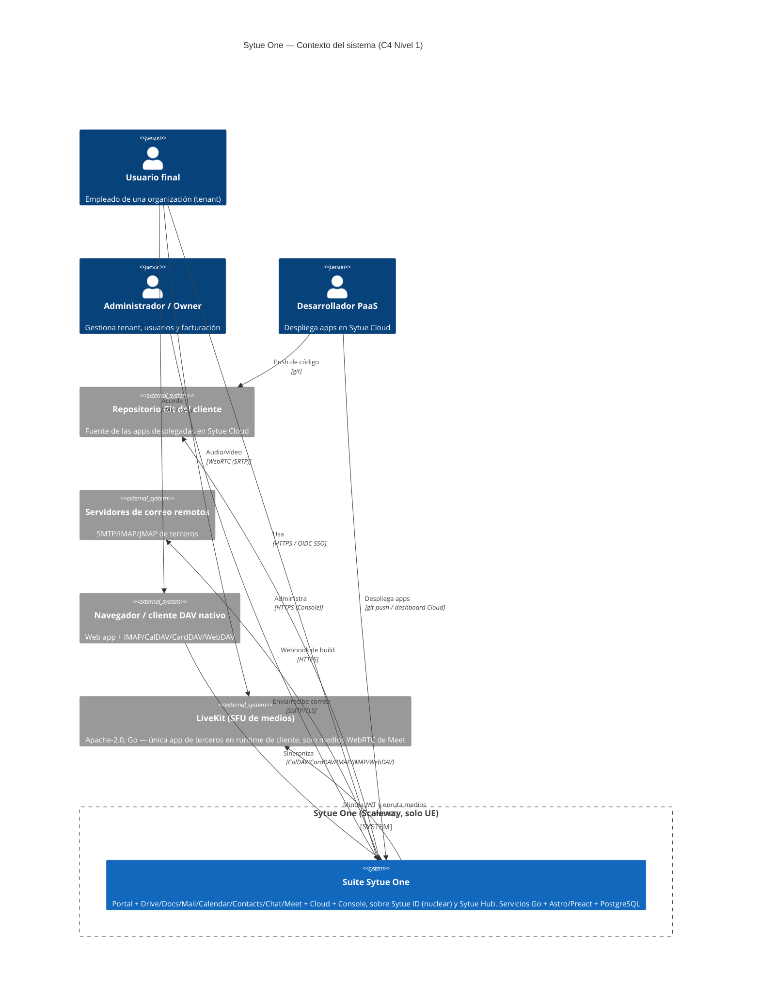

<a id="14-diagrama-de-contenedores-c4--nivel-2-containers"></a>

### 1.4 C4 container diagram — Level 2 (Containers)

All backend containers are **our own Go binaries** (one binary per service,
`services/<svc>/cmd/<svc>/main.go`). The only datastore is PostgreSQL; blobs go to S3.

```mermaid
C4Container
  title Sytue One — Contenedores (C4 Nivel 2)

  Person(user, "Usuario", "Tenant")

  System_Boundary(sytue, "Sytue One — Scaleway UE") {

    Container_Boundary(front, "Frontend (Astro + Preact · @sytue/shell + @sytue/ui + @sytue/auth)") {
      Container(portal, "Sytue One (portal)", "Astro/Preact + BFF", "Lanzador · one.sytue.eu")
      Container(drive, "Sytue Drive", "Astro/Preact + BFF", "drive.sytue.eu")
      Container(docs, "Sytue Docs", "Astro/Preact (editor propio) + BFF", "docs.sytue.eu")
      Container(mail, "Sytue Mail", "Astro/Preact + BFF", "mail.sytue.eu")
      Container(cal, "Sytue Calendar", "Astro/Preact + BFF", "calendar.sytue.eu")
      Container(contacts, "Sytue Contacts", "Astro/Preact + BFF", "contacts.sytue.eu")
      Container(notes, "Sytue Notepads", "Astro/Preact + BFF", "notes.sytue.eu")
      Container(roomsfe, "Sytue Rooms", "Astro/Preact + BFF + LiveKit web SDK", "rooms.sytue.eu")
      Container(cloudui, "Sytue Cloud Dashboard", "Astro/Preact + BFF", "cloud.sytue.eu")
      Container(console, "Sytue Admin", "Astro/Preact + BFF", "admin.sytue.eu")
    }

    Container(idp, "Sytue ID", "Go (ory/fosite o zitadel/oidc)", "OIDC/PKCE, JWKS, SCIM, MFA/WebAuthn · id.sytue.eu :8081")
    Container(hub, "Sytue Hub", "Go (chi, WS/SSE)", "Búsqueda federada, notificaciones, presencia, intents · hub.sytue.eu :8092")

    Container_Boundary(svcs, "Servicios de producto (Go · git.sytue.eu/sytue/one)") {
      Container(drivesvc, "Drive svc", "Go", "WebDAV + REST · :8082")
      Container(docssvc, "Docs svc", "Go", "CRDT/OT colab WS + REST · :8083")
      Container(mailsvc, "Mail svc", "Go", "SMTP/IMAP/JMAP · :8086 / 25,465,587,993")
      Container(calsvc, "Calendar svc", "Go", "CalDAV + REST · :8087")
      Container(consvc, "Contacts svc", "Go", "CardDAV + REST · :8088")
      Container(roomssvc, "Rooms svc", "Go", "WebSocket + REST + salas/señalización · :8085")
      Container(intsvc, "Integration Gateway", "Go", "Egress único a SaaS de terceros: SSRF+rate-limit+auditoría+DLP+auth · :8093")
    }

    Container_Boundary(paas, "Sytue Cloud (PaaS — Go)") {
      Container(paasapi, "Cloud API / control plane", "Go + PostgREST", ":8090")
      Container(builder, "Builder", "Kaniko rootless Jobs", ":8091")
    }

    Container(livekit, "LiveKit (SFU)", "Apache-2.0, Go", "Solo medios WebRTC de Meet · 7880/7881/UDP mux 7882")

    ContainerDb(pg, "PostgreSQL", "RDB", "ÚNICO datastore: estado + colas + caché de TODOS los servicios y tenants (esquema/RLS)")
    ContainerDb(s3, "Object Storage (S3)", "Scaleway / MinIO", "Blobs Drive/Mail/Docs, backups, LOGS de build, tfstate")
  }

  System_Ext(saas, "SaaS del cliente (BYO-SaaS)", "Microsoft 365, Google Workspace, Salesforce, Jira, Odoo, Slack… — cuenta del propio cliente")
  System_Ext(bots, "Integraciones de terceros ya existentes", "Bots/CI escritos para webhooks de Slack o Teams")

  Rel(user, portal, "SSO", "HTTPS/OIDC")
  Rel(portal, idp, "Autentica", "OIDC/PKCE (BFF)")

  Rel(drive, drivesvc, "Archivos", "REST/WebDAV")
  Rel(docs, docssvc, "Edición colaborativa", "WS (CRDT/OT)")
  Rel(mail, mailsvc, "Lee/envía", "JMAP/REST")
  Rel(cal, calsvc, "Eventos", "CalDAV/REST")
  Rel(contacts, consvc, "Contactos", "CardDAV/REST")
  Rel(roomsfe, roomssvc, "Mensajería y señalización de sala", "WS/REST")
  Rel(roomsfe, livekit, "Audio/vídeo", "WebRTC")
  Rel(roomssvc, livekit, "Mintea JWT (API key/secret)", "tras validar OIDC")
  Rel(cloudui, paasapi, "Gestiona proyectos", "HTTPS")
  Rel(console, idp, "Admin API", "HTTPS")
  Rel(console, hub, "Tenants/eventos", "HTTPS")

  Rel(drivesvc, idp, "Valida JWT", "JWKS")
  Rel(mailsvc, idp, "Valida JWT", "JWKS")
  Rel(hub, idp, "Valida JWT", "JWKS")
  Rel(hub, drivesvc, "Búsqueda federada", "REST")
  Rel(hub, mailsvc, "Búsqueda federada", "REST/JMAP")
  Rel(hub, roomssvc, "Búsqueda/notif", "REST")
  Rel(hub, calsvc, "Búsqueda", "REST")
  Rel(hub, consvc, "Búsqueda", "REST")
  Rel(hub, intsvc, "Búsqueda federada sobre SaaS conectados", "REST")

  Rel(console, intsvc, "Conectar/gobernar aplicaciones", "HTTPS")
  Rel(intsvc, idp, "Valida JWT + materializa SP SAML / client OIDC", "JWKS + admin API")
  Rel(intsvc, saas, "ÚNICA salida a terceros: SSO/SCIM/datos/embed", "HTTPS (SSRF-safe + DLP + auditoría)")
  Rel(intsvc, pg, "Instancias, secretos sellados, auditoría de egress", "SQL (RLS por org)")
  Rel(bots, roomssvc, "Webhooks en dialecto Slack/Teams (capa compat)", "HTTPS")

  Rel(idp, pg, "Persistencia", "SQL (pgx)")
  Rel(hub, pg, "Estado/colas/presencia", "SQL (LISTEN/NOTIFY)")
  Rel(drivesvc, pg, "Metadatos", "SQL")
  Rel(drivesvc, s3, "Blobs", "S3")
  Rel(mailsvc, pg, "Metadatos", "SQL")
  Rel(mailsvc, s3, "Blobs", "S3")
  Rel(docssvc, s3, "Documentos", "S3")
  Rel(paasapi, pg, "Sytue Postgres", "SQL/PostgREST")
  Rel(builder, s3, "Build cache/artefactos", "S3")

  UpdateLayoutConfig($c4ShapeInRow="3", $c4BoundaryInRow="2")
```

<a id="15-flujo-sso--oidc--pkce-contra-sytue-id-bff--cookie-de-dominio"></a>

<a id="15-flujo-sso--oidc--pkce-contra-sytue-id-cookies-host-only"></a>

### 1.5 SSO flow — OIDC + PKCE against Sytue ID (host-only cookies)

Each surface has a **confidential BFF** (Astro endpoints from `@sytue/auth`) with its own OIDC
client. After the code exchange, each BFF issues a **host-only `__Host-` cookie**, httpOnly.
Sytue ID also keeps its own host-only session and silently authorizes the next app's client,
so switching subdomains happens **without entering credentials again**. No authentication
cookie reaches the Cloud deployments under `*.apps/preview.sytue.eu`. No secret lives
in the client. Each Go service validates the access token via **JWKS**.

```mermaid
sequenceDiagram
  autonumber
  actor U as Usuario (navegador)
  participant App as Superficie Sytue (mail.sytue.eu)
  participant BFF as BFF Astro (@sytue/auth · client sytue-mail)
  participant ID as Sytue ID (servicio Go · id.sytue.eu)
  participant Svc as Mail svc (Go · valida JWKS)

  U->>App: GET /inbox (sin sesión)
  App->>BFF: comprueba cookie host-only de Mail
  BFF-->>U: 302 → /auth/login (genera code_verifier + code_challenge S256, state, nonce)
  U->>ID: GET /authorize?client_id=sytue-mail&code_challenge=...&scope=openid
  alt usuario no autenticado
    ID-->>U: Login (UI Sytue, es_ES) + MFA/WebAuthn si admin/owner
    U->>ID: Credenciales + 2º factor
  else SSO activo (sesión Sytue ID)
    ID-->>U: Reutiliza sesión (login único)
  end
  ID-->>U: 302 redirect_uri?code=AUTH_CODE&state=...
  U->>BFF: GET /auth/callback?code=AUTH_CODE
  BFF->>ID: POST /token (code + code_verifier + client_secret confidencial)
  ID-->>BFF: id_token + access_token (JWT) + refresh_token
  BFF->>ID: GET /.well-known/openid-configuration + JWKS (cacheado)
  BFF->>BFF: valida nonce/claims/firma; crea sesión server-side
  BFF-->>U: Set-Cookie __Host- host-only, httpOnly
  U->>App: GET /inbox (con cookie)
  App->>BFF: solicita datos (proxy con Bearer)
  BFF->>Svc: GET /jmap (Authorization: Bearer access_token)
  Svc->>Svc: valida firma JWT vía JWKS de Sytue ID + claims tenant/rol
  Svc-->>BFF: Mensajes
  BFF-->>U: Inbox renderizado (@sytue/shell + @sytue/ui)

  note over U,ID: Al abrir Drive, su BFF hace OAuth y la sesión host-only de Sytue ID evita repetir credenciales
```

<a id="16-flujo-de-un-intent-del-hub-cross-app-crear-evento-desde-un-correo"></a>

### 1.6 Flow of a Hub intent (cross-app: "create event from an email")

`@sytue/shell` (front end) consumes **Sytue Hub** (Go service) for federated search,
real-time notifications (SSE/WS over PostgreSQL LISTEN/NOTIFY) and **cross-app intents**.
The Hub orchestrates calls to the relevant Go services, always authorizing with the
Sytue ID JWT (validated via JWKS).

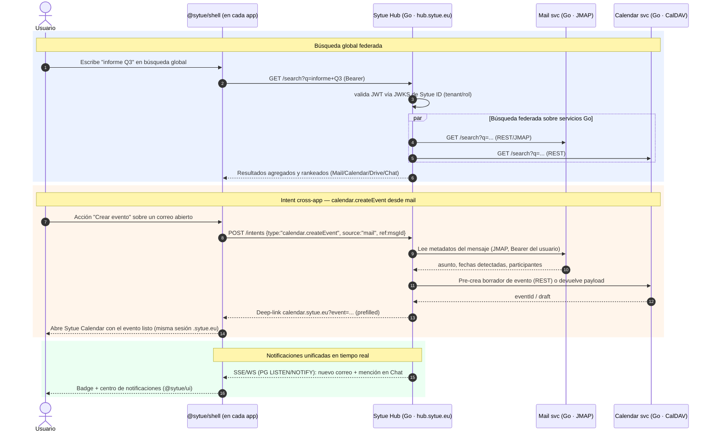

<a id="17-flujo-de-despliegue-del-paas-sytue-cloud"></a>

### 1.7 PaaS deployment flow (Sytue Cloud)

`git push` → webhook → **Kaniko build** (rootless Job) → **Scaleway Registry** → deploy (Serverless
Containers or a Kapsule namespace) → URL with **automatic TLS** (cert-manager / Let's Encrypt).
Per-PR previews, promotion to prod and rollback. The whole control plane is **Go**; state lives in
**PostgreSQL** and artifacts (build logs, backups) in **S3**. Builds do NOT have a layer cache
yet: see the note below the diagram.

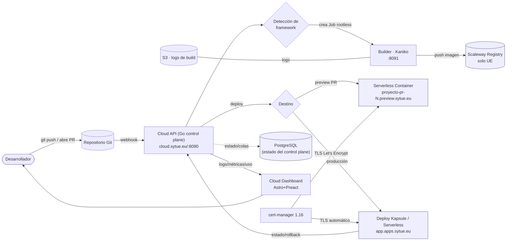

> **No layer cache (actual state).** Every build is done from scratch. It is not an oversight:
> the phase that runs the user's code (the buildpack scripts, or Kaniko with
> `--no-push`) runs **without a registry credential** on purpose, so that this code cannot
> exfiltrate it — the push is done by a separate container that does have it. A remote
> cache would require that phase to be able to read and write the cache image, that is,
> to give it a credential. The way out is a credential SCOPED only to the tenant's cache
> image, which depends on the registry's IAM (infrastructure).
> Meanwhile, the cost is paid in `build_minutes`, which is billed to the customer.

<a id="71-servicios-gestionados-sytue-postgres--postgrest--storage--functions--cron"></a>

#### 7.1 Managed services (Sytue Postgres / PostgREST / Storage / Functions / Cron)

Creating a service automatically injects its credentials into the project's deployments
(Vercel/Supabase style). All on **PostgreSQL** and **S3**, in the EU.

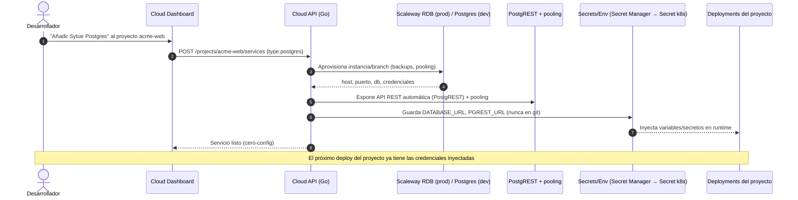

<a id="18-modelo-multi-tenant"></a>

### 1.8 Multi-tenant model

`Organization (tenant) → Workspace → Users`. Each tenant is projected consistently:
**group `org/<slug>` in Sytue ID ⇄ namespace `tenant-<slug>` in Kapsule ⇄ per-tenant data in
PostgreSQL (schema/RLS) ⇄ dedicated S3 prefixes**. There are no engines: tenant isolation is
enforced by Sytue ID (claims), **PostgreSQL RLS** and the S3 prefixes.

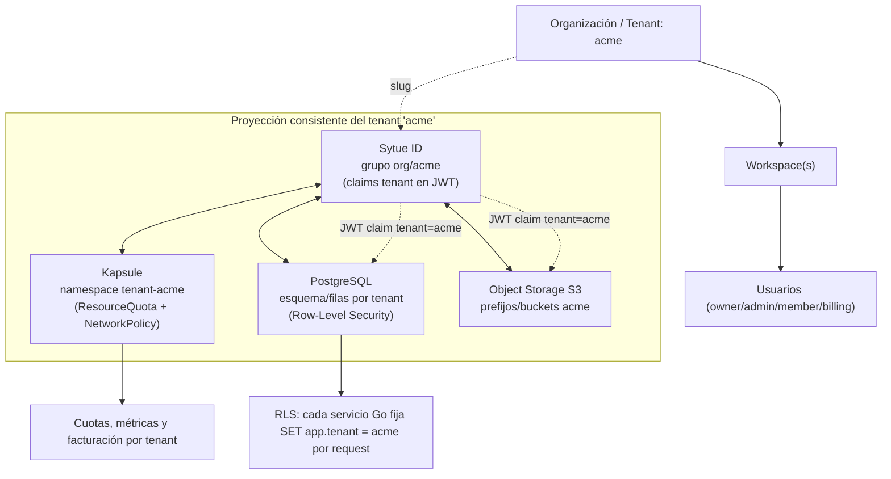

<a id="19-topologia-en-scaleway-prodbase"></a>

<a id="19-topología-en-scaleway-prodbase"></a>

### 1.9 Topology on Scaleway (PROD/BASE)

Primary region `fr-par` (zones `fr-par-1/2/3`), DR `nl-ams`. **EU regions only.** Provisioned
with Terraform (modules `network`, `kapsule`, `database`, `object-storage`, `registry`, `dns`,
`secrets`, `loadbalancer`, `livekit`) and deployed with the `sytue-one` Helm umbrella chart (only
Go services + LiveKit + Traefik). **No Valkey/Redis. No charts for AGPL engines.**

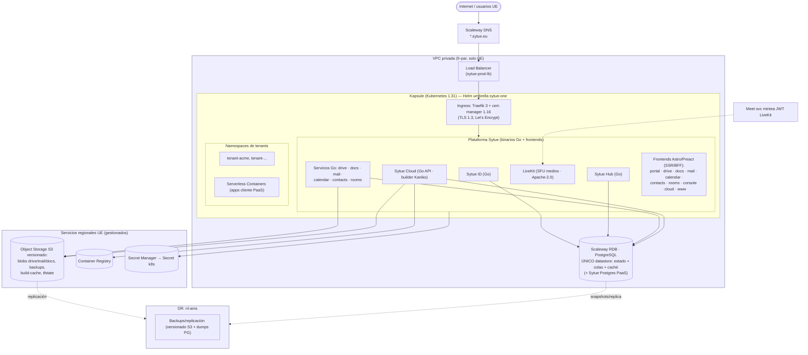

---

<a id="19a-workers-ci-y-sfu-de-rooms-separados"></a>

<a id="19a-workers-de-ci-y-sfu-de-rooms-separados"></a>

#### 1.9a Separate CI workers and Rooms SFU

WebRTC media and CI execution are incompatible workloads: a container build
transiently exhausts disk, CPU and memory; the SFU needs predictable latency
and jitter. That is why they are two different instances in
`fr-par-1`:

| Function          | Instance            | Capacity                             | Responsibility                                                       |
| ----------------- | ------------------- | ------------------------------------ | -------------------------------------------------------------------- |
| Sytue Rooms media | `sytue-rooms-sfu`   | Does not run CI                      | Rooms WebRTC transport; receives no runners or build caches.         |
| CI worker         | `sytue-rooms-media` | 6 ARM64 vCPU, 24 GiB RAM, 72 GB root | Three Forgejo Runner daemons, all labeled `docker`, capacity 1 each. |

The three runners share a host for efficiency, but not state: each one has its own
working directory, registration file, token and systemd unit. Their
individual capacity is **1**, so a single run cannot take three
heavy jobs; the host's maximum parallelism is three. The SFU's former runner
is disabled: CI jobs no longer compete with media.

The registration secrets live exclusively in files with mode `0640`,
owned by `root:sytue-runner`, outside the repository and outside the workspaces.
Administrative access to the worker uses a dedicated ED25519 SSH key, not
passwords. The real Docker socket is kept for the daemon's internal orchestration and
cleanup; jobs mount exclusively the Unix bridge of the API proxy with an
explicit list of operations. The runner allows only that path and enforces it
once; the proxy keeps the list of operations. The operational detail is in
`.github/RUNNERS.md`.

<a id="110-dev-local-compose-vs-prod-scaleway-helm--paridad"></a>

### 1.10 Local dev (Compose) vs Prod Scaleway (Helm) — parity

Same logical architecture (domains, OIDC clients, variables); endpoints and scale change. DEV is
brought up with a single command (`make dev-up`) under `*.sytue.localhost` with mkcert TLS. **There is no
Valkey/Redis nor AGPL engines in any environment.**

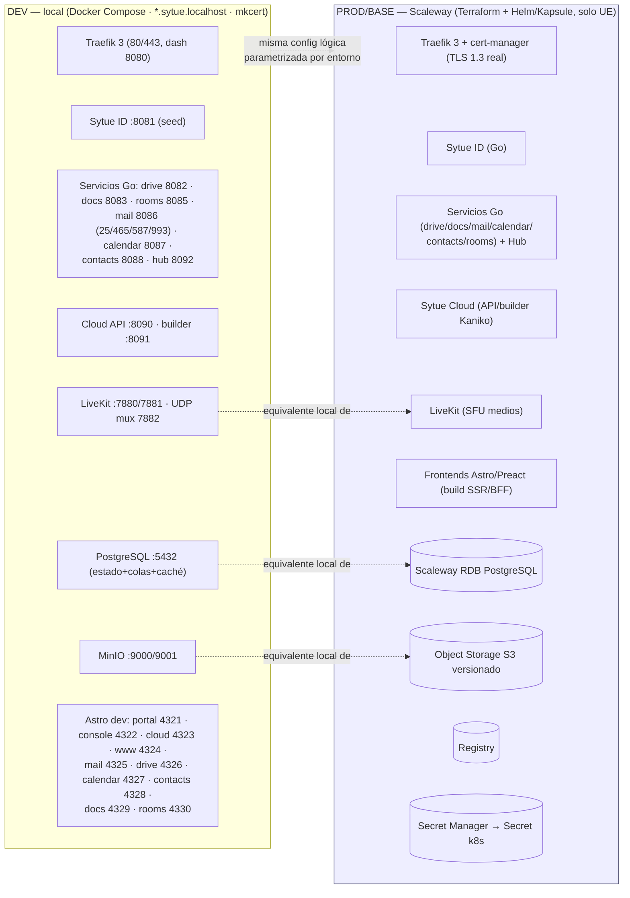

---

<a id="111-decisiones-de-arquitectura-transversales"></a>

### 1.11 Cross-cutting architecture decisions

- **Single Go + Astro/Preact + PostgreSQL stack.** 100% Go backend (module `git.sytue.eu/sytue/one`,
  one binary per service, layers `internal/{http,domain,store}`, `pgx`+`sqlc`, `chi`, `slog`,
  `goose`/`golang-migrate` migrations, multi-stage Dockerfile `golang:1.23` → `distroless/static`).
  PostgreSQL as the only datastore (state + queues with `riverqueue`/`pgmq`/LISTEN-NOTIFY + cache).
  **No Redis/Valkey.**
- **Sytue-native, clean-room, proprietary.** Each product is an original work by Daniel Delgado Ramos (thinkddr)
  on top of open standards and permissive libraries (MIT/BSD/Apache); copying/porting
  AGPL code is **forbidden**. No third-party engines (Keycloak/Nextcloud/OnlyOffice/Mattermost/Stalwart are out).
- **Sytue ID at the core.** Our own Go service (OIDC/PKCE, JWKS, SCIM, MFA/WebAuthn). Each service
  validates JWTs via JWKS; no introspection against external engines. One sign-up = access to the whole suite.
- **LiveKit, the only third-party app in the customer runtime.** Only the WebRTC media SFU for Meet
  (Apache-2.0). The Meet BFF/service mints the LiveKit JWT after validating OIDC; the room logic
  is our own.
- **Design first.** Every surface mounts `@sytue/shell` and uses `@sytue/ui`. Zero ad-hoc UI.
  **All configuration is guided** (Apple/Vercel/DigitalOcean style, never Google Cloud/AWS):
  mandatory primitives `Wizard`/`SettingsShell`/`FieldHint`/`ReviewSummary`/`ChoiceCard` from
  `@sytue/ui` — see [`design.md#2-sistema-de-diseno` §8](./design.md#2-sistema-de-diseno).
- **A single exit door to third parties.** All egress towards customers' SaaS goes through
  `services/integrations`, which is the **only factory** of egress HTTP clients (SSRF-safe +
  rate-limit + audit + DLP + auth injection). No driver sees a token: security is
  structural, not a convention. See [`architecture.md#4-integration-gateway-saliente`](./architecture.md#4-integration-gateway-saliente).
- **Compatibility per service, not per gateway.** Emulation of third-party APIs
  (Slack/Teams today; OIDC issuer, WOPI and Graph/Google as a plan) lives in `internal/compat/` of the
  service that owns the data, because it translates into **its** domain and **its** authorization. The translation
  is pure and never decides destination or authorization. See [`architecture.md#5-capa-de-compatibilidad-entrante`](./architecture.md#5-capa-de-compatibilidad-entrante).
- **Multi-tenant via RLS.** Isolation with group `org/<slug>` in Sytue ID ⇄ namespace
  `tenant-<slug>` ⇄ PostgreSQL RLS ⇄ S3 prefixes.
- **100% EU sovereignty.** Only Scaleway EU regions; secrets in Secret Manager,
  never in git; encryption at rest and TLS 1.3 in transit.
- **Dev/prod parity.** Compose (local) ⇄ Helm/Kapsule (Scaleway), same logical config.

> Related references: [`docs/CONVENTIONS.md`](./CONVENTIONS.md),
> [`docs/security.md#1-seguridad-y-rgpd`](./security.md#1-seguridad-y-rgpd),
> [`docs/CONVENTIONS.md#16-naming-dominios-y-dns-anexo-normativo`](./CONVENTIONS.md#16-naming-dominios-y-dns-anexo-normativo),
> [`docs/design.md#2-sistema-de-diseno`](./design.md#2-sistema-de-diseno), [`docs/architecture.md#2-integracion-seamless-shell--hub`](./architecture.md#2-integracion-seamless-shell--hub),
> [`docs/architecture.md#4-integration-gateway-saliente`](./architecture.md#4-integration-gateway-saliente),
> [`docs/architecture.md#5-capa-de-compatibilidad-entrante`](./architecture.md#5-capa-de-compatibilidad-entrante),
> [`docs/architecture.md#6-identidad-enterprise-y-cumplimiento`](./architecture.md#6-identidad-enterprise-y-cumplimiento),
> [`docs/security.md#5-licencias-propiedad-y-cumplimiento`](./security.md#5-licencias-propiedad-y-cumplimiento), [`docs/security.md#4-politica-de-reimplementacion-clean-room`](./security.md#4-politica-de-reimplementacion-clean-room).

---

<a id="2-integracion-seamless-shell--hub"></a>

<a id="2-integración-seamless-shell--hub"></a>

## 2. Seamless integration (Shell + Hub)

> Design of the unified experience (Google Workspace style) for the whole **Sytue One** suite.
> Three pieces support the integration: **Sytue ID** (our own IdP in Go, at the core), **Sytue Shell**
> (`@sytue/shell`, common UI layer mounted in every app) and **Sytue Hub** (Go service,
> `hub.sytue.eu`, integration backend). Source of truth for names/domains/ports/versions:
> [`docs/CONVENTIONS.md`](./CONVENTIONS.md) (**v4 "Sytue Native"**).
>
> **Scope: INTERNAL integration of the suite.** Integration with **third-party** software
> has its own documents:
> [`architecture.md#4-integration-gateway-saliente`](./architecture.md#4-integration-gateway-saliente) (outbound: connecting the SaaS the
> customer already uses) and [`architecture.md#5-capa-de-compatibilidad-entrante`](./architecture.md#5-capa-de-compatibilidad-entrante) (inbound: making
> integrations written for Slack/Teams/Google/Microsoft work against Sytue unchanged).

<a id="20-objetivo"></a>

### 2.0 Goal

Make Mail, Drive, Calendar, Contacts, Docs, Chat, Meet, Cloud and Console **feel like a
single application**: one login, a common top bar, an app switcher, a search that
spans every product, a unified notification center, shared presence and
**cross actions** (attach from Drive in Mail, create an event from an email, share in
Chat). Identity and authorization are **never** duplicated: everything hangs off **Sytue ID**.

**No third-party engines.** In v4 there is no Nextcloud, Stalwart, Mattermost or OnlyOffice: each
product is **our own Go service** (clean-room on top of open standards). The Hub federates over
**the Go services**, not over engines. The only third-party app in the customer runtime:
**LiveKit** (Apache-2.0), the media SFU of _Sytue Rooms_. **No Redis/Valkey:** all state
(presence, subscriptions, queues)
lives in **PostgreSQL** (`LISTEN/NOTIFY`, tables).

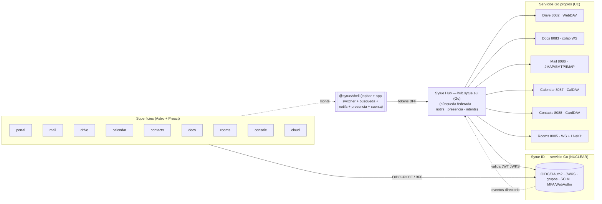

---

<a id="21-el-idp-es-la-pieza-nuclear-sytue-id--servicio-go"></a>

### 2.1 The IdP is the core piece (Sytue ID — Go service)

**Sytue ID** (`id.sytue.eu`, dev port `8081`) is **our own Go service** that implements
**OIDC/OAuth2** (Authorization Code + PKCE, refresh, **JWKS**, discovery), **SAML** (optional),
**SCIM** and **MFA/WebAuthn**, on top of Apache-2.0 libraries (`ory/fosite` / `zitadel/oidc`). State in
**PostgreSQL**. It is the **backbone**: no product manages its own credentials; each
Go service **validates Sytue ID JWTs via JWKS** (`authn` middleware from `platform/pkg`).

<a id="11-sso-y-tokens-oidc--pkce--bff"></a>

#### 1.1 SSO and tokens (OIDC + PKCE + BFF)

Each surface has a **confidential OIDC client** (BFF, Astro endpoints) — see §8 of
CONVENTIONS: `sytue-one`, `sytue-console`, `sytue-cloud` (+ `sytue-cloud-api`), `sytue-mail`,
`sytue-drive`, `sytue-calendar`, `sytue-contacts`, `sytue-docs`, `sytue-rooms`,
`sytue-hub`. The flow:

1. The browser arrives at `<app>.sytue.eu`; the Astro BFF starts **Authorization Code + PKCE**
   against Sytue ID (`@sytue/auth`).
2. Sytue ID authenticates (theme `sytue`, es_ES; **MFA/WebAuthn mandatory for `admin`/`owner`**).
3. The BFF exchanges the `code` for tokens (`access` + `refresh` + `id`), **never exposed to the
   client**: they are stored server-side and a **host-only `__Host-` cookie**, httpOnly, is issued.
4. Jumping from `mail.` to `drive.` **does not ask for credentials again**: the Sytue ID host-only session is already
   established (silent re-auth) and each BFF creates its own session, without sharing cookies with
   user deployments.

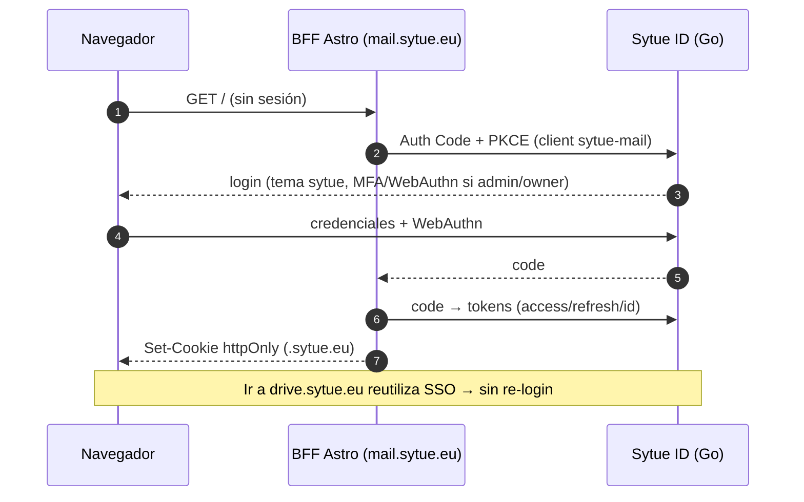

<a id="111-mi-cuenta--self-service-del-usuario-account"></a>

#### 1.1.1 “Mi cuenta” (My account) — user self-service (`/account`)

A server-rendered panel of the IdP itself (no framework or front-end build), with one card per
area. The Shell's account menu links to it.

| Card                | What it allows                                                                   | Notes                                                                                                                |
| ------------------- | -------------------------------------------------------------------------------- | -------------------------------------------------------------------------------------------------------------------- |
| **Profile**         | First name, last name, **job title**, **department**, **location**, **language** | Job title/department feed the **dynamic group** rules (mig 0021): editing them can change which groups you belong to |
| **Your account**    | Email, organizations (by name), current session, sign-up date                    | Read-only                                                                                                            |
| **Security**        | Password and TOTP + recovery codes                                               | —                                                                                                                    |
| **Passkeys**        | Adding and removing **passkeys** from the browser                                | The only part with JS: `navigator.credentials.create()` has no HTML equivalent                                       |
| **Active sessions** | Device, **IP**, method and expiry; sign out one or all the others                | —                                                                                                                    |
| **Recent sign-ins** | Already-ended sessions with their IP, telling closed ones from expired ones      | Last 50; the permanent record is the audit log                                                                       |

| **Recent sign-ins** with **location** | Approximate country and city for each IP | Optional: resolved against `geoip_networks` (mig 0037); empty table ⇒ not shown |

**Languages.** The IdP is served in the five product languages with a catalog in
Go (`services/id/internal/i18n`), not with a library: it is a binary without a front-end
build, it cannot consume Astro's i18n, and the alternatives bring files
to load at runtime and one more dependency for a set of strings that fits
in one file. The negotiation is the same as in the rest of the platform
—cookie `sytue_locale` > `Accept-Language` > English— and a test checks that
no key is left untranslated.

Decisions worth not undoing:

- **`SetProfile` enumerates columns** instead of reusing `UpdateUser`, which rewrites the whole
  record. Through that path a profile form could be used to verify one's own email or reactivate a
  suspended account: those columns simply do not appear in the self-service SQL.
- **Passkey registration via two paths, a single handler.** `/api/v1/me/webauthn/*` (Bearer) and
  `/account/passkeys/*` (cookie) share code; the cookie path requires an allowed `Origin`. Duplicating
  attestation verification was the alternative.
- **The last passkey is not removed** if it is the only second factor: it would leave `mfa_enabled` with nothing
  behind it, and the next app that requires MFA would present an impossible step.
- **The language is propagated** to the suite through the `sytue_locale` cookie (shared and readable by JS, unlike
  the session one, which is host-only `__Host-`). It is a preference, not a credential.
- **The language reaches each template explicitly** instead of being taken from the request at
  render time: that way the document's `lang` and the text do not end up in different languages, which is what
  breaks a screen reader. And the passkey sign-in error message travels in a
  `data-` attribute of the HTML, not inside the script, because the script's sha256 goes into the CSP and one
  text per language would mean five hashes to maintain.
- **Location is resolved in PostgreSQL**, not with a GeoIP library or an external
  service: no user IP leaves our infrastructure. A single query per list,
  not one per row. See `deploy/geoip/` for loading and the CC BY attribution the source requires.
- **The CSP has no `unsafe-inline`:** each stylesheet and each script goes in its own block and its sha256
  is computed at runtime from the same constant that is served (`cspStyleHashes`/`cspScriptHashes`).
  Adding a stylesheet requires listing it there, or the browser serves the page without styles.

<a id="12-autorización-grupos-y-tenancy"></a>

#### 1.2 Authorization, groups and tenancy

- **Groups** `org/<slug>` per organization (tenant); **roles** `owner`, `admin`, `member`,
  `billing`. These claims travel in the `access_token` and are consumed by the apps (via BFF)
  as well as by the Hub and each Go service.
- Mapping groups to resources: Kapsule **namespaces** `tenant-<slug>`, **per-tenant schema/rows
  in PostgreSQL with RLS**, S3 prefixes/buckets. Each Go service applies RLS and authorizes by role.
- The Hub uses the user's `access_token` to scope **every** search and action to the requester's
  tenant and roles (no cross-organization escalation).

<a id="13-aprovisionamiento-un-alta--toda-la-suite"></a>

#### 1.3 Provisioning (one sign-up = the whole suite)

Sytue ID is the **source of identity**. A sign-up is **not** "projected" onto engines (they no longer exist):
thanks to the **tenant/role claims** in the token, a new account has **immediate access** to
all the Go services. Details:

- **"Lazy" provisioning per service:** on the first authenticated request, each Go service
  creates/resolves (idempotently) the user's local record inside its tenant schema, from
  the JWT claims.
- **Directory events:** sign-ups/removals/group changes are published as **events** that
  **Sytue Hub** consumes and forwards to the services that require proactive action (e.g. creating the
  mailbox in **Sytue Mail**). Internal transport over PostgreSQL (`events`) and SCIM 2.0 for
  the customer's external directories. Details in §4.3.
- **Immediate removal:** deactivation/deletion in Sytue ID → revocation of refresh tokens/sessions; the
  short-lived `access_token`s expire on their own and services check status/introspection for
  immediate revocation (see `docs/security.md#1-seguridad-y-rgpd` §4.4).

---

<a id="22-sytue-shell-sytueshell--la-capa-de-ui-comun"></a>

<a id="22-sytue-shell-sytueshell--la-capa-de-ui-común"></a>

### 2.2 Sytue Shell (`@sytue/shell`) — the common UI layer

The Shell is the Preact package that **is mounted in EVERY app** (portal, console, cloud-dashboard,
mail, drive, calendar, contacts, docs, rooms, www). It guarantees that the chrome is
identical across the whole suite — **Sytue** look with `@sytue/ui` components. Apps do **not**
create variants of the chrome.

Shell composition:

| Piece                   | Function                                                 | Data source                        |
| ----------------------- | -------------------------------------------------------- | ---------------------------------- |
| **TopBar**              | Global top bar: Sytue logo, app context, global controls | `@sytue/ui` (`TopBar`)             |
| **App Switcher**        | **9-dot** grid that launches any product in the suite    | static catalog + token permissions |
| **Global search**       | Input + federated results panel, grouped by product      | `GET hub/search`                   |
| **Notification center** | Unified real-time inbox (Mail/Chat/Calendar/Drive/Cloud) | `hub/notifications` (SSE/WS)       |
| **Presence**            | Status of the user and contacts (online/away/busy)       | `hub/presence` (WS)                |
| **Account menu**        | Profile, active organization, light/dark theme, sign out | `@sytue/auth` + Sytue ID account   |

```tsx
// apps/frontend/apps/mail/src/layouts/AppLayout.astro  (patrón idéntico en toda app)
---
import { SytueShell } from "@sytue/shell";
import { requireSession } from "@sytue/auth/server"; // resuelve la cookie host-only en el BFF
const session = await requireSession(Astro);        // redirige a OIDC si no hay sesión
// Con `roles:`/`perms:`, quien no pasa recibe un 403 que es una PÁGINA (identidad
// Graphite & Brass, idioma negociado y enlace al portal), no un texto plano: la
// pinta el propio guard, así que cubre de una vez las 25 páginas protegidas.
---
<html lang="es" data-theme={session.prefs.theme}>
  <body>
    <SytueShell
      client:load
      app="mail"                          {/* marca la celda activa del app switcher */}
      user={session.profile}              {/* nombre/avatar/org del id_token */}
      tenant={session.activeTenant}        {/* org/<slug> activo */}
      hubBaseUrl="/_hub"                   {/* el BFF proxya a hub.sytue.eu con el token */}
    />
    <main><slot /></main>
  </body>
</html>
```

> The client **never** talks directly to `hub.sytue.eu`: the Shell calls `/_hub/*` on the BFF of
> the app itself, which attaches the `access_token` (server-side) and forwards to the Hub. That way there are no
> tokens in the browser and the httpOnly cookie is respected.

<a id="21-app-switcher-grid-9-puntos"></a>

#### 2.1 App Switcher (9-dot grid)

Canonical catalog (order and subdomains fixed in CONVENTIONS §1). The Shell **filters** the
cells according to the user's groups/roles (e.g. Console only for `admin`/`owner`).

| 1 Portal (`one.`)            | 2 Mail (`mail.`)             | 3 Drive (`drive.`)   |
| ---------------------------- | ---------------------------- | -------------------- |
| **4 Calendar** (`calendar.`) | **5 Contacts** (`contacts.`) | **6 Docs** (`docs.`) |
| **7 Rooms** (`rooms.`)       | **8 Cloud** (`cloud.`)       | **9 Hub** (`hub.`)   |

> Console (`console.`) appears as an additional entry under the account menu for admin roles.

---

<a id="23-sytue-hub-hubsytueeu--backend-de-integracion-go"></a>

<a id="23-sytue-hub-hubsytueeu--backend-de-integración-go"></a>

### 2.3 Sytue Hub (`hub.sytue.eu`) — integration backend (Go)

**Our own Go** service (module `git.sytue.eu/sytue/one`, `services/hub`, dev port **8092**;
`chi` router, `pgx`/`sqlc`, `slog`). **It authorizes every request by validating the Sytue ID JWT** via
**JWKS** (`authn` middleware from `platform/pkg`) and scopes by tenant + roles. It does not duplicate business
data: it orchestrates the **Go services** and keeps ephemeral state (presence, subscriptions) in
**PostgreSQL** (tables + `LISTEN/NOTIFY`) — **no Redis/Valkey**.

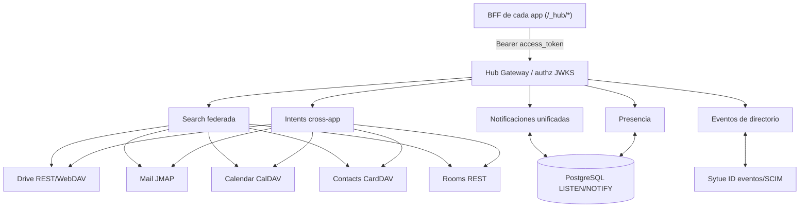

<a id="31-búsqueda-federada"></a>

#### 3.1 Federated search

`GET /search?q=<texto>&scope=all|mail|drive|docs|calendar|contacts|chat&limit=N`

The Hub opens queries **in parallel** to each Go service with the user's context (propagated
token or a service token scoped by tenant), normalizes them to a common schema and returns
results grouped by product with a `deeplink` to the target app.

- **Drive** → Sytue Drive (REST API / WebDAV `SEARCH`).
- **Mail** → Sytue Mail (JMAP `Email/query`).
- **Docs** → Sytue Docs (document search REST API).
- **Calendar** → Sytue Calendar (CalDAV `calendar-query`).
- **Contacts** → Sytue Contacts (CardDAV `addressbook-query`).
- **Chat** → Sytue Rooms (message/user search REST API).

```jsonc
// Respuesta normalizada (extracto)
{
  "query": "informe Q2",
  "groups": [
    {
      "product": "drive",
      "items": [
        {
          "id": "f_8821",
          "title": "Informe Q2.xlsx",
          "snippet": "…ventas Q2…",
          "icon": "spreadsheet",
          "deeplink": "https://drive.sytue.eu/f/8821",
        },
      ],
    },
    {
      "product": "mail",
      "items": [
        {
          "id": "m_4410",
          "title": "RE: Informe Q2",
          "snippet": "adjunto el informe…",
          "deeplink": "https://mail.sytue.eu/message/4410",
        },
      ],
    },
  ],
}
```

<a id="32-notificaciones-unificadas-sse--websocket"></a>

#### 3.2 Unified notifications (SSE / WebSocket)

A **single** channel per user: the BFF opens `GET /notifications/stream` (SSE) or `WS /notifications`.
The Hub subscribes to the events of each Go service (Chat WS, Mail JMAP push, Drive/Docs/Calendar
hooks, Cloud events) and **multiplexes them via PostgreSQL `LISTEN/NOTIFY`** towards
the client, with a common schema. The Shell renders the inbox and the unread badge.

```jsonc
{
  "type": "notification",
  "product": "chat",
  "title": "Ana en #lanzamiento",
  "body": "¿Revisamos el informe?",
  "ts": "2026-06-30T10:12:00Z",
  "deeplink": "https://rooms.sytue.eu/...",
  "unread": true,
}
```

<a id="33-presencia"></a>

#### 3.3 Presence

WebSocket `WS /presence`. The Hub aggregates presence from Sytue Rooms and Shell heartbeats,
stores the latest state in **PostgreSQL** (table with logical TTL + periodic cleanup) and broadcasts
changes via `LISTEN/NOTIFY` to subscribers that share the tenant. States:
`online` · `away` · `dnd` · `offline`.

<a id="34-intents-cross-app"></a>

#### 3.4 Cross-app intents

An API of **cross actions** that connects products without the user leaving their flow. The
Shell exposes the available intents according to context; each intent is resolved server-side against
the Go services with the user's token.

| Intent                 | Source → Target | Effect                                               |
| ---------------------- | --------------- | ---------------------------------------------------- |
| `drive.attachToMail`   | Drive → Mail    | Attaches a file (or sharing link) to a draft         |
| `mail.createEvent`     | Mail → Calendar | Creates an event from an email (attendees = senders) |
| `*.shareToChat`        | any → Chat      | Shares a link/resource in a channel or DM            |
| `mail.saveToDrive`     | Mail → Drive    | Saves attachments to a Drive folder                  |
| `contacts.composeMail` | Contacts → Mail | Opens a draft addressed to a contact                 |
| `calendar.startMeet`   | Calendar → Meet | Creates/opens a meeting for the event                |

`POST /intents/<name>` with a typed payload; the response includes a `deeplink` so the Shell
redirects to the target app with the result already created.

<a id="35-eventos-de-directorio-un-alta--toda-la-suite"></a>

#### 3.5 Directory events (one sign-up = the whole suite)

Internal endpoint/consumer of **Sytue ID events** (sign-up/removal/group changes) and **SCIM 2.0**
for the customer's external directories. The Hub forwards to the Go services that require proactive
action (e.g. creating a mailbox in Mail). Internal transport over PostgreSQL (`events`); reachable
only from the internal network/mTLS, never exposed to the Internet (see §1.3 and §4.3).

---

<a id="24-diagramas-de-secuencia-de-intents"></a>

### 2.4 Intent sequence diagrams

> This section details **two** cross-app intents (the most representative ones) with their full
> sequence over the Go services. The rest of the intents in §3.4 follow the same pattern
> (Shell → BFF `/_hub/*` → Hub → Go services → `deeplink`).

<a id="41-intent-a--adjuntar-de-drive-en-mail-driveattachtomail"></a>

#### 4.1 Intent A — Attach from Drive in Mail (`drive.attachToMail`)

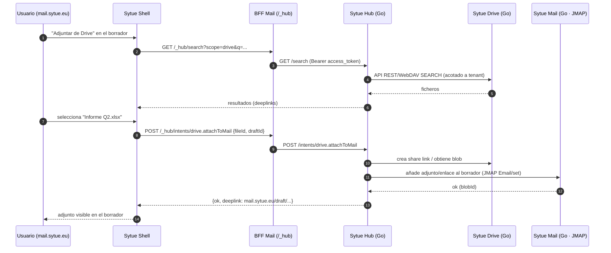

<a id="42-intent-b--crear-evento-desde-un-correo-mailcreateevent"></a>

#### 4.2 Intent B — Create an event from an email (`mail.createEvent`)

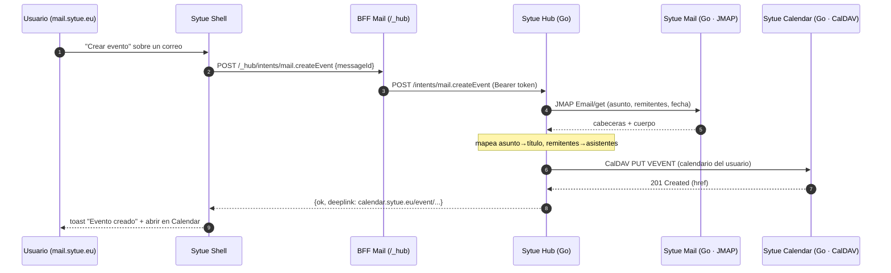

> Provisioning (sign-up in Sytue ID → the whole suite) and the rest of the intents are described as
> a pattern in §1.3 and §3.4; they are not "user intents" but a directory/event flow.

---

<a id="25-como-cada-app-monta-la-shell-y-consume-el-hub"></a>

<a id="25-cómo-cada-app-monta-la-shell-y-consume-el-hub"></a>

### 2.5 How each app mounts the Shell and consumes the Hub

A single pattern for **all** surfaces (no ad-hoc UI exceptions):

1. **Auth/BFF.** The app uses `@sytue/auth`: `requireSession()` in the layout resolves the httpOnly
   `.sytue.eu` cookie; if there is no session, it starts OIDC+PKCE with its client (`sytue-<app>`). The
   tokens live **only** on the server.
2. **Shell.** The layout mounts `<SytueShell app="<app>" .../>` from `@sytue/shell`, which provides
   the top bar, app switcher (9 dots), global search, notifications, presence and account — all
   with `@sytue/ui` components and tokens (Sytue look, light/dark, WCAG AA).
3. **Hub proxy.** The app exposes BFF endpoints `/_hub/*` (Astro) that **attach the
   `access_token`** and forward to `hub.sytue.eu`. The Shell and the app consume the Hub **only** through
   there (search, notification stream, presence WS, intents).
4. **Data from its own service.** For its domain, the app uses the SDKs from `@sytue/api-clients`
   (SDKs for the **Go services**: id/drive/docs/mail/calendar/contacts/rooms/hub/cloud +
   LiveKit web SDK for Meet) — also via the BFF.

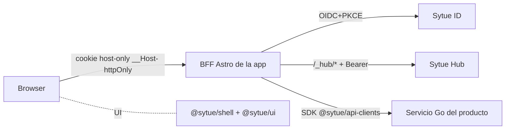

| App                    | OIDC client                         | Own Go service (via `@sytue/api-clients`)            | Hub consumption                                                                            |
| ---------------------- | ----------------------------------- | ---------------------------------------------------- | ------------------------------------------------------------------------------------------ |
| portal (`one.`)        | `sytue-one`                         | —                                                    | search, notifs, presence, switcher                                                         |
| mail (`mail.`)         | `sytue-mail`                        | Sytue Mail (JMAP/SMTP/IMAP)                          | search + intents (attachFromDrive, createEvent, saveToDrive, shareToChat)                  |
| drive (`drive.`)       | `sytue-drive`                       | Sytue Drive (REST/WebDAV)                            | search + intents (attachToMail, shareToChat)                                               |
| calendar (`calendar.`) | `sytue-calendar`                    | Sytue Calendar (CalDAV)                              | search + intents (startMeet)                                                               |
| contacts (`contacts.`) | `sytue-contacts`                    | Sytue Contacts (CardDAV)                             | search + intents (composeMail)                                                             |
| notes (`notes.`)       | `sytue-notes`                       | Sytue Notepads (own REST)                            | search (only what its owner leaves in the index) + cross-reference with Calendar and Rooms |
| docs (`docs.`)         | `sytue-docs`                        | Sytue Docs (own editor + WS collaboration)           | search + intents (shareToChat)                                                             |
| rooms (`rooms.`)       | `sytue-rooms`                       | Sytue Rooms (WS/REST + signaling; LiveKit for media) | search + presence + notifs + intents (shareToChat, startMeet)                              |
| console (`console.`)   | `sytue-console`                     | Sytue ID Admin/SCIM + Hub                            | SCIM/tenant management, audit                                                              |
| cloud (`cloud.`)       | `sytue-cloud` (+ `sytue-cloud-api`) | Sytue Cloud (control plane + PostgREST)              | deploy notifs                                                                              |

> **Dev/prod parity note:** in dev (`*.sytue.localhost`, mkcert TLS) the endpoints point
> to the Compose ports (Sytue ID `8081`, Hub `8092`, Drive `8082`, Docs `8083`, Chat `8085`,
> Mail `8086`, Calendar `8087`, Contacts `8088`, Rooms `8085`, PostgreSQL `5432`, etc.); in prod to
> the `*.sytue.eu` subdomains. The endpoints change, not the architecture. **No
> Redis/Valkey ports** (state in PostgreSQL).

---

<a id="26-seguridad-de-la-integracion"></a>

<a id="26-seguridad-de-la-integración"></a>

### 2.6 Integration security

- **No tokens in the client.** Only httpOnly host-only `__Host-` cookies; the `access_token`s live in
  the BFF. The Hub validates each call against Sytue ID (**JWKS**, client `sytue-hub`).
- **Scoped by tenant + role** in each Hub response (no leakage between organizations); each
  Go service also applies **RLS in PostgreSQL** per tenant.
- **Directory events / SCIM** on the internal network/mTLS; never exposed to the Internet.
- **100% EU:** Hub and Go services on Scaleway (EU regions). Ephemeral state (presence,
  subscriptions) in **EU PostgreSQL** — no Redis/Valkey.
- **Audit** of searches, intents and events (Hub + Sytue ID + services), in accordance with
  `docs/security.md#1-seguridad-y-rgpd`.

> Cross-references: identity §8 and tenancy §9 of CONVENTIONS; design system in
> `docs/design.md#2-sistema-de-diseno`; architecture in `docs/architecture.md`; security/GDPR in
> `docs/security.md#1-seguridad-y-rgpd`.

---

<a id="3-sytue-cloud-paas"></a>

## 3. Sytue DevX (PaaS)

> Product and architecture document for **Sytue Cloud**, the PaaS of the Sytue One suite.
> Source of truth: [`docs/CONVENTIONS.md`](./CONVENTIONS.md) (§1, §9, §14, §15). Every
> name, domain, port, version or license must match the canonical contract.
>
> - **Panel subdomain:** `cloud.sytue.eu` · **API:** OIDC client `sytue-cloud` (+ `sytue-cloud-api`)
> - **Frontend:** Astro + Preact (app `cloud-dashboard`), mounts `@sytue/shell` and uses `@sytue/ui`
> - **Backend:** our own Go service (`services/cloud/`: `api/`, `builder/`, `controller/`) + PostgREST
> - **License of our own code:** proprietary (Apache-2.0, © 2026 Daniel Delgado Ramos (thinkddr)) · **Sovereignty:** 100% EU on Scaleway (EU regions only)

<a id="31-que-es-sytue-cloud"></a>

<a id="31-qué-es-sytue-devx"></a>

### 3.1 What Sytue DevX is

Sytue Cloud is a **sovereign PaaS** that combines the best of three references, but is **simpler
and more intuitive than Google Cloud**:

- **Vercel's immediacy** for deploying: connect a repository, automatic build,
  a preview for each PR, promote to production and roll back — with automatic domains and TLS.
- **Supabase's managed services**: a Postgres database with an instant REST API,
  a visual explorer/editor, object storage, cache, functions, cron
  and managed authentication.
- **Google Cloud's breadth** but **without its complexity**: few screens, plain
  language, zero-config by default, no cloud jargon (no IAM bindings, VPC peerings or
  service accounts that the user has to understand to get started).

**Guiding principle:** _the happy path needs no configuration._ A developer connects
their repo and, within minutes, has an app in production with its database connected. The
platform makes sensible decisions by default and only exposes configuration when needed.

The entire engine is **FOSS and resides entirely in the EU** (Scaleway, regions `fr-par`/`nl-ams`).
There are no US providers nor transfers of personal data outside the EU.

<a id="32-modelo-conceptual"></a>

### 3.2 Conceptual model

```
Organización (tenant)  →  Proyecto  →  { Deployments, Servicios gestionados, Dominios }
```

- **Organization (tenant):** unit of billing and isolation. Maps 1:1 to the
  **Sytue ID** group `org/<slug>` and the Kapsule namespace `tenant-<slug>` (see §9 of the contract).
- **Project:** the central unit of work (Vercel-style _project-centric_ DX). It groups
  a repository, its deployments (prod + previews), the managed services it consumes
  and the associated domains. Almost the whole UI revolves around the project.
- **Deployment:** a built and deployed version of the project (from a commit/branch).
  It can be **production** (`<app>.apps.sytue.eu`) or **preview** (`<proyecto>-pr-<n>.preview.sytue.eu`).
- **Managed service:** Postgres, Storage, Cache/Queue, Functions, Cron, Auth — provisioned
  with one click and **automatically connected** to the project's deployments (see §5).

<a id="roles-y-autorización"></a>

#### Roles and authorization

The roles come from the core IdP (**Sytue ID**, Go service): `owner`, `admin`, `member`,
`billing`. Sytue Cloud does not manage its own credentials; all authentication is OIDC+PKCE
against Sytue ID through the BFF (`@sytue/auth`). Access to a project is derived from
membership in the `org/<tenant>` group and from the role.

<a id="33-developer-experience-el-flujo-de-deploy-estilo-vercel"></a>

### 3.3 Developer Experience: the deploy flow (Vercel style)

The complete cycle, **with no mandatory configuration**:

1. **Connect a repository.** A Git repo is connected (self-hosted or from a provider with
   a free license). Sytue Cloud registers a webhook to react to `push` and to PRs being
   opened.
2. **Framework detection.** On the first build, the `builder` inspects the repo and detects the
   framework (Astro, Next/Node, Vite/static SPA, container with a `Dockerfile`, etc.) and infers
   the build commands, the output directory and the runtime. Everything can be **overridden**
   but it is rarely needed.
3. **Automatic build with Kaniko.** Each push triggers a reproducible, **rootless** build with
   **Kaniko** (Kubernetes Job on Kapsule, no Docker daemon). The resulting image is
   published to **Scaleway Container Registry** (EU). Build cache in an S3 bucket (`build-cache`).
4. **Preview per PR.** Each PR generates an isolated preview deployment at
   `https://<proyecto>-pr-<n>.preview.sytue.eu`, with its own URL and automatic TLS. The build/preview
   status is reported back to the PR.
5. **Promote to production.** On merge (or with a **Promote** button in the panel) the
   deployment moves to production at `https://<app>.apps.sytue.eu`. Promotion is **atomic**:
   traffic switches to the new version all at once.
6. **Instant rollback.** Each previous production deployment stays immutable and ready;
   one click on **Rollback** reactivates a previous version without rebuilding (a routing change).
7. **Automatic domains + TLS.** The `.apps.sytue.eu` and `.preview.sytue.eu` URLs work
   without configuring anything. For a **custom domain**, the user points a `CNAME` to
   `ingress.sytue.eu`; the platform issues and renews the certificate automatically
   (cert-manager 1.16 + Traefik 3, TLS 1.3).

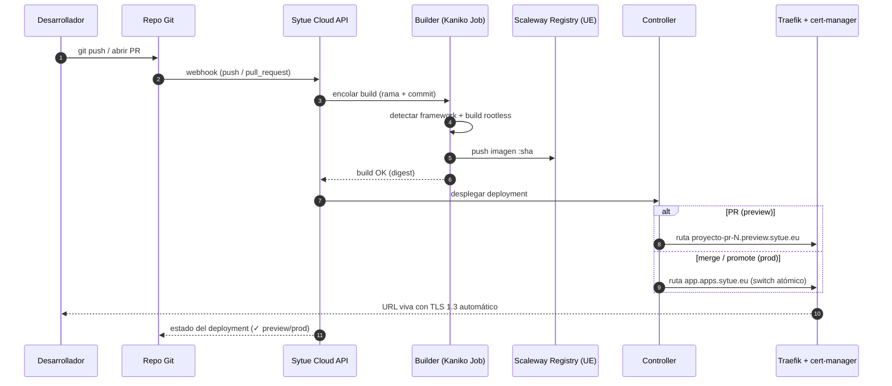

<a id="plantillas-de-proyecto"></a>

#### Project templates

The template catalog (`GET /api/v1/templates`, the panel's **Plantillas** (Templates) screen) is the
entry door for anyone who does not have a project yet. It pursues the feel of a DigitalOcean
“1-Click”, but **does not share its implementation**: a DO 1-Click is a
virtual machine image, and here there are no machines to boot. A Sytue Cloud template
is a **declarative JSON manifest** embedded in the binary
(`services/cloud/internal/domain/templates/*.json`), not a disk image nor a repository
that we clone and claim is deployable.

The catalog is **global and read-only**, just like the instance sizes or the
price list: it lives in embedded files, not in a table. Adding a template means adding a
file — no migration, no CRUD, no RLS.

**Security invariant — a template CANNOT express pod configuration.** The
schema is a closed _allow_ list and is decoded with `DisallowUnknownFields`, so
`securityContext`, `hostNetwork`, `capabilities`, `volumes`, `nodeSelector` or `command` are not
filtered with a deny list —which would have to be extended every time Kubernetes adds a field—
but by simply not being on the list. The PodSpec is still written by the controller. “Secure by
default” is thus the **structural floor**: no template can lower it, neither by mistake nor on
purpose. An invalid manifest crashes startup instead of degrading silently.

Each environment variable declares **where its value comes from**, and that is where the product
promise lies:

| `origin`       | Who provides the value                                                                                                                         |
| -------------- | ---------------------------------------------------------------------------------------------------------------------------------------------- |
| `value`        | A literal from the manifest. **It can never be a secret**: it lives in the repository in plain text forever (declaring it so is a load error). |
| `ask`          | The wizard asks for it. Ideally zero or one per template: each question is one more step between the user and their app.                       |
| `generate`     | **A random secret generated by the platform** and stored encrypted. `secret` is forced to true at parse time: the file does not get a vote.    |
| `from_service` | Injected by the controller from the managed service (§3.5). It is only declared.                                                               |

That is: **the user never invents a password**. It is at once the easiest option (there is nothing
to type) and the most secure one (there is no human password to guess or reuse).

The **license is mandatory** and is validated against a permissive allowlist (MIT, Apache-2.0,
BSD-2/3-Clause, ISC, MPL-2.0). That turns “no AGPL or source-available” into a
mechanical gate of the load test, rather than a human review that gets forgotten.

> **Pending:** atomic creation (`POST /api/v1/projects:from-template`) is not there yet. Today
> creating project + services + variables takes several non-transactional requests, so a
> failure halfway leaves the project half-done.

<a id="34-catalogo-de-servicios-gestionados"></a>

<a id="34-catálogo-de-servicios-gestionados"></a>

### 3.4 Managed services catalog

All services are **FOSS** and run **in the EU**. In **dev** they have a local
equivalent in Docker Compose (dev/prod parity, §15 of the contract); in **prod** they use Scaleway
managed services where applicable.

| Service               | What it does                                             | Engine (prod / dev)                                 | Notes                                                                               |
| --------------------- | -------------------------------------------------------- | --------------------------------------------------- | ----------------------------------------------------------------------------------- |
| **Sytue Postgres**    | Relational database with an **automatic REST API**       | Postgres 18 — Scaleway RDB (prod) / container (dev) | PostgREST (roles `authenticator`/`web_anon`), PgBouncer pooling, backups, branching |
| **Sytue DB Studio**   | Table explorer, SQL editor and API/credentials generator | On top of the project's Postgres instance           | Supabase style **with Sytue design**, embedded in the panel                         |
| **Sytue Storage**     | Per-project S3 object buckets                            | Object Storage (prod) / MinIO (dev)                 | Versioning, encryption at rest, signed URLs                                         |
| **Sytue Cache/Queue** | In-memory cache and queues                               | **Valkey 7** (BSD; replaces Redis)                  | Injects `VALKEY_URL`                                                                |
| **Sytue Functions**   | Serverless (HTTP/event handlers)                         | Own runtime on top of containers                    | Same Kaniko pipeline                                                                |
| **Sytue Cron**        | Scheduled tasks                                          | Controller (Kapsule CronJobs)                       | Triggers Functions or endpoints                                                     |
| **Secrets/Env**       | Variables and secrets per project/environment            | Scaleway Secret Manager → Kubernetes Secret         | **Never in git**; encrypted at rest                                                 |
| **Managed Auth**      | Authentication for customer apps (optional)              | **Sytue ID** (Go service; one realm per project)    | Consistent with the core IdP                                                        |

#### 4.1 Sytue Postgres (+ PostgREST)

The flagship service, Supabase style. When creating it the user gets:

- **A managed Postgres 18 database** (Scaleway RDB in prod, container in dev),
  encrypted at rest and only reachable from the tenant's network.
- **Automatic REST API via PostgREST:** each table/view is exposed as a REST endpoint without
  writing a backend. The credentials and the API URL are injected into the project.
  PostgREST **never** connects as the database owner: it connects with its own role
  (`authenticator`, LOGIN NOINHERIT and without privileges) and resolves requests **without a JWT**
  as `web_anon` (NOLOGIN, with `USAGE` on `public` and nothing else). That is, **by default nothing is
  published**: whatever must be readable without authentication is granted by the customer
  explicitly (`GRANT SELECT … TO web_anon`). Previously the anonymous role was the database owner,
  so the tokenless path had full CRUD and the JWT protected nothing.
- **Pooling with PgBouncer** in front of the instance, to support many short connections
  (typical of serverless/Functions) without exhausting the database.
- Automatic **backups** (dumps to a separate S3 bucket, versioned) and point-in-time restore.
- **Data branching:** create a copy of the database for a branch/PR, so that a preview
  works against isolated data without touching production.

#### 4.2 Sytue DB Studio

A visual explorer and editor **embedded in the dashboard** (it is not a separate app): table
view with row editing, SQL editor with history, schema designer, and an
**API/credentials generator** that shows the PostgREST endpoints and the keys to
consume the database from the app. Same Sytue visual language (`@sytue/ui`, 100% Sytue-native),
light/dark mode and WCAG AA accessibility.

<a id="43-resto-de-servicios"></a>

#### 4.3 Other services

- **Sytue Storage** — per-project S3 buckets (EU Object Storage in prod, MinIO in dev),
  with versioning and encryption at rest; exposes an S3-compatible endpoint and access keys.
- **Sytue Cache/Queue** — managed Valkey 7 for cache and lightweight queues.
- **Sytue Functions** — serverless functions that share the build pipeline (Kaniko) and are
  routed by the platform; ideal for webhooks, short jobs and lightweight APIs.
- **Sytue Cron** — scheduled tasks that invoke Functions or project endpoints.
- **Secrets/Env** — management of environment variables and secrets per project and per environment
  (production vs. preview), backed by Scaleway Secret Manager.
  Secrets are **never** stored in git nor shown after being created.
- **Managed Auth** — optional for customer apps: backed by **Sytue ID** (our own Go
  service; one realm per project), the suite's same core IdP. It gives the customer's app
  login/sign-up without the developer building their own identity system.

<a id="35-conexion-cero-friccion-inyeccion-de-credenciales"></a>

<a id="35-conexión-cero-fricción-inyección-de-credenciales"></a>

### 3.5 Zero-friction connection (credential injection)

The Vercel/Supabase-style differentiator: **creating a service automatically connects it** to the
project's deployments. There is no need to copy connection strings by hand.

- When provisioning **Sytue Postgres**, the platform injects variables such as `DATABASE_URL`,
  `POSTGREST_URL` and the API keys into the environment of each of the project's deployments (prod and
  previews), managed as secrets.
- The same with **Storage** (`S3_ENDPOINT`, `S3_BUCKET`, keys), **Cache/Queue** (`VALKEY_URL`)
  and **Auth** (OIDC issuer/client).
- The credentials live as the project's **Secrets/Env** (Secret Manager → Kubernetes Secret),
  are rotated from the panel and are **never** exposed in the client nor stored in git.
- **Previews** receive, where applicable, credentials to isolated resources (e.g. a Postgres data
  branch) so as not to contaminate production.

**And that is where the SDK comes from.** `@sytue/cloud`
([`packages/cloud`](../apps/frontend/packages/cloud/README.md)) is not configured: it READS that environment.
That is why its first useful line is the very first line —`sytue.table('posts').all()`— with no URL to
copy from the panel nor key to paste into a `.env`. That step is where beginners
give up, and incidentally the most common way for a credential to end up in a commit; here it does not
exist. On top of PostgREST, but without mentioning it: the verbs are `add`, `update`, `remove`,
`find`, `all`. `update` and `remove` **require the row identifier**, so there is no way to
empty a table by accident. And errors translate the SQLSTATE into a next step (“no existe
la tabla «postss», revisa el nombre o créala…” (table “postss” does not exist, check the name or create it…)), in the five languages —the message IS the feature,
and in a language you do not understand it ceases to exist—.

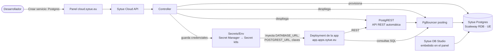

<a id="coste-óptimo-medir-de-verdad-antes-de-aconsejar"></a>

#### Optimal cost: measure for real before advising

The promise is that the customer **always pays the minimum with optimal performance**, and that they
solve it with one click. For that not to be decoration, a gap at the source had to be closed: the
billing meter records `replicas × CONFIGURED memory × hours`, that is, **it charges for
what was requested, not for what is used**, so there was not a single real utilization data point with
which to recommend anything.

- **The sensor** (`internal/controller/rightsizing.go`) samples `metrics.k8s.io` every 15 min and
  stores one maximum per project and bucket in `resource_samples`. Across replicas it keeps the
  **maximum, not the average**: the memory limit applies per pod, so averaging would hide
  precisely the pod that is about to die from OOM. Without `metrics-server` it is a no-op: the
  recommendations stay, rightly, at “not enough data”.
- **The criterion** (`internal/domain/rightsizing.go`) is a **pure** function, and that is why its
  policy can really be tested. Three rules govern it:
  1. **Without enough data there is no recommendation** — an explicit state, never a lukewarm one.
  2. **Going down requires much more evidence than going up.** Going up is proposed with 6 h of observation
     because it protects the service; going down asks for three days, because getting it wrong costs an outage.
  3. **95th percentile for the steady state and MAXIMUM for the risk.** The p95 by definition ignores the
     top 5%, so an app with a single burst would seem to fit comfortably in a smaller
     size — and would fall over at the first peak. Going down also requires the observed peak to fit.
- **There is no “apply” endpoint**: applying the recommendation is `PATCH /projects/{id}`, which already
  validates, audits and respects the quota. The “1 click” lives in the interface, not in a new API
  verb that could skip any of those three.

When the steady state would fit but the peak would not, it is stated with its own reason (`peak_blocks_downgrade`)
instead of being kept quiet: the difference between “you cannot save” and “you cannot save **because of this**” is
what the customer needs in order to decide.

**In the first days, the gap is covered by comparable apps.** Requiring three days of its own
history leaves without advice precisely the window in which the customer chose a size blindly and almost
always overshot. `internal/domain/benchmark.go` aggregates consumption per **cohort** —framework +
services + size— and publishes it in `sizing_benchmarks`, a table **with no `tenant` column** because
no row belongs to anyone: each one summarizes **at least 5 different companies**, counted by
tenant and not by project (with projects, a single customer would only need to create five to
“anonymize” itself).

The threshold is applied **at publish time and not at query time** —a cohort that does not reach it is not written, so
the read path cannot filter it badly— and it is replicated as `CHECK (tenants >= 5)` in
migration `0029` on purpose: lowering it requires touching both halves. Only
percentages of the size's limit are published, never absolute figures. Each recomputation **replaces the
whole table**: a cohort that today gathers four companies disappears, whereas with `upsert`
it would stay published forever with the figures from the day it did reach the threshold.

On top of the recommendation, the cohort has two hard limits: **its own history always wins**
(it only fills in `insufficient_data`) and **it never proposes going up nor goes down more than one step** —going up based on
the consumption of third parties is charging more to someone we know nothing about, and jumping two sizes
with zero own data is a gamble—. The reason that reaches the screen is
`cohort_over_provisioned`, different from `over_provisioned` so that the interface cannot say
“we have measured your app” when what was measured are other people's; the text names how many companies are
behind it. See [ADR 0028](./decisions.md#0028).

<a id="36-pantallas-del-dashboard-cloudsytueeu"></a>

### 3.6 Dashboard screens (`cloud.sytue.eu`)

Sytue design, modern and 100% native: **left sidebar** + **top bar** (`@sytue/shell`: 9-dot app
switcher, global search, notifications, presence, account) + content area.
Few screens, obvious actions, plain language.

- **Project overview** — status of the latest production deployment, live URL,
  recent activity, shortcuts to logs and to the connected services.
- **Deployments** — list of deployments (prod + previews) with commit, branch, status and
  build duration; **Promote** and **Rollback** actions; link to the originating PR.
- **Services** — catalog (Postgres, Storage, Cache/Queue, Functions, Cron, Auth) and the
  services already created, with their status and a **create** button that provisions and injects
  credentials with no further steps.
- **DB Studio** — table explorer, SQL editor and API generator (embedded section of the
  Sytue Postgres service).
- **Storage** — browser of the project's buckets/objects.
- **Logs** — build and runtime logs per deployment, streaming, with filters.
- **Settings / Env** — environment variables and secrets per environment (prod vs. preview),
  framework and build commands, custom domains.
- **New project: create the repository** — the path for whoever does not have one yet.
  Cloud creates one for them in **Sytue Git** by copying the stack's skeleton —a
  TEMPLATE repository of the forge, declared in `starter_repo`, not a file tree inside the
  binary— and applies the settings template on top with `ApplyTemplate`. The credential is an
  **OAuth2 application registered in the forge**, not an administrator token: what Cloud
  can do is exactly what that user consents to, and they revoke it from their account. The
  token is used to create the repository and **is discarded** —no table, no encryption at rest, no
  refresh—. The intent travels through the ephemeral cache and the `state` is an opaque identifier:
  a self-contained one would be written by the browser, and with it the tenant would be chosen.
- **New project: existing repository** — pasting the repository URL is enough: the control plane LOOKS at it through the
  API of its forge (`GET /inspect-repo` → `builder.InspectRepo`) and deduces framework, strategy,
  commands and output directory, which is what the form used to ask and is written in the
  repo. The evidence is shown —“Astro, because of `astro.config.mjs`”— along with a button to set it by hand:
  being right 95% of the time leaves the other 5% trapped if there is no way to change it. Creation never
  fails: an unknown forge, a private repository or a server that is down return `detected:false` and the form
  asks as before. The request goes out to a host the user types, so it is bounded
  by two independent gates —an allowlist of forges and the SSRF guard—.
- **Domains** — add a custom domain with `CNAME` → `ingress.sytue.eu` instructions,
  verification and TLS certificate status.
- **Simple observability** — usage, metrics and consumption per project, in plain language, without
  cloud jargon, the basis for per-tenant billing.
- **Apps** — a catalog of open-source products that are brought up ALONGSIDE the customer's (cache,
  search engine, queue, CMS) with **multiple selection**: several are chosen and start together. They connect
  in two directions and the user wires neither: `exports` declares which variables the CUSTOMER'S APP
  receives (`VALKEY_URL`, `MEILI_URL`…) and `integrations` what one catalog app receives from ANOTHER
  when they coexist in the project, with the URL of the official documentation that backs it
  ([ADR 0032](./decisions.md#0032)). It works in any order: adding or deleting an app
  **re-enqueues** the ones that integrate with it, because a `ready` service does not reconcile on its own.
  The customer **chooses from the catalog; they do not write an image** ([ADR 0029](./decisions.md#0029)): pinned
  digest, EU registry, verified license and mandatory limits. Permissive and strong
  copyleft licenses are allowed —the image runs unmodified, and the digest identical to the upstream one proves it—,
  with a mandatory link to the source; never “source available”. They are deployed under the PodSecurity
  `restricted` profile —no privileges, read-only root, the manifest's non-root UID—, and **publishing them
  on the internet is decided by the catalog** (`web_port`), not by the customer: a CMS gets its hostname with TLS,
  a queue's admin panel does not, and there is no checkbox to tick.
- **Analytics** — the app's visits, enabled with one click and **without touching the code**. It is a
  section of this panel and not a separate app ([ADR 0026](./decisions.md#0026)): enabling it means
  registering the hostname, because the `/_sytue` route is already published by the control plane in the project's
  Ingress. The `<script>` tag is injected by the build itself into all the HTML that Sytue Cloud
  builds (`builder.analyticsInjectStep`, frameworks astro/static/node), so it is always there; the
  switch is the collector, which returns **404 on `/_sytue/s.js`** while the hostname is not
  registered. The other way round —injecting only when it is enabled— would turn “enable analytics” into
  “rebuild and redeploy”. With a custom image (Dockerfile or Go) the HTML does not pass through our
  hands and the panel offers the line to paste. Only an **own** host can be claimed
  —the production URL or a **verified** domain—, and the check requires a
  live control plane: the host is globally unique in Analytics, so whoever registers it first leaves
  the real owner unable to measure it. The visitor figure is always shown labeled as **sum
  of daily uniques**, which is what the architecture allows to be computed.

<a id="37-principios-de-simplicidad"></a>

### 3.7 Simplicity principles

1. **Zero-config by default.** The happy path asks for no configuration; framework detection
   and sensible defaults cover the common case.
2. **Project-centric.** Almost everything is done from the project; few screens, flat navigation.
3. **Plain language, no cloud jargon.** "Connect repo", "Promote", "Rollback", "Create
   database" — no IAM, VPC peering or service accounts.
4. **Automatic connection.** Creating a service connects it by itself; there is no manual copying of
   credentials.
5. **Total visual consistency.** Same design system as the rest of the suite (`@sytue/ui` +
   `@sytue/shell`), light/dark and WCAG AA; no ad-hoc UI.
6. **Sovereignty and security by default.** EU only; TLS 1.3; encryption at rest; secrets in
   Secret Manager, materialized directly in Kubernetes, never in git.
7. **Dev/prod parity.** Each managed service has a local equivalent (Postgres + PostgREST
   - MinIO + Valkey in Compose), so that what works locally works on Scaleway.

<a id="38-arquitectura-interna-resumen"></a>

### 3.8 Internal architecture (summary)

`services/cloud/` (Go, Apache-2.0 © 2026 Daniel Delgado Ramos (thinkddr)):

- **`api/`** — the platform's control API (projects, deployments, services, domains,
  env/secrets). Authorizes with **Sytue ID** tokens (clients `sytue-cloud` / `sytue-cloud-api`).
  Dev port `8090`.
- **`builder/`** — orchestrates builds: receives webhooks, detects the framework and launches **Kaniko** Jobs
  (rootless) that publish images to Scaleway Registry. Dev port `8091`.
- **`controller/`** — reconciles the desired state in Kapsule: deploys contents
  (Serverless Containers or the tenant's namespace), provisions managed services, manages
  Traefik routes, TLS (cert-manager) and CronJobs.

Frontend: app `cloud-dashboard` (Astro + Preact) in `apps/frontend/apps/`, dev port
`4323`, mounting `@sytue/shell` and `@sytue/ui`, with OAuth SSO and the BFF's host-only cookie.

<a id="39-referencias"></a>

### 3.9 References

- Canonical contract: [`docs/CONVENTIONS.md`](./CONVENTIONS.md) (§1, §6, §9, §14, §15).
- General architecture: `docs/architecture.md` · Security/GDPR: `docs/security.md#1-seguridad-y-rgpd`.
- Design: `docs/design.md#2-sistema-de-diseno` · Integration: `docs/architecture.md#2-integracion-seamless-shell--hub`.

---

<a id="4-integration-gateway-saliente"></a>

## 4. Integration Gateway (outbound)

> **What it is.** The **single gateway** through which Sytue talks to the third-party software that
> the organization already uses (Microsoft 365, Google Workspace, Salesforce, Jira, Odoo…):
> `services/integrations`, dev port **8093**, an internal subdomain of the same Go module
> `git.sytue.eu/sytue/one`. It is the **outbound** side of interoperability; the
> **inbound** side —Sytue posing as Slack/Teams/Google/Microsoft so that
> already-written integrations work unchanged— lives in
> [`architecture.md#5-capa-de-compatibilidad-entrante`](./architecture.md#5-capa-de-compatibilidad-entrante).
>
> **Not to be confused with** [`architecture.md#2-integracion-seamless-shell--hub`](./architecture.md#2-integracion-seamless-shell--hub), which describes the suite's
> _internal_ integration (common shell, SSO, federated search, cross-app intents). This doc
> is the SoT for integration with **third parties**.
>
> Names, ports and versions: [`CONVENTIONS.md`](./CONVENTIONS.md) (§6 registers port
> 8093).

---

<a id="40-objetivo-y-modelo-de-negocio-byo-saas"></a>

### 4.0 Goal and business model (BYO-SaaS)

An organization that adopts Sytue does **not throw away** the rest of its SaaS estate. The gateway
exists so that Sytue becomes the **center** of that estate instead of one more island:

- **One sign-up in Sytue ID = access to everything**, including third-party SaaS (Sytue acts as an outbound
  IdP: SAML/OIDC).
- **BYO-SaaS** (_bring your own SaaS_): Sytue does **not resell** the Salesforce or
  Microsoft 365 license. The customer brings their own account/tenant; Sytue brings the **identity,
  provisioning, data, embedding and governance** on top of it. The connected
  SaaS appears in the suite as **one more Sytue product** (a tile in the launcher).
- **A single exit door.** No other part of the suite calls a third party on its own:
  if it leaves Sytue towards the Internet on behalf of an organization, it leaves through here and
  is audited.

**Product directive (permanent).** Every configuration surface of this gateway
—like that of the rest of the suite— is implemented with **guided UX in the style of Apple + Vercel +
DigitalOcean**: clean, step by step, in plain language, so that a basic administrator
connects an application **without reading documentation**. Never the density of Google Cloud/AWS nor
a “wall of forms”. The mandatory primitives are in `@sytue/ui`; see
[`design.md#2-sistema-de-diseno` §8](./design.md#2-sistema-de-diseno).

---

<a id="41-enforcement-central-por-construccion"></a>

<a id="41-enforcement-central-por-construcción"></a>

### 4.1 CENTRAL enforcement by construction

The security guarantee is not a convention (“remember to use the secure client”) but
a **structural impossibility**: in `services/integrations` there is **a single factory** of egress
`*http.Client` —`policy.BuildRuntime` (`internal/policy/policy.go`)— and a driver
**only** receives the `Runtime` it builds. A driver cannot build its own because it
never sees credentials with which to authenticate.

Each outbound request goes through, in this order, inside a single `http.RoundTripper`:

| #   | Stage                 | Implementation                                                            | What it guarantees                                                                                                                                                                |
| --- | --------------------- | ------------------------------------------------------------------------- | --------------------------------------------------------------------------------------------------------------------------------------------------------------------------------- |
| 1   | **SSRF-safe**         | `ssrfhttp.ValidateURL` + `ssrfhttp.Transport()` (`platform/pkg/ssrfhttp`) | Double barrier: revalidation of the URL before connecting and _dial_ to an already-validated IP. Never an internal/link-local host.                                               |
| 2   | **Rate-limit**        | `httpx.RateLimiter`, key `org:instance`                                   | Egress budget per instance, shared across replicas (state in PostgreSQL). Exceeded ⇒ `ErrRateLimited`.                                                                            |
| 3   | **Audit**             | `egress_audit` via `AuditSink`                                            | One row per request: host, method, status, bytes, latency. `Authorization` is persisted as `REDACTED`; **never** the token or the body.                                           |
| 4   | **Policy / DLP (L5)** | `policy.Engine.Hook`                                                      | Evaluates `allow \| warn \| block` **before** connecting. A `block` never goes out (and that is why it leaves no row in `egress_audit`: its only evidence is `policy_decisions`). |
| 5   | **Auth injection**    | clone of the request + `Authorization: Bearer …` from the vault           | **The driver never sees the token.** The `Instance` it receives carries an empty `Secrets`.                                                                                       |

In addition, the resulting client **does not follow redirects that change host**: since auth is
injected on each hop, a cross-host redirect would leak the Bearer. Maximum 5 hops (configurable),
each one revalidated against SSRF. Per-request timeout 15 s by default.

> The audit is _best-effort_ and has its own context (5 s): the request has already gone out, breaking the
> response because of a write failure adds nothing. Synchronous write per egress — marked in
> the code as a known ceiling (batch/async if volume gets tight).

---

<a id="42-contrato-de-conector-capacidades-opcionales"></a>

### 4.2 Connector contract: optional capabilities

`internal/connector/connector.go` defines the minimal surface. A driver implements **only
what its SaaS supports**; the core detects the rest by _type assertion_ (same idiom as
`services/hub`). Nothing monolithic, no giant interface with methods that return
“not supported”.

| Interface          | Mandatory | Signature (summary)                                      | Use                                                                                                    |
| ------------------ | --------- | -------------------------------------------------------- | ------------------------------------------------------------------------------------------------------ |
| `Driver`           | **Yes**   | `Kind() string`, `Test(ctx, inst, rt) error`             | Driver identity + end-to-end verification of the connection.                                           |
| `Provisioner`      | No        | `Sync(ctx, inst, rt) error`                              | Provisioning (L2). Implemented by the outbound SCIM driver.                                            |
| `TabularSource`    | No        | `Query(ctx, inst, rt, spec) (Table, error)`              | Data (L3) towards Sytue Sheets. Same `{columns, rows}` _shape_ as `services/docs/internal/connectors`. |
| `EmbedBroker`      | No        | `EmbedToken(ctx, inst, rt, req) (Embed, error)`          | Embedding (L4): server-side minting of a short-lived token.                                            |
| `EventSink`        | No        | `HandleWebhook(ctx, inst, rt, body, headers) error`      | Incoming webhooks from the third party, already authenticated by the core.                             |
| `SearchCapability` | No        | `Search(ctx, inst, rt, q, limit) ([]ExternalHit, error)` | Federated search: results normalized to `ExternalHit`.                                                 |

The `Registry` indexes by `Kind` and supports template **aliases**, because the real dispatch is
by the instance's `template_key` and it does not always match the `Kind` of the driver that
serves it (`jira-cloud → jira`, `microsoft365 → graph`, `google-workspace → gws`).

---

<a id="43-catalogo-declarativo-manifiesto--semillas"></a>

<a id="autenticación-hacia-el-saas-oauth-20-preferente"></a>

#### Authentication towards the SaaS: OAuth 2.0 preferred

**Product policy: every integration authenticates with OAuth 2.0 whenever the SaaS
allows it.** A static token does not expire, is not scoped, cannot be revoked without regenerating it
by hand, and forces the administrator to go and create it in the third party's panel — the opposite of the
1-click that §8 of the [design](./design.md) demands. Static token or Basic only when the
SaaS offers nothing else, and saying so.

Order of preference when adding or touching a driver:

1. **authorization_code + refresh** (3LO) — when acting on behalf of the
   organization is needed and the provider requires consent;
2. **client_credentials** (2LO) — app-to-app;
3. **JWT bearer** (RFC 7523) — service accounts;
4. static token — last resort, justified in the manifest.

Status (2026-07-28): `graph` uses client_credentials against Entra and `gws` JWT bearer with
domain-wide delegation. `jira` and `servicenow` go with Basic, and `salesforce`,
`odata`, `odoo`, `databricks` and `powerbi` with a token pasted by the administrator. The
last five —except `odata`, which is a generic protocol against arbitrary customer
servers— have OAuth available in their SaaS and are the natural candidates.

**`internal/oauth2` is the only place that mints tokens.** It caches by key —organization,
instance and, if the provider distinguishes them, delegated subject and scope— with a renewal
margin, and exposes `Forget` to drop a token revoked ahead of time. Before, each
driver repeated the POST, the parsing and the error handling, and none of them cached: Microsoft
Graph asked for a new token **on every query**.

The exchange **goes out through `Runtime.HTTP`**, the only egress door: requesting a token is outbound
traffic towards a third party like any other, so it goes through the SSRF-safe destination,
per-organization rate-limit, audit and policy, instead of opening a parallel door. The
`client_secret` travels in the form body, which the audit does not persist.

<a id="despacho-por-capacidad-no-por-plantilla"></a>

#### Dispatch BY CAPABILITY, not by template

The manifest names, for each capability, the **driver Kind** that serves it:
`"provisioning": "scim"` and `"data": "jira"` are not descriptive labels — they are registry
keys. An instance uses **several drivers at once**, each with its own credential: Jira
provisions via SCIM and queries via JQL with different tokens.

For a long time the six dispatch points resolved the driver by `template_key`, so
each instance could only have one. What that caused, measured before the fix:

- **Provisioning did not work in ANY template** even though 14 declared it:
  `POST /instances/{id}/sync` always returned 400. Worse: `Activate` enqueued the first sync,
  which died after 8 retries in the outbox **silently**, while the interface promised
  “automatic sign-ups and removals”.
- The three templates that did resolve (via `Registry.Alias`) resolved to the **data** driver,
  which does not implement `Provisioner`.
- `POST /instances/{id}/test` failed in the 12 templates without a same-named driver.

Today `Manifest.DriverFor(capability)` resolves each one separately and `Registry.Alias` no longer
exists: it was the patch hiding the defect. The catalog **does not load** if it declares a
capability that nobody can serve — `provisioning: "scim"` requires `scim_base_url` and `secret`—, and
a test runs the 18 seeds against the service's real registry.

`POST /test` tests **each capability** and returns one result per capability; an
SSO-only connection responds `200` with an empty list instead of the old 400: there is no outbound credential
to verify, and sign-in is tested by the SP/client itself created in Sytue ID.

The `Authorization` header that a driver has already set **wins** over the vault's bearer
(Jira and ServiceNow compose Basic). It used to be overwritten, so as soon as an instance stored
a `bearer` for another of its capabilities, its queries returned 401.

<a id="43-catálogo-declarativo-manifiesto--semillas"></a>

### 4.3 Declarative catalog: manifest + seeds

Adding a SaaS to the catalog means **adding a file**, with no migration or code:
`services/integrations/db/seeds/templates/<clave>.json`. The file carries `key`, `tier` and a
`manifest` that `internal/manifest` **validates at startup** (a badly written seed is a
startup error, not a silently broken catalog).

Manifest fields (`internal/manifest/schema.go`):

| Field                             | Values                       | Note                                                                                                             |
| --------------------------------- | ---------------------------- | ---------------------------------------------------------------------------------------------------------------- |
| `name`, `description`, `category` | text                         | Presentation of the tile “as a Sytue product”.                                                                   |
| `color`                           | `#hex` or `var(--token)`     | Tile accent; the format is validated.                                                                            |
| `icon`                            | **inline SVG**               | Curated in the repo. Never a _hotlink_ to a third party.                                                         |
| `identity.kind`                   | `saml` \| `oidc` \| `none`   | SAML requires `entity_id` + `acs_url`; OIDC requires ≥1 `redirect_uri`.                                          |
| `provisioning`                    | `scim` \| `none`             | `scim` schedules the outbound sync on activation.                                                                |
| `data`                            | `Kind` of the tabular driver | `""` if the app exposes no data.                                                                                 |
| `embed`                           | boolean                      | Reserved for `EmbedBroker`: validated today, not acted upon.                                                     |
| `launch.kind`                     | `initiate` \| `url`          | `initiate` = IdP-initiated SAML SSO (URL issued by Sytue ID); `url` = direct template.                           |
| `fields`                          | **at most 3**                | A 1-click sign-up does not ask for a long form: subdomain/host/instance and little else.                         |
| `secret`                          | `{label, help}`              | The **only** write-only secret the admin provides; it travels separately (`PUT /secrets`) and is never returned. |

Hard invariants of the schema: `DisallowUnknownFields` (an unknown field is an error),
field keys `^[a-z][a-z0-9_]{0,30}$` (they never collide with the gateway's internal keys,
prefixed with `_`), and **every `{campo}` template in a URL must reference a
declared field** — no unresolved placeholder is left in an outbound request.

---

<a id="44-los-cinco-niveles-de-integracion-l1l5"></a>

<a id="44-los-cinco-niveles-de-integración-l1l5"></a>

### 4.4 The five integration levels (L1–L5)

| Level                 | What it solves                                                                                                                                                                                                                                                                                    | Where it lives                                                                                                                                                | Status        |
| --------------------- | ------------------------------------------------------------------------------------------------------------------------------------------------------------------------------------------------------------------------------------------------------------------------------------------------- | ------------------------------------------------------------------------------------------------------------------------------------------------------------- | ------------- |
| **L1 — SSO**          | Sytue ID as an outbound IdP: **SAML 2.0 IdP** (`/saml/idp/metadata`, `/saml/idp/sso`, `/saml/idp/initiate/{spID}`, `/saml/idp/slo`), **per-organization OIDC clients** and **Dynamic Client Registration RFC 7591** (`POST /oauth2/register` with a 24 h _initial access token_, PKCE mandatory). | `services/id` (`internal/saml/idp.go`, `internal/http/dcr.go`, mig `0017_outbound_identity`)                                                                  | **Delivered** |
| **L2 — Provisioning** | **Outbound SCIM 2.0** (RFC 7643/7644): creates/updates/deactivates users and groups _in_ the SaaS. **Idempotent diff-based** reconcile, adopts pre-existing resources by `userName eq` instead of duplicating them and **deactivates, never deletes**.                                            | `services/integrations/internal/scimout`, tables `scim_map` + `sync_runs` (mig `0002_scim_out`)                                                               | **Delivered** |
| **L3 — Data**         | The SaaS data comes into **Sytue Sheets** as a tabular source.                                                                                                                                                                                                                                    | 9 drivers (§5) + `POST /instances/{id}/data/query`; consumed in `services/docs/internal/connectors/gateway.go` (`KindGateway`)                                | **Delivered** |
| **L4 — Embedding**    | A **Power BI** report lives inside a **Sytue Docs** document, with a token minted **server-side** (app-owns-data), short TTL, delivered over a secure channel (server→BFF→`postMessage`); never in a query string nor persisted in the browser.                                                   | `internal/driver/powerbi/powerbi_embed.go`, `POST /instances/{id}/embed/token`; editor block in `apps/frontend/packages/office/src/editor/canvas/embedDom.ts` | **Delivered** |
| **L5 — Governance**   | Policy/DLP rules evaluated **inside** the single RoundTripper + egress audit + decision log + export.                                                                                                                                                                                             | `internal/policy/engine.go`, tables `policies` + `policy_decisions` (mig `0003_governance`)                                                                   | **Delivered** |

<a id="41-alcance-honesto-de-la-dlp-l5"></a>

#### 4.1 Honest scope of the DLP (L5)

Rules match on egress **metadata** —`api_family` (= `template_key`), `host` (exact
or suffix `.dominio.com`), `method`, `path_prefix`— combined with AND; empty fields are
wildcards. That part is the **hard guarantee**.

`body_contains` is a _best-effort_ extra: a substring match on a **prefix bounded to 64 KiB** of the
body, only if some rule asks for it and the body is re-readable. It is **not** deep inspection:
no decompression, no parsing, no regex (and therefore no ReDoS). Real content
classification is future work and is marked as such in the code.

A `block` returns **403** to the user (“your organization forbids it”), not a network error.

---

<a id="45-drivers-y-catalogo-de-saas-conectables"></a>

<a id="45-drivers-y-catálogo-de-saas-conectables"></a>

### 4.5 Drivers and catalog of connectable SaaS

<a id="51-drivers-registrados-10-kind"></a>

#### 5.1 Registered drivers (10 `Kind`)

`services/integrations/cmd/integrations/main.go`:

| Kind         | Protocol/API                  | Capabilities                        |
| ------------ | ----------------------------- | ----------------------------------- |
| `scim`       | Outbound SCIM 2.0             | `Provisioner`                       |
| `odata`      | OData v4 (SAP and compatible) | `TabularSource`                     |
| `odoo`       | Odoo JSON-RPC                 | `TabularSource`                     |
| `databricks` | Databricks SQL Statement API  | `TabularSource`                     |
| `powerbi`    | Power BI (DAX + embed)        | `TabularSource`, `EmbedBroker`      |
| `graph`      | Microsoft Graph               | `TabularSource`, `SearchCapability` |
| `gws`        | Google Workspace Directory    | `TabularSource`, `SearchCapability` |
| `salesforce` | SOQL                          | `TabularSource`, `SearchCapability` |
| `servicenow` | Table API                     | `TabularSource`, `SearchCapability` |
| `jira`       | JQL                           | `TabularSource`, `SearchCapability` |

<a id="52-catálogo-1-click--34-plantillas-dbseedstemplatesjson"></a>

#### 5.2 1-click catalog — **34 templates** (`db/seeds/templates/*.json`)

| Key                       | Name                    | Category           | Tier | Identity | SCIM | Data         | Launch   |
| ------------------------- | ----------------------- | ------------------ | ---- | -------- | ---- | ------------ | -------- |
| `github-enterprise`       | GitHub Enterprise       | Engineering        | 1    | OIDC     | —    | —            | url      |
| `jira-cloud`              | Jira Cloud              | Engineering        | 1    | SAML     | ✓    | `jira`       | initiate |
| `odoo`                    | Odoo                    | ERP                | 1    | OIDC     | —    | `odoo`       | url      |
| `salesforce`              | Salesforce              | CRM                | 1    | SAML     | ✓    | `salesforce` | initiate |
| `asana`                   | Asana                   | Project management | 2    | SAML     | ✓    | —            | url      |
| `aws-iam-identity-center` | AWS IAM Identity Center | Identity           | 2    | SAML     | ✓    | —            | initiate |
| `box`                     | Box                     | Storage            | 2    | SAML     | ✓    | —            | url      |
| `confluence`              | Confluence Cloud        | Documentation      | 2    | SAML     | ✓    | —            | url      |
| `dropbox`                 | Dropbox Business        | Storage            | 2    | SAML     | ✓    | —            | url      |
| `google-workspace`        | Google Workspace        | Productivity       | 2    | SAML     | —    | `gws`        | initiate |
| `microsoft365`            | Microsoft 365           | Productivity       | 2    | —        | —    | `graph`      | url      |
| `miro`                    | Miro                    | Collaboration      | 2    | SAML     | ✓    | —            | url      |
| `notion`                  | Notion                  | Productivity       | 2    | SAML     | ✓    | —            | url      |
| `servicenow`              | ServiceNow              | Service management | 2    | SAML     | ✓    | `servicenow` | initiate |
| `slack`                   | Slack                   | Communication      | 2    | SAML     | ✓    | —            | initiate |
| `snowflake`               | Snowflake               | Data               | 2    | SAML     | ✓    | —            | initiate |
| `tableau`                 | Tableau Cloud           | Analytics          | 2    | SAML     | ✓    | —            | initiate |
| `zoom`                    | Zoom                    | Communication      | 2    | SAML     | ✓    | —            | initiate |
| `gitlab`                  | GitLab.com (group)      | Engineering        | 2    | SAML     | —    | —            | url      |
| `saml-generica`           | SAML application (any)  | Identity           | 2    | SAML     | —    | —            | initiate |

> The table lists the templates with SAML/OIDC identity from the first batch; the rest
> (`airtable`, `azure`, `databricks`, `docusign`, `github`, `github-com`, `hubspot`,
> `microsoft-teams`, `monday`, `odata`, `okta`, `powerbi`, `sytue`, `trello`, `zendesk`)
> are in `db/seeds/templates/` and in the seed test, which is the authoritative list.
>
> **`saml-generica` is the template that closes the catalog**: a SaaS without its own entry
> gets in just the same by pasting its Entity ID and its ACS. With it, “sign in with Sytue” works
> for any service that speaks SAML 2.0 — what an organization expects from its
> Google Workspace or Microsoft account, without Google or Microsoft seeing anything.

> **Known gap.** The `powerbi`, `databricks` and `odata` drivers **do not have a seed
> template** yet, and the catalog is only populated from `db/seeds/` (there is no template
> creation endpoint). Until their files are added, an instance of those
> three cannot be created from the catalog, even though the driver is wired and tested. The Docs
> embed block already filters by `template_key === 'powerbi'`.

<a id="53-activación-1-click-y-materialización"></a>

#### 5.3 1-click activation and materialization

`POST /instances/{id}/activate` **materializes** the instance according to its manifest
(`internal/manifest/materialize.go` + `internal/directory/idapps.go`):

1. Registers the **outbound** identity in Sytue ID: a SAML SP (`idp_initiated=true`,
   `enabled=true`) or an OIDC client via DCR, using the same `client_credentials` token of the
   `sytue-gateway` client that is already cached per organization.
2. Resolves the tile's **launch URL** (Sytue ID's `initiate_url`, or the manifest's
   `{campo}` template already rendered).
3. If the template provisions, **schedules the first SCIM sync**.

It is **idempotent** (reactivating does not recreate the SP/client) and **de facto transactional**: if
persistence fails after creating the resource in Sytue ID, it is **rolled back** — it leaves no orphans.
The generated credentials are returned **only once**. `POST /deactivate` reverts it.

---

<a id="46-los-saas-conectados-como-productos-sytue"></a>

> **Honest scope of provisioning (2026-07-28).** Only `slack` and
> `aws-iam-identity-center` declare SCIM: Slack's root is known and AWS's is provided
> by the admin themselves in a field. The other 12 were switched to `provisioning: "none"` — **they never
> worked**, and writing their SCIM URL without verifying it against the vendor's documentation
> would have traded a noisy failure for a silent one. Re-enabling one means **adding
> `scim_base_url` to its JSON**, without touching code: the validator and the seed test say whether the
> declaration is servable.

### 4.6 Connected SaaS as Sytue products

| Surface                                                       | File                                                                                       | What it shows                                                                                                                                                                                                                  |
| ------------------------------------------------------------- | ------------------------------------------------------------------------------------------ | ------------------------------------------------------------------------------------------------------------------------------------------------------------------------------------------------------------------------------ |
| **Console → “Integraciones” (Integrations)**                  | `apps/frontend/apps/console/src/pages/apps.astro` + `components/AppsPanel.tsx`             | Two sections: connected instances (open/test/sync/deactivate) and the catalog of what can be connected. Gate: role `admin\|owner` + permission `apps.manage`.                                                                  |
| **“Conectar una aplicación” (Connect an application) wizard** | `components/ConnectAppWizard.tsx`                                                          | 6 steps: choose → explain what will be enabled → configure → **test the connection** → review → done. The draft instance is created when testing and **is deleted on cancel** (no orphan instances). The secret is write-only. |
| **Portal → “Mis apps” (My apps)**                             | `apps/frontend/apps/portal/src/components/Launcher.tsx` (section “Conectadas” (Connected)) | Tiles of the active apps, with the manifest's icon and color, next to the native Sytue products.                                                                                                                               |

The backend of the tiles is `GET /api/v1/my-apps` (`internal/http/handlers_myapps.go`): it crosses
the active instances with the in-memory catalog, scoped by RLS. The portal's BFF
(`src/pages/api/my-apps.ts`) resolves the session cookie to a Bearer server-side and **degrades to an
empty list with 200** if the gateway does not respond: a gateway that is down does not break the launcher.

---

<a id="47-busqueda-federada-el-saas-conectado-aparece-en-sytue-hub"></a>

<a id="47-búsqueda-federada-el-saas-conectado-aparece-en-sytue-hub"></a>

### 4.7 Federated search: the connected SaaS shows up in Sytue Hub

The suite's unified search includes the content of the connected SaaS **without per-source
code in the frontend**:

```
Shell/portal → BFF /_hub/* → Hub GET /api/v1/search
                                   └─ fan-out a drive · mail · calendar · contacts · rooms · integrations
                                                                                        │
                                        Gateway GET /api/v1/search ────────────────────┘
                                                   └─ fan-out concurrente a las instancias activas
                                                      cuyo driver implementa SearchCapability
```

- **Hub (Go).** `services/hub/internal/connectors/integrations.go` calls the gateway
  propagating the user's Bearer and maps `{hits:[{title,url,snippet,kind,source}]}` to the
  canonical `domain.SearchHit`. Registered in `cmd/hub/main.go` together with the rest of the connectors;
  `SourceIntegrations = "integrations"` is part of `AllSources()`. Config
  `INTEGRATIONS_BASE_URL` (default `http://integrations:8093`).
- **Gateway.** `GET /api/v1/search?q=&connections=&limit=` with bounded concurrent fan-out and
  **per-connector degradation** (a slow or down SaaS does not bring the search down).
- **Consumers.** `packages/shell/src/GlobalSearch.tsx` and `apps/portal/src/pages/buscar.astro`
  receive the results unchanged.

> **Cosmetic pending item (verified).** `integrations` is not a `ProductKey` of the design
> system: `productColor` and `SOURCE_ALIAS` do not map it, so the results group is
> labeled literally “integrations” and without an icon. The results **do** appear.

---

<a id="48-modelo-de-datos-y-aislamiento"></a>

### 4.8 Data model and isolation

All durable state in PostgreSQL, with **deny-by-default RLS per organization**
(`org_id` = slug, compared with `current_setting('app.tenant', true)`), `ENABLE` + `FORCE`
and a **non-superuser** application role (`integrations_app`).

| Migration         | Tables                                                                                                        | Note                                                                                                                                                                                    |
| ----------------- | ------------------------------------------------------------------------------------------------------------- | --------------------------------------------------------------------------------------------------------------------------------------------------------------------------------------- |
| `0001_core`       | `app_templates`, `app_instances`, `instance_secrets`, `egress_audit`, `events_outbox`, `platform_rate_limits` | `app_templates` is a **global** catalog (no RLS: public to any authenticated user). `instance_secrets` stores AES-256-GCM (`encv1`), opened only in memory when building the `Runtime`. |
| `0002_scim_out`   | `scim_map`, `sync_runs`                                                                                       | Local↔remote correlation and reconciliation log (keyset per instance).                                                                                                                  |
| `0003_governance` | `policies`, `policy_decisions`                                                                                | Rules (`jsonb` condition compiled in Go) and append-only log of `block`/`warn` decisions, correlated by `X-Request-Id`. Metadata only.                                                  |

The outbox relay processes the SCIM reconciliation jobs enqueued by
`POST /instances/{id}/sync`, with backoff/retries and _exactly-once_ across replicas via
`FOR UPDATE SKIP LOCKED`.

---

<a id="49-api-http-internalhttproutergo"></a>

### 4.9 HTTP API (`internal/http/router.go`)

The whole API requires a **Sytue ID JWT** with an active organization (`RequireAuth` +
`RequireTenant`, which sets the RLS tenant).

**“lista” (list)** (NEG-06, decided by the owner on 2026-10-16): querying goes out with the
organization's credential, so it is done by the administrators, whoever created the connection and the people or
groups on its list; everyone else receives 403 `connection_not_allowed`. Connections older than
the list did not store a creator and were left for administrators only. “Bringing over your own stuff”
(`/migrations/self`) does not go through the list: it only reads the caller's data.

| Method and route                                                                   | Authorization                     | What it does                                                                                          |
| ---------------------------------------------------------------------------------- | --------------------------------- | ----------------------------------------------------------------------------------------------------- |
| `GET /api/v1/templates`                                                            | member                            | Catalog of installable templates.                                                                     |
| `GET /api/v1/my-apps`                                                              | member                            | Tiles of connected apps for the launcher.                                                             |
| `GET /api/v1/instances` · `GET /api/v1/instances/{id}`                             | member                            | The organization's instances.                                                                         |
| `GET /api/v1/instances/{id}/sync-runs`                                             | member                            | Reconciliation history.                                                                               |
| `GET /api/v1/search`                                                               | member                            | Federated search over the connected SaaS, only in the connections the searcher can query.             |
| `POST /api/v1/instances/{id}/data/query`                                           | lista                             | **L3**: tabular query (POST because the spec is carried in the body; it is a read).                   |
| `POST /api/v1/instances/{id}/embed/token`                                          | lista                             | **L4**: minting of the embed artifact. _Who_ mints is governed, not the content.                      |
| `GET`/`PUT /api/v1/instances/{id}/readers`                                         | owner/admin or whoever created it | Who can query the connection (NEG-06): people by `sub` and groups by name.                            |
| `POST /api/v1/instances` · `PATCH`/`DELETE /instances/{id}`                        | owner/admin                       | Creating and managing instances.                                                                      |
| `PUT /api/v1/instances/{id}/secrets`                                               | owner/admin                       | Write-only secret (never returned).                                                                   |
| `POST /api/v1/instances/{id}/test`                                                 | owner/admin                       | End-to-end verification (`Driver.Test`).                                                              |
| `POST /api/v1/instances/{id}/sync`                                                 | owner/admin                       | Enqueues the SCIM reconciliation.                                                                     |
| `POST /api/v1/instances/{id}/activate` · `/deactivate`                             | owner/admin                       | 1-click materialization and its reverse.                                                              |
| `GET /api/v1/admin/egress-audit` (`?format=csv`)                                   | owner/admin                       | Egress log + export.                                                                                  |
| `GET /api/v1/admin/policy-decisions`                                               | owner/admin                       | Log of blocks/warnings.                                                                               |
| `GET`/`POST /api/v1/admin/policies` · `PATCH`/`DELETE /api/v1/admin/policies/{id}` | owner/admin                       | CRUD of policy rules (the _enforcement_ lives in the RoundTripper; this is its administration plane). |

Standard `httpx` health/readiness (PostgreSQL checker). The binary supports
`integrations migrate` and `integrations healthcheck`.

---

<a id="410-reutilizacion-inversa"></a>

<a id="410-reutilización-inversa"></a>

### 4.10 Reverse reuse

The drivers of this gateway speak Microsoft Graph, Google Directory, SOQL, JQL, Table API,
OData… **against third parties**. When the [compatibility layer](./architecture.md#5-capa-de-compatibilidad-entrante)
exposes those same APIs **from** Sytue (Graph/Google API-compat, a future wave), the same
drivers will serve to point at Sytue itself — and they become the most honest conformance test
that exists for that emulation.

---

<a id="411-despliegue"></a>

### 4.11 Deployment

| Environment    | How                                                                                                        | Status                             |
| -------------- | ---------------------------------------------------------------------------------------------------------- | ---------------------------------- |
| Dev            | `deploy/compose/docker-compose.yml` (service `integrations`, `:8093`, host `integrations.sytue.localhost`) | From the start                     |
| Helm / Kapsule | `deploy/helm/charts/integrations/` + `integrations` subchart of the umbrella (`integrations.sytue.eu`)     | **Added**; it did NOT exist before |

Until the chart was added, this service **could only be brought up in compose**: there was no
subchart nor entry in the umbrella, so the whole outbound side (the 18 templates, SCIM,
data towards Sheets, embedding and governance) was correct code that could not be deployed to
production. It was uncovered by the `platform/pkg/ingressroutes` test when it could not find the chart.

Notes on the chart, so as not to repeat the failures of its neighbors:

- **The Ingress publishes `/`**, not a list of prefixes: `integrations.sytue.eu` has no SPA
  of its own — the entire host is the API, consumed by Sytue Admin's BFF. That is why this service
  cannot suffer the “route mounted but not routed” failure that `/hooks` and
  `/compat` did suffer.
- **`SYTUE_INTEGRATIONS_KEY_ENCRYPTION_KEY` is mandatory in practice**: without it the
  service starts healthy but responds `503` to every secret write. It is deliberate —
  rather than storing a third party's credential in plain text, do not store it.
- **`SYTUE_INTEGRATIONS_OPERATOR_TOKEN` is optional**: without it `PUT /operator/delegated-client`
  is not even mounted.
- **The NetworkPolicy lets egress to `:443` on the Internet** —that is its job— but **excludes the
  private ranges** (RFC 1918, link-local, loopback). The SSRF filter of `platform/pkg/ssrfhttp`
  is still the first barrier; this is the second one, in the network, in case one day a driver
  dodged the RoundTripper.

---

<a id="412-asistentes-de-migracion-un-login-y-lo-trae-todo"></a>

<a id="412-asistentes-de-migración-un-login-y-lo-trae-todo"></a>

### 4.12 Migration wizards: one login and it brings everything over

`services/integrations/internal/migrate` is the **adoption on-ramp**: it brings into Sytue what
the organization has in the SaaS it is leaving. There are two paths and they share an engine:

- **Manual** (`POST /migrations`) — an administrator says from which account to which account and what
  content. It still exists: it is the fine-grained control and the only path for Microsoft 365.
- **Automatic** (`GET /instances/{id}/migration-plan` + `POST /migrations/auto`) — the only thing
  asked for is **signing in to the source**. From there the SOURCE is asked
  who you are, what you have and how far your credential reaches (`migrate.Discover`), and the
  **Sytue directory** is asked which account each source account lands in. Today it covers
  **Microsoft 365**, **Google** and **GitHub.com**.

**Why the plan comes before the launch.** The discovery is shown —how many
repositories, for whom, what is NOT brought over, which accounts cannot be matched— and only afterwards
are the jobs enqueued. `POST /migrations/auto` **recomputes the plan on the server**:
what gets copied is decided by the source and the directory, never by the body the browser sends.

**Matching does not guess.** Exact email and, failing that, the local part within the
organization's directory — and only if it identifies ONE person. Anything ambiguous comes out as
`unmatched` and is not migrated: copying someone's Drive into another person's mailbox has no
undo.

<a id="alcance-real-de-cada-origen"></a>

#### Actual scope of each source

| Source            | What it brings                                                                                                                   | Where to                                                                                              | Scope of one login                                                                                                                                                                                                                                                                                                    |
| ----------------- | -------------------------------------------------------------------------------------------------------------------------------- | ----------------------------------------------------------------------------------------------------- | --------------------------------------------------------------------------------------------------------------------------------------------------------------------------------------------------------------------------------------------------------------------------------------------------------------------- |
| **Microsoft 365** | OneDrive · contacts · Teams teams, channels and members · SharePoint files and history of each channel                           | Sytue Drive · Sytue Contacts · **Sytue Rooms**                                                        | **The authorizing account**. Extending to the whole organization is cheaper here than in Google: an administrator approves ONE screen (`migrate.AdminConsentURL`, Entra admin consent) and the same application gets application permissions. No service accounts or keys to paste.                                   |
| **Google**        | Drive files · native documents (Docs, Sheets, Slides) · contacts · Gmail · Calendar · **Google Cloud and Firebase applications** | Sytue Drive · **Sytue Docs** · Sytue Contacts · **Sytue Mail** · **Sytue Calendar** · **Sytue Cloud** | **The authorizing account**. A Google user token does not open other people's content: for the whole organization a service account with **domain-wide delegation** is needed, and the wizard leads to the Google screen that grants it with client and permissions already filled in (`migrate.DelegationSetupURL`). |
| **GitHub.com**    | Repositories with their history, branches, tags, issues, pull requests, wiki and releases · gists                                | **Sytue Git** · Sytue Drive                                                                           | Everything the authorizing account reaches: its own, where it collaborates and that of its organizations.                                                                                                                                                                                                             |

<a id="microsoft-teams-qué-va-a-rooms-y-qué-va-a-drive"></a>

#### Microsoft Teams: what goes to Rooms and what goes to Drive

Teams is two things and is migrated to two places, for a concrete reason:

- **The structure** (teams, channels and members) is recreated in **Sytue Rooms** so that people can
  keep working on day one. Rooms identifies each person by their **Sytue
  ID subject**, so memberships are resolved against the directory: whoever has no account here
  is left out **with their reason**, instead of becoming a ghost member that would never
  match whoever signs in.
- **The content** (the channel's SharePoint files + conversation history) goes to
  **Sytue Drive**, one folder per team and channel. The history travels as a **faithful
  transcript** with the ORIGINAL author and date inside.

Why the history is not republished in Rooms: its API publishes a message as **whoever writes it
now** —it does not accept a source author or date—, so dumping it there would falsify one
of the two things. An honest archive is worth more than an invented timeline. Channels
shared with other organizations are not copied either: their content does not belong to this one.

The Teams tree is exposed as a **synthetic tree** (team → channel → files) that
the SAME runner that copies a normal Drive walks — just like GitHub gists. There is no
second implementation of the walk, and the transcript is generated **while it is being uploaded**
(`io.Pipe`): a channel with years of conversation does not have to fit in memory.

Importing a repository **is executed by the forge**, not by this process: one call to
Sytue Git's `POST /api/v1/repos/migrate` per repository, with the forge's administrator token
and the `Sudo` header of the target person —the repository ends up being theirs, not a
shared service account's—. Reimplementing the import here would have meant
also rewriting the translation of issues and PRs between two forges. It requires `GIT_URL` +
`SYTUE_INTEGRATIONS_GIT_TOKEN`; without them, content of type `repos` is rejected with a
readable reason instead of failing halfway through the copy. Teams require `ROOMS_URL`, with the
same criterion.

<a id="google-cloud-y-firebase-qué-llega-a-sytue-cloud-y-qué-no"></a>

#### Google Cloud and Firebase: what reaches Sytue Cloud and what does not

An application is not its data: it is its **definition** (image, variables, scale, domains) and
what it stores alongside. That is exactly what is migrated, and what is not is stated:

- **Cloud Run and Firebase Hosting → Sytue Cloud projects.** Each service arrives as a
  project with its environment variables, its instance size —translated to the catalog's
  one that covers its limits, **rounding up**: falling short turns a migration
  into a performance drop that nobody relates to the move— and its custom domains,
  ready to point the DNS whenever the organization decides.
- **Variables that came from Secret Manager arrive AS A SECRET and empty**, with the name
  of the source secret in the reason. The value is not copied: a migration must not turn
  into a dump of secrets, and a variable that exists but is empty is diagnosed in a
  minute; one that does not exist, is not.
- **Cloud Storage and Firebase Storage → the project's Storage**, object by object, streaming.
  Buckets in the ARCHIVE class are **not** copied: retrieving each object takes hours and is billed
  separately, so that decision (and that bill) belongs to whoever owns the data.
- **Cloud Scheduler → Sytue Cloud scheduled tasks**, with their schedule, their URL and their body.
  This required **new parity in Sytue Cloud**: until now a cron had to run an
  image of the project itself, and the vast majority of the world's scheduled tasks only
  call a URL. Now a `cron` service accepts `url`/`method`/`body` and runs with the
  platform image; the URL goes through the **same anti-SSRF filter** as a deploy webhook.
- **Container images are NOT copied.** Sytue Cloud builds from the project's
  repository: it gets connected and the first deployment replaces them. Copying gigabytes of images for
  which Google charges egress, only to replace them at the first `git push`, would be paying twice
  for the same thing.
- **Databases are NOT copied, and they are listed.** Cloud SQL, Firestore and BigQuery appear in
  the report one by one with what has to be done with each (Postgres → provision Sytue
  Postgres and restore; Firestore → export and decide the model). Copying them through a control
  API is impossible and pretending would be worse: writing has to stop at some point, and
  that is decided by whoever owns the data, not by a wizard.

Google does not have a single platform API —each product lives on its own host— and **Cloud Run
rejects the region wildcard**, so discovery sweeps region by region (starting
with Europe) and a region without the API enabled, which responds 403, does not abort the sweep. The
connection can restrict the regions to avoid twenty useless requests.

<a id="irse-también-es-un-asistente"></a>

#### Leaving is a wizard too

The same engine goes in both directions (`direction` = `in` | `out`). An
OUTBOUND job reads from Sytue —`migrate.NewSytueSource`, which implements the same `Source` as
Google or Microsoft— and writes to the third party, with the same guarantees: idempotency via
`migration_map`, resumption via cursor and honesty about what does not travel. There is no
second tree walk nor a second pagination.

It is in plain sight, in the same panel and two clicks away, and not out of generosity: **a platform
you cannot leave is not sovereign, it is another cage with a different flag**. What
keeps a customer is the product being better, not their data being held hostage.

- **To Google Workspace and to Microsoft 365, files and contacts.** In Google the requested scope
  is `drive.file`, the minimum that allows creating: it gives access ONLY to what Sytue creates, not to
  thirty years of other people's files. In Microsoft, `Files.ReadWrite` and `Contacts.ReadWrite`.
  Everything lands in a **“Sytue”** folder in the target Drive or OneDrive, which is
  reused on resume (Drive allows repeated names: without looking it up first, a network cut
  would leave two half-done trees; OneDrive does not, and the existing folder is reused).
- **Write permissions are requested SEPARATELY.** The manifest declares them in
  `oauth.write_scopes` and they are only requested with `oauth/start` and `purpose: "out"` —the
  “Autorizar escritura” (Authorize writing) button of the outbound wizard—: whoever connects to bring over their data does not
  grant permission to write to their account.
- **Large files go through an upload session.** Up to 250 MB, Graph's simple
  upload; above that, 10 MiB chunks (Graph requires multiples of 320 KiB) to the
  pre-authenticated URL the session provides, on another host. Those requests go with
  `policy.SinCredencial`: the gateway does not inject the instance's token into them. Such a
  transfer does not fit in `EGRESS_TIMEOUT` (15 s), so migration jobs
  use `MIGRATION_EGRESS_TIMEOUT` (1 h, in both directions).
- **It is a COPY:** nothing is deleted from Sytue. Whoever decides to delete is the organization, and it
  does so from its own place.
- **Your own content leaves without delegation** (`POST /api/v1/migrations/self/out`, “Llevarme mi
  contenido” (Take my content)). Integrations opens, with the token of whoever launches it, the SAME portability
  deliveries as the “Tus datos” (Your data) copy —all at once, while the token is valid, like
  Hub— and copies them in the background (`migrate.RunEntregas`). It works the same for a personal
  account, an owner or an admin. The job is recognized by `direction = out` and an empty
  `source_user`: it does not go through the outbox (the worker would not have the token), relaunching it
  reuses the job and its map, and a shutdown closes it stating that it was interrupted. Other
  people's content still requires the organization's delegable client.
- **Mail and calendar, too.** Gmail: `messages.import` of the .eml as is, with the label
  of its mailbox (the system one if there is one, otherwise “Sytue/<ruta>”). Google Calendar: one
  secondary calendar for each Sytue one (`calendar.app.created`: the app only touches what
  it creates) and `events.import` with its iCalUID, which does not send invitations. Outlook does not import
  MIME as received mail: it is created from its parts with `PR_MESSAGE_FLAGS = 1` and its
  dates, and if the attachments do not fit in the request's 4 MB it arrives as a draft with
  everything. In Outlook attendees go in the description (creating an event with attendees sends them
  the invitation) and recurrences it cannot represent (BYSETPOS, RDATE…) are omitted
  with their reason. A 401/403 from the target (`ErrSinPermiso`) stops the job instead of failing
  on each element.
- Being able to take the whole address book required **new parity in Sytue Contacts**:
  `GET /api/v1/contacts/all` (paginated). Search required a term and listing by
  address book cut off at 500 without saying so, so an export silently fell short.

<a id="lo-de-cada-persona-y-lo-compartido"></a>

#### Per-person content and shared content

`MigrationDomain.PerPerson()` separates the two: Drive and the address book belong to **each
person** (one job per head), and Teams teams belong **to the organization** (a single
job, in the name of whoever launches it). Creating the teams once per employee would copy the same
channels as many times as there are staff.

<a id="lo-que-no-cambia"></a>

#### What does not change

Idempotency (`migration_map`), resumption via cursor and **honesty**: what cannot be
copied is recorded with its reason (`skip_reason`) and appears in the report. A definitive failure
of the target (`migrate.ErrUnimportable`: empty repository, path already taken) is recorded as an
omission instead of being retried forever. All egress to the source goes through `Runtime.HTTP`
—SSRF, rate-limit, audit and policy—; writing into Sytue goes through each service's
public API.

<a id="consentimiento-y-vuelta"></a>

#### Consent and return

`POST /instances/{id}/oauth/start` accepts `return_to` (`apps` | `migrations`), which travels
**sealed inside the `state`** and is validated again against that allowlist when building the
return `Location`: the destination of a redirect is not built with “trusted” data.
That way the wizard returns the person to the screen they started from, already connected.

---

<a id="411-referencias"></a>

<a id="413-referencias"></a>

### 4.13 References

- [`architecture.md#5-capa-de-compatibilidad-entrante`](./architecture.md#5-capa-de-compatibilidad-entrante) — the inbound side (Google/Microsoft drop-in).
- [`architecture.md#6-identidad-enterprise-y-cumplimiento`](./architecture.md#6-identidad-enterprise-y-cumplimiento) — enterprise identity and compliance (inbound L1, conditional access, PIM, legal hold).
- [`architecture.md#2-integracion-seamless-shell--hub`](./architecture.md#2-integracion-seamless-shell--hub) — internal integration of the suite (shell, SSO, intents).
- [`design.md#2-sistema-de-diseno` §8](./design.md#2-sistema-de-diseno) — the mandatory configuration UX standard.
- [`security.md#1-seguridad-y-rgpd`](./security.md#1-seguridad-y-rgpd) · [`security.md#2-modelo-de-amenazas-stride-por-servicio`](./security.md#2-modelo-de-amenazas-stride-por-servicio) — security posture and threats.

---

<a id="45-libertad-de-eleccion-sustitucion-de-producto"></a>

<a id="45-libertad-de-elección--sustituir-un-producto-de-la-suite"></a>

### 4.5 Freedom of choice — replacing a product of the suite

> **Goal.** That an organization can decide, product by product, who serves it:
> Sytue's native one or a connected application. Google Sheets instead of Sytue Sheets,
> Microsoft Teams instead of Rooms, Azure instead of Cloud. It is the difference between a
> suite that requires adopting it whole and one you can enter wherever you want.

**What it means today, and what it does not.** It is worth saying before anything else, because the word
“replace” promises much more than there is:

| Level  | What it does                                                                                                                      | Status                                                  |
| ------ | --------------------------------------------------------------------------------------------------------------------------------- | ------------------------------------------------------- |
| **L1** | The launcher, the switcher and the quick actions open the substitute instead of the Sytue product.                                | **Delivered** (`0125799`, `0e09fef`, `c5d0cf0`)         |
| **L2** | Per-document handoff: “open THIS file there”. Requires the provider to publish a URL per document **and** the data to live there. | Declared in the manifest (`document_url`); not used yet |
| **L3** | Data federation: Hub search, attachments and notifications query the substitute.                                                  | Not started                                             |

**What can be replaced is declared by the TEMPLATE, not by an organization preference**
(`manifest.substitutes`). Only something that really edits spreadsheets is offered as a
spreadsheet substitute; without that, the catalog would allow setting Slack as a substitute for Sytue Mail and
the launcher would take mail to a place where there is no mail. The list of valid
products is CLOSED: a typo in a seed (“sheet”) would mean the substitution would never be
offered and nobody would know why.

**Data model** (`product_substitutions`, integrations mig. 0007):

- **One row per product.** Replacing is choosing, not accumulating: with two substitutes the
  launcher would have to break the tie and “where does this open?” would no longer have a single
  answer.
- **The absence of a row IS the default state** (“served by Sytue”). Modeling it with a
  row would require seeding one per product and organization.
- `ON DELETE CASCADE`: when the connection is deleted the product goes back to the native one, instead of
  leaving the launcher pointing at something that no longer exists.
- A substitution that points to a **deactivated connection is not served**: the product
  goes back to the native one. It is the only thing that leaves the person with an application that works.

**Two endpoints, on purpose.** `GET /substitutions` assembles the alternatives and is requested by an
administration screen; `GET /substitutions/resolved` is requested by EVERY shell load of
every user and returns the minimum. Writing is owner/admin: it changes what the whole
organization sees, not a personal preference.

**A trap that forced changing the shape of the data.** The portal's quick actions
built their destination by concatenating a Sytue route (`/new/document`) to the
product's host. On a substitute that gives a BROKEN link — Google Docs does not have
`/new/document`—, so the action stores the product and the route separately, and with a
substitute it takes you to the chosen application without the route. The intent is lost; it is the worst that
can happen without lying.

**UX** (`apps/console/src/components/AppMap.tsx`): the information is a bipartite mapping
—connected applications ↔ products— and it is drawn as such, with connectors between columns.
Dragging is a SHORTCUT: the real interaction is a button per product that opens its list
of alternatives, operable with the keyboard. Each option declares what it does **and what it does not**
(“opens the application and also each document” versus “opens the application; the
documents stay in Sytue”), because that difference is real and the user should not have to
deduce it.

---

<a id="5-capa-de-compatibilidad-entrante"></a>

## 5. Compatibility layer (inbound)

> **Goal.** That Sytue products **expose the APIs and protocols of the big
> vendors**, so that a third-party integration already written for Slack, Teams,
> Microsoft 365 or Google Workspace works against Sytue **without changing a line**.
>
> It is the **INBOUND** side of interoperability. The **outbound** side —Sytue calling the
> customer's SaaS— lives in [`architecture.md#4-integration-gateway-saliente`](./architecture.md#4-integration-gateway-saliente). The
> suite's _internal_ integration is in [`architecture.md#2-integracion-seamless-shell--hub`](./architecture.md#2-integracion-seamless-shell--hub).
>
> Names, ports and versions: [`CONVENTIONS.md`](./CONVENTIONS.md).

---

<a id="51-por-que-existe"></a>

<a id="51-por-qué-existe"></a>

### 5.1 Why it exists

The real cost of switching suites is not migrating the data: it is **redoing the dozens of
integrations** the organization has in place (the bot that notifies the channel, the CI that
posts the _build_ result, the ERP that syncs users, the phone's mail
client). If Sytue speaks the dialect those integrations already emit, the switching cost
approaches zero: you paste another URL and it keeps working.

Declared bar: **Google-SaaS-level integration, Microsoft-level functionality or
better**.

---

<a id="52-decision-de-arquitectura-adaptadores-por-servicio"></a>

<a id="52-decisión-de-arquitectura-adaptadores-por-servicio"></a>

### 5.2 Architecture decision: PER-SERVICE adapters

**An `internal/compat/` package inside the service that owns the data — not a shared inbound
gateway.**

Reason: each emulation translates into the **internal APIs of the service that owns the data**. A
Slack-style webhook ends up posting a message in a Rooms channel; a WOPI call
ends up locking and saving a Drive file; a Graph-style `Email/query` ends up in
Mail's JMAP. A shared intermediary would have to reimplement each service's authorization and
model in order to translate — that is, it would be a second copy of each
service.

Consequences of the criterion:

|                          | Per-service adapter (**adopted**)            | Shared inbound gateway (discarded)                   |
| ------------------------ | -------------------------------------------- | ---------------------------------------------------- |
| Authorization            | The service's own, not duplicated            | It would have to be reimplemented or delegated twice |
| Data model               | Translates directly into the internal domain | Needs its own intermediate model                     |
| Blast radius             | Bounded to one service                       | One failure brings down all inbound interoperability |
| Cost of adding a dialect | A pure package, testable without a network   | Coordinated changes across two deployments           |

Accepted trade-off: if two services had to emulate the **same** dialect there would be
duplication. It does not happen today and is not anticipated: dialects are split by domain.

**Adapter design invariant.** The translation is **pure**: a `[]byte` goes in,
text/structure comes out. No network, no database, no context. The translation **does not decide destination
or authorization** — that still belongs to the service.

---

<a id="53-principio-rector-honesto-es-pegable"></a>

### 5.3 Honest guiding principle: “can it be pasted?”

Emulation works **where the third party lets you paste a URL**, and does not work where the
endpoint is hard-wired to the vendor. It is the criterion that decides the priority of each wave.

| Works (configurable endpoint)                          | Does not work (hard-wired endpoint)                  |
| ------------------------------------------------------ | ---------------------------------------------------- |
| Incoming and outgoing webhooks                         | Mobile apps that only talk to `googleapis.com`       |
| Configurable OIDC _issuer_ / SAML metadata             | SDKs with the vendor's host compiled in              |
| DAV/IMAP/SMTP/JMAP servers in the client               | Integrations that require the vendor's OAuth console |
| “Base URL” / “self-hosted instance” in the integration | Surfaces that validate the issuer's domain           |

The latter is not pursued. Pursuing it produces half-baked emulations that fail in
subtle ways, which is worse than not offering them.

---

<a id="54-lo-que-ya-cubre-el-estandar-abierto-verificado-en-codigo"></a>

<a id="54-lo-que-ya-cubre-el-estándar-abierto-verificado-en-código"></a>

### 5.4 What the open standard already covers (verified in code)

Before emulating anybody, a good part of interoperability **is already solved by
standards**, because each Sytue product is a clean-room reimplementation on top of them.
A native client (Thunderbird, Apple Mail, iOS Calendar, a WebDAV client)
connects today with no compatibility layer at all:

| Product      | Standard                                                   | Implementation                       | Route / port                                                                                                           |
| ------------ | ---------------------------------------------------------- | ------------------------------------ | ---------------------------------------------------------------------------------------------------------------------- |
| **Mail**     | **JMAP** (RFC 8620/8621)                                   | `services/mail/internal/jmap`        | `GET /.well-known/jmap`, `GET /jmap/session`, `POST /jmap`, blob upload/download                                       |
| **Mail**     | **IMAP4 (IMAPS)**                                          | `services/mail/internal/imap`        | `:993` — **only starts if TLS is configured**; without TLS it stays disabled and that is recorded in the log           |
| **Mail**     | **SMTP** (submission + MX)                                 | `services/mail/internal/smtp`        | `:587` submission, `:25` MX, `:465` SMTPS (also conditional on TLS)                                                    |
| **Drive**    | **WebDAV** (RFC 4918)                                      | `services/drive/internal/webdav`     | `/dav` (behind `RequireAuth` + tenant)                                                                                 |
| **Calendar** | **CalDAV** (RFC 4791) + **iCalendar**                      | `services/calendar/internal/caldav`  | `/dav` (configurable prefix)                                                                                           |
| **Contacts** | **CardDAV** (RFC 6352)                                     | `services/contacts/internal/carddav` | `/dav`                                                                                                                 |
| **ID**       | **OIDC/OAuth2** + **SAML 2.0** (SP and IdP) + **SCIM 2.0** | `services/id`                        | see [`architecture.md#6-identidad-enterprise-y-cumplimiento`](./architecture.md#6-identidad-enterprise-y-cumplimiento) |

<a id="41-autodescubrimiento-escribir-solo-la-dirección-y-que-se-configure-solo"></a>

#### 4.1 Autodiscovery: type only the address and it configures itself

The standards above are only useful if the client **finds** the server. That layer is
delivered (commit `a66f695` + this exposure wave):

| Endpoint                                                                                          | Service                             | Client that queries it                                             | Status                                                              |
| ------------------------------------------------------------------------------------------------- | ----------------------------------- | ------------------------------------------------------------------ | ------------------------------------------------------------------- |
| `GET /.well-known/autoconfig/mail/config-v1.1.xml` and `GET /mail/config-v1.1.xml?emailaddress=…` | `services/mail/internal/autoconfig` | Thunderbird and compatible                                         | Served and **routed** on `mail.`, `autoconfig.` and `autodiscover.` |
| `POST\|GET /autodiscover/autodiscover.xml` (+ `/Autodiscover/Autodiscover.xml`)                   | `services/mail/internal/autoconfig` | Outlook (POX Autodiscover)                                         | Same                                                                |
| `GET /.well-known/caldav` → `301 /dav/`                                                           | `services/calendar`                 | Apple Calendar, Thunderbird, DAVx5                                 | Routed on `calendar.<dominio>`                                      |
| `GET /.well-known/carddav` → `301 /dav/`                                                          | `services/contacts`                 | Apple Contacts, DAVx5                                              | Routed on `contacts.<dominio>`                                      |
| `GET /account/apple.mobileconfig` (with session)                                                  | `services/id`                       | iOS/macOS                                                          | Linked from `/account` and from the portal wizard                   |
| `GET /.well-known/sytue-clients.json`                                                             | `services/id`                       | “Conectar tus dispositivos” (Connect your devices) wizard (portal) | Public coordinates (server/port/DAV URLs); no user data             |

Requires the DNS records from [`CONVENTIONS.md#16-naming-dominios-y-dns-anexo-normativo` §3.4.7](./CONVENTIONS.md#16-naming-dominios-y-dns-anexo-normativo)
(`imap.`, `smtp.`, `autoconfig.`, `autodiscover.` and the SRV records `_imaps`, `_submissions`,
`_autodiscover`, `_caldavs`, `_carddavs`). Without them the endpoints exist but nobody
finds them.

**Exchange/ActiveSync is not emulated.** Autodiscover is used to deliver an **IMAP/SMTP**
configuration, which is what Sytue serves; there is no EWS or EAS.

Verified nuances worth not glossing over:

- **Subscribing to external calendars (ICS) yes; public ICS publishing no.** There is
  `DecodeICSFeed` + `POST /api/v1/subscriptions` and `POST /api/v1/calendars/{id}/refresh`;
  ICS is served **over CalDAV**, there is no public publishing endpoint.
- **iTIP yes, iMIP no.** `services/calendar` builds iTIP `REQUEST`/`CANCEL` and places them
  in an internal _scheduling_ inbox; **external delivery by email (iMIP)** has no
  consumer yet. Intra-suite invitations work; email invitations to attendees
  from another organization do not.

---

<a id="55-entregado--ola-1-sytue-rooms-habla-slack-y-microsoft-teams"></a>

### 5.5 Delivered — Wave 1: Sytue Rooms speaks Slack and Microsoft Teams

`services/rooms/internal/compat/` (`compat.go`, `slack.go`, `teams.go`) — commit `52ac71f`.

A tool configured with “a Slack webhook” or “a Teams webhook” posts to a
**Sytue Rooms** channel by changing **only the URL**.

<a id="51-autodetección-del-dialecto-por-la-forma-del-cuerpo"></a>

#### 5.1 Dialect autodetection by the SHAPE of the body

`compat.Detect(contentType, body)` — no fragile heuristics or proprietary headers:

| Signal                                                                                                                                                              | Dialect                                                 |
| ------------------------------------------------------------------------------------------------------------------------------------------------------------------- | ------------------------------------------------------- |
| `Content-Type: application/x-www-form-urlencoded`                                                                                                                   | **Slack** (only Slack posts `payload={json}` like that) |
| Keys `@type`, `@context`, `themeColor`, `sections`, or `{"type":"message"\|"adaptivecard"}`                                                                         | **Teams**                                               |
| Keys `attachments`, `blocks`, `channel`, `username`, `icon_emoji`, `icon_url`, `mrkdwn`, `unfurl_*`, `thread_ts`, `response_type`, `link_names`, `as_user`, `parse` | **Slack**                                               |
| Anything else, including a bare `{"text":"…"}`                                                                                                                      | **Native**                                              |

The bias is deliberate: today's native payload keeps falling into “native” and is processed
**exactly as before**. Zero regression on webhooks already created.

<a id="52-qué-se-traduce"></a>

#### 5.2 What gets translated

| Dialect   | Accepted formats                                                                                                                                                                                                                   | Translation                                                                                                                            |
| --------- | ---------------------------------------------------------------------------------------------------------------------------------------------------------------------------------------------------------------------------------- | -------------------------------------------------------------------------------------------------------------------------------------- |
| **Slack** | `text`, `attachments` (fallback/pretext/title+title_link/text/fields/footer), **Block Kit** (`blocks`), **mrkdwn**, JSON body or `payload=` form                                                                                   | Rooms Markdown text. Since Rooms Markdown uses **autolinks** (not `[texto](url)`), an mrkdwn link is rendered as “text (url)”.         |
| **Teams** | Legacy **MessageCard** (`@type`, `title`, `text`, `sections[].activityTitle/facts`) and the **Adaptive Card** envelope (`attachments[].contentType: application/vnd.microsoft.card.adaptive`), as well as the “bare” Adaptive Card | Rooms Markdown text. Whatever has no equivalent (images, actions, styled columns) **degrades to readable text; it is never an error**. |

<a id="53-rutas-y-_acks_"></a>

#### 5.3 Routes and _acks_

| Route                       | Behavior                                                                          |
| --------------------------- | --------------------------------------------------------------------------------- |
| `POST /hooks/{token}`       | Universal URL: **autodetects** the dialect.                                       |
| `POST /hooks/slack/{token}` | **Forces** Slack. For senders that send only `{"text":…}` but expect Slack's ack. |
| `POST /hooks/teams/{token}` | **Forces** Teams.                                                                 |

The _acks_ matter: many senders mark the delivery as failed if the body of the 200 is not
the one they expect. Sytue returns the exact literal — `ok` for Slack, `1` for Teams
(`text/plain`); the native dialect keeps its usual JSON. An uninterpretable body
degrades to **400**, never to 500.

<a id="54-seguridad"></a>

#### 5.4 Security

Three invariants, all verified in the code:

1. **The token in the route is the only authorization.** The endpoint is public (outside the
   authenticated `/api/v1` group) and **rate-limited per token + IP**, cross-replica on PostgreSQL,
   to bound token probing.
2. **The payload's `channel` CANNOT divert the message.** Slack allows redirecting with that
   field; in Rooms the channel is fixed by the webhook. The field is not even declared in the
   decoding struct — declaring it would invite using it. The same with
   `username`/`icon_*`: the message's identity is the webhook's, not whatever the sender says.
3. **The translation is pure**: it does not decide destination or authorization.

<a id="55-salientes"></a>

#### 5.5 Outgoing

`services/rooms/internal/service/outgoing.go` + migration `0017_webhook_dialect` (column
`dialect` in `outgoing_webhooks`). An outgoing webhook in the **Slack** dialect emits the
`form-urlencoded` POST of a Slack _Outgoing Webhook_ and knows how to read the Slack-style response
(`{text, response_type, attachments, blocks}` → text), so that **a bot written for
Slack works without touching it**. Empty or `sytue` ⇒ historical native behavior.

> **Honest scope.** Outgoing supports `sytue` and `slack`; **there is no outgoing Teams
> dialect**. Incoming does support both.

<a id="550-el-modal-apps-e-integraciones-2026-10-21"></a>

#### 5.5.0 The “Apps e integraciones” (Apps and integrations) modal (2026-10-21)

Two tabs, the same on the web (`IntegrationsModal.tsx`) and in Fyne (`integraciones.go`),
with a single channel selector on top:

- **Apps**: Slack, Microsoft Teams, Google Chat and WhatsApp, each with its own consent
  wizard (`AppConnectionsWizard`, `WhatsAppConnectionsWizard`), and below ONE list
  of what is connected —channel bridges, including the old pasted-URL ones, and WhatsApp
  numbers— with “Desconectar” (Disconnect). The buttons are only visible to an owner/admin of the
  **organization**, which is what `/api/app-connections` requires; a team admin is
  told in one line who connects the apps, instead of letting them hit a 403.
- **Developers**: bots, commands and incoming and outgoing webhooks, with a single
  form (type selector) and a single list.

Removed: the duplicated “WhatsApp” tab, manually adding bridges by pasting a URL (the
return path is covered by the incoming webhook with its provider alias), manually adding WhatsApp
with token and secret (`POST /whatsapp`, web client, BFF, core and Fyne) and the organization's
Google Meet card: Meet is personal, under “Canales externos” (External channels). Rows already
stored —URL bridges, numbers added by hand— keep working and can be
disconnected from the list.

<a id="551-puentes-de-canal-slack-microsoft-teams-google-chat"></a>

#### 5.5.1 Channel bridges (Slack, Microsoft Teams, Google Chat)

`services/rooms/internal/service/bridges.go` + migration `0033_puentes`. A channel is
connected to a Slack, Teams or Google Chat channel from the wizard in the
“Apps” tab (OAuth consent, organization admin). The old bridges, created by
pasting the other side's incoming webhook, keep delivering with these formats:

| Platform    | Accepted URL (allowlist)                                                                      | Format                                                                                                                                          |
| ----------- | --------------------------------------------------------------------------------------------- | ----------------------------------------------------------------------------------------------------------------------------------------------- |
| Slack       | `https://hooks.slack.com/…`                                                                   | `{"text":"*Autor*: mensaje"}` with `&`, `<` and `>` escaped                                                                                     |
| Teams       | `*.webhook.office.com`, `*.logic.azure.com`, `*.powerplatform.com` (connectors and Workflows) | Adaptive card (author and body with `wrap`)                                                                                                     |
| Google Chat | `https://chat.googleapis.com/v1/spaces/…`                                                     | `{"text", "thread.threadKey"}` with `messageReplyOption=REPLY_MESSAGE_FALLBACK_TO_NEW_THREAD`: replies in a Rooms thread stay in a thread there |

- On connecting, a **test message** is sent (`✅ #canal`); if the other side does not accept it,
  422 with its response and nothing is saved.
- The URL is stored **encrypted** (`encv1:`) and does not come back through the API; the list shows
  `host/…abcd` and the last delivery error (only written when it changes).
- It is delivered from the same exactly-once consumer as the outgoing webhooks, best-effort and without
  retrying the event. Only messages from people: whatever comes in through a webhook (author
  `hook:`) does not go out again, so connecting both directions produces no echo.
- **The return path** is the channel's incoming webhook with its provider alias, fed from
  a flow on the other side (Slack Workflow Builder, Power Automate, Apps Script).
- Limit of 5 bridges per channel. Edits, deletions and attachments are not mirrored.

<a id="552-whatsapp-business-cloud-api-de-meta"></a>

#### 5.5.2 WhatsApp Business (Meta Cloud API)

`services/rooms/internal/service/whatsapp.go` + migration `0034_whatsapp`. A
WhatsApp Business number is connected to a **team** (WhatsApp card in the “Apps” tab, organization
admin):

- **Guided setup:** choose a team, authorize in Meta with Embedded Signup v4, select
  a real number and confirm. The SDK is loaded after explicitly continuing; its button opens
  Meta from the user's gesture. The gateway exchanges the code immediately, validates the
  application and the granted WABAs and keeps the credentials encrypted. The browser does not
  receive tokens or application secrets. A number that Meta has not registered yet
  requests the six-digit PIN in the wizard.
- **Activation:** Rooms checks administration and team membership before asking
  the internal gateway for credentials. The account is stored as pending in order to answer Meta's
  challenge; it does not appear connected nor accept conversations until registration,
  subscription and the official override of the number's callback are finished. If something fails the pending account
  is deleted and it can be retried without overwriting an active connection. Manual setup
  (`POST /whatsapp` with token and secret) was removed on 2026-10-21; numbers already
  added that way keep working. The wizard does not ask to copy tokens, URLs or secrets.
- **Inbound:** `GET` answers Meta's verification; `POST` requires `X-Hub-Signature-256`
  (HMAC of the body with the app secret) and discards `wamid`s already seen (Meta delivers
  at least once; they are recorded AFTER publishing so as not to lose a message if something fails
  before). Each customer (`wa_id`) has ONE public channel in the team, with the team inside,
  which is reopened as a new channel if it is archived. Photos, audio and documents arrive as a notice
  with their caption; location, with a link to OpenStreetMap.
- **Outbound:** what a person writes in that channel goes to the customer via Graph
  (`/{phone_number_id}/messages`) as `*Nombre*: texto`. If Meta rejects it —typically the
  24 h window since the customer's last message—, the channel receives the notice with its
  explanation. What comes in from the customer carries author `hook:` and does not go out again.
- **There are no** templates yet (writing first or outside the 24 h) nor attachments in either
  direction. `WHATSAPP_GRAPH_URL` sets the Graph version (`v23.0` by default).

In messages, a **Zoom, Google Meet, Teams or Webex** link is rendered as a
“Reunión de … · Unirse” (… meeting · Join) card instead of a preview (`MeetingLinkCard`), with the same
host recognizer as “Unirse con un enlace” (Join with a link).

---

<a id="56-plan--olas-siguientes-no-implementadas"></a>

### 5.6 Plan — next waves (NOT implemented)

Ordered by the “can it be pasted?” criterion of §3. Of these, **W3 (WOPI) is already
delivered in its read half** — see the verified status further below—; the rest
does not exist in the code yet.

| Wave                                           | What                                                                                                                                           | Why it is pasteable                                                                                                                      | Enables                                                                                                                                                                                           |
| ---------------------------------------------- | ---------------------------------------------------------------------------------------------------------------------------------------------- | ---------------------------------------------------------------------------------------------------------------------------------------- | ------------------------------------------------------------------------------------------------------------------------------------------------------------------------------------------------- |
| **W2 — ID as a compatible OIDC/OAuth issuer**  | That an integration that today offers “Sign in with Google/Microsoft” can point its _issuer_/metadata at Sytue ID                              | Almost every enterprise integration allows a generic OIDC/SAML IdP with a configurable URL; Sytue ID **already is** an OIDC and SAML IdP | Replacing “Login with Google” with “Login with Sytue” without touching the third-party app                                                                                                        |
| **W3 — WOPI in Docs/Drive** _(read delivered)_ | The WOPI protocol (_Web Application Open Platform Interface_) so that a WOPI host opens and saves Sytue Drive files with the Sytue Docs editor | _WOPI discovery_ and the _host URL_ are configurable by definition                                                                       | Integration with third-party document hosts; a migration path from Office Online/OnlyOffice                                                                                                       |
| **W4 — Graph / Google API-compat**             | A subset of Microsoft Graph and of the Google Workspace APIs served **by** Sytue (Mail/Drive/Calendar/Contacts)                                | Many B2B integrations allow a configurable _base URL_ or are the customer's own code                                                     | That integrations written against Graph/Google point at Sytue; **and** reusing the [gateway](./architecture.md#4-integration-gateway-saliente) drivers against Sytue itself as a conformance test |
| **W5 — iMIP**                                  | A consumer that delivers over SMTP the iTIP messages Calendar already produces                                                                 | It is email: always “pasteable”                                                                                                          | Calendar invitations to external attendees                                                                                                                                                        |

**Verified current status (2026-08-13):** WOPI **is in the code, and on both
sides**. Sytue Drive is the HOST since migration `0016_wopi_locks`
(`services/drive/internal/http/handlers_wopi.go`: CheckFileInfo, GetFile, PutFile and
locks) and Sytue Docs is the CLIENT since `services/docs/internal/wopi/`
(`discovery.xml` catalog, HTTP client with the platform's SSRF barrier) plus
`internal/http/wopi_bridge.go` and the `/wopi/editor` screen of the Astro app.
Our own implementation on top of `net/http`, without a single line ported from any engine.

What **is still missing** to consider W3 closed: today the catalog only announces `view`
—the `anunciarEdicion` constant is switched off— because the
`Lock`/`PutFile`/`Unlock` cycle from the editor does not exist yet; without it, announcing
`edit` would be sending someone to write into something that keeps nothing. The
_proof key_ is not there either (an optional layer of the protocol: the type is declared and it is not
emitted, on purpose).

There is still nothing for W4 (Gmail/Outlook in `services/mail`) and W5. **W2 is
delivered for Google** (2026-09-14): see §5.6.1.

<a id="561-cuenta-de-google-emulada"></a>

<a id="561-cuenta-de-google-emulada-sytue-id"></a>

#### 5.6.1 Emulated Google account (Sytue ID)

An app written for Google is registered in Sytue Admin (“Registrar una aplicación que
entre con Sytue” (Register an application that signs in with Sytue) › “Acceso a datos como una cuenta de Google” (Data access as a Google account)) by ticking Calendar, Drive and
Contacts (read or read and write) and the directory (users, groups). Then it requests
the Google permissions and receives Sytue's data; **Google takes no part in anything**.

- **Scopes.** `domain.GoogleScopes` is the closed list of Google scopes that are
  served. Only the console grants them (an administrator chooses them); dynamic registration
  is still limited to login, because there the scopes are chosen by the app itself.
- **Token.** With any Google API scope, the access token carries the extra audience
  `sytue-googleapis` AFTER the client (whoever looks for the client takes the first entry that
  is not the resource server). It is the audience that the products' `/compat/google` routes
  open. Without it —plain login—, nothing changes. The ID token carries `hd` (the first
  verified domain of an organization; a personal account does not carry it).
- **`/compat/google` in Sytue ID.**
  - `/.well-known/openid-configuration`: the usual discovery, but with the auth and userinfo below.
  - `/o/oauth2/v2/auth`: translates `access_type=offline` → `offline_access` and `userinfo.email|profile` → `email|profile`, and continues to the usual authorize.
  - `oauth2/v3/userinfo`, `oauth2/v2/userinfo` and `userinfo/v2/me`: Google's formats, with `hd`. They only accept Bearer: a token in the URL would end up in the logs of any proxy along the way.
  - `oauth2/v3/tokeninfo`: Google's format, numbers as strings and `aud`/`azp` = client.
- **Directory API (Admin SDK), read-only:** `users` (paginated with `pageToken`,
  `query` simplified to a substring, `users/{id|dirección}`), `groups` (`userKey` for a
  person's groups), `groups/{id}` and `groups/{id}/members`. All three things are needed at once:
  the scope, that whoever signed in is owner/admin, and that the app is registered in THAT
  organization. `primaryEmail` is the organization's mailbox. Groups go **without
  `email`**: they have no address, and an invented one would send mail to a mailbox that does not exist.
- **Products.** Calendar, Contacts and Drive mount `/compat/google` with
  `authn.RequireGoogleAPIs(lectura, escritura)`: in addition to the suite's tokens, they accept
  those of apps with the `sytue-googleapis` audience, and from those they require a read or
  write scope on GET/HEAD and a write one on everything else (`calendar(.events)(.readonly)`,
  `contacts(.readonly)`, `drive(.readonly)`). `/api/v1` and `/compat/graph` do not accept it.
  No `drive.file` nor `drive.metadata.readonly`: Drive does not know which files each app created, and
  granting more than requested is not emulating.
- **Emulated writes.**
  - **Calendar:** `events.update` (PUT, replaces with the same UID), `events.patch` (top-level per-field merge onto the current event) and `events.delete`, which only notifies guests with `sendUpdates=all`, like Google (`service.DeleteEventNotifying`). A single occurrence of a series gives 400.
  - **People:** `people:createContact` (in the default address book), `people/{id}:updateContact` (only the `updatePersonFields`, with the `etag` as a precondition) and `:deleteContact`, on names, emailAddresses, phoneNumbers and organizations. Any other field gives 400 by its name.
  - **Drive:** `files.create` without content (a folder with the folder mimeType; otherwise, an empty file), `files.update` (`name` renames, `addParents` moves and `removeParents` must be the current parent) and `files.copy`.
- **Pending:** the Gmail API and a single `www.googleapis.com`-style base (today it is one base
  per product, which the portal shows in “Conectar dispositivos › APIs” (Connect devices › APIs)).

---

<a id="57-criterios-de-aceptacion-de-una-emulacion"></a>

<a id="57-criterios-de-aceptación-de-una-emulación"></a>

### 5.7 Acceptance criteria for an emulation

For a compatibility adapter to be considered delivered:

1. **A real, unmodified client.** The proof is not a unit test of the translator, but the
   third-party tool working by only changing the URL.
2. **Native left intact.** Zero regression on Sytue's own format (verified by a
   test: the native payload does not go through the translator).
3. **Literal ack.** The body and the `Content-Type` that the vendor's client expects.
4. **Degrade, never break.** Whatever has no equivalent is rendered as readable text;
   garbage ⇒ 400, never 500.
5. **Translation does not authorize.** Authorization, destination and identity are still set by the
   service; no field of the payload can redirect or impersonate.
6. **Pure translator tested without a network** (`[]byte` → structure).
7. **Guided configuration UX.** The screen where the administrator obtains or pastes the URL
   meets the mandatory standard of [`design.md#2-sistema-de-diseno` §8](./design.md#2-sistema-de-diseno).

---

<a id="58-referencias"></a>

### 5.8 References

- [`architecture.md#4-integration-gateway-saliente`](./architecture.md#4-integration-gateway-saliente) — outbound interoperability (BYO-SaaS, L1–L5).
- [`architecture.md#6-identidad-enterprise-y-cumplimiento`](./architecture.md#6-identidad-enterprise-y-cumplimiento) — Sytue ID's OIDC/SAML/SCIM, the basis of wave W2.
- [`architecture.md`](./architecture.md) — service map.
- [`security.md#4-politica-de-reimplementacion-clean-room`](./security.md#4-politica-de-reimplementacion-clean-room) — emulating a **public protocol/format** is legitimate; copying non-public code or documentation is not. Every emulation is implemented from the open specification or from observable behavior.

---

<a id="6-identidad-enterprise-y-cumplimiento"></a>

## 6. Enterprise identity and compliance

> **What it covers.** The capabilities a large organization demands before signing:
> identity federation, conditional access control, delegated administration,
> _just-in-time_ privilege elevation, dynamic groups, trusted devices,
> legal hold, eDiscovery and unified audit with SIEM export.
>
> **SoT for these functions.** `docs/security.md#1-seguridad-y-rgpd` describes the security _posture_ and
> GDPR compliance; **this document** describes the enterprise _functions_, where they live and
> exactly what they do. When in doubt about a specific function, this doc prevails; about the
> posture, `security.md#1-seguridad-y-rgpd` prevails.
>
> Related: [`architecture.md#4-integration-gateway-saliente`](./architecture.md#4-integration-gateway-saliente) (**outbound** identity
> towards the customer's SaaS), [`architecture.md#5-capa-de-compatibilidad-entrante`](./architecture.md#5-capa-de-compatibilidad-entrante) (Sytue as a
> _drop-in_ IdP), [`roadmap.md#3-paridad-panorama-y-backlog-transversal`](./roadmap.md#3-paridad-panorama-y-backlog-transversal) (parity vs Okta / Entra ID).

---

<a id="61-panorama"></a>

### 6.1 Overview

| Capability                                                            | Service                                                               | Migration                                      | Status                                                            |
| --------------------------------------------------------------------- | --------------------------------------------------------------------- | ---------------------------------------------- | ----------------------------------------------------------------- |
| Upstream **OIDC** federation (Sytue as RP/broker)                     | `id`                                                                  | `0015_federated_oidc`                          | Delivered                                                         |
| **SAML 2.0** as SP (customer's IdP → Sytue)                           | `id`                                                                  | `0016_federated_saml`                          | Delivered                                                         |
| **Outbound SAML 2.0 IdP** + per-org OIDC clients + **DCR** (RFC 7591) | `id`                                                                  | `0017_outbound_identity`                       | Delivered                                                         |
| **Inbound SCIM 2.0** (users + groups)                                 | `id`                                                                  | —                                              | Delivered                                                         |
| **Conditional Access**                                                | `id`                                                                  | `0018_access_policies`                         | Delivered                                                         |
| **Custom roles / delegated admin** (claim `perms`)                    | `id`                                                                  | `0019_custom_roles`                            | Delivered                                                         |
| **PIM** — _just-in-time_ elevation                                    | `id`                                                                  | `0020_pim`                                     | Delivered                                                         |
| **Dynamic groups** based on attribute rules                           | `id`                                                                  | `0021_dynamic_groups`                          | Delivered                                                         |
| **Trusted devices**                                                   | `id`                                                                  | `0022_trusted_devices`                         | Delivered                                                         |
| Mail **legal hold + eDiscovery**                                      | `mail`                                                                | `0009_legal_hold`                              | Delivered                                                         |
| File **legal hold + eDiscovery**                                      | `drive`                                                               | `0012_legal_hold`                              | Delivered                                                         |
| **Unified audit + SIEM export**                                       | Console (aggregates `id`+`mail`+`drive`+`integrations`) + `id` (push) | `0029_audit_sink`                              | Delivered (**pull** CSV/JSON **and push** to the customer's SIEM) |
| Shared mailboxes and delegation                                       | `mail`                                                                | `0008_shared_mailboxes`                        | Delivered                                                         |
| Bookable rooms and resources                                          | `calendar`                                                            | `0008_resources`, `0009_delegate_permission`   | Delivered                                                         |
| Team units (_team drives_)                                            | `drive`                                                               | `0010_team_drives`, `0011_team_drives_archive` | Delivered                                                         |

**Product directive (permanent).** All these administration surfaces are
built with **guided UX in the style of Apple + Vercel + DigitalOcean** — clean, step by step, in
plain language, so that an administrator configures **without documentation**. See
[`design.md#2-sistema-de-diseno` §8](./design.md#2-sistema-de-diseno):
that is where the inventory of which surfaces already comply and which are still flat forms lives.

---

<a id="62-federacion-de-identidad"></a>

<a id="62-federación-de-identidad"></a>

### 6.2 Identity federation

<a id="21-entrante--el-idp-del-cliente-autentica-en-sytue"></a>

#### 2.1 Inbound — the customer's IdP authenticates into Sytue

| Mode              | Package                                                | Routes                                                                                                                                       |
| ----------------- | ------------------------------------------------------ | -------------------------------------------------------------------------------------------------------------------------------------------- |
| **Upstream OIDC** | `internal/federation`, `internal/http/federated.go`    | `GET /federated/{id}/start`, `GET /federated/{id}/callback`, `GET\|POST /login/sso`                                                          |
| **SAML 2.0 (SP)** | `internal/saml/saml.go`, `internal/http/saml.go`       | `GET /saml/{id}/metadata`, `GET /saml/{id}/login`, `POST /saml/{id}/acs`                                                                     |
| Administration    | `internal/http/admin_sso.go` (permission `sso.manage`) | `GET\|POST /api/v1/admin/sso/providers`, `GET\|PATCH\|DELETE /api/v1/admin/sso/providers/{id}`, `POST /api/v1/admin/sso/providers/{id}/test` |

Setup is done with the **“Conectar proveedor de identidad” (Connect identity provider) wizard**
(`apps/frontend/apps/console/src/components/ConnectIdpWizard.tsx`): type → what will change for
your team → configure → **test** → review → done. The provider is created **disabled**
in the test step and **is deleted if the admin cancels**; the final step shows the values that
the administrator must paste into _their_ provider.

<a id="22-saliente--sytue-autentica-en-el-saas-del-cliente"></a>

#### 2.2 Outbound — Sytue authenticates into the customer's SaaS

| Mode               | Package                                                                           | Routes                                                                                                                                  |
| ------------------ | --------------------------------------------------------------------------------- | --------------------------------------------------------------------------------------------------------------------------------------- |
| **SAML 2.0 IdP**   | `internal/saml/idp.go`, `internal/http/saml_idp.go`, `internal/store/outbound.go` | `GET /saml/idp/metadata`, `GET\|POST /saml/idp/sso`, `GET /saml/idp/initiate/{spID}`, `POST /saml/idp/slo`                              |
| SP administration  | `internal/http/admin_apps.go` (permission `apps.manage`)                          | `GET\|POST /api/v1/admin/apps/saml-sps`, `GET\|PATCH\|DELETE /api/v1/admin/apps/saml-sps/{id}`                                          |
| **DCR** (RFC 7591) | `internal/http/dcr.go`                                                            | `POST /oauth2/register` (Bearer = _initial access token_, TTL 24 h, rate-limited); token issuance: `POST /api/v1/admin/apps/dcr-tokens` |

**RSA-2048 signing key per organization**, sealed at rest (`saml_idp_keys`). DCR
restricts _scopes_ to `openid`, `profile`, `email`, `offline_access` and **requires PKCE**.

OIDC clients carry `org_id` + `managed_by` (`static` | `dcr` | `admin`). The per-organization admin CRUD
**does exist** (`GET|POST /api/v1/admin/apps/oidc-clients`,
`POST .../{id}/rotate-secret`, `DELETE .../{id}`) and the Console consumes it with the
`RegisterOidcAppWizard.tsx` wizard; the “gap” note that used to be here had gone
unreviewed since then. A client can also be born via DCR or be static from startup.

**Surface in the Console (2026-08-11).** SAML SPs are administered from Ajustes (Settings) → SSO
(`SsoPanel.tsx`), next to the OIDC clients: the table lists `entity_id` and `acs_url`, the
toggle cuts or restores the federation without losing the configuration, and a modal copies the
IdP data (entity ID, metadata, SSO, SLO and, only if the SP accepts IdP-initiated SSO,
the start URL). The BFF routes live in
`apps/frontend/apps/console/src/pages/api/admin/apps/`: `saml-sps.ts` and `saml-sps/[id].ts`.
Before this the CRUD had **no** consumer in the
frontend, so the SPs that `integrations` created when activating a template stayed
invisible. There is still no MANUAL creation from the Console (it asks for a PEM certificate, NameID
format and attribute mapping); the backend supports it and it is noted in the backlog.

This is the **L1** of the [Integration Gateway](./architecture.md#4-integration-gateway-saliente),
which materializes it in 1 click from the manifest of each catalog template.

<a id="23-scim-20-entrante"></a>

#### 2.3 Inbound SCIM 2.0

`internal/scim/` — users and groups, with the standard's discovery resources.

```
GET  /scim/v2/ServiceProviderConfig · /ResourceTypes · /Schemas
GET|POST /scim/v2/Users     · GET|PUT|PATCH|DELETE /scim/v2/Users/{id}
GET|POST /scim/v2/Groups    · GET|PUT|PATCH|DELETE /scim/v2/Groups/{id}
```

Authorization by static Bearer (`requireSCIMAuth`), scoped to the organization of
`SCIM_ORG_SLUG`.

---

<a id="63-acceso-condicional-mig-0018accesspolicies"></a>

<a id="63-acceso-condicional-mig-0018_access_policies"></a>

### 6.3 Conditional Access (mig. `0018_access_policies`)

Per-organization rules that are evaluated **at login**, before issuing a session.

- **Pure engine:** `internal/domain/accesspolicy.go` (`EvaluateAccess`). **Wiring and
  enforcement:** `internal/http/access.go`, with the gate in `createSession`
  (`internal/http/session.go`) — the **single session creation point** for all login
  methods (password, passkey, federated OIDC, SAML). There is no path that bypasses it.
- **Administration:** `internal/http/admin_accesspolicy.go`, permission `access_policies.manage`.

| Condition (actual field name)               | What it evaluates                                                               |
| ------------------------------------------- | ------------------------------------------------------------------------------- |
| `include_users` / `include_groups`          | Whom the rule reaches                                                           |
| `exclude_users` / `exclude_groups`          | Exemptions (**break-glass**: not locking yourself out of your own organization) |
| `ip_ranges` + `ip_negate`                   | CIDR with `net/netip`; `ip_negate` inverts (“outside the corporate network”)    |
| `client_ids`                                | A specific application/surface                                                  |
| `require_trusted_device`                    | Only applied if the device is **not** trusted (§7)                              |
| `days_mask` + `start_minute` / `end_minute` | Time window **in UTC**; can cross midnight                                      |
| `enabled`, `priority`                       | Retire a rule without deleting it; stable order                                 |

**Actions:** `allow`, `require_mfa`, `block`. **The most restrictive wins**; no policies ⇒
`allow` (an organization that configures nothing does not lock itself out).

**Administration surface:** `AccessPolicyPanel.tsx` + `AccessPolicyWizard.tsx` — four
steps in plain language (who / in which situations / what should happen / review), where the
review step **translates the whole rule into a sentence in Spanish** and warns whom it
would leave out.

---

<a id="64-roles-personalizados-y-administracion-delegada-mig-0019customroles"></a>

<a id="64-roles-personalizados-y-administración-delegada-mig-0019_custom_roles"></a>

### 6.4 Custom roles and delegated administration (mig. `0019_custom_roles`)

Granular permissions instead of the `admin`/`member` pair. Closed catalog in
`internal/domain/roles.go`:

`users.manage` · `users.read` · `sso.manage` · `apps.manage` · `access_policies.manage` ·
`groups.manage` · `audit.view` · `billing.manage` · **`roles.manage` (not delegable)**

- **Claim `perms`** in the **access token** (never in the ID token), computed in
  `buildTokens` → `domain.EffectivePerms(directos, activaciones, ahora)`. Announced in
  the _discovery_'s `claims_supported` and returned by RFC 7662 introspection.
- **`requirePermission` middleware** in `internal/http/middleware.go`: it is the real gate of each
  admin route, not a role check scattered across the handlers.
- **Routes:** `GET|POST /api/v1/admin/roles`, `GET|PATCH|DELETE /api/v1/admin/roles/{id}`,
  `POST /api/v1/admin/roles/{id}/members`, `DELETE /api/v1/admin/roles/{id}/members/{userID}`
  — all under `owner`/`admin`, because `roles.manage` **is not delegated** (whoever can create
  roles can grant themselves any permission).

---

<a id="65-pim--elevacion-just-in-time-mig-0020pim"></a>

<a id="65-pim--elevación-_just-in-time_-mig-0020_pim"></a>

### 6.5 PIM — _just-in-time_ elevation (mig. `0020_pim`)

Nobody is a permanent administrator: you are **eligible** and you **activate** the role for as long as
the task lasts.

| Piece                                  | Detail                                                                                                                                                                                                               |
| -------------------------------------- | -------------------------------------------------------------------------------------------------------------------------------------------------------------------------------------------------------------------- |
| **Eligibility** (`role_eligibilities`) | User + role (custom **or** built-in `owner`/`admin`), `requires_approval`, `max_duration_minutes` (1–1440, default 60).                                                                                              |
| **Activation** (`role_activations`)    | States `pending`, `active`, `revoked`, `denied`, `expired`. **Justification is mandatory.** The requested duration must be `>0` and `<= max`: if it exceeds it, **explicit 400**, not silent truncation.             |
| **Without approval**                   | A direct `active` row with `expires_at = now + duration`.                                                                                                                                                            |
| **With approval**                      | A `pending` row without a window until an admin approves; then `[now, now+duration]`.                                                                                                                                |
| **Expiry**                             | **Lazy**: evaluated against `now` on each token issuance, with no sweeper. Elevated permissions materialize in the **next** access token (TTL 15 min by default), which is also the maximum latency of a revocation. |
| **Built-in elevation**                 | Only `owner`/`admin`, and it grants the delegable set — that is, **everything except `roles.manage`**.                                                                                                               |

Own routes: `GET /api/v1/me/pim`, `POST /api/v1/me/pim/activate`, `POST /api/v1/me/pim/deactivate`.
Admin routes: `GET|POST /api/v1/admin/pim/eligibilities`, `DELETE …/{id}`,
`GET /api/v1/admin/pim/activations`, `POST …/{id}/approve`, `POST …/{id}/deny`.

---

<a id="66-grupos-dinamicos-mig-0021dynamicgroups"></a>

<a id="66-grupos-dinámicos-mig-0021_dynamic_groups"></a>

### 6.6 Dynamic groups (mig. `0021_dynamic_groups`)

Membership by **attribute rule** instead of by manual list. The migration creates no tables:
it adds `groups.membership_rule jsonb` and the attributes `users.department`, `users.title`,
`users.location`.

- **Rule** (`internal/domain/dynamicgroup.go`): `{match: "all"|"any", conditions:[…]}`.
  Operators `eq`, `ne`, `contains`, `starts_with`, `in`. Attributes `email`, `name`,
  `department`, `title`, `location`. _Case-insensitive_ comparison with whitespace trimming.
  Limits: ≤50 conditions, value ≤256 characters, ≤100 values in an `in`.
- **Materialization.** The result is written into `group_members`, the usual table. That is why
  the JWT `groups` claim and the SCIM read **do not change**, and Drive's per-group _share_
  works with dynamic groups without touching anything.
- **Routes:** `membership_rule` in `POST /api/v1/admin/groups` and `PATCH …/{id}`;
  `POST /api/v1/admin/groups/preview` (preview members before saving, permission
  `groups.manage`); `PATCH /api/v1/admin/users/{id}/profile` sets department/job title/location
  (permission `users.manage`).

> **Verified ceilings (documented, not hidden).** (1) Re-evaluation is **trigger-based**:
> full recomputation when creating/editing the rule and per-user re-evaluation when their
> attributes change, both in the same transaction. **There is no periodic sweeper.** (2) Inbound
> SCIM **does not write** `department`/`title`/`location` yet (only the admin profile
> route), so a user provisioned via SCIM does not yet feed rules on those three
> attributes.

---

<a id="67-dispositivos-de-confianza-mig-0022trusteddevices"></a>

<a id="67-dispositivos-de-confianza-mig-0022_trusted_devices"></a>

### 6.7 Trusted devices (mig. `0022_trusted_devices`)

| Piece                            | Detail                                                                                                                                                                                                                |
| -------------------------------- | --------------------------------------------------------------------------------------------------------------------------------------------------------------------------------------------------------------------- |
| **Identification**               | Cookie `sytue_device`, `httpOnly`, HMAC-signed, TTL 365 days; the key is derived from the service's KEK. `device_id = HMAC(clave, user_id ‖ secreto_del_navegador)` ⇒ stable per (user, browser) and globally unique. |
| **Enrollment**                   | `registerDevice` is invoked from `createSession` — again the **single** session creation point, so it covers password, passkey, federated OIDC and SAML without per-method code.                                      |
| **Trust**                        | Devices are born `trusted=false`. Only the **current device** can be marked as trusted, and with proof of possession of the cookie.                                                                                   |
| **Routes**                       | User: `GET /api/v1/me/devices`, `POST /api/v1/me/devices/{id}/trust`, `DELETE /api/v1/me/devices/{id}`. Admin: `GET /api/v1/admin/devices` (`users.read`), `DELETE /api/v1/admin/devices/{id}` (`users.manage`).      |
| **Hook into Conditional Access** | The device lookup is only done if some policy needs it (`PoliciesNeedDevice`); the `require_trusted_device` condition applies **only when the device is NOT trusted**.                                                |

> **Explicit decision:** a database error when resolving the device is treated as a
> _trusted device_ (**fail-open**). It is deliberate —an outage of the device store
> must not lock the organization out of its suite— and it must be kept in mind
> when modeling threats.

---

<a id="68-cumplimiento-retencion-legal-y-ediscovery"></a>

<a id="68-cumplimiento-retención-legal-y-ediscovery"></a>

### 6.8 Compliance: legal hold and eDiscovery

Same design in Mail (`0009_legal_hold`) and Drive (`0012_legal_hold`): two tables per service,
`legal_holds` (with `subject` NULL = hold on the whole organization, `reason`, `case_ref`,
`created_by`, `released_at`/`released_by`) and `audit_log`.

|                  | Mail                                                                    | Drive                                                                                     |
| ---------------- | ----------------------------------------------------------------------- | ----------------------------------------------------------------------------------------- |
| Packages         | `internal/jmap/ediscovery.go`, `internal/store/legalhold.go`            | `internal/http/handlers_compliance.go`, `internal/store/legalhold.go`, `internal/trashgc` |
| Export           | `GET /api/v1/admin/ediscovery/export` → **`application/mbox`** (mboxrd) | `GET /api/v1/admin/ediscovery/export` → **zip**                                           |
| How it preserves | `PurgeDeleted` and the `DeleteMailbox` cascade exclude held content     | Purging and the automatic trash GC skip held files                                        |

Common routes (role `owner`/`admin`, **revalidated inside the handler**, not just in the router):

```
POST /api/v1/admin/legal-holds
GET  /api/v1/admin/legal-holds          (?include_released=true)
POST /api/v1/admin/legal-holds/{holdID}/release
POST /api/v1/admin/ediscovery/search
GET  /api/v1/admin/ediscovery/export
GET  /api/v1/admin/audit-log            (keyset + action/actor/since/until/limit/cursor, ?format=csv)
```

Verified properties:

- **Non-destructive.** The hold **only blocks physical deletion**: the user can still
  archive or send to the trash, and their view does not change. Releasing the hold
  returns the content to the normal purge cycle. There is no parallel copy nor a per-file
  seal: the exclusion is evaluated **dynamically** in the purge query.
- **Per-organization isolation.** RLS `ENABLE` + `FORCE` with a policy on
  `current_setting('app.tenant')`. In Mail **there is no bypass policy**; in addition the purge
  query carries the explicit `tenant = $2` predicate as defense in depth against a
  `BYPASSRLS` role. In Drive there is a `legal_holds_maintenance` policy scoped to
  `app.maintenance = 'on'` so that the trash GC (which sweeps across tenants) can **read**
  the holds; isolation is preserved with the predicate `h.tenant = <tenant de la fila>`
  in each query.
- **Audit of the tool itself.** Each privileged action writes to `audit_log`:
  `legalhold.create`, `legalhold.release`, `ediscovery.search`, `ediscovery.export`. Whoever
  investigates is recorded.

---

<a id="69-auditoria-unificada-y-export-siem"></a>

<a id="69-auditoría-unificada-y-export-siem"></a>

### 6.9 Unified audit and SIEM export

The Console **aggregates** the logs of the four services that produce them and normalizes them to
a common schema `{ ts, service, actor, action, target, detail }`.

| Source         | Service endpoint                                                                          |
| -------------- | ----------------------------------------------------------------------------------------- |
| `id`           | `GET /api/v1/admin/audit`, `GET /api/v1/admin/audit/export.csv` (permission `audit.view`) |
| `mail`         | `GET /api/v1/admin/audit-log`                                                             |
| `drive`        | `GET /api/v1/admin/audit-log`                                                             |
| `integrations` | `GET /api/v1/admin/egress-audit` (`?format=csv`), `GET /api/v1/admin/policy-decisions`    |

Aggregator and surface (`apps/frontend/apps/console/`):

| Piece                                  | Route                                                                                                   |
| -------------------------------------- | ------------------------------------------------------------------------------------------------------- |
| Aggregation + normalization + CSV/JSON | `src/lib/audit-siem.ts` (`loadUnifiedAudit`, `parseAuditFilters`, `toCsv`, `toJson`)                    |
| Query                                  | `GET /api/admin/siem-audit`                                                                             |
| Export                                 | `GET /api/admin/siem-audit/export.csv` · `GET /api/admin/siem-audit/export.json`                        |
| Filters (all)                          | `?service=&action=&actor=&since=&until=&limit=`                                                         |
| UI                                     | `src/pages/audit.astro` (`UnifiedAuditPanel.tsx`), `src/pages/compliance.astro` (`CompliancePanel.tsx`) |

The fan-out is **best-effort with per-source status**: if `mail` does not respond, the view shows the
rest and indicates which source failed, instead of failing entirely. Gate: `roles: ['admin','owner']`.

> **Honest scope.** Today the model is **pull**: query and download in **CSV** and **JSON**.
> There is **no** real-time delivery nor SIEM transport formats (`NDJSON`, `CEF`, `syslog`,
> HEC, OTLP) — it is marked in the code as a later wave. A SIEM is fed today by
> scheduling the download of the export endpoints.

---

<a id="610-colaboracion-enterprise-en-los-productos"></a>

<a id="610-colaboración-enterprise-en-los-productos"></a>

### 6.10 Enterprise collaboration in the products

| Function                            | Service    | Detail                                                                                                                                                                                                                                                                                                                                  |
| ----------------------------------- | ---------- | --------------------------------------------------------------------------------------------------------------------------------------------------------------------------------------------------------------------------------------------------------------------------------------------------------------------------------------- |
| **Shared mailboxes and delegation** | `mail`     | Table `mailbox_acl` (mig. `0008_shared_mailboxes`). Routes `GET\|POST /api/v1/shared-mailboxes`, `…/{accountID}/mailboxes`, `…/{accountID}/mailboxes/{mailboxID}/messages`, `GET\|POST …/{accountID}/grants`, `GET\|POST /api/v1/delegation`. _Send-as_ / _on-behalf_ is verified **on the server** when sending.                       |
| **Rooms and resources**             | `calendar` | Table `calendar_resources` (mig. `0008_resources`) + a “delegate” permission level in `calendar_shares` (mig. `0009_delegate_permission`). Routes `GET\|POST /api/v1/resources`, `GET\|PATCH\|DELETE /api/v1/resources/{id}`, `POST /api/v1/resources/{id}/book`, `DELETE /api/v1/resources/{id}/book?source_uid=`.                     |
| **Team units**                      | `drive`    | Tables `team_drives` + `team_drive_members`, and `team_drive_id` in `folders`/`files` (mig. `0010_team_drives`); archiving in `0011_team_drives_archive`. Roles `viewer < editor < manager`, **deny-by-default**: a non-member gets **404** (without leaking existence); insufficient role, 403. 12 routes under `/api/v1/team-drives`. |

---

<a id="611-pendientes"></a>

### 6.11 Pending items

| Pending                                                                                     | Impact                                                                      |
| ------------------------------------------------------------------------------------------- | --------------------------------------------------------------------------- |
| SIEM export via **push**/streaming (NDJSON, CEF, syslog, HEC, OTLP)                         | Real-time SOC integration                                                   |
| **Scheduled** re-evaluation of dynamic groups                                               | Today only trigger-based (rule or attribute)                                |
| Inbound SCIM that writes `department`/`title`/`location`                                    | Closes the loop between external provisioning and dynamic groups            |
| Per-organization admin CRUD of OIDC clients                                                 | Today only DCR or static                                                    |
| Sensitivity labels and automatic retention-purge policies                                   | Advanced compliance (beyond manual legal hold)                              |
| Upgrade the Groups, Roles, PIM, Compliance, Governance and Devices panels to guided wizards | See [`design.md#2-sistema-de-diseno` §8.4](./design.md#2-sistema-de-diseno) |
| **External** security audit of the IdP                                                      | Mandatory before production (`CONVENTIONS.md` §0.7)                         |

---

<a id="112-almacenamiento-de-objetos"></a>

<a id="112-almacenamiento-de-objetos-compresión-deduplicación-y-archivado"></a>

### 1.12 Object storage: compression, deduplication and archiving

Measured in the pilot (SeaweedFS, 2026-09-13) on the real volumes: mail compresses
**36-71%** with gzip, Docs **79%**, Drive 5% and Photos 1%. And Mail stored **one
copy per recipient** —the same newsletter in a hundred mailboxes was a hundred objects— and never deleted
an S3 blob. Hence the three pieces, all in `platform/pkg/objectstore`:

| Piece                       | Where                                                    | What it does                                                                                                                                                                                                                                                      |
| --------------------------- | -------------------------------------------------------- | ----------------------------------------------------------------------------------------------------------------------------------------------------------------------------------------------------------------------------------------------------------------- |
| **Transparent compression** | `PutOptions.Comprimir`                                   | gzip on save, flagged in a user metadata field (`sytue-codificacion`); `Get` decompresses without the reader knowing. Only if it comes out smaller. For bounded objects that are not served via a presigned URL: Mail (all `.eml`) and Docs, not Drive or Photos. |
| **Shared space**            | `PrefijoCompartido` (`shared/`)                          | Keys outside the per-organization prefix, addressed by SHA-256. They can only be reached through a row under RLS that points to them; the name is the hash of the content.                                                                                        |
| **Archiving by age**        | `infra/terraform/modules/object-storage` (`transitions`) | Lifecycle rule per bucket: mail to ONEZONE_IA after 365 days (immediate read, cheaper), backups to GLACIER after 30.                                                                                                                                              |

**Mail** (`internal/blobs`, migration 0017 `blob_refs`): the `.eml` is stored once per
content (`shared/mensajes/<sha256>.eml`, compressed) and each `messages` row that uses it
counts a reference, added in the SAME transaction as its insert. Physical purging
(`PurgeDeleted`) subtracts and returns the keys nobody uses anymore. The order reserve → upload →
“ready” prevents a second mailbox from pointing to a half-written object. The quota the
person sees is still the logical size.

**Drive** (`service/compartir.go`, migration 0022): each upload —through the service or presigned,
whose hash is now computed by reading the object once— is MOVED to `shared/drive/<sha256>`
with a server-side copy; if it already existed, its own copy is discarded. The `files`
and `file_versions` rows do not change: they point to a `storage_key`. What changes is deletion: a
shared key is not removed when a row is purged (another organization may use it and under RLS it cannot
be known); it is recorded in `blobs_candidatos` and the maintenance sweep, which sees all
organizations through the `app.maintenance` policy, deletes it after 15 minutes if no
row uses it. Reusing a key withdraws its candidacy first, and that withdrawal waits for the
sweep to release the row: what is checked afterwards is what is there.

`blob_refs` and `blobs_candidatos` deliberately have no `tenant` column —a hash and a
counter are nobody's data— and that is why they are outside the forced-RLS invariant.

---

---

<a id="7-syerp"></a>

## 7. SyERP (Sytue ERP)

`services/syerp` (Go, :8098) + `apps/frontend/apps/erp` (Astro/Preact, `/erp`). It is shown
as **ERP** in the suite; the `erp` key and the `sytue-syerp` OIDC client do not change.

<a id="71-el-núcleo-es-un-catálogo"></a>

### 7.1 The core is a catalog

Thirty-three modules and sixty-two models declared in
`internal/catalogo/modulos/*.json`: fields, types, states, list columns and, for
documents that go into the ledger, the journal entry (`contable`). **There is no per-module code**:
a generic API (`/api/v1/{modelo}`) and a generic interface serve them all. The
labels live in `terminos.json` in the five languages, and a field without a label does not start.
Money in whole cents; double-entry with balancing and immutability enforced by
PostgreSQL triggers; RLS per organization.

<a id="72-onboarding-y-calendario-de-obligaciones"></a>

### 7.2 Onboarding and the obligations calendar

`internal/obligaciones/paises/<CC>.json` declares, for the thirty-one countries of the EU, the EEA
(Norway, Iceland, Liechtenstein) and Switzerland — for the twenty-seven of the
Union, the legal forms, the portals and the tax, accounting,
employment and corporate obligations with their periodicity, their deadlines (a mini-grammar with two
forms: fixed date “MM-DD[+N]” and relative to the end of the period “DD[+n]”), the recommended
margin, the penalty in figures and, when the ledger can compute it, the calculation
rule (account prefixes). The wizard (`Onboarding.tsx`) collects country, legal form, issuer
data and five switches (VAT, monthly VAT, employees, intra-community,
rent) in the `organizacion` table; from there come:

- `GET /obligaciones?anio=` — the year's calendar, with translated labels and, per row,
  what is missing in the ERP to file it (`pendientes`, see §7.5);
- `GET /obligaciones/ics` — that year and the next in iCalendar, each obligation on “your
  date” with a reminder one week before and the day before, plus a **weekly review** every Monday
  at nine. It is imported, not subscribed to: subscribed calendars discard alarms;
- `GET /obligaciones/calculo?clave=&periodo=` — the figure taken from the ledger (net VAT for the
  quarter, base of the installment payment) and, in the interface, the estimated surcharge for one month's
  delay.

**The twenty-seven of the EU, Norway and Iceland are verified** (`verificado: true`): each
deadline was checked against the official source of its country —the law (gesetze-im-internet, the Moniteur
belge in ejustice), the calendar or the administration's page (service-public, Agenzia
delle Entrate, Portal das Finanças, belastingdienst, usp.gv.at, revenue.ie, podatki,
skatteverket, skat.dk, vero.fi, financnisprava, ANAF, NAV, AADE, financnasprava,
porezna-uprava, FURS, NRA, VMI, VID, EMTA, guichet.lu, MTCA, gov.cy, skatteetaten's
skattekalender and skatturinn's skattadagatal)— and the test keeps the list of the reviewed ones.
**Liechtenstein and Switzerland are indicative**: Liechtenstein's portal does not respond to a bot,
and in Switzerland direct taxes are set by each canton (each obligation's note says so;
federal VAT and AHV are checked against ESTV and ahv-iv.ch). Where the law says
“last working day” (Greece, Slovenia) the `ultimo_habil` rule moves back to Friday instead of
forward to Monday. The rest is indicative and the interface says so on every screen. Special
regimes are not modeled, and public holidays only for **Spain** (§7.5). The
**filing** is done on each administration's portal, linked in each row; Spain's
with the company certificate is phase 2 of §7.5.

<a id="73-interoperabilidad-con-otros-erp"></a>

### 7.3 Interoperability with other ERPs

| Path                                                                                                          | Direction  | What                                                                                                                                                                                                                                                                                                                                                                             |
| ------------------------------------------------------------------------------------------------------------- | ---------- | -------------------------------------------------------------------------------------------------------------------------------------------------------------------------------------------------------------------------------------------------------------------------------------------------------------------------------------------------------------------------------- |
| CSV                                                                                                           | in and out | `GET /{modelo}/export` and `POST /{modelo}/importar`: same columns, header by key or by label, autodetected separator, amounts “1.234,56”, relations by name, update by `externo_id`                                                                                                                                                                                             |
| UBL 2.1 (EN 16931 / Peppol BIS 3)                                                                             | out        | `GET /{modelo}/{id}/ubl` for issued invoices: what SAP, Dynamics, Sage, Odoo, Holded and the Peppol platforms understand                                                                                                                                                                                                                                                         |
| Facturae 3.2.2                                                                                                | out        | `GET /{modelo}/{id}/facturae` for invoices issued by a Spanish organization, unsigned (the XAdES signature is the issuer's), with the lines and their real VAT rates and the recipient's three DIR3 centers if provided; compatible with the official XSD. Requires NIF, address and a five-digit Spanish postal code on both parties and reports everything together if missing |
| Received e-invoice (UBL 2.1 Invoice/CreditNote, UN/CEFACT CII —Factur-X, ZUGFeRD, XRechnung—, Facturae 3.2.x) | in         | the same `POST /{modelo}/importar` with an XML, on the models that `recibe` (supplier invoices): supplier by NIF (with or without country prefix) or new record, amounts to cents, credit notes as negatives, idempotent by `NIF/número`; rejects other currencies and invoices addressed to another NIF                                                                         |
| Odoo (JSON-RPC)                                                                                               | in         | `POST /importar/odoo` through the Integration Gateway (driver `odoo`): contacts, products, issued invoices and opportunities, idempotent by source id                                                                                                                                                                                                                            |
| Microsoft Dynamics 365 Business Central (OData v4)                                                            | in         | `POST /importar/business-central` through the `odata` driver with Microsoft consent: customers (company and person), suppliers, items (goods and services) and sales and purchase invoices with their status                                                                                                                                                                     |
| Holded (REST)                                                                                                 | in         | `POST /importar/holded` through the `holded` driver (API key): contacts, products and issued and received invoices; Unix dates to YYYY-MM-DD in the driver                                                                                                                                                                                                                       |
| Salesforce (SOQL)                                                                                             | in         | `POST /importar/salesforce`: accounts, contacts and opportunities                                                                                                                                                                                                                                                                                                                |
| Stripe                                                                                                        | in         | signed webhook: charges → collection journal entry                                                                                                                                                                                                                                                                                                                               |
| Norma 43 (AEB's Cuaderno 43)                                                                                  | in         | the same `POST /linea_extracto/importar` with the statement from any Spanish bank: each transaction is a task (§7.5), idempotent by fingerprint                                                                                                                                                                                                                                  |

There is no SEPA import (pain.001/camt.053) nor DATEV export yet: the chart of accounts is the Spanish PGC and DATEV expects SKR03/SKR04.

<a id="74-sytue-ai-en-el-erp"></a>

### 7.4 Sytue AI in the ERP

A “Sytue AI” button in the sidebar, present on every screen, and a button
on each record. Since the ERP has no per-module code, both things work for all
thirty-three modules at once.

- **Reports requested in one sentence** (`internal/ia`): “sales per month this year and the
  pending invoices per customer”. The result is a **dashboard** (figures, bars and
  tables, stored in `tableros`) or an **Excel** with one sheet per part. Both
  use the same structure: a dashboard can be downloaded as Excel.
  - `POST /ia/informe` asks the quality model for the proposal (`reasoning_effort: high`).
  - `POST /informes/datos` and `POST /informes/excel` execute that proposal.
  - They are two requests because the model takes about ten seconds and each request
    has thirty. Also, that way you see what will come out before saving it.
- **The AI does not see the data.** It receives the sources and their fields: keys, types, labels
  and selection values. It returns a query: filters (with relative dates
  such as `inicio_mes`, resolved when the dashboard is opened), grouping, measure,
  order and limit.
- **The query is validated and executed by the service.** Parts with invented fields
  are discarded. No SQL is generated: the query is applied in memory to the rows that
  already come out of the store with their RLS, with amounts in whole cents until the end.
- **Sources**:
  - the models of the enabled modules and the journal entries;
  - listings from other apps read with the requester's token, so each app applies
    its permissions: Sytue ID people and groups (whoever can administer people),
    Rooms channels (administration), Calendar rooms and equipment, and the requester's
    Contacts address book.
  - A source without permission comes out as a flagged part, not as a report error.
  - Caps: `EXPORT_MAX_FILAS` per model and 10,000 rows per listing from another app. Whatever
    is computed over a truncated source is marked “recortado” (truncated).
- **The Excel** is SpreadsheetML written here: fixed header, numbers as numbers,
  amounts with two decimals, real dates and inline text, which Excel does not evaluate
  as a formula. It does not reuse the Docs exporter: that one reproduces an edited sheet
  and this one dumps tables.
- **Filling in a record** (`POST /{modelo}/ia/rellenar`): you paste an email or an order
  and the interactive model returns the fields. Each field goes through the save
  validation (`domain.ValorDeCampo`) and whatever does not pass it is left empty. Relations are
  looked up by name. Nothing is saved: the person reviews the record.
- It calls Sytue AI with `platform/pkg/asistente`, the same client used by the Hub's search
  interpreter, and with the person's token: spending, budget and limits are
  theirs.

<a id="75-españa-sin-gestoría-banco-obligaciones-guiadas-y-presentación"></a>

### 7.5 Spain without an accounting firm: bank, guided obligations and filing

Designed for whoever runs a business **without knowing about taxes, accounting or computing**.
The interface does not talk about accounts or journal entries: it asks “is this the invoice?” and “what is
this?”, says what is missing and when, and the accounting-firm criteria live inside the code and the data.
Decision and alternatives in [ADR-0042](decisions.md#0042).

<a id="fase-1--lo-que-hay"></a>

#### Phase 1 — what exists

**The bank as tasks** (`internal/banca`, `store/banca.go`, `http/banca.go`, `Banco.tsx`).

- It comes in via **Norma 43**, which every Spanish bank provides from its business banking and
  which requires no contract or license. The reader validates the totals of record 33 and the
  count of record 88: a truncated file is rejected entirely. It reads ISO-8859-1 (the BFF forwards the
  body as bytes so as not to break the “Ñ”s).
- Each bank account creates its treasury sub-account (572001, 572002…) and each
  transaction, a **pending** `linea_extracto`. The fingerprint (date, value date, amount,
  concepts and order number among identical ones) means that uploading a period twice does not
  duplicate anything, nor resurrect what was deleted.
- On upload, the service **matches by itself** only what is beyond doubt: same amount to the cent,
  a reasonable date (from a week before the invoice to four months after its due date),
  something confirming it in the concept (invoice number, NIF or name) and no other one
  equally likely; and only against invoices already confirmed. With only the amount, it proposes.
- It justifies by itself only what **explains itself**: charges from the Agencia Tributaria or the
  Tesorería de la Seguridad Social and fees that the bank calls a fee.
- The rest waits in “Banco” (Bank) with three ways out: the proposed invoice, **add the invoice**
  (who and which VAT; the date and total come from the transaction) or **another invoice**, or **no
  invoice** with a reason in plain words. Everything can be undone: the journal entry
  is voided in the ledger and the invoice goes back to pending.
- Justifying writes the bank journal entry with the line as its origin (the unique index per
  document prevents posting it twice), marks the invoice as paid and reconciles the line, in
  one transaction. Counter-entries: the invoice (430/400); without an invoice, 626 fees,
  662/769 interest, 475/470 Hacienda (tax authority), 476 (company) or 642 (self-employed) Social Security,
  465 payroll, 572 transfer, 520 loan, 550 (self-employed) or 551 (company) owner or
  partners and 555 whatever is unknown.

**Guided obligations** (`paises/ES.json`, `habiles.go`).

- **Official non-working days** from the BOE's annual resolution (2026: BOE-A-2025-23702),
  national and per autonomous community; the community comes from the postal code. A year without a published
  resolution uses the fixed holidays and Good Friday, and the row says so.
- **Legal deadline**: if it falls on a non-working day it moves to the next working day (art. 30.5 of Law
  39/2015), counting only national holidays.
- **Direct debit**: the last day to file with direct debit is the later of
  five calendar days and three working days before the deadline. Checked against the Agencia
  Tributaria's examples for 2026 (Q4 303: 30 → 27 January; 200: 27 → 22 July).
- **“Your date”**: four working days before the last usable day (the direct-debit one if
  direct debit is possible), also counting the community's holidays. It is the date
  shown, used for sorting and where the calendar event goes.
- **Territories**: in the Basque Country and Navarre VAT, personal income tax and corporate tax are foral; in
  the Canary Islands, Ceuta and Melilla there is no VAT (IGIC, IPSI). Those obligations do not appear there and the
  screen explains it.
- **Guide per obligation**, in plain Spanish: what it is, what you need, steps and what happens
  if it is late. Eighteen obligations, including form 184 for joint ownerships (comunidades de bienes).
- **What is missing** (`store.Pendientes`, one query per year): unjustified transactions
  and invoices or payslips not yet posted to the ledger, per month, added up over the period of
  each obligation.
- **Form 130** is computed like the form: 20% of the cumulative result since January
  minus what was paid in the previous quarters (`PagoFraccionado`).
- The home page shows “Esta semana” (This week) (unjustified transactions) and the upcoming ones on “your date”
  with what they are missing.

<a id="fase-2--presentar-por-ti-diseño-no-construido"></a>

#### Phase 2 — filing for you (design, not built)

1. **VeriFactu first**, because it is mandatory for the product itself: Sytue ERP issues
   invoices and from **1 January 2027** (Corporate Income Tax
   taxpayers) and **1 July 2027** (the rest) every invoicing system has to
   comply with the Regulation on computerized invoicing systems (RD 1007/2023, Order
   HAC/1177/2024, dates from RDL 15/2025): a chained record with a fingerprint, a QR on the
   invoice, submission to the Agencia Tributaria and the manufacturer's statement of compliance. In
   the Basque Country TicketBAI applies.
2. **Company certificate**. The .p12/.pfx is uploaded; it is checked that it has a private
   key, that it has not expired and that the certificate's NIF is the organization's; it is
   stored sealed with `keycrypto` and does not leave the service; a warning thirty days before it
   expires; it is deleted whenever desired. Keeping custody of it requires express consent and a
   written mandate stating what it is used for.
3. **Filing with the Agencia Tributaria** through the direct filing service
   (PresBasicaDos, mTLS with the certificate): JSON with form, fiscal year, period, NRC and the
   F01 file of the record layout; it returns a CSV, a receipt and the amount. Each file
   is validated first with ServaliDos in pre-production. Order: 303, 130, 111 and 115; the
   informational ones (390, 347, 349, 190, 180) afterwards. The 303 needs bases and amounts per VAT
   rate, so the invoice has to store each line's rate first.
4. **Approval and mandate**. On “your date” the draft is shown in plain words and
   the question “¿lo presento?” (shall I file it?) is asked. Whoever wants signs a **standing mandate**: “if I do not
   answer, file it on the last day with whatever there is”. Who signed it,
   when and with what text is recorded, it can be revoked and each filing is notified with its
   receipt immediately. It is filed on the last direct-debit day if there is an amount to pay and,
   otherwise, on the deadline.
5. **Notifications outside the app**: the email ten days before is already sent from a
   service mailbox (§7.6); the weekly reminder remains in the .ics calendar and the Hub push is pending.

<a id="fase-3--el-resto-de-administraciones-diseño"></a>

#### Phase 3 — the other administrations (design)

- **Automatic bank feed** via PSD2 (account information) with a licensed provider:
  transactions come in through the same matching. The provider is a pending decision on contract,
  price and privacy, and its data flow goes into the integration's notice.
- **Notifications (DEHú)**: companies are obliged to receive them electronically
  and they are deemed rejected after ten calendar days unopened (arts. 14.2 and
  43.2 of Law 39/2015). With the certificate, a daily check and a “Hacienda te ha
  escrito” (the tax office has written to you) notice.
- **Social Security** (RED/SILTRA, RED authorization), **SEPE** (contrat@) and the **Registro
  Mercantil** (filing of annual accounts and legalization of books via registradores.org).

<a id="cautelas-de-gestoría-que-la-interfaz-tiene-que-decir"></a>

#### Accounting-firm caveats the interface has to state

- A filed self-assessment **cannot be voided**: it is corrected with a supplementary return or a
  rectification. Filing on time with whatever there is and correcting on your own initiative only
  costs the surcharge of art. 27 LGT on the difference; not filing leads to a
  formal request and a penalty (art. 191).
- Out of scope, and stated on screen when applicable: foral tax authorities, IGIC and IPSI,
  modules (131), equivalence surcharge, SII, OSS (369), non-residents, related-party
  transactions and census registrations (036/037).

<a id="76-el-erp-de-toda-la-organización-permisos-tareas-documentos-y-sytue-ai-que-crea"></a>

### 7.6 The ERP for the whole organization: permissions, tasks, documents and Sytue AI that creates

The ERP is an app shared by the whole organization: each person sees what their level
opens for them in each module, each record carries its tasks and its documents, and Sytue AI creates
records requested in one sentence. Decision and alternatives in [ADR-0043](decisions.md#0043).

**Per-module permissions, Odoo style** (`internal/permisos`, `http/permisos.go`, table
`permisos`).

- Four levels per module: no access, read, user and administrator. The organization's owner and admin
  are administrators in everything.
- Per-module default: accounting, invoicing, payroll, HR, absences, evaluations,
  recruiting, consolidation, expenses and obligations start closed for members;
  the rest, at user. Only what differs from the default is stored, so changing a default
  reaches whoever nobody has touched.
- The service enforces it: the generic CRUD (`exigirModelo`: reading requires read and writing,
  user), bank, ledger and balance sheet (accounting), obligations, search, summary, the
  sources of the AI reports and voiding journal entries (accounting administrator). The
  interface only hides what would return 403.
- It is administered in **Sytue Admin → Permisos del ERP** (ERP permissions) (`apps/console/src/pages/erp.astro`):
  the people in the Sytue ID directory with their levels, stored in the ERP with the session's
  token. `GET /mis-permisos` records whoever signs in (email, name and roles) in order
  to know whom to notify.

**Tasks and documents on any record** (tables `actividades` and `adjuntos`,
`Seguimiento.tsx`, `Tareas.tsx`).

- Tasks with a type (upload document, request document, call, email, meeting or task),
  due date and owner, hanging off any record or off an obligation
  (`modelo = obligacion`, record `clave:periodo:documento`). The “Tareas” (Tasks) view separates
  overdue, today and upcoming; the sidebar and the home page count today's.
- Documents go into Postgres (`bytea`, 10 MiB CHECK) and inherit RLS and
  backups. They are accepted by the type **detected** in the content (PDF, JPEG, PNG, WebP and the
  e-invoice XML), with `nosniff`; only PDFs and images open in the
  tab and everything else is downloaded. Uploading a document closes the “upload document” tasks of
  its record.
- Wherever something is uploaded, it says what it has to contain: the invoice (`paises/ES.json →
requisitos_factura`, from the Invoicing Regulation: full, simplified and from a foreign
  supplier) and each document of each obligation (`documentos`: filing
  receipt, lease agreement, accounts and minutes, receipts).

**Sytue AI that creates records** (`ia/acciones.go`, `http/ia_acciones.go`, the panel's “Crear
registros” (Create records) tab).

- `POST /ia/acciones`: Gemma 4 (`reasoning_effort: high`) receives the request, the schema of
  the models the person can write to and the organization's tax data,
  and returns up to ten steps that reference each other (`$p1`). The service looks up what already
  exists (by NIF or name), validates each step like a normal creation and checks on the internet
  whatever can be checked. It returns the plan with what is missing and the warnings; it saves nothing.
- `POST /ia/acciones/crear`: with the confirmation, everything is created in **one transaction**
  (`CrearVarios`): either all go in or none. Each document with an invoice (accounting-relevant and not
  a collection) leaves the task “sube la factura” (upload the invoice) due today (Europe/Madrid) and a
  notification in the Hub.
- The VAT rules go in the instruction: with the total paid, base = total / 1.21; a
  service from outside Spain, without VAT and with the reverse-charge notice. The
  figures are visible in the plan before creating.
- **Internet** (`internal/web`), from the service and with the SSRF-barrier client: the
  European VAT number against the European Commission's **VIES** (not a Spanish NIF, because
  VIES only knows intra-community operators), the proposed pages via HEAD or
  GET and an email's domain via MX. Whatever is not confirmed is emptied and flagged. It is the
  documented exception to “egress goes through the gateway”: an EU public service, without
  credentials, and the model does not browse. What goes out is the supplier's VAT number, a request to the supplier's
  website and a DNS query; nothing about the organization or its transactions.

**Invoice hints in the bank** (`ia/pistas.go`, `POST /banco/pistas`).

- When “Banco” (Bank) is opened, charges without a hint (fifteen at a time) go to Gemma 4 with date, concept and
  amount. It returns who charged and, if it is an online payment, their invoices page; otherwise,
  the email address to request it from. They are checked as above and stored on the line (`empresa`,
  `web`, `url_factura`, `email_facturas`). Whatever gets no answer is flagged so as not to
  ask again.
- The row says “Descarga la factura en su web” (Download the invoice from their website) or “Pide la factura a …” (Request the invoice from …). The latter opens
  **Sytue Mail** with the email written (recipient, subject, the charge and the organization's
  tax data) via the intent `?action=compose&to=&subject=&body=`.
- “Añadir factura” (Add invoice) accepts the PDF; without it, it leaves the task of uploading it today.

**Email notice ten days before** (`internal/avisos`, `platform/pkg/correo`).

- Every thirty minutes from 8:00 (Europe/Madrid) it goes through the organizations with a profile
  (`TenantsConPerfil`, in maintenance mode to read across tenants) and notifies about obligations
  whose “your date” falls within ten days. `avisos_enviados` claims each send (once per
  obligation and period, even with several replicas) and releases it if none went out.
- Recipients: whoever has read access or more on Obligations and the owners/admins who have signed in
  to the ERP. The email states your date, the direct-debit date, the legal deadline, what it is, what is missing,
  how it is done and the link.
- By default it goes out through Sytue Mail's MSA (`<release>-mail-mx:587`, mandatory STARTTLS
  with credentials) with a service mailbox. In helm it goes out **directly through our own
  relay** (`mx-out.<dominio>:587`) with its SASL user `erp` and sender
  `no-reply@<dominio>` (`deploy/mail-relay/README.md` §5). The credential goes in the
  `sytue-syerp` secret (`smtp-user`, `smtp-password`; `SYERP_SMTP_PASSWORD` in `.secrets.env`).
  Without a credential or without a sender, the scheduler does not start and the rest carries on unchanged.

**History of each record, like Odoo's** (migration 0011, `store/historial.go`,
`HistorialRegistro` in `Seguimiento.tsx`).

- It is written by **a trigger** on `records`: creation, each field change with its before
  and after value (status goes as one more field), the trash and restoring from it. That way everything
  that changes a record —the form, a batch, an import, the bank or Sytue AI— goes in without a
  new path skipping it. Saving without changing anything leaves no trace.
- Who acts is recorded by the service in `app.sub` when opening the transaction of the methods that
  write records (`escritura`); whatever the service itself does without a session is signed by
  “Sytue”. The name comes from `usuarios`.
- Team notes (`POST /{modelo}/{id}/historial`) go into the same list, with the same RLS.
  The record renders the values with each field's format and the name of the relations.

**Filling in the record with the invoice PDF** (`RellenarFicha`, `textoDePDF`). “Rellenar con
Sytue AI” (Fill in with Sytue AI) accepts, besides pasted text, the invoice PDF: the service reads it with Sytue PDF
(`POST {DOCS_BASE_URL}/api/v1/pdf/text`, with the requester's token), puts it in reading order
and continues as with text. A scan without a text layer is reported, not guessed: OCR belongs to Sytue
PDF and is not present in every deployment.

**Obligations always on.** After the wizard it is not a module that can be switched on or off: it appears
fixed on the home page (“siempre activo” (always on)) and in the sidebar for whoever has permission.

**With the rest of the suite**: Sytue ID (directory and roles), Sytue Admin (permissions), Hub (notice
of the created task), Mail (requesting invoices) and Sytue AI (plans and hints with the requester's token).

<a id="77-verifactu-cada-factura-registrada-en-la-agencia-tributaria-al-emitirla"></a>

### 7.7 VERI\*FACTU: every invoice registered with the Agencia Tributaria when issued

Sytue ERP is a **VERI\*FACTU-only** computerized invoicing system (RD 1007/2023, Order
HAC/1177/2024): each sales invoice it issues leaves an invoicing record chained to
the previous one, which is sent to the Agencia Tributaria, and the invoice carries the QR code with which the customer
verifies it. Mandatory for companies from 1-1-2027 and for everyone else from
1-7-2027; until then, voluntary. Decision and alternatives in [ADR-0044](decisions.md#0044).

**The package** (`services/syerp/internal/verifactu`), with no database or HTTP from the ERP:

- SHA-256 **fingerprint** per specification v0.1.2, tested with its three official examples.
- Registration and cancellation **records** written in the exact order of the XSD
  (`SuministroInformacion.xsd`), validated before being generated: whatever does not pass would be reported by the
  AEAT, and a generated record can no longer be deleted. `RefExterna` carries the record id and matches
  each line of the response.
- SOAP 1.1 **submission** with the qualified certificate over mutual TLS, to the test or
  production addresses (and the seal-certificate ones). It reads the response line by line
  (`Correcto`, `AceptadoConErrores`, `Incorrecto`), takes the duplicate's as valid when the
  AEAT already had the record, and distinguishes a client Fault (must be corrected) from a server
  and network one (retried).
- **QR** with the verification URL in the order of specification v0.5.0, drawn with
  `platform/pkg/qr` (level M).

**In the store** (migration 0010, `store/verifactu.go`):

- The record is generated **in the same transaction** that takes the invoice out of draft, through
  any of its paths: changing the status, in batch, posting it to the ledger or collecting it via Stripe.
  Voiding it generates its cancellation. Only invoices issued here: those that arrive already issued from
  another system (imported or synced, with `externo_id`) were registered by whoever issued them.
- **One chain per organization** (`verifactu_instalacion`, fixed on activation): a per-organization
  lock serializes whoever generates, and `UNIQUE (tenant, instalacion, huella_anterior)` prevents
  forking it even if the lock fails.
- **What the law does not allow to be undone, the database prevents**: a trigger rejects changing or deleting a
  record (only what the AEAT answered is recorded) and another rejects an invoice with a record
  going back to draft, going to the trash, changing number, being voided without its cancellation or reviving
  once voided, and the data that goes into the record changing except after a rejection. Notes and the
  due date can change. The organization's NIF stays fixed while VERI\*FACTU is active.
- The invoice states what is missing **before** being issued: the customer's NIF (EU VAT number if from the EU),
  a VAT amount matching a current rate on the base, and the regime if it carries no VAT
  (`regimen_iva`: exempt, export, EU supply, service to a foreign business or reverse
  charge). A corrective invoice is another invoice with `rectifica` (R1, for differences).

**Submission** (`cmd/syerp`, `ReclamarLoteVerifactu`, `GuardarRespuestaVerifactu`): every 30 s it checks
which organizations have pending records (maintenance read). The AEAT's flow control
lives in `organizacion.verifactu_proximo_envio`, with the database clock, so it works for all
replicas: it is sent when the time set by the last response has passed or there are a thousand
records. The registration and cancellation of the same invoice go in different submissions. A rejection or an
acceptance with errors leaves a task on the invoice; a failed submission records the reason and waits longer
each time, up to one hour.

**Correcting**: “Volver a enviar” (Resend) (`POST /factura_venta/{id}/verifactu/subsanar`) generates the
correction with the current data of the invoice and its customer: registration after rejection
(`Subsanacion=S`, `RechazoPrevio=X`) if the AEAT never accepted it, a correction if it accepted it with
errors, and the corresponding cancellation if what was rejected was a cancellation.

**In the interface** (`Verifactu.tsx`): a card in “Facturas de cliente” (Customer invoices) that explains what it is,
enables it (owner or admin; it says why it cannot be enabled if it cannot: the Basque Country and Navarre use
TicketBAI, the Canary Islands, Ceuta and Melilla not yet, the profile or certificate is missing) and counts
pending, accepted with errors and rejected; the status of each invoice with its CSV, “Comprobar en
la Agencia Tributaria” (Check with the Agencia Tributaria) and “Volver a enviar”; and the **printable invoice**
(`GET /factura_venta/{id}/imprimir`, HTML to print or save as PDF) with “QR tributario:”,
the QR at 35 mm and “VERI\*FACTU” at the top. The Facturae carries the QR URL in
`InvoiceAdditionalInformation` and the UBL, in the note. The **statement of compliance** is at
`GET /verifactu/declaracion` and all records can be downloaded from `GET /verifactu/exportar`.

**Operation.** Without a certificate nothing is sent and nobody can enable it. The certificate goes in the
`sytue-syerp` secret (`verifactu-cert-pem`, `verifactu-key-pem`), `config.verifactu.entorno`
chooses `pruebas` or `produccion` and `config.verifactu.sello` the seal-certificate addresses.
In production, in addition, the statement of compliance has to be signed
(`verifactu.DeclaracionFecha`), version by version.

<a id="erp-ventas-tpv-procesos"></a>

<a id="78-ventas-tpv-y-procesos-asistidos-2026-10-03"></a>

### 7.8 Sales, POS and assisted processes (2026-10-03)

The POS uses final prices in cents and VAT rates declared in Products;
it does not deduce VAT from an unconfigured price. The basket shows the tax per rate,
lets you open the till and choose a customer, record cash or a payment already made on
the card terminal, print the invoice and generate a quote with its lines.
Recording a card payment does not initiate a bank charge. Quick creation reuses the
catalog form: creating a product, customer or related object keeps
the originating draft, also when chaining relations. Each action applies the
permissions of the target module and its effective verbs.

`POST /tpv/cobrar` confirms invoice, lines, journal entries, paid status and till totals
in one transaction. It keeps the accounting close, approval and
VERI\*FACTU checks. The operation and its fingerprint prevent duplicates and reject reusing a
key with another basket. The web stores the request before sending in `@sytue/offline`,
scoped by organization and person, to recover the same charge after a lost
response or a reload. Without a customer it is limited to 400 EUR (general simplified invoice);
cash payments must be under 1,000 EUR. This first version covers
mainland and Balearic VAT with a positive amount; it does not interpret cash exceptions,
IGIC, IPSI or exemptions. [Cash limit, Law 7/2012 art. 7](https://www.boe.es/buscar/act.php?id=BOE-A-2012-13416).

`POST /tpv/presupuesto` stores the basket as a quote without issuing or charging. An
accepted quote becomes an order and a confirmed or delivered order becomes a draft invoice
via `POST /{modelo}/{id}/convertir`; retries return the same
document and the lines keep product, quantity, final price and VAT rate.
Old orders without a final price or rate must be completed before converting.
Facturae 3.2.2 keeps the breakdown by rate and requires the three DIR3 codes together;
the XAdES signature and submission to FACe remain steps for the issuer on the official portal.
[Official Facturae format](https://www.facturae.gob.es/formato/ultima-version).

The calendar opens a process of preparation, figures review, filing and
archiving of the receipt. Progress persists per organization, obligation and period
(migration 0099). Pending items are resolved with real actions in the bank and the
invoices, using their permissions; the server checks the preparation when advancing.
Finishing requires a reference and all the required receipts. Deleting the last
required file sends the process back to the filing step. “Justificante archivado” (Receipt archived)
expresses what is stored in the ERP; administrative acceptance is checked on the portal.
The wizard prepares data and coordinates the tasks, but it does not yet sign or submit
tax forms on behalf of the organization.

The invoice wizard reads a PDF with the existing reader or a purchase XML
via `POST /factura_compra/asistencia/leer`. Reading XML requires EUR, a matching recipient
NIF, a single document and permissions on Invoicing and Contacts;
it neither creates nor posts anything. The review uses the common record form, including creating
the supplier, and keeps the original as an attachment. Attachment retries
keep the invoice already created. Supplier/number identify the source purchases:
the reader recovers the existing one and writes share a per-identity lock
to avoid races. The accounting confirmation is explicit; new sales
use the existing VERI\*FACTU connector when it is active. A historical sales XML
is not re-issued from this wizard.

In Spain the operation is invoiced and, in general, the advance payment. The later payment of
an issued invoice is recorded by linking the transaction to that invoice, without issuing
another one for the same collection. Bank keeps the choice between an existing invoice, an
operation pending invoicing and a transaction that has another accounting reason.
[Obligation to invoice, AEAT](https://sede.agenciatributaria.gob.es/Sede/iva/facturacion-registro/facturacion-iva/obligacion-facturar.html).

---

<a id="docs-en-drive"></a>

<a id="un-documento-de-sytue-docs-vive-en-el-sytue-drive-de-su-dueño"></a>

## A Sytue Docs document lives in its owner's Sytue Drive

Design and status of the unification of Sytue Docs and Sytue Drive storage.
Revision of 2026-09-06.

<a id="1-de-qué-se-partía-y-qué-había-ya-hecho"></a>

### 1. Where we started from (and what had already been done)

The two services stored the same thing —“a person's file”— in two places
that did not know each other:

|             | Sytue Docs                                  | Sytue Drive                              |
| ----------- | ------------------------------------------- | ---------------------------------------- |
| Metadata    | `documents` (its own PostgreSQL)            | `files` / `folders` (its own PostgreSQL) |
| Content     | CRDT log `doc_operations` + `doc_snapshots` | blob in S3, `storage_key`                |
| Blobs in S3 | bucket `docs-blobs`, keys `docs/<id>/…`     | bucket `drive`, opaque key               |
| Quota       | **none**: a document cost nothing           | `quotas.used_bytes`, per tenant          |
| Versions    | `doc_versions` over CRDT snapshots          | `file_versions` over blobs               |
| Permissions | `doc_permissions` + links                   | `shares` + tenant RLS                    |

The consequence for whoever uses the suite: a document created in Docs **did not exist in
their drive**. It did not appear when searching in Drive, it could not be downloaded from where they look for
their things, it did not count against the space the drive said was free, and the two
trash bins were two trash bins.

<a id="11-qué-encontramos-en-la-migración-0006_origen_en_drive"></a>

#### 1.1 What we found in migration `0006_origen_en_drive`

**It is not abandoned: it is complete, and it is half of the bridge in the opposite
direction.** It adds `documents.source_ref` (`drive:<uuid>`) and a partial unique
index on `(tenant, owner_sub, source_ref)`. It is wired end to end:
`store/documents.go` (INSERT with `ON CONFLICT` on that index, i.e. idempotent
creation), `domain.CreateDocumentParams` / `ListFilter`, `POST|GET
/api/v1/documents`, the TypeScript `DocsClient` (`create({sourceRef})`,
`bySource()`) and the editor (`useDocument.ts`, `Ribbon.tsx`).

What we did find half-done is its **surface**:

- `apps/frontend/packages/office/src/pages/open-from-drive.ts` —the only place that
  set anchors— **is no longer linked from any interface**: its own header
  says so. Since Drive opens files via WOPI (`/wopi/view`), viewing a `.docx` no
  longer creates any document.
- Therefore `POST /api/save-to-drive` and the “Guardar en Sytue Drive” (Save to Sytue Drive) entry in the
  editor menu, which are only rendered `if (ctx.sourceRef)`, were written,
  tested… and **out of reach of practically every document**.
- The other path, WOPI in edit mode, is still deliberately switched off:
  `internal/wopi/discovery.go`, `anunciarEdicion = false`. The save cycle
  against the host (`Lock → PutFile → Unlock`) exists in `internal/http/wopi_save.go`;
  what is missing is for the editor canvas to accept a standalone model, without a service
  document or collaboration session behind it.

In other words: the way back to Drive existed and almost no document could take it.
**This wave does not invent the anchor: it gives it documents to anchor to.**

<a id="2-lo-implementado"></a>

### 2. What was implemented

When creating a document, Docs **first** creates its file in the drive of whoever
creates it, and the document is born anchored to it.

- `services/docs/internal/drive/` — HTTP client for Drive's public API
  (stdlib, no new dependencies). It ensures the `Sytue Docs/` folder under the
  root, picks a free name and uploads the bytes.
- `services/docs/internal/http/hogar_en_drive.go` — the why and the glue.
- `services/docs/internal/http/documents.go` — `createDocument` goes through there
  when the request does **not** already carry a `source_ref`.
- `SYTUE_DOCS_DRIVE_URL` in the config, in the chart and in compose.

<a id="21-decisiones-con-lo-que-se-descartó"></a>

#### 2.1 Decisions, with what was discarded

**The requester's JWT is propagated, not a service secret.** Drive applies its
own authorization and RLS, and Docs cannot write into anyone's drive beyond
what that person could already do. It is the pattern Sytue Rooms uses to
resolve attachments (`services/rooms/internal/service/drive.go`). _Discarded:_ a
shared internal secret —it would have turned Docs into an omnipotent writer
over all the tenant's drives.

**The file is created BEFORE the document.** The other way round, a Drive failure
would leave a document without an anchor **forever**: nobody goes through that
code again for an already-created document, there would be no save button and it would stay
invisible in the drive with nothing to give it away. _Accepted price:_ if the
creation of the document fails afterwards, an empty orphan file remains —with its
name, in its folder, visible, and the person deletes it—. A ghost document
cannot even be seen.

**ODF (`.odt` / `.ods` / `.odp`), not OOXML.** It is the open standard, it is what
befits a sovereign suite and it is a format that Docs' WOPI catalog already
announces, so the file can be reopened from Drive without leaving
Sytue. _Discarded:_ `.docx` —just as valid technically, worse as a default—; and
a proprietary `.sydoc` format —a file that only its writer can open is not
“having your files”, it is having them held hostage with a different look—.

**A truly empty document is uploaded, not zero bytes.** It costs a few kilobytes and
prevents whoever downloads their freshly created document from finding a file
that “cannot be opened”.

**The name is disambiguated (`Sin título (2).odt`).** In Drive, uploading with an
existing name **replaces** the file (a new version of the same id). Without a suffix, the
second “Sin título” (Untitled) of the day would have received the same file id, the two
documents would have shared `source_ref` and —because of the unique index from 0006— the
second “Nuevo documento” (New document) would have opened the first. A document that eats
another is much worse than a parenthesis in the name.

**A `Sytue Docs/` folder in each person's “Mi unidad” (My drive).** In Drive, “Mi unidad”
is private to each person (migration 0032: a single personal root per `(tenant, owner_sub)`,
restrictive RLS policies `folders_scope_isolation` and `files_scope_isolation` with
`app.owner_sub`, and an explicit SQL predicate on `owner_sub`): the constant
`CarpetaDocumentos` (`"Sytue Docs"`) hangs from its owner's personal root and the
file is born with their `owner_sub`.

**The CRDT is still the source of truth for editing.** The Drive file
is the materialization of the document, not its live state. _Discarded:_ moving the
content to Drive and reading it from there on every open —that is exactly what
the WOPI path does, and it costs collaborative editing: you cannot merge an `.odt`,
and without an operation log there is no convergence, no presence and no anchored
comments. The real unification of the _content_ goes through finishing the WOPI
canvas (§4), not through killing the CRDT.

<a id="22-la-cuota-sí-cambia-y-a-propósito"></a>

#### 2.2 The quota: yes, it changes, and on purpose

A document **now consumes quota**. The meter is Drive's and there is no new one:
`reserveQuota` in `services/drive/internal/store/store.go`, on the
`quotas` table, **per tenant** (not per person) and with `DEFAULT_QUOTA_GB` = 10 by
default. It counts the byte `delta`, so rewriting the same file only
adds the difference.

With the drive full, Drive responds 507, **the document is not created** and the 507
reaches the requester as is. Keeping quiet and creating the document anyway would have left
exactly the state this wave sets out to eliminate: a document without a file. What
an empty document costs is a few kilobytes; the real risk is not the size but
that an organization at 100% of quota can no longer create documents, when
before it could. **It is stated here because it is an observable behavior change,
not an implementation detail.**

Minor pending item: the BFF (`apps/frontend/packages/office/src/pages/api/create.ts`)
translates any service failure into `create_failed` (502), so the 507 does not
reach the screen with its message. Fixing it properly also requires the text
translated into the editor's five languages, which is outside the scope of this wave.

<a id="3-los-datos-que-ya-existían"></a>

### 3. The data that already existed

**It is not migrated in this wave, and not by oversight.** Previous documents remain
without `source_ref`, without a file in the drive and working exactly as
before: nothing that has been touched reads or writes them. The risk of this wave
for existing data is, by design, **zero**.

Plan to migrate them, when it is decided:

1. **A walk, not an SQL migration.** Each document has to be exported (read its
   CRDT, serialize to ODF) and uploaded to Drive with its owner's identity. None
   of that can be done from an `.up.sql`: it is a service job.
2. **Idempotent by construction.** `UPDATE documents SET source_ref=… WHERE id=$1
AND source_ref IS NULL`, and the unique index from 0006 rejects the duplicate if
   two passes cross. Re-running the job is safe.
3. **Quota is the real obstacle, not the code.** Materializing an organization's
   history can push it into 507 all at once and break its normal uploads.
   The job has to go per tenant, check the headroom **beforehand** and stop
   —reporting— instead of filling anyone's drive by surprise.
4. **Identity, the other obstacle.** The job does not have each owner's JWT.
   Either it is done with a service token scoped to this operation (and then that
   privilege must be designed carefully, see §2.1), or it is materialized **lazily**:
   the first time someone opens an old document, its
   file is created with their own session. The second option needs no new privileges,
   spreads the quota over time and only materializes what someone actually uses.
   It is the one this document recommends.

<a id="4-lo-que-queda"></a>

### 4. What remains

- **Syncing the content.** Today the file is written on creation and rewritten
  when the person presses “Guardar en Sytue Drive” —which is now offered on all
  documents, because they all have an anchor—. In between, the file falls
  behind. The natural step is to move that save to the server (hanging it off
  `createExport` in `internal/http/exports.go`, where the document is already
  serialized) so that it also works outside the editor; it must first be ensured that
  the BFF does not upload the same bytes twice and leave two versions per save.
- **Cascading renames.** Renaming the document does not rename the file. The
  trash already goes together: see §5.
- **The other direction.** Editing the `.odt` from Drive (WOPI `edit`) is still switched off
  pending the standalone canvas. When it is switched on, that file and this one will be
  literally the same, and the unification will truly be finished.
- **The dead code from 0006.** `open-from-drive.ts` is linked by nobody: either it
  is given a name and a place in the interface (“make me an editable copy”) or it is deleted
  together with the half of `save-to-drive.ts` that only served that journey.

<a id="docs-en-drive-papelera"></a>

<a id="5-una-sola-papelera-2026-09-28"></a>

### 5. A single trash (2026-09-28)

Decided by the owner: trashing, restoring or purging a document does the same with its
`.odt/.ods/.odp`, in both directions, and Docs has its “Papelera” (Trash) view (web and
Fyne) with restore and empty.

- **Docs → Drive.** Delete, restore and purge call Drive BEFORE touching the
  document (`services/docs/internal/http/papelera.go`), via
  `POST /internal/docs/files/{id}`. Drive only acts on a file in the document OWNER's
  “Mi unidad” and with the format of its type, only purges what is already
  in its trash, and the purge is stopped by a legal hold on that person
  even if the document has no file.
- **Drive → Docs.** A trigger on `files` (Drive, mig 0027) records in
  `docs_sync_pending` which Docs file went into or out of the trash or was purged,
  through any path (one by one, in batch, with its folder, auto-purge).
  `internal/docssync` delivers the current STATE to Docs (`/internal/drive/files`);
  whatever fails is postponed with increasing backoff and after 48 attempts it is logged and
  discarded. From Drive **nothing is deleted forever in Docs**: the document's content
  is emptied by its owner from the Docs trash.
- **Idempotent and race-free**: both halves apply states, not events. The
  bounce (Docs trashes → Drive trashes → the queue notifies Docs) does nothing.
- **Expires after 30 days**, like Drive (counted from 29/09/2026 at the earliest): Docs
  purges what has expired every hour, going through Drive; the file, if it is still in Drive's
  trash, is purged with it; if it is still alive, the document stays; a legal hold
  stops it forever.
- **What was deleted before this unification** is reconciled once with
  `docs reconciliar-papelera` ([operations.md](operations.md#reconciliar-papelera)).
- **Out of scope**: team drives and channel attachments, and documents
  opened from another person's file. Both doors use their own secret
  (`sytue-docs-drive-internal`), not the suite's: they delete.

---

<a id="certidocs-sustituto-docusign"></a>

<a id="sytue-certipdf-sustituto-integral-soberano-de-docusign-eidas-y-costes-ue"></a>

## Sytue CertiPDF: Full Sovereign Replacement for DocuSign (eIDAS and EU Costs)

<a id="1-resumen-ejecutivo-y-propuesta-de-valor"></a>

### 1. Executive Summary and Value Proposition

**Sytue certiDocs** is the electronic signature and document certification platform of the **Sytue One** suite, designed specifically to provide a **100% sovereign alternative, legally binding under Regulation (EU) No 910/2014 (eIDAS)** and with a per-transaction cost between **95% and 99% lower than DocuSign's**.

Unlike DocuSign —whose headquarters are in the United States and whose services are subject to US extraterritorial legislation (_CLOUD Act_ and _FISA 702_)—, Sytue certiDocs operates with **registered office, capital and infrastructure located exclusively in the European Union** (Scaleway data centers in Paris and Amsterdam, or OVHcloud in Roubaix and Frankfurt).

---

<a id="2-comparativa-detallada-de-costes-docusign-vs-sytue-certidocs"></a>

### 2. Detailed Cost Comparison: DocuSign vs. Sytue certiDocs

<a id="21-desglose-de-precios-por-transacción-y-modalidad-de-firma"></a>

#### 2.1. Price Breakdown per Transaction and Signature Type

| Item / Signature Type                                       | DocuSign (USA)                                                           | Sytue certiDocs (Sovereign EU)                                                      | Relative Savings                               |
| :---------------------------------------------------------- | :----------------------------------------------------------------------- | :---------------------------------------------------------------------------------- | :--------------------------------------------- |
| **Licensing Model**                                         | Fixed subscription: €23 - €38/user/month (limited to 100 envelopes/year) | Included in the Sytue One suite infrastructure                                      | **No per-user cost and no artificial limits**  |
| **Signature with Local Certificate (DNIe, FNMT, OS Store)** | Not natively supported (requires opaque corporate add-ons)               | **€0.00** (uses the OS store and the user's private key directly)                   | **Marginal cost €0 (100% savings)**            |
| **Qualified Timestamp (TSA RFC 3161 eIDAS)**                | Charged within custom Enterprise plans ($1-$2 extra)                     | **€0.005 - €0.015** per document (via European QTSP: Uanataca, Camerfirma, EDICOM)  | **>95% cheaper**                               |
| **Advanced Signature (AES) with SMS OTP**                   | €1.00 - €2.50 per envelope                                               | **€0.03 - €0.05** (European carrier SMS) or **€0.00** (Push 2FA / TOTP in Sytue ID) | **>97% cheaper**                               |
| **Cloud Qualified Signature (QES Cloud HSM)**               | €3.00 - €7.00 per transactional signature                                | **€0.80 - €1.50** per ephemeral qualified certificate issuance                      | **>75% cheaper**                               |
| **Evidentiary Custody / Audit Trail (10 years)**            | Extra storage cost after the quota is exhausted                          | **< €0.0002** per document/year (Scaleway Object Storage Standard/Glacier)          | **Practically negligible (<€0.01 per decade)** |
| **Average Cost per Complete Envelope (3 signers)**          | **€4.50 - €9.50**                                                        | **€0.02 - €0.15**                                                                   | **>98% cost reduction**                        |

---

<a id="22-simulación-de-coste-anual-por-volumen-de-firmas"></a>

#### 2.2. Annual Cost Simulation by Signature Volume

- **Small/Medium Business (1,000 envelopes/year, 5 users)**:
  - **DocuSign**: 5 Business Pro licenses (€2,280) + overages = **~€2,780/year (~€2.78/envelope)**.
  - **Sytue certiDocs**: 1,000 TSA stamps (€10) + 300 SMS OTP (€12) + custody (<€1) = **€23/year (€0.023/envelope)**.
  - **Net savings: €2,757/year (99.1% savings)**.
- **Mid-size Company / Accounting Firm (10,000 envelopes/year, 25 users)**:
  - **DocuSign**: Enterprise / API plan = **~€18,500/year (~€1.85/envelope)**.
  - **Sytue certiDocs**: 10,000 TSA stamps (€100) + 4,000 SMS OTP (€160) + cloud (~€15) = **€275/year (€0.027/envelope)**.
  - **Net savings: €18,225/year (98.5% savings)**.
- **Large Corporation / Public Sector (50,000 envelopes/year, 100 users)**:
  - **DocuSign**: Corporate contract with QES module = **€75,000 - €120,000/year**.
  - **Sytue certiDocs**: Dedicated microservice + QTSP stamps + Sytue ID 2FA = **~€1,200/year (€0.024/envelope)**.
  - **Net savings: >€73,000/year (>98% savings)**.

---

<a id="3-arquitectura-técnica-de-reemplazo"></a>

### 3. Replacement Technical Architecture

DocuSign structures its operations around the lifecycle of the _Envelope_, the visual placement of signature fields and the issuance of a _Certificate of Completion_. Sytue certiDocs implements a modular architecture identical in functionality, but superior in cryptographic security and privacy:

```
┌─────────────────────────────────────────────────────────────────────────────┐
│                       CICLO DE VIDA EN SYTUE CERTIDOCS                      │
└─────────────────────────────────────────────────────────────────────────────┘
                                      │
           1. PREPARACIÓN DEL SOBRE (Documentos + Destinatarios)
                                      │
                     ┌────────────────┴────────────────┐
                     ▼                                 ▼
             Flujo Secuencial                  Flujo Paralelo
          (Firmante A -> B -> C)            (Todos a la vez)
                                      │
           2. COLOCACIÓN DE CAMPOS Y METADATOS
              - Firma digital / Iniciales / Rúbrica
              - Fecha automática (UTC ISO-8601)
              - Campos de texto, NIF/CIF, cargo y empresa
              - Casillas de verificación (Checkboxes obligatorios)
                                      │
           3. AUTENTICACIÓN DEL FIRMANTE
              - Certificado del SO (DNIe, FNMT, Smartcard, Keychain) -> QES
              - Sytue ID OIDC + 2FA TOTP -> AES
              - Enlace seguro de un solo uso + SMS OTP -> AES
                                      │
           4. FIRMA CRIPTOGRÁFICA Y SELLADO DE TIEMPO
              - Hash SHA-256 del documento antes de la firma
              - Cifrado asimétrico RSA-4096 / ECDSA P-256
              - Sello de tiempo cualificado TSA RFC 3161 (eIDAS)
              - Hash SHA-256 resultante y encadenamiento PAdES-LTV
                                      │
           5. GENERACIÓN DEL FOLIO NOTARIAL / AUDIT TRAIL
              - Documento probatorio anexo con trazabilidad forense:
                IP, User-Agent, geo-IP, marcas temporales, huellas SHA-256.
              - Sellado conjunto con firma corporativa del servidor.
                                      │
           6. CUSTODIA PROBATORIA EN LA NUBE SOBERANA
              - Almacenamiento inalterable (WORM) en Scaleway Object Storage.
              - Disponibilidad inmediata en la suite (certiDocs, Drive, ERP).
```

---

<a id="4-niveles-de-firma-y-cumplimiento-eidas-reglamento-ue-9102014"></a>

### 4. Signature Levels and eIDAS Compliance (EU Regulation 910/2014)

1. **Simple Electronic Signature (SES)**: Acceptance of terms and conditions with a touch/mouse scribble, associated with the verified email address, IP address and the server's timestamp.
2. **Advanced Electronic Signature (AES)**: Complies with Art. 26 eIDAS (unique link, sole control, change detection with SHA-256/RSA-4096). Two-factor (SMS OTP or Sytue ID Push), biometric stroke capture and qualified timestamp.
3. **Qualified Electronic Signature (QES)**: Legal effects identical to those of a handwritten signature throughout the EU (Art. 25.2 eIDAS). Direct support for certificates installed in the OS store (DNIe, FNMT, smartcards) and Cloud HSM with CSC APIs.

---

<a id="5-folio-de-evidencias--audit-trail-criptográfico"></a>

### 5. Evidence Folio / Cryptographic Audit Trail

Each completed envelope generates a **Custody and Forensic Audit Certificate** that includes:

- An immutable Universally Unique Identifier (UUIDv4).
- Initial and Final Cryptographic Fingerprint (SHA-256).
- Chronological Event Log (`SOBRE_CREADO`, `CORREO_ENTREGADO`, `DOCUMENTO_VISUALIZADO`, `OTP_VALIDADO`, `FIRMA_APLICADA`, `SELLO_TIEMPO_EMITIDO`).
- Certificate Data (Subject CN, Issuer CA, Serial, Validity, Algorithm).
- Qualified Timestamp (TSA RFC 3161) issued by a qualified authority on the EU trusted list (LOTL).

<a id="gioweb"></a>

<a id="el-frente-en-gio-para-la-web-servicesgioweb--appsgiocmdweb"></a>

## The Gio front end for the web: `services/gioweb` + `apps/gio/cmd/web`

> **Removed from the repository on 2026-09-23** ([ADR 0045](decisions.md#0045)): the native interface
> is Fyne and `sytue.com` is a 301 to sytue.eu. What follows describes how it was.

The Gio suite ([ADR 0045](decisions.md#0045)) reaches the browser as ONE WebAssembly and ONE
Go service that serves it and keeps its session. It shares everything else with the Astro front end
—Sytue ID, the services, the data—: a note written in one front end is read in the other.

```
navegador ──(cookie __Host- httpOnly)──▶ gioweb ──(Authorization: Bearer)──▶ notes, drive, mail…
   │  main.wasm, /auth/session                │  por dentro del clúster: http://<release>-<svc>
   └─ /svc/<producto>/api/…  ─────────────────┘
   └─ /svc/rooms/ws (WebSocket, solo con el Origin de este sitio)
```

| Piece           | Where                                | What it does                                                                                                                                                                                                                                                                                                                                                                                                                                                                                                                                                                                                                                                                   |
| --------------- | ------------------------------------ | ------------------------------------------------------------------------------------------------------------------------------------------------------------------------------------------------------------------------------------------------------------------------------------------------------------------------------------------------------------------------------------------------------------------------------------------------------------------------------------------------------------------------------------------------------------------------------------------------------------------------------------------------------------------------------ |
| Shell           | `apps/gio/internal/suite`            | Bar, app switcher and the open app. The SAME on web, desktop and mobile; what changes is injected by each `cmd/` in an `Entorno` (service URLs, session, files)                                                                                                                                                                                                                                                                                                                                                                                                                                                                                                                |
| Launcher        | `apps/gio/apps/portal`               | The home of the suite: all apps in the `apps.ts` catalog. Those that already live in Gio open inside; the rest, in the current suite (`https://<host>.<apex>`), and it says which ones. It shows whether the server is answering                                                                                                                                                                                                                                                                                                                                                                                                                                               |
| Web entry point | `apps/gio/cmd/web` (`//go:build js`) | Asks `/auth/session`, sends to `/auth/login` if nobody is there, negotiates language and theme with the browser, signs writes with `X-CSRF-Token` and uses the browser's picker and downloads                                                                                                                                                                                                                                                                                                                                                                                                                                                                                  |
| BFF             | `services/gioweb`                    | Confidential OIDC + PKCE + state + nonce against Sytue ID (client `sytue-gio`, migration 0070); SEALED session (AES-256-GCM, the cookie name as associated data) in `__Host-sytue_gio`; closed proxy `/svc/<producto>/api/…`; precompressed static files. Rooms real-time (`/svc/rooms/ws`) goes through the same proxy and is the ONLY route outside `/api/` (`tiempoReal`, another closed list): a WebSocket is authenticated by the cookie and cannot carry the CSRF header, so the `Origin` is required to be this site's, and it is stripped before reaching the service —which would compare it with its own host and with the organization's, and this one is neither—. |

**What it guarantees and why.**

- **No token goes down to the browser.** `/auth/session` returns who has signed in and nothing else. It is
  stricter than the Astro BFF and it comes for free: since everything goes to the same origin, the services do not
  need new CORS nor to know that a second domain exists.
- **The proxy is a closed list**: only known products and only under `/api/`, with the path
  normalized. `/svc/notes/metrics` or `/svc/notes/api/../admin` are a 404 that does not leave here. Neither the
  browser's cookie nor its CSRF token reach the service, and its `Set-Cookie`s do not
  come back.
- **One renewal per refresh token, with a one-minute memory.** Sytue ID rotates the refresh
  token: eight parallel requests with an expired access token cannot spend it eight times.
- **One canonical host.** The `__Host-` cookie belongs to ONE host and the OIDC `redirect_uri` is literal;
  whoever arrives through an alias gets a 308 to the canonical one before anything starts. Probes stay out.
- **Signing out closes in both places, and in both directions.** “Salir” (Sign out) from Gio goes through
  Sytue ID's `end_session`. And the other way round: when signing out from Sytue ID (or from the Astro
  suite), its logout sweep requests `/auth/logout?scope=local` from each surface —as an image—
  and `gioweb` handles it by deleting its cookie without redirecting, which is the `@sytue/auth` contract.
  That holds while the front end lives at `gio.sytue.eu`; `sytue.com` is ANOTHER site and the sweep does not
  reach it: there the session falls when the access token expires (minutes), because the refresh is already
  revoked.
- **The front end's host has to be in Sytue ID's CSP** (`sytueOperatedExtraProdCSV`, in
  `platform/pkg/config`): `form-action` covers the login's chain of redirects, and without the
  host there Chrome cuts it and you cannot sign in, with a console warning as the only clue.
  `gio.sytue.eu` and `sytue.com` are already there; another domain has to be added before switching it on.
- **CSP without inline script** and with `'wasm-unsafe-eval'`, which is the minimum permission to compile
  WebAssembly and does not open `eval`. `scripts/captura/web.mjs` starts the page with THAT policy
  —read from `server.go`, not copied— and fails if anything is blocked.

**There is one image** (`services/gioweb/Dockerfile`): binary and WebAssembly are built together
so that the page and whoever keeps its session are always the same version. The `.wasm` weighs
~25 MB and goes precompressed with brotli next to it; compressing it on every request would be wasted CPU.

**What it does not do yet**, on purpose: canvas accessibility (the semantic mirror of
[ADR 0045](decisions.md#0045), item 2), and uploads and downloads that do not go through memory.

---

<a id="migracion-nombres-v4"></a>

<a id="migración-de-nombres-v4-qué-se-renombró-y-qué-no"></a>

## v4 name migration: what was renamed and what was NOT

The v4 iteration (2026-09-21) set the **canonical nomenclature**: `console` is **Sytue Admin**,
`portal` is **Sytue Hub**, `cloud` is **Sytue DevX**, certiDocs is **Sytue CertiPDF** and what used to be
called “Sytue Docs” as an office suite is **Sytue WorkHub**. `docs/` —this documentation— is not
renamed.

**Hub ≠ WorkHub**, and it is the distinction the old name erased. _Sytue Hub_ is the **common
entry point**: launcher, federated search, notifications, presence, account and intents. _Sytue WorkHub_
is the **office suite**: Docus, Calcus, Diapos, CertiPDF, Photos and Notepads. Calling both
“Docs” —and the text editor as well— is what had to be undone.

<a id="lo-que-cambió-es-el-nombre-no-la-clave"></a>

### What changed is the NAME, not the key

A product key (`one`, `console`, `cloud`, `pdf`, `docs`) is not a label: it is the
subdomain, the OIDC `client_id`, the chart name, the ingress prefix and what is inside
the links people already have saved. Renaming it fixes nothing of what the assignment
asks for —what things are called— and breaks production. So **the visible name changed
everywhere and the technical key stayed**, with its reason noted below.

The source of truth is **a single catalog**: `apps/frontend/packages/ui/src/lib/apps.ts`
(`CATALOGO_ORDENADO`). It had a mirror in the Gio suite that a test compared field by field, and
it went away with it on 2026-09-23. Per product it carries the technical key, the v4 visible
name, the suite (Hub / WorkHub / standalone), route, real availability and whether it has a native app. From there drink
`www`, the launcher, the bundles and the installers.

<a id="tabla-de-migración"></a>

### Migration table

| Legacy reference                                          | Actual meaning                                                                                                        | v4 destination                                                                                             | Temporary compatibility                                                                   | Removal condition                                                                                                                                                                                                                                              | Proof                                                                                         |
| --------------------------------------------------------- | --------------------------------------------------------------------------------------------------------------------- | ---------------------------------------------------------------------------------------------------------- | ----------------------------------------------------------------------------------------- | -------------------------------------------------------------------------------------------------------------------------------------------------------------------------------------------------------------------------------------------------------------- | --------------------------------------------------------------------------------------------- |
| Name “Sytue Console”                                      | Organization governance                                                                                               | **Sytue Admin**                                                                                            | None: it was only a name                                                                  | Removed on 2026-09-09                                                                                                                                                                                                                                          | `apps.test.ts` › «los nombres v4… los legacy no vuelven»                                      |
| Host `console.<apex>`                                     | Old Admin host                                                                                                        | `admin.<apex>`                                                                                             | Traefik 301, already **removed**                                                          | Met on 2026-09-11                                                                                                                                                                                                                                              | `appDomains.console` points to `admin.*` (`appurl.test.ts`)                                   |
| Key `console`                                             | client_id `sytue-console`, `appDomains`, permissions, chart                                                           | **Stays**                                                                                                  | —                                                                                         | **Not removed.** It would require: a new OIDC client in Sytue ID, migration of the existing `grants`, ingress and `values.yaml` changes, and rewriting the delegated permissions that reference it                                                             | `apps.test.ts` › «la clave técnica NO cambió»                                                 |
| Name “portal” / “Sytue One” as the portal                 | Common entry point                                                                                                    | **Sytue Hub**                                                                                              | None: it was only a name                                                                  | Removed on 2026-09-09                                                                                                                                                                                                                                          | `apps.test.ts`, `TestElCatalogoEsElDeLaWeb`                                                   |
| Route `/portal`                                           | Common entry point in the Gio front end                                                                               | `/` (Hub)                                                                                                  | **308** in `services/gioweb` (`entradaLegado`)                                            | 90 days without requests to `/portal` in the front end's logs                                                                                                                                                                                                  | `TestLosNombresViejosDeLaEntradaLlevanAlHub`                                                  |
| Route `/one`                                              | Technical key of the entry point                                                                                      | `/` (Hub)                                                                                                  | **308** in `services/gioweb`                                                              | Same as `/portal`                                                                                                                                                                                                                                              | `TestLosNombresViejosDeLaEntradaLlevanAlHub`                                                  |
| Key `one` + directory `apps/frontend/apps/portal`         | Subdomain `one.*`, client_id `sytue-one`, prefix `/one` of the organization host                                      | **Stays**                                                                                                  | —                                                                                         | **Not removed.** It would require: new subdomain and certificate, a new OIDC client, and breaking all the `<slug>.sytue.eu/one/…` links already handed out                                                                                                     | `apps.test.ts` › «la clave técnica NO cambió»                                                 |
| Bare root `/docs`                                         | General entry point, before “Docs” was the office suite                                                               | `/` (Hub)                                                                                                  | **308** in `services/gioweb`, **root only**                                               | Same as `/portal`                                                                                                                                                                                                                                              | `TestLosNombresViejosDeLaEntradaLlevanAlHub` (includes that `/docs/<algo>` is NOT redirected) |
| `/docs/<recurso>`                                         | Office suite resource                                                                                                 | Opened by its product according to type, tenant and authorization                                          | It is not an alias: it is the live route                                                  | —                                                                                                                                                                                                                                                              | `TestLosNombresViejosDeLaEntradaLlevanAlHub`                                                  |
| Name “Sytue Docs” (suite)                                 | Office suite                                                                                                          | **Sytue WorkHub**                                                                                          | None                                                                                      | Removed in v4                                                                                                                                                                                                                                                  | `apps.test.ts` › «Sytue Docs no nombra nada»; `TestWorkHubEsLaSuiteOfimatica`                 |
| Name “Sytue Docs” (text editor)                           | Text document                                                                                                         | **Sytue Docus**                                                                                            | None                                                                                      | Removed on 2026-09-09                                                                                                                                                                                                                                          | `TestElCatalogoEsElDeLaWeb`                                                                   |
| Key `docs` + host `docs.<apex>`                           | Until 2026-10-12, the shared deployment of Docus/Calcus/Diapos/CertiPDF under `/docs`                                 | The `docs` key is **Docus** (`docus.<apex>/docus`); `docs.<apex>` remains only for the service's **API**   | **None**: `docs.<apex>/docs` disappears without redirects ([ADR 0076](decisions.md#0076)) | Met when `apps/frontend/apps/docs` was removed                                                                                                                                                                                                                 | `appurl.test.ts` › «host y prefijo propios»                                                   |
| Name “Sytue certiDocs”                                    | Certified PDF, signing and verification                                                                               | **Sytue CertiPDF**                                                                                         | None: there was no URL or key with that string                                            | Removed in v4                                                                                                                                                                                                                                                  | `apps.test.ts` › «los legacy no vuelven»                                                      |
| Key `pdf`                                                 | Color token, native scheme `sytue-pdf`, `ProductoDocs`, native bundle                                                 | **Stays**; its web is `certipdf.<apex>/certipdf` (studio at `/certipdf/<org>/pdf?path=…`) since 2026-10-12 | —                                                                                         | **Not removed.** The `/docs/pdf` route no longer exists ([ADR 0076](decisions.md#0076))                                                                                                                                                                        | `appurl.test.ts`, `TestElCatalogoEsElDeLaWeb`                                                 |
| Name “Sytue Cloud”                                        | PaaS, deployments and operations                                                                                      | **Sytue DevX**                                                                                             | None                                                                                      | Removed in v4                                                                                                                                                                                                                                                  | `apps.test.ts`; `TestElCatalogoEsElDeLaWeb`                                                   |
| Key `cloud` + host `cloud.<apex>`                         | client_id `sytue-cloud`, charts `cloud-api`/`cloud-builder`/`cloud-controller`, `apps.<dominio>`, `preview.<dominio>` | **Stays**                                                                                                  | —                                                                                         | **Not removed.** It would require: a new OIDC client, three renamed charts with their `Chart.lock`, app and preview domains of customers already deployed, and the image registry                                                                              | `apps.test.ts` › «la clave técnica NO cambió»                                                 |
| Folder `Sytue Docs/` in Drive (`drive.CarpetaDocumentos`) | **DATA, not a name**: the real folder where each document's file lives, in each organization's drive                  | **Stays**                                                                                                  | —                                                                                         | **Not removed.** It looks like branding and it is a key: renaming it would orphan the folders already created and the documents anchored to them. It would require a migration that renames each organization's folder and re-anchors its files, with rollback | `services/docs/internal/drive/cliente_test.go`, `hogar_en_drive_test.go`                      |
| `nombre: "Sytue Docs"` in WOPI discovery                  | Name of the app that the WOPI server announces to an external host                                                    | **Stays**                                                                                                  | —                                                                                         | **Not removed** without first checking which WOPI hosts already have that name stored in their file associations                                                                                                                                               | `services/docs/internal/wopi`                                                                 |
| Key `hub` as `source`                                     | Cross-cutting search, notifications and presence service                                                              | **Presented** as Sytue Hub                                                                                 | `SOURCE_ALIAS` (`hub` → `one`) in `apps.ts`                                               | When the Hub connector stops emitting `source: "hub"`                                                                                                                                                                                                          | `apps.test.ts` › `appForKey('hub')`                                                           |
| Keys `chat` and `meet`                                    | Unified into Rooms                                                                                                    | **Sytue Rooms**                                                                                            | `SOURCE_ALIAS` + Traefik 301 on `chat.*`/`meet.*`                                         | When the Hub connector stops emitting `source: "chat"`                                                                                                                                                                                                         | `apps.test.ts` › `appForKey('chat')`                                                          |

**How to read the “Proof” column.** Each row leaves a test that fails if the alias disappears too
early **or** if the visible name goes back to the legacy one. The name tests compare for equality against the
full list, not for membership: adding a product without naming it also breaks them.

**Availability.** The catalog distinguishes `disponible`, `piloto`, `beta`, `desarrollo` and
`no-disponible`, and it is not decoration: `www` cannot promise what does not exist. Today DevX is in
`desarrollo` —it left the public site on 2026-09-15 “while the pilot phase lasts” and the umbrella
only installs it with `CLOUD_ENABLED`—, and `nativa` is not an opinion: a test compares it with the
apps that are actually packaged, those in `apps/fyne/cmd/*/FyneApp.toml`.

---

<a id="capacidades-nativas"></a>

<a id="capacidades-nativas-por-producto-y-plataforma"></a>

## Native capabilities per product and platform

> **This matrix belongs to the Gio suite and the Wails desktop, removed on 2026-09-23.** The
> one for the Fyne apps is still to be done; until then, what follows describes what there was.

The matrix that the v4 brief asks for in §5: **product × platform × capability × use case ×
permission × data processed × retention × fallback × proof**. It is here, and not in a new
document, because `docs/` is ten files and this is a piece of the system.

**How to read it, and why it is short.** There are only rows for what the Gio suite does **today**,
checked by reading `apps/gio` and `apps/desktop` on 2026-09-21. What would be useful and is not there
—drag and drop, rich clipboard, camera, background, global shortcuts,
multiple windows, system file provider— **has no row**: a
matrix of desired capabilities is exactly the “card without an action” that the anti-slop gate
blocks in the interface, and it is not going to sneak in through the back door in the documentation. What is
pending lives in [`roadmap.md`](roadmap.md) §“Gio”.

**The “Permission” column says “none” almost always, and it is not carelessness.** It is the principle of the
v4 brief §4 —no system permission at startup “just in case”— met by
construction: the file picker goes through the system dialog (Windows and macOS), the
desktop portal (Linux), the Storage Access Framework (Android) and the document picker
(iOS), and in all four **the person chooses, file by file**, so there is no permission to
request.

**The exception is notifications, and they are three permissions** —`POST_NOTIFICATIONS`,
`FOREGROUND_SERVICE` and `FOREGROUND_SERVICE_SPECIAL_USE`—, all for the same capability: notifying
with the app closed ([ADR 0047](decisions.md#0047)). The notification one **is not requested at startup**: it is
requested when opening the bell, which is where the screen already explains what it is for. On Android all of that is
verified **twice, from different places**:

- `apps/nucleo/sistema` › `TestElManifiestoNoGanaPermisosQueNadieUsa` looks at the **two
  ways** a permission can reach the manifest: the imports of
  `gioui.org/app/permission/*` throughout `apps/gio` —none today— and the `PERMISOS_AVISOS` line
  of `empaquetar-movil.sh`. It compares them **for equality** with the justified lists, so
  it also goes red when there is a leftover justification nobody uses anymore. It runs in
  `go test ./...`, i.e. in the pre-push hook, with no SDK or phone.
- `empaquetar-movil.sh` reads the freshly built APK with `aapt2` and **fails** if the manifest
  has an extra permission **or is missing one** of those that must be there —without
  `POST_NOTIFICATIONS` Android discards the notification without saying anything, which is a silent failure—, and
  also if it does not find the `<service>`. It needs the SDK and an APK, so it finds out
  later, but it looks at the real artifact.

Both were seen going red on 2026-09-21 by manually adding an `import _
"gioui.org/app/permission/camera"` to `cmd/movil`: the test flagged it by file and the APK came out
with `android.permission.CAMERA`, which is the proof that the import and the manifest are the same
thing. On mobile the fourteen products are **the same binary**, so an import in any
corner adds it to all fourteen.

<a id="lo-que-hay"></a>

### What there is

| Product        | Platform                                | Capability                                                                                                                                       | Use case                                                                                                                                                                                                                                     | Permission                                                                                                                                                              | Data processed                                                                                                                                                   | Retention                                                                                         | Fallback                                                                                                                                                                                                                                                                                                                                                                                      | Proof                                                                                                                                                                                                                                                                                                         |
| -------------- | --------------------------------------- | ------------------------------------------------------------------------------------------------------------------------------------------------ | -------------------------------------------------------------------------------------------------------------------------------------------------------------------------------------------------------------------------------------------- | ----------------------------------------------------------------------------------------------------------------------------------------------------------------------- | ---------------------------------------------------------------------------------------------------------------------------------------------------------------- | ------------------------------------------------------------------------------------------------- | --------------------------------------------------------------------------------------------------------------------------------------------------------------------------------------------------------------------------------------------------------------------------------------------------------------------------------------------------------------------------------------------- | ------------------------------------------------------------------------------------------------------------------------------------------------------------------------------------------------------------------------------------------------------------------------------------------------------------- |
| Whole suite    | macOS · Windows · Linux                 | **System notification** (`beeep`: notification center, toast, D-Bus)                                                                             | A Hub notification arrives with the window behind or minimized                                                                                                                                                                               | None that we request; macOS asks the user the first time, and their “no” only turns off the notification                                                                | Title and text of the notification, exactly as the Hub gives them — never the email body or the document content                                                 | None: nothing is written to disk                                                                  | The bar's bell keeps counting and marking: the notification is not lost, it just does not interrupt                                                                                                                                                                                                                                                                                           | `apps/gio/apps/avisos` › `TestLaCampanaCuentaYAvisaSoloDeLoNuevo` (notifies once per new notification, not per poll)                                                                                                                                                                                          |
| Whole suite    | macOS                                   | **Dock icon badge**                                                                                                                              | Knowing how many notifications remain unread without going back to the window                                                                                                                                                                | None                                                                                                                                                                    | A number (99+ as the cap)                                                                                                                                        | None                                                                                              | Outside macOS `setPlatformBadge` does nothing: the count is visible on the bell                                                                                                                                                                                                                                                                                                               | `apps/gio/internal/suite` › `TestElBadgeSoloSeDiceCuandoCambia`                                                                                                                                                                                                                                               |
| Whole suite    | macOS · Windows · Linux                 | **System file picker** (`gioui.org/x/explorer`)                                                                                                  | Uploading to Drive, attaching in Mail, opening a PDF in CertiPDF                                                                                                                                                                             | None: the person opens the dialog and only what they select is read                                                                                                     | The chosen file, on its way to the service                                                                                                                       | Not copied anywhere locally                                                                       | Without a picker (`Archivos.Elegir` nil) the upload button **is not offered**, instead of failing when pressed                                                                                                                                                                                                                                                                                | `apps/gio/apps/drive` (the view treats “cancelled” as “nothing chosen”)                                                                                                                                                                                                                                       |
| Whole suite    | macOS · Windows · Linux                 | **MULTIPLE file picker** (`explorer.ChooseFiles`)                                                                                                | Uploading a folder of photos to Drive without repeating the dialog twenty times                                                                                                                                                              | None: the person selects                                                                                                                                                | The chosen files, on their way to the service                                                                                                                    | Not copied anywhere locally                                                                       | **macOS does not have it** (explorer returns `ErrNotAvailable`): there `elegirVariosCon` falls back to the SINGLE-file picker. Without that step, “Subir archivos” (Upload files) would upload nothing on macOS                                                                                                                                                                               | `apps/gio/apps/drive` › `TestSubirVarios`; the macOS step is `elegirVariosCon` in `escritorio.go`                                                                                                                                                                                                             |
| Whole suite    | macOS · Windows · Linux                 | **System “Save” dialog** (`explorer.CreateFile`)                                                                                                 | “Descargar” (Download) from Drive, a Mail attachment, a photo, the GDPR ZIP, an invoice, a PDF: you choose where it goes, as v4 §6 asks                                                                                                      | None: it writes **only** to the path the person has just pointed to, once. No authorized folder nor persistent permission remains                                       | The file being saved, and its path while the notice is on screen                                                                                                 | Whatever the person decides: it is their file. The suite does not keep the path beyond the notice | Two, and neither loses the file: cancelling returns an empty path without error and nothing happens; **without a dialog** (Linux without `xdg-desktop-portal`) it goes to the system's downloads folder, like a browser                                                                                                                                                                       | `apps/nucleo/ficheros` › `TestGuardar` (does not overwrite what was there: adds a suffix); cancellation, in `apps/gio/apps/pdf` › `TestImprimirSoloLoQueSeAcabaDeGuardar`                                                                                                                                     |
| Whole suite    | macOS · Windows · Linux                 | **SYSTEM downloads folder** (`ficheros.Carpeta`)                                                                                                 | Where what is saved lands when there is no dialog                                                                                                                                                                                            | None                                                                                                                                                                    | The downloaded file                                                                                                                                              | Whatever the person decides: it is their folder                                                   | Without configuration it is `~/Downloads`                                                                                                                                                                                                                                                                                                                                                     | `apps/nucleo/ficheros` › `TestDescargasDe`, `TestCarpetaMiraLaConfiguracion`. It queries `XDG_DOWNLOAD_DIR` and `user-dirs.dirs` (Linux), `FOLDERID_Downloads` (Windows) and `~/Downloads` (macOS): composing it by hand created an empty `~/Downloads` next to the real `~/Descargas`, measured in the pilot |
| Sytue Drive    | macOS · Windows · Linux                 | **Show in the file manager** (`ficheros.Revelar`)                                                                                                | You have just downloaded something and want to see it where it ended up: the notice's “↓ /ruta” is what you click                                                                                                                            | None. It is **only** given a path returned by `Guardar`, so it is not a door to walk the disk (v4 §5 forbids full file-system access)                                   | One path, that of the last saved file                                                                                                                            | Forgotten when the notice closes, when changing folder and when reloading                         | Three steps on Linux: `org.freedesktop.FileManager1` over D-Bus → open the folder with `xdg-open` → `ErrNoDisponible`, and then the button stops being drawn instead of showing an error about a download that went fine                                                                                                                                                                      | `apps/nucleo/ficheros` › `TestNoDisponibleSeDistingueDeUnFallo`, `TestNoSeLePasaAlSistemaLoQueNoEsUnFichero`                                                                                                                                                                                                  |
| Sytue CertiPDF | Windows                                 | **Native printing** (shell `print` verb, `ShellExecuteW`)                                                                                        | Printing the PDF just downloaded without going to look for it                                                                                                                                                                                | None: the handler registered for the type shows ITS dialog, with the machine's printers                                                                                 | The file just saved, and nothing else                                                                                                                            | None: the file already belongs to the person                                                      | A type without a registered `print` verb returns an error and the button is withdrawn                                                                                                                                                                                                                                                                                                         | `apps/gio/apps/pdf` › `TestImprimirSoloLoQueSeAcabaDeGuardar` (the path can only be that of the last download)                                                                                                                                                                                                |
| Sytue CertiPDF | macOS · Linux                           | **Printing via the system viewer**                                                                                                               | The same, where there is no desktop “print” verb                                                                                                                                                                                             | None                                                                                                                                                                    | Same as above                                                                                                                                                    | None                                                                                              | **It is the fallback, and it is the normal path**: it opens in the associated viewer (Preview, Evince, Okular), where ⌘P and Ctrl+P are the native dialog. Sending it with `lp` to the default printer without asking would be worse: printing is irreversible and spends someone's paper. The next step on Linux is `org.freedesktop.portal.Print`, noted in `sistema_linux.go` and not done | The same; the viewer is chosen by the system and cannot be simulated without a desktop                                                                                                                                                                                                                        |
| Whole suite    | Android · iOS                           | **System picker and “save as”** (SAF · document picker)                                                                                          | The same as above, on mobile                                                                                                                                                                                                                 | None, by design of the SAF                                                                                                                                              | The chosen file                                                                                                                                                  | Not copied                                                                                        | Without a document provider, the button is not offered                                                                                                                                                                                                                                                                                                                                        | No automated test: it is compiled and packaged, but opening the dialog requires a phone (see “What is missing”)                                                                                                                                                                                               |
| Whole suite    | macOS · Windows · Linux · Android · iOS | **Deep link via own scheme** (`sytue-mail://…`; declared by gogio's `-schemes` on mobile and the installer or `register_*.go` on desktop)        | An “open in the application” link opens the right product                                                                                                                                                                                    | None                                                                                                                                                                    | **Only** a catalog key comes out of the link: not a URL, nor an identifier, nor a parameter                                                                      | None                                                                                              | If that product does not live in Gio yet, it opens the launcher, which offers it in the current suite                                                                                                                                                                                                                                                                                         | `apps/gio/internal/suite` › `TestEnlaceA`, `TestTodoEsquemaEmpaquetadoLlevaASuProducto`; `apps/desktop/shell` › `TestResolveDeepLink_rechazaLoAjeno`, `TestCadaAppAbreUnProductoDelCatalogoDeGio`                                                                                                             |
| Whole suite    | macOS                                   | **URL-open Apple Event** (`app.URLEvent`)                                                                                                        | On macOS the system does not pass the link through `argv`: it sends it as an event, and without handling it a deep link did nothing                                                                                                          | None                                                                                                                                                                    | Same as the previous row                                                                                                                                         | None                                                                                              | If the event does not arrive, the app opens via its manifest                                                                                                                                                                                                                                                                                                                                  | The same boundary (`TestEnlaceA`); the event is delivered by the OS and cannot be simulated without a window                                                                                                                                                                                                  |
| Whole suite    | macOS · Windows · Linux                 | **System browser for sign-in** (Authorization Code + PKCE with return to loopback, public client `sytue-desktop`)                                | Signing in without typing the password inside the app, which is what allows MFA and passkeys                                                                                                                                                 | None                                                                                                                                                                    | The authorization code, on the return to `127.0.0.1:8921`; the `state` is compared in constant time                                                              | The tokens, for as long as the session lasts                                                      | If the port is taken it says which one and why; if the browser does not come back within three minutes, it is cut off                                                                                                                                                                                                                                                                         | `apps/nucleo/auth` › `TestLoginPorLoopback`, `TestLoginRechazaUnaVueltaAjena`, `TestLoginSeCancela`, `TestDiscoveryDeOtroEmisor`                                                                                                                                                                              |
| Whole suite    | macOS · Windows · Linux                 | **System keychain** (Keychain · Credential Manager · Secret Service)                                                                             | So that reopening the app does not force signing in again                                                                                                                                                                                    | None                                                                                                                                                                    | **Only** the refresh token and the `sub`; the access token is not stored (it lasts minutes and would not fit on Windows, which allows 2560 bytes per credential) | Until signing out, which deletes the entry                                                        | Without a keychain, the session lasts as long as the process. **There is no fallback on disk on purpose**: a refresh token in plain text is worse than signing in again                                                                                                                                                                                                                       | `apps/nucleo/auth` › `TestLlavero`, `TestCompartidaRenuevaConLoGuardado` (fifteen binaries, a single entry: rotation is not clobbered)                                                                                                                                                                        |
| Whole suite    | macOS · Windows · Linux                 | **Window keyboard shortcuts** (⌘/Ctrl+1…9 product, ⌘/Ctrl+0 launcher, ⌘/Ctrl+Shift+N notifications)                                              | Switching product without the web's tile row, which has no place in a native app                                                                                                                                                             | None                                                                                                                                                                    | None                                                                                                                                                             | None                                                                                              | Without a keyboard, the whole launcher is one button away in the native chrome                                                                                                                                                                                                                                                                                                                | `apps/gio/internal/suite` › `TestLosAtajosCambianDeProducto`                                                                                                                                                                                                                                                  |
| Whole suite    | Android                                 | **System BACK key** (`key.NameBack`)                                                                                                             | Exiting from the inside out: drawer → detail → notifications → launcher                                                                                                                                                                      | None                                                                                                                                                                    | None                                                                                                                                                             | None                                                                                              | In the launcher it does nothing and the system sends the app to the background, which is what is expected there                                                                                                                                                                                                                                                                               | `apps/gio/internal/suite` › `TestLaTeclaAtrasVuelveHaciaFuera`                                                                                                                                                                                                                                                |
| Whole suite    | Android                                 | **User language** (`nucleo/sistema.Idioma`, JNI to `java.util.Locale.getDefault().toLanguageTag()`)                                              | That the app speaks the phone's language. On Android **there are no environment variables**: `LANG` and `LC_ALL` arrive empty, and reading them as the only source left the fourteen packages in English with twenty-six languages published | None: `Locale` is what the system tells any app                                                                                                                         | A BCP 47 tag (“es-ES”), in memory                                                                                                                                | None                                                                                              | If the JNI fails or there is no system to ask, it falls back to `LC_ALL`/`LANG` and from there to English: the app starts anyway                                                                                                                                                                                                                                                              | `apps/nucleo/sistema` › `TestElIdiomaSaleDelSistemaYSiNoDelEntorno` (the environment branch; the JNI one needs a phone)                                                                                                                                                                                       |
| Whole suite    | Android                                 | **System light/dark theme** (`nucleo/sistema.Oscuro`, JNI to `Configuration.uiMode`)                                                             | A phone in night mode and the app in white is the cheapest complaint to avoid. It is the same question as `prefers-color-scheme` on the web                                                                                                  | None                                                                                                                                                                    | A boolean                                                                                                                                                        | None                                                                                              | `Oscuro` also returns whether it KNOWS; when it does not, the caller decides (the web asks `matchMedia`) and the desktop stays light                                                                                                                                                                                                                                                          | `apps/nucleo/sistema` › `TestSinSistemaNoSeInventaUnTema`                                                                                                                                                                                                                                                     |
| Whole suite    | Android                                 | **System notification with the app CLOSED** (`nucleo/sistema.Avisar`, JNI to `NotificationManager` with forty lines of Java that decide nothing) | That an email or a mention is seen without having the app in front. It is the ONLY thing `apps/mobile/rooms` did and the Gio suite did not                                                                                                   | `POST_NOTIFICATIONS`. Requested **when opening the bell**, not at startup: there the screen is the explanation (v4 §5). Justified in writing in `permisosDelManifiesto` | The title and text the Hub already gives —never the email body or the document content—, the target URL and the unread count                                     | None: nothing is written to disk                                                                  | If they say no, the bar's bell **keeps counting and marking**; what is lost is the interruption. And the notification is tappable: it leads to its product through the same path as a deep link                                                                                                                                                                                               | `apps/gio/apps/avisos` › `TestElFlujoAvisaUnaVezYLlevaElBadge` (the decision); `apps/nucleo/sistema` › `TestElServicioQueSeDeclaraEsElQueArrancaGo` (that the name and the JNI signature do not diverge). In the APK: `aapt2 dump badging`                                                                    |
| Whole suite    | Android                                 | **Foreground service with the Hub SSE** (`eu.sytue.gio.Avisos`, `foregroundServiceType="specialUse"`)                                            | Keeping the process alive —and with it the SSE stream— when the app is closed. It is the design of [ADR 0039](decisions.md#0039): no FCM, no Play Services and no identifier outside the EU                                                  | `FOREGROUND_SERVICE` and `FOREGROUND_SERVICE_SPECIAL_USE`                                                                                                               | Nothing new: it is the SAME authenticated connection as with the app open                                                                                        | While there is a session; `Salir` (Sign out) turns it off (`sistema.Callar`)                      | A permanent, silent notification, which is the deal: nothing keeps listening behind your back without saying so. If Android kills the process, the service does **not** resurrect on its own (`START_NOT_STICKY`): it is switched on again when the app is opened, because resurrecting it without the Go that feeds it would be a notification in front of a connection that does not exist  | Verified in the APK: the manifest declares the `<service>` and `classes.dex` contains `Leu/sytue/gio/Avisos;`. **Not run on a phone** (see “What is missing”)                                                                                                                                                 |
| Whole suite    | Android                                 | **Launcher icon badge**                                                                                                                          | How many notifications remain unread, without opening anything                                                                                                                                                                               | The notification one: on Android the badge **has no API of its own**, it is a notification's `setNumber`                                                                | A number                                                                                                                                                         | None                                                                                              | Without notification permission there is no notification and therefore no badge: the count is visible on the bell. The launcher may also not draw it (it decides)                                                                                                                                                                                                                             | `apps/gio/apps/avisos` › `TestElFlujoAvisaUnaVezYLlevaElBadge` checks that the number that comes out is the current total; it is the same one that `Entorno.Badge` takes to the Dock on macOS                                                                                                                 |
| Whole suite    | Android · Web                           | **Status and navigation bar** (`app.StatusColor`, `app.NavigationColor`, from `ventana.Correr`)                                                  | That the chrome's graphite continues upwards instead of being cut by a white strip. It is what `@capacitor/status-bar` provided in the Rooms wrapper                                                                                         | None                                                                                                                                                                    | None                                                                                                                                                             | None                                                                                              | On desktop Gio ignores both options, so there is no need to ask about the platform                                                                                                                                                                                                                                                                                                            | It comes from the tokens (`topbar-bg`, `bg`), which already have their own contrast gate; the on-screen color requires a phone                                                                                                                                                                                |
| Whole suite    | Android                                 | **On-screen keyboard** (gogio's `windowSoftInputMode="adjustResize"` + `app.NewContext`, which subtracts `FrameEvent.Insets`)                    | Typing in a field at the bottom without the keyboard covering it. It is what `@capacitor/keyboard` with `resize: "native"` provided                                                                                                          | None                                                                                                                                                                    | None                                                                                                                                                             | None                                                                                              | There is no fallback and none is needed: it comes from the manifest gogio writes, not from our code                                                                                                                                                                                                                                                                                           | Verified in the APK: `aapt2 dump xmltree` gives `windowSoftInputMode=0x10` (adjustResize)                                                                                                                                                                                                                     |
| Whole suite    | Android                                 | **Splash screen** (gogio's `Theme.GioApp` theme + Android 12 `SplashScreen`)                                                                     | Not showing an empty rectangle while loading. It is what `@capacitor/splash-screen` provided                                                                                                                                                 | None                                                                                                                                                                    | None                                                                                                                                                             | None                                                                                              | Below Android 12 the theme's `windowBackground` is shown, without an icon                                                                                                                                                                                                                                                                                                                     | Verified in the APK (the activity declares `android:theme="@style/Theme.GioApp"`). **The color is white and cannot be changed**: gogio fixes it in its `themes.xml` template and does not accept one of ours                                                                                                  |
| Whole suite    | Linux                                   | **`.desktop` entry** (`register_linux.go`)                                                                                                       | That the desktop knows the app, its name and its icon                                                                                                                                                                                        | None: it is written to `~/.local/share/applications`, without root                                                                                                      | The binary's path and the list of extensions                                                                                                                     | Rewritten identically on each startup and fixes itself if the binary moves                        | If it cannot be written, the app works anyway: the icon is lost                                                                                                                                                                                                                                                                                                                               | `apps/desktop/shell/manifiestos_test.go`. **The `MimeType=` of that entry is NOT a capability yet**: see “What is missing”                                                                                                                                                                                    |
| Sytue Rooms    | macOS · Windows · Linux                 | **System tray, badge, autostart and update**                                                                                                     | A messaging app has to stay there with the window closed                                                                                                                                                                                     | Autostart: the person enables it and can remove it                                                                                                                      | Unread messages and mentions (a number)                                                                                                                          | The autostart preference, in the Windows registry, `LaunchAgents` or `autostart`                  | Without a tray, the app is a normal window                                                                                                                                                                                                                                                                                                                                                    | `apps/desktop/rooms` › `TestParseUnread`, `TestTrustedDownloadURL`                                                                                                                                                                                                                                            |

**Rooms is the exception in the table, and it is stated**: it is still a separate binary
(`apps/desktop/rooms`, with its own `go.mod`) and it is the only product with a tray, autostart
and updater. It has not been unified with the Gio suite in this iteration.

**And on mobile it is still on Capacitor (`apps/mobile/rooms`), although no longer because of notifications.** Of the
four native plugins it uses, the Gio suite covers **all four** since 2026-09-21: status
bar, keyboard and splash (in the table above, plus deep links and the BACK key, which
Capacitor solved in `www/native.js`) and now also `@capacitor/push-notifications` and its
badge, with the Hub SSE instead of FCM ([ADR 0047](decisions.md#0047)). That was the reason
the wrapper could not be switched off, and it no longer is.

**What remains to switch it off is calls**, not notifications: `apps/mobile/rooms` has not a single
line of WebRTC —the embedded browser does them—, and that is another iteration
([ADR 0046](decisions.md#0046)). And the decision to retire it should also wait to see the
notifications working on a real phone, which is what has not happened yet (right below).

<a id="lo-que-falta-y-qué-lo-bloquea"></a>

### What is missing, and what blocks it

No table, because these are not capabilities: they are concrete, named blockers.

- **Session on mobile.** The mobile app (`apps/gio/cmd/movil`) opens, navigates and shows its
  states, but **has no session**. Starting one requires opening the system browser, and on
  Android that is an `Intent` via JNI that is not written; the redirect to the loopback of the
  `sytue-desktop` client does not work on iOS either. A **dedicated mobile OIDC client in Sytue
  ID** is needed: public, PKCE, with a redirect to each app's scheme (`sytue-mail://auth/callback`), which
  is exactly what `-schemes` already declares in the package. It is a migration of `services/id`.
- **Secure storage on mobile.** `go-keyring` does not cover Android or iOS. Until
  Android Keystore or iOS Keychain is used, the mobile session lives **in memory**: it is lost when closing
  the app, and that is correct — a refresh token in plain text would be worse.
- **Android: built and verified; iOS not.** Since 2026-09-21 the pilot has the JDK, SDK
  and NDK, and `cmd/movil` really compiles: **fourteen APKs in 1 min 14 s**, with the
  correct package (`eu.sytue.<paquete>`, `eu.sytue.one` the launcher), each product's scheme and
  **only the `INTERNET` permission**. It is published by the `android-suite` job of `release-mobile.yml` as
  soon as ops sets `ANDROID_SDK_ROOT`, `ANDROID_NDK_HOME` and the keystore; until then it
  filters itself out and says so. **iOS still does not compile**: there is no Mac on git.gay and its flow lives in
  `codemagic.yaml`, waiting for an Apple Developer Program membership. The `movil` rows
  in `paridad.ts` remain at `planificado` until someone runs it on a phone:
  an APK being built and declaring what it should is not the same as seeing it work. And there is nowhere
  to run it: **neither device nor emulator**, because the pilot has no `/dev/kvm` and
  setting one up on the machine that serves production is not worth it.
- **Notifications and badge on Android: DONE, with the packager patched, and not seen on a
  phone.** Until 2026-09-21 this was the big blocker and it came from **gogio 0.10.0**: its
  `AndroidPermissions` table does not provide `POST_NOTIFICATIONS` —and the package
  `gioui.org/app/permission/notification` does not exist, meaning there is no import that enables it—,
  and its manifest template has no slot for a `<service>`. With `targetSdkVersion 35`
  that means Android **discards the notification without saying anything**.

  It is unblocked by `apps/desktop/scripts/gogio-avisos.patch`: **twelve lines** that open two
  generic slots —`-permissions` and `-appmanifest`— instead of one flag per case, so it
  can be sent upstream. There is no fork: `gogio-sytue.sh` takes from the module cache the
  version that `versions.env` pins, patches it in a temporary directory and compiles. The why and the
  Go/Java split are in [ADR 0047](decisions.md#0047).

  **What is verified is the ARTIFACT, and it is worth saying it that way.** The APK is built on the pilot
  and `aapt2` confirms the three permissions and no others, the `<service>` with
  `foregroundServiceType` `specialUse` and the class in `classes.dex`. **Nobody has seen it ring
  on a phone**: there is neither a device nor an emulator, because the pilot has no `/dev/kvm`.
  It remains to be seen on a device: that the permission is granted and the notification appears, that the
  service survives closing the app from the task switcher, that the launcher draws the
  badge —it decides— and that tapping the notification opens the correct product.

- **“Wake-only” APNs on iOS: two blockers, not one.** The known one is the **Apple
  Developer Program** account (99 USD/year, plus a D-U-N-S for a company), which does not exist. The one that
  was not written down is that the **`Info.plist` that gogio generates does not carry `UIBackgroundModes`**, so
  a `content-available` would not wake the app even if it arrived. The _entitlements_ would
  come out of the provisioning profile (gogio takes them from there with `PlistBuddy`), so
  `aps-environment` is not a problem. The body of the push is already decided and closed on the
  server side: the constant `{"aps":{"content-available":1}}`, today in `platform/pkg/apns`
  (moved from `services/rooms` on 2026-11-07, with a single device registry in the Hub),
  which `TestAPNSNoMandaNadaMasQueElDespertar` prevents from being extended. With Fyne, the
  `remote-notification` background mode and `aps-environment` are written by `empaquetar.sh` after
  `SYTUE_DESPERTAR_APPLE` ([runbook](operations.md#despertar-widgets-ios)). **Path written and
  NOT EXECUTED**: no `.ipa` has been built, nor a push sent, nor tested on an iPhone.
- **Drive in the file system.** The FUSE mount exists as a standalone binary
  (`apps/desktop/cmd/sytue-drive-fuse`) and **there is nothing in the interface that launches it** since
  the Fyne shell went away. The macOS file provider and the Android SAF, not even started.
- **Window menu.** Gio provides no application or window menu on any platform, so
  “Salir” (Sign out) and the account remain in the native chrome instead of in a menu. It is not a design
  decision: it is the library's ceiling, and it is noted in `apps/gio/internal/suite/nativo.go`.
- **Drag and drop from the system.** It cannot be done with Gio 0.10.2, and it is not a matter of
  writing it: `gioui.org/io/transfer` works **only inside the window** —whoever emits
  `transfer.DataEvent` is `io/input/pointer.go`—, and of the five desktop backends
  none delivers an operating-system drop. Measured by reading the library on
  2026-09-21: on Wayland the `gio_onDataDeviceDrop` of the `wl_data_device` is **an empty
  function**, and on macOS, Windows and X11 there is no `draggingEntered`, no `IDropTarget`, no XDND.
  The only `transfer.DataEvent` that comes out of a backend is in `os_ios.go`. The fallback is
  the one already there and it is native: the system picker, now also for multiple files.
  Getting it requires patching Gio, not writing our own code.
- **Rich clipboard** (formatted text, images, files). It cannot be done with
  Gio 0.10.2 either: `WriteClipboard(mime string, s []byte)` **ignores the `mime`** on macOS,
  Windows, X11 and Wayland —all four just write the string—, and when reading only plain
  text types are requested (`clipboardMimeTypes`). So the suite's clipboard is text, and what
  is copied today —the “Compartir” (Share) link— is exactly what fits. The good side is
  that the v4 §5 prohibition is met **by construction**: Gio only reads the clipboard
  when a view asks for it with `clipboard.ReadCmd`, so there is no global or
  persistent read to remove.
- **File type associations and “Abrir con…” (Open with…).** It is half done and it must be said: the
  Linux `.desktop` entry declares `MimeType=application/pdf`, but **the file is thrown away**
  — `productoInicial` passes `os.Args[1:]` through `resolveDeepLink`, which only understands URLs of its
  scheme, so “Abrir con Sytue PDF” (Open with Sytue PDF) opens Sytue PDF empty. macOS does not even declare it
  (the `Info.plist` has no `CFBundleDocumentTypes`) and Windows registers the scheme but not the
  extension. The whole pipeline is missing: `argv` path → product → open that file. It has not
  been done in this iteration because it touches `apps/desktop/shell`, and because the Windows part
  —writing to `HKCU\Software\Classes`— done badly and without being able to test it **hijacks** the
  PDF association of whoever installs it; the additive and safe way is `OpenWithProgids`.
- **Document icons and file explorer previews.** Out of scope because of cost: on
  macOS it is a QuickLook extension and on Windows a COM preview handler, two more
  binaries to sign, install and maintain per product. v4 §5 also requires
  explicit justification for installing system extensions, and today there is none.
- **Watching folders and syncing.** Drive sync does not exist in Gio: it is still
  the standalone FUSE binary from the row above. Without sync there is no folder to
  watch, and watching for the sake of watching is exactly the “just in case” permission that v4 §4 forbids.

<a id="pages-arquitectura"></a>

<a id="sytue-web-publicación-separada-y-contrato-de-exportación"></a>

## Sytue Web: separate publishing and export contract

> **Since 2026-11-07 the product is called “Sytue Webs”** (in the bar, “Webs”): everything a person
> sees changes —the picker catalog, brands, texts, exports and
> emails—. The `pages` key, the hosts and routes (`web.*`, `/web`), DNS, charts, compose,
> the migrations and the Sytue ID OIDC client (`Sytue Web`, migration 0104) do not change;
> below, “Sytue Web” is the historical name.

Sytue Web has two surfaces: the authenticated BFF at `web.<dominio>/web` and the customers' websites.
The BFF converts the validated IR with `@sytue/pages-render`; `pages sitios` only reads the immutable
publication from S3 by `Host`. The `/api/v1` API does not go out to the edge: `/_pages/v1` is the versioned public
contract used by the allowed islands and the code exports. The host→version map does not
contain tenant routes and is updated after the set of files has been validated.

Custom domains come in through the front end's second IP. Caddy queries Sytue Web before issuing
TLS and Traefik only accepts the request marked by that edge; `sites.<dominio>` and `*.sites.<dominio>`
are created as a pair so as not to leave published sites in NXDOMAIN. Analytics is a suite
service, not a Cloud dependency: Sytue Web degrades without analytics, not without publishing.

<a id="coedicion-ofimatica"></a>

<a id="coedición-de-calcus-y-diapos-base_seq-y-fusión-a-tres-bandas"></a>

## Co-editing in Calcus and Diapos: `base_seq` and three-way merge

Calcus and Diapos store the entire model in an LWW register (`doc:sheet`, `doc:slides`), so
two people touching different cells or slides at the same time lost the changes of whoever saved
first. It is solved in two pieces, which only work together:

- **The server serializes** (`store.AppendOps`, `comprobarBase`). `POST /ops` accepts `base_seq`,
  the seq up to which the saver knows the register; if another person wrote any of the
  batch's `set` keys afterwards, it answers `409` without persisting anything. The check runs under the
  same row lock that assigns the seq, so there is no window. The register's history is
  linear and everyone ends up seeing the latest version. **Without `base_seq` the write is unconditional
  LWW**, as always: that is what Fyne (`apps/nucleo/api`), Sytue Web and the
  text documents send, which are co-edited per character (RGA) and do not need this.
- **The client merges before sending** (`editor/state/fusion.ts`). It keeps the common ancestor of
  what the editor shows and of the latest it knows from the server, and sends
  `fusionar3(ancestro, local, servidor)`; after a `409` it rereads and merges again. The merge goes
  by stable paths (`cells` keys, `id` or `name` of lists); if both changed the
  same leaf of the tree, the local one wins. `fusion.test.ts` checks it with a simulated server and
  writes in random order.

**It coexists with sheet protection** (permisos-1): the server first checks the
base and then the protection, both inside the transaction. A batch rejected by protection
(`403 protected` or `protection_password`) writes nothing, and the client (`adoptarServidor`) makes
the merge model start again from what the server has, so that neither the previous base nor the
previous ancestor contaminate the next save.

**Per-operation audit** (`GET /api/v1/documents/{id}/audit?before_seq=&limit=`, **owner**
only: editors and readers get `403`). Each operation already stores `author_sub`, type and
time in `doc_operations`; the API summarizes them without the content leaving the server: groups by
(author, type, key name, minute) with `seq_desde`, `seq_hasta`, `count` and `at`. The value
of what was written is not read from the database. It paginates **by operations** (`limit` = operations
the page summarizes, 500 by default and 5000 as the cap; `next_before_seq` for the next one), which
prevents losing groups that interleave in time; a group cut by the page boundary
comes out as two contiguous entries. It does not use `platform/pkg/auditlog`: that package is the admin
read of the compliance `audit_log` (it filters a 500-row window in memory), and this is the
per-document log, which can have millions of operations.

<a id="plantillas-organizacion"></a>

<a id="plantillas-y-temas-de-docus-calcus-y-diapos"></a>

## Templates and themes for Docus, Calcus and Diapos

Three pieces that build on one another (ROADMAP-OFFICE `plantillas-1`): the **organization's template
library**, the **common themes** with the organization's **brand**, and
opening/downloading **Office and OpenDocument templates**. Sytue's embedded gallery (twenty-three
models in 26 languages, `services/docs/internal/plantillas/`: four documents, ten sheets and
nine presentations) remains the base.

**The brand lives in Docs, not in Drive.** An organization template is a Docs document
marked as such (`doc_org_templates`, migration 0020): Drive only stores files, and
“Mi unidad” (My drive) is private to each person (migration 0032), whereas a template must be
visible across the organization without copying files to team drives. Marking a document copies nothing, and unmarking it does not delete the document
nor its versions.

- **Who can do what.** Marking and unmarking: whoever administers the organization (role `owner`
  or `admin`) **and**, to mark, being able to edit the document (the first version is a
  snapshot of its content). Publishing a new version: whoever edits the document, without
  needing to administer. All members of the _tenant_ see and use it (RLS by `tenant`); another
  organization sees nothing, and a reader of the document cannot mark or publish it.
- **Versions.** A version is a snapshot of the document (`doc_versions`) numbered in
  `doc_org_template_log`; as long as no other is published, members receive the latest published one
  even if the document keeps being edited. Whoever uses the template can choose another version
  (`template_version`). Unmarking and marking again continues the numbering.
- **Log.** The same `doc_org_template_log` is the audit (`marked`, `published`,
  `renamed`, `unmarked`, `used`, with who and when; `GET /org-templates/{id}/log`, administrators
  only). It has no foreign key to the document: it survives the document being purged.
- **Using it** is `POST /documents {template: "org:<id>", template_version?}`: the server copies the
  content of the chosen version (`State.Diff` from an empty state, without the protection
  password) into a NEW document of whoever uses it. Permissions, comments and
  versions are not copied. The gallery (`GET /templates`) returns the organization's ones in `org_templates`.
- **Making a copy** is the same path with `copy_of: <id>` instead of a template: the original's current
  state (reader role, which is already enough to read it in full), `State.Diff` in the name
  of a new actor; type and, without `title`, the original's title. It is not combined with `template`
  or with `source_ref` (`creacion.go`).

**Common themes and brand.** `domain.CatalogoTemas()` reuses the Diapos presets
(`slideThemePresets`: same ids and colors) and adds an accent, the ink on it and the
typefaces for headings and body; `TestCatalogoTemasCubreLosPresetsDeDiapos` fails if Diapos
adds one and it is not added here. The **brand** (`doc_org_brand`, migration 0021: name, background, ink,
accent and typefaces) is one more theme (`id: marca`), changed by whoever administers
(`PUT /brand`) and **each save is a new version**; previous ones are kept and a
document can apply whichever it wants (`brand_version`). The organization's **logo** lives in
Sytue ID and goes with the brand (below).

**The logo goes with the brand** (`internal/logoorg`, `domain/tema_logo.go`). Docs does not store it:
it requests it from Sytue ID server to server, at the endpoint ID already publishes without a session
(`GET {SYTUE_DOCS_ID_BASE_URL}/branding/{slug}/logo.png`), which serves a PNG reframed and
re-encoded by ID, never the uploaded file. **Sytue ID has not been touched.** Security
decisions:

- **No credentials.** It is the same public resource that draws each app's bar: no token
  travels, so there is no audience to get wrong nor secret to leak (the test checks
  that the request carries neither `Authorization` nor `Cookie`).
- **Only the organization's own.** The slug comes from `tenancy` (the session), never from the
  request; it is validated against `^[a-z0-9](?:[a-z0-9-]{0,61}[a-z0-9])?$` before composing the URL and
  the cache is per slug (`TestSlugHostilNoSalePorLaRed`, `TestCadaOrganizacionSuLogo`,
  `TestLogoDeLaOrganizacionConLaMarca`).
- **Where to.** To the configured base and without following redirects (a 3xx is a failure).
- **What gets in.** `image/png`, up to 512 KiB and 4 megapixels (the header is checked before
  decoding). It is **decoded and re-encoded** here: what gets embedded is our own
  pixels. An SVG —with or without scripts—, an HTML or a PNG with a trailer do not survive, whatever
  the `Content-Type` says (`TestSoloEntraUnPNG`).
- **Versioned cache.** In memory per organization, five minutes, revalidated with ID's `ETag`
  (its hash); if ID does not respond the last good copy is served. The version the document sees
  is the hash of what was embedded (`data-logo-marca`, `logo` in the theme). If there is no logo or it cannot
  be fetched, the brand is applied anyway, without a logo.

Where it goes: in a **document**, a paragraph with the image at the beginning (48 px high, 240
wide at most); in a **presentation**, an image box `logo-marca` in the corner of the
title slide; in a **sheet it is not embedded**, because the sheet model has no images (pending:
add them to Calcus). It is set when creating with the brand and when applying it; it changes when the logo changes;
it is removed with any other theme; and “Actualizar a la marca vigente” (Update to the current brand) names it in its diff
(`scope: logo`).

**Applying a theme does not destroy content** (`domain.AplicarTema`, `temas_comunes_test.go`):

| Type         | What changes                                                                                   | What it respects                                                                                |
| ------------ | ---------------------------------------------------------------------------------------------- | ----------------------------------------------------------------------------------------------- |
| Document     | color and font of headings, fill and ink of the table header, body font, as `style` attributes | the text; whatever the author set by hand (not overwritten)                                     |
| Sheet        | fill, ink and font of the first row with content in each sheet                                 | cells, formulas, charts and every model field the server does not know (edited as generic JSON) |
| Presentation | `theme` and, for the brand, a custom theme `custom-marca`                                      | slides and the author's custom themes                                                           |

What the theme sets is recorded in `data-tema="<id>:<propiedades>"` (documents), so it can be changed or
removed later by undoing **only** its own changes; the `papel` theme removes another's. Applying the same
theme twice gives the same result and writes nothing. It is applied when creating (`POST /documents
{theme}`, only with a template) and to an existing document (`POST /documents/{id}/theme`,
editor): before writing it leaves a “Antes del tema …” (Before theme …) version, so restoring it undoes it, and
the write goes through the same door as any edit (sheet and section protection is
honored).

**Update to the current brand** (migration between brand versions of an already-created document).
The same `POST /documents/{id}/theme` accepts `preview: true`: it returns `changes`, the readable diff
of what would change (`domain.PrevisualizarTema`), **without writing or leaving a version**. The diff comes
from comparing the content with the result of `AplicarTema`, the same function that writes, so
what you read is what gets applied. Each line carries a scope (`headings`, `table_headers`,
`body_font`, `sheet_header` with the sheet name, `slide_theme`), how many places and the starting
and ending value; the web translates it (`theme.change.*`) and shows it in the ribbon dialog
before applying. The brand's restore point is called “Antes de la marca vN” (Before brand vN) (N
is the version being applied). It is idempotent (a second preview comes out empty) and
reversible in two ways: by restoring that version or by reapplying the previous brand with
`brand_version`, which reproduces the content byte for byte (`TestMigrarMarcaEntreVersiones`, with
document, sheet and presentation). The document does not store which brand version it carries: it is not
needed, because the diff is computed against its real content.

**Reusable blocks** (`plantillas.ListarBloques`, `GET /blocks?kind=`, `GET /blocks/{clave}`).
Pieces inserted from the ribbon into an existing document, with the same machinery of
models with placeholders and texts in 26 languages as the gallery (`plantillas/bloques/`):

| Type         | Sytue blocks                                           | What a block is                                                                | How it is inserted                                                        |
| ------------ | ------------------------------------------------------ | ------------------------------------------------------------------------------ | ------------------------------------------------------------------------- |
| Document     | cover page, signature table, summary box, legal footer | a fragment of the editor's HTML                                                | where the caret was (`insertHTML`, with its undo)                         |
| Sheet        | report header, totals block, branded chart             | `{cells, formats, styles, charts}` with references counted from its own corner | at the active cell: references, formulas and chart range shifted          |
| Presentation | agenda, comparison, closing                            | ONE slide `{id, boxes}`                                                        | after the current slide, with new ids (inserting it twice does not clash) |

- **Versioned with the brand.** Without `theme`, the service dresses the block with the organization's current
  brand (`brand_version` chooses another; `theme=papel` asks for it neutral; without a brand it comes out
  neutral). In a document it is `aplicarTemaTexto` over the fragment; in a sheet, the cells that
  the block declares as branded (style with `tema`) and the chart color (`colors`); a
  slide inherits its presentation's theme. `AplicarTema` on the sheet later reaches
  those cells wherever they are, so “Actualizar a la marca vigente” also updates the
  blocks already inserted. Ceiling: the color of an already-inserted chart is not migrated (the editor does not
  store where it came from), and “papel” removes the brand from block cells along with their color.
- **The organization's own** are documents in its library (`doc_org_templates`) with
  `es_bloque` (migration 0023, a column and not a table: same published versions, same
  `used` log, same RLS by _tenant_). They are marked from the File menu (“Guardar como
  bloque de la organización” (Save as organization block), whoever administers), they do not appear in the “Crear nuevo” (Create new) gallery and they are
  requested as `org:<id>` (`version` chooses a published one). What gets inserted is the document's entire HTML,
  the first slide or the cells of the first sheet (`domain.ExtraerBloque`).
  **The HTML goes through the importer's sanitization** before leaving: it is another person's document
  and it is going to be inserted into the requester's (`TestExtraerBloqueSaneaElHTML`,
  `TestBloquesReutilizables`).
- **In the ribbon** (`ribbon/BloquesGroup.tsx`): Insert tab in Docus and Diapos (command
  `bloque`) and Data in Calcus (`bloquehoja`), both with their row in the registry
  (`apps/nucleo/office/comandos.json`). What arrives is sanitized again in the client when
  placing it (`sheets/bloque.ts`, `slides/bloque.ts`). The native app does not offer them yet.

**Office and OpenDocument templates.** `.dotx .xltx .potx` and `.ott .ots .otp` (and the macro-enabled
variants, which are read without running them) are imported with the same reader as their document and
`ImportResult.Template` says so, by extension or by what the package declares: opening a
template from Drive creates a **new** document each time, without anchoring it to the file. On download,
`ComoPlantilla` changes only the package's declared type (`[Content_Types].xml` or the ODF `mimetype`
and manifest). The native apps (`apps/nucleo/api/abrir.go`) do not yet declare these
extensions to the system.

<a id="scripts-usuario"></a>

<a id="scripts-de-usuario-de-docus-calcus-diapos-y-bases"></a>

## User scripts for Docus, Calcus, Diapos and Bases

Decision and security reasoning in [ADR 0069](decisions.md#0069) and in
[security.md](security.md#scripts-usuario). Pieces:

- **Store (`services/docs`)**: tables `doc_scripts`, `doc_script_versions` (immutable) and `doc_script_runs` (migration
  `0022`, RLS per organization). Routes under `/api/v1/scripts`, `/api/v1/script-runs` and `/documents/{id}/script-runs`
  (`internal/http/scripts.go`); pure rules in `internal/domain/scripts.go` (manifest, quotas, who runs what).
- **Common runtime (client)**, in `apps/frontend/packages/scripts` (`@sytue/scripts`): `sandbox.ts` (iframe
  `sandbox="allow-scripts"` without `allow-same-origin`, CSP `default-src 'none'`, a Worker inside; it generates `sytue.v1` from
  the surface the product gives it), `protocolo.ts` (messages validated against the product's list of operations),
  `ejecutor.ts` (limits and forced termination) and `consentimiento.ts` (remembering what was consented). Docs and
  Bases import it; it is not copied.
- **The Docs part**, in `apps/frontend/packages/office/src/editor/scripts/`: its surface (`protocolo.ts`), `api.ts`
  (`sytue.v1.*` → common command registry with the macros' validators), `manifiesto.ts` (mirror of
  `domain.ParseManifiesto`) and `anfitrion.ts` (validates the manifest and dispatches through the editor).
- **The Bases part**: server in `services/bases` (tables `base_scripts`, `base_script_versions` and `base_script_runs`,
  migration `0030`; routes under `/api/v1/bases/{id}/scripts` and `/script-runs`; `internal/{domain,store,http}/scripts.go`) and
  web in `apps/frontend/apps/bases/src/lib/scripts/` (`superficie.ts`, mirror of `domain.OperacionesDeScript`;
  `manifiesto.ts`; `anfitrion.ts`, which translates each call into an API request and confines the script to its base) with
  the `components/PanelScripts.tsx` panel. [ADR 0068](decisions.md#0068).
- **Common server rules** in `platform/pkg/guiones`: bounds, fixed quotas, states, who runs which and the hash.
- Tests in a real browser: `test/e2e/scripts-sandbox.mjs` (`PRODUCTO=bases` for the Bases cases;
  `SABOTAJE=csp|same-origin|tiempo` to see them fail).
- **Fyne**: out of scope for this delivery.

<a id="pdf-accesible"></a>

<a id="pdf-accesible-pdfua-1-de-lo-que-sytue-exporta"></a>

## Accessible PDF (PDF/UA-1) of what Sytue exports

Since 2026-10-04 “Descargar como PDF” (Download as PDF) produces a **tagged, PDF/UA-1-conformant** PDF
(ISO 14289-1) by default. Only what Sytue exports is tagged, where the structure is known;
a third-party PDF is not retagged (the reading order would have to be guessed).

| Piece             | Where                                        | What it does                                                                                                                                                                                       |
| ----------------- | -------------------------------------------- | -------------------------------------------------------------------------------------------------------------------------------------------------------------------------------------------------- |
| Fonts             | `platform/pkg/pdffuente`                     | Embedded TrueType subset: `Type0` Identity-H › `CIDFontType2` with `/W` and `/ToUnicode`. Figtree (brand) and Liberation Sans (fallback: Greek and Cyrillic), both SIL OFL 1.1 and with `fsType` 0 |
| Writer            | `platform/pkg/pdfdoc`                        | Layout with the real metrics; marked content (MCID), structure tree, `ParentTree`, artifacts (rules, borders, page number), `/Lang`, `MarkInfo`, `DisplayDocTitle`, XMP `pdfuaid:part`             |
| Tables and images | `pdfdoc/tabla.go`, `pdfdoc/imagen.go`        | `Table › TR › TH/TD` with `Scope`, `ColSpan`, `RowSpan`; `Figure` with `/Alt`, and an image without alt as a counted artifact                                                                      |
| Docus mapping     | `apps/nucleo/office/model/export_pdf_ua.go`  | `ExportPDFAccesible`: from the model DOCX/ODT already use to `pdfdoc`; returns an `InformePDF` (images without alt, losses, characters without a glyph)                                            |
| Request           | `services/docs/internal/http/exports.go`     | `POST …/exports {format:"pdf", accessible?}`; without the field, accessible. The document language is that of `Accept-Language`                                                                    |
| Switch            | `apps/nucleo/office/catalog.json` (`option`) | “PDF accesible” (Accessible PDF) in File, web (`Ribbon.tsx`, `localStorage`) and Fyne (`editor/archivo.go`); when off it requests the simple PDF from `pdfsimple`                                  |
| CertiPDF check    | `domain/pdfarchivo.go`                       | `ComprobarArchivo` adds `declara_pdfua` (MarkInfo, DisplayDocTitle and `pdfuaid:part=1`)                                                                                                           |
| Validation        | `platform/pkg/pdfdoc/uacheck`                | Our own structural verifier (always) and veraPDF as an external check (`SYTUE_VERAPDF`, development/CI only; `scripts/verapdf-instalar.sh`)                                                        |

Declared limits: no justification (Identity-H does not support `Tw`), no kerning, non-European
scripts replaced by “?” and counted, lists inside a cell without `L`/`LI`, table headers
that are not repeated across page breaks. `pdfsimple` stays the same for Notepads and for the PDF
with the switch off.

<a id="fidelidad-ofimatica"></a>

<a id="fidelidad-ooxmlodf-de-docus-calcus-y-diapos"></a>

## OOXML/ODF fidelity of Docus, Calcus and Diapos

Opening an outside file (`domain.Import`) and downloading it (`domain.Export`) are two
translations between the format and the editor's model (`doc:html`, `doc:sheet`, `doc:slides`),
and each one loses what it does not know how to translate. This section is the **measurement** of those losses, not
a wish list: it is written by `TestMatrizDeFidelidad`
(`apps/nucleo/office/model/fidelidad_test.go`), which fails if what is measured and what is written do not
match.

**How it is measured.** The corpus is in `apps/nucleo/office/model/testdata/fidelidad/`:

- `fuentes/*.fodt|fods|fodp`: document, sheet and presentation in flat ODF, written by hand
  with made-up content, and from them LibreOffice produces the files in `libreoffice/`
  (`generar.sh`, in the front end's agent container).
- `office/*`: the same contents with the Microsoft flavor (style identifiers
  translated from Word, Excel shared formulas, placeholders that inherit the layout's
  position in PowerPoint…), in hand-written XML that the test packages on the fly.

Each file is imported, exported to the same format and imported again. Each
feature has its **probes** on the model: the “import” column says how many are
met when opening the file (all, “completa”; none, “perdida”; otherwise, “parcial”) and
“export”, how many of those are still met after saving and reopening (“—” if there was
nothing to keep). To regenerate it after a change, on the front end:

```sh
SYTUE_FIDELIDAD_ESCRIBIR=1 go -C apps/nucleo test ./office/model -run TestMatrizDeFidelidad
```

**What the Diapos matrix measures poorly.** Media (video and audio, with their poster, loop and
autoplay) and WebVTT subtitles are only in the PowerPoint-flavored
sample (a video with its track, row “Vídeo y subtítulos”): a video does not fit in a hand-written `.fodp`
and Impress does not store tracks. The rest is measured with dedicated packages
(`slides_subtitulos_test.go`, `pptx_fiel_test.go`, `import_odp_fiel_test.go`) and the
`export_fidelity_test.go` battery (intact package, fixed point of the round trip, text that
breaks XML, hostile input); in addition LibreOffice opens and renders each exported package
(`soffice --convert-to pdf`). How the three editor features that ODF and OOXML do not
carry in the same way are handled:

- **Subtitles** (`tracks` of a `media` box): in the `.pptx`, `ppt/media/subtitlesN.vtt` parts
  with Office's subtitle relationship and our own extension (`p:ext`) stating the language
  and which is the default; in the `.odp`, `sytue:track` elements inside the `draw:plugin`.
  LibreOffice ignores them without breaking the file (measured: it opens it, renders it and saves it).
  On **import** tracks from other tools are also read: in a `.pptx`, any
  `.vtt` the slide references by relationship (PowerPoint's way: the track hangs from the
  slide and not from the media; if there is more than one media item it is not known which it belongs to and it is not imported) or that
  travels next to the media file with the same name; in an `.odp`, the `clip.vtt` or
  `clip.es.vtt` that the package places next to `clip.mp4`. PowerPoint's `.vtt` does not state its
  language: it is taken from the file name (`captions_fr-CA.vtt`), otherwise from the `lang` of the slide's
  text and, failing that, it stays `und` (“idioma desconocido” (unknown language) in the panel). Two tracks without
  a language on the same media collide and the first one is kept.
- **Custom themes** (`themes`): written as the package's theme (`dk1`/`lt1` and the body
  font; `style:display-name` of the master page in ODF) and read from it. A background, an
  ink or a font that belongs to none of the editor's themes nor the usual white paper
  remains as a custom theme of the presentation.
- **Layouts** (`master.layouts`, and `layout` on each slide): PowerPoint `slideLayout`
  in the `.pptx` (the blank layout is not a model layout) and
  `style:presentation-page-layout` with its own id and name in the `.odp`. LibreOffice's page
  schemes (`AL1T0`, `AL2T1`…, without their own id) are imported as Sytue layouts: id
  `lo-<esquema>`, the geometry of their placeholders (title, subtitle, content, object, chart,
  table; those for notes, handout and footer are not slide boxes) and the name of their
  composition, in the same language as the built-in ones (“Título”, “Título y subtítulo”, “Título y
  contenido”, “Dos columnas”; repeated ones, with a number). Measured in Impress 7.4: when saving a
  Sytue `.odp`, LibreOffice reduces each layout to its closest standard scheme and does not
  keep the custom name; when converting a `.pptx` to `.odp` it does not convert the layouts.

<a id="validar-con-powerpoint"></a>

**Validating with real PowerPoint (manual procedure).** What is measured here has been opened by
LibreOffice 7.4 (`soffice` in the agent container): the exported `.pptx` and `.odp`
with media, subtitles and layouts open, render to PDF and are saved again with the video and
slides intact. There is no PowerPoint in any agent environment, so the
following remains unmeasured and is for whoever has one (Windows or Mac, 365 or 2019 onwards):

1. In Sytue Diapos, create a presentation with a slide with a short `.mp4` video, an
   audio clip, a subtitle track in Spanish and another in English (“Subtítulos” (Subtitles) panel), a custom
   layout and a transition. Download as `.pptx`.
2. Open the `.pptx` in PowerPoint. It must open **without** the “PowerPoint found a problem
   with content… repair” warning. If it appears, write down the exact text and which slide.
3. Play the video in presentation mode: the poster is shown, it starts, the audio plays. The subtitle
   tracks will **not** appear in PowerPoint's “Subtitles” menu (the extension is
   Sytue's and PowerPoint ignores it; that is expected until PowerPoint's own link
   is written). If they appear, all the better: write down the language it assigns them.
4. In PowerPoint, “Insert captions” on the video with your own `.vtt`, save under another name and
   upload it to Sytue Diapos (Drive → Abrir con Diapos (Open with Diapos)). The track must appear in the
   “Subtítulos” panel; write down in which part of the package PowerPoint put it
   (`unzip -l fichero.pptx | grep -i -E "vtt|media"` and `ppt/slides/_rels/slide1.xml.rels`) and which
   language it has in the panel: that tells whether the reading in `readTracks` (`slides_subtitulos.go`)
   needs adjusting.
5. Check that the custom layouts appear under PowerPoint's “Layout” with their name and their
   placeholders, and that each slide keeps its own.

Whatever looks different goes into an issue with the `.pptx` attached, and if it is a real loss it is
added to the corpus in `testdata/fidelidad/office/presentacion-powerpoint` (PowerPoint's `.pptx`
is unpacked there) so that the matrix measures it.

<a id="corpus-terceros"></a>

**Real third-party files (.xlsx and .pptx).** The matrix above measures hand-written files;
this one, real files: those published as test files by projects licensed
Apache-2.0, MIT or BSD (Apache POI and Tika, XlsxWriter, Open XML SDK and PowerTools, ClosedXML,
calamine, excelize, exceljs, PhpSpreadsheet, ExcelDataReader, xlnt, python-pptx, ShapeCrawler…;
never GPL or AGPL). They are fetched by `testdata/corpus-terceros/traer.sh` (~230 MB, they do not go into the repository)
and measured by `TestCorpusTerceros` (`corpus_terceros_test.go`, skipped without `SYTUE_CORPUS_TERCEROS`):
each file is imported through `domain.Import` in a separate process with a clock and a memory cap and
compared with what its package says. `SYTUE_CORPUS_MODELOS` also leaves the model of each one,
which `test/e2e/correr-importados.sh` renders in the editor's test bench to place it next to
the PDF LibreOffice produces from the original (as a black box, §4 of security.md).

```sh
SYTUE_CORPUS_TERCEROS=/ruta/corpus SYTUE_CORPUS_SALIDA=/ruta/salida \
  go -C apps/nucleo test ./office/model -run '^TestCorpusTerceros$' -timeout 180m
```

Measured on 2026-10-15 over 3530 .xlsx and 501 .pptx, with the importer from before the series
(#612, #615, #622, #628, #632, #667, #670) and with the one after:

| .xlsx (in the files that open)        | Before                    | After                     |
| ------------------------------------- | ------------------------- | ------------------------- |
| Open                                  | 3418                      | 3425                      |
| Cells with a value                    | 417 557 / 460 981 (90.6%) | 450 640 / 452 930 (99.5%) |
| Cells with a fill                     | 43 623 / 50 434 (86.5%)   | 52 123 / 52 127 (99.99%)  |
| Cells with a font color               | 8 664 / 9 470 (91.5%)     | 8 985 / 9 482 (94.8%)     |
| Sheets with a tab color (all)         | 0 / 122                   | 120 / 122                 |
| Conditional rules with a fill         | 427 / 512                 | 448 / 512                 |
| Cells with a colored border           | 0 / 7 638                 | 7 638 / 7 638             |
| Cells with a border of another stroke | 0 / 17 939                | 17 939 / 17 939           |
| Conditional rules with a font color   | 0 / 227                   | 227 / 227                 |

The last three rows were measured on 2026-10-16 over that day's corpus (3521 .xlsx), in the
files that open completely. A colored border is one that is neither “auto” nor black (black is the
editor's default); another stroke, one that is not thin (medium, thick, dashed, dotted or
double). The `start` and `end` sides also count, the ISO 29500 names for left and
right that PhpSpreadsheet writes, which used to be lost entirely. In the model each side now carries its
color and its stroke (`tc`… and `ts`…, optional: an older border looks as always), and a conditional
rule, its font color (`textColor`): with it also come the rules that only change the
font, which used to be discarded. The exporters (.xlsx and .ods) write them too, the web
renders them with its CSS and native Calcus, with their color, thickness and segments (dashed, dotted and
double).

The tab color also makes the round trip through .ods: the exporter writes a table style with
`tableooo:tab-color`, the attribute LibreOffice writes and reads (checked with it as a black box
in `TestPestanaPorLibreOffice`), and the importer reads the `tab-color` of each table's style, with
that namespace or another. Of the 110 sheets with a colored tab in the corpus .xlsx files
(43 files), after the round trip through .ods 0 arrived; now all 110 arrive.

| .pptx                                                 | Before                    | After                     |
| ----------------------------------------------------- | ------------------------- | ------------------------- |
| Open                                                  | 487 / 501                 | 487 / 501                 |
| Text characters in shapes                             | 199 009 / 237 202 (83.9%) | 236 642 / 237 202 (99.8%) |
| Slides with their own or layout background color      | 9 / 28                    | 23 / 28                   |
| Slides with an image background                       | 0 / 52                    | 52 / 52                   |
| Shapes with a fill (their own or their style's)       | 2 953 / 4 897 (60.3%)     | 4 845 / 4 897 (98.9%)     |
| Table cells that look filled                          | 0 / 1 103                 | 1 103 / 1 103             |
| Highlighted runs                                      | 0 / 9                     | 9 / 9                     |
| Placeholder paragraphs with their inherited size      | 0 / 1 742                 | 1 719 / 1 742 (98.7%)     |
| Placeholder paragraphs with their inherited alignment | 0 / 685                   | 669 / 685 (97.7%)         |
| Placeholder paragraphs with their inherited color     | 8 / 632 (1.3%)            | 619 / 632 (97.9%)         |
| Layout shapes that are not placeholders               | 0 / 217                   | 217 / 217 (100%)          |

The three placeholder rows, the tables one and the layouts one were measured on 2026-10-16
over that day's corpus (491 .pptx). The tables one counts cell by cell those that look filled: their own
fill or that of the part of their table style that applies to them, without those covered by a merge
(the origin's is shown). The previous measurement gave 1 292 out of 1 834 because it counted as filled the
cells of “No Style, Table Grid” (`a:fill/a:noFill`: it only sets borders) and the covered ones, which in
the model do not exist: no fill was missing.
They only count what looks different from what the editor renders by default: a size that is not a
paragraph's, an alignment that is not left, a color that is not the theme's ink.

**Placeholder text** (`pptx_marcadores.go`). A PowerPoint paragraph almost never states its
formatting: it inherits it, according to its level, from its shape's list style, from the placeholder's in the
layout and in the master, from the master's for its text class (title, body or other) and from the
presentation's. Size, alignment and color arrive; size, in px of the editor's stage
(960 wide), scaled with the slide width like the geometry (on a 10-inch one,
4:3 or Google's, 18 pt is 24 px) and with what autofit shrank
(`normAutofit`). The exporter does the calculation in reverse and writes each run's size, so
“Guardar en Drive” (Save to Drive) no longer turns everything back to 20 pt. Each slide inherits from its master, not from the
first one: 27 files in the corpus have several, and 181 slides used another.

**Layout shapes** (`slides_disenos.go`, `import_imagenes.go`). What a layout carries besides its
placeholders —a band, a logo, a line, fixed text— is stored once in the layout
(`layouts[].decor`, its lines in `layouts[].connectors` and `hideMaster` if the layout hides the
master's shapes), not on each slide, which would repeat its images, and it is drawn beneath each
slide that uses it, on the web and in native Diapos. On save they go back to the layout: in .pptx to its
`p:sldLayout`, and in .odp to one master page per layout, reusing the same file in `ppt/media/`
and `Pictures/` when an image is repeated across layouts or slides. All three fields are optional: an
older document renders as always. When editing a layout (on the web and in Fyne with `EditarDiseno`),
both the `decor` shapes and the `boxes` placeholders are selected, moved, recolored, inserted
and deleted on the same canvas, being split back between `decor` and `boxes` on save. With them,
three fixes that touched the same thing: a hidden shape (`hidden`, like those think-cell leaves) is no longer
drawn anywhere, and there were 48 in the corpus layouts, 35 in the masters and 1 on a slide;
.pptx files in strict OOXML bring their layouts, which the master references with Strict's `r:id`, another
namespace; and TIFF and EMF images (with vector or bitmap content inside their `rclBounds`)
are converted to bounded PNG on import, reaching 217 / 217 with the model's master (and 359 / 361
counting all masters, where the remaining 2 are `a:graphicFrame` in a layout).

**Layouts from other masters** (`disenoDeOtroPatron`). The model has one master, and a
presentation can have several. A slide from another master brings its layout into the list of
layouts, with its master's shapes beneath the layout's and hiding those of the model's
master. Only those used by some slide arrive. If a layout already has the same name, its name
is followed by the master's, which is that of its theme (“Título · Oscuro”). The owner decided it on
2026-10-16. With a single master, the model does not change: it is the same, byte for byte, in the 464
corpus files that do not use another, and it goes from 165 shapes to 215.

What does not open, and why: 42 .xlsx and 2 .pptx that are encrypted or binary (CFB); 21 broken ZIPs; 2
ZIPs without a workbook or sheets (ExcelDataReader's `EmptyZipFile.xlsx`, which only carry `test.txt` with
`"test empty zip file"` to test rejecting a file that is not a spreadsheet); and
1 .xlsx that does not fit in a document even without rows (a test for a ClosedXML CVE: what does not
fit are its objects).

**The main part, wherever the package says.** The workbook of an .xlsx is the part named by the
officeDocument relationship of `_rels/.rels`, not always `xl/workbook.xml`: there are workbooks with it at the
package root (xlnt, calamine, PhpSpreadsheet) or as `xl/workbook2.xml` (with an absolute target,
the Open XML SDK), and its strings, styles and theme go wherever the workbook's relationships say
(`partePrincipal` in `import.go`, the one Docus already used for Word .docx files on the web). OPC
part names are case-insensitive, and if the main part only exists with a different case
(`xl/WorkBook.xml` referenced as `xl/workbook.xml`), the package is aligned with the names that
reference it (`alinearCaja`). If the actual `xl/workbook.xml` is also missing but the package keeps the
workbook's relationships (`xl/_rels/workbook.xml.rels`) or the sheets in `xl/worksheets/sheetN.xml`
(like exceljs' `missing-bits.xlsx`), `abrirLibroXlsx` rebuilds the list of sheets from
them and reads the cells present. That way 7 of the 9 that did not open now open (leaving out only
the two `EmptyZipFile.xlsx`): of the 3521 .xlsx, 3455 open instead of 3448.

<a id="libros-recortados"></a>

**A workbook or document that does not fit opens truncated, as a separate copy.** The owner's decision
(2026-10-16 for .xlsx; extended on 2026-10-21 to .ods, .docx and .pptx). The
document is a single value that is seeded and saved in an operation of less than 1 MiB (900 KB
usable), and a 10 000-row workbook does not fit even with a more compact model: of the 33 .xlsx in the
corpus that did not fit, 17 needed between 0.9 and 2.1 MB, 7 between 2.3 and 4.8 and 9 between 8 and 57. Now
they open with the first N rows of each sheet, the highest N with which they fit, and an “Aviso” (Notice) sheet
in front (in the language of whoever opens it) that says how many rows, which of the sheets are truncated
and that the original has not been touched (`recortarLibro` in `import_presupuesto.go`). The import
flags the result (`truncated`), and `/open-from-drive` opens it as a separate document, without anchoring it
to the file, like a template: without an anchor there is no “Guardar en Drive”, so saving cannot
overwrite the original with the truncated copy. In the corpus 32 of the 33 open, the slowest in under
4 s and without exceeding 290 MB. In an .ods each `<table:table>` of `content.xml` is split off
and the rest of its rows are skipped by bytes, just like in an .xlsx (`partirCuerpoODS` and
`ultimoCierreXML`); and a .docx or .pptx that exceeds the budget also opens truncated with
the notice in front (`recortarDocx` and `recortarPptx`).

**Import memory.** The cap on what is seeded used to be checked at the end, with the whole model
already in memory: a 14 MB .xlsx reached 1.5 GB before failing for size, the worst in the
corpus exhausted the 4 GiB, and the same happened with .docx, .odt, .pptx, .odp and .ods of a few hundred KB.
Now each import carries a budget, one for all six formats
(`import_presupuesto.go`): the decoder of the part with the content charges it the text it reads,
sheets also charge it each cell they place, and as soon as it exceeds twice what fits the
read ends and `ErrDemasiadoGrande` is returned. The ZIP is sniffed without fully decompressing it (before
it was decompressed twice) and each part is read in one go into a buffer of its size. Peak memory
of the importing process, the import alone:

| File                                                  | Before                | After     |
| ----------------------------------------------------- | --------------------- | --------- |
| exceljs' `huge.xlsx` (14 MB, 80 MB of XML)            | 1471 MB               | 175 MB    |
| tealeg's `large_sheet_large_sharedstrings` (7 MB)     | out of memory (4 GiB) | 154 MB    |
| POI's `poc-shared-strings.xlsx`                       | out of memory (4 GiB) | 23 MB     |
| POI's `LIBRE_OFFICE-116306-0.xlsx` (2.9 MB)           | 697 MB                | 97 MB     |
| Tika's `testRecordSizeExceeded.xlsx` (over 100 MB)    | 331 MB                | 28 MB     |
| Test .docx, .odt, .pptx, .odp and .ods (30-55 MB XML) | 325-595 MB            | 82-134 MB |

What remains is the decompressed package, which `readZip` holds entirely (up to 100 MB), and a model
bounded by the budget. `TestImportarGrandeCortaAlConvertir` fails if a format exceeds
that again, and `TestPresupuestoNoCortaLoQueCabe`, if the cut rejects something that would have fit.

What the model does not have and is lost or approximated, by how visible it is: gradients and
patterns arrive with their average color; bullets a placeholder inherits (those the
paragraph states do arrive); Diapos charts (`c:chart` in `.pptx` and `chart:chart` in `.odp`) arrive as a
table with their title, their categories and the values of each series, and embedded objects
(`p:oleObj`, `draw:object-ole` and `draw:object`) with their replacement image or their name; the
layout of a SmartArt without a composite drawing arrives with its text as a list; and a slide
table is saved in `.pptx`/`.odp` as text, cell by cell. In iWork (`.pages`, `.numbers`
and `.key`, both '09 in XML and 2013+ in IWA, measured with `TestMedirIWork` over the 133 samples
from `tika`, `keynote-parser`, `numbers-parser`, `libetonyek` and `muestras-completas`), text, styles, multilevel lists, tables, cells v0–v5, merged cells (`sf:col-span`/
`sf:row-span` and `MergeRegionMapArchive` `6144`), pivot tables with their total rows and columns
(`SummaryModel` `6316`), charts (`sf:chart-info` and `5000`/`5021` as a table or sheet with
their data), embedded images (`Data/*`), anchored and floating comments and speaker notes are
converted at 100%.

<a id="segmentadores-excel"></a>

**Excel slicers (import yes, x14 export no).** `import_sheet_segmentadores.go` reads
the table and pivot table slicers of an Excel `.xlsx` (the workbook's `slicerCaches`,
the sheet's `slicerList`, `slicers/*.xml`, `tableSlicerCache`, the drawing with `sle:slicer`) and
takes them to `Slicer` (which column or field they slice and where the card is; the selection already lives in
the table's autofilter or in the pivot's hidden items, which are imported on their
own). The `Slicer_*` entries with `#N/A` in `definedNames` are not imported as names. Hostile input:
a cap of 100 per workbook, 1 MiB per part, and a cache without a table, a column outside the table or
a nonexistent pivot discard that slicer and nothing else. The fixtures are written by
hand according to [MS-XLSX] (`import_sheet_segmentadores_test.go`), they do not come from any Excel.

Export is still ONLY our own `urn:sytue:calcus` extension: Excel does not understand
Sytue's slicers and `x14:slicerCache` is not written because there is no way to validate it here
(there is no Excel and the XSDs for the [MS-XLSX] extensions are not distributed as a usable
schema); an `.xlsx` with a malformed extension gets “repaired” without warning and would take the
workbook down with it. **Manual procedure for whoever has Excel:** open in Excel an `.xlsx`
with slicers made by Excel, import it into Calcus (both slicers must come out
on the correct column and field and at the card's position) and compare with the
original; if in any case it does not match, attach the `.xlsx` to an issue and add it as a
fixture. x14 writing will be opened when someone can confirm that Excel opens the result
without repairing.

**Sheet formatting (styles, conditional formatting and validations).** The Calcus model
(`SheetData.styles`, `condFormats`, `validations`) travels to both formats with our own code
(`sheet_formato.go`, `export_sheet_formato.go`, `import_sheet_formato.go`,
`export_ods_formato.go`, `import_ods.go`) and comes back without loss in what the editor can
render. What is worth knowing:

- **Bold, italic and alignment** are not in `styles`: they live in the cell's HTML (the
  canonical wrapper `<div style="text-align…"><b><i>`), so the export takes them from there
  and the import wraps them again.
- **XLSX.** Fonts, fills, borders and combinations (`cellXfs`) are written only once.
  When reading, `rgb` colors, theme colors with tint (HLS, like Excel; may differ
  by one level due to rounding) and indexed ones are resolved, and the typeface is only kept if it is one of the
  six the editor can render and different from the workbook's base one. Rules go out as
  `cfRule` (`cellIs`, `containsText`, `expression`, `top10`, `duplicateValues`,
  `uniqueValues`, `dataBar`, `colorScale`, `iconSet`) with their `dxf`; when reading, `between`,
  `beginsWith` and the like become formula rules, and a rule that only changes the font
  color (without a fill) is discarded because the editor cannot render it.
- **ODS.** Cell styles are automatic (`content.xml`); conditions are
  `calcext:conditional-format`, and their styles go named in `styles.xml`, because
  LibreOffice only resolves them there. Validations are `table:content-validation` before
  the tables and each cell names them: a huge range is bounded to 20,000 cells on export,
  and on read the cells are grouped back into ranges. In `between` LibreOffice writes and
  reads a comma, not a semicolon.
- **Widths and heights.** `SheetData.colWidths` and `rowHeights` store, in layout px with the
  0-based index as key, only what departs from the default grid (96 × 24 px). The XLSX
  writes them in `<cols>` (width in characters: `(px − 5) / 7`, the Calibri 11 digit) and in
  `<row ht customHeight>` (points), and declares the default grid in `sheetFormatPr`; the ODS,
  in column and row styles (inches). On read only widths with
  `customWidth` and heights with `customHeight`/`use-optimal-row-height="false"` count, and a
  `<col min max>` is expanded up to 1,024 columns. LibreOffice measures Excel's width with the
  font it has (in the agent container it is not Calibri), so what Calc writes
  into `.xlsx` may differ by a few pixels from what it draws. The Calcus grid honors them
  (`rejilla.ts`: cumulative positions and bisection search; without custom sizes, the
  geometry is the usual fixed-step one). Floating charts are anchored to the default
  grid. The native canvas (Fyne) renders them with the same calculation (`calcus/geometria.go`, against
  the shared vectors) and changes them the same way: dragging the header border, double-click
  to autofit and the `colwidth`/`rowheight` commands.
- **Dates, number formats and shared formulas.** An editor date goes out to ODS as
  `office:value-type="date"` with its `office:date-value`, and on read `date-value` and
  `time-value` go back to a serial number. ODF data styles (`number-style`,
  `percentage-style`, `currency-style`, `date-style`, `time-style`) are converted to their Excel
  code and from there to the editor's presets with the same classifier as the .xlsx (the editor does not
  store custom masks); a cell inherits its column's default style
  (`table:default-cell-style-name`), which is how Calc writes a whole-column format. LibreOffice
  writes no style for the default currency: a `currency` cell without a style is read as
  currency with two decimals. In .xlsx, a shared formula (`t="shared"`) carries the text only
  in the master cell; the others inherit it with the relative references shifted
  (`ShiftRefs`) and, if they would fall outside the sheet, are left without a formula.
- **Outline, scenarios and merged cells.** `rowGroups` and `colGroups` go out to XLSX as
  `outlineLevel` per row and column (with `hidden` and `collapsed` on the summary) and to ODS as nested
  `table-row-group` and `table-column-group` with `display="false"` and `visibility="collapse"` (the only thing
  LibreOffice honors on read); on the way back, each level is the contiguous span of units with that level or more, and
  groups that cross each other (which ODF does not support) are discarded. Scenarios are `<scenarios>` in XLSX and, in
  ODS, one hidden sheet per scenario after its sheet with a `table:scenario` and the values in the same
  cells; those sheets are not editor sheets. `merges` (A1 ranges of more than one cell without overlapping) is
  `<mergeCells>` and `number-columns-spanned` with `covered-table-cell`; the Calcus grid draws the anchor
  occupying the range (with the keyboard it is skipped entirely) and row and column insertions and deletions
  follow them, just like widths and heights. Ceilings: 5,000 merges, 2,000 groups, 200 scenarios.
- **Slicers.** They still go as our own element (`sytue`) in the `.xlsx` and `.ods`: Excel's native
  ones (`x14:slicer`, with their cache and drawing) are neither written nor read yet, because no
  test environment here opens Excel and a malformed `.xlsx` gets “repaired” without warning.
- **Ceilings.** A validation list of more than 255 characters is truncated (Excel does not accept
  more in the literal). Lists pointing to a range are read resolved, with the cells'
  values. Validations and conditional formats from Excel's `x14` extension
  (across sheets) are not read. Whole-column or whole-row style (`<col style>`,
  `<row s>`) is not expanded. Cell protection (`locked`, `hidden`) belongs to the
  protection track and is not translated here.
- **Hostile input.** Per-sheet caps (20,000 styles, 2,000 rules, 2,000 validations),
  ranges outside Excel's grid discarded and ODF repetitions bounded
  (`TestFormatoHostil`).

<!-- matriz-fidelidad:inicio (generada: no editar a mano) -->

**Documento (Docus)** (import / export):

| Característica         | DOCX · Word         | DOCX · LibreOffice  | ODT · LibreOffice   |
| ---------------------- | ------------------- | ------------------- | ------------------- |
| Títulos y cita         | completa / completa | completa / completa | completa / completa |
| Formato de carácter    | completa / completa | completa / completa | completa / completa |
| Alineación             | completa / completa | completa / completa | completa / completa |
| Enlaces                | completa / completa | completa / completa | completa / completa |
| Listas                 | completa / completa | completa / completa | completa / completa |
| Tablas                 | completa / completa | completa / completa | completa / completa |
| Imágenes               | completa / completa | completa / completa | completa / completa |
| Cabecera y pie         | completa / completa | completa / completa | completa / completa |
| Notas al pie y finales | completa / completa | completa / completa | completa / completa |
| Comentarios            | completa / completa | completa / completa | completa / completa |
| Control de cambios     | completa / completa | completa / completa | completa / completa |

**Hoja de cálculo (Calcus)** (import / export):

| Característica      | XLSX · Excel        | XLSX · LibreOffice  | ODS · LibreOffice   |
| ------------------- | ------------------- | ------------------- | ------------------- |
| Tipos de valor      | completa / completa | completa / completa | completa / completa |
| Fórmulas            | completa / completa | completa / completa | completa / completa |
| Formatos de número  | completa / completa | completa / completa | completa / completa |
| Estilo de celda     | completa / completa | completa / completa | completa / completa |
| Celdas combinadas   | completa / completa | completa / completa | completa / completa |
| Anchos y altos      | completa / completa | completa / completa | completa / completa |
| Validación de datos | completa / completa | completa / completa | completa / completa |
| Formato condicional | completa / completa | completa / completa | completa / completa |
| Esquema (agrupar)   | completa / completa | completa / completa | completa / completa |
| Autofiltro          | completa / completa | completa / completa | completa / completa |
| Escenarios          | completa / completa | completa / completa | completa / completa |
| Tablas              | completa / completa | completa / completa | completa / completa |
| Nombres definidos   | completa / completa | completa / completa | completa / completa |
| Varias hojas        | completa / completa | completa / completa | completa / completa |

**Presentación (Diapos)** (import / export):

| Característica                 | PPTX · PowerPoint   | PPTX · LibreOffice  | ODP · LibreOffice   |
| ------------------------------ | ------------------- | ------------------- | ------------------- |
| Texto                          | completa / completa | completa / completa | completa / completa |
| Formas                         | completa / completa | completa / completa | completa / completa |
| Imágenes                       | completa / completa | completa / completa | completa / completa |
| Notas del ponente              | completa / completa | completa / completa | completa / completa |
| Tema y patrón                  | completa / completa | completa / completa | completa / completa |
| Transiciones                   | completa / completa | completa / completa | completa / completa |
| Fondo y patrón por diapositiva | completa / completa | completa / completa | completa / completa |
| Animaciones                    | completa / completa | completa / completa | completa / completa |
| Conectores                     | completa / completa | completa / completa | completa / completa |
| Diseños                        | completa / completa | completa / completa | completa / completa |
| Vídeo y subtítulos             | completa / completa | perdida / —         | perdida / —         |
| Tamaño de diapositiva          | completa / completa | completa / completa | completa / completa |

Pérdidas:

- Vídeo y subtítulos: las muestras de LibreOffice no llevan vídeo: Impress no guarda pistas de subtítulos de un vídeo, y un .vtt que viaja con él solo se lee si el paquete lo pone junto al medio con su mismo nombre.

<!-- matriz-fidelidad:fin -->

<a id="corpus-docx"></a>

<a id="corpus-de-docx-reales"></a>

#### Corpus of real .docx files

The matrix measures documents written on purpose; real ones bring something else. `TestCorpusDocx`
(`apps/nucleo/office/model/corpus_docx_test.go`) imports a folder of third-party `.docx` files and
counts how many fail, how many lose text (the letters of `document.xml`, without the
`mc:AlternateContent` fallback, that do not reach the HTML; more than 1%) and which properties are read and not
translated, by the number of files that carry them. The corpus does not live in the repository:

```sh
SYTUE_CORPUS_DOCX=/ruta/al/corpus go -C apps/nucleo test ./office/model -run TestCorpusDocx -v
```

Measured on 2026-10-14 with 883 permissively licensed files: the test files of Apache POI (134),
python-docx (45), mammoth.js (17), Open-XML-SDK (422) and docx4j (213) —Word 2007 to 365 for Windows
and Mac, Outlook, LibreOffice, OnlyOffice and Word on the web— and 52 Pages templates exported
to `.docx`. “Before” is `main` before #617; “after”, with #617 and what followed it.

|                               | Before | After |
| ----------------------------- | ------ | ----- |
| Fail to import                | 21     | 19    |
| Lose more than 1% of the text | 168    | 7     |

The 19 that fail are password-encrypted files, truncated ZIPs or ones broken on purpose (POI's
fuzzing ones) and one that does not fit in a document; none is a valid `.docx` that opens in
Word. The 7 that lose text are isolated cases (an unknown test element, nested
fields). There were 17: ten were equations (`m:oMath`), which the editor does not have and which now come in
as text in the linear format typed in Word to write them (“(a+b)/2”, “x^(n+1)”,
“√(b^2-4ac)”, “∑\_(i=1)^n a_i”, “■(1&0@0&1)”), in Cambria Math; a display equation
(`m:oMathPara`) goes in its own paragraph with its alignment, centered unless it says otherwise
(`import_docx_omml.go`).

Properties that are read and not translated, by files (the 24 most frequent before):

| Property                                           | Before | After |
| -------------------------------------------------- | ------ | ----- |
| rPr/rFonts (typeface)                              | 791    | 0     |
| rPr/sz (size)                                      | 791    | 0     |
| tblPr/tblInd (table indent)                        | 779    | 0     |
| tblPr/tblCellMar (cell margins)                    | 729    | 0     |
| pPr/spacing (spacing and line spacing)             | 648    | 0     |
| rPr/b, i, u, color in styles                       | 366    | 0     |
| pPr/jc in styles                                   | 297    | 0     |
| pPr/ind (indents)                                  | 283    | 0     |
| pPr/tabs (custom tab stops)                        | 257    | 0     |
| pPr/pBdr (paragraph borders)                       | 212    | 0     |
| rPr/spacing (letter spacing)                       | 201    | 0     |
| pPr/numPr in styles (lists)                        | 167    | 0     |
| pPr/contextualSpacing                              | 161    | 0     |
| tblPr/tblBorders                                   | 154    | 0     |
| tcPr/tcW and tblW (widths)                         | 138    | 0     |
| rPr/vertAlign (superscript and subscript)          | 121    | 0     |
| pPr/shd and rPr/shd (shading)                      | 100    | 0     |
| rPr/caps and smallCaps                             | 87     | 0     |
| pPr/framePr (text frames)                          | 72     | 0     |
| style/tblStylePr (table conditional formatting)    | 72     | 0     |
| rPr/bdr and position                               | 66     | 0     |
| rPr/textOutline and textFill (Office 2010 effects) | 61     | 66    |
| tcPr/shd and tcBorders                             | 55     | 0     |
| rPr/highlight                                      | 40     | 0     |

“After” also counts headers, footers and notes, which were not looked at before: that is why some rows
grow. In the Pages files, `w14:textFill` repeats the color of `w:color` and nothing is lost.
What remains of this list are font effects (outline, emboss, shadow) that the editor does not
render.

Text frames (`framePr`) and anchored text boxes (`wp:anchor` with `wps:txbx`) go
in a `div[data-marco]` with what they contain (the consecutive paragraphs with the same frame, or the
box's text), at the place of their anchor (`import_docx_marcos.go`). If they are positioned relative to their
paragraph or line, the `div` floats beside it, with its width, its horizontal position and its
distance to the text: the left-column labels of a Pages résumé stay next to
their text, and a novel's drop cap, at the beginning of its paragraph. If they are positioned relative to the
page (the header of a Pages template, anchored wherever), the `div` goes on its own
line: it does not get in between the neighboring lines. The vertical position is not read. The neutral
frame Pages writes in `pPrDefault` (no width, no height and to the left) is not a frame.
Export returns each frame as `framePr`. In rico the frame does not prevent editing: its paragraphs
are edited in the flow and its `float` is not rendered. There were 85 files with `framePr`; 52 carried only
the Pages neutral one.

Conditional formatting of styled tables (`tblStylePr`: header row, total row and
bands of Word's “Grid Tables”) is applied according to each table's `tblLook` (without it,
Word's 04A0): to each cell, the shading and borders of its parts, and to its text, the font and
paragraph (including `lastRow`, `swCell` and `seCell`). The order between parts is that of LibreOffice
used as a reference: row bands, column bands, first and last column, first and last row
and corners.

The page (size, margins and paper color) belongs to the document and not to the view: it goes in an empty
layer at the beginning of the sheet, `div[data-sytue-page]` with `data-width`, `data-height` and
`data-margins` (top, right, bottom, left) in px and `data-color`. It is written by the importer
(`pgSz`, `pgMar` and `w:background`), the web ribbon (`pagedecor.ts`: `paginaHtml` and
`leerPagina`) and rico (`GuardarPagina`); it is read by the export, which without a layer writes the A4 with
96 px seen while editing. A document without a layer —everything imported before— opens as always.
Of the 857 readable `.docx` in the corpus, 815 state their paper: 434 are Letter, 297 A4, 20 landscape and
64 another size; 420 do not have a 2.54 cm left margin and 16 carry a page color. Before,
they all opened in A4 with 96 px.

The Docus → `.docx` → Docus round trip is measured with `TestCorpusDocxIdaYVuelta`, in the same
file and with the same variable: it imports each file, exports it and imports the export
again. A CSS declaration is lost if it comes back fewer times than it went out (coming back on
another element does not count: a paragraph's color comes back on its runs and looks the same). The
export (`export_docx_formato.go`) reads the editor's CSS —each block's for its `pPr`, the
inheritable one of blocks and runs for its `rPr`, that of cells and tables for `tcPr` and `tblPr`— and
writes it in schema order; in addition `settings.xml` (default tab stop), `fontTable.xml`
(the generic family of each font) and one list per custom bullet. Its styles reflect the editor's
sheet (12 pt, 1.5 line spacing, headings of 24, 18 and 14 pt).

| Round trip (858 files)         | Before | After |
| ------------------------------ | ------ | ----- |
| Come back identical            | 2      | 277   |
| Text changes                   | 41     | 2     |
| Lose font-family               | 828    | 0     |
| Lose font-size                 | 772    | 0     |
| Lose margin-bottom             | 667    | 0     |
| Lose line-height               | 651    | 0     |
| Lose margin-top                | 196    | 0     |
| Lose color                     | 181    | 0     |
| Lose width                     | 146    | 0     |
| Lose padding                   | 142    | 0     |
| Lose margin-left               | 102    | 0     |
| Lose letter-spacing            | 95     | 0     |
| Lose border-bottom             | 91     | 0     |
| Lose background-color          | 88     | 0     |
| Lose tab-size and white-space  | 72     | 0     |
| Lose border-top                | 69     | 0     |
| Lose text-transform            | 66     | 0     |
| Lose text-indent               | 63     | 0     |
| Lose border-left, border-right | 54     | 0     |
| Lose margin-right              | 43     | 0     |
| Lose --sytue-tabs              | 41     | 0     |
| Lose font-weight               | 39     | 0     |
| Lose border                    | 37     | 0     |
| Lose list-style-type           | 29     | 0     |
| Lose vertical-align            | 26     | 0     |
| Lose display                   | 11     | 0     |
| Lose font-variant              | 9      | 0     |

Of the 858, 581 do not come back identical mainly because of the order of the declarations and because
a paragraph's color comes back on its runs. The two in which the text changes do so in the stored
value of a field (a page number) or in a non-breaking space inside a table.

Custom tab stops (`w:tabs`, with their style inheritance and their “clear”s) go in the
paragraph's `style` as `--sytue-tabs: 189.33px right, 213.33px left dot`, in px from the edge
of the text; the hanging indent is one more stop. CSS only knows about `tab-size`, so they are placed
by whoever renders: rico in its layout and the web with `canvas/tabulaciones.ts`, which wraps each
tab in a live `<span>` with its gap and removes it from the HTML that is saved. In the corpus
41 files and 990 paragraphs with tabs carry them; the Pages résumé template, which used to
pile label and data together, comes out with the columns of the LibreOffice reference.

<a id="corpus-certipdf"></a>

<a id="compatibilidad-de-certipdf-con-un-corpus-de-pdf-ajenos"></a>

#### CertiPDF compatibility with a corpus of third-party PDFs

`scripts/certipdf-compat` measures each CertiPDF function against PDFs we did not write ourselves.
The CertiPDF half is `pdfcompat_medida_test.go` (open, render, text, form, annotate,
redact, edit, rotate, sign and verify, one file per process); the yardstick is
third-party tools used as a black box —their binaries are run, their code is not read
(§4 of `docs/security.md`)—: Poppler for the rendering and text reference, qpdf `--check` and
pypdf for what comes out, pyHanko and `pdfsig` for signatures, and veraPDF for what was PDF/A. All
on the front end; nothing against production.

```sh
scripts/certipdf-compat/corpus.sh /srv/agentes/tmp/certipdf-corpus      # corpus y herramientas
medir.py --corpus fuentes --salida medida/<etiqueta> --binario domain.test --herramientas herramientas
poppler.py medida/<etiqueta>                                             # errores NUEVOS de Poppler
informe.py medida/antes/resultados.jsonl medida/despues/resultados.jsonl --capturas capturas
```

The corpus (4,848 files): pdf.js `test/pdfs` (990, those in the repository), PDFBox (172), qpdf
(628), veraPDF-corpus (2,906, CC BY 4.0), 58 public EU PDFs (BOE from 2009 to 2026, AEAT,
e-Justice, FNMT, Council) and 94 generated ones (RC4 and AES encrypted with and without a user password,
linearized, with stream and damaged references, PAdES B-B to B-LTA, expired and revoked). “Before”
is `main` of 2026-10-12.

The old “Before” figures counted any Poppler complaint about an output as a failure, even if
the input already caused it; since 2026-10-15 only **new** errors count (`poppler.py`),
so they were recomputed. “After” is `main` of 2026-10-15 with PRs #655 (text through the interpreter,
editing and CFF), #656 (saving without loss and not breaking signatures), #657 (path redaction) and #658.

| Measure                                                         | Before (12/10) | After (15/10) | 16/10    | 17/10    | 22/10    |
| --------------------------------------------------------------- | -------------- | ------------- | -------- | -------- | -------- |
| Open                                                            | 98.4%          | 98.4%         | 98.7%    | 98.8%    | 98.8%    |
| Open, where Poppler opens                                       | 99.7%          | 99.7%         | 99.9%    | 99.96%   | 99.96%   |
| No panic                                                        | 100%           | 100%          | 100%     | 100%     | 100%     |
| Render correctly (pages, against Poppler)                       | 92.0%          | 92.3%         | 92.9%    | 93.5%    | 95.0%    |
| Extract the full text (≥ 95% of Poppler's words)                | 25.6%          | 80.3%         | 91.1%    | 96.0%    | 97.2%    |
| Search (≥ 95% of the words)                                     | 29.1%          | 85.5%         | 92.8%    | 97.1%    | 98.2%    |
| Fill in the form                                                | 69.8%          | 69.8%         | 93.0%    | 93.0%    | 93.0%    |
| Annotate                                                        | 99.4%          | 99.6%         | 99.4%    | 99.4%    | 99.4%    |
| Redact                                                          | 89.6%          | 91.2%         | 93.6%    | 94.0%    | 94.5%    |
| Edit text                                                       | 81.7%          | 85.0%         | 96.9%    | 96.4%    | 98.8%    |
| Rotate pages                                                    | 99.1%          | 99.5%         | 99.2%    | 99.2%    | 99.2%    |
| Sign (validated by pyHanko and Poppler)                         | 98.7%          | 98.7%         | 98.4%    | 99.3%    | 99.4%    |
| Annotate or fill in a signed PDF without breaking the signature | 0 of 37        | 33 of 37      | 33 of 33 | 33 of 33 | 33 of 33 |
| Valid outputs (qpdf, pypdf and Poppler)                         | 97.9%          | 99.0%         | 99.2%    | 99.2%    | 99.4%    |
| Lossless outputs (excluding what is removed on purpose)         | 43.3%          | 84.9%         | 99.8%    | 99.8%    | 99.8%    |
| Lossless outputs, counting everything                           | 41.0%          | 82.6%         | 83.3%    | 83.3%    | 83.4%    |
| Outputs that remain PDF/A                                       | 15.4%          | 24.0%         | 73.3%    | 86.2%    | 91.0%    |

The 22/10 column is `main` after closing PRs #895, #896, #1014, #1022 and #1030 (`medida/despues4`,
with 100% of the 3,852 PDF/A outputs honest).

The 17/10 column is `main` of that morning (`medida/despues3`), with all the PRs in the table
below up to #880. Edit drops from 96.9 to 96.4% because it is now attempted on more files (1,993 versus
1,980), not because it fails where it used to succeed.

The 16/10 column is `main` of that morning (`medida/despues2`, all 4,848 again), before that day's
text PRs, which are in the table below. Since that measurement, text and search apply the
**tie-break**: when CertiPDF does not reach 95% of Poppler the file is also read with pypdf
(BSD, as a black box), and if pypdf matches CertiPDF (≥ 95% of its words) and not Poppler
(< 95%), two readers out of three say the same and the one that fails is the reference: the file counts in
our favor. It is what the owner asked for (“si acertamos donde la referencia falla, cuenta a favor” — if we get it right where the reference fails, it counts in our favor) with a
test that does not depend on our own judgment. The report lists those files one by one; on 16/10
there were 19 (text 89.1 → 91.1%): words with spaced letters that Poppler joins (the
`GlyphLayoutDIN91379` ones), rotated text that Poppler fragments (`issue2948`, `issue9949`) or words that
Poppler splits (`issue7492`, `bug946506`). Where all three readers fail, two agreeing does not
prove anything and the file is excluded by hand in `SIN_DESEMPATE` with its reason (`XiaoBiaoSong`: Chinese
in GBK with a simple font, garbage in all three).

What is removed on purpose does not count as a loss: XMP and /Info always (`claveQueNoViaja`);
when redacting, everything in the catalog that could repeat what was covered —structure, outline, /Names,
form, layers and signatures— (`catalogoSinTexto`), and the /DSS when rewriting a signed file.

After that measurement, each PR measures its piece on the subset it affects:

| PR    | Piece                                                                                            | Measure                                                                           |
| ----- | ------------------------------------------------------------------------------------------------ | --------------------------------------------------------------------------------- |
| #689  | Open without `%PDF-`, deep tree, without /Pages, only encrypted attachments, TIFF predictor      | Open 98.37 → 98.74%; where Poppler opens 99.71 → 99.94%                           |
| #693  | Embedded Type 1 and CFF accented characters                                                      | Pages with Type 1/Type1C 80.3 → 87.4%; render 92.69 → 92.99%                      |
| #695  | Fill in with /NeedAppearances                                                                    | Fill in 69.8 → 79.2%                                                              |
| #705  | Text includes annotation appearances                                                             | Full text 80.3 → 89.1%; search 85.5 → 91.6%                                       |
| #711  | Radio buttons: only the widget of the chosen state; /Opt by value                                | Fill in 79.2 → 93.3%                                                              |
| #718  | Edit counts fragments the same way as when listing them                                          | Edit 89.3 → 97.9% on its subset                                                   |
| #721  | Measurement: impossible P1/P2 certificates; editing without an attempt does not count            | Signed without breaking 33 of 33                                                  |
| #727  | PDF/A: only the marker, if it complies; “a” → “b” when redacting; warning                        | Remain PDF/A 23.9 → 72.8%                                                         |
| #739  | Measurement: whole glyph crossing the area; current PDF/A marker                                 | Redact 91.2 → ~93.7%                                                              |
| #740  | PDF/A in appended signed files, in linked content and in CMYK                                    | Honest PDF/A 99.1 → 100%; remain 72.8 → 74.0%                                     |
| #746  | Redact keeps the fields outside the area                                                         | Redact in forms 96.8 → 97.9%                                                      |
| #779  | Non-Identity CMaps, “Identity” /ToUnicode, TrueType cmap, zlib with a bad checksum               | Full text 841 → 849 of 944; search 830 → 839 of 906                               |
| #788  | Simple encodings: MacRoman, standard, custom, ZapfDingbats, Adobe names                          | Full text 849 → 863 of 944; search 839 → 847 of 906                               |
| #821  | Measurement: tie-break with pypdf where Poppler fails (text and search)                          | Full text 89.1 → 91.1%; search 91.7 → 92.8%                                       |
| #824  | Measurement: in signing, what readers already rejected in the input does not count               | Sign 98.4 → 99.3%                                                                 |
| #825  | Verify: CMS without signed attributes is accepted; negative serial with its reason               | Verify 49 → 50 of 53 (against pyHanko)                                            |
| #828  | Arabic and Hebrew in reading order                                                               | Full text 863 → 869 of 944; search 847 → 851 of 906                               |
| #831  | /NeedAppearances: fields redrawn from /V; free text without /AP                                  | In 564 forms: text 89.2 → 95.5%; search 90.6 → 97.1%                              |
| #832  | Edit warns when the font does not say which letters it uses                                      | Its own message instead of «no tiene la letra «​»» (does not have the letter “​”) |
| #833  | Redaction: TJ gap ≤ 32 000 and the image's calibrated color space                                | Honest PDF/A 99.8 → 100% (the 6 dishonest outputs, to 0)                          |
| #837  | JBIG2: composition operators, page, MMR, unknown length and symbols                              | 24 test images identical to `pdfimages`                                           |
| #838  | Annotated PDF/A: free text and stamp with embedded Liberation Sans                               | Annotated files that remain PDF/A: 0 → 99 of 184                                  |
| #856  | Verify reads CMS signatures in BER                                                               | Verify 50 → 51 of 53                                                              |
| #859  | JBIG2: refinement and intermediate regions (without TPGRON)                                      | Correctly rendered JBIG2 pages 41 → 63 of 98                                      |
| #888  | JBIG2: typical prediction for refinement (TPGRON), from the T.88 standard                        | 3 `*-tpgron` images: 9.7–42.9% differing pixels → 0%                              |
| #889  | JBIG2: halftones and pattern dictionary                                                          | Images identical to `pdfimages` 53 → 62 of 98                                     |
| #891  | JBIG2: Huffman, aggregated and refined symbols, retained contexts                                | Correctly rendered JBIG2 pages 63 → 87 of 98                                      |
| #893  | Measurement: JBIG2 pages that Poppler renders wrong (below, one by one)                          | Correctly rendered JBIG2 pages 87 → 97 of 98                                      |
| #895  | Word gaps inside the string (except CJK), vertical writing on extraction and OCR `Tz`            | Full text 889 → 893 of 945                                                        |
| #896  | Axial and radial gradients (types 2 and 3) in the PNG output                                     | Pages with shadings rendered correctly 0 → 11 of 29                               |
| #1014 | Type 3 (`/FirstChar..LastChar` and `/Differences`), CMap stack 4096, combining marks and `Tc`    | Full text 96.0 → 97.2% (919 of 945); search 97.1 → 98.2%                          |
| #1022 | Meshes (types 4–7), function shading (type 1), functions 0 and 4, `/OFF` layers and vertical     | Render 93.5 → 95.0% (24 of 31 mesh/function pages identical)                      |
| #1030 | Edit with `\(` and Unicode/Identity/TrueType CMap; PDF/A with `/DefaultRGB`, `/Group` and fields | Edit 96.4 → 98.8%; remain PDF/A 86.2 → 91.0%                                      |

<a id="corpus-certipdf-jbig2"></a>

<a id="jbig2-donde-la-referencia-falla"></a>

##### JBIG2: where the reference fails

The 98 pdf.js JBIG2 images (`bitmap-*.pdf`) encode the SAME 399×400 image in different
ways, and Poppler and CertiPDF extract it identically from `bitmap-symbol.pdf`. That “common image” is the
proof: in these CertiPDF gives the common image pixel by pixel and Poppler 22.12 does not
(`herramientas/jbig2-cruce.py` on the front end). Those affecting rendering count as correctly rendered
(`PINTADO_FALLA_POPPLER` in `informe.py`); the rest already came out correctly rendered and only differ from
`pdfimages`:

| File                                                              | Poppler versus the common image  | Counts in rendering    |
| ----------------------------------------------------------------- | -------------------------------- | ---------------------- |
| `bitmap-halftone-skip-grid.pdf` and its `-template1`, `2` and `3` | Blank (6.86% of the ink missing) | Yes                    |
| `bitmap-halftone-skip-dummy.pdf`                                  | Blank                            | Yes                    |
| `bitmap-symbol-context-reuse.pdf`                                 | Blank                            | Yes                    |
| `bitmap-symbol-symhuffB5B3-texthuffB7B9B12.pdf`                   | Blank                            | Yes                    |
| `bitmap-symbol-symhuffuncompressed-texthuff.pdf`                  | Blank                            | Yes                    |
| `bitmap-refine-tpgron.pdf`                                        | 7.91% differing pixels           | Yes                    |
| `bitmap-refine-template1-tpgron.pdf`                              | 7.70%                            | Yes                    |
| `bitmap-refine-customat-tpgron.pdf`                               | 0.96%                            | Already came out right |
| `bitmap-halftone-composite.pdf`                                   | 0.65%                            | Already came out right |
| `bitmap-composite-and-xnor-halftone.pdf`                          | 1.98%                            | Already came out right |
| `bitmap-symbol-symhuff-texthuff.pdf`                              | 0.01%                            | Already came out right |
| `bitmap-symbol-symhuff-texthuffB10B13.pdf`                        | 0.01%                            | Already came out right |
| `bitmap-symbol-symhuffcustom-texthuffcustom.pdf`                  | 0.01%                            | Already came out right |
| `bitmap-symbol-symhuffrefine-textrefine.pdf`                      | 0.01%                            | Already came out right |
| `bitmap-symbol-symhuffrefineseveral.pdf`                          | 0.01%                            | Already came out right |

`jbig2_file_header.pdf` (a different image, 128×96, with the header of a standalone `.jb2` inside
the PDF) does NOT count in our favor: Poppler renders it blank with “Unknown segment type in JBIG2 stream” and
CertiPDF decodes it, but there is no second decoder to say that ours is the right one.
It still counts as incorrectly rendered.

<a id="corpus-certipdf-imposibles"></a>

<a id="lo-imposible"></a>

##### The impossible ones

A file counts as impossible only if the reference cannot get anything out of it either and CertiPDF says so
with an explained error (never an empty document or a silent failure):

| File                                                    | CertiPDF                                                                                                                                  | Poppler                                                                            |
| ------------------------------------------------------- | ----------------------------------------------------------------------------------------------------------------------------------------- | ---------------------------------------------------------------------------------- |
| qpdf `fuzz-16214.pdf`                                   | «estructura ilegible: el trailer no tiene /Root» (unreadable structure: the trailer has no /Root)                                         | 1 blank 612×792 page, 1 byte of text                                               |
| pdf.js `poppler-937-0-fuzzed.pdf`                       | «el documento no declara ninguna página» (the document declares no pages)                                                                 | 1 page of 0×0, blank, no text                                                      |
| pdf.js `PDFBOX-4352-0.pdf`                              | «está cifrado y no se puede leer» (it is encrypted and cannot be read) (broken /Encrypt: `E<` instead of `<<`)                            | 1 blank page, 1 byte of text                                                       |
| Sytue `certificacion-p1*.pdf` and `-p2*.pdf` (annotate) | «una firma de certificación no admite anotaciones» (a certification signature does not allow annotations) and asks for confirmation (409) | pyHanko: annotating breaks the DocMDP P1/P2 certification; the standard forbids it |

In text extraction there are also corpus files where no reader can match
Poppler because the PDF does not declare which letters it uses or because `pdftotext` itself fragments or scrambles
the text:

- **No `/ToUnicode` nor encoding in the font** (only glyph indices or private codes; both
  Poppler and pypdf dump control or PUA bytes and CertiPDF emits `U+200B`): `TAMReview.pdf`
  (`/F1` Cambria with `/g18…/g821` without `/ToUnicode`), `ThuluthFeatures.pdf`, `bug1146106.pdf`,
  `complex_ttf_font.pdf` and `issue13916.pdf`. In `XiaoBiaoSong.pdf` the Chinese text is in GBK on
  a simple font declared as WinAnsi (all three readers produce garbage).
- **`xref` table with wrong offsets**: in `issue19802.pdf`, `7 0 R` (`/ToUnicode`) points
  to byte 4696 (where the `/W` table of `6 0 obj` still continues); Poppler and pypdf do not find the CMap and
  dump the codes shifted by +29 (`ÄOHFM\x01QJEJï…`), while CertiPDF indexes the objects on
  opening, decompresses the CMap (of 316 pairs) and extracts the real text (“Àngel pidió a Änne un
  Æbleskiver…”).
- **Where `pdftotext` fragments, reverses or loses text** (and pypdf does not reach 95% to
  break the tie either): `Type3WordSpacing.pdf` (repeats syllables `baba`/`abab` because of the `/FontMatrix` scale),
  `test80b1.pdf` and `test80b2.pdf` (writes `dalas`, `evif`, `atled`, `tnahpele` backwards because of the mirrored
  CTM), `custom-render-demo.pdf`, `PDFBOX-6049-ExpectedResult.pdf`, `rotated.pdf` and
  `issue9949.pdf` (splits rotated words letter by letter), `issue12810.pdf` (`FM PD PD F IT ED R
O` instead of `PDFM PDF EDITOR`), `bug1157493.pdf` (`n e t : " h o s t "` letter by letter),
  `issue18117.pdf` (omits the plane-2 CJK ideographs in UTF-8),
  `GlyphLayoutLigaturesAndKerning*.pdf` (misplaces Thai and Bengali vowels),
  `ControlCharacters.pdf` (discards the control characters `0x01..0x1F` that PDFBox's own test
  puts between the letters) and `veraPDF 6-3-8-t01-fail-a.pdf` (a deliberately invalid
  PDF/A test with `U+FFFD` in `/ToUnicode`).
- **Highlights in PDF/A-1 (`1a` and `1b`)**: ISO 19005-1:2005 §6.4 forbids transparency (`/CA < 1`,
  `/ca < 1`, `/BM` other than `/Normal` or `/Compatible`) and §6.5.3 requires every annotation to carry an
  `/AP /N` appearance, which is painted on top of the page content; an opaque highlight would cover the
  text instead of highlighting it, so when adding a highlight on a PDF/A-1 `pdfaid` is removed and
  a warning is given (`X-Sytue-PDFA: perdido`, 100% honest outputs).
- **Text editing with only encrypted attachments or broken test subsets**: in the 5 qpdf files
  with `/EFF` (only attachments encrypted with a key other than the empty one), rewriting without the key
  asks for the password so as not to corrupt the attachment; and in veraPDF's negative tests
  (`6-2-11-4-1-t02-fail-*`, `6-2-10-4-1-t02-fail-*`, `isartor-6-3-5-t01-fail-*`) the subset
  font declares width 0 for glyphs present in the string.

<a id="calcus-filtros"></a>

<a id="calcus-filtros-por-condición-y-vistas-de-filtro"></a>

### Calcus: condition filters and filter views

A sheet's autofilter (`SheetData.autofilter`) stores, per column, the **excluded
values** (`excl`) and from now on a **condition** (`cond`: greater/less/equal/not equal, between
and not between, contains/does not contain/begins/ends with, blanks, top/bottom N —also as a
percentage—, above/below average and by manual fill or text color). Values
and condition are two ways of filtering the same column: choosing one removes the other. The
semantics live in `packages/office/src/editor/sheets/filtro.ts` and are repeated, with the same table of
cases, in `apps/nucleo/office/model/sheet_filtro.go` (`TestPasaCondicion` and
`sheets-filtro.test.ts`): if one changes, so does the other.

A **filter view** is a named snapshot of those criteria and **belongs to one person**: it is
stored on the server, one row per document and person (`doc_vistas_filtro`, migration 0018;
`GET`/`PUT /documents/{id}/filter-views`, BFF `/api/filter-views`), and it never enters the shared
model. The route carries no `sub`: the service uses the session's, so nobody reads or writes
another person's views —not even the document owner—; the `viewer` role is enough
(filtering is viewing) and the server bounds the size (64 KiB, 256 sheets, 50 views per sheet). While
one is active, that person sees the view's filter (rows, `SUBTOTAL`, slicers) and everyone else
keeps seeing the shared one. “Aplicar a todos” (Apply to everyone) is the only way into the shared state: it writes the
view's criteria into the autofilter with the protected sheet's `autoFilter` permission; switching
views requires none, because it writes nothing.

**Migration from localStorage, without loss.** The old views lived in the browser
(`sytue:docs:filterviews:<sub>:<doc>`). That store is now the outbox: each change is
written locally first and the copy is only deleted when the server confirms, and when opening the
document whatever is pending is merged, id by id, with what is on the server (the server wins in a
conflict) and uploaded. There is no separate migration step that could be left half-done
(`vistasFiltroSync.ts`, `vistas-filtro-sync.test.ts`). Ceiling: last write wins per person, and a
view deleted on one device can reappear from the outbox of another that was offline; and they are
stored by absolute column (if another person inserts a column they do not shift).

**XLSX.** The sheet autofilter goes out as `<autoFilter>` with one `<filterColumn>` per column
(`customFilters`, `top10`, `dynamicFilter`, `filters`), the reserved name
`_xlnm._FilterDatabase` (LibreOffice needs it to show the funnels) and the rows the filter
hides with `hidden="1"`, because Excel does not reapply the filter on opening. On a table, the filter
goes in the table itself and a second overlapping `<autoFilter>` is not written. On import, the
conditions with an equivalent come back to the editor and value lists are converted into exclusions
(literals only; grouped date columns are not touched). Without an equivalent: the filter by
color (it requires a `dxf` in `styles.xml` and the export does not write cell styles yet) and the
ODS filter (the color filter has no operator in Calc). The ODS autofilter is an anonymous `table:database-range`
with a `table:filter` of conditions joined by “and”: value lists go out the way Calc writes them
(“equal to” with the list of what is visible in `table:filter-set-item`), “between” as two conditions and the filtered rows
with `table:visibility="filter"`; “outside an interval” (which Excel solves with “or”) and “above
average” are not written, and the “top N” of a third-party `.ods` is read by LibreOffice as “greater than or equal”.

<a id="calcus-compatibilidad"></a>

<a id="calcus-compatibilidad-medida-con-una-fuente-independiente"></a>

### Calcus: compatibility measured against an independent source

The function catalog (`packages/formula/src/catalogo.ts`) is versioned —4 is the one from
2026-10-04, with 509 functions: it adds the four odd-coupon functions and the ten exponential
smoothing names— and each function declares since which version it exists, whether Excel has had it
since 2019 or only in 365 (`compat`), a checkable example and, if it does not do the same as Excel,
a `nota`. What is new in version 3 are the 29 Excel functions that were missing and have
clear semantics: `STDEVPA`, `VARPA`, `BINOM.DIST.RANGE`, `FVSCHEDULE`, `TBILLPRICE`,
`TBILLYIELD`, `TBILLEQ`, `PRICEMAT`, `YIELDMAT`, `AMORLINC`, `AMORDEGRC`, the seven “B” ones
(`LEFTB`, `RIGHTB`, `MIDB`, `LENB`, `FINDB`, `SEARCHB`, `REPLACEB`), `ASC`, `DBCS`, `JIS`,
`PHONETIC`, `ENCODEURL`, `BAHTTEXT`, `AREAS`, `FORMULATEXT`, `SHEET`, `SHEETS` and `CELL` (with
the types that do not depend on the cell format). Each one is in the TypeScript engine
and in the Go mirror (`apps/nucleo/formula/fn_compat.go`).

**How it is measured.** An engine that tests itself only proves that it is consistent. The corpus
(`packages/formula/compat/corpus.ts`: some fixed data and 628 formulas, at least one per
function) is computed with **LibreOffice** —an implementation without a single line in common with
ours— and what it answered is stored in `esperado-libreoffice.json`:

```bash
cd apps/frontend/packages/formula
bun compat/libreoffice.ts   # escribe un .xlsx, `soffice --headless --convert-to csv` y lee el CSV (hace falta soffice)
bun compat/comparar.ts      # informe: igual / difiere / sin contraste
```

BOTH engines check it with the same JSON and the same list of divergences:
`compat/compat.test.ts` (TypeScript) and `apps/nucleo/formula/compat_test.go` (Go). The
divergences are in `compat/divergencias.json`, each with its reason, and are watched for
**equality**: a formula that differs without being declared makes the test fail, and so does a declared one
that no longer differs (its entry has to be deleted). This was verified by manually inverting a
declared divergence.

**Result with LibreOffice 7.4.7** (the one in the test container): of 628 formulas, **558
match**, **25 differ** (all declared) and 45 cannot be checked because LibreOffice 7.4
does not have the function (the Excel 365 ones —`XLOOKUP`, `FILTER`, `LET`, `LAMBDA`…, which arrived in
LibreOffice 24.8— and a few more, such as `BAHTTEXT`, `BINOM.DIST.RANGE` or `PHONETIC`; those are
checked with the examples from Microsoft's documentation in the catalog).

**What the measurement found and was fixed** (the first pass gave 42 divergences):

- **Array constants** (`{1,2;3,4}`): the engine did not have them (`PROB`, `FVSCHEDULE` and
  `FREQUENCY` with one gave `#NAME?`). Now they are parsed, spill and are rewritten when copying.
- **An overflow** (`1E+308*10`) gave ∞ instead of `#NUM!`.
- **`0,1+0,2=0,3`** gave FALSE: Excel compares with 15 significant digits.
- **`PRICE`, `YIELD`, `DURATION` and `MDURATION`** used a simple bond (whole periods, without
  basis or accrued coupon) and were only right with settlement on a coupon date. Now they use the
  coupon calendar (`COUPDAYBS`, `COUPDAYS`, `COUPDAYSNC`, `COUPNUM`) and give the examples from
  Excel's documentation (94.634362; 0.065; 5.993775; 5.73567) with all five bases.
- **`ROMAN`** ignored the form argument: now it has forms 0 to 4. It was checked against
  LibreOffice with the 19,995 cases (`compat/romano-exhaustivo.ts`), without a single difference.
- **`erf` and the normal family** (`ERF`, `ERFC`, `GAUSS`, `NORM.DIST`, `NORM.INV`, `LOGNORM.DIST`,
  `Z.TEST`…) only reached 1e-7 (`ERF(0)` gave −3e-8 and `NORM.S.DIST(0)`, 0.5000000005). Now
  they share a double-precision `erf` (`functions/erf.ts` and `erf.go`) and match
  LibreOffice to 1e-9.

**The 25 remaining divergences**, by whose difference it is:

- **LibreOffice differs from Excel and Calcus does what Excel does (22).** LibreOffice counts a
  logical stored in a cell as a number (`SUM`, `AVERAGE` and `COUNT` of a range with `TRUE`), concatenates
  `TRUE` as `1`, rounds `PERCENTRANK` where Excel truncates, does not convert the space in `ASC` and
  `JIS`, separates the sheet with `.` in `ADDRESS` and, in `DURATION` and `MDURATION` with bases 1 and 3,
  computes the year fraction with the basis instead of with the coupon periods (Excel's documented
  example, 5.993775, is the coupon-period one). Another seven are about
  mathematics: `BESSELK(1,5; 1)` (Calcus 0.27738780045684, the exact value of the series to 50
  digits; LibreOffice 0.27738780360, off by 3.1e-9: its approximation is polynomial) and the six
  odd-coupon cases below.
- **Odd coupons (`ODDFPRICE`, `ODDFYIELD`, `ODDLPRICE`, `ODDLYIELD`, six cases).**
  LibreOffice 7.4 returns `#VALUE!` in `ODDFPRICE` and `ODDFYIELD` with any argument
  (short and long periods, frequencies 1, 2 and 4, all five bases and Microsoft's examples
  were tried), so there the reference is the examples from Microsoft's documentation
  (113.597717 and 7.72%, which Calcus gives) and the identities (with issue one regular period
  before, the price is exactly that of `PRICE` in bases 0, 1 and 4; and the yield inverts
  the price). In `ODDLPRICE` and `ODDLYIELD` LibreOffice does answer, and with bases 0, 2, 3 and 4
  they match to 1e-9, including Microsoft's examples (99.87829 and 4.52%) and long
  periods; with basis 1 (actual/actual) LibreOffice measures with `YEARFRAC` and not with the days of the
  coupon period, and differs in the seventh digit of the price (1.4e-7 relative) and the fifth of the
  yield (4.2e-5).
- **Text written as an argument (2, previously “decided”):** `SUM(1;"2")` and `SUM(A1:A2;"2")`. Excel
  converts text written in the formula to a number and gives `#VALUE!` if it is not numeric, and Calcus
  now does too (3 and 12; `AVERAGE`, `MIN`, `MAX`, `PRODUCT` and the other aggregates likewise), because the
  argument knows whether it is quoted text or the result of an operator (`Arg.literal`) and
  not a reference or a call. LibreOffice gives `#VALUE!`. `COUNT("1";1;TRUE)` gives 3 in all
  three and is no longer a divergence. What remains different from Excel, on purpose: text
  returned by a function (`SUM(LEFT("12";1))`) is still ignored, because the engine does not distinguish
  those that in Excel return a reference (`INDEX`, `OFFSET`), whose text Excel ignores.
- **No reference (1):** `TBILLEQ` at more than 182 days. Excel's documentation only gives the
  formula up to that term; Calcus solves the bond-equivalent yield equation
  (like the OpenFormula specification) and LibreOffice applies the short formula to all
  terms (0.100035 versus 0.098312 at 290 days, 1.7%), so it is not a reference
  for that range and there is no Excel with which to decide.

**Exponential smoothing (`FORECAST.ETS` and family, catalog v4).** Ten names for five
functions: Excel's (`FORECAST.ETS`, `.CONFINT`, `.SEASONALITY`, `.STAT`) and LibreOffice's
(`.ADD`, `.MULT`, `.PI.ADD`, `.PI.MULT`, `.STAT.ADD`, `.STAT.MULT`; the multiplicative model only
exists in LibreOffice). The implementation is our own (`functions/ets.ts` and its mirror
`apps/nucleo/formula/fn_ets.go`): Holt-Winters with additive trend and additive or
multiplicative seasonality, automatic period by autocorrelation of the detrended series, and parameters
that minimize the one-step squared error with a 0.1 grid and a pattern search
down to 1e-4. It is **deterministic** —no randomness or seeds: the same input gives the same result— and
only uses addition, subtraction, multiplication, division and square root, so TypeScript and Go match to 1e-9
(80 shared vectors in `calcus.json`). The data rules are those Microsoft documents: the
timeline does not have to be sorted, but it must have a constant step (also monthly: the
same day of each month); gaps are filled by interpolation (`data_completion` 1) or with
zeros (0); repeated instants are aggregated (0/1 average, 2 count, 3 count, 4 max, 5
median, 6 min, 7 sum); different sizes give `#N/A`; text, `#VALUE!`; and a non-constant step,
fewer than three points, a target not later than the history, seasonality outside 0..8760 or with
fewer than two periods of data, confidence outside (0, 1) or a statistic type outside 1..8,
`#NUM!`.

Neither Excel nor LibreOffice publish their optimizer, and Microsoft publishes no numeric
result for these functions (only syntax, rules and errors), so 1e-9 is **not** required
here. The corpus (`compat/ets-corpus.ts`: ten synthetic series —trend, additive and
multiplicative seasonal, noise, gaps, duplicates, monthly dates, weekly step, unsorted and short—
and 286 formulas) is computed with LibreOffice 7.4.7 (`bun compat/ets-libreoffice.ts`) and compared
(`bun compat/ets-comparar.ts`) with a **relative tolerance per family**, declared with its
reason in `compat/ets-divergencias.json` and watched for equality in both engines
(`compat/ets.test.ts` and `ets_compat_test.go`):

| family                 | tolerance               | measured against LibreOffice 7.4.7                      |
| ---------------------- | ----------------------- | ------------------------------------------------------- |
| forecast               | 2%                      | median 0.35%; maximum with everything at default, 1.79% |
| interval               | ×2 (order of magnitude) | median 30%; maximum 89%                                 |
| seasonal period        | exact                   | equal in 6 of 10 series                                 |
| alpha, beta, gamma     | not compared            | flat minimum: not comparable                            |
| MASE, SMAPE, MAE, RMSE | ×2 (order of magnitude) | median 18%; maximum 90%                                 |
| timeline step          | exact                   | equal in all 20                                         |

Forecast per series, with everything at default (relative difference, median and maximum): trend
0.38% and 0.52%; additive 0.66% and 0.90%; multiplicative 0.07% and 0.26%; noise 0.44% and 0.47%;
gaps 0.42% and 1.15%; duplicates 0.77% and 1.79%; monthly 0.30% and 1.31%; weekly 0.31% and
1.79%; unsorted 0.34% and 0.66%; short 0.00% and 0.20%.

Of the 286 formulas, 207 stay within tolerance, 60 are not compared (the parameters) and **19
diverge, all declared**: four periods (LibreOffice gives 11, 14 and 11 on series without
seasonality and 20 on the weekly one with period 4; Calcus 6, 1, 1 and 4), eight out-of-model
forecasts (seasonality 0 or wrong on a seasonal series, pure noise or gaps as
zeros: the minimum is flat and each optimizer ends up somewhere else), two `COUNT` aggregations
(LibreOffice returns a value from the original series, not the forecast of the counts) and five
errors where Calcus follows Microsoft and LibreOffice does not (`#N/A` for sizes, `#NUM!` for a target
within the history, for confidence 0 or 1 and for statistic 9).

**LibreOffice's interval is not deterministic**: it comes from a simulation and the same file gives
values about ±15% different on each run (0.484, 0.527 and 0.600 in three consecutive runs), so the
JSON stores the mean, minimum and maximum of 25 runs and it does not serve as an exact reference.
Calcus' is analytical —Hyndman's h-step error variance for the additive model,
σ²·(1 + Σ c_j²)— and what is validated are its properties (`functions/ets.test.ts`): it grows with the
horizon and with the confidence, it is symmetric (it does not change when inverting or shifting the series) and,
over 150 synthetic series with known Gaussian noise, the 95% interval contains the
real value between 90% and 99.5% of the time and the 80% one between 72% and 90%. With
multiplicative seasonality the same formula is an approximation.

**What is not there** (and why): `GETPIVOTDATA` and
`RTD` (they depend on pivot tables and COM servers), `INFO` (system data),
`IMAGE`, `WEBSERVICE` and `FILTERXML` (they go out to the network or to a browser: a sheet should not make
requests on its own) and the `CELL` types that depend on formatting.

<a id="calcus-rendimiento"></a>

<a id="calcus-rendimiento-del-motor-con-10000-y-100000-celdas"></a>

### Calcus: engine performance with 10,000 and 100,000 cells

The benchmark is `apps/frontend/packages/formula/bench/calcus.ts` (`bun run bench` in the
package). A sheet of `n` cells with four columns —a literal `A`, `B = A*1,21`,
`C = IF(B>100,1,0)` and a running total `D = D(i-1)+B(i)`, which is a chain of `n/4` dependencies—
and four summaries at the bottom (`SUM`, `COUNTIF`, `AVERAGE` and a `VLOOKUP` over the four columns).
Each scenario is repeated and the **median** is published:

- `carga`: writing all cells (parsing and dependency graph), without computing.
- `calculo-completo`: reading everything after loading, cold. `recalculo-completo`: `recalc()`.
- `edicion-suelta`: a cell nothing reads. `edicion-con-volatil` and `…-volatiles-muchas`: the
  same with one `NOW()` and with one `RAND()` per hundred cells.
- `edicion-cascada`: changing `A1`, on which the whole `D` chain hangs, reading what the
  editor shows (60 rows and the summaries). `…-completa`: reading everything.
- Besides the milliseconds, how many formulas the engine actually evaluated (`evaluadas`): it is what
  `bench/calcus.test.ts` checks, which is a real test and fails.

**What is published: CPU, not the clock.** The test machine is shared (the front end's
agents): with the load average at 35–50 on 6 cores, loading 100,000 cells took 3,530 ms
of wall-clock time in one pass (load 50) and 4,464 ms in another (load 35), and the process CPU
of the latter was 1,238 ms. That is why the script outputs both columns and the one compared
between runs is `cpu ms`.

Measured on 2026-10-02 on the front end (Neoverse-N1 × 6, aarch64, Scaleway VM; Bun 1.4.2;
median of 5 repetitions; load average 35):

| scenario                     |   cells | cpu ms | wall ms | evaluated |
| ---------------------------- | ------: | -----: | ------: | --------: |
| carga                        |  10,004 |  120.5 |   593.8 |         0 |
| calculo-completo             |  10,004 |  156.2 |   603.3 |     7,504 |
| recalculo-completo           |  10,004 |   57.7 |   234.0 |     7,504 |
| edicion-suelta               |  10,004 |    0.3 |     0.3 |         0 |
| edicion-cascada              |  10,004 |   29.0 |   188.0 |     2,506 |
| edicion-cascada-completa     |  10,004 |   36.6 |   378.7 |     2,506 |
| edicion-con-volatil          |  10,004 |    0.4 |     0.4 |         1 |
| edicion-con-volatiles-muchas |  10,004 |    0.7 |     0.7 |       100 |
| carga                        | 100,004 | 1238.1 |  4463.9 |         0 |
| calculo-completo             | 100,004 |  530.4 |  2322.2 |    75,004 |
| recalculo-completo           | 100,004 |  538.9 |  2832.1 |    75,004 |
| edicion-suelta               | 100,004 |    0.4 |     0.4 |         0 |
| edicion-cascada              | 100,004 |  317.1 |  2495.5 |    25,006 |
| edicion-cascada-completa     | 100,004 |  420.1 |  2206.3 |    25,006 |
| edicion-con-volatil          | 100,004 |    0.4 |     0.4 |         1 |
| edicion-con-volatiles-muchas | 100,004 |    4.6 |    13.0 |     1,000 |

What the numbers say, and what they do not:

- An edit that nothing reads costs the same with 10,000 as with 100,000 cells (0.3 and 0.4 ms), and
  a volatile one evaluates only its own: incremental recalculation does what it says.
- What you pay for is what depends on it: changing `A1` re-evaluates the whole chain (2,506 and 25,006
  formulas, ~12 µs each) because that is how the sheet is built, not because of an engine loss.
  With the editor reading only 60 rows all 25,006 are still evaluated: it is the `VLOOKUP` at the bottom,
  which reads the four columns of the range and forces `D` to be computed too.
- Loading is the most expensive part of a large sheet (12 µs per cell, almost all parsing): 1.2 s of CPU
  for 100,000. It has not been touched: it happens once per open, and measuring it is what lets us know
  that it is not the bottleneck for edits.
- The times are from THIS machine, with someone else's load. They are useful for comparing engine versions
  with one another and for the order of magnitude, not as an absolute guarantee.

**In CI.** The `bench-calcus` job of `ci-frontend.yml` runs the benchmark on every run
of the workflow (release, schedule, manual), **does not block** (`continue-on-error`) and stores the
result: the table in the run summary and the JSON (`runtime`, `maquina`,
`cargaMedia`, `fecha` and the measurements) as the `bench-calcus-<sha>` artifact with 90-day
retention, to compare it across releases.

<a id="escena-vectorial"></a>

<a id="escena-vectorial-común-y-bloque-dibujo-de-docus-canvas-1"></a>

## Common vector scene and Docus “Dibujo” (Drawing) block (canvas-1)

`@sytue/escena` (`apps/frontend/packages/escena`) is the suite's single vector drawing model:
nodes (shape, line, connector with anchors, text, image, group, freehand stroke), named and ordered
layers, transformations, stable versioned serialization, hit-testing and export to
SVG. It is pure TypeScript, without the DOM. The geometry that already existed in Diapos (polygonal shapes, connector
routing, z-order/align/distribute) **was moved there** and Diapos imports it; the slide
model has not changed yet.

- **Format.** `serializar` gives canonical JSON (keys in fixed order, 3 decimals: reading and writing back
  does not change the text) with a `v` version and a table of n → n+1 migrations
  (`MIGRACIONES`; a published one is never rewritten). `leer` is the trust boundary: unknown
  types out, bounded numbers, `#RRGGBB` colors, unique ids, images only
  `data:image/…`, http(s) or an absolute path, caps on nodes (5000), depth (8) and points. A
  **future** version is neither interpreted nor edited: its SVG is shown and it is left intact.
- **Ids.** Node ids are random, not a counter: a comment anchored to a deleted node cannot
  end up pointing to another one.
- **Connectors** only at the first level of a layer (their coordinates are the canvas').
- **SVG** self-contained (no `defs`, `foreignObject` or scripts), with `currentColor` by default, which
  adapts to light and dark, and `role="img"`, `aria-label`, `<title>` and `<desc>`.

**Docus “Dibujo” block.** The page HTML is the model (§6.5), so the drawing lives as
`<figure data-dibujo data-escena="…" contenteditable="false" tabindex="0">` with the render's `<svg>`
and a hidden fallback PNG image (`img[data-dibujo-respaldo]`). The source of truth is
`data-escena`; the SVG is ALWAYS regenerated from the sanitized scene. Code: `editor/dibujo.ts`
(block), `editor/dibujo/estado.ts` (history and tools), `editor/dibujo/DibujoEditor.tsx`
(accessible dialog) and `editor/dibujo/DibujoHost.tsx` (opens and saves; mounted by `PageCanvas`).

- **Accessible by design.** Everything the pointer does can be done with the keyboard (armed tool
  plus Enter, arrows with Shift, “[” and “]”, Delete, numeric fields), the object list is the
  pointer-free way to select, and each action is announced in an `aria-live` region. Closing with
  changes asks whether to discard them: Escape and a click outside must not throw away a drawing session.
- **Export.** The Go service exporters (`export_richtext.go`) only accept embedded raster
  images, so on save the browser paints the SVG at 2× on a `canvas` and leaves
  the PNG in the block. DOCX and ODT carry it as an image with the scene's alt text (the
  neighboring `<svg>` and the JSON are not dumped as loose text). The Docus PDF is text-based: it leaves the
  `[dibujo: descripción]` placeholder. Without a fallback (the browser could not paint) the placeholder is left
  in DOCX and ODT too. An old fallback is NOT kept when editing: it would show a drawing that is no
  longer the current one. Text formats (Markdown, HTML) still strip tags without understanding
  blocks.
- **Pending.** ODT and DOCX could also carry the vector SVG (ODF accepts it as an image and
  Word 2016+ as `svgBlip` with a fallback PNG): today it is only the PNG. The fidelity matrix has
  no row for this block because its corpus (third-party files) does not contain it; it is watched by
  `export_dibujo_test.go` and `test/e2e/dibujo.mjs` (real browser).

<a id="widgets-nativos"></a>

<a id="widgets-nativos-de-las-apps-de-fyne-2026-10-21"></a>

## Native widgets for the Fyne apps (2026-10-21)

The why is in [ADR 0078](decisions.md#0078); here, the pieces and who calls whom.

- **Who writes (since 2026-11-06).** Only the `widgets.Publicador`
  (`apps/nucleo/widgets/publicador.go`); screens no longer publish
  (`TestNadiePublicaWidgetsDesdeLaVista`). Each `cmd/<app>` gives it its Source with
  `s.PublicadorWidget(fuentes.<Producto>(s.ComunesWidget(t), cliente))`: its own read,
  without Fyne and without depending on the screen (`apps/nucleo/widgets/fuentes`), with a client without
  the offline cache. The screen's client is wrapped in
  `s.ClienteConAviso`, which notifies after each successful write of the product
  (`api.ConAvisoDeEscritura`; `Request.Lectura`, `Request.SinAviso` and `api.SinAviso(ctx)`
  exclude it). `Suite.iniciarWidgets` hooks it to sign-in/sign-out, lock, renewal
  (`Republicar`, without network), `AlVolver`, the `offline.Monitor` of `Suite.Conexion`, the Hub's
  notifications and its **change signal** `datos` (`AvisoDelHub`, from the bar; since
  2026-11-07: each service emits it after its writes with `hubnotify.TrasEscribir`, to whoever
  writes and to those who see what was written with `hubnotify.AvisarTambien`, and when finishing its asynchronous
  jobs with `AvisarCambio`; `{"producto"}` and nothing else, grouped over 3 s); `AlFondo` publishes what was postponed right away
  (`PublicarPendiente`); Mail and Rooms notify from their live stream (`AlCambiarDatos`; Rooms also
  with `ready`, on reconnect). The rules the widget shares with a screen are imported
  from `api`, not copied: the Hub's agenda for today (`api.Calendars.Hoy`, `RecortarHoy`,
  `EventoDeHoy.HaTerminado`) and what a Rooms channel adds up (`api.PendientesRooms`). In each round it captures the adopted **identity epoch**
  (`ajustes.MarcarIdentidad`, `sesion.epoca`), reads, and writes with `PublishDetail` the
  counters, the sanitized visual rows (`items`, max. 8, without `enc:v1:` or bodies) and, in
  Calendar, the grid of the current month, under the suite's lock, with the **epoch** in
  `generation` (format 2, since 2026-11-07) and a 24 h lifetime, and it notifies the system
  (`widgets.Notify`). All **fifteen apps** publish: Calendar (monthly grid, upcoming
  unencrypted events and `calendars`/`events`), Mail (`unread` and Inbox headers without a
  body), Rooms (`channels`, `unread` and internal public channels), Notes (`notes` and
  unencrypted notes/tasks), Drive (`storage_percent` and recent root), Contacts
  (`address_books` and contacts with a monogram), Hub (`unread`, `events`, today's agenda and
  recent activity), Cast (`storage_percent`, `episodes` and live streams/videos), Docus/Calcus/Diapos
  (`documents` and recent documents), CertiPDF (`pending` signatures, `files` and recent PDFs),
  Bases (`documents` and bases with role), ERP (`pending` and activities with a due date) and Photos
  (`photos` and albums/photos). Identical content with the same epoch is not rewritten
  during `RenovarTras` (10 min, the heartbeat) if it still survives the next heartbeat
  (`vidaParaReusar`: heartbeat + wait + round deadline); after that time, it is, so that
  `updated_at` says when it was checked. A token renewal does not change the epoch and does not
  rewrite anything.
- **With the app closed, on iOS (since 2026-11-07, switched on with the `v2.8.2-sytue.5` fork).** The
  `BGAppRefreshTask` `<App ID>.refresco` (`plist_refresco` in `empaquetar.sh`, after
  `SYTUE_WIDGETS_APPLE`) is launched by the fork's driver (`mobile.BackgroundDriver`, patch
  `0016`) and handled by `Suite.RefrescarWidgetEnFondo` (`sesion/fondo.go`) with the same
  Publisher (`RefrescarEnFondo`: if startup already left a round pending, that one). Launched
  without a scene, the suite only runs the widget and `ajustes.Vigilar`: presence, notifications,
  the bar and each `cmd`'s loads wait for `Suite.CuandoHayaEscena`, and the apps' `AlCambiar`
  are held until then. With protected data out of reach
  (phone locked) it does not read and answers `Aplazado` (another task after 5 min).
- **Woken by the Hub, on iOS (since 2026-11-07; the fork is ready, it is switched on with
  `SYTUE_DESPERTAR_APPLE` after the owner's steps).** The empty APNs push (`mobile.RemoteNotificationDriver`,
  patch `0017`) comes in through the same `RefrescarWidgetEnFondo`. `sesion/despertar.go` decides the
  registration: with “Actualizar los widgets con la app cerrada” (Update widgets with the app closed) switched on
  (`ajustes.DespertarWidgets`, off by default), a widget placed (`widgets.Instalados`,
  which asks WidgetKit for `sytue_widgets_instalados` from `Puente.swift`), a session and no
  lock, it registers the token in the Hub (`api.Hub.RegistrarAparatoApple`) and stores it in the
  secure store (`despertar-<bundle>`); signing out, setting the lock or switching off the toggle
  makes the Hub forget the tokens of the device's fifteen apps, with the session still valid. In the
  Hub, `aparatos_apns` and `internal/despertar` (one wake-up every 5 min per device, reserved
  in the database); see the [ADR 0039 amendment](decisions.md#0039).
- **With the app closed, on Android (since 2026-11-07, switched on by the owner's decision
  and not yet tested on a phone: `FONDO_GO` in `android-widgets.py`).** `eu.sytue.nativo.RefrescoWidgets` (`JobService`,
  hourly; enqueued by `Widgets.onUpdate`) loads the library with `System.loadLibrary`
  —the `init`s, not the `main`— and calls the JNI entry point of `sesion/fondo_android.go`, which provides
  `RefrescarSinVentana` (`sesion/fondo_sinventana.go`): the stored session
  (`leerSesionGuardada`), the Source from `fuentes.Registrada` (the same one each `cmd` mounts
  with `Suite.FuenteWidget`) and one round of a Publisher that stops when finished, without a Suite
  or `fyne.App`. One relays the change signal to the product's app
  (`sesion/relevo.go` → `RelevoWidgets.avisar`, a data-less call to the
  `<paquete>.sytue.widgets` provider, which only accepts One with its pinned signature and enqueues a standalone
  job). See the [ADR 0078 amendment](decisions.md#0078) and the
  [runbook](operations.md#widgets-android-fondo).
- **Who deletes.** `Suite.iniciarWidgets` listens for session and lock changes:
  signed out or locked, it pauses the publisher and `widgets.ClearIf` deletes the snapshots
  of that epoch (a late call does not delete those of the new account). If the server rejects
  an app's session, its publisher deletes only that app's (`ClearBundleIf`).
- **Who reads.** On Android, `eu.sytue.nativo.Widgets` (`AppWidgetProvider`, one per APK)
  renders a `Canvas` adapted to the widget's size and to dark mode (graphical monthly
  grid with the current day highlighted, event dots and agenda in Calendar; storage
  bar in Drive/Cast; avatars, states and cards in the rest, with a cap of
  135,000 pixels to respect the Binder limit), compiled and injected into the AAB by
  `android-widgets.py`. On Apple, one WidgetKit extension per app (`Sytue-<app>-Widgets.appex`,
  `eu.sytue.<app>.widgets`) generated by `apps/fyne/xcode/generar.py` from the
  `widget_acciones` of its `FyneApp.toml`, plus the `SytueWidgetBridge` framework, which gives the
  Go executable `sytue_widgets_reload` (WidgetCenter). Both implement the same
  checks as `Snapshot.Visible` in Go, with the cases from
  `apps/nucleo/widgets/testdata/contrato.tsv`: format 2; the epoch of `sesion.epoca` (on
  Android with the broker, its `marca_widgets`), confirmed with the current `sesion.marca`;
  no `*.cerrada`; no lock; 24 h at most. Calendar rows are trimmed when
  reading (`widgets.Vigentes`: what has ended goes away; all-day is floating).
- **How it changes without anyone publishing.** On Apple, the `.atEnd` timeline is
  precomputed (`SytueWidgetTimeline.plan`): now, +15/30/45 min and every hour from the
  check, each midnight, the end of each event and the no-data expiry, ≤ 40
  entries; from 15 min on each entry says “Actualizado hace X” (Updated X ago) (`widgets.updatedAgo`,
  `RelativeDateTimeFormatter`). A read that fails because of data protection gives the frame
  with the placeholder and another request after 5 min, never the empty entry. On Android,
  `Widgets.java` always labels the absolute time of the check (`widgets.updatedAt`) and
  schedules the next repaint with `AlarmManager.RTC` (`WidgetSnapshot.proximoRepintado`:
  end of an event, midnight, expiry); with the device locked it neither reads nor repaints
  the home screen (`WidgetSnapshot.pintado`; a `KEYGUARD` host, blank) and
  tries again after 5 min.
- **Apple gallery (iOS, iPadOS and macOS desktop).** Each extension declares a
  `WidgetBundle`: it keeps the summary's identifier and adds Search; Mail adds Compose
  and Calendar Create event. The summary supports `systemSmall`, `systemMedium`, `systemLarge`
  and `systemExtraLarge` (iPadOS 15+ and macOS 14+, compatible with the macOS desktop's vibrant/accented
  mode via `widgetAccentable` and `containerBackground`), as well as the
  lock-screen accessories on iOS 16+. Calendar always draws the graphical grid
  of the current month with today selected and overlays colored dots and upcoming events when
  there is a valid snapshot; the rest combine a quota bar, visual cards and quick actions
  with `privacySensitive` and complete data protection. Without a valid snapshot it shows a
  neutral description of the app (or the empty month grid in Calendar), never invented
  zeros.
- **Where, on Apple.** The App Group `group.eu.sytue.suite`, only with
  `SYTUE_WIDGETS_APPLE = YES` in `Sytue.xcconfig`. Switched off, `ajustes` uses the previous
  folder (`os.UserConfigDir` on iOS and Developer ID, `<equipo>.eu.sytue.suite` in the Mac App
  Store) and no bridge is loaded, so `widgets.Disponible()` is false and nothing is
  written.
- **How it is packaged, on Apple.** `empaquetar.sh` (`preparar_widgets_apple`) compiles the
  extensions with `widgetkit-apple.py` before the host, links the bridge into the Go
  executable (`-needed_framework`, with the narrowest possible `CGO_LDFLAGS_ALLOW`), and before
  signing the host copies the extension and the bridge inside, with their profile, and signs them
  (`incorporar_widgets_apple`). All of that only with the toggle switched on; the profiles
  are fetched by `apple-perfiles.py` in `release-desktop.yml`, also only then. Each
  extension carries a `PrivacyInfo.xcprivacy` with no collected data or required-reason
  APIs.
- **Windows and Linux**: there is no reader and nothing is written (ADR 0078).
- **Who watches it.** `widgets_test.go` (format, expiry, lock, late responses,
  no writing without a reader), `contrato_test.go` (the common contract and that Swift and Java say
  `86400`, `900` and version 2), each app's `widgets_test.go`, `ProjectTests.swift` and
  `SnapshotTests.swift` (in the `widgets-apple` job of `ci-desktop`, on the Mac),
  `WidgetSnapshotPrueba.java` and `WidgetsBloqueoPrueba.java` (in `empaquetar.sh`, on the JVM),
  and `empaquetar-test.sh` (the entitlements with the toggle in both positions).

<a id="gestos-moviles-fyne"></a>

<a id="gestos-móviles-de-las-apps-de-fyne"></a>

## Mobile gestures in the Fyne apps

`apps/fyne/ui/gestosmoviles.go` shares two gestures on iOS, iPadOS and Android:
pull down from the top of a list to refresh it and swipe from the
left edge to the right to open the existing navigation drawer. The
suite bar installs a single arbiter per canvas. On desktop it returns the
original controls and keeps the mouse, wheel and shortcuts.

The Fyne fork exposes `mobile.TouchFilterCanvas`: it delivers start, move,
end and cancel with canvas coordinates and the actual path of pressed objects.
The filter can let a sequence through, defer it or capture it before changing
focus or sending `TouchDown`. When declining it replays the events with their original
timings; when capturing it consumes them until the finger is lifted. A second finger
cancels recognition: it keeps normal input if it was still deferred
and avoids an accidental tap if it was already captured. System cancellation
never equals releasing.

Lists are marked with `ui.RefrescarAlTirar` and `ui.RefrescoLista`. The marker
is a widget in the tree, without tap or drag methods; its rows and its
scroller keep receiving the usual input. Each app provides the
actual scroll, its availability condition, a revision when there is one and
the reload action it already used. No polls or endpoints are created for the
gestures. The refresh keeps the active folder, query, filters and calendar and
uses the same loading and error states as the explicit refresh.

The direction is decided after 12 logical units and with one axis dominating at
1.5 to 1; the action happens on release after 72 vertical units or 64
horizontal ones. The menu starts within the first 24 units from the safe left
edge. A small movement, the opposite axis or an undecided diagonal are
returned to the control. The two-second maximum lets through a long press
not yet captured and discards without action a captured sequence that is too
slow. On finishing, the same marker is checked again in the visible path,
its revision, the top of the list and availability. A replaced view does not
receive the replay of the previous touch.

Focus in a text editor, a detail view with back navigation, dialogs
and overlays keep their gestures. On Android only a bounded left
band next to the menu access is reserved through
`Window.setSystemGestureExclusionRects`; the rest of the edge remains available for
Back. It is withdrawn when opening the drawer, a detail view or a modal, focusing an input,
showing the keyboard or going to the background. Availability is computed from
the live content of the canvas; a removed scaffold cannot restore it.

| Surface                  | Lists the gesture refreshes                                                                                      |
| ------------------------ | ---------------------------------------------------------------------------------------------------------------- |
| Mail and Contacts        | Inbox and search, also when empty; active address book with its filters.                                         |
| Drive                    | My drive in list or grid, folders, recent, favorites, documents, trash, shared, team drives and personal clouds. |
| Docus, Calcus and Diapos | Home page and recent documents with the query applied.                                                           |
| Calendar                 | Agenda, including the empty state.                                                                               |
| Rooms                    | The sidebar's channel inventory.                                                                                 |
| Cast and Photos          | Cast's home, explore and channel; Photos' galleries, favorites, albums, trash, duplicates and shared.            |
| Notepads                 | Notebook in list, columns and tree, with no note or editor open, no pending capture, queue or migration.         |
| ERP and Bases            | ERP model lists with no record, creation or batch selection open; My bases with no name pending creation.        |
| CertiPDF and Hub         | PDF home page and signature requests; Hub home, activity, notifications, downloads and devices.                  |

Chat history keeps its gesture for loading earlier messages. The
document, cell, PDF and note editors, the Notepads free canvas, the
forms, the Calendar grids, Cast's video and studio and Photos' viewer and
editor keep their specific controls. The menu gesture
applies to surfaces that already have a `ui.Armazon` drawer; it does not create one on
home pages navigated through other controls. The existing buttons and keyboard
and accessibility paths remain available.

The regressions in `gestosmoviles_test.go` cover direction, thresholds, a scrolled
or busy list, focus, modal, view replacement, revision, timeout and
cancellation; the Mail and Contacts tests verify that the real callback
keeps the filters. The fork also checks replay, multi-touch and
native cancellation. Tests and build verifications run in CI or on
Scaleway, according to the repository's instructions.

<a id="astro-fyne"></a>

<a id="conversión-automatizada-de-astro--preact-a-fyne"></a>

## Automated conversion from Astro + Preact to Fyne

The design and development of views have their source of truth in Astro and Preact.
`tools/astro-fyne` transforms those sources into a versioned intermediate program and generates Go
that builds Fyne objects. The generated code is regenerated; integrations with services
are implemented in Go through the actions the view receives. `watch` mode repeats
generation when the sources change and `check` detects out-of-date generated artifacts.

The compiler and its independent runtime are published under **Apache-2.0** at
[thinkddr/astro-fyne](https://github.com/thinkddr/astro-fyne); the runtime's Go module is
`github.com/thinkddr/astro-fyne/native`. The Sytue-specific adapters
can import its existing widgets, tokens, fonts and clients, according to the catalog in
[CONVENTIONS §13.2](CONVENTIONS.md#13-2-lo-que-ya-existe); they keep the license of the
suite's code and are distributed separately from the open core.

The optional adapter `apps/fyne/webui/sytue` reuses `ui.Medir`, `ui.Texto`,
`ui.ColocarTexto` and the existing boxes. It delegates editing to `webui.NewEditor`, so that
the generated view is the sole owner of focus and of confirmation events.
That initial engine does not inherit the scrolling, history, line wrapping or IME of
`EditorPlano`; those behaviors need an additional contract and tests.

The independent publication and its public dependencies were expressly authorized
by the owner on 2026-10-04. Its integration copy adds the lock paths of
`tools/astro-fyne` to the inventory of `proxy.golang.org`, `sum.golang.org` and
`registry.npmjs.org`: they are the same existing inbound channels, with pinned versions and
checksums. It adds no providers to the production runtime. The rows will be removed when replacing
that copy with a published, versioned artifact; they do not certify a 100% EU chain.

<a id="compilación-estado-y-servicios"></a>

### Compilation, state and services

The configuration declares the Astro/TSX inputs and the destination of the generated Go. The compiler
parses the syntax and keeps the node identifiers, properties, declarative
state and compatible events. A generated view receives a `webui.Scope` with the
input data and a `webui.Actions` with the host's actions. The supported `useState`
states and their changes are represented in the native runtime; an action that queries or
modifies a service is explicitly bound to its Go implementation. The suite's
clients are imported from `apps/nucleo/api` and their session from `apps/nucleo/auth`.

The compatibility goal is to run the interfaces developed in Astro + Preact in
Fyne with their appearance and behavior. **The initial contract covers a subset** of
that platform. A construct not yet supported causes a diagnostic and stops
generation. Extending the language, styles or runtime requires extending the
conformance cases; universal coverage remains work in stages.

| Area             | Initial contract                                                            | Extension needed                                                   |
| ---------------- | --------------------------------------------------------------------------- | ------------------------------------------------------------------ |
| Sources          | Astro inputs and TSX components within the constructs the compiler supports | JavaScript syntax and execution outside that contract              |
| Data and events  | Properties, compatible declarative state and host actions bound to Go       | Browser APIs, effects or libraries with untranslated execution     |
| Geometry         | Boxes and coordinates measured for the declared state, size and scale       | Automatic reflow of profiles not yet captured                      |
| Painting         | Solid colors, uniform borders and radii supported by the renderer           | Gradients, shadows, filters, transformations and group compositing |
| Text and input   | Typography and controls supported by the native adapter                     | Fonts without an equivalent, rich composition and text effects     |
| Special elements | Explicit adapters where support exists                                      | SVG, canvas, video, iframe or Shadow DOM trees without an adapter  |
| Fidelity         | Zero-difference gate between the two captures of the same profile           | Certifying other states, platforms, themes, fonts and scales       |

<a id="medidas-vinculadas-a-la-fuente"></a>

### Measurements tied to the source

`capture/astro-fyne-capture.ts` uses Playwright and the remote browser to measure the real
DOM, after loading fonts, images and the optional `--ready-selector` signal.
Each element under the root, `#fyne-root` by default, needs an explicit, unique `id`.
The capture fails if it finds CSS the adapter cannot represent, if JavaScript errors
appear or if the DOM or the measurements change while the image is being taken.

The output contains `web.png` and `measurements.json`, with `schema: 1`, `sourceHash`, `state`,
`viewport: {width, height, scale}`, hashes of the DOM and of the capture and a `nodes` map by
identifier. The root's coordinates are relative to the window; each descendant's,
to its parent's outer rectangle. The map records size, padding, gap, direction,
colors, border, radius and typographic attributes. `measured: true` distinguishes those measurements from
a style computed by the runtime.

`sourceHash` is the SHA-256 of the canonical list of parsed sources. It is obtained from the
`analyze` command and must be passed via `--source-hash`. Generation with `--measurements`
checks the correspondence of source, state, window and identifiers. An earlier capture
does not certify a new revision. If the root declares `data-fyne-source-hash` or
`data-fyne-state`, the capture requires them to match the arguments. `--state` identifies
the state already prepared in the URL and the page; the interactions needed to
reach it belong to the conformance scenario.

Example of generation and capture **in CI or on the ephemeral Scaleway machine**, from the root:

```sh
bun tools/astro-fyne/src/cli.ts generate --config tools/astro-fyne/astro-fyne.json
bun tools/astro-fyne/src/cli.ts watch --config tools/astro-fyne/astro-fyne.json
bun tools/astro-fyne/src/cli.ts check --config tools/astro-fyne/astro-fyne.json
bun tools/astro-fyne/src/cli.ts analyze --config tools/astro-fyne/visual.json --entry Geometry \
  > /tmp/astro-fyne-geometry-analysis.json
task_source_hash="$(jq -r '.sourceHash' /tmp/astro-fyne-geometry-analysis.json)"
bun tools/astro-fyne/capture/astro-fyne-capture.ts \
  --url http://127.0.0.1:4321/geometry \
  --out /tmp/astro-fyne-geometry --width 320 --height 240 --scale 1 \
  --state default --source-hash "$task_source_hash"
bun tools/astro-fyne/src/cli.ts generate --config tools/astro-fyne/visual.json \
  --measurements /tmp/astro-fyne-geometry/measurements.json
```

Tests and builds run remotely according to the repository's instructions.
The window and scale of the native capture must be exactly those of the web capture.
Scenarios prepare deterministic data and each verified state keeps its artifacts.

<a id="qué-significa-pixel-perfect"></a>

### What “pixel perfect” means

The browser capture serves as the gate's reference. The native application draws the
generated Fyne objects and produces its own `native.png`. The comparator does not resize or
align the images and rejects different dimensions. Its default policy requires
**zero difference per channel and zero differing pixels**, alpha included:

```sh
cd tools/astro-fyne/native
go run ./visual/cmd/astro-fyne-compare \
  --reference /tmp/astro-fyne-geometry/web.png \
  --native /tmp/astro-fyne-geometry/native.png \
  --out /tmp/astro-fyne-geometry/diff.png
```

The JSON result reports the changed pixels, the largest channel difference, its
rectangle, the tolerance used and the `exact` and `accepted` flags. The optional tolerances
`--channel-tolerance` and `--pixel-tolerance` must be requested explicitly; an accepted result
with differences keeps `exact: false`. The comparator returns an error code
if the gate is not met and saves the diff to review the differences. The guard has a
negative case that alters a single channel of a single pixel and requires it to fail.

Visual equality is attested per **specific profile**: revision, state, window, scale,
theme, fonts and render platform. Passing the example's geometry does not certify texts,
controls or an application as a whole. Until each conformance profile has a
zero-difference comparison, its conversion remains uncertified as “pixel perfect”.

---

<a id="ofimatica-una-app-por-producto"></a>

<a id="la-ofimática-una-app-por-producto-2026-10-12"></a>

## Office, one app per product (2026-10-12)

Since [ADR 0076](decisions.md#0076), **Sytue Docus**, **Sytue Calcus**, **Sytue Diapos** and
**Sytue CertiPDF** are four products with their own Astro app, host, prefix and OIDC client. The
technical keys do not change (`docs`, `sheets`, `slides`, `pdf`); their addresses do:

| Key      | Web app (`apps/frontend/apps/`) | Canonical address                  | OIDC client      | Native scheme  |
| -------- | ------------------------------- | ---------------------------------- | ---------------- | -------------- |
| `docs`   | `docus`                         | `docus.<apex>/docus/<org>/…`       | `sytue-docus`    | `sytue-docs`   |
| `sheets` | `calcus`                        | `calcus.<apex>/calcus/<org>/…`     | `sytue-calcus`   | `sytue-sheets` |
| `slides` | `diapos`                        | `diapos.<apex>/diapos/<org>/…`     | `sytue-diapos`   | `sytue-slides` |
| `pdf`    | `certipdf`                      | `certipdf.<apex>/certipdf/<org>/…` | `sytue-certipdf` | `sytue-pdf`    |

**What belongs to each app and what is common.** Each app is its own assembly: `astro.config` with its `base`, its
pages (`src/pages/*.astro`, which mount the views and say which product they are), the
`/auth/*` routes and the middleware re-export. Everything else lives once in `@sytue/office`
(`apps/frontend/packages/office`): the document, sheet and presentation editor, CertiPDF, the
views (`src/vistas/`), the layout, the i18n and the **BFF** (`src/pages/**/*.ts`), which the
`sytueOffice()` integration injects into each app with the same route it would have as a file. The app's product
comes from its prefix (`productoDeLaApp`, over `appPaths` from `@sytue/config`).

**A document in an app that is not its own** is sent to its product's app with the same
organization and the same way back to Drive (`entrarEnDocumento`): whoever composes a link without knowing the
type breaks nothing, it only costs a hop. Whoever knows it uses `enlaceDocumento(id, kind, org)` from
`@sytue/config` (in Go, the core's `api.EnlaceDocumento` and `hubnotify.EnlaceDocumento`).

**The document service is still one.** Documents, sheets and presentations share
model, collaboration, permissions, trash and templates, and CertiPDF works on Drive files.
Its API remains at `docs.<apex>/api/v1` (used by the native apps, Drive for WOPI and the BFFs), and its
notifications open each product's web on its host (`hubnotify.EnlaceDocumento` and `EnlacePDF`). The
WOPI bridge opens the Docus viewer (`docus.<apex>/docus/wopi/editor`) for any file.

**Natively** (`apps/nucleo/api`) the API host and the web host are separated: `hostDe` still
sends the API of all four to `docs.`, and `webDe` gives each one's web. `rutaDe` is `appPaths`.

<a id="android-sesion-broker"></a>

<a id="sesión-compartida-android-implementación-desactivada-2026-10-20"></a>

## Shared Android session: implementation disabled (2026-10-20)

The fifteen apps published through Play have **fifteen different final certificates**.
`apps/fyne/android/session-signers.json` contains the public fingerprints per package; the common
signature of the upload AABs is **not** accepted as proof of an APK. The generator
`apps/fyne/scripts/android-sesion.py` validates the catalog against the fifteen `FyneApp.toml` and
produces a single Java table, fifteen explicit visibility queries and each app's
provider. `QUERY_ALL_PACKAGES` is not used and trust is not widened through preferences or
runner variables.

The owner is the verified app with the lowest `firstInstallTime`, with ties broken by package.
An old installed app takes part even if it does not include the provider yet: it has to be updated,
instead of creating a second store and changing owner when it is updated later.
Each call verifies the UID and the packages Android assigns to it, the caller's final
certificates and the identity of the target provider. The session remains separated by
OIDC issuer/client. Only the owner imports its previous private copy, once; a sign-out
leaves a persistent revision and does not re-import old tokens from another app.

The store uses AES-GCM with a non-exportable Android Keystore key, an atomic encrypted
record in `getNoBackupFilesDir()` and per-account revisions. The shared descriptor of a
stable inode reuses the `flock` of `ajustes.CerrojoSesion`; there is no other lease algorithm.
A write with an old revision is rejected. Loss or rejection by the broker prevents
renewing with the in-memory copy and also deletes its access token, without writing to another store.

The session lock requires Android 11 or later and a proof with `CryptoObject` over a
signing key of the **owner UID**. A private activity receives an immutable, single-use
`PendingIntent` and signs a challenge bound to UID, PID, Binder, package and generation.
A boolean from the client unlocks nothing. Process death, sign-out and
screen lock invalidate the grants. The Java API
`SesionCompartida.generacion(Context)` exposes only an opaque marker; `estadoBloqueo(Context)`
exposes only the effective policy. A failure returns an empty marker/locked in order to hide widgets.
The keys for Notes, Matrix and the other application credentials remain private.

**It is not enabled.** The catalog sets `runtime_enabled: false`; that way the current versions
keep their private store. Compiling against API 36, D8 with minimum 24, JVM
trust/challenge tests and Go tests do not test Binder or Android Keystore. Before enabling it,
tests on a real or emulated Android are missing: two apps with different signatures, partial update,
concurrent rotation, sign-out with live and dead processes, device lock and
the owner's biometric/credential authentication. A guided recovery
after uninstalling the owner is also missing: the witness kept in each client rejects that change,
without reusing an old private copy. Directly distributed APKs need their final
signature measured and an explicit review of the catalog; it is not inferred from the AAB.

<a id="suite-blobs-cifrados-propuesta"></a>

<a id="propuesta-blobs-cifrados-y-almacenamiento-externo-de-toda-la-suite"></a>

## Proposal: encrypted blobs and external storage for the whole suite

**Status: implementation proposal, not enabled and no data migrated (2026-10-20).** Connecting an
external store in Drive does not change the stores of Mail, Cast, Docs or Photos' derivatives.
Nor does it encrypt the content of the objects. Encrypting credentials with the service's KEK
protects the stored tokens and passwords; the server can open them and it does not constitute E2E for the
content.

<a id="mapa-de-las-piezas-que-ya-existen"></a>

### Map of the pieces that already exist

- **Shared transport:** `platform/pkg/objectstore` contains the S3 client and its operations
  `Put`, `Get`, `GetRange`, copy, delete and presigned URLs. It also hosts the adapters
  for Google Drive, OneDrive, Dropbox and WebDAV. `Config.Remote` only decides between Sytue's local and
  remote S3; the user's configuration is still resolved by Drive.
  `PutOptions` accepts MIME type, metadata and compression, but does not require an encrypted envelope.
- **Drive:** `services/drive/internal/service/blobrouter.go` implements the split between the
  base store and the external ones according to the persisted key. It imports the adapters from
  `platform/pkg/objectstore/externo_*.go`; `tunnel.go` keeps the NAS configuration. The
  `external_objects` map resolves Google IDs and `external_storage` stores the destination per
  tenant. The `connectors.go` client obtains the tokens from Integrations; the other services must not
  receive or duplicate that code. The API already accepts raw bodies in
  `POST /api/v1/folders/{id}/files`, channel attachments, presign/finalize, DAV and
  Google/Graph compatibility. Its own bucket comes from the Drive process's `S3_BUCKET` and the development name is
  `sytue-dev-drive-blobs`. `putBlob` keeps the received bytes and publishes name, owner and
  MIME type; today it does not require ciphertext.
- **Mail:** `services/mail/internal/jmap/jmap.go` mounts
  `POST /jmap/upload/{accountId}` and `GET /jmap/download/{accountId}/{blobId}/{name}`. `blob.go`
  writes directly to its `objectstore`; `services/mail/internal/blobs/blobs.go` deduplicates the
  EML per organization and SHA-256 and compresses it. Its bucket is independent of Drive's
  (the Mail process's `S3_BUCKET`, development `sytue-dev-mail-blobs`). JMAP, MIME and mail transport
  process readable content; changing only the blob's destination does not make them E2E.
- **Docs, Calcus, Diapos and CertiPDF:** `services/docs/internal/http/s3.go` hydrates CRDT JSON and
  writes snapshots and exports to its `objectstore` (`SYTUE_DOCS_S3_BUCKET`, default `docs-blobs`).
  `exports.go` records `doc_blobs` and delivers presigned downloads. Documents anchored in
  Drive also use `services/docs/internal/drive/cliente.go`; they do not replace its own snapshots,
  history, imports and exports. Server-side rendering, WOPI, OCR and export
  need plaintext with the current model.
- **Cast:** `services/cast/internal/http/server.go` accepts
  `PUT /api/v1/videos/{id}/original` and `PUT /api/v1/videos/{id}/poster`.
  `internal/almacen/almacen.go` wraps its own `objectstore`
  (the Cast process's `S3_BUCKET`, development `sytue-dev-cast-medios`). The transcoder also accesses
  the client directly. `internal/service/drive.go` streams a copy from Drive into
  Cast's store; it does not keep a reference to the original file. FFmpeg, HLS, recordings and
  posters are other outputs that must be covered, not only the original.
- **Photos:** the service is called `services/syphotos`. Originals go into Drive from
  `apps/frontend/apps/photos/src/pages/api/drive-subir.ts`. The indexer
  `internal/service/ingesta.go` reads their headers and content from Drive, extracts metadata and
  produces images into another `objectstore` (the Syphotos process's `S3_BUCKET`, development
  `sytue-dev-syphotos-derivadas`). Index, EXIF, people, recipes, thumbnails and exports hold
  sensitive content besides the original.

**Destination selection on write:** `Service.claveDeBlob` propagates errors when resolving
the external store. Normal uploads and presigned URLs fail before consuming the
content, reserving an upload or registering a file; they do not turn a configuration,
KEK or connector failure into permission to use the base store. The real absence of external storage
keeps Sytue's store as the destination. Reading an external key still does not fall back to the
base store. This change respects the existing destination; it does not yet implement the common policy
nor encrypt the bytes that legacy clients deliver.

<a id="contrato-común-propuesto"></a>

### Proposed common contract

The adapters and the `BlobStore` contract already live in `platform/pkg/objectstore`, and Drive
consumes them. What remains is extending that package with the routing that today lives inside Drive's
`internal` package, so that the other services consume it via injection. Access to configuration, policy and tokens is provided through resolvers
scoped by tenant/person; no `internal` package is imported from another service and the
adapters are not copied. Keeping a per-object destination record allows reading earlier versions even
when the default destination changes. Capabilities must be explicit: Drive's router
does not yet expose ranges and the OAuth/WebDAV adapters do not support presign. A lack of presign
can use a ciphertext proxy; it does not authorize another destination nor a plaintext download. Cast
will need ranges tied to verifiable encrypted fragments, in addition to the existing S3 transport.

Creating an encrypted object needs a contract different from the legacy upload:

1. **Reservation:** authenticated scope (tenant, person, product and container), opaque object
   ID, explicit destination, policy revision and cryptographic contract version.
   `ResolveForWrite` returns a destination or an error; a required destination that is disconnected does not authorize a
   fallback. The reservation has an expiry and an idempotency key.
2. **Bytes:** only the ciphertext stream, the ciphertext's size and digest. Public MIME
   `application/octet-stream`, opaque key, no original name, readable owner or plaintext
   hash in the provider's metadata. No compression or content extraction on the server.
   A presigned URL must stay bound to the same reservation and to those restrictions; finalize
   checks the received object before creating a usable reference.
3. **Envelope:** versioned format, allowed algorithm, fragment parameters and limits,
   cryptographic domain and immutable object identity, encrypted metadata and keys wrapped
   for their recipients. Decryption material is never delivered to the backend, the OAuth broker
   or the provider. AAD and the final manifest must authenticate scope, version, order, length and
   truncation. Choosing the interoperable web/Fyne streaming format requires a specific
   review; Notes' text format is not a protocol for large files.
4. **Confirmation:** CAS of the reserved scope, policy and destination, in addition to digest/size.
   A change of session, account, channel or connection does not allow confirming an old
   operation with the new context. An encryption, key or provider failure is not turned into a normal
   upload. Each product with an E2E policy rejects its plaintext write paths, including
   alternative DAV/Google/Graph paths, importers and internal tasks.
5. **Reading and sharing:** authorization of the reference before obtaining bytes; the client
   verifies and decrypts before showing content. Copying between products keeps only
   ciphertext and requires the client to wrap the keys for the new recipients, or to encrypt
   again if the cryptographic domain changes. Sharing a physical blob does not by itself share
   its key nor widen the ACL. Deduplication uses only encrypted identities/digests and
   keeps tenant isolation.

The backend can check the contract, limits and the transport digest; it cannot check an
AEAD tag without having its key. The guarantee that content is encrypted before it leaves
comes from the clients and key management, not from a declarative header. The existing
Matrix attachments (`apps/nucleo/matrix/attachments.go` and the web SDK) already encrypt on the client and store
their descriptor inside the Megolm message; they must keep their protocol. Notes has another
AES-GCM client format in `apps/nucleo/api/notes_cifrado.go`, with keys that do not leave the client either.
Neither, by itself, turns the S3 transport into E2E for the whole suite.

<a id="suite-blobs-streaming-evaluacion"></a>

<a id="evaluación-de-streaming-y-reproducción-de-cast-prototipo-no-adopción"></a>

### Evaluation of streaming and Cast playback: prototype, not adoption

**Isolated measurement of 2026-10-20; without changing the product or adding dependencies to its
modules.** Cast accepts originals of up to 8 GiB. Its transcoder downloads the original to
a temporary file and runs FFprobe/FFmpeg to create HLS, WebM and posters
(`services/cast/internal/transcoder/trabajo.go`). That flow needs readable content on the
server. The E2E proposal requires producing those outputs on an authorized client or stating that
they are not available; handing its key to the transcoder does not meet that requirement.

| Option                                        | Authentication and memory                                                                                                                                                                                                                  | Access for playback                                                                                                                                                                   |
| --------------------------------------------- | ------------------------------------------------------------------------------------------------------------------------------------------------------------------------------------------------------------------------------------------ | ------------------------------------------------------------------------------------------------------------------------------------------------------------------------------------- |
| Existing Matrix v2 attachments                | AES-256-CTR and SHA-256 of the complete ciphertext; key, IV and hash inside a Megolm event. Current clients limit the attachment to 50 MiB and verify the hash before showing it; the web SDK loads the complete file.                     | An isolated range of a large file does not verify the global hash. Raising the limit to 8 GiB does not solve memory, startup time or range authentication.                            |
| Tink Go Streaming AEAD                        | Upstream profile `AES256_GCM_HKDF_1MB`: authenticates segments with bounded memory and distinguishes the final segment. Native and interoperable WASM prototype; not adopted.                                                              | The stable public Go API offers a sequential reader; it has no `ReaderAt` or `Seek`. Efficient seeking within a single encrypted original cannot be advertised.                       |
| age Go and Typage                             | Standard age format with per-chunk authentication; compatible Go and TypeScript implementations in the prototype, without WASM. Not adopted.                                                                                               | Go exposes `DecryptReaderAt`, verifies the final chunk on opening and authenticates each range read. Typage exposes sequential streams; web player seeking has not been tested.       |
| Existing HLS, one encrypted blob per fragment | Each fragment, initialization, playlist and poster has independent encryption and bounded size. It can reuse the Matrix v2 attachment by verifying each whole fragment; if AEAD per blob is required, Matrix CTR+hash is not that profile. | Seeking selects fragments through the standard HLS container, without jumping inside the ciphertext. It requires a protected manifest and adapting both players; not implemented yet. |

The [Matrix attachment specification](https://spec.matrix.org/v1.16/client-server-api/#sending-encrypted-attachments)
requires a single-use key and the ciphertext hash in the encrypted event. Its hash must not be
presented as per-segment AEAD nor should `DecryptStream` be used to show plaintext before
checking the hash. A large Matrix original could be downloaded to an **encrypted** temporary file and
verified in full before decrypting, but that imposes local space and a complete download; it is not
a progressive playback solution for web or mobile.

<a id="perfil-tink-medido-y-límites-upstream"></a>

#### Measured Tink profile and upstream limits

The releases API confirmed [Tink Go v2.9.0](https://github.com/tink-crypto/tink-go/releases/tag/v2.9.0)
as the latest stable, published on 2026-10-16. It uses
[Apache-2.0](https://github.com/tink-crypto/tink-go/blob/v2.9.0/LICENSE), requires Go 1.25 and
the prototype compiled with Go 1.27.2 for Linux ARM64 and `js/wasm`. No `go.mod`
of the suite was changed. Before adopting it, the dependency origin evaluation
of CONVENTIONS §0.5 and its supply chain must also be closed.

[Tink's AES-GCM-HKDF format](https://developers.google.com/tink/streaming-aead/aes_gcm_hkdf_streaming)
binds the position and final flag of each segment; the AAD context is not encrypted.
It allows decrypting segments in the format, but the
[published Go interface](https://pkg.go.dev/github.com/tink-crypto/tink-go/v2@v2.9.0/tink#StreamingAEAD)
only exposes `NewEncryptingWriter` and `NewDecryptingReader`. The
[ReaderAt #44](https://github.com/tink-crypto/tink-go/pull/44) proposal was closed **without being merged**.
Java does offer `newSeekableDecryptingChannel` in its
[official API](https://github.com/tink-crypto/tink-java/blob/main/src/main/java/com/google/crypto/tink/StreamingAead.java);
it does not provide a Go/WASM API, and copying its segment calculation would introduce another cryptographic
implementation. The alternative of reading and discarding the whole prefix with the sequential API has a
cost proportional to the position and is not considered efficient seeking.

Two v2.9.0 behaviors were reproduced with fault injection, both pending upstream
when the measurement closed:

- [Issue #72 / PR #73](https://github.com/tink-crypto/tink-go/issues/72): after a failed `Close`
  that has already delivered bytes, the writer accepts another `Write` and another `Close`; two different endings
  with the same header authenticate. That instance cannot be reused after the first failure.
- [PR #69](https://github.com/tink-crypto/tink-go/pull/69): after an authentication error of the
  final segment, a subsequent `Read` may return `EOF`. The original error must remain
  terminal for the consumer. `io.Copy` aborts at the first error and does not turn the
  failure into a complete download.

**Current decision: Tink is not incorporated into the product.** A future adoption needs a documented
decision and review of a lifecycle guard: first failure terminal, cancellation and
erasure of sensitive state, without exposing raw readers/writers or retrying the same cryptographic
operation. Resending identical bytes of an immutable ciphertext is different from continuing a
failed writer. An edit or cryptographic restart creates a new revision and new keys/state;
it does not modify or append segments to the previous ciphertext.

<a id="evidencia-del-prototipo-desechable"></a>

#### Evidence from the throwaway prototype

It was run in the Scaleway development container, without an external provider or real data.
The same Go core called Tink; the browser loaded it in a Worker through the official WASM runtime
of the same Go version. The bridge only moved blocks of up to 64 KiB with
backpressure; it implemented no framing or encryption primitives. The harness's plaintext keys
were exclusively artificial, for the interoperability vectors.

| Check             | Observed result                                                                                                                                                                                                                                                           |
| ----------------- | ------------------------------------------------------------------------------------------------------------------------------------------------------------------------------------------------------------------------------------------------------------------------- |
| 8 GiB native run  | 8 589 934 592 bytes encrypted and decrypted through `io.Pipe`, verified; 16.28 s, sampled Go heap peak 8 518 152 bytes and maximum process RSS 67 496 KiB. Includes small fixtures; does not measure network, disk or upload performance.                                 |
| Interoperability  | 2 097 231 bytes native → Chromium/WASM and WASM → native, with the same Tink profile and AAD. Verifies the Go core proposed for Fyne, not its interface nor all operating systems.                                                                                        |
| Limits            | Empty files, one byte, before/exact/after boundaries of the first segment and several correct segments.                                                                                                                                                                   |
| Adversarial       | Wrong key/AAD, tampering with header/first/middle/last segment, segment substitution, one-byte truncation, truncation at an exact segment and appended bytes rejected. Chromium repeated context, tampering, truncations and appending.                                   |
| Plaintext release | `-race` test with a blocked pipe: zero bytes while part of the first segment's tag was missing. A tampered first segment returns zero bytes. Earlier valid segments may be delivered before detecting a final failure; they never amount to success of the complete file. |
| Web cost          | Uncompressed WASM 10 961 271 bytes; gzip 2 580 879. With symbols stripped: 10 615 789 / gzip 2 519 375. It must be loaded on demand and evaluated against the web budget before adopting.                                                                                 |

The session evidence was kept in the isolated snapshot
`/tmp/sytue-blob-stream-research-20261020` of the container: `native-results.log`,
`large-results.log`, `large-resources.json`, `lifecycle-auth-results.log`,
`browser-results.log` and the harness sources. 8 GiB was not run in the browser, Safari,
iOS or Android; remote storage, playback, recovered keys and
migration have not been tested yet. The test HTTP server was shut down when finished. This prototype does not certify the
product nor does it make a declarative header prove encryption.

<a id="alternativa-age-acceso-parcial-nativo-y-streams-typescript"></a>

#### age alternative: native partial access and TypeScript streams

The releases API confirmed [age v1.3.2](https://github.com/FiloSottile/age/releases/tag/v1.3.2)
and [Typage v0.3.1](https://github.com/FiloSottile/typage/releases/tag/v0.3.1), without a
prerelease flag. Both use BSD-3-Clause. The isolated prototype uses those versions, Go 1.27.2 and
the same versions of `x/crypto` and `x/sys` as the suite. It does not modify any of the product's
dependency manifests nor replace the Matrix format of federated attachments.

The [public Go API of that version](https://pkg.go.dev/filippo.io/age@v1.3.2#DecryptReaderAt)
allows `EncryptReader` and `DecryptReaderAt`; the latter authenticates the final chunk and the
size before returning the reader. Intermediate chunks are authenticated when they are read.
The [TypeScript API](https://github.com/FiloSottile/typage/blob/v0.3.1/README.md#encrypt-and-decrypt-using-the-streams-api)
encrypts and decrypts `ReadableStream` and computes the encrypted size of an input of known
length. No custom framing or cryptographic primitives were implemented.

Measurement on Scaleway ARM64, with artificial keys and data:

| Run                                    | Observed result                                                                                                                                                                                                                                                                                                                                                        |
| -------------------------------------- | ---------------------------------------------------------------------------------------------------------------------------------------------------------------------------------------------------------------------------------------------------------------------------------------------------------------------------------------------------------------------- |
| Go, 8 GiB                              | 8 589 934 592 bytes of plaintext encrypted and decrypted in 70.75 s; sampled Go heap peak of 5 449 640 bytes. It is not a strict limit nor an RSS measurement. Performance is not compared with the previous prototype, run under a different load.                                                                                                                    |
| Chromium in Worker, 256 MiB + 79 bytes | 268 435 535 bytes checked with a slowed-down consumer; 268 501 271 bytes encrypted, matching the declared size. Maximum producer lead: 589 824 bytes; it does not equal the browser's total heap.                                                                                                                                                                      |
| Interoperability                       | 2 097 231 bytes Go → browser and browser → Go; the ciphertext produced by Typage also opens through Go's `DecryptReaderAt`.                                                                                                                                                                                                                                            |
| Concurrent ranges                      | In that file, opening the reader obtained 4 191 bytes in two reads; the concurrent reads of the beginning, chunk crossings, middle and end obtained less than 512 KiB in total. It is an artificial `ReaderAt`, not an HTTP measurement.                                                                                                                               |
| Failures                               | Rejects another identity, truncation, appended bytes and damage in read chunks. Damage in the middle does not prevent opening other ranges: it is rejected when reading the affected range. Cancelling encryption or decryption cancels the browser source. A source failure prevents completing the ciphertext; the Go writer remains failed after an error on close. |
| Web cost                               | Minified Worker of 146 048 bytes, gzip 53 204; it includes the harness. It does not measure an integration with the suite's bundle.                                                                                                                                                                                                                                    |

`govulncheck` found no affected symbols or imported packages; it kept the warning about the
non-imported `openpgp` of the `x/crypto` module. Collecting a failed stream through
`Response.arrayBuffer()` returns `TypeError` in Chromium and does not keep the identity of the original
artificial error; an integration must distinguish cancellation and failure without accepting an
incomplete output.

**The previous Typage prototype is not incorporated into the product.** The [age format](https://c2sp.org/age) alone does not authenticate the
sender nor bind the file to the expected application, owner or revision. A protected
descriptor that fixes that context and the identity of the ciphertext is needed; the following custody,
recovery and freshness requirements still apply. Opening `ReaderAt` does not certify
chunks not yet read either. Real providers, network, playback,
local transcoding, physical devices and recovered keys have not been tested; there is no global encryption
enabled. The origin and supply-chain evaluation precedes any new dependency.

Sources, lockfiles and results remain in the Scaleway session snapshot
`/tmp/sytue-age-stream-research-20261020` and in the evidence archive
`/tmp/sytue-age-stream-research-evidence-20261020.tgz`, SHA-256
`90b07810e1e85ad2e58870ccd4d7f05e1c05fc8b15ee6b69951ff030eeeda3c9`.
The harness HTTP server was shut down when finished. The fixture keys are synthetic.

<a id="almacenamiento-e2e-nucleo"></a>

<a id="núcleo-compartido-implementado-y-límites-de-activación"></a>

#### Shared core implemented and activation limits

The previous evaluation keeps its original measurements. The repository now includes the
Go package `apps/nucleo/storage/pqc`: it uses the maintained age implementation and the
`age-MLKEM768-X25519-v1` profile, with ML-KEM-768 and X25519 from the upstream hybrid recipient. Web,
Fyne and the processing engines import the same Go sources. Neither Typage nor an alternative
cryptographic combiner in JavaScript has been incorporated. Old identities
are kept for reading; recovering a secret does not authorize silently replacing its identity or its
version.

The private log encrypts content, indexes and file descriptors before publishing them.
The common codec fixes scope, identity, object, revision and content commitments.
Fragmentation respects the Matrix event limit and keeps the log's original
limit. The outer transport still uses the official Matrix and Megolm SDKs; the inner hybrid
envelope protects application data and its keys. SSSS holds custody of the private
identities with names and pins derived by Go from their scope, version, homeserver, user and
recovery key. It keeps the SSSS freshness limitations described below.

The browser loads the cryptographic core in a Worker. The `office` and `mail` engines
are separate lazy modules so that opening another app does not load their full processors.
The manifest binds module identifier, version and SHA-256; the paths are fixed and same-origin.
A document never chooses an executable URL. Each instance and port keeps its real
scope and SDK; their handles are not exchanged between modules. The BFF requests of
these ports keep the immutable generation of their Sytue session, which the server
checks before querying the service. Withdrawing the session cancels and drains all
its modules, ports and operations before deleting the keys. An ordinary shutdown keeps
the encrypted journals; deleting data requires pausing the engine and checking its pending work.

Publications require a recoverable backup of the Matrix session and the original policy
before each HTTP request. Durable admission binds scope, device, transaction and ciphertext;
only its exact reservation allows the first send. A recovery confirmation does not grant
another send. Resolving an ambiguous ACK requires fetching the real event with the SDK and comparing
its content with the original intent and journal. A REST status or a 404 does not replace
that check. Activation of each product remains conditional on closing that path.

Collaboration uses the common `resource` package: one hybrid identity per resource and epoch,
individual grants to authorized members and certificates bound to the SDK and its roles. The
owner's personal vault is not mounted to give a collaborator access. Removing
a member rotates the epoch; the history and the current checkpoint keep separate policies.
The large-file gateway by resource capability, Office's complete private repositories
and the equivalence of shared functions remain closing requirements.
E2E for the whole suite is not announced nor is an app activated just because its transport is available.

The native bootstrap requires storing and rereading the key of its signed plan in the SSSS of
that product's isolated storage SDK before preparing the first descriptor.
The encrypted journal retains the pending backup until the exact bytes are verified. The
local key is not replaced when lost and Rooms' global canonical SSSS does not serve as an
alternative custody. The recovery codec is the same Go in native and Wasm: it binds
owner, plan, historical SDK signature, resource, recipient and verified initial epoch.
It returns an epoch handle; operations still require the current session, its
capabilities and the lock of the original source. It does not restore the retired device.
The tests separate recovery with a new SDK2 and real Synapse from the verification
of a retired producer's signatures. What is missing is composing both paths with the original log and
SQL source, connecting the web custody port and testing on physical OSes.

The migration keeps the original sources frozen until the result has been copied, verified and confirmed
from an authorized device. SQL capture, Matrix identity change and
resource epoch are different states. Search, OCR, AI and transcoding of private content
run on authorized devices, without sending keys to the backend. External
channels the user authorizes to exchange readable content and SMTP transit
keep their own guarantees: they are not described as native E2E of Rooms or of storage.

<a id="contrato-para-una-implementación-posterior"></a>

#### Contract for a later implementation

1. **Scope and identity:** opaque, immutable reference per owner, object, revision and
   purpose. The protected context fixes those values and, for media, track, order and length;
   it is checked against the client's selection. Tink uses AAD; Matrix keeps the descriptor and
   that binding inside the authenticated message/manifest. Neither paths nor sensitive names
   appear in the outer transport.
2. **Keys:** an independent random key per object/revision and per derivative. It is never
   derived from the OIDC token nor is the server's KEK or a Megolm session key used as a DEK.
   Reuse SSSS for a personal vault and Megolm events in a private room with an explicit
   ACL to share descriptors; extend the existing Matrix client, without another
   cryptographic broker. SSSS is personal account-data, not an organization ACL.
3. **Recovery:** the existing APIs are `client.secretStorage.store/get` on the web and
   `Machine().SSSS.SetEncryptedAccountData/GetDecryptedAccountData` in Go. The
   namespaced secret must match exactly: Go receives raw bytes and the web the base64 string of
   those bytes (`apps/nucleo/matrix` and `@sytue/offline/matrix` share the name derivation
   `sytue.<producto>.v1.<hex32>` and the contextual JSON envelope in base64, keeping the
   SSSS key in memory after unlocking the backup). Do not use additional plaintext metadata.
   Connecting that common vault to the product repositories of the rest of the apps is still missing. A missing
   key/backup or an incompatible identity blocks
   access, without creating an empty vault on top of the previous one.
   **SSSS does not guarantee freshness:** a fixture with the mautrix 0.32.0 SDK and artificial
   account-data rejected a tampered MAC and moving to another name, but accepted an
   authentic old revision of the same secret after publishing a new one. Its
   [standard storage](https://spec.matrix.org/v1.16/client-server-api/#secret-storage)
   does not add an anti-rollback counter or CAS to `SetAccountData`. The payload must fix
   owner, tenant, object and revision, with opaque names per revision and comparison
   against an expected version or a maximum already verified by the client. An HTTP CAS by itself
   does not solve a malicious server; a new device that only has the recovery
   key does not have an independent reference to the latest revision. Global protection against rollback is not
   announced. A recovered key must be checked against
   the protected content and its context before adopting it.
   **Custody does not equal a complete authenticated descriptor:** SSSS computes the HMAC over the
   ciphertext, while the IV travels separately. Another SDK fixture accepted a different value
   of a one-byte artificial secret by varying only the IV, keeping ciphertext and MAC.
   This does not prove normal acceptance of a tampered 32-byte DEK or a long JSON descriptor,
   but it prevents treating a successful `GetDecryptedAccountData` as a signature of the
   descriptor. Format, length and context must be validated, and the content opened with its
   authentication before adopting the key. SSSS and the Matrix v1 backup provide standard custody and
   recovery; they do not constitute a reliable version log on their own.
4. **Streaming and confirmation:** 8 GiB plaintext limit independent of the ciphertext
   size, whose overhead counts toward transport and quota; `Close` and authenticated EOF
   mandatory before final success. An invalid
   tag stops the operation, even if authenticated prefixes already exist. Reservation and CAS of
   scope/session/revision before publishing the descriptor; staging and persistent caches store only
   ciphertext. No decryption material is sent to the backend, OAuth or the external store.
5. **Cast:** the manifest and each initialization, fragment and poster are independent protected
   objects. The [existing HLS container](https://www.rfc-editor.org/rfc/rfc8216.html)
   determines order, timing and end; the encrypted manifest authenticates its references and
   versions to prevent substitution/reordering. Matrix v2 can be reused per
   small fragment with full verification before the decoder; choosing AEAD per blob
   needs another approved upstream profile. There is no new custom cryptographic segmentation,
   no server-side decryption and no fallback to readable HLS. Removing a recipient requires new keys and
   a new revision for future content; it does not delete copies they could already read.

<a id="orden-para-implementarlo-sin-prometer-capacidades-inexistentes"></a>

### Order to implement it without promising nonexistent capabilities

First, the contract and destination resolution, web/Fyne interoperability tests and rejection of
plaintext in the first enabled product. Then, clients and metadata of the other products,
replacing direct accesses to `objectstore` and each derived output. Rendering, search,
OCR, thumbnails and transcoding of E2E content must move to the client or remain
explicitly unavailable; they do not receive user keys in order to keep processing on the
server. SMTP, external chat APIs and external editors require compatible encrypted formats
or sharing a link to the E2E content; a channel that requires readable text cannot
keep this property through a storage adapter.

Migration is done from an authorized client: it reads the legacy data, encrypts, verifies and atomically confirms
a new reference, without deleting the original before checking the result.
Versions, indexes, derivatives, backups and retention policies must be accounted for before
announcing that no readable copies remain. This proposal does not activate that migration nor allow
announcing global encryption.

The original Docus, Calcus and Diapos engine now lives in
`apps/nucleo/office/model`: the backend imports its types and functions instead of maintaining another
implementation. It includes CRDT, protection, formats, comments and history. The frozen Docs
source keeps the original relationships and the `int64` sequence; numbers that cross a
signed protocol travel as decimal strings. Its activation as an encrypted repository is still
pending closing collaboration, large objects, complete sources and the interfaces.

`apps/nucleo/resource` defines the authority and the common commitments of collaborative resources.
The age ML-KEM768+X25519 hybrid identity belongs to each resource and epoch; its grants go
to the authorized recipients, without giving access to the owner's personal vault. The signed `Baseline`
keeps the original history; each epoch's `Checkpoint` represents the current state with a
different reference and does not replace the logical head. The canonical public contexts are kept
by hash so that a recovered device does not have to rebuild the old creator.
In Rooms, the current state for a new member comprises only channel metadata, without
transcripts from before they joined.

`platform/pkg/resourcepg` is the common SQL relay: candidates keep the exact SDK ciphertext,
publishing acquires a durable hold before the network and ACL/epoch/position are checked again
under the row lock. The same transaction confirms reference, sequence and outbox.
There is no expiry that releases an ambiguous acceptance. The reservation descriptor and the public SDK
evidence are stored only once by hash; recovery verifies the retained reservation and the SDK's
GET to confirm only that send, without giving publishing authority back to the old
device. The schema is imported with `pg.WithResourceRelayDDL`; each service provides its SQL
grants, the domain route validator and the notification. These pieces do not activate the Mains nor
retire the historical plaintext sources by themselves.

<a id="custodia-envuelta-de-la-clave-de-recuperacion"></a>

<a id="custodia-envuelta-de-la-clave-de-recuperación-2026-11-12"></a>

## Wrapped custody of the recovery key (2026-11-12)

The why is in [ADR 0082](decisions.md#0082). This is the format, shared by
`apps/nucleo/recoverywrap` (Go: desktop and service validation) and the web client.
It is pinned by the vectors in `apps/nucleo/recoverywrap/testdata/vectors.json`: each entry carries
the password or the PRF output, the wrapping key (`wrap_key`, hex), the AAD (hex) and the
resulting wrapper. They are regenerated with `go test ./recoverywrap -update`, and only with a
format version change: if they change unintentionally, the stored wrappers stop opening.

**Account.** The API selector is the query of `GET`/`PUT /api/v1/matrix/recovery-wrappers`:
without parameters, the Rooms account (`@sytue_<sub>`); `product` alone, or with
`identity_version=1`, that same account; `product` with `identity_version=2`, that product's isolated
account in the request's organization. `identity_version` without `product` is a 400.
In the AAD, the account is its Matrix ID (`matrix_user_id` from the bootstrap).

**Wrapper** (JSON; bytes in standard base64 with padding, `credential_id` in base64url
without padding, as in WebAuthn):

```json
{"id": "uuid", "v": 1, "kind": "password | passkey", "key_id": "<id de la clave SSSS>",
 "credential_id": "<'' en contraseña>", "kdf": {…}, "nonce": "<12 bytes>",
 "ciphertext": "<salida de AES-GCM con la etiqueta de 16 bytes>", "created_at": "RFC 3339"}
```

`id` and `created_at` are set by the service and are not sent when saving. The service validates the shape
and the derivation minimums with the same `Validate` and stores the JSON as is.

**Derivation.**

| `kind`     | `kdf`                                                        | Wrapping key (32 bytes)                                                                                                                 |
| ---------- | ------------------------------------------------------------ | --------------------------------------------------------------------------------------------------------------------------------------- |
| `password` | `{"alg":"argon2id","m":65536,"t":3,"p":1,"salt":<16 bytes>}` | `HKDF-SHA256(Argon2id(contraseña en UTF-8 sin normalizar, salt, t, m KiB, p, 32), sal vacía, "sytue-matrix-recovery-wrap-v1/password")` |
| `passkey`  | `{"alg":"webauthn-prf-hkdf-sha256","prf_salt":<32 bytes>}`   | `HKDF-SHA256(salida PRF «first» de 32 bytes con entrada prf_salt, sal vacía, "sytue-matrix-recovery-wrap-v1/passkey")`                  |

Argon2id is version 0x13. The limits accepted by client and service are
`65536 ≤ m ≤ 1048576`, `3 ≤ t ≤ 10` and `1 ≤ p ≤ 4`; `p = 1` is so that the browser computes it in
a single thread. The passkey is Sytue ID's (RP ID `WEBAUTHN_RP_ID`).

**Encryption.** AES-256-GCM with a random 12-byte nonce. The plaintext is the
recovery key as encoded by the SDK (space-separated base58 groups), in UTF-8. The
AAD is, in UTF-8 and separated by a `0x00` byte:
`"sytue-matrix-recovery-wrap-v1" ‖ kind ‖ cuenta ‖ key_id ‖ credential_id`. A wrapper
copied to another account, another key or another passkey does not open.

**Order.** When creating the encryption or resetting it, the wrapper is saved **before** publishing
the key as the secret storage key; if the service does not accept it, nothing is published.
Saving a wrapper for another `key_id` deletes those of the previous key; in the Rooms account
it also deletes the KEK copy from [0081](decisions.md#0081).
