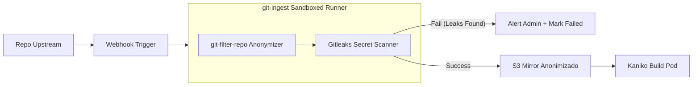
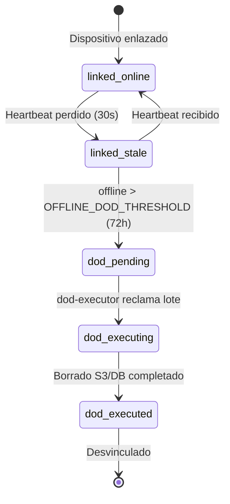
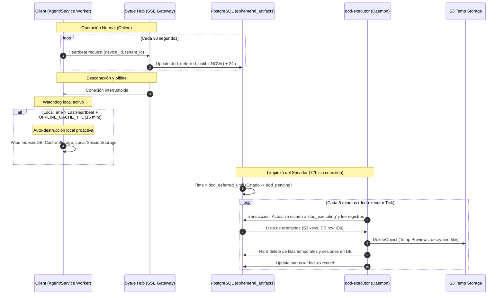
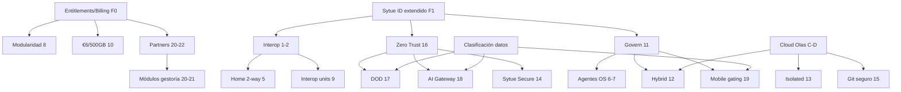

<!-- SPDX-License-Identifier: Apache-2.0 -->
<!-- Copyright (c) 2026 Daniel Delgado Ramos -->

<a id="negocio--plan-estratégico-y-modelo-de-costes"></a>

# Business — strategic plan and cost model

1. **[Platform strategic plan](#1-plan-estrategico-de-plataforma)** — positioning,
   architectural vision, specification per strategic item, integrated roadmap and decisions.
2. **[Cost model](#2-modelo-de-costes)** — SKUs, cost per environment, per product and per
   tenant, and optimization levers.

> Technical execution: [`roadmap.md`](roadmap.md) · Architecture: [`architecture.md`](architecture.md).

---

<a id="1-plan-estrategico-de-plataforma"></a>

<a id="1-plan-estratégico-de-plataforma"></a>

## 1. Platform strategic plan

> **Status:** agreed draft (rev. 4) · **Date:** 2026-07-11 · **Branch:** `sytue-native`  
> **Methodology:** plan produced through **multi-agent analysis by Sytue Projects** (rev. 1–3). **Rev. 4:** explicit definition of **Platform OS** — **Linux-based** desktop + **Android-based** mobile, with SyID and the suite integrated at system level.  
> **Relationship to other docs:** complements [`roadmap.md`](./roadmap.md) (F0–F6), [the backlog](../el backlog) (operational status), [`architecture.md#2-integracion-seamless-shell--hub`](./architecture.md#2-integracion-seamless-shell--hub), [`architecture.md`](./architecture.md), ADR-0023 (Cloud/Kapsule).

---

<a id="posicionamiento-competir-e-interoperar"></a>

### Positioning: compete and interoperate

Sytue One is a **direct competitor** to suites such as **Microsoft 365** and **Google Workspace**: it offers the same product categories (email, files, office suite, calendar, contacts, chat, video calls, identity, PaaS) with an **in-house, sovereign and EU-only** implementation.

The strategic difference: **we do not force a choice**. A customer can:

- **Use only Sytue** — complete native suite: **free** for one person (5 GB), **€5/user/month** with **200 GB/user** or **€25/user/month** with **1 TB/user**. All plans allow connecting your own S3 storage.
- **Coexist** — run Sytue as the primary system and keep M365, Google Workspace, Slack, Odoo, Shopify, Jira, etc. with **bidirectional sync** and visibility in Home.
- **Migrate gradually** — connect external apps in **1 click**, import data, and switch off the external one when native parity is enough.

**Product rule:** every feature we offer in the suite **must also be interoperable** with the equivalent market leader. We are not a “cheap connector”: we are the complete alternative that also talks to everyone.

**One-liner (GTM consensus rev. 3):**

> _“The European sovereign suite, free for one person and from €5/user, that doesn't force you to leave Google or Microsoft and connects them in 1 click.”_

**Honest framing of the “1 click”:** _“One click in Sytue. One consent in your provider.”_ — zero XML/scripts in Sytue; the OAuth/admin consent in Google/Entra is unavoidable and visible.

| Category        | Sytue product (native)                                 | Competitor / interoperable                             |
| --------------- | ------------------------------------------------------ | ------------------------------------------------------ |
| Identity        | Sytue ID                                               | Entra ID, Google Identity, Okta                        |
| Email           | Sytue Mail                                             | Exchange Online, Gmail                                 |
| Files           | Sytue Drive                                            | OneDrive, Google Drive, SharePoint                     |
| Office suite    | Sytue Docs (Docs/Sheets/Slides)                        | Microsoft Office, Google Docs/Sheets/Slides            |
| Calendar        | Sytue Calendar                                         | Outlook Calendar, Google Calendar                      |
| Contacts        | Sytue Contacts                                         | Outlook Contacts, Google Contacts                      |
| Chat + Meet     | Sytue Rooms                                            | Microsoft Teams, Slack, Mattermost, Zoom, Google Meet  |
| ERP / business  | Sytue Business _(roadmap)_                             | Odoo, SAP B1                                           |
| E-commerce      | Sytue Commerce _(roadmap)_                             | Shopify                                                |
| Dev / ITSM      | Sytue Cloud + integrations                             | Jira, Confluence, GitHub, GitLab                       |
| PaaS            | Sytue Cloud                                            | Azure App Service, Google Cloud Run, Vercel            |
| **Platform OS** | **Sytue Linux** (desktop) · **Sytue Android** (mobile) | Windows, macOS, iOS, generic Linux distros (via agent) |

**Platform OS (custom OS):** it is not an abstract generic OS — it is **two concrete platforms** derived from open-source upstream:

| Platform          | Base                                                            | Native integration                                                                                                                            |
| ----------------- | --------------------------------------------------------------- | --------------------------------------------------------------------------------------------------------------------------------------------- |
| **Sytue Linux**   | In-house **Linux** distribution (LTS kernel + EU desktop stack) | SyID as system SSO; Mail/Drive/Docs/Calendar/Contacts/Rooms/Cloud as first-class apps; Govern and DOD in the agent kernel; free tier (item 7) |
| **Sytue Android** | **AOSP** (Android Open Source Project)                          | SyID via Account Manager; pre-integrated suite; hardware attestation; full access to classified data (item 19)                                |

Windows, macOS, iOS and third-party Linux distros are **not** Platform OS: they use `sytue-agent` with a lower trust level (`standard` / `untrusted`).

---

<a id="resumen-ejecutivo"></a>

### Executive summary

Sytue One today has a mature **sovereign productivity suite** (Mail, Drive, Docs, Calendar, Contacts, Rooms, Cloud PaaS) with core identity (Sytue ID), internal integration (Hub/Shell) and an operable cloud control plane on Kapsule. The enterprise platform layer described in the 22 strategic items **does not exist yet**: Google/Microsoft/SaaS external connectors, endpoint governance, OS agents, hybridization, full Zero Trust, unified billing and partner programs.

**Cross-cutting principle (rev. 2):** all external interoperability is configured in **1 click** — no scripts, no manual XML, no developer consoles. The admin clicks “Connect {app}”, grants OAuth/admin consent, and the system automatically provisions sync, a Home tile and default policies.

This plan defines **five new services** and **three major extensions** on top of the existing base:

| New / extended piece                                                 | Items covered                              |
| -------------------------------------------------------------------- | ------------------------------------------ |
| `services/integrations`                                              | 1, 2, 5, 9                                 |
| `services/govern`                                                    | 11, 8 (entitlements), 19 (mobile policies) |
| `clients/sytue-agent` + mobile shells                                | 6, 7, 19                                   |
| `services/edge-connector`                                            | 12                                         |
| `services/billing` + `platform/pkg/entitlements`                     | 8, 10, 13, 20–22                           |
| `services/security-mgmt` (Sytue Secure)                              | 14, 16                                     |
| `services/ai-gateway`                                                | 18                                         |
| Extensions: Sytue ID (federation, devices), git-ingest, dod-executor | 4, 15, 17                                  |

**Agreed sequence:** (1) entitlements + billing → (2) SyID federation + devices → (3) integrations 1-Click → (4) govern + agent on third-party OSes → (5) **Sytue Linux** Platform OS → (6) Zero Trust + DOD → (7) **Sytue Android** + hybrid + partners → (8) AI gateway + secure git.

**Commercial plans (2026-09-14, ADR 0038):** `personal_free` —**free**, one person, **5 GB**, no organization administration or ERP—; `pro` —**€5 per user per month** (+ VAT) with **200 GB per user**; educational institutions at 50 %—; `enterprise` —**€25 per user per month** (+ VAT) with **1 TB per user** and **Premium Support**—. The `enterprise` price rose from €20 to €25 per user per month on 2026-09-22 (owner's decision; migration id/0095). Paid subscriptions are still “coming soon” and Mollie billing is not wired up, so there were no live contracts whose price had to be preserved; once there are, the committed price revision is the only thing that can raise them. ADR 0038 keeps the figure with which the plan was decided. Lifetime committed price revision: +€0.50 per user every four years, and nothing more. The same products in all three; the paid ones apply to an organization (per active seat, `memberships` in Sytue ID) and to a single person. All of them allow connecting your own S3 storage, which does not count towards the quota. Viable as a volume product with real average usage << ceiling, S3 lifecycle, the accounting-firm (gestoría) channel and the `isolated_extra` upsell.

---

<a id="1-estado-actual-del-repositorio-baseline"></a>

### 1. Current state of the repository (baseline)

<a id="11-lo-que-ya-funciona"></a>

#### 1.1 What already works

| Layer                       | Capability                                                                  | Evidence                                                 |
| --------------------------- | --------------------------------------------------------------------------- | -------------------------------------------------------- |
| **Identity**                | OIDC+PKCE, rotating refresh, SCIM 2.0, TOTP/WebAuthn MFA, admin keyset      | `services/id/`                                           |
| **Internal suite**          | Mail, Drive, Docs, Calendar, Contacts, Rooms (Chat+Meet), Cloud PaaS        | `services/*`, `apps/frontend/apps/*`                     |
| **Intra-suite integration** | Hub: federated search, SSE notifications, presence, cross-app intents       | `services/hub/internal/connectors/`                      |
| **Unified shell**           | App switcher, OAuth SSO with host-only cookies, Mattermost/Linear design    | `@sytue/shell`, `@sytue/ui`                              |
| **Multi-tenant**            | RLS `app.tenant`, namespace `tenant-<slug>`, S3 prefix                      | `platform/pkg/pg`, ADR-0011                              |
| **Cloud PaaS**              | K8s controller, Kaniko builds, `free/pro/team` quotas, webhooks, API tokens | `services/cloud/`, ADR-0023                              |
| **Open protocols**          | CalDAV, CardDAV, WebDAV, JMAP, SMTP/IMAP                                    | Interop with third-party clients (Thunderbird, iOS Mail) |

<a id="12-brechas-transversales"></a>

#### 1.2 Cross-cutting gaps

| Gap                                                                  | Affected items |
| -------------------------------------------------------------------- | -------------- |
| Zero OAuth/API connectors to Google, Microsoft, Slack, Zoom          | 1, 2, 5, 9     |
| No inbound federation (Google/Entra as upstream IdP)                 | 1, 3, 4        |
| Portal shows only internal apps (`suiteApps`)                        | 5              |
| No OS agents or MDM                                                  | 6, 7, 11, 19   |
| No govern service, hybrid edge or explicit isolated tier             | 11, 12, 13     |
| No billing, entitlements or unified storage pool                     | 8, 10, 20–22   |
| No Zero Trust device, data classification, DOD, AI gateway           | 14–19          |
| Cloud clones repos without anonymization                             | 15             |
| Disconnected plans (`free/pro/team` vs €49/€199 UI vs €5/€20 target) | 10             |

---

<a id="2-vision-arquitectonica-unificada"></a>

<a id="2-visión-arquitectónica-unificada"></a>

### 2. Unified architectural vision

```mermaid
flowchart TB
  subgraph Identity["Capa identidad"]
    ID[Sytue ID<br/>OIDC · SCIM · Federación · Devices]
  end

  subgraph Experience["Experiencia"]
    PORTAL[Portal / Home<br/>Suite + Apps conectadas]
    SHELL[@sytue/shell]
    AGENT[sytue-agent · SO terceros]
    PLATOS[Sytue Linux · Sytue Android]
  end

  subgraph Platform["Plataforma empresarial"]
    GOVERN[services/govern<br/>Políticas · Assets · Sensibilidad]
    BILLING[Sytue ID billing<br/>Suscripción · Entitlements · Mollie]
    INTEG[services/integrations<br/>Google · MS · Slack · Zoom]
    SEC[services/security-mgmt<br/>Sytue Secure · SIEM export]
    EDGE[services/edge-connector<br/>IP dedicada · WireGuard]
    AI[services/ai-gateway<br/>Conectores RO · Redacción]
  end

  subgraph Suite["Suite Sytue (existente)"]
    HUB[Hub] --> MAIL & DRIVE & DOCS & CAL & CHAT & CLOUD
  end

  ID --> PORTAL & SHELL & AGENT & PLATOS
  GOVERN --> ID & AGENT & PLATOS & Suite
  BILLING --> ID & PORTAL & CLOUD
  INTEG --> HUB & PORTAL
  SEC --> ID & GOVERN & AI
  EDGE --> CLOUD & GOVERN
  AI --> HUB
  AGENT --> GOVERN
  PORTAL --> HUB & INTEG
```

<a id="21-principios-invariantes-consenso-multi-agente"></a>

#### 2.1 Invariant principles (multi-agent consensus)

1. **Backend always Go** — the Astro BFF is only a proxy; new services follow `services/<svc>/cmd/<svc>`.
2. **Sytue ID is the only source of identity** — Google/Microsoft are upstream IdPs or connected data systems, never a parallel IdP.
3. **PostgreSQL = durable truth** — Dragonfly is only ephemeral (presence, rate limits, DOD TTL).
4. **Entitlements ≠ commercial plan** — enables modularity (item 8) and partners without rewriting prices.
5. **One tenant per end customer** — partners manage via delegation; they do not host customer data in their own tenant.
6. **Zero Trust by default** — no resource is accessible just because it is on the internal network.
7. **AI never touches raw data** — read-only connectors with redaction; `value_ip` cannot be disabled.
8. **EU-only, clean-room** — permissive SDKs (MIT/BSD/Apache); infra images documented case by case.
9. **1 click to connect** — every external app is enabled with one button; zero manual configuration in each connector's MVP.
10. **Compete + interoperate** — complete native functionality _and_ a bidirectional bridge with the market equivalent; never only one or the other.

---

<a id="22-connectkit--arquitectura-1-click"></a>

### 2.2 ConnectKit — 1-Click architecture

Mandatory pattern for **every** external integration. Each connector packages:

```
ConnectKit (por provider)
├── manifest.yaml           # id, scopes mínimos, icono, categoría, producto Sytue equivalente
├── oauth_config            # client_id multi-tenant Sytue + redirect URI fija
├── admin_consent_flow      # Google Workspace / Entra: URL pre-armada
├── default_sync_policy     # qué dominios sync, dirección, resolución conflictos
├── home_tile_spec          # título, deeplink, badge source
├── provisioning_hooks      # post-connect: SCIM, webhooks, cron jobs
└── health_checks           # reauth_required, last_sync, error surface
```

**UX flow (always the same):**

1. Console or Portal → **Integrations** → grid of apps with logos.
2. The admin clicks **“Connect”** on the card (e.g. “Microsoft Teams”).
3. OAuth redirect / admin consent → automatic callback.
4. The backend creates the `connection`, starts the initial sync, registers the tile in Home, emits a Hub event.
5. The UI shows **“Connected ✓”** with the sync status; the end user configures nothing.

**Unified API:**

```
POST /api/v1/connect/{provider}/start     # devuelve authorize_url (1 clic desde UI)
GET  /api/v1/connect/{provider}/callback  # handler OAuth
POST /api/v1/connect/{provider}/oneclick  # variantes con credenciales pre-registradas Sytue (marketplace app)
```

**Global acceptance rule:** no GA connector requires more than **1 click + consent** from the admin. Advanced options exist but are **opt-in**.

**Sync strategy per domain (architecture consensus rev. 3):**

| Domain                        | Day-1                              | Default conflict policy  |
| ----------------------------- | ---------------------------------- | ------------------------ |
| Calendar                      | **2-way**                          | `newest_wins`            |
| Contacts                      | **2-way**                          | `newest_wins`            |
| Drive                         | Import-first → 2-way v1.1          | `newest_wins`            |
| Docs (Office/Google)          | Import-first; OOXML/ODF round-trip | `sytue_wins` post-import |
| Mail                          | Import-first (1-way)               | `remote_wins`            |
| Chat (Slack/Teams/Mattermost) | Notification bridge                | dedup by `remote_msg_id` |
| Directory/SCIM                | Inbound                            | `remote_wins`            |

**Office/Google Docs:** API-native + OOXML/ODF conversion in Sytue Docs. **WOPI ruled out** for GA (EU sovereignty; we compete with Office, we do not embed it).

**Entra ID vs M365:** two separate ConnectKits — `entra-id` (federation, **does not count as a UI**) and `microsoft-365` (data, **does count as 1 UI**). The “Migrate from M365” bundle chains them automatically.

**Mattermost:** bridge/coexistence with native Rooms; do not replace the customer's server on day 1.

**Rate limiting (100k+ users):** Dragonfly token bucket per `(tenant, provider, api_family)` + Postgres `sync_jobs` queue + delta/webhook-first; honor `Retry-After`.

---

<a id="23-sytue-platform-os--linux-escritorio-y-android-movil"></a>

<a id="23-sytue-platform-os--linux-escritorio-y-android-móvil"></a>

### 2.3 Sytue Platform OS — Linux (desktop) and Android (mobile)

The roadmap's “custom OS” are **Sytue Linux** and **Sytue Android**: operating systems based on Linux and AOSP respectively, designed to integrate **Sytue ID (SyID)** and **the whole suite** at platform level — not simple agents installed on third-party OSes.

<a id="objetivo"></a>

#### Goal

That the user on Sytue Linux or Sytue Android experiences the suite as a **native system layer**: one SyID login unlocks Mail, Drive, Docs, Calendar, Contacts, Rooms and Hub notifications, without standalone apps or the browser as the only container.

<a id="sytue-linux-escritorio"></a>

#### Sytue Linux (desktop)

**Technical base:** in-house Linux distribution (LTS kernel, systemd init, desktop consistent with `@sytue/ui`). Permissive upstream (clean-room); **no** branded fork of Ubuntu/ChromeOS — our own reproducible build (`platforms/sytue-linux/`).

**System integrations:**

| Layer                      | Implementation                                                                                                                     |
| -------------------------- | ---------------------------------------------------------------------------------------------------------------------------------- |
| **SyID**                   | Desktop session SSO: OIDC device flow + PAM/polkit; screen lock = step-up; multiple accounts per user profile                      |
| **Suite**                  | Native Fyne 2.8.1 apps (Go, no WebView) packaged as `.deb`/Flatpak/OSTree; `sytue://` deep links; product switcher in the launcher |
| **Drive**                  | System FUSE/WebDAV mount + offline sync with DOD policy                                                                            |
| **Mail/Calendar/Contacts** | OS default clients (JMAP + CalDAV/CardDAV) pointing to Sytue services                                                              |
| **Rooms**                  | Desktop notifications + presence indicator in the system panel                                                                     |
| **Govern**                 | `sytue-agent` agent as a system service; policy pull; software inventory                                                           |
| **DOD**                    | Integrated heartbeat; local cache wipe when the device is unlinked                                                                 |
| **Trust**                  | `device_trust=managed`; TPM/Secure Boot attestation where the hardware allows it                                                   |

**Free tier (item 7):** users on **Sytue Linux** (official ISO/OSTree) automatically receive `suite_linux_free` after enrollment — it does not apply to the agent on generic Debian/Fedora without Platform OS.

<a id="sytue-android-móvil"></a>

#### Sytue Android (mobile)

**Technical base:** **AOSP** fork without mandatory GMS (`platforms/sytue-android/`). Optional: work profile (Android Work Profile) for BYOD. OTA signed by Sytue.

**System integrations:**

| Layer                   | Implementation                                                                                            |
| ----------------------- | --------------------------------------------------------------------------------------------------------- |
| **SyID**                | Android Account Manager + Autofill; biometrics bound to SyID WebAuthn                                     |
| **Suite**               | System apps (Mail, Drive, Docs, Calendar, Contacts, Rooms) with silent SSO; icons in the default launcher |
| **Hub**                 | FCM push (or an EU self-hosted equivalent) + unified badge                                                |
| **Govern**              | Lightweight Device Policy Controller (DPC) or SyID managed profile                                        |
| **Data classification** | Full access to `restricted` and `value_ip` — the only mobile with full trust                              |
| **Trust**               | `device_trust=managed`; Android Keystore + SyID's own attestation                                         |

**Devices without Sytue Android** (stock Android, iOS, mobile browser): **never** access `restricted`/`value_ip` content, not even via email — see item 19.

<a id="arquitectura-de-repositorio"></a>

#### Repository architecture

```
platforms/
├── sytue-linux/              # imagen ISO/OSTree, packages, branding, kernel config
│   ├── os/                   # rootfs, systemd units, polkit, PAM
│   ├── apps/                 # launchers suite (.desktop, icons)
│   └── agent/                # sytue-agent como servicio de sistema
└── sytue-android/            # AOSP manifest + overlays SyID/suite
    ├── device/sytue/           # product definition, OTA
    ├── packages/apps/          # Mail, Drive, … (system apps)
    └── syid/                   # AccountManager, attestation

clients/sytue-agent/            # núcleo Go compartido (Linux third-party, Win, macOS)
```

<a id="modelo-de-confianza-de-dispositivo-3-niveles"></a>

#### Device trust model (3 levels)

| Level       | Platforms                                         | Capabilities                                                    |
| ----------- | ------------------------------------------------- | --------------------------------------------------------------- |
| `managed`   | **Sytue Linux**, **Sytue Android**                | Everything, including `restricted`/`value_ip`; DOD; full Govern |
| `standard`  | Win/macOS agent + WebAuthn; generic Linux + agent | Everyday operations; no `value_ip` on mobile                    |
| `untrusted` | Browser without agent; generic mobile web         | Basic reading; no `restricted` body or sensitive attachments    |

<a id="roadmap-platform-os"></a>

#### Platform OS roadmap

| Phase        | Deliverable                                                      |
| ------------ | ---------------------------------------------------------------- |
| **Phase 4a** | Sytue Linux alpha: ISO + SyID SSO + system agent + 3 suite apps  |
| **Phase 4b** | Sytue Linux beta: full suite + free tier + FUSE Drive            |
| **Phase 5a** | Sytue Android alpha: AOSP + SyID + Mail/Drive/Rooms system apps  |
| **Phase 5b** | Sytue Android beta: attestation + `restricted` access + OTA      |
| **Phase 6**  | Optional GSI for compatible devices; Secure Boot / AVB hardening |

<a id="234-integración-tecnológica-de-wrappers-e-interfaces-de-sistema"></a>

#### 2.3.4 Technology Integration of Wrappers and System Interfaces

Sytue Linux desktop development will be built on the shared **Fyne 2.8.1** shell (Go and native rendering); Android keeps its Capacitor/PWA client. Platform integration is as follows:

1. **Fyne for Sytue Linux (`sytue-desktop`):**
   - It is compiled as a native Go application and talks to the local `sytue-agent` to interact with the FUSE storage driver (Drive).
   - **Security:** there is no embedded HTML engine or JavaScript bindings. Views call authenticated Go APIs and validate deep links before acting.
   - **Agent and FUSE integration:** the Go shell can coordinate `sytue-agent` as a subprocess or local service and dynamically mount Sytue Drive at `/media/sytue-drive`.

2. **Service Worker and PWA Caching logic:**
   - **Caching strategies:** caching by resource type via Workbox:
     - _Cache-First_ for static brand assets (fonts, logos, illustrations) with a 30-day TTL.
     - _Stale-While-Revalidate_ for compiled Astro/Preact code, ensuring instant interface start-ups.
     - _Network-First_ for main HTML pages and JMAP/REST API requests, guaranteeing timely session revocation.
   - **IndexedDB for offline operations:** local storage in IndexedDB (`pending_emails`, `pending_calendar`, `pending_drive`) to persist actions without network, syncing automatically when connectivity is detected via `BackgroundSyncPlugin` and `newest_wins` conflict resolution.

3. **AOSP Account Manager for Sytue Android:**
   - It will handle the management and silent renewal of the user's OIDC/OAuth2 tokens through a system authentication service (`AuthenticatorService`) that inherits from `AbstractAccountAuthenticator` and is defined in `authenticator.xml`.
   - The token will be consumed directly by the system's encapsulated web applications without requiring duplicate sign-ins.
   - **WebAuthn and biometric integration:** binds the signature of WebAuthn keys generated in Android Keystore (backed by StrongBox on a secure physical chip) directly to the native `BiometricPrompt` API for user biometric verification.

**Out of Platform OS scope:** custom iOS, custom Windows, custom macOS — only agents/`standard` on those platforms.

---

---

<a id="3-especificacion-por-item-estrategico"></a>

<a id="3-especificación-por-ítem-estratégico"></a>

### 3. Specification per strategic item

<a id="ítem-1--full-interop-con-google-y-microsoft"></a>

#### Item 1 — Full interop with Google and Microsoft

**Goal:** bidirectional coexistence with Google Workspace and Microsoft 365 — **we compete and connect in 1 click**. Not only standard clients (CalDAV/IMAP): full cloud-to-cloud sync.

**Current state:** open protocols operational; **no** Google Admin SDK, Microsoft Graph, Gmail API or cloud-to-cloud Calendar API.

**1-Click ConnectKit (mandatory MVP):**

| Button in Console            | What it does on connect                                                      | Native Sytue product |
| ---------------------------- | ---------------------------------------------------------------------------- | -------------------- |
| **Connect Google Workspace** | OIDC federation + Directory sync + Calendar/Drive/Mail import                | The whole suite      |
| **Connect Microsoft 365**    | Entra ID OIDC/SAML + Graph sync + OneDrive/Outlook/Teams bridge              | The whole suite      |
| **Connect Entra ID**         | Identity only (M365 subset)                                                  | Sytue ID             |
| **Connect Google Docs**      | Sync of documents/sheets/presentations + cross-editing via OOXML/ODF formats | Sytue Docs           |
| **Connect Microsoft Office** | Graph drive items + import/export co-editing; optional WOPI-style preview    | Sytue Docs           |

**Sync architecture per domain:**

| Domain       | API / protocol                                       | Direction          | 1-Click | Phase |
| ------------ | ---------------------------------------------------- | ------------------ | ------- | ----- |
| Login        | Upstream OIDC (Google + **Entra ID**)                | Inbound → Sytue ID | ✅      | MVP   |
| Directory    | SCIM inbound + Graph SCIM / Google Directory         | Inbound            | ✅      | MVP   |
| Calendar     | CalDAV + Graph Calendar + Google Calendar API        | 2-way              | ✅      | v1    |
| Contacts     | CardDAV + People API + Graph Contacts                | 2-way              | ✅      | v1    |
| Files        | WebDAV + Drive API + OneDrive/SharePoint             | 2-way              | ✅      | v1    |
| Office suite | Google Docs/Sheets/Slides API + Graph Excel/Word/PPT | 2-way              | ✅      | v1    |
| Mail         | IMAP/JMAP + Gmail API / Graph Mail                   | 1-way → 2-way      | ✅      | v2    |
| Teams / Meet | Graph onlineMeetings, Meet links                     | Bridge             | ✅      | v1    |

**Implementation:** new service `services/integrations` (dev port `:8093`, `integrations.sytue.eu`), separate from the Hub because it handles service refresh tokens, webhooks and sync jobs. Each row of the catalog above = one packaged **ConnectKit**.

**Bidirectional sync pattern:**

```
Servicio Sytue (outbox) → Integrations worker → API remota
API remota (webhook)    → Integrations       → entity_mappings → Servicio Sytue
```

Configurable conflict policies: `sytue_wins` | `remote_wins` | `newest_wins`.

---

<a id="ítem-2--integraciones-con-todas-las-herramientas-saas-importantes"></a>

#### Item 2 — Integrations with all the major SaaS tools

**Principle:** every external app whose **functionality we already offer in the suite** must have a **1-Click** connector + a native product on the roadmap if it does not exist yet.

**Priority catalog — sequential GA order (product consensus rev. 3):**

| #   | Connector                 | Launch phase                   |
| --- | ------------------------- | ------------------------------ |
| 1   | Google Workspace          | **Public GA**                  |
| 2   | Microsoft 365             | **Public GA**                  |
| 3   | Entra ID                  | **Public GA**                  |
| 4   | Slack                     | **Public GA**                  |
| 5   | Zoom                      | **Public GA**                  |
| 6   | Microsoft Teams           | Beta → GA                      |
| 7   | Google Docs/Sheets/Slides | Beta → GA                      |
| 8   | Microsoft Office (Graph)  | Beta → GA                      |
| 9   | Jira                      | Beta → GA                      |
| 10  | GitHub                    | Beta → GA                      |
| 11  | Confluence                | Beta                           |
| 12  | Odoo                      | Beta (accounting-firm channel) |

_Outside the top 12 until Phase 6:_ Mattermost (P1), Google Meet, Shopify (P2), Salesforce, Notion.

**Initial public launch (5 GA connectors):** Google Workspace, Microsoft 365, Entra ID, Slack, Zoom. The rest stay in beta until Phase 2 is complete.

**Odoo / Shopify / Jira — DECISION: connector-first.** Native modules (`Sytue Business`, `Commerce`, `Projects`) only when the connector exceeds 12 months of use or >40% of tenants connected. Phase 2 connector scope: Jira issues 2-way; Odoo contacts+invoices; Shopify orders+products.

**Extensible architecture (ConnectKit registry):**

```
services/integrations/
├── connectkit/
│   ├── registry.go              # catálogo 1-Click
│   └── manifest_schema.json
├── internal/connectors/
│   ├── google/                  # Workspace + Docs
│   ├── microsoft/               # M365 + Office + Entra + Teams
│   ├── slack/
│   ├── zoom/
│   ├── mattermost/
│   ├── jira/
│   ├── confluence/
│   ├── odoo/
│   ├── shopify/
│   └── ...
```

Each connector implements `ConnectKit` + the sync interface:

```go
type Connector interface {
    Manifest() ConnectManifest       // metadata 1-Click UI
    StartConnect(ctx context.Context, tenant string) (authorizeURL string, err error)
    OnConnected(ctx context.Context, conn Connection) error  // provisioning auto
    SyncDomains() []string
    // ... ExchangeCode, RefreshToken, Pull, Push
}
```

**Console Integrations:** grid of cards with a single **“Connect”** button per app; real-time status; zero forms on the happy path.

---

<a id="ítem-3--mega-easy-setup-for-companies-1-click-end-to-end"></a>

#### Item 3 — Mega Easy setup for companies (1-Click end-to-end)

**Goal:** enterprise onboarding in minutes. **Each step = 1 click**; the system infers the rest.

**Agreed flow (Console + Portal wizard):**

1. **Create org** → automatic slug → K8s tenant provisioned (automatic, no input).
2. **Connect identity** → 1 click “Google Workspace” / “Entra ID” / “Microsoft 365” → admin consent → federation + SCIM auto-configured.
3. **Import directory** → automatic after step 2 (SCIM endpoint generated and shown only if the admin wants to see it).
4. **Connect apps** → 1-Click grid; each app = one “Connect” button (Slack, Teams, Odoo, Jira, …).
5. **Point govern** → 1 click “Enable Govern” (auto-assigned URL) or paste a custom URL (item 11).
6. **Verify mail domain** → DNS wizard with copy-paste records (the only unavoidable semi-manual step).

**MVP bundle “Migrate from Google / M365” (consensus rev. 3):**

| Included in MVP  | Direction                  | Excluded (v2)                      |
| ---------------- | -------------------------- | ---------------------------------- |
| OIDC federation  | Inbound → Sytue ID         | Full SAML SP                       |
| SCIM directory   | Inbound auto               | Advanced groups                    |
| Calendar         | **2-way**                  | —                                  |
| Contacts         | **2-way**                  | —                                  |
| Drive / OneDrive | **1-way import** (90 days) | 2-way files                        |
| Mail             | **1-way IMAP**             | 2-way Gmail/Graph                  |
| Docs / Office    | **1-way import** OOXML/ODF | Cross co-editing                   |
| —                | —                          | Teams/Slack messaging, Meet bridge |

Automatic sequence after 1 bundle click: Identity → Directory → Calendar → Contacts → Drive import → Mail import → Docs import. **≤3 admin clicks, <10 min** until corporate login + visible calendar.

**Technical deliverables:**

| Component                                               | Description                              |
| ------------------------------------------------------- | ---------------------------------------- |
| `POST /api/v1/onboarding/wizard`                        | Step orchestrator; chains ConnectKits    |
| `POST /api/v1/onboarding/bundle/{id}`                   | Triggers a bundle's 1-Click sequence     |
| Console `OnboardingWizard.tsx` + `IntegrationsGrid.tsx` | UI: only Connect buttons                 |
| Terraform module `tenant-quickstart`                    | Namespace + DNS + cert in a single apply |
| Device enrollment QR                                    | 1 click “Add device” → QR                |

**MVP acceptance criterion:** the admin connects Google Workspace or M365 with **≤3 clicks**; users sign in with their corporate login; calendar and contacts visible in the suite; external tile in Home — all in **< 10 minutes**.

---

<a id="ítem-4--syid-para-todo"></a>

#### Item 4 — SyID for everything

**Principle:** Sytue ID (`services/id`) is the **only issuing IdP** for the whole platform: suite, Cloud, Govern, Integrations, OS agents, partners.

**Agreed extensions to the existing IdP:**

| Capability                        | Status      | Action                                              |
| --------------------------------- | ----------- | --------------------------------------------------- |
| OIDC+PKCE BFF                     | ✅          | Keep                                                |
| SCIM 2.0 inbound                  | ✅          | Onboarding wizard                                   |
| SAML SP (Entra login)             | ❌ doc only | `internal/saml/`                                    |
| Upstream OIDC federation          | ❌          | `internal/federation/oidc.go`                       |
| Dynamic OAuth client registration | ❌ defer    | Admin clients API → unblocks Cloud managed-auth     |
| Device enrollment + claims        | ❌          | Tables `devices`, `device_sessions`                 |
| Identity brokering                | ❌          | Tables `identity_providers`, `federated_identities` |

**Extended JWT claims (consensus):**

```json
{
  "sub": "...",
  "tenant": "acme",
  "roles": ["admin"],
  "modules": ["drive", "mail", "cloud"],
  "device_id": "uuid",
  "device_trust": "managed|standard|untrusted",
  "partner_of": "optional-delegated-tenant"
}
```

**Rule:** services validate the JWT via JWKS (`platform/pkg/authn`); hard quotas always reconcile with `services/billing`, not only the JWT.

<a id="especificación-criptográfica-y-almacenamiento-seguro-sytue-id"></a>

##### Cryptographic Specification and Secure Storage (Sytue ID)

- **Token encryption:** Access and ID Tokens are issued digitally signed using **RS256** (RSA-2048 with SHA-256) or **ES256** (ECDSA P-256 with SHA-256). Session tokens and opaque refresh tokens are high-entropy random strings (256 bits, generated with `crypto/rand`) of which **only the SHA-256 hash is stored** in the database (`sessions.token_hash`, `refresh_tokens.token_hash`).
- **Encryption of sensitive columns (Envelope Encryption):** for highly confidential data at rest in the DB (private signing keys, TOTP secrets, external OAuth tokens), an envelope encryption scheme is used:
  1. **Master Key (KEK):** 256-bit symmetric key stored in Scaleway Secret Manager, injected into the environment as `SYTUE_ID_KMS_MASTER_KEY`.
  2. **Data Encryption Key (DEK):** generated per row/record via `crypto/rand` (32 bytes).
  3. **Row algorithm:** the value is encrypted with the DEK using **AES-256-GCM** and a unique 12-byte IV. Payload structure: `IV (12 B) || Ciphertext || Auth Tag (16 B)`.
  4. **Wrapping:** the DEK is encrypted with the KEK using **AES-256-GCM** and stored in the `encrypted_dek` column next to the encrypted data.
- **JWKS key rotation and rollover:**
  - The lifecycle of signing keys is managed with the states: `active` -> `next` -> `retired`.
  - The `active` key signs new tokens. The `next` key is published in the JWKS to allow validation of still-valid tokens during the transition.
  - Rotation happens every 90 days via a cron daemon. On rotation, `active` becomes `next`, `next` becomes `retired` (and is removed from the JWKS) and a new `active` key is generated.
  - In case of compromise or suspected anomalies (`oauth.refresh.reuse_detected` event), an immediate emergency rotation can be triggered, invalidating the compromised key.
  - The validating middleware (`platform/pkg/authn/verifier.go`) caches the JWKS (`jwk.NewCache` with a minimum refresh of 15 minutes) and performs a forced on-demand fetch when it sees an unknown `kid`, rate-limited to one fetch every 10 seconds.

---

<a id="ítem-5--conexión-2-way-de-apps-saas-si-lo-conectas-lo-ves-en-home"></a>

#### Item 5 — 2-way connection of SaaS apps: if you connect it, you see it in Home

**Current state:** Portal `Launcher.tsx` shows only `suiteApps` from `@sytue/ui`.

**Agreed design:**

```
[Aplicaciones Sytue]      ← suiteApps (actual)
[Apps conectadas]         ← GET /integrations/v1/connections?visible=true
[Accesos rápidos]         ← acciones cross-provider + intents Hub
```

**API:**

```
GET    /api/v1/connections
POST   /api/v1/connections/{provider}/authorize
GET    /api/v1/connections/{id}/status     # healthy | sync_error | reauth_required
DELETE /api/v1/connections/{id}
```

**Behavior per connected app (1-Click → visible in Home):**

| App                       | Tile in Home                                    | 2-way sync                             |
| ------------------------- | ----------------------------------------------- | -------------------------------------- |
| Slack                     | Workspace deeplink + @mentions badge via Hub    | Notifications → Hub; messages v2       |
| Microsoft Teams           | Channel deeplink / Sytue tab                    | Meeting links + presence v1            |
| Zoom                      | “Start meeting”                                 | Create a Zoom or Rooms room per policy |
| Mattermost                | Linked channels + unread                        | API import + notifications             |
| Google Calendar / Outlook | Unified events in Sytue Calendar                | v1 bidirectional                       |
| Google Docs / Office      | Documents in Sytue Drive/Docs                   | v1 import/export + limited co-editing  |
| Jira                      | Assigned issues + active sprints                | 2-way issues                           |
| Confluence                | Recent pages / spaces                           | Markdown import → Docs                 |
| Odoo                      | Recent orders/invoices _(once Business exists)_ | Contacts, invoices 2-way               |
| Shopify                   | Today's orders _(once Commerce exists)_         | Orders + products                      |
| GitHub                    | Repos + recent PRs                              | Webhook → notifications                |

Each active connection with `visible_on_home=true` generates a tile in `@sytue/ui/AppGrid` **automatically when the 1-Click completes** — with no additional checkbox.

The Hub extends `domain.Source` with external sources for aggregated search/notifications (metadata only, no direct mutation).

---

<a id="ítem-6--super-integrado-a-so-móviles-y-de-escritorio-incl-linux"></a>

#### Item 6 — Deeply integrated with mobile and desktop OSes (incl. Linux)

**Current state:** web only (Astro+Preact); DAV/JMAP protocols for third-party clients; UA parsing in ID sessions. **Platform OS does not exist** (`platforms/sytue-linux`, `platforms/sytue-android` yet to be built).

**Two-layer strategy:**

```
Capa A — Platform OS (máxima integración, device_trust=managed)
  Sytue Linux (escritorio)     Sytue Android (móvil)
  SyID + suite nativa          SyID + suite system apps

Capa B — Agente en SO de terceros (standard/untrusted)
  Windows · macOS · Linux genérico · iOS (web/TWA) · Android stock
  clients/sytue-agent/
```

**Architecture of `clients/sytue-agent/`** (Layer B + embedded service in Sytue Linux):

```
clients/sytue-agent/
├── cmd/agent/
├── internal/
│   ├── enroll/               # OIDC device flow + mTLS → SyID
│   ├── govern/               # pull desired-state
│   ├── sync/                 # WebDAV FUSE, push notifications
│   └── platform/             # linux | windows | darwin
└── packaging/
    ├── deb-rpm/              # Linux third-party
    ├── windows/              # MSI + servicio + tray
    └── macos/                # .pkg + menubar
```

| Platform            | Layer | Phase | Integration                                                       |
| ------------------- | ----- | ----- | ----------------------------------------------------------------- |
| **Sytue Linux**     | A     | 4a–4b | Full OS: SyID session, suite launcher, Govern, DOD, **free tier** |
| **Sytue Android**   | A     | 5a–5b | AOSP: SyID Account Manager, system apps, attestation              |
| **Generic Linux**   | B     | 2–4   | Flatpak/deb agent; xdg-open SSO; no Platform free tier            |
| **Windows / macOS** | B     | 4     | Agent + tray; GPO/MDM via Govern                                  |
| **Stock Android**   | B     | 5     | TWA + Account Manager; **no** `restricted` access                 |
| **iOS**             | B     | 6     | ASWebAuthenticationSession; **no** `restricted` access            |

See §2.3 for Platform OS details.

**Cross-cutting integrations:**

- SSO: SyID OIDC + PKCE; RFC 8628 Device Flow on headless Linux
- Files: WebDAV FUSE (Drive) — native on Sytue Linux
- Calendar/Contacts: CalDAV/CardDAV — default clients on Platform OS
- Notifications: Hub push → agent / system UI
- Deep links: `sytue://` registered in Platform OS and the agent

---

<a id="ítem-7--gratis-para-usuarios-linux"></a>

#### Item 7 — Free for Linux users

**DECISION (rev. 4):** the free tier applies to users of **Sytue Linux** (official Platform OS), not to any Linux distro with a browser or generic agent.

| Signal                                                      | `suite_linux_free` eligibility      |
| ----------------------------------------------------------- | ----------------------------------- |
| Device with **Sytue Linux** (Platform OS) + SyID enrollment | ✅ Eligible                         |
| Agent on Debian/Fedora/Arch without Platform OS             | ❌ Not eligible (use `pro` €5/user) |
| Web browser only on Linux                                   | ❌ Not eligible                     |

**Flow:**

1. Install **Sytue Linux** from the official ISO/OSTree (`platforms/sytue-linux/`).
2. First boot → SyID enrollment wizard → `devices.platform=sytue_linux` + `device_trust=managed`.
3. Sytue ID issues `plan=suite_linux_free` for the org.
4. Quotas: e.g. 5 users, 25 GB storage, standard suite without Cloud deploy, no SLA.

**Upsell:** `pro`/`enterprise` (€5/€25 per user per month), Cloud, advanced Govern, Hybrid, Isolated.

**Commercial note:** free Sytue Linux strengthens EU-sovereign adoption and the dev/open-source channel; the margin is recovered in orgs that scale up to `pro`/`enterprise` or accounting-firm partners.

---

<a id="ítem-8--modular-y-libre-elección"></a>

#### Item 8 — Modular and free choice

**Agreed separation:**

```
Plan comercial (qué pagas) → Subscription (Mollie, fuente en Sytue ID)
Entitlements (qué puedes usar) → org_entitlements
Quotas (cuánto consumes) → org_quota_profiles
```

**Module catalog:**

| Module                                                   | SKU                               | Dependencies    |
| -------------------------------------------------------- | --------------------------------- | --------------- |
| `suite.core`                                             | Included                          | id, hub, portal |
| `mail`, `drive`, `docs`, `calendar`, `contacts`, `rooms` | À la carte or bundle              | suite.core      |
| `cloud`                                                  | Plan personal_free/pro/enterprise | suite.core      |
| `govern`                                                 | +€/device                         | suite.core      |
| `finance`, `accounting`, `legal`, `payroll`, `employees` | Free for accounting firms / paid  | suite.core      |
| `interop_*`                                              | License units (item 9)            | integrations    |
| `isolated_extra`                                         | Premium (item 13)                 | cloud.team+     |
| `hybrid`                                                 | +€/site + IP                      | cloud.team+     |

**Implementation:**

1. Table `org_entitlements(tenant, module_id, source, expires_at)`.
2. The app switcher filters tiles by `modules[]` in the JWT.
3. Go middleware: `403 module_disabled` in addition to RLS.
4. Portal onboarding: checkboxes with dependencies + real-time quote.

**Decision:** modularity via **entitlements in the JWT**, not via partial deployment of Helm charts (lower ops cost).

---

<a id="ítem-9--licencias-para-unidades-de-interoperabilidad"></a>

#### Item 9 — Licenses for interoperability units

**Definition:** one **Interoperability Unit (UI)** = one connected external workspace with active sync (1 Slack workspace, 1 Teams tenant, etc.).

| Type          | Counts as 1 UI                                        |
| ------------- | ----------------------------------------------------- |
| `teams`       | 1 Microsoft 365 tenant with Teams active              |
| `slack`       | 1 Slack OAuth workspace                               |
| `zoom`        | 1 account-level Zoom OAuth account                    |
| `mattermost`  | 1 Mattermost server                                   |
| `meet_bridge` | 1 Google Workspace domain with a Meet↔Calendar bridge |
| `jira`        | 1 Atlassian Cloud site                                |
| `odoo`        | 1 Odoo instance                                       |
| `shopify`     | 1 Shopify store                                       |

**Native Sytue Meet (LiveKit), native Mail, Drive and Docs do not consume UIs** — they are product included in `suite_one`.

**Current model — interop included in €6/user:**

| Element                      | Value                                       |
| ---------------------------- | ------------------------------------------- |
| UIs included per org         | **3** (typically Slack + Teams + Zoom)      |
| Additional UIs               | **+€1/UI/month**                            |
| Google/Entra/M365 federation | **Does not count** as a UI (it is identity) |
| 30-day trial                 | 4th UI allowed with an upsell notice        |
| Unlimited enterprise         | Negotiated **€6+/user** plan                |

**Enforcement:** insert into `interop_units` when the 1-Click + first sync complete; notice when connecting the 4th UI → inline upsell (no hard block during the 30-day trial).

---

<a id="ítem-10--6usuariomes-todas-las-funciones"></a>

#### Item 10 — €6/user/month, all features

**Plans:** `personal_free`, `pro` and `enterprise` (constants in `platform/pkg/commerce`).

| Dimension                                 | `personal_free`                                                                                           | `pro`                                                                | `enterprise`                                                |
| ----------------------------------------- | --------------------------------------------------------------------------------------------------------- | -------------------------------------------------------------------- | ----------------------------------------------------------- |
| Monthly price                             | **€0**                                                                                                    | **€5.00 per user/month** (+ VAT); educational institutions **−50 %** | **€25.00 per user/month** (+ VAT), with **Premium Support** |
| Who it is for                             | One person (their organization is their email)                                                            | Organizations and individuals                                        | Organizations and individuals                               |
| Storage (Drive: files, photos, documents) | **5 GB**                                                                                                  | **200 GB × users** (org pool)                                        | **1 TB × users** (org pool)                                 |
| Mailbox                                   | 1 GB                                                                                                      | 10 GB per user                                                       | 25 GB per user                                              |
| Modules                                   | Everything except organization administration and SyERP; Sytue Admin only for integrations and migrations | All                                                                  | All                                                         |
| Own S3 storage                            | Yes                                                                                                       | Yes                                                                  | Yes                                                         |
| Billing                                   | —                                                                                                         | Mollie **per-seat**; seats cover active members                      | Same                                                        |
| Annual price                              | Not published in the first version                                                                        |                                                                      |                                                             |

**Current subscription parameters:**

| ID                       | Value                                                          |
| ------------------------ | -------------------------------------------------------------- |
| `pro_monthly`            | €5.00/seat/month (€2.50 educational)                           |
| `enterprise_monthly`     | €25.00/seat/month                                              |
| `price_rise`             | +€0.50/seat every 4 years, for life                            |
| `min_seats`              | 1                                                              |
| `storage_pool_formula`   | `bytes_por_usuario_del_plan × active_users`                    |
| `deactivated_grace_days` | 90 (data retained; the pool is recalculated without that user) |
| `overage_price`          | **€0.05/GB/month**, minimum block **100 GB** (€5/month)        |
| `interop_unit_extra`     | €1.00/UI/month                                                 |

**Formula:** an org with 20 users on `pro` → **4 TB** pool included; on `enterprise`, **20 TB**. Enforcement on the org pool; optional `user_storage_usage` breakdown. Alert at **80%**; upload throttled at **100%**; reads OK.

**Fair use (200 GB and 1 TB = commercial ceilings):** target average usage **50 GB/user**; P50=35 GB, P95=120 GB; Glacier lifecycle >90d. With Scaleway One Zone (€0.00803/GB/month, measured on 2026-09-13) the `enterprise` plan is below cost if the user fills it (€8.22/TB): it lives off average usage; `pro` covers its cost even when full (€1.64).

**Accounting-firm channel:** the **end customer** pays their €5 or €25/seat (own tenant); the accounting firm receives the vertical modules for free in its partner org.

```sql
org_storage_pools (
  tenant text PRIMARY KEY,
  bytes_per_user bigint NOT NULL DEFAULT 536870912000,
  active_users int NOT NULL,
  limit_bytes bigint GENERATED ALWAYS AS (bytes_per_user * active_users) STORED,
  used_bytes bigint NOT NULL DEFAULT 0
)
```

**Honest comparison vs the competition (GTM rev. 3):**

|                      | Sytue One             | M365 Business Basic | Google Workspace Starter |
| -------------------- | --------------------- | ------------------- | ------------------------ |
| Price/user           | **€5 / €25**          | ~€5.60              | ~€6                      |
| Storage/user         | **500 GB**            | 1 TB OneDrive       | 30 GB                    |
| EU-only residency    | ✅                    | ❌                  | ❌                       |
| 1-click coexistence  | ✅                    | ❌                  | ❌                       |
| Offline desktop apps | ❌ (web+agent)        | ✅                  | ❌                       |
| Enterprise ecosystem | ⚠️ Under construction | ✅                  | ✅                       |

---

<a id="ítem-11--plataforma-de-gobierno-de-datos-y-configuración-govern"></a>

#### Item 11 — Data and configuration governance platform (Govern)

**Goal:** a single point for policies on PCs, software, assets, login and sensitivity levels. Extreme customization: **point the govern IP/URL and you're done**.

**New service:** `services/govern` (`govern.sytue.eu`, dev `:8094`)

**Model:**

```
Tenant
 └── GovernProfile (endpoint_url — "apunta y listo")
      ├── Policies[]           (login, MFA, sesión, red, cifrado)
      ├── SoftwareCatalog[]    (apps permitidas/bloqueadas)
      ├── AssetInventory[]     (hardware, serial, owner)
      ├── SensitivityLevels    (public | internal | confidential | restricted | value_ip)
      └── ModuleEntitlements   (módulos activos — ítem 8)
```

**“Point and done” onboarding:**

1. The admin creates a `GovernProfile` with `endpoint_url` (CNAME `govern.<tenant>.sytue.eu` or a hybrid dedicated IP).
2. The agent/OS profile contains only: `govern_url`, `tenant_slug`, `enroll_token`.
3. First contact → OIDC device enrollment → mTLS certificate.
4. Periodic policy pull (long-poll/SSE).

**Key endpoints:**

```
POST /api/v1/govern/profile
GET  /api/v1/policies
PUT  /api/v1/policies/{id}/publish
GET  /api/v1/devices                    # inventario keyset
POST /api/v1/devices/enroll
GET  /api/v1/devices/{id}/desired         # estado deseado
POST /api/v1/devices/{id}/report          # telemetría/postura
PUT  /api/v1/sensitivity/{resource}       # etiquetado Drive/Mail/Docs
```

**Integration with existing products:**

| Product  | Hook                                                        |
| -------- | ----------------------------------------------------------- |
| Sytue ID | MFA enforced by role/device; blocking by posture            |
| Drive    | Sensitivity labels in metadata; DLP on share links          |
| Mail     | Classification in internal headers; mobile gating (item 19) |
| Docs     | Export restriction by level                                 |
| Cloud    | Egress/deploy policies (allowed repos)                      |
| Console  | Govern admin UI (new tab)                                   |

---

<a id="ítem-12--hibridación-mediante-ip-dedicada"></a>

#### Item 12 — Hybridization via dedicated IP

**Agreed pattern:** dedicated EU elastic IP (Scaleway) + outbound tunnel from the customer site (without opening inbound ports).

```
[Sitio cliente]                    [Scaleway UE]
  edge-agent ──WireGuard──►  edge-gateway (tenant-acme-edge)
       │                           │
       │                           ├──► tenant-acme (K8s)
       │                           ├──► RDB privado (VPC)
       └── LAN 10.x/192.x            └──► govern.sytue.eu
```

**Components:**

| Component         | Role                                            |
| ----------------- | ----------------------------------------------- |
| `edge-gateway`    | Terminates the tunnel, NAT, split-DNS           |
| `edge-agent`      | Customer VM/firewall; OVA + Docker + systemd    |
| `edge-controller` | cloud-controller extension: IP, WG keys, health |

**Console onboarding:** “Add hybrid site” → dedicated IP + WireGuard config + QR.

**Tables:**

```sql
hybrid_sites(id, tenant, name, dedicated_ip, wg_pubkey, status, last_handshake)
hybrid_routes(site_id, cidr, service)
```

**Infra cost:** +€17–40/month per LB/IP (`docs/business.md#2-modelo-de-costes` §8) — pass on to the Team/Hybrid plan.

---

<a id="ítem-13--isolated-extra-premium"></a>

#### Item 13 — Isolated extra (premium)

**Agreed isolation tiers:**

| Tier               | Compute                          | Data                               | Network               | Indicative price |
| ------------------ | -------------------------------- | ---------------------------------- | --------------------- | ---------------- |
| `shared` (default) | Shared Kapsule namespace         | Shared RDB RLS                     | Standard NetPol       | Included         |
| `isolated_compute` | Dedicated node pool + affinity   | RLS (shared)                       | Filtered egress       | +€49/month       |
| `isolated_data`    | Dedicated namespace              | Dedicated RDB instance + S3 bucket | Optional dedicated IP | +€99/month       |
| `isolated_full`    | Dedicated Kapsule cluster (cell) | Dedicated RDB + S3 + KMS           | VPN + no neighbors    | Enterprise       |

**Implementation:** extend `controller.Platform` (ADR-0023) with `IsolatedPlatform`; `isolation_tier` flag in `org_quota_profiles`; chart `tenant-isolated/`.

Future escape hatch: `FirecrackerPlatform` for regulated workloads.

---

<a id="ítem-14--seguridad-gestionada-sytue-secure-interoperable"></a>

#### Item 14 — Managed security (Sytue Secure), interoperable

**Product:** `services/security-mgmt` — cross-cutting managed security.

**Capabilities:**

- Centralized policies (Zero Trust, DOD, classification, AI)
- Device / session / token posture
- Cross-app event correlation
- Automated playbooks (revoke, rotate, isolate tenant)
- **Interoperable export** to the customer's SIEM

<a id="especificación-de-formatos-de-exportación-para-siem"></a>

###### SIEM Export Formats Specification

The security audit logs emitted by the Sytue Secure subsystem are formatted according to three industry standards to guarantee native compatibility with Splunk, QRadar (LEEF), Azure Sentinel (CEF) and Elasticsearch/OpenSearch (OTel):

1. **Common Event Format (CEF):**
   - **Format:** `CEF:Version|Device Vendor|Device Product|Device Version|Signature ID|Name|Severity|Extension`
   - **Real example of a token detected as reused:**
     ```syslog
     CEF:0|Sytue|SytueOne|2.0|oauth.refresh.reuse_detected|Refresh Token Reuse Detected|9|src=198.51.100.42 suser=admin@acme.eu target=acme msg=Rotated refresh token requested again, revoking session chain deviceTrust=untrusted request_id=req-9f8e7d
     ```
2. **Log Event Extended Format (LEEF):**
   - **Format:** `LEEF:Version|Vendor|Product|Version|EventID|Extension` (separated by tabs or specific characters).
   - **Real example of a failed MFA login:**
     ```syslog
     LEEF:2.0|Sytue|SytueOne|2.0|auth.mfa.failed|src=198.51.100.42 devTime=2026-07-11T23:03:40Z usrName=admin@acme.eu tenant=acme sev=7 msg=TOTP verification failed request_id=req-a1b2c3
     ```
3. **OpenTelemetry Logs (OTel structured JSON):**
   - **Format:** JSON log record conforming to the OTel semantic schema.
   - **Example of a build rejected because of secrets:**
     ```json
     {
       "timeUnixNano": 1783811020000000000,
       "severityNumber": 17,
       "severityText": "ERROR",
       "name": "git.security_leak.detected",
       "body": "Gitleaks verification gate failed. Secret pattern matched in code repo.",
       "attributes": [
         { "key": "service.name", "value": { "stringValue": "sytue-cloud" } },
         { "key": "tenant.id", "value": { "stringValue": "acme" } },
         {
           "key": "git.commit.sha",
           "value": { "stringValue": "a7421b1b4d24f0c" }
         },
         {
           "key": "security.leak.rule_id",
           "value": { "stringValue": "generic-api-key" }
         }
       ]
     }
     ```

<a id="configuración-del-transporte-de-eventos"></a>

###### Event Transport Configuration

Customers can configure the export in Console under three secure transport modes:

- **syslog over TLS (RFC 5424):** real-time event streaming to the IP/FQN of the customer's SIEM over a TLS 1.3 TCP connection on port `6514`. Requires mTLS authentication: Sytue validates the certificate of the customer's SIEM collector, which in turn validates the certificate signed by the Sytue CA presented by `services/security-mgmt`.
- **HTTPS webhook with HMAC signatures:** HTTP POST calls in JSON format to the customer's ingestion URL. Authentication is done via a digital signature in the `X-Sytue-Signature` headers computed using **HMAC-SHA256** over the timestamp and the JSON body, with a pre-shared key stored in the Secret Manager.
- **Batch export to S3 WORM:** for consolidation and historical ingestion, logs are grouped into **Apache Parquet** files every hour and deposited in an S3 bucket with **Object Lock in Compliance mode** (WORM) active for 365 days to prevent modification or deletion.

**Telemetry sources:** ID audit, Console, Cloud, Traefik, Hub, AI Gateway, DOD executor.

**Plans:** Team/Enterprise = SIEM export + playbooks; Free/Pro = UI-only auditing.

**Additional interoperability:** OpenID Shared Signals (SSE/RISC) for federated revocation; SCIM `security-admins` groups.

---

<a id="ítem-15--git-seguro-con-anonimización-proactiva-constante"></a>

#### Item 15 — Secure Git with constant proactive anonymization

**Principle:** the control plane **never** clones or persists a real author identity without transformation. **No warnings** — silent operation + admin audit.

**“Secure Git Proxy” pipeline:**



<a id="1-filtros-de-anonimización-de-repositorio-git-filter-repo"></a>

###### 1. Repository Anonymization Filters (git-filter-repo)

When the webhook fires in `services/cloud`, the integration microservice spins up a temporary job in an isolated environment and runs `git-filter-repo` (a high-performance Python-based utility) to transform the Git database before any build or persistent storage:

- **Authors and Committers:** mapping and rewriting of all names and emails of the branch's commits:
  ```bash
  git-filter-repo --email-callback "return b'deploy-' + b'$TENANT' + b'@git.internal.sytue.eu'" \
                  --name-callback "return b'Sytue Bot'"
  ```
- **Signature and metadata cleanup:** GPG signatures, SSH signatures and validation metadata (such as `Signed-off-by` and `Co-authored-by` trailers) are removed:
  ```bash
  git-filter-repo --commit-callback "
    if hasattr(commit, 'gpgsig'):
      del commit.gpgsig
    # Redactar PII en mensajes de commit usando expresiones regulares
    import re
    msg = commit.message
    msg = re.sub(b'(?i)email|phone|password|secret', b'[redacted]', msg)
    commit.message = msg
  "
  ```

<a id="2-validación-de-puerta-de-fugas-gitleaks-gate"></a>

###### 2. Leak Gate Validation (Gitleaks Gate)

Before packaging the transformed repository for the build, a scan for secrets and cryptographic keys is run over the whole anonymized history:

- **Execution command:** `gitleaks detect --source=. --config=/etc/gitleaks/gitleaks.toml --verbose --fail-on-leak`
- **Gitleaks Gate rules:** the validator's local configuration (`gitleaks.toml`) defines specific patterns for Scaleway API keys, PostgreSQL DSNs, private RSA/EC keys, JSON Web Keys (JWK) and Sytue ID cookie tokens.
- **Fail-closed policy:** if a secret is detected (exit code `67` in Gitleaks), execution is aborted immediately. The build container image is not generated. An alert event is emitted to Sytue Secure (`git.security_leak.detected`) and the project's deploy status is changed to `failed` with the log _"Secret leak detected in repository history. Build aborted."_

<a id="3-aislamiento-de-la-compilación-de-contenedores-kaniko-sandbox"></a>

###### 3. Container Build Isolation (Kaniko Sandbox)

The image build and packaging process runs under strict isolation in Kubernetes:

- **Rootless environment:** the official image `gcr.io/kaniko-project/executor:latest` runs in a Pod configured with a restrictive `SecurityContext`:
  ```yaml
  securityContext:
    runAsNonRoot: true
    runAsUser: 1000
    allowPrivilegeEscalation: false
    readOnlyRootFilesystem: false # Kaniko requiere escribir en su espacio de compilación temporal /workspace
    capabilities:
      drop:
        - ALL
  ```
- **Network isolation:** the Kaniko Pod has no permission to reach the internet. A specific `NetworkPolicy` blocks all egress traffic except internal connections to the Scaleway Registry (in the same EU zone) and internal DNS queries. This prevents malicious install scripts in the build (e.g. npm/Bun preinstall scripts) from exfiltrating the code or the secrets injected into environment variables.

The Cloud UI shows `anon_commit` (mirror SHA), not the upstream SHA (optional admin link).

Integration: extend the existing Cloud webhook; Kaniko reads **only** the S3 mirror.

---

<a id="ítem-16--zero-trust-by-default"></a>

#### Item 16 — Zero Trust by default

**Four-plane architecture:**

| Plane        | Implementation                                                                          |
| ------------ | --------------------------------------------------------------------------------------- |
| **Identity** | Sytue ID + device claims + continuous step-up                                           |
| **Device**   | `untrusted` → `standard` (WebAuthn/agent) → **`managed` (Sytue Linux · Sytue Android)** |
| **Network**  | Intra-cluster mTLS; SPIFFE/SVID phase 2; NetworkPolicy deny-by-default (existing Cloud) |
| **Data**     | Classification + RLS clearance + PEP in every service                                   |

**JWT claims:**

```json
{
  "device_id": "uuid",
  "device_trust": "managed|standard|untrusted",
  "auth_strength": 2,
  "policy_version": "2026-07"
}
```

**New middleware:** `RequireDeviceTrust(minLevel)` in `platform/pkg/authn`.

**PDP:** start by extending the Hub; extract a `policy` service when there are >5 dynamic policies.

---

<a id="ítem-17--autodestrucción-dod-por-diseño"></a>

#### Item 17 — DOD self-destruction by design

**Agreed semantics:**

- **DOD (Data Operational Destruction):** cryptographic and logical destruction of operational copies (local cache, file previews, pre-rendered email bodies, in-memory indexes).
- **While the device is linked + online:** destruction is **deferred** (`dod_deferred_until` renewed by heartbeat).
- **Cached online copies:** expire if the device is offline > X time.

**Device states:**



<a id="algoritmos-y-secuencia-operativa-del-flujo-dod"></a>

###### Algorithms and Operational Sequence of the DOD Flow



<a id="1-rutina-cliente-de-auto-destrucción-indexeddb-cache-y-storage-wipe"></a>

###### 1. Client Self-Destruction Routine (IndexedDB, Cache and Storage Wipe)

Implemented at the level of the Shell's Service Worker (`apps/frontend/packages/shell/sw.ts`) and the native agent. If the local timer exceeds the disconnection threshold without receiving a successful pong from the server, it runs the following immediate purge subroutine:

```typescript
async function performClientSideDODWipe(): Promise<void> {
  console.warn("DOD Triggered: Executing complete client-side storage wipe.");

  // 1. Cerrar conexiones activas de bases de datos
  // (Previene bloqueos de borrado en algunos motores de navegador)

  // 2. Borrar bases de datos de IndexedDB de la suite
  const databasesToWipe = [
    "sytue-mail-cache",
    "sytue-drive-offline",
    "sytue-rooms-store",
    "sytue-docs-crdt",
    "sytue-hub-notifications",
  ];

  for (const dbName of databasesToWipe) {
    await new Promise<void>((resolve) => {
      const request = indexedDB.deleteDatabase(dbName);
      request.onsuccess = () => {
        console.log(`IndexedDB ${dbName} wiped.`);
        resolve();
      };
      request.onerror = () => {
        console.error(`Error wiping IndexedDB ${dbName}`);
        resolve(); // Continuar con la siguiente para no bloquear el flujo
      };
      request.onblocked = () => {
        console.warn(`Wipe of IndexedDB ${dbName} was blocked, retrying...`);
        resolve();
      };
    });
  }

  // 3. Vaciar Cache Storage de la API y de assets
  const cacheKeys = await caches.keys();
  await Promise.all(cacheKeys.map((key) => caches.delete(key)));
  console.log("Cache Storage wiped.");

  // 4. Vaciar LocalStorage y SessionStorage
  localStorage.clear();
  sessionStorage.clear();
  console.log("Web storages cleared.");

  // 5. Redireccionar al usuario a pantalla de bloqueo sin estado
  window.location.href = "/lock?reason=dod_wipe";
}
```

<a id="2-daemon-servidor-de-ejecución-dod-dod-executor"></a>

###### 2. DOD Execution Server Daemon (`dod-executor`)

A daemon written in Go (`services/security-mgmt/cmd/dod-executor/main.go`), structured for efficient Postgres queries using `pgx`:

```go
package main

import (
	"context"
	"log/slog"
	"time"

	"github.com/aws/aws-sdk-go-v2/service/s3"
	"github.com/jackc/pgx/v5"
)

type EphemeralArtifact struct {
	ID           string
	Tenant       string
	ResourceType string
	S3Key        string
	DatabaseRow  string
}

func executeDODBatch(ctx context.Context, db *pgx.Conn, s3Client *s3.Client, bucketName string) error {
	tx, err := db.Begin(ctx)
	if err != nil {
		return err
	}
	defer tx.Rollback(ctx)

	// Seleccionar y bloquear en lote los artefactos pendientes y expirados
	query := `
		WITH batch AS (
			SELECT id, tenant, resource_type, s3_key, database_row_id
			FROM ephemeral_artifacts
			WHERE status = 'dod_pending' AND dod_deferred_until < NOW()
			LIMIT 100
			FOR UPDATE SKIP LOCKED
		)
		UPDATE ephemeral_artifacts e
		SET status = 'dod_executing', updated_at = NOW()
		FROM batch
		WHERE e.id = batch.id
		RETURNING e.id, e.tenant, e.resource_type, e.s3_key, e.database_row_id;
	`

	rows, err := tx.Query(ctx, query)
	if err != nil {
		return err
	}
	defer rows.Close()

	var artifacts []EphemeralArtifact
	for rows.Next() {
		var art EphemeralArtifact
		if err := rows.Scan(&art.ID, &art.Tenant, &art.ResourceType, &art.S3Key, &art.DatabaseRow); err != nil {
			return err
		}
		artifacts = append(artifacts, art)
	}

	if len(artifacts) == 0 {
		return nil
	}

	for _, art := range artifacts {
		slog.Info("Executing DOD for artifact", "id", art.ID, "type", art.ResourceType, "tenant", art.Tenant)

		// 1. Eliminar de S3 si aplica
		if art.S3Key != "" {
			_, err := s3Client.DeleteObject(ctx, &s3.DeleteObjectInput{
				Bucket: &bucketName,
				Key:    &art.S3Key,
			})
			if err != nil {
				slog.Error("Failed to delete S3 object for DOD", "key", art.S3Key, "error", err)
				continue
			}
		}

		// 2. Eliminar el registro en base de datos del servicio si aplica
		if art.DatabaseRow != "" && art.ResourceType == "mail_body" {
			_, _ = tx.Exec(ctx, "DELETE FROM transient_mail_bodies WHERE id = $1 AND tenant = $2", art.DatabaseRow, art.Tenant)
		}

		// 3. Marcar como ejecutado final
		_, err = tx.Exec(ctx, "UPDATE ephemeral_artifacts SET status = 'dod_executed', updated_at = NOW() WHERE id = $1", art.ID)
		if err != nil {
			slog.Error("Failed to update status to dod_executed", "id", art.ID, "error", err)
		}
	}

	return tx.Commit(ctx)
}
```

**Configurable per-tenant defaults:**

| Parameter                | Default                |
| ------------------------ | ---------------------- |
| `PRESENCE_TTL`           | 45s                    |
| `OFFLINE_CACHE_TTL`      | 15 min                 |
| `OFFLINE_DOD_THRESHOLD`  | 72 h                   |
| `DOD_DEFER_WHILE_ONLINE` | ∞ (while heartbeating) |

The mail body cache and Drive previews are registered as ephemeral artifacts when served.

---

<a id="ítem-18--ia-siempre-por-conectores-ip-de-valor-siempre-protegida"></a>

#### Item 18 — AI always through connectors; valuable IP always protected

**Non-negotiable principle:** no LLM accesses raw data. `value_ip` rules are **hardcoded** — impossible to disable per tenant.

**Service:** `services/ai-gateway`

```
UI copilot → POST /api/v1/ai/complete
  → PEP (auth + device_trust + scope ai:use)
  → PDP (política tenant)
  → Conectores RO (mail.subject_snippet, drive.filename_meta, docs.outline, chat.last_n)
  → Redaction pipeline (PII → placeholder, IP strip)
  → LLM Provider UE (Scaleway Generative / Mistral)
```

**Connectors (read-only, least privilege):**

| Connector              | Exposes                      | Forbidden              |
| ---------------------- | ---------------------------- | ---------------------- |
| `mail.subject_snippet` | subject + 200 redacted chars | HTML body, attachments |
| `drive.filename_meta`  | name, mime, size             | blob content           |
| `docs.outline`         | section titles               | formulas, macros       |
| `chat.last_n`          | last N redacted messages     | `restricted` DMs       |

**`value_ip` rules (cannot be disabled):**

1. Connectors return 403 — the AI only receives “protected document, N pages”.
2. Invisible watermark on `confidential+` outputs.
3. No fine-tuning with tenant data.
4. Logging: hashes only; 7-day retention.
5. No free tool use or browsing.

**OIDC scope:** `ai:use`, `ai:admin`.

---

<a id="ítem-19--dispositivos-sin-platform-os-acceso-limitado-incluso-en-emails"></a>

#### Item 19 — Devices without Platform OS: limited access even in emails

**Rule:** mobiles **without Sytue Android** (stock Android, iOS, mobile browser) and desktops **without Sytue Linux** never access certain resources, **even if the link arrives by email**.

**Device × classification matrix (rev. 4):**

| Resource                          | Sytue Linux / desktop + MFA | Third-party OS (Win/macOS/agent) | Mobile without Sytue Android |
| --------------------------------- | --------------------------- | -------------------------------- | ---------------------------- |
| Mail subject                      | ✓                           | ✓                                | ✓                            |
| `confidential` mail body          | ✓                           | ✓ recent MFA                     | ✓ recent MFA                 |
| `restricted` mail body/attachment | ✓                           | ✓ device `standard`+             | **✗** teaser only            |
| Drive `value_ip`                  | ✓                           | ✓ desktop agent                  | **✗**                        |
| Cloud secrets / exec              | ✓                           | ✓ agent + MFA                    | **✗**                        |
| Admin Console                     | ✓ MFA+WebAuthn              | ✓ MFA+WebAuthn                   | **✗**                        |

**Server-side enforcement:**

- The BFF detects `device_trust != managed` + mobile UA → `GET /api/body` returns a placeholder for `restricted`+.
- Sensitive attachments: signed URLs require `device_trust=managed` on mobile; `standard` minimum on desktop.
- Internal header `X-Sytue-Classification` in Mail; filtering in outbound JMAP/IMAP/SMTP.

**Platform OS attestation:**

| Platform          | Mechanism                                                                       |
| ----------------- | ------------------------------------------------------------------------------- |
| **Sytue Linux**   | TPM/Secure Boot + device certificate signed by the SyID CA                      |
| **Sytue Android** | Android Keystore + `X-Sytue-Device-Assertion` (server nonce, TTL 60s)           |
| **Third parties** | WebAuthn / Play Integrity (only raise to `standard`, never `managed` on mobile) |

<a id="protocolo-de-atestación-de-dispositivo-sytue-linux-tpm-20--secure-boot"></a>

###### Sytue Linux Device Attestation Protocol (TPM 2.0 / Secure Boot)

1. **Boot verification:** the UEFI firmware of the customer's machine boots in mandatory `Secure Boot` mode, loading only components signed by Sytue's db key: `Shim` -> `GRUB` -> `Signed Kernel` -> `systemd-initrd`.
2. **Enrollment registration (AIK/EK):**
   - The `sytue-agent` daemon interacts with the local TPM 2.0 chip. It generates a restricted RSA-2048 attestation key inside the chip: the _Attestation Identity Key_ (AIK).
   - It reads the _Endorsement Key_ (EK) certificate, burned into the TPM at the factory.
   - It sends the public AIK and the EK certificate to `services/id` (`POST /api/v1/devices/attestation/enroll`).
   - Sytue ID validates the EK certificate signature against the CA roots of known manufacturers. If valid, it associates the public AIK with the device and the user.
3. **Boot state validation (TPM Quote):**
   - On every login or elevation, Sytue ID sends a random 256-bit challenge (nonce) to `sytue-agent`.
   - The agent asks the TPM for a Quote: `TPM2_Quote(AIK, Nonce, PCR_List=[0, 2, 4, 7])`.
     - **PCR 0:** hash of the motherboard firmware (BIOS/UEFI).
     - **PCR 2:** Option ROMs.
     - **PCR 4:** Bootloader (shims/GRUB).
     - **PCR 7:** Secure Boot configuration and state of the UEFI variables.
   - The TPM chip generates a digest signed with the private AIK.
   - The agent returns the Quote and its signature to Sytue ID.
   - The server validates the signature with the registered AIK and verifies that the PCR digest matches the Sytue Linux golden baseline. When it matches, it sets the `device_trust=managed` claim.

<a id="protocolo-de-atestación-de-dispositivo-sytue-android-aosp-keystore--strongbox"></a>

###### Sytue Android Device Attestation Protocol (AOSP Keystore / StrongBox)

Since Sytue Android does without Google Mobile Services (GMS), it has no access to Google Play Integrity. It uses a native hardware attestation implementation:

1. **Key generation and Attestation Chain (enrollment):**
   - During device provisioning, the security agent generates a P-256 elliptic-curve asymmetric key pair in the hardware-backed key store (Android Keystore / StrongBox / TEE) with the directive `setAttestationChallenge(challengeNonce)`.
   - Android Keystore returns a chain of attestation certificates signed by the manufacturer's silicon chip key, where the leaf certificate contains the extension OID `1.3.6.1.4.1.11129.2.1.17` (KeyDescription).
   - The mobile agent sends the certificate chain to the Sytue ID server.
   - Sytue ID validates the certification path up to Google's root certificate, checks that the nonce is not duplicated, and decodes the `KeyDescription` extension:
     - `attestationSecurityLevel` and `keymasterSecurityLevel` must be `TrustedEnvironment` or `StrongBox`.
     - `verifiedBootState` must be `Verified` (signed with Sytue's AOSP release key).
     - `deviceLocked` must be `true`.
   - Once validated, the public key is stored for subsequent verifications.
2. **Continuous request assertion:**
   - On REST/JMAP requests involving resources labeled `restricted` or `value_ip`, the client must send the `X-Sytue-Device-Assertion` header.
   - That header is an ephemeral JWT signed by the Android Keystore private key, whose content is: `{"device_id": "uuid", "nonce": "<nonce_servidor_ DragonFly>", "timestamp": 1783811020}`.
   - The server validates the signature with the registered public key and rejects reuse by validating the single-use nonce (TTL 60s in Dragonfly).

**UX:** “Available on Sytue Android” / “Available on Sytue Linux” + a CTA to download Platform OS — not a generic block message.

---

<a id="ítem-20--finanzas-y-contabilidad-gratis-para-gestorías"></a>

#### Item 20 — Free finance and accounting for accounting firms

**Partner program `partner_gestoria`:**

| Module       | Free entitlement (partner org) |
| ------------ | ------------------------------ |
| `finance`    | ✅                             |
| `accounting` | ✅                             |

**Eligibility conditions:**

- `org_type = 'gestoria'`, manual verification (CIF tax ID, professional association)
- Minimum of 10 active `suite_one` customers within 90 days
- Modules operate on the partner's data; access to customers via audited `delegated_access`

**Services to build:** `services/finance` (F7+, can start as stubs with an entitlement gate).

**Flow:** the partner creates a `ClientOrg` via Console → idempotent provisioning → **each customer user pays €6/month** (or the partner resells); the partner does not pay for modules 20–21.

---

<a id="ítem-21--legal-payroll-employees-gratis-para-gestorías"></a>

#### Item 21 — Free legal, payroll and employees for accounting firms

**Same `partner_gestoria` program:**

| Module      | Service                                   |
| ----------- | ----------------------------------------- |
| `legal`     | `services/legal` or Docs+templates module |
| `payroll`   | `services/hr`                             |
| `employees` | `services/hr`                             |

Free for the **partner org**, not automatically for all its end customers.

---

<a id="ítem-22--cloud-admin-users-gratis-para-consultoras"></a>

#### Item 22 — Free Cloud admin users for consulting firms

**Program `partner_consultora`:**

**Benefit:** consulting-firm `admin` users who manage customers' Cloud **do not count as a billable seat** in customer orgs.

**Implementation:**

```sql
sponsored_seats (
  sponsor_tenant,      -- consultora
  beneficiary_tenant,    -- cliente
  user_sub,
  seat_kind,             -- 'cloud_admin'
  expires_at
)
```

- Limit: e.g. 50 free cloud_admin seats per partner
- UI badge “Managed by {consultora}” in cloud-dashboard
- Enforcement in Cloud RBAC: `EffectiveRole` queries `sponsored_seats`

---

<a id="4-modelo-de-datos-transversal-consenso"></a>

### 4. Cross-cutting data model (consensus)

<a id="41-esquema-billing"></a>

#### 4.1 `billing` schema

```sql
CREATE SCHEMA IF NOT EXISTS billing;

CREATE TABLE billing.billing_plans (
    id text PRIMARY KEY,
    name text NOT NULL,
    provider_price_id text NOT NULL UNIQUE,
    billing_period text NOT NULL CHECK (billing_period IN ('monthly', 'annual')),
    active boolean NOT NULL DEFAULT true,
    created_at timestamptz NOT NULL DEFAULT now()
);

CREATE TABLE billing.org_subscriptions (
    tenant text PRIMARY KEY, -- Slug de la organización
    plan_id text NOT NULL REFERENCES billing.billing_plans(id),
    provider_subscription_id text NOT NULL UNIQUE,
    provider_customer_id text NOT NULL,
    status text NOT NULL CHECK (status IN ('active', 'trialing', 'canceled', 'past_due', 'deactivated_grace')),
    current_period_end timestamptz NOT NULL,
    updated_at timestamptz NOT NULL DEFAULT now()
);

CREATE TABLE billing.org_entitlements (
    tenant text NOT NULL,
    module_id text NOT NULL,
    source text NOT NULL, -- 'subscription' | 'sponsored' | 'manual'
    granted_at timestamptz NOT NULL DEFAULT now(),
    expires_at timestamptz,
    PRIMARY KEY (tenant, module_id)
);

CREATE TABLE billing.org_quota_profiles (
    tenant text PRIMARY KEY,
    bytes_per_user bigint NOT NULL DEFAULT 536870912000, -- 500 GB por defecto
    cloud_plan text NOT NULL DEFAULT 'free',
    isolation_tier text NOT NULL DEFAULT 'shared' CHECK (isolation_tier IN ('shared', 'isolated_compute', 'isolated_data', 'isolated_full')),
    max_interop_units integer NOT NULL DEFAULT 3
);

CREATE TABLE billing.org_storage_pools (
    tenant text PRIMARY KEY,
    bytes_per_user bigint NOT NULL DEFAULT 536870912000,
    active_users integer NOT NULL DEFAULT 1,
    limit_bytes bigint GENERATED ALWAYS AS (bytes_per_user * active_users) STORED,
    used_bytes bigint NOT NULL DEFAULT 0,
    CONSTRAINT chk_pool_positive CHECK (limit_bytes >= 0 AND used_bytes >= 0)
);

CREATE TABLE billing.user_storage_usage (
    tenant text NOT NULL,
    user_sub text NOT NULL,
    used_bytes bigint NOT NULL DEFAULT 0 CHECK (used_bytes >= 0),
    updated_at timestamptz NOT NULL DEFAULT now(),
    PRIMARY KEY (tenant, user_sub)
);

CREATE TABLE billing.partner_relationships (
    partner_tenant text NOT NULL,
    client_tenant text NOT NULL,
    kind text NOT NULL CHECK (kind IN ('gestoria', 'consultora')),
    status text NOT NULL CHECK (status IN ('active', 'pending', 'terminated')),
    created_at timestamptz NOT NULL DEFAULT now(),
    PRIMARY KEY (partner_tenant, client_tenant)
);

CREATE TABLE billing.sponsored_seats (
    sponsor_tenant text NOT NULL,
    beneficiary_tenant text NOT NULL,
    user_sub text NOT NULL,
    seat_kind text NOT NULL CHECK (seat_kind IN ('cloud_admin', 'partner_staff')),
    expires_at timestamptz,
    PRIMARY KEY (sponsor_tenant, beneficiary_tenant, user_sub)
);

CREATE TABLE billing.seat_ledger (
    tenant text NOT NULL,
    user_sub text NOT NULL,
    period text NOT NULL, -- YYYY-MM
    billable boolean NOT NULL DEFAULT true,
    plan_id text NOT NULL REFERENCES billing.billing_plans(id),
    created_at timestamptz NOT NULL DEFAULT now(),
    PRIMARY KEY (tenant, user_sub, period)
);

-- Índices optimizados para billing
CREATE INDEX idx_entitlements_expires ON billing.org_entitlements (expires_at) WHERE expires_at IS NOT NULL;
CREATE INDEX idx_seat_ledger_lookup ON billing.seat_ledger (tenant, period);
CREATE INDEX idx_partner_lookup ON billing.partner_relationships (client_tenant);
```

<a id="42-esquema-integrations"></a>

#### 4.2 `integrations` schema

```sql
CREATE SCHEMA IF NOT EXISTS integrations;

CREATE TABLE integrations.connections (
    id uuid PRIMARY KEY DEFAULT gen_random_uuid(),
    tenant text NOT NULL,
    provider text NOT NULL,
    status text NOT NULL CHECK (status IN ('healthy', 'sync_error', 'reauth_required')),
    scopes text[] NOT NULL,
    token_enc text NOT NULL,          -- AES-256-GCM token
    refresh_token_enc text NOT NULL,  -- AES-256-GCM refresh token
    token_expires_at timestamptz NOT NULL,
    visible_on_home boolean NOT NULL DEFAULT true,
    connectkit_version text NOT NULL,
    created_at timestamptz NOT NULL DEFAULT now(),
    updated_at timestamptz NOT NULL DEFAULT now(),
    UNIQUE (tenant, provider)
);

CREATE TABLE integrations.connectkit_manifests (
    provider text PRIMARY KEY,
    version text NOT NULL,
    manifest jsonb NOT NULL,
    updated_at timestamptz NOT NULL DEFAULT now()
);

CREATE TABLE integrations.interop_units (
    tenant text NOT NULL,
    unit_type text NOT NULL, -- 'slack' | 'teams' | 'zoom' | etc.
    connection_id uuid NOT NULL REFERENCES integrations.connections(id) ON DELETE CASCADE,
    external_id text NOT NULL,
    status text NOT NULL,
    PRIMARY KEY (tenant, external_id)
);

CREATE TABLE integrations.entity_mappings (
    connection_id uuid NOT NULL REFERENCES integrations.connections(id) ON DELETE CASCADE,
    domain text NOT NULL, -- 'calendar' | 'contacts' | 'drive' | 'docs'
    local_id text NOT NULL,
    remote_id text NOT NULL,
    sync_state jsonb NOT NULL DEFAULT '{}'::jsonb,
    updated_at timestamptz NOT NULL DEFAULT now(),
    PRIMARY KEY (connection_id, domain, local_id)
);

CREATE TABLE integrations.sync_cursors (
    connection_id uuid NOT NULL REFERENCES integrations.connections(id) ON DELETE CASCADE,
    domain text NOT NULL,
    cursor_data jsonb NOT NULL DEFAULT '{}'::jsonb,
    updated_at timestamptz NOT NULL DEFAULT now(),
    PRIMARY KEY (connection_id, domain)
);

CREATE TABLE integrations.sync_jobs (
    id uuid PRIMARY KEY DEFAULT gen_random_uuid(),
    tenant text NOT NULL,
    connection_id uuid NOT NULL REFERENCES integrations.connections(id) ON DELETE CASCADE,
    domain text NOT NULL,
    direction text NOT NULL CHECK (direction IN ('inbound', 'outbound', 'bidirectional')),
    status text NOT NULL CHECK (status IN ('pending', 'running', 'completed', 'failed')),
    attempts integer NOT NULL DEFAULT 0,
    last_error text,
    run_at timestamptz NOT NULL DEFAULT now(),
    created_at timestamptz NOT NULL DEFAULT now(),
    updated_at timestamptz NOT NULL DEFAULT now()
);

-- Índices optimizados para integrations
CREATE INDEX idx_entity_mappings_remote ON integrations.entity_mappings (connection_id, domain, remote_id);
CREATE INDEX idx_sync_jobs_priority ON integrations.sync_jobs (status, run_at) WHERE status IN ('pending', 'failed');
```

<a id="43-esquema-govern"></a>

#### 4.3 `govern` schema

```sql
CREATE SCHEMA IF NOT EXISTS govern;

CREATE TABLE govern.govern_profiles (
    tenant text PRIMARY KEY,
    endpoint_url text NOT NULL UNIQUE,
    enroll_token text NOT NULL,
    created_at timestamptz NOT NULL DEFAULT now()
);

CREATE TABLE govern.policies (
    tenant text NOT NULL,
    version integer NOT NULL,
    body jsonb NOT NULL,
    published_at timestamptz NOT NULL DEFAULT now(),
    PRIMARY KEY (tenant, version)
);

CREATE TABLE govern.devices (
    id uuid PRIMARY KEY DEFAULT gen_random_uuid(),
    tenant text NOT NULL,
    user_sub text NOT NULL,
    platform text NOT NULL, -- 'sytue_linux' | 'sytue_android' | 'windows' | 'darwin' | 'linux_generic' | 'android_stock' | 'ios' | 'web'
    trust_level text NOT NULL CHECK (trust_level IN ('managed', 'standard', 'untrusted')),
    posture_json jsonb NOT NULL DEFAULT '{}'::jsonb,
    enrolled_at timestamptz NOT NULL DEFAULT now(),
    attestation_key_id text,
    UNIQUE (tenant, user_sub, id)
);

CREATE TABLE govern.assets (
    tenant text NOT NULL,
    kind text NOT NULL CHECK (kind IN ('laptop', 'mobile', 'server')),
    serial text NOT NULL,
    owner_sub text NOT NULL,
    created_at timestamptz NOT NULL DEFAULT now(),
    PRIMARY KEY (tenant, serial)
);

CREATE TABLE govern.sensitivity_labels (
    tenant text NOT NULL,
    resource_type text NOT NULL, -- 'drive' | 'mail' | 'docs'
    resource_id text NOT NULL,
    level text NOT NULL CHECK (level IN ('public', 'internal', 'confidential', 'restricted', 'value_ip')),
    updated_at timestamptz NOT NULL DEFAULT now(),
    PRIMARY KEY (tenant, resource_type, resource_id)
);

-- Índices de govern
CREATE INDEX idx_devices_tenant_lookup ON govern.devices (tenant, trust_level);
CREATE INDEX idx_sensitivity_lookup ON govern.sensitivity_labels (tenant, level);
```

<a id="44-extensiones-id-y-autodestrucción"></a>

#### 4.4 `id` extensions and Self-Destruction

```sql
-- Agregar columnas adicionales en la tabla de organizaciones del IdP
ALTER TABLE id.organizations ADD COLUMN IF NOT EXISTS org_type text NOT NULL DEFAULT 'customer' CHECK (org_type IN ('customer', 'gestoria', 'consultora'));
ALTER TABLE id.organizations ADD COLUMN IF NOT EXISTS partner_verified_at timestamptz;

-- Proveedores de Identidad federados (Upstream)
CREATE TABLE id.identity_providers (
    id uuid PRIMARY KEY DEFAULT gen_random_uuid(),
    org_id text NOT NULL, -- Relación con la organización del IdP
    provider_type text NOT NULL CHECK (provider_type IN ('oidc', 'saml')),
    issuer text NOT NULL,
    client_id text NOT NULL,
    client_secret_enc text NOT NULL,
    metadata_json jsonb NOT NULL DEFAULT '{}'::jsonb,
    created_at timestamptz NOT NULL DEFAULT now()
);

-- Mapeo de credenciales de usuario federado
CREATE TABLE id.federated_identities (
    user_id text NOT NULL, -- sub en Sytue ID
    provider_id uuid NOT NULL REFERENCES id.identity_providers(id) ON DELETE CASCADE,
    external_sub text NOT NULL, -- sub del IdP remoto (Google/Entra)
    created_at timestamptz NOT NULL DEFAULT now(),
    PRIMARY KEY (user_id, provider_id)
);

-- Registro de artefactos efímeros para la destrucción criptográfica por diseño (DOD)
CREATE TABLE id.ephemeral_artifacts (
    id uuid PRIMARY KEY DEFAULT gen_random_uuid(),
    tenant text NOT NULL,
    device_id uuid NOT NULL, -- Relacionado con govern.devices(id)
    resource_type text NOT NULL, -- 'transient_mail_body' | 'transient_drive_preview' | 'doc_crdt_ops'
    s3_key text,
    database_row_id text,
    status text NOT NULL DEFAULT 'dod_pending' CHECK (status IN ('dod_pending', 'dod_executing', 'dod_executed')),
    expires_at timestamptz NOT NULL,
    dod_deferred_until timestamptz NOT NULL,
    created_at timestamptz NOT NULL DEFAULT now(),
    updated_at timestamptz NOT NULL DEFAULT now()
);

-- Índices para el worker dod-executor
CREATE INDEX idx_ephemeral_dod_trigger
    ON id.ephemeral_artifacts (dod_deferred_until)
    WHERE status = 'dod_pending';
```

---

<a id="5-roadmap-integrado-por-fases"></a>

### 5. Integrated phased roadmap

<a id="fase-0--fundamentos-810-semanas"></a>

#### Phase 0 — Foundations (8–10 weeks)

**Prerequisites on work in progress** (the backlog, Cloud waves C–D).

| Deliverable                                                     | Items         |
| --------------------------------------------------------------- | ------------- |
| `billing` schema + read-only `EntitlementResolver`              | 8, 10         |
| `PlanSuiteOne` in `plan_quota.go`                               | 10            |
| Minimal device enrollment API in ID                             | 4, 6, 16      |
| Skeleton of `services/govern`, `services/integrations`          | 11, 1         |
| Unify plan vocabulary (remove Console `starter/business` drift) | 8, 10         |
| ADR-0024: Govern + Edge + Isolated + Entitlements               | cross-cutting |

**Gate:** token with `modules[]`; Cloud operable end-to-end.

---

<a id="fase-1--identidad-extendida--govern-mvp-1012-semanas"></a>

#### Phase 1 — Extended identity + Govern MVP (10–12 weeks)

| Deliverable                                               | Items          |
| --------------------------------------------------------- | -------------- |
| Google + Entra OIDC federation → Sytue ID                 | 1, 3, 4        |
| `devices` table + JWT claims + `RequireDeviceTrust`       | 16, 19         |
| Data classification + RLS clearance (Drive, Mail, Docs)   | 11, 16, 18, 19 |
| Govern: JSON policies, inventory, Drive sensitivity       | 11             |
| Generic Linux agent v1: SSO, policy pull                  | 6, 11          |
| Console Govern UI + onboarding wizard                     | 3, 11          |
| Portal: “Connected apps” section (structure, no sync yet) | 5              |

**Gate:** the admin publishes a policy → the agent applies it on third-party OSes; Google/Entra corporate login works.

---

<a id="fase-2--integrations-1-click--billing-per-user-1216-semanas"></a>

#### Phase 2 — Integrations 1-Click + per-user billing (12–16 weeks)

| Deliverable                                               | Items   |
| --------------------------------------------------------- | ------- |
| **ConnectKit framework** + registry + IntegrationsGrid UI | 2, 3, 5 |
| 1-Click: Google Workspace, Entra ID, Microsoft 365        | 1, 3, 4 |
| 1-Click: Slack, Teams, Zoom, Mattermost                   | 2, 5, 9 |
| 1-Click: Google Docs, Microsoft Office (Docs sync)        | 1, 2    |
| 1-Click: Jira, Confluence, Odoo (basic sync)              | 2       |
| Bidirectional Calendar + Contacts sync                    | 1, 5    |
| Automatic Home tiles post-connect                         | 5       |
| `interop_units` (3 included in suite_one)                 | 9       |
| Storage pool **500 GB × active_users** + metering         | 10      |
| Sytue ID billing + Mollie **per-seat** €6/user            | 10, 8   |
| Portal switcher respects modules                          | 8       |

**Gate:** the admin connects Slack + Teams in 2 clicks; Calendar events visible; Mollie charges €6 × N users; storage limit = N × 500 GB.

---

<a id="fase-2b--commerce--business-nativos-paralelo-812-semanas"></a>

#### Phase 2b — Native Commerce + Business (parallel, 8–12 weeks)

| Deliverable                                                          | Items |
| -------------------------------------------------------------------- | ----- |
| 1-Click: Shopify → Sytue Commerce MVP                                | 2     |
| Sytue Business MVP (basic Odoo parity: contacts, invoices, products) | 2     |
| 1-Click: Odoo ↔ Sytue Business sync                                  | 2     |
| Sytue Projects MVP (basic Jira parity)                               | 2     |

**Gate:** connecting Odoo in 1 click imports contacts and invoices; a connected Shopify shows orders in Home.

---

<a id="fase-3--seguridad-zero-trust--dod--git-1014-semanas"></a>

#### Phase 3 — Zero Trust security + DOD + Git (10–14 weeks)

| Deliverable                                               | Items  |
| --------------------------------------------------------- | ------ |
| `ephemeral_artifacts` + heartbeat + `dod-executor`        | 17     |
| Client wipe via SSE                                       | 17     |
| `git-ingest` job + anonymized S3 mirror                   | 15     |
| Kaniko context only from the mirror                       | 15     |
| `services/security-mgmt` MVP: audit export → SIEM webhook | 14, 16 |
| Intra-cluster mTLS in staging                             | 16     |
| Mobile gating of Mail/Drive by `device_trust`             | 19     |

**Gate:** a generic mobile does not get a `restricted` body; offline >72h destroys previews; the build uses the anonymized mirror.

---

<a id="fase-4--os-agentes-terceros--sytue-linux--ai-gateway-1418-semanas"></a>

#### Phase 4 — OS: third-party agents + Sytue Linux + AI Gateway (14–18 weeks)

| Deliverable                                                             | Items |
| ----------------------------------------------------------------------- | ----- |
| Windows/macOS + generic Linux agents (Layer B)                          | 6     |
| **Sytue Linux alpha:** ISO + SyID SSO + suite launcher + system agent   | 6, 7  |
| **Sytue Linux beta:** full suite + `suite_linux_free` tier + FUSE Drive | 6, 7  |
| `services/ai-gateway` + RO connectors                                   | 18    |
| Hub push → agent / desktop notifications                                | 6     |

**Gate:** Sytue Linux boots, SyID enrollment, Mail/Drive operational; free tier only on Platform OS.

---

<a id="fase-5--sytue-android--hybrid--partners-1620-semanas"></a>

#### Phase 5 — Sytue Android + Hybrid + Partners (16–20 weeks)

| Deliverable                                                                         | Items |
| ----------------------------------------------------------------------------------- | ----- |
| **Sytue Android alpha:** AOSP + SyID Account Manager + Mail/Drive/Rooms system apps | 6, 19 |
| **Sytue Android beta:** attestation + `restricted` access + OTA                     | 19    |
| `edge-gateway` + `edge-agent` WireGuard                                             | 12    |
| Accounting-firm/consulting-firm partners                                            | 20–22 |

**Gate:** `restricted` content accessible only on Sytue Android; a stock mobile receives a teaser in Mail.

---

<a id="fase-6--paridad-enterprise--longtail-6-meses"></a>

#### Phase 6 — Enterprise parity + long tail (6+ months)

| Deliverable                                                  | Items  |
| ------------------------------------------------------------ | ------ |
| Mail/Drive 2-way Google/Microsoft                            | 1, 2   |
| Teams/Slack/Mattermost messaging bridge ↔ Rooms              | 2, 5   |
| 1-Click long tail (Notion, Salesforce, Dropbox, …)           | 2      |
| Full SAML SP + SCIM Groups                                   | 1, 4   |
| Sytue Business + Commerce + Projects GA                      | 2      |
| Complete `services/finance`, `services/hr`, `services/legal` | 20, 21 |
| FirecrackerPlatform (ADR-0023 escape hatch)                  | 13     |
| RISC/SSE federated revocation                                | 14     |
| Sytue Android GA + optional GSI                              | 6, 19  |
| Isolated tier + `tenant-isolated` chart                      | 13     |
| Deep native mobile shells                                    | 6      |

---

<a id="6-decisiones-expertas-consensuadas-sytue-projects-rev-3"></a>

### 6. Agreed expert decisions (Sytue Projects, rev. 3)

Second round of analysis with **four independent perspectives** (product, billing, GTM, integration architecture). Each perspective issued a **single DECISION** per topic; the orchestrator resolved ties and conflicts.

| Perspective              | Source         | Topics                                                                          |
| ------------------------ | -------------- | ------------------------------------------------------------------------------- |
| Product / pricing        | Sytue Projects | €6 sustainability, interop UIs, connector priority, Odoo/Jira, migration bundle |
| Billing / unit economics | Sytue Projects | Mollie, storage, overage, break-even, accounting firms                          |
| Go-to-market             | Sytue Projects | ICP, M365/Google comparison, GA launch, accounting-firm GTM                     |
| Technical integration    | Sytue Projects | ConnectKit, sync per domain, Office/Docs, rate limits                           |

<a id="61-producto-y-pricing"></a>

#### 6.1 Product and pricing

| Topic                     | Agreed DECISION                                                                 |
| ------------------------- | ------------------------------------------------------------------------------- |
| **€6 + 500 GB/user**      | Current price; 500 GB remains a commercial ceiling, not expected consumption    |
| **Break-even**            | **~400–850** paying users; an org is profitable from **≥15 users**              |
| **Included interop UIs**  | **3 per org**; +€1/UI/month additional; identity federation **does not count**  |
| **Odoo / Shopify / Jira** | **Connector-first**; native only after 12 months or >40% adoption               |
| **Migration MVP bundle**  | 7 domains: OIDC + SCIM + Calendar/Contacts 2-way + Drive/Mail/Docs 1-way import |
| **Positioning**           | Native first; interop = migration bridge, not brand identity                    |

<a id="62-billing-parámetros-congelados"></a>

#### 6.2 Billing (frozen parameters)

See the subscription table in §Item 10. **Overage:** €0.05/GB, minimum 100 GB. **User deactivation:** 90 days of retention, then the pool is recalculated without that seat.

#### 6.3 Go-to-market

| Topic                               | Agreed DECISION                                                                                                        |
| ----------------------------------- | ---------------------------------------------------------------------------------------------------------------------- |
| **Primary ICP**                     | EU SMBs with **10–100 employees** already on M365/Google; looking for EU-only + savings + migration without a big bang |
| **GA launch (5)**                   | Google Workspace, M365, Entra ID, Slack, Zoom                                                                          |
| **Beta launch**                     | Teams, Office/Docs sync, Calendar 2-way, Jira, Confluence, Odoo                                                        |
| **Accounting firms as primary GTM** | **No** — Phase 5 channel; **direct** self-service launch with Mollie                                                   |
| **Jack-of-all-trades message**      | Hero = €6 sovereign suite; interop = secondary; logo catalog only on demand                                            |

**3 differentiators vs M365/Google:**

1. **Price:** €6/user with a sovereign suite and native applications
2. **Real coexistence:** connect the current stack in ≤3 clicks; gradual migration
3. **EU sovereignty:** 100% Scaleway stack + Zero Trust + DOD by design

<a id="64-arquitectura-de-integración"></a>

#### 6.4 Integration architecture

| Topic                  | Agreed DECISION                                                                          |
| ---------------------- | ---------------------------------------------------------------------------------------- |
| **Services**           | A single `services/integrations`; federation in Sytue ID; Hub only a metadata aggregator |
| **Day-1 2-way sync**   | Only Calendar + Contacts                                                                 |
| **Office/Google Docs** | API-native + OOXML/ODF; **WOPI ruled out** for GA                                        |
| **Entra vs M365**      | **Separate** ConnectKits; optional composite bundle                                      |
| **Mattermost**         | **Bridge** with Rooms; no replacement                                                    |
| **Conflicts**          | `newest_wins` collaborative; `remote_wins` Mail/SCIM; `sytue_wins` Docs post-import      |
| **100k+ scale**        | Dragonfly token bucket + Postgres `sync_jobs` + webhook/delta-first                      |

<a id="65-conflictos-resueltos-entre-modelos-rev-3"></a>

#### 6.5 Conflicts resolved between models (rev. 3)

| Tension                 | Model A            | Model B        | **Resolution**                                            |
| ----------------------- | ------------------ | -------------- | --------------------------------------------------------- |
| Break-even              | ~750 users         | ~400 users     | Range **400–850**; depends on storage mix                 |
| Accounting firm pays €6 | Partner subsidizes | Customer pays  | The **end customer** pays; accounting firm = free modules |
| Teams GA vs beta        | Sequential P0      | Beta at launch | **Beta** at public launch; GA in Phase 2                  |
| Shopify priority        | P2                 | Top 12         | **Beta Phase 2b**; Odoo first (Spanish accounting firms)  |
| Per-user storage cap    | Hard cap           | Org pool only  | **Org pool**; fair use via alerts, no runtime cap         |

---

<a id="7-matriz-de-dependencias"></a>

### 7. Dependency matrix



---

<a id="8-decisiones-de-arquitectura-consensuadas"></a>

### 8. Agreed architecture decisions

| #   | Decision                                                | Rejected alternative             | Reason                                                             |
| --- | ------------------------------------------------------- | -------------------------------- | ------------------------------------------------------------------ |
| 1   | `services/integrations` separate from the Hub           | Extend the Hub                   | OAuth secrets, webhooks and async jobs do not fit the realtime Hub |
| 2   | `services/billing` as the commercial source             | Duplicate in Cloud/ID            | A single entitlements resolver                                     |
| 3   | Storage pool **500 GB × active user**                   | Fixed 500 GB per org             | Aligned with €6/user/month                                         |
| 4   | Modularity via JWT + API, not partial charts            | Micro-deployment per module      | Prohibitive ops cost                                               |
| 5   | Govern as desired-state pull                            | External MDM (Intune fork)       | Clean-room, consistent with Go-only                                |
| 6   | WireGuard for hybrid v1                                 | Site-to-site IPsec               | Simplicity, auditable, userspace                                   |
| 7   | Free Linux only on the **Sytue Linux** Platform OS      | Agent on any Linux               | Anti-abuse + real SyID integration                                 |
| 20  | **Platform OS = Linux + Android** (AOSP)                | Generic custom OS / custom iOS   | Aligned with product rev. 4                                        |
| 8   | AI hard deny of `value_ip` in the gateway code          | Tenant flag                      | Non-negotiable business requirement                                |
| 9   | Silent Git anonymization                                | Opt-in/warnings                  | Item 15 requirement                                                |
| 10  | One tenant per end customer (partner)                   | Subfolders in the partner tenant | ADR-0011, GDPR                                                     |
| 11  | Reuse `controller.Platform` for Isolated/Hybrid         | Second control plane             | ADR-0023                                                           |
| 12  | **ConnectKit 1-Click** mandatory for every GA connector | Manual config / XML              | Product requirement rev. 2                                         |
| 13  | **Compete + interoperate** — native product + bridge    | Only connector or only suite     | Positioning vs M365/Google                                         |
| 14  | **3 interop UIs included** in suite_one                 | Charge for each bridge           | Reduces friction vs the competition                                |
| 15  | €6/user viable with average usage << 500 GB             | Margin at the full ceiling       | Realistic unit economics                                           |
| 16  | **Connector-first** Odoo/Jira/Shopify                   | Native day-1                     | Time-to-market 16 weeks vs 18–36 months                            |
| 17  | **5 GA connectors** at launch; the rest beta            | Everything GA on day 1           | Quality > promised breadth                                         |
| 18  | **WOPI ruled out**; OOXML/ODF round-trip                | Embed Office Online              | Sovereignty + competing natively                                   |
| 19  | **Accounting firms = Phase 5 channel**, not launch GTM  | Accounting firms as primary      | Direct PMF before partners                                         |
| 20  | Mollie **€6/month, minimum 1 seat**                     | Stripe / minimum of 5            | Contract implemented in Sytue ID                                   |

---

<a id="9-riesgos-y-mitigaciones"></a>

### 9. Risks and mitigations

| Risk                                                                         | Impact            | Mitigation                                                               |
| ---------------------------------------------------------------------------- | ----------------- | ------------------------------------------------------------------------ |
| Sytue ID audit pending pre-prod                                              | Blocks federation | Complete MFA binding + WebAuthn assertion before F1                      |
| Complexity of bidirectional Mail sync                                        | High              | v2; start with Calendar/Contacts                                         |
| Graph/Google API limits                                                      | Medium            | Rate limiter + queues; Retry-After backoff                               |
| GDPR data residency with Google/MS                                           | High              | EU tokens; DPA; minimize PII cache                                       |
| €6/user with a 500 GB ceiling = negative margin if everyone fills their disk | High              | Average usage 30–80 GB; S3 lifecycle; 80% alerts                         |
| “1 click” expectation vs OAuth admin consent                                 | Medium            | Pre-built bundles; clear copy “1 click in Sytue, 1 consent in Google/MS” |
| Odoo/Shopify/Jira parity requires native modules                             | High              | Business/Commerce/Projects roadmap; basic interop before native GA       |
| Bidirectional sync conflicts                                                 | Medium            | Explicit policies; conflict UI; never silent loss                        |
| Zoom/Teams API licensing                                                     | Medium            | Verify marketplace ToS                                                   |
| Scope creep of 22 items                                                      | High              | Strict phases; demonstrable MVP per phase                                |
| Subagents/session limit during implementation                                | Operational       | Backlog workflow: Sytue Projects implements, the orchestrator verifies   |

---

<a id="10-mapa-de-archivos-existentes-a-extender"></a>

### 10. Map of existing files to extend

| Area                     | Path                                                       |
| ------------------------ | ---------------------------------------------------------- |
| Cloud quotas             | `services/cloud/internal/domain/plan_quota.go`             |
| Org plans                | `services/cloud/internal/domain/domain.go`                 |
| K8s platform             | `services/cloud/internal/controller/platform.go`           |
| Hub connectors (pattern) | `services/hub/internal/connectors/`                        |
| Sytue ID SCIM/OIDC       | `services/id/internal/scim/`, `internal/oidc/`             |
| JWT claims               | `services/id/internal/oidc/token.go`                       |
| Auth middleware          | `platform/pkg/authn/`                                      |
| Portal launcher          | `apps/frontend/apps/portal/src/components/Launcher.tsx`    |
| App switcher             | `apps/frontend/packages/ui/src/lib/apps.ts`                |
| Shell                    | `apps/frontend/packages/shell/`                            |
| Cloud dashboard pricing  | `apps/frontend/apps/cloud-dashboard/src/pages/usage.astro` |
| API clients              | `apps/frontend/packages/api-clients/src/index.ts`          |
| Tenancy                  | `platform/pkg/tenancy/tenancy.go`                          |
| Event outbox             | `platform/pkg/events/outbox.go`                            |
| Cache TTL                | `platform/pkg/cache/`                                      |
| Helm tenant              | `deploy/helm/charts/tenant/`                               |
| Cloud ADR                | `docs/decisions.md#0023`                                   |

---

<a id="11-servicios-nuevos--resumen-de-contratos"></a>

### 11. New services — contract summary

| Service           | Subdomain               | Dev port | OIDC client          |
| ----------------- | ----------------------- | -------- | -------------------- |
| `integrations`    | `integrations.sytue.eu` | 8093     | `sytue-integrations` |
| `govern`          | `govern.sytue.eu`       | 8094     | `sytue-govern`       |
| `billing`         | `billing.sytue.eu`      | 8095     | `sytue-billing`      |
| `security-mgmt`   | `secure.sytue.eu`       | 8096     | `sytue-secure`       |
| `ai-gateway`      | `ai.sytue.eu`           | 8097     | `sytue-ai`           |
| `edge-controller` | (internal)              | —        | service account      |

Corresponding Helm charts in `deploy/helm/charts/` + entries in the umbrella `sytue-one/values.yaml`.

<a id="112-definición-de-interfaces-go-de-los-nuevos-servicios"></a>

#### 11.2 Go interface definitions for the new services

The main Go contracts and types for the new services are defined below. All of them are integrated under the single module `git.sytue.eu/sytue/one` using `context.Context` and strict error handling:

##### 11.2.1 `services/integrations` (ConnectKit Framework)

Located in `services/integrations/pkg/connectkit/connectkit.go`:

```go
// SPDX-License-Identifier: Apache-2.0
// Copyright (c) 2026 Daniel Delgado Ramos

package connectkit

import (
	"context"
	"time"
)

type ConnectionStatus string

const (
	StatusHealthy        ConnectionStatus = "healthy"
	StatusSyncError      ConnectionStatus = "sync_error"
	StatusReauthRequired ConnectionStatus = "reauth_required"
)

type Connection struct {
	ID                string           `json:"id"`
	Tenant            string           `json:"tenant"`
	Provider          string           `json:"provider"`
	Status            ConnectionStatus `json:"status"`
	Scopes            []string         `json:"scopes"`
	AccessTokenEnc    string           `json:"-"` // Cifrado AES-256-GCM
	RefreshTokenEnc   string           `json:"-"` // Cifrado AES-256-GCM
	TokenExpiresAt    time.Time        `json:"token_expires_at"`
	VisibleOnHome     bool             `json:"visible_on_home"`
	ConnectKitVersion string           `json:"connectkit_version"`
	CreatedAt         time.Time        `json:"created_at"`
	UpdatedAt         time.Time        `json:"updated_at"`
}

type ConnectManifest struct {
	Provider          string            `json:"provider"`
	Version           string            `json:"version"`
	DisplayName       string            `json:"display_name"`
	Category          string            `json:"category"`
	SytueProductEquiv string            `json:"sytue_product_equivalent"`
	RequiredScopes    []string          `json:"required_scopes"`
	DefaultSyncPolicy map[string]string `json:"default_sync_policy"`
	IconURL           string            `json:"icon_url"`
}

type Connector interface {
	Manifest() ConnectManifest
	StartConnect(ctx context.Context, tenant string) (authorizeURL string, state string, err error)
	ExchangeCode(ctx context.Context, tenant string, code string, state string) (Connection, error)
	RefreshToken(ctx context.Context, conn Connection) (Connection, error)
	Sync(ctx context.Context, conn Connection, domain string) error
	HealthCheck(ctx context.Context, conn Connection) (ConnectionStatus, error)
}
```

##### 11.2.2 `services/govern`

Located in `services/govern/internal/domain/govern.go`:

```go
package domain

import (
	"context"
	"encoding/json"
	"time"
)

type DeviceTrustLevel string

const (
	TrustManaged   DeviceTrustLevel = "managed"
	TrustStandard  DeviceTrustLevel = "standard"
	TrustUntrusted DeviceTrustLevel = "untrusted"
)

type Policy struct {
	Tenant      string          `json:"tenant"`
	Version     int             `json:"version"`
	Body        json.RawMessage `json:"body"`
	PublishedAt time.Time       `json:"published_at"`
}

type DevicePosture struct {
	OSVersion      string    `json:"os_version"`
	DiskEncrypted  bool      `json:"disk_encrypted"`
	FirewallActive bool      `json:"firewall_active"`
	AgentVersion   string    `json:"agent_version"`
	LastHeartbeat  time.Time `json:"last_heartbeat"`
}

type Device struct {
	ID                string           `json:"id"`
	Tenant            string           `json:"tenant"`
	UserSub           string           `json:"user_sub"`
	Platform          string           `json:"platform"`
	TrustLevel        DeviceTrustLevel `json:"trust_level"`
	Posture           DevicePosture    `json:"posture"`
	EnrolledAt        time.Time        `json:"enrolled_at"`
	AttestationKeyID  string           `json:"attestation_key_id"`
}

type Asset struct {
	Tenant    string    `json:"tenant"`
	Kind      string    `json:"kind"`
	Serial    string    `json:"serial"`
	OwnerSub  string    `json:"owner_sub"`
	CreatedAt time.Time `json:"created_at"`
}

type GovernService interface {
	GetActivePolicy(ctx context.Context, tenant string) (Policy, error)
	PublishNewPolicy(ctx context.Context, tenant string, body json.RawMessage) (Policy, error)
	EnrollDevice(ctx context.Context, tenant string, userSub string, platform string, attestationKeyID string) (Device, error)
	ReportPosture(ctx context.Context, tenant string, deviceID string, posture DevicePosture) (DeviceTrustLevel, error)
	GetDevice(ctx context.Context, tenant string, deviceID string) (Device, error)
	ListDevices(ctx context.Context, tenant string) ([]Device, error)
	RegisterAsset(ctx context.Context, tenant string, asset Asset) error
	ApplySensitivityLabel(ctx context.Context, tenant string, resourceType string, resourceID string, level string) error
}
```

##### 11.2.3 `services/billing`

Located in `services/billing/internal/domain/billing.go`:

```go
package domain

import (
	"context"
	"time"
)

type SubscriptionStatus string

const (
	SubActive             SubscriptionStatus = "active"
	SubTrialing           SubscriptionStatus = "trialing"
	SubCanceled           SubscriptionStatus = "canceled"
	SubPastDue            SubscriptionStatus = "past_due"
	SubDeactivatedGrace   SubscriptionStatus = "deactivated_grace"
)

type Subscription struct {
	Tenant           string             `json:"tenant"`
	PlanID           string             `json:"plan_id"`
	ProviderSubID      string             `json:"provider_subscription_id"`
	ProviderCustomerID string             `json:"provider_customer_id"`
	Status           SubscriptionStatus `json:"status"`
	CurrentPeriodEnd time.Time          `json:"current_period_end"`
}

type StoragePool struct {
	Tenant       string `json:"tenant"`
	BytesPerUser int64  `json:"bytes_per_user"`
	ActiveUsers  int    `json:"active_users"`
	LimitBytes   int64  `json:"limit_bytes"`
	UsedBytes    int64  `json:"used_bytes"`
}

type SeatAudit struct {
	Tenant    string    `json:"tenant"`
	UserSub   string    `json:"user_sub"`
	Period    string    `json:"period"`
	Billable  bool      `json:"billable"`
	PlanID    string    `json:"plan_id"`
	CreatedAt time.Time `json:"created_at"`
}

type BillingService interface {
	CreateCheckoutSession(ctx context.Context, tenant string, planID string) (checkoutURL string, err error)
	HandleMollieWebhook(ctx context.Context, paymentID string) error
	ResolveEntitlements(ctx context.Context, tenant string) (modules []string, err error)
	GetStoragePool(ctx context.Context, tenant string) (StoragePool, error)
	SyncActiveSeats(ctx context.Context, tenant string) (int, error)
	GrantSponsoredSeat(ctx context.Context, sponsorTenant string, beneficiaryTenant string, userSub string, seatKind string) error
	GetSeatLedger(ctx context.Context, tenant string, period string) ([]SeatAudit, error)
}
```

##### 11.2.4 `services/edge-connector` (WireGuard)

Located in `services/edge-connector/internal/domain/edge.go`:

```go
package domain

import (
	"context"
	"time"
)

type EdgeSiteStatus string

const (
	SiteOnline  EdgeSiteStatus = "online"
	SiteOffline EdgeSiteStatus = "offline"
)

type EdgeSite struct {
	ID            string         `json:"id"`
	Tenant        string         `json:"tenant"`
	Name          string         `json:"name"`
	DedicatedIP   string         `json:"dedicated_ip"`
	WgPubKey      string         `json:"wg_pubkey"`
	WgServerKey   string         `json:"wg_server_key"`
	Status        EdgeSiteStatus `json:"status"`
	LastHandshake time.Time      `json:"last_handshake"`
	CreatedAt     time.Time      `json:"created_at"`
}

type Route struct {
	SiteID    string    `json:"site_id"`
	CIDR      string    `json:"cidr"`
	Service   string    `json:"service"`
	CreatedAt time.Time `json:"created_at"`
}

type EdgeService interface {
	ProvisionSite(ctx context.Context, tenant string, name string, clientPubKey string) (EdgeSite, error)
	GetSiteConfiguration(ctx context.Context, tenant string, siteID string) (configFile string, err error)
	AddRoute(ctx context.Context, tenant string, siteID string, cidr string, service string) (Route, error)
	RemoveRoute(ctx context.Context, tenant string, siteID string, cidr string) error
	GetSiteStatus(ctx context.Context, tenant string, siteID string) (EdgeSite, error)
	ListSites(ctx context.Context, tenant string) ([]EdgeSite, error)
}
```

##### 11.2.5 `services/ai-gateway`

Located in `services/ai-gateway/internal/domain/ai.go`:

```go
package domain

import (
	"context"
	"time"
)

type AIRequest struct {
	Prompt    string `json:"prompt"`
	System    string `json:"system,omitempty"`
	Model     string `json:"model"`
	ContextID string `json:"context_id,omitempty"`
}

type AIResponse struct {
	Completion string    `json:"completion"`
	TokensUsed int       `json:"tokens_used"`
	Redacted   bool      `json:"redacted"`
	CreatedAt  time.Time `json:"created_at"`
}

type AIGatewayService interface {
	Complete(ctx context.Context, userSub string, tenant string, req AIRequest) (AIResponse, error)
	ValidatePolicy(ctx context.Context, tenant string, userSub string, level string) error
}

type RedactionPipeline interface {
	Redact(ctx context.Context, text string) (redactedText string, modified bool, err error)
}
```

<a id="113-librerías-y-mecanismos-de-rate-limiting"></a>

#### 11.3 Libraries and Rate Limiting Mechanisms

<a id="1131-librerías-externas-aprobación-de-licencia-y-origen-independientes"></a>

##### 11.3.1 External libraries: independent license and origin approval

Dependencies incorporated into the product must be permissive; AGPL/GPL and _source-available_ do not
go into its artifacts. Passing this gate **does not approve the origin** of the vendor or project:
each library must also pass the EU sovereignty inventory in `roadmap.md` P0.

- **Google integration (license candidate only):** `google.golang.org/api` and
  `golang.org/x/oauth2/google` (BSD-3). Their use stays blocked until the origin is approved or an
  explicit exception is documented; the temporary GitHub exception does not cover Google products.
- **Microsoft Graph integration (license candidate only):**
  `github.com/microsoft/msgraph-sdk-go` and `github.com/microsoft/msgraph-sdk-go-core` (MIT). Their use
  stays blocked by the origin gate; downloading them from GitHub does not turn them into an exception.
- **Protocol servers and clients:** `github.com/emersion` libraries for SMTP, IMAP, JMAP,
  WebDAV, vCard and iCal (MIT), likewise subject to verification of origin, governance and provenance.

<a id="1132-rate-limiting-centralizado-token-bucket-en-dragonflydb"></a>

##### 11.3.2 Centralized Rate Limiting (Token Bucket in DragonflyDB)

API consumption control is handled by an atomic Lua script executed in DragonflyDB.

<a id="script-lua-platformpkgcacheluatoken_bucketlua"></a>

###### Lua script (`platform/pkg/cache/lua/token_bucket.lua`):

```lua
local key = KEYS[1]
local max_tokens = tonumber(ARGV[1])
local fill_rate = tonumber(ARGV[2]) -- tokens por milisegundo
local requested = tonumber(ARGV[3])
local now = tonumber(ARGV[4]) -- timestamp actual en ms

local state = redis.call('HMGET', key, 'tokens', 'last_updated')
local tokens = tonumber(state[1])
local last_updated = tonumber(state[2])

if not tokens then
    tokens = max_tokens
    last_updated = now
else
    local elapsed = now - last_updated
    tokens = math.min(max_tokens, tokens + elapsed * fill_rate)
end

if tokens >= requested then
    tokens = tokens - requested
    redis.call('HMSET', key, 'tokens', tokens, 'last_updated', now)
    local ttl = math.ceil(max_tokens / fill_rate)
    redis.call('PEXPIRE', key, ttl)
    return {1, tokens} -- Permitido
else
    return {0, tokens} -- Denegado
end
```

<a id="middleware-de-autorización-zero-trust-platformpkgauthnmiddlewarego"></a>

###### Zero Trust authorization middleware (`platform/pkg/authn/middleware.go`):

Dynamic evaluation of the device trust level reported in the claims of the session JWT issued by Sytue ID:

```go
func (v *Verifier) RequireDeviceTrust(minLevel DeviceTrustLevel) func(http.Handler) http.Handler {
	return func(next http.Handler) http.Handler {
		return http.HandlerFunc(func(w http.ResponseWriter, r *http.Request) {
			claims, ok := FromContext(r.Context())
			if !ok {
				httpx.Fail(w, r, httpx.ErrUnauthorized)
				return
			}

			devTrust := claims.DeviceTrust
			if !isLevelSufficient(devTrust, minLevel) {
				httpx.Fail(w, r, httpx.ErrForbidden.WithMessage("Nivel de confianza de dispositivo insuficiente."))
				return
			}
			next.ServeHTTP(w, r)
		})
	}
}
```

---

<a id="12-criterios-de-exito-global"></a>

<a id="12-criterios-de-éxito-global"></a>

### 12. Global success criteria

When **Phase 6** is complete, the platform must demonstrate:

1. **Positioning:** a customer can use **only Sytue** (M365/Google parity) or **coexist** with 1-Click connectors.
2. **Corporate login** with Google/Entra/M365 via the Sytue ID broker in 1 click; SCIM auto-provisioned.
3. **Unified Home** with connected apps (Slack, Teams, Zoom, Jira, Odoo, …) visible automatically post-connect.
4. **1-Click GA** for ≥15 apps from the priority catalog (M365, Google, Entra, Office, Docs, Teams, Slack, Zoom, Mattermost, Jira, Confluence, Odoo, Shopify, GitHub).
5. **Onboarding in ≤3 clicks** for the “Migrate from Google” or “Migrate from M365” bundle.
6. **€6/user/month** Mollie per-seat; an org of 20 users = 10 TB storage pool; self-service checkout.
7. **Sytue Linux** with the `suite_linux_free` tier; **Sytue Android** as the only mobile with `restricted` access.
8. **Verified accounting firm** with free finance/legal/payroll; **consulting firm** with 50 sponsored cloud_admin seats.
9. **Govern** publishes a policy → devices apply it in < 5 min.
10. **Hybrid site** with a dedicated IP and an operational WireGuard tunnel.
11. **Isolated tier** passes a tenant A → tenant B lateral penetration test.
12. **Zero Trust:** generic mobile blocked from `restricted` content even via email.
13. **DOD:** offline >72h destroys the server-side cache without user intervention.
14. **Git:** upstream push → the build uses the anonymized mirror.
15. **AI:** a pentest confirms it is impossible to exfiltrate `value_ip`.
16. **Sytue Secure:** CEF/OTel SIEM export to an enterprise tenant.
17. **Sytue Business/Commerce:** basic native Odoo/Shopify parity + 1-Click sync with external instances.

---

<a id="13-metodologia-de-elaboracion"></a>

<a id="13-metodología-de-elaboración"></a>

### 13. Methodology

**Rev. 1–2** — four analyses of the monorepo:

| Perspective  | Source         | Items        |
| ------------ | -------------- | ------------ |
| Interop/SaaS | Sytue Projects | 1–5, 9       |
| Security     | Sytue Projects | 14–19        |
| Platform OS  | Sytue Projects | 6–8, 11–13   |
| Pricing      | Sytue Projects | 8, 10, 20–22 |

**Rev. 3** — second round of analysis (expert decisions, §6):

| Perspective                        | Source         |
| ---------------------------------- | -------------- |
| Product + connector prioritization | Sytue Projects |
| Billing + unit economics           | Sytue Projects |
| GTM + ICP + launch                 | Sytue Projects |
| ConnectKit architecture + sync     | Sytue Projects |

**Cumulative revisions:**

- **Rev. 2:** €3/user, 1-Click, compete+interop, expanded catalog
- **Rev. 3 (historical, superseded on billing):** fair-use/break-even decisions, GA connector order, migration MVP bundle, ICP, M365/Google comparison, sync per domain, WOPI ruled out, accounting firms ≠ primary GTM
- **Rev. 4:** **Platform OS** defined — **Sytue Linux** (desktop, Linux-based) + **Sytue Android** (mobile, AOSP); SyID and the suite integrated at OS level; free tier only on Sytue Linux; `managed` trust exclusive to Platform OS; iOS/Windows/macOS remain Layer B (agent)

---

_Living document. Pending ADRs: ADR-0024 Govern, ADR-0025 Integrations/ConnectKit, ADR-0026 Zero Trust, ADR-0027 Pricing suite_one, **ADR-0028 Platform OS (Sytue Linux + Sytue Android)**._

---

<a id="2-modelo-de-costes"></a>

## 2. Cost model

> **Estimation document.** All EUR figures are **approximations to be validated**
> against the official calculator and actual Scaleway billing. Public prices
> change, vary by region and **do not include VAT**. Primary region: `fr-par`
> (`fr-par-1/2/3`); DR: `nl-ams`. EU regions only (see `docs/CONVENTIONS.md` §2).
>
> **Stack v4:** the backend is **one Go service per product** (small, lightweight binaries:
> `gcr.io/distroless/static`), the **single** datastore is **PostgreSQL** (state + queues +
> cache — **no Redis/Valkey**), large blobs go to **S3 Object Storage** and the only
> third-party app is **LiveKit** (Meet media SFU). **No** AGPL engine is deployed
> (Keycloak/Nextcloud/OnlyOffice/Mattermost/Stalwart), which notably **reduces** the
> compute/RAM footprint compared with a suite based on JVM/PHP/Node engines.
>
> Price references used (consulted 2026-06, validate before committing spend):
> [Pricing Scaleway](https://www.scaleway.com/en/pricing/) ·
> [Managed Databases](https://www.scaleway.com/en/pricing/managed-databases/) ·
> [Storage](https://www.scaleway.com/en/pricing/storage/) ·
> [Network](https://www.scaleway.com/en/pricing/network/) ·
> [Serverless](https://www.scaleway.com/en/pricing/serverless/) ·
> [Containers / Registry / Kapsule](https://www.scaleway.com/en/pricing/containers/).

---

<a id="1-resumen-ejecutivo"></a>

### 1. Executive summary

Three environments with logical parity (same architecture; scale and endpoints change, see
`docs/CONVENTIONS.md` §15):

| Environment     | Platform                                            | Estimated monthly cost (EUR) | Notes                                                      |
| --------------- | --------------------------------------------------- | ---------------------------: | ---------------------------------------------------------- |
| **dev**         | Local (Docker Compose, mkcert, seed)                |                      **≈ 0** | Only the developer's machine resources. No Scaleway spend. |
| **staging**     | Scaleway (shared Kapsule, single-AZ)                |      **≈ 260 – 400 / month** | Reduced replica; no high availability.                     |
| **prod (base)** | Scaleway (Kapsule, RDB HA, Object Storage, LiveKit) |    **≈ 950 – 1,700 / month** | For the base scale of §3. Grows with tenants/users.        |

> **Actual measured spend, 2026-08-08:** the infrastructure that exists today runs at **≈ 849
> EUR/month** (≈ 1,501 if the CI runners stay on) with **ten internal
> users**, versus the 210 EUR/month budgeted by the `arranque` tier. 72 % of the
> difference is a single line: the production database is `DB-PRO2-S` in HA. **Decided on
> 2026-08-08: it goes down to `DB-DEV-M` without HA (−462 EUR/month), and the total ends up at ≈ 387 EUR/month.**
> The per-resource breakdown, checked against the invoice, is in
> **[§14](#14-auditoria-de-gasto-real-2026-08-08)**.

> The v4 ranges are **lower** than those of an engine-based suite: the Go services
> consume much less RAM/CPU (static binaries, no JVM/PHP-FPM), there are no managed
> Valkey/Redis instances, and _Sytue Docs_ does not need a separate CPU-intensive Document Server.
> The **prod** range corresponds to the "base scale" defined in §3 (≈ 500–1,000 suite
> users, 20–40 PaaS tenants). Each scale jump (×2 users, ×2 builds, additional managed
> services) moves the cost mostly linearly in the compute pools
> and in RDB; see §9 (levers) and §10 (scenarios).

**Scaleway's structural advantage over US hyperscalers:** outbound bandwidth
from **Cloud Instances** (Kapsule worker nodes) is **unmetered** (capped by speed,
not by volume), so the suite's egress (Mail, Drive, Chat, Meet) **does not generate
a per-GB bill**. This is especially relevant for **LiveKit/Meet** (WebRTC media) and
for Drive downloads. Egress is paid on Object Storage (beyond the free allowance)
and on inter-regional Registry.

---

<a id="2-catalogo-de-skus-de-referencia-precios-aproximados-validar"></a>

<a id="2-catálogo-de-skus-de-referencia-precios-aproximados-validar"></a>

### 2. Reference SKU catalog (approximate prices, validate)

> All prices are **excluding VAT**, region `fr-par`, and **estimates**. Monthly ≈ hourly × 730.

<a id="21-kapsule--plano-de-control-y-nodos-worker"></a>

#### 2.1 Kapsule — control plane and worker nodes

| Resource                     | Approx. SKU         | vCPU / RAM | Approx. EUR/h |              Approx. EUR/month |
| ---------------------------- | ------------------- | ---------- | ------------: | -----------------------------: |
| Shared control plane         | Kapsule (free tier) | —          |             0 | **0** (up to ~150 nodes, 4 GB) |
| Dedicated control plane 4 GB | Kapsule dedicated   | —          |          0.11 |                           ≈ 80 |
| Dedicated control plane 8 GB | Kapsule dedicated   | —          |          0.18 |                          ≈ 131 |
| Worker node                  | **PRO2-XXS**        | 2 / 8 GB   |         0.055 |                           ≈ 40 |
| Worker node                  | **PRO2-XS**         | 4 / 16 GB  |         0.110 |                           ≈ 79 |
| Worker node                  | **POP2-2C-8G**      | 2 / 8 GB   |        0.0735 |                           ≈ 53 |
| Worker node                  | **POP2-4C-16G**     | 4 / 16 GB  |         0.147 |                          ≈ 106 |
| Worker node                  | **POP2-HM-4C-32G**  | 4 / 32 GB  |         0.206 |                          ≈ 148 |
| Worker node                  | **GP1-S**           | 8 / 32 GB  |         0.187 |                          ≈ 135 |

> **Important (do not forget in the budget):** the PLAY2/PRO2/GP1/POP2 series **do not include
> local storage**; the node disk is separate SBS Block Storage. Budget ~40 GB
> of volume per node (≈ 4–6 EUR/month/node on the 5K tier). Likewise, each public IPv4 adds
> ≈ 3.65 EUR/month.
>
> **v4 density:** since these are Go binaries (`distroless/static`, tens of MB, no heavy
> runtime), **more services fit per node** than with JVM/PHP engines. This allows using
> mid-range nodes (POP2-4C-16G) for almost the whole platform and reserving the HM range only for
> mail/collaboration IO peaks.

<a id="22-managed-database-postgresql-rdb-16--datastore-único-de-la-suite"></a>

#### 2.2 Managed Database PostgreSQL (RDB 16) — the suite's SINGLE datastore

PostgreSQL is the **only datastore**: state of all Go services + **queues** (e.g.
`riverqueue`/`pgmq`/LISTEN-NOTIFY) + **cache** (no Redis/Valkey). RDB sizing
is therefore the model's main data lever.

> ⚠️ **RDB is billed in TWO SKUs, not one.** Scaleway charges `/storage/rdb/node/…` **per
> node** and `/storage/rdb/instance/…` **per instance** — the “management” fee, which is **not** symbolic:
> on `DB-PRO2-S` it is **150.72 EUR/month on its own**, almost as much as the node (169.62). Without that
> breakdown this table is misread in two ways, and both cost money in August
> 2026 ([§14](#14-auditoria-de-gasto-real-2026-08-08)):
>
> 1. **The HA column is not “× 1.47” nor “× 2”.** The node is duplicated, **not** the management:
>    `HA = 2 × nodo + 1 × gestión`. The HA columns below are a rule of three over the
>    published price and **do not reproduce** the invoice: for `DB-PRO2-S` they give ≈ 471 where Scaleway
>    charges **489.96**.
> 2. **A SKU that is not in the table has no budget line.** `DB-PRO2-S` was missing
>    here, and `deploy/production/estimate-costes.mjs` only carries rates for the SKUs that some
>    tier declares. An apply raised the production database to `DB-PRO2-S` and **no cost model
>    could see it**: what saw it was the invoice, a month later. What closes that gap
>    is not a more complete table but comparing declared against actual —
>    `deploy/production/tests/deriva-infra-test.sh`.
>
> The only figures **measured against the invoice** are those in
> [§14.1](#141-precios-unitarios-reales-derivados-de-la-factura-no-de-la-web) and the
> `DB-PRO2-S` row; the rest of the table is still a website estimate, not validated.

| Approx. SKU                | vCPU / RAM |                  Primary node EUR/h | EUR/month (1 node) | EUR/month (HA, +1 standby) |
| -------------------------- | ---------- | ----------------------------------: | -----------------: | -------------------------: |
| **DB-DEV-S**               | 2 / 2 GB   |                              0.0156 |               ≈ 11 |                       ≈ 21 |
| **DB-DEV-M**               | 3 / 4 GB   |                              0.0382 |               ≈ 28 |                       ≈ 41 |
| **DB-DEV-L**               | 4 / 8 GB   |                              0.0756 |               ≈ 55 |                       ≈ 81 |
| **DB-GP-XS**               | 4 / 16 GB  |                              0.1906 |              ≈ 139 |                      ≈ 206 |
| **DB-GP-S**                | 8 / 32 GB  |                              0.3803 |              ≈ 278 |                      ≈ 410 |
| **DB-POP2-2C-8G**          | 2 / 8 GB   |                              0.1434 |              ≈ 105 |                      ≈ 160 |
| **DB-POP2-4C-16G**         | 4 / 16 GB  |                              0.2866 |              ≈ 209 |                      ≈ 320 |
| **DB-PRO2-S** _(measured)_ | 8 / 32 GB  | 0.2324 node **+ 0.2065 management** |         **320.34** |                 **489.96** |

> The `DB-PRO2-S` row is **measured against the August 2026 invoice**, not estimated: it is the
> SKU to which an apply raised `sytue-prod-pg` and the one that prompted this correction. Its HA column
> (489.96 = 2 × 169.62 + 150.72) does **not** come from multiplying the single-node figure by the ≈ 1.47 that
> the other rows use — which is exactly the mistake that has to stop being made.

- **RDB storage (Block 5K):** ≈ 0.0993 EUR/GB/month.
- **RDB storage (Block 15K):** ≈ 0.1489 EUR/GB/month.
- **RDB backups/snapshots:** ≈ 0.03 EUR/GB/month — **per retained copy**. With the default
  7-day retention on 100 GB that is ≈ 22 EUR/month, a line the model did not have.

> "HA" = deployment with a standby node (Multi-AZ recommended for prod). The standby price
> is lower than the primary's; the HA column adds primary + approximate standby.
>
> **Queues/cache in Postgres:** the queue and cache load adds IO and connections to the RDB. It is
> mitigated with **PgBouncer** (pooling) in front of RDB and with separate queue tables/indexes;
> budget an extra vCPU/RAM step compared with a "state-only" Postgres. Even so, it comes out
> **cheaper** than maintaining a separate managed Valkey/Redis instance.

<a id="23-object-storage-s3-y-block-storage"></a>

#### 2.3 Object Storage (S3) and Block Storage

Large blobs (Drive files, Mail attachments and messages, Docs documents,
backups, PaaS build cache, tfstate) live in **S3 Object Storage**. Each Go service uses its
own bucket/prefix (`sytue-<env>-drive-blobs`, `-mail-blobs`, `-docs-blobs`, …).

| Item                                 |                        Approx. price | Notes                                |
| ------------------------------------ | -----------------------------------: | ------------------------------------ |
| Object Storage **Standard Multi-AZ** |               ≈ 0.01606 EUR/GB/month | production data (Drive/Mail/Docs)    |
| Object Storage **Standard One-Zone** |               ≈ 0.00803 EUR/GB/month | PaaS build cache, non-critical       |
| Object Storage **Glacier**           |               ≈ 0.00254 EUR/GB/month | archiving / long retention / backups |
| Object Storage **egress**            | 75 GB/month free, then ≈ 0.01 EUR/GB | Glacier restore ≈ 0.009 EUR/GB       |
| Block Storage SBS **5K IOPS**        |                ≈ 0.0993 EUR/GB/month | node disks / PV volumes              |
| Block Storage SBS **15K IOPS**       |                ≈ 0.1489 EUR/GB/month | RDB/IO-intensive                     |

<a id="24-red--load-balancer-public-gateway-ipv4"></a>

#### 2.4 Network — Load Balancer, Public Gateway, IPv4

| Approx. SKU                   | Capacity    | Approx. EUR/month |
| ----------------------------- | ----------- | ----------------: |
| **LB-S**                      | 200 Mbps    |              ≈ 17 |
| **LB-GP-M**                   | 500 Mbps    |              ≈ 40 |
| **LB-GP-L**                   | 1 Gbps      |              ≈ 69 |
| **VPC-GW-S** (Public Gateway) | 100 Mbps    |              ≈ 19 |
| **VPC-GW-M**                  | 1 Gbps      |              ≈ 70 |
| Additional public IPv4        | per address |            ≈ 3.65 |

> **Instance/Kapsule egress: unmetered** (capped by speed). The LB is billed by
> size/time, not by GB transferred. **LiveKit** (Meet) takes advantage of this: the bulk of
> video traffic leaves through the worker nodes, at no per-GB cost.

#### 2.5 Container Registry

| Item                  |        Approx. price |
| --------------------- | -------------------: |
| Private image storage | ≈ 0.027 EUR/GB/month |
| Public images         |     free up to 75 GB |
| Intra-regional egress |                 free |
| Inter-regional egress |       ≈ 0.033 EUR/GB |

> **Small Go images:** binaries on `distroless/static` produce images of
> tens of MB (vs. hundreds of MB–GB for engines). A dozen Go services take up a few
> tens of GB in the Registry, lowering storage costs and speeding up pulls.

<a id="26-serverless-sytue-functions--jobs--builds-kaniko-del-paas"></a>

#### 2.6 Serverless (Sytue Functions / Jobs / PaaS Kaniko builds)

| Item                 |              Approx. price | Free monthly allowance        |
| -------------------- | -------------------------: | ----------------------------- |
| Containers — memory  |        ≈ 0.000002 EUR/GB-s | 400,000 GB-s                  |
| Containers — vCPU    |       ≈ 0.00001 EUR/vCPU-s | 200,000 vCPU-s                |
| Functions — resource |        ≈ 0.000005 EUR/GB-s | 400,000 GB-s                  |
| Functions — requests |         ≈ 0.15 EUR/million | 1,000,000 requests            |
| Jobs — memory / vCPU | ≈ 0.000002 / 0.00001 EUR/s | 400,000 GB-s / 200,000 vCPU-s |

> For small workloads (Sytue Functions/Cron for a few tenants and Kaniko builds) the
> **free allowance usually covers the bulk**; real serverless cost only appears with
> sustained traffic.

<a id="27-livekit-sfu-de-medios-de-sytue-rooms"></a>

#### 2.7 LiveKit (Sytue Rooms media SFU)

LiveKit (Apache-2.0, Go) is **self-hosted on Kapsule** (it is not a SaaS billed per minute):
its cost is the **pod compute** + the **IPv4/UDP** the media requires. There is no license.

| Item                                   | Dimension                                       |               Approx. EUR/month |
| -------------------------------------- | ----------------------------------------------- | ------------------------------: |
| LiveKit pod(s) on Kapsule (media pool) | charged to the worker node (POP2-HM or similar) |      ≈ 0 (included in the pool) |
| Flexible IPv4 of the media LB          | per address                                     |                     ≈ 3.65 each |
| Video egress (WebRTC)                  | through worker nodes                            | **unmetered** (capped by speed) |

> Multiplexed UDP port `7882` (see CONVENTIONS §6) and a dedicated flexible IP.
> The cost is **compute + IP**, not transfer.

---

<a id="3-supuestos-de-escala-escala-base-de-prod"></a>

### 3. Scale assumptions (prod base scale)

| Dimension                            |                Base assumption | Comment                                          |
| ------------------------------------ | -----------------------------: | ------------------------------------------------ |
| Active suite users                   |                    500 – 1,000 | Mail + Drive + Calendar + Contacts + Chat + Docs |
| Tenants (organizations)              |                        20 – 40 | `org/<slug>` ⇄ namespace `tenant-<slug>`         |
| Mailboxes (Sytue Mail)               |                    500 – 1,000 | ≈ 1–2 GB/average mailbox (blobs in S3)           |
| Drive storage (Sytue Drive)          |               ≈ 1 TB effective | ≈ 1–2 GB/user + team folders                     |
| Collaborative documents (Sytue Docs) |                    ≈ 50–150 GB | OOXML/ODF + CRDT snapshots in S3                 |
| PaaS projects (Sytue Cloud)          |                        30 – 60 | deployed customer apps                           |
| CI/CD builds (Kaniko) per month      |                  1,000 – 3,000 | ≈ 1–3 vCPU min/build                             |
| Active PaaS managed services         |                        20 – 40 | Postgres/Storage/Functions/Cron per project      |
| Chat messaging (Sytue Rooms)         |              500 – 1,000 users | WebSocket + PG; presence in Postgres             |
| Concurrent Meet meetings (LiveKit)   | peaks of 50 – 100 participants | WebRTC, unmetered egress                         |

**Estimated total Object Storage (prod base):** ≈ 1.5–2.5 TB effective
(Drive + Mail blobs + Docs blobs + versioned backups + PaaS build cache + tfstate),
part of which goes to Glacier (retention/backup) and part to Standard.

---

<a id="4-entorno-dev-local---0-eur"></a>

### 4. Dev environment (local) — ≈ 0 EUR

Dev is **100 % local** (Docker Compose, a single `make dev-up` command, `*.sytue.localhost`, mkcert
TLS, seed; see `docs/CONVENTIONS.md` §15). **It consumes no Scaleway resources.**

| Item                                                         |                               Cost |
| ------------------------------------------------------------ | ---------------------------------: |
| Kapsule / RDB / Object Storage / LB / Serverless             | 0 (everything in local containers) |
| PostgreSQL + MinIO + LiveKit + Go services + Astro frontends |                   0 (local images) |
| **Total dev**                                                |                  **≈ 0 EUR/month** |

Developer machine requirements (indicative, not a cloud cost): **≥ 8–16 GB RAM**
to run PostgreSQL + MinIO + LiveKit + **all the Go services** + Astro dev servers
at the same time, and ≥ 30 GB of disk for volumes and images.

> **Lower local requirements than in v3:** since there is no Keycloak (JVM) + Nextcloud (PHP) +
> OnlyOffice + Mattermost + Stalwart + Valkey, the development workstation needs **considerably
> less RAM**. Go binaries start in milliseconds and use a few MB at rest.

---

<a id="5-entorno-staging-scaleway-reducido-sin-ha---260--400-eurmes"></a>

### 5. Staging environment (Scaleway, reduced, no HA) — ≈ 260 – 400 EUR/month

Goal: validate deployments, integration and realistic data at a contained cost.
**Shared control plane (free), single-AZ, no HA replicas, small instances.**

| Component                                                        | Dimension / SKU                  | Qty. | Approx. EUR/month |
| ---------------------------------------------------------------- | -------------------------------- | ---: | ----------------: |
| Kapsule control plane                                            | shared (free)                    |    1 |                 0 |
| General worker pool (all Go services + LiveKit + Traefik)        | POP2-2C-8G                       |    2 |             ≈ 106 |
| Node volumes (Block 5K)                                          | ~40 GB/node                      |    2 |               ≈ 8 |
| PostgreSQL RDB (single datastore: state + queues + cache, no HA) | DB-DEV-M (3 vCPU / 4 GB)         |    1 |              ≈ 28 |
| RDB storage                                                      | ~50 GB Block 5K                  |    — |               ≈ 5 |
| Object Storage                                                   | ~200 GB Standard One-Zone        |    — |               ≈ 2 |
| Backups (Glacier)                                                | ~100 GB                          |    — |             ≈ 0.3 |
| Load Balancer (Traefik ingress)                                  | LB-S (200 Mbps)                  |    1 |              ≈ 17 |
| Container Registry                                               | ~15 GB private (small Go images) |    — |             ≈ 0.4 |
| Serverless (PaaS)                                                | within the free allowance        |    — |               ≈ 0 |
| Public IPv4                                                      | LB + GW                          |    2 |               ≈ 7 |
| Public Gateway (outbound NAT)                                    | VPC-GW-S                         |    1 |              ≈ 19 |
| Margin / observability / contingencies                           | ~25 %                            |    — |         ≈ 50 – 80 |
| **Total staging**                                                |                                  |      |   **≈ 260 – 400** |

> In staging, **all of the suite's Go services** + LiveKit + the PaaS control plane coexist
> in the same pool of 2 POP2-2C-8G nodes — viable thanks to the density of the Go
> binaries. It is enough for testing, not for real load. No HA: a node or RDB failure
> means temporary unavailability — acceptable in staging, **not** in prod. **No
> Valkey/Redis instance** (state/queues/cache in the same RDB).

---

<a id="6-entorno-prod-scaleway-escala-base---950--1700-eurmes"></a>

### 6. Prod environment (Scaleway, base scale) — ≈ 950 – 1,700 EUR/month

Design with **high availability** where it matters (Multi-AZ RDB, ≥ 3 worker nodes spread
across `fr-par-1/2/3`), Multi-AZ Object Storage for data and versioning/backup in separate buckets.

<a id="61-cómputo--kapsule"></a>

#### 6.1 Compute — Kapsule

The Go services have homogeneous, lightweight profiles. Recommendation: **three node pools**
to isolate workloads (autoscaling per pool), the media pool being the only one with special
network requirements.

| Pool                    | Workloads                                                                                                      | SKU            | Nodes | Approx. EUR/month |
| ----------------------- | -------------------------------------------------------------------------------------------------------------- | -------------- | ----: | ----------------: |
| `pool-platform`         | Sytue ID, Hub, Console, Cloud API/builder, frontends (Astro SSR), ingress/Traefik                              | POP2-4C-16G    |     2 |             ≈ 212 |
| `pool-workload`         | Drive, Docs (+collab WS), Mail (SMTP/IMAP/JMAP), Calendar, Contacts, Chat (+WS), Kaniko builders, PaaS runtime | POP2-4C-16G    |     2 |             ≈ 212 |
| `pool-media`            | Meet (signaling) + **LiveKit** (WebRTC SFU)                                                                    | POP2-HM-4C-32G |     1 |             ≈ 148 |
| Node volumes (Block 5K) | ~40 GB/node                                                                                                    | 5              |  ≈ 20 |
| Control plane           | shared (free)                                                                                                  | 1              |     0 |

> _Sytue Mail_ (mail IO) and _Sytue Docs_ (WS collaboration) are the Go services with the most
> sustained IO, but they are still lightweight binaries: they fit comfortably on the
> POP2-4C-16G of `pool-workload`. **LiveKit** goes to `pool-media` (HM, 32 GB) because of
> video concurrency; it takes advantage of **unmetered egress** and usually requires a dedicated IPv4 +
> a UDP range (`host network`). With autoscaling, off-peak the `pool-platform` and
> `pool-workload` pools can go down to 1 node each.

<a id="62-datos--rdb-único-datastore-y-object-storage"></a>

#### 6.2 Data — RDB (single datastore) and Object Storage

| Component                                                                                                        | SKU / dimension                           | Approx. EUR/month |
| ---------------------------------------------------------------------------------------------------------------- | ----------------------------------------- | ----------------: |
| **Suite RDB** (state + queues + cache of all Go services: id, drive, docs, mail, calendar, contacts, rooms, hub) | DB-GP-XS (4 vCPU / 16 GB) **HA Multi-AZ** |             ≈ 206 |
| Suite RDB storage                                                                                                | ~150 GB Block 5K + backups                |              ≈ 20 |
| **PaaS RDB** (managed Sytue Postgres for customer projects)                                                      | DB-POP2-2C-8G **HA**                      |             ≈ 160 |
| PaaS RDB storage                                                                                                 | ~100 GB Block 5K                          |              ≈ 10 |
| **Object Storage Standard Multi-AZ**                                                                             | ~1.5 TB (Drive + Mail blobs + Docs blobs) |              ≈ 24 |
| **Object Storage backups/versioning** (Glacier)                                                                  | ~1 TB                                     |               ≈ 3 |
| **PaaS build cache** (One-Zone)                                                                                  | ~100 GB                                   |               ≈ 1 |
| **Object Storage egress**                                                                                        | ~300 GB/month (−75 allowance)             |               ≈ 2 |

> **No Valkey/Redis:** the state, queues and cache of the whole suite live in the **suite
> RDB**. This removes the cost line of a managed Valkey (≈ 20–30 EUR/month in v3) and
> simplifies operations, in exchange for sizing one more RDB step (included above).
> **Separation of DB responsibilities:** the **suite** DB and the **PaaS** DB are
> kept on different RDB instances (isolation of failures and of customer tenants). Each
> PaaS project that creates a "Sytue Postgres" can use a logical database inside the PaaS RDB
> (PgBouncer pooling) or, for large tenants, its own RDB instance (incremental cost
> ≈ 105–160 EUR/month per small HA instance, which can be passed on to the tenant).

<a id="63-red-registry-serverless"></a>

#### 6.3 Network, registry, serverless

| Component                                                 | SKU / dimension                                         | Approx. EUR/month |
| --------------------------------------------------------- | ------------------------------------------------------- | ----------------: |
| Load Balancer (Traefik ingress, all \*.sytue.eu surfaces) | LB-GP-M (500 Mbps)                                      |              ≈ 40 |
| Public Gateway (outbound NAT)                             | VPC-GW-M (1 Gbps)                                       |              ≈ 70 |
| Public IPv4s (LB + GW + Meet/LiveKit node)                | ~3–4 addresses                                          |         ≈ 11 – 15 |
| Container Registry                                        | ~40 GB private (small Go images + PaaS)                 |               ≈ 1 |
| Serverless (Sytue Functions/Jobs/Cron + Kaniko builds)    | 1,000–3,000 builds + functions; mostly within allowance |          ≈ 5 – 30 |
| Registry egress (intra-regional)                          | free                                                    |                 0 |

#### 6.4 Total prod base

| Block                                                                    |   Approx. EUR/month |
| ------------------------------------------------------------------------ | ------------------: |
| Compute (Kapsule, 3 pools, 5 nodes + volumes)                            |               ≈ 592 |
| Data (suite RDB HA + PaaS RDB HA + Object Storage + backups)             |               ≈ 426 |
| Network + Registry + Serverless                                          |         ≈ 127 – 156 |
| **Subtotal**                                                             | **≈ 1,145 – 1,175** |
| Margin / observability / Secret Manager / contingencies (~−15 % … +45 %) |         −195 … +525 |
| **Total prod (base scale)**                                              |   **≈ 950 – 1,700** |

> The low end of the range assumes aggressive autoscaling (pools that go down to 1 node off
> peak) and a suite RDB without Multi-AZ. The high end adds growth margin, full HA,
> an RDB read replica and reserves for Meet/build peaks. **Validate with
> the Scaleway calculator before committing budget.**
>
> **Why it is cheaper than v3:** without heavy JVM/PHP engines, without the CPU-intensive
> OnlyOffice Doc Server and without managed Valkey, the compute and data base drops
> noticeably; Go binaries allow fewer, mid-range nodes.

---

<a id="7-desglose-por-producto-prod-base-imputacion-aproximada"></a>

<a id="7-desglose-por-producto-prod-base-imputación-aproximada"></a>

### 7. Breakdown by product (prod base, approximate allocation)

Each product is **one Go service** (pods in its pool) + a share of the **suite RDB** (state +
queues + cache) + Object Storage where applicable. There is no engine or Valkey cost.

| Product                                                               | Main resources                                                | Approx. EUR/month (allocated) |
| --------------------------------------------------------------------- | ------------------------------------------------------------- | ----------------------------: |
| **Sytue ID** (Go OIDC/OAuth2/SCIM service)                            | pods in `pool-platform` + suite RDB share                     |                     ≈ 50 – 90 |
| **Sytue Drive** (Go WebDAV + REST)                                    | `pool-workload` pods + Object Storage ~1 TB + RDB share       |                    ≈ 90 – 140 |
| **Sytue Docs** (Go doc model + CRDT/OT WS collab)                     | `pool-workload` pods + Object Storage + RDB share             |                     ≈ 50 – 90 |
| **Sytue Mail** (Go SMTP/IMAP/JMAP)                                    | `pool-workload` pods + Object Storage blobs + IO + RDB share  |                    ≈ 90 – 140 |
| **Sytue Calendar / Contacts** (Go CalDAV/CardDAV)                     | `pool-workload` pods + RDB share                              |                     ≈ 40 – 70 |
| **Sytue Rooms** (Go WebSocket + REST)                                 | `pool-workload` pods + RDB share + Object Storage attachments |                     ≈ 50 – 90 |
| **Sytue Rooms** (Go signaling + **LiveKit** SFU)                      | `pool-media` pods + dedicated IPv4 (unmetered egress)         |                    ≈ 80 – 150 |
| **Sytue Cloud** (PaaS: API, builder, controller, runtime + PostgREST) | Kaniko builders + PaaS RDB + serverless + Registry            |                   ≈ 230 – 360 |
| **Sytue One / Console / www** (Astro SSR frontends)                   | `pool-platform` pods                                          |                     ≈ 40 – 80 |
| **Sytue Hub** (integration: search/notif/presence/intents)            | `pool-platform` pods + RDB share                              |                     ≈ 30 – 60 |
| Shared infra (LB, GW, control plane, Secret Manager)                  | network + control plane                                       |                   ≈ 120 – 150 |

> The sum of the allocations is indicative and overlaps the shared compute of the pools; it
> does not add up exactly to §6.4 (there the cost is per physical resource, here per logical product).
> _Sytue Cloud_ (PaaS) remains the most expensive product because of the Kaniko builders and its
> dedicated RDB.

---

<a id="8-coste-incremental-por-tenant-y-por-proyecto-paas"></a>

### 8. Incremental cost per tenant and per PaaS project

To pass on/estimate billing per customer (per-tenant billing is planned in
`docs/CONVENTIONS.md` §9):

| Growth unit                                | Approx. incremental cost | Driver                                                   |
| ------------------------------------------ | -----------------------: | -------------------------------------------------------- |
| +1 tenant (suite, medium scale)            |       ≈ 4 – 15 EUR/month | marginal compute share + the tenant's Drive/Mail storage |
| +100 suite users                           |     ≈ 40 – 100 EUR/month | usually compute share + storage; rarely 1 new node       |
| +1 TB Object Storage (Standard)            |           ≈ 16 EUR/month | Drive/Mail/Docs/attachments                              |
| +1 TB backup (Glacier)                     |          ≈ 2.5 EUR/month | versioning/retention                                     |
| +1 PaaS project (no managed services)      |        ≈ 0 – 5 EUR/month | usually fits in serverless/allowance                     |
| +1 dedicated "Sytue Postgres" (small HA)   |    ≈ 105 – 160 EUR/month | RDB DB-POP2-2C-8G HA                                     |
| +1,000 builds/month (Kaniko)               |       ≈ 5 – 25 EUR/month | vCPU-s; partly within the serverless allowance           |
| +1 Load Balancer (dedicated domain/tenant) |      ≈ 17 – 40 EUR/month | LB-S / LB-GP-M                                           |

> **No incremental Valkey cost:** adding tenants/users does not force a separate Redis/
> Valkey to grow; the tenant's queue and cache live in the suite RDB (vertical
> or horizontal Postgres scaling based on real metrics).

---

<a id="9-palancas-de-optimizacion-de-coste"></a>

<a id="9-palancas-de-optimización-de-coste"></a>

### 9. Cost optimization levers

1. **Autoscaling per pool (Kapsule Cluster Autoscaler):** set low minimums (e.g. 1
   node) and maximums for peaks; the `pool-platform`, `pool-workload` and `pool-media` pools scale
   separately. Go binaries reschedule quickly (start-up in ms).
2. **Shared control plane (free)** unless the SLA requires a dedicated one — saving of
   ≈ 80–255 EUR/month compared with dedicated.
3. **Unmetered instance egress:** route heavy traffic (Drive downloads, Meet/LiveKit
   video) through worker nodes, not through services with billed egress. Avoid
   inter-regional Registry egress (keep pulls within `fr-par`).
4. **Object Storage classes:** Standard Multi-AZ only for production data; **One-Zone**
   for build cache and temporary data; **Glacier** for backups/long retention (≈ 6× cheaper
   than Standard).
5. **S3 lifecycle:** transition rules (Standard → Glacier) and expiration of old versions
   and of expired PaaS previews; cleanup of orphaned images in the Registry.
6. **Commitments / reservations:** Scaleway offers commitments (monthly/annual) on nodes and the dedicated control
   plane — evaluate for the stable base (minimum pools, primary RDB).
7. **Postgres as the single datastore:** queues (`riverqueue`/`pgmq`) and cache in Postgres avoid
   the cost and operation of a managed Valkey/Redis. Use **PgBouncer** so as not to inflate
   the RDB with queue/cache connections.
8. **RDB right-sizing:** start with DB-GP-XS / DB-POP2-2C-8G and only scale up with real
   metrics; RDB storage is billed separately, do not oversize volumes. Consider
   a **read replica** before jumping SKU to offload reads (Hub search).
9. **Small Go images:** `distroless/static` reduces Registry storage and speeds up
   pulls; less node disk for image layers.
10. **Make use of serverless allowances:** 400,000 GB-s + 200,000 vCPU-s + 1M requests/month
    free cover low-load Sytue Functions/Cron/Kaniko builds at no cost.
11. **Shut staging down outside working hours** (scale-to-zero of pools, stop RDB) if the policy
    allows it: staging can go from ≈ 350 down to ≈ 120 EUR/month with night/weekend shutdown.
12. **`nl-ams` disaster recovery:** keep it as a **cold replica / replicated
    backups** (storage cost, not active compute) unless the RTO requires active-active.

---

<a id="10-escenarios-de-escala-orientativos"></a>

### 10. Scale scenarios (indicative)

| Scenario       |   Suite users | PaaS tenants | Compute (nodes) | RDB                                                  | Object Storage | **Approx. total prod EUR/month** |
| -------------- | ------------: | -----------: | --------------- | ---------------------------------------------------- | -------------: | -------------------------------: |
| **Base** (§6)  |   500 – 1,000 |      20 – 40 | 5 (3 pools)     | suite HA + PaaS HA                                   |        ~2.5 TB |                **≈ 950 – 1,700** |
| **Growth**     | 2,000 – 3,000 |     60 – 100 | 7 – 9           | suite DB-GP-S HA (+replica) + PaaS DB-POP2-4C-16G HA |          ~6 TB |              **≈ 2,300 – 3,600** |
| **High scale** | 5,000 – 8,000 |    150 – 250 | 11 – 15         | suite DB-GP-M HA (+replicas) + several PaaS RDBs     |         ~15 TB |              **≈ 5,000 – 8,500** |

> Growth is mostly linear in compute and RDB; storage grows with user data
> (Drive/Mail/Docs) and Object Storage egress with downloads. **Meet/LiveKit** compute
> grows with **video concurrency**, not with the total number of users.
> At high scales, splitting the Postgres queues/cache onto their own replica/instance may be
> more cost-effective than oversizing the primary RDB.

---

<a id="10b-viabilidad-del-plan-comercial-de-3-mes-500-gb-storage"></a>

### 10b. Viability of the €3/month Commercial Plan (500 GB Storage)

This annex assesses the sustainability of the suite's main commercial plan (**€3/month per user**, minimum 5 seats per org) offering a storage ceiling of **500 GB**.

<a id="10b1-el-dilema-de-los-500-gb-y-la-viabilidad-económica"></a>

#### 10b.1 The 500 GB Dilemma and Economic Viability

If a user uses the full **500 GB** capacity in hot storage (Standard), the storage cost exceeds the sale price with every EU provider:

- **Scaleway Standard (Multi-AZ):** 500 GB × €0.01606/GB = **€8.03/user/month** (net loss of **-€5.03**).
- **OVHcloud Object Storage:** 500 GB × €0.0119/GB = **€5.95/user/month** (net loss of **-€2.95**).
- **Hetzner Object Storage (S3):** 500 GB × €0.00649/GB = **€3.25/user/month** (net loss of **-€0.25**).

The plan is therefore viable only under two principles:

1.  **Oversubscription:** a real average usage of **50 GB per user** is assumed (P50 = 35 GB, P95 = 120 GB).
2.  **Lifecycle transition (S3 Lifecycle):** Sytue Mail and Drive automatically move inactive files (>90 days) to Glacier (€0.00254/GB/month), reducing the average storage cost to **~€0.40/user/month** on Scaleway.

---

<a id="10b2-análisis-en-el-peor-escenario-100-de-ocupación-de-500-gb"></a>

#### 10b.2 Worst-Case Analysis (100% Occupancy of 500 GB)

If 100% of an organization's users filled their 500 GB space, the total cost per user (adding the fixed compute/database infrastructure amortization and the raw storage) breaks down by scale as follows:

<a id="a-escala-de-500-usuarios-amortización-fija-de-cómputobd--240-usuariomes"></a>

##### A. 500-User Scale (Fixed compute/DB amortization = €2.40/user/month)

- **Scaleway Standard (100% Hot):** €2.40 + €8.03 = **€10.43/user/month** (Margin: **-€7.43**)
- **Scaleway Optimized (40% Standard / 60% Glacier):** €2.40 + €3.97 = **€6.37/user/month** (Margin: **-€3.37**)
- **OVHcloud Object Storage (Hot):** €2.40 + €5.95 = **€8.35/user/month** (Margin: **-€5.35**)
- **Hetzner Object Storage (Hot):** €2.40 + €3.25 = **€5.65/user/month** (Margin: **-€2.65**)

<a id="b-escala-de-1000-usuarios-amortización-fija-de-cómputobd--120-usuariomes"></a>

##### B. 1,000-User Scale (Fixed compute/DB amortization = €1.20/user/month)

- **Scaleway Standard (100% Hot):** €1.20 + €8.03 = **€9.23/user/month** (Margin: **-€6.23**)
- **Scaleway Optimized (40% Standard / 60% Glacier):** €1.20 + €3.97 = **€5.17/user/month** (Margin: **-€2.17**)
- **OVHcloud Object Storage (Hot):** €1.20 + €5.95 = **€7.15/user/month** (Margin: **-€4.15**)
- **Hetzner Object Storage (Hot):** €1.20 + €3.25 = **€4.45/user/month** (Margin: **-€1.45**)

> [!IMPORTANT]
> In the worst case, even amortizing infrastructure on Hetzner at large scale, **we operate at a loss** if users consume 100% of the theoretical quota. As protection, the tenant console blocks the pool at 100% and activates an overage charge of **€5/month for every additional 100 GB** (€0.05/GB/month, which yields a **67% net margin** over the Scaleway price).

---

<a id="10b3-rendimiento-y-uxcx-de-la-estrategia-híbrida"></a>

#### 10b.3 Performance and UX/CX of the Hybrid Strategy

To mitigate storage costs, the team is evaluating a **Hybrid Cloud** model (compute on Scaleway Paris + S3 Object Storage on Hetzner Germany/Finland). This architecture is validated under the following performance considerations:

1.  **Network latency and interconnection:**
    - The fiber latency (RTT) between the Paris (Scaleway) and Germany (Hetzner) datacenters is only **10 ms to 20 ms**.
    - This delay is completely **imperceptible** to the human eye (whose threshold is 100 ms).
    - For downloading large files (Drive) or attachments (Mail), an initial delay of 15 ms in session establishment has no impact on UX/CX. The network backbone bandwidth of both providers is excellent and will keep downloads ultra-fast.
2.  **Local database (Scaleway):**
    - The main datastore (PostgreSQL) stays on Scaleway alongside compute.
    - Frequent interactive actions (browsing folders, searching files, opening chats) are resolved against the DB in **< 2 ms**, ensuring the suite feels snappy and instant.
3.  **Sytue Docs collaboration snapshots:**
    - Real-time co-editing (WebSockets) is resolved on the Scaleway nodes. Full document snapshots are saved **asynchronously in the background** to Hetzner S3, so the additional network latency does not interrupt the user while typing.
4.  **Mitigation techniques in the code:**
    - _Preview cache (thumbnails):_ image thumbnails are stored temporarily in the local cache in Paris (Dragonfly or NVMe disk) so that Drive grids load instantly.
    - _Signed URLs (pre-signed):_ the backend redirects the client directly to the Hetzner S3 bucket for heavy downloads. The client downloads at Hetzner line speed without overloading the Sytue server's CPU.

---

<a id="11-costes-no-incluidos-en-este-modelo-a-presupuestar-aparte"></a>

### 11. Costs NOT included in this model (to be budgeted separately)

- **`sytue.eu` domain and DNS** (can go on Scaleway Domains/DNS; minor annual cost).
- **TLS certificates:** managed by cert-manager/Let's Encrypt — 0 EUR; the cost is the LB.
- **Scaleway Secret Manager:** cost per secret/operation (minor; budget within the margin).
- **External observability** (if an EU SaaS is used instead of our own stack on Kapsule).
- **Scaleway premium support**, if a support plan with an SLA is purchased.
- **Initial data transfer/migration** and bootstrap traffic.
- **Engineering/operations time** (not a cloud cost).

> **LiveKit adds no license:** it is self-hosted Apache-2.0; its cost is already accounted for
> as pod compute + IP in §2.7/§6.1, not as a per-minute SaaS.

---

<a id="12-recordatorio-de-cumplimiento"></a>

### 12. Compliance reminder

All sizing is restricted to **Scaleway EU regions** (`fr-par` primary, `nl-ams`
DR). **No** US providers for personal data and **no** transfers outside the EU
(see `docs/CONVENTIONS.md` §4/§5 and `docs/security.md#1-seguridad-y-rgpd`). **No** AGPL engines and **no**
Redis/Valkey: the stack is Go + PostgreSQL + Object Storage + LiveKit. The secrets referred to
in this document are always **variable names / placeholders**, never real values,
and they live in Scaleway Secret Manager and are materialized in Kubernetes during
bootstrap, never in git.

> **These figures are starting estimates.** Before committing budget, validate them
> with the [official Scaleway calculator](https://www.scaleway.com/en/pricing/) and with real
> consumption data from the first months.

<a id="13-precios-de-facturacion-al-cliente-paas-metered"></a>

<a id="13-precios-de-facturación-al-cliente-paas-metered"></a>

### 13. Customer billing prices (PaaS metered)

Price **charged** per billable control-plane metric (`usage_records`), set as the
**market average** normalized to a common unit, EUR excluding VAT, FX USD→EUR = 0.92. Authoritative
source at runtime: `GET /billing/pricing`; the local table
`apps/frontend/apps/cloud-dashboard/src/lib/pricing.ts` is only the UI's **fallback/estimator**
when there is no live backend, and must reflect these figures.

| Metric             | Unit                                  | Market average | **Charge** | References (EUR excluding VAT)                                                                 |
| ------------------ | ------------------------------------- | -------------- | ---------- | ---------------------------------------------------------------------------------------------- |
| `build_minutes`    | EUR/min (build container 1 vCPU/2 GB) | 0.005097       | **0.005**  | Vercel 0.01288 · DigitalOcean 0.00644\* · Scaleway 0.00084 · Fly.io 0.000229                   |
| `compute_gb_hours` | EUR/GB·h (RAM of a running app)       | 0.008985       | **0.009**  | Vercel 0.009752 · DigitalOcean 0.0126\* · Scaleway 0.0072 · Fly.io 0.006389                    |
| `storage_gb`       | EUR/GB·month (object storage)         | 0.048405       | **0.02**   | Scaleway 0.01606 · DigitalOcean 0.0184* · Vercel Blob 0.02116* · Fly.io 0.138 (block, outlier) |

\* Estimate (the provider's page does not expose the exact per-unit figure). In `storage_gb` the
raw average (0.0484) is distorted by Fly (NVMe block volume, ~7× object storage);
3 of 4 providers cluster at 0.016–0.021, so the sensible charge trims the outlier to
**0.02 EUR/GB·month** (consistent with §2.3 and §6.2, anchored on Scaleway Multi-AZ ~0.016).

Live sources verified: Scaleway (serverless + storage), Vercel (build + compute), Fly
(compute + volumes). Notice: Scaleway raised prices on 01-jun-2026 (inflation + RAM/storage
crisis); the figures are those in force after that update. All amounts exclude VAT;
the customer invoice adds the applicable European VAT.

These three amounts are the **authoritative map** `domain.PricingTable`
(`services/cloud/internal/domain/billing.go`); the invoicing engine (Wave 10) uses them as the
overage price and `GET /billing/pricing` exposes them.

<a id="131-planes-base-mensual--cuotas-incluidas"></a>

#### 13.1 Plans (monthly base + included quotas)

Each plan has a **base fee** (EUR/month) and an **included quota** per metric; consumption
above the quota is charged at the unit price from the previous table (overage). Authoritative
definition in `domain.PlanSpec` / `planSpecs`.

| Plan   | Base EUR/month | build_minutes incl. | compute_gb_hours incl. | storage_gb incl. |
| ------ | -------------- | ------------------- | ---------------------- | ---------------- |
| `free` | 0              | 100                 | 100                    | 1                |
| `pro`  | 19             | 1,000               | 1,000                  | 25               |
| `team` | 49             | 3,000               | 4,000                  | 100              |

The billing plan follows the organization's plan (`PATCH /org` → `billing_accounts.plan`), so the
engine applies the quotas and base fee of the actual plan without a separate plan endpoint.

<a id="132-factura-límite-de-gasto-y-overage"></a>

#### 13.2 Invoice, spend limit and overage

- **Invoice** (`POST /billing/invoices:generate`, triggered by a monthly CronJob): for the closed
  period, the aggregated usage is read (`SummarizeUsage`), the included quota per metric is subtracted, the
  excess is charged at the `PricingTable` price, the plan base fee is added and the result is rounded to cents.
  Idempotent via `UNIQUE(tenant, period_from, period_to)`: regenerating the same period returns the
  existing invoice, it does not duplicate it.
- **Spend limit** (`PUT /billing/spend-limit`, optional per tenant): month-to-date EUR cap.
  If the month's estimated spend (overage + base) exceeds it, the **deploy choke point**
  (`service.Deploy`) rejects the new build with `402 spend_limit_exceeded` **before enqueuing it**.
  Cap `null` = no limit (usage is not queried: cheap in the common case). The cap must be
  ≥ the plan base fee (otherwise it would be unsatisfiable and block everything with zero usage). It pauses NEW
  spend: services already running stay active and **rollback is exempt** (it reuses an
  already-built image) so as not to trap an over-cap tenant on a broken deploy.
- **Sytue One subscription (Mollie)**: lives exclusively in Sytue ID. ID computes
  `600 × asientos` cents on the server, verifies each payment through Mollie's authenticated
  API and issues the access entitlement. The Cloud engine computes and persists
  only the Cloud cost; it receives no payment keys or webhooks.

---
