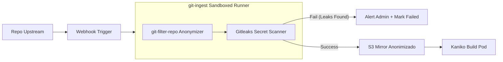
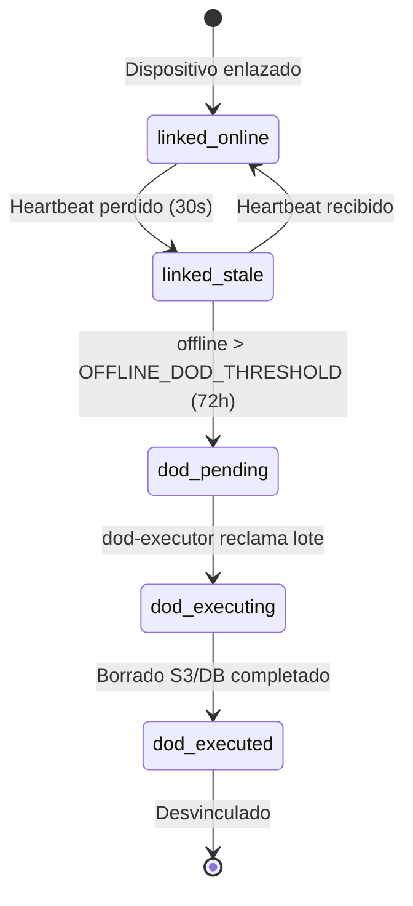
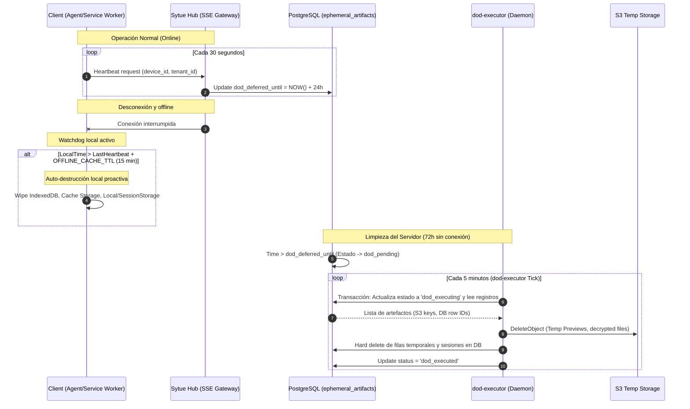
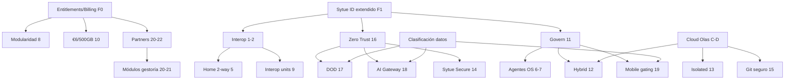

<!-- SPDX-License-Identifier: Apache-2.0 -->
<!-- Copyright (c) 2026 Daniel Delgado Ramos -->

# Negocio — plan estratégico y modelo de costes

1. **[Plan estratégico de plataforma](#1-plan-estrategico-de-plataforma)** — posicionamiento,
   visión arquitectónica, especificación por ítem estratégico, roadmap integrado y decisiones.
2. **[Modelo de costes](#2-modelo-de-costes)** — SKUs, coste por entorno, por producto y por
   tenant, y palancas de optimización.

> Ejecución técnica: [`roadmap.md`](roadmap.md) · Arquitectura: [`architecture.md`](architecture.md).

---

<a id="1-plan-estrategico-de-plataforma"></a>

## 1. Plan estratégico de plataforma

> **Estado:** borrador consensuado (rev. 4) · **Fecha:** 2026-07-11 · **Rama:** `sytue-native`  
> **Metodología:** plan elaborado mediante **análisis multi-agente de Sytue Projects** (rev. 1–3). **Rev. 4:** definición explícita de **Platform OS** — escritorio **Linux-based** + móvil **Android-based**, con SyID y suite integrados a nivel de sistema.  
> **Relación con otros docs:** complementa [`roadmap.md`](./roadmap.md) (F0–F6), [el backlog](../el backlog) (estado operativo), [`architecture.md#2-integracion-seamless-shell--hub`](./architecture.md#2-integracion-seamless-shell--hub), [`architecture.md`](./architecture.md), ADR-0023 (Cloud/Kapsule).

---

<a id="posicionamiento-competir-e-interoperar"></a>

### Posicionamiento: competir e interoperar

Sytue One es un **competidor directo** de suites como **Microsoft 365** y **Google Workspace**: ofrece las mismas categorías de producto (correo, archivos, ofimática, calendario, contactos, chat, videollamadas, identidad, PaaS) con implementación **propia, soberana y UE-only**.

La diferencia estratégica: **no obligamos a elegir**. Un cliente puede:

- **Usar solo Sytue** — suite nativa completa: **gratis** para una persona (5 GB), **€5/usuario/mes** con **200 GB/usuario** o **€25/usuario/mes** con **1 TB/usuario**. Todos los planes permiten conectar almacenamiento S3 propio.
- **Coexistir** — operar Sytue como sistema principal y mantener M365, Google Workspace, Slack, Odoo, Shopify, Jira, etc. con **sync bidireccional** y visibilidad en Home.
- **Migrar gradualmente** — conectar apps externas en **1 clic**, importar datos, y desactivar el externo cuando la paridad nativa baste.

**Regla de producto:** toda funcionalidad que ofrecemos en la suite **también debe ser interoperable** con el líder de mercado equivalente. No somos un «conector barato»: somos la alternativa completa que además habla con todos.

**One-liner (consenso GTM rev. 3):**

> _«La suite soberana europea, gratis para una persona y desde €5/usuario, que no te obliga a abandonar Google ni Microsoft y los conecta en 1 clic.»_

**Framing honesto del «1 clic»:** _«Un clic en Sytue. Un consentimiento en tu proveedor.»_ — cero XML/scripts en Sytue; el consent OAuth/admin en Google/Entra es inevitable y visible.

| Categoría       | Producto Sytue (nativo)                                  | Competidor / interoperable                                |
| --------------- | -------------------------------------------------------- | --------------------------------------------------------- |
| Identidad       | Sytue ID                                                 | Entra ID, Google Identity, Okta                           |
| Correo          | Sytue Mail                                               | Exchange Online, Gmail                                    |
| Archivos        | Sytue Drive                                              | OneDrive, Google Drive, SharePoint                        |
| Ofimática       | Sytue Docs (Docs/Sheets/Slides)                          | Microsoft Office, Google Docs/Sheets/Slides               |
| Calendario      | Sytue Calendar                                           | Outlook Calendar, Google Calendar                         |
| Contactos       | Sytue Contacts                                           | Outlook Contacts, Google Contacts                         |
| Chat + Meet     | Sytue Rooms                                              | Microsoft Teams, Slack, Mattermost, Zoom, Google Meet     |
| ERP / negocio   | Sytue Business _(roadmap)_                               | Odoo, SAP B1                                              |
| E-commerce      | Sytue Commerce _(roadmap)_                               | Shopify                                                   |
| Dev / ITSM      | Sytue Cloud + integraciones                              | Jira, Confluence, GitHub, GitLab                          |
| PaaS            | Sytue Cloud                                              | Azure App Service, Google Cloud Run, Vercel               |
| **Platform OS** | **Sytue Linux** (escritorio) · **Sytue Android** (móvil) | Windows, macOS, iOS, distros Linux genéricas (vía agente) |

**Platform OS (custom OS):** no es un SO genérico abstracto — son **dos plataformas concretas** derivadas de upstream open-source:

| Plataforma        | Base                                                          | Integración nativa                                                                                                                                         |
| ----------------- | ------------------------------------------------------------- | ---------------------------------------------------------------------------------------------------------------------------------------------------------- |
| **Sytue Linux**   | Distribución **Linux** propia (kernel LTS + stack desktop EU) | SyID como SSO de sistema; Mail/Drive/Docs/Calendar/Contacts/Rooms/Cloud como apps de primera clase; Govern y DOD en kernel de agente; tier gratis (ítem 7) |
| **Sytue Android** | **AOSP** (Android Open Source Project)                        | SyID vía Account Manager; suite preintegrada; attestation hardware; acceso completo a datos clasificados (ítem 19)                                         |

Windows, macOS, iOS y distros Linux de terceros **no** son Platform OS: usan `sytue-agent` con nivel de confianza inferior (`standard` / `untrusted`).

---

<a id="resumen-ejecutivo"></a>

### Resumen ejecutivo

Sytue One dispone hoy de una **suite de productividad soberana** madura (Mail, Drive, Docs, Calendar, Contacts, Rooms, Cloud PaaS) con identidad nuclear (Sytue ID), integración interna (Hub/Shell) y control plane cloud operable sobre Kapsule. **No existe aún** la capa de plataforma empresarial descrita en los 22 ítems estratégicos: conectores externos Google/Microsoft/SaaS, gobernanza de endpoints, agentes OS, hibridación, Zero Trust completo, billing unificado ni programas de partners.

**Principio transversal (rev. 2):** toda interoperabilidad externa se configura en **1 clic** — sin scripts, sin XML manual, sin consolas de desarrollador. El admin pulsa «Conectar {app}», concede consent OAuth/admin, y el sistema provisiona sync, tile en Home y políticas por defecto automáticamente.

Este plan define **cinco servicios nuevos** y **tres extensiones mayores** sobre la base existente:

| Pieza nueva / extendida                                               | Ítems que cubre                            |
| --------------------------------------------------------------------- | ------------------------------------------ |
| `services/integrations`                                               | 1, 2, 5, 9                                 |
| `services/govern`                                                     | 11, 8 (entitlements), 19 (políticas móvil) |
| `clients/sytue-agent` + shells móviles                                | 6, 7, 19                                   |
| `services/edge-connector`                                             | 12                                         |
| `services/billing` + `platform/pkg/entitlements`                      | 8, 10, 13, 20–22                           |
| `services/security-mgmt` (Sytue Secure)                               | 14, 16                                     |
| `services/ai-gateway`                                                 | 18                                         |
| Extensiones: Sytue ID (federación, devices), git-ingest, dod-executor | 4, 15, 17                                  |

**Secuencia consensuada:** (1) entitlements + billing → (2) SyID federación + devices → (3) integrations 1-Click → (4) govern + agente en SO terceros → (5) **Sytue Linux** Platform OS → (6) Zero Trust + DOD → (7) **Sytue Android** + híbrido + partners → (8) IA gateway + git seguro.

**Planes comerciales (2026-09-14, ADR 0038):** `personal_free` —**gratis**, una persona, **5 GB**, sin administración de organización ni ERP—; `pro` —**€5 por usuario al mes** (+ IVA) con **200 GB por usuario**; las instituciones educativas, al 50 %—; `enterprise` —**€25 por usuario al mes** (+ IVA) con **1 TB por usuario** y **Soporte Premium**—. El precio de `enterprise` subió de €20 a €25 por usuario y mes el 2026-09-22 (decisión del dueño; migración id/0095). Las suscripciones de pago siguen en «próximamente» y el cobro con Mollie no está cableado, así que no había contratos vivos a los que conservarles el precio; el día que los haya, la revalorización comprometida es lo único que puede subirles. ADR 0038 conserva la cifra con la que se decidió el plan. Revalorización comprometida de por vida: +€0,50 por usuario cada cuatro años, y nada más. Los mismos productos en los tres; los de pago valen para una organización (por asiento activo, `memberships` en Sytue ID) y para una persona sola. Todos permiten conectar almacenamiento S3 propio, que no cuenta en la cuota. Viable como producto de volumen con uso medio real << techo, lifecycle S3, canal gestoría y upsell `isolated_extra`.

---

<a id="1-estado-actual-del-repositorio-baseline"></a>

### 1. Estado actual del repositorio (baseline)

#### 1.1 Lo que ya funciona

| Capa                        | Capacidad                                                                   | Evidencia                                                |
| --------------------------- | --------------------------------------------------------------------------- | -------------------------------------------------------- |
| **Identidad**               | OIDC+PKCE, refresh rotativo, SCIM 2.0, MFA TOTP/WebAuthn, admin keyset      | `services/id/`                                           |
| **Suite interna**           | Mail, Drive, Docs, Calendar, Contacts, Rooms (Chat+Meet), Cloud PaaS        | `services/*`, `apps/frontend/apps/*`                     |
| **Integración intra-suite** | Hub: búsqueda federada, notificaciones SSE, presencia, intents cross-app    | `services/hub/internal/connectors/`                      |
| **Shell unificada**         | App switcher, SSO OAuth con cookies host-only, diseño Mattermost/Linear     | `@sytue/shell`, `@sytue/ui`                              |
| **Multi-tenant**            | RLS `app.tenant`, namespace `tenant-<slug>`, prefijo S3                     | `platform/pkg/pg`, ADR-0011                              |
| **Cloud PaaS**              | Controller K8s, Kaniko builds, cuotas `free/pro/team`, webhooks, tokens API | `services/cloud/`, ADR-0023                              |
| **Protocolos abiertos**     | CalDAV, CardDAV, WebDAV, JMAP, SMTP/IMAP                                    | Interop con clientes de terceros (Thunderbird, iOS Mail) |

#### 1.2 Brechas transversales

| Brecha                                                                   | Ítems afectados |
| ------------------------------------------------------------------------ | --------------- |
| Cero conectores OAuth/API a Google, Microsoft, Slack, Zoom               | 1, 2, 5, 9      |
| Sin federación inbound (Google/Entra como IdP upstream)                  | 1, 3, 4         |
| Portal muestra solo apps internas (`suiteApps`)                          | 5               |
| Sin agentes OS ni MDM                                                    | 6, 7, 11, 19    |
| Sin servicio govern, edge híbrido ni tier isolated explícito             | 11, 12, 13      |
| Sin billing, entitlements ni pool storage unificado                      | 8, 10, 20–22    |
| Sin Zero Trust device, clasificación de datos, DOD, AI gateway           | 14–19           |
| Cloud clona repos sin anonimización                                      | 15              |
| Planes desconectados (`free/pro/team` vs UI €49/€199 vs €5/€20 objetivo) | 10              |

---

<a id="2-vision-arquitectonica-unificada"></a>

### 2. Visión arquitectónica unificada

```mermaid
flowchart TB
  subgraph Identity["Capa identidad"]
    ID[Sytue ID<br/>OIDC · SCIM · Federación · Devices]
  end

  subgraph Experience["Experiencia"]
    PORTAL[Portal / Home<br/>Suite + Apps conectadas]
    SHELL[@sytue/shell]
    AGENT[sytue-agent · SO terceros]
    PLATOS[Sytue Linux · Sytue Android]
  end

  subgraph Platform["Plataforma empresarial"]
    GOVERN[services/govern<br/>Políticas · Assets · Sensibilidad]
    BILLING[Sytue ID billing<br/>Suscripción · Entitlements · Mollie]
    INTEG[services/integrations<br/>Google · MS · Slack · Zoom]
    SEC[services/security-mgmt<br/>Sytue Secure · SIEM export]
    EDGE[services/edge-connector<br/>IP dedicada · WireGuard]
    AI[services/ai-gateway<br/>Conectores RO · Redacción]
  end

  subgraph Suite["Suite Sytue (existente)"]
    HUB[Hub] --> MAIL & DRIVE & DOCS & CAL & CHAT & CLOUD
  end

  ID --> PORTAL & SHELL & AGENT & PLATOS
  GOVERN --> ID & AGENT & PLATOS & Suite
  BILLING --> ID & PORTAL & CLOUD
  INTEG --> HUB & PORTAL
  SEC --> ID & GOVERN & AI
  EDGE --> CLOUD & GOVERN
  AI --> HUB
  AGENT --> GOVERN
  PORTAL --> HUB & INTEG
```

#### 2.1 Principios invariantes (consenso multi-agente)

1. **Backend siempre Go** — BFF Astro solo proxy; servicios nuevos siguen `services/<svc>/cmd/<svc>`.
2. **Sytue ID es la única fuente de identidad** — Google/Microsoft son IdP upstream o sistemas de datos conectados, nunca IdP paralelo.
3. **PostgreSQL = verdad durable** — Dragonfly solo efímero (presencia, rate limits, TTL DOD).
4. **Entitlements ≠ Plan comercial** — habilita modularidad (ítem 8) y partners sin reescribir precios.
5. **Un tenant por cliente final** — partners gestionan vía delegación, no alojan datos de clientes en su propio tenant.
6. **Zero Trust by default** — ningún recurso accesible solo por estar en la red interna.
7. **IA nunca toca datos crudos** — conectores read-only con redacción; `value_ip` no desactivable.
8. **EU-only, clean-room** — SDKs permisivos (MIT/BSD/Apache); imágenes infra documentadas caso a caso.
9. **1 clic para conectar** — toda app externa se activa con un botón; cero configuración manual en MVP de cada conector.
10. **Competir + interoperar** — funcionalidad nativa completa _y_ puente bidireccional con el equivalente de mercado; nunca solo uno u otro.

---

<a id="22-connectkit--arquitectura-1-click"></a>

### 2.2 ConnectKit — arquitectura 1-Click

Patrón obligatorio para **toda** integración externa. Cada conector empaqueta:

```
ConnectKit (por provider)
├── manifest.yaml           # id, scopes mínimos, icono, categoría, producto Sytue equivalente
├── oauth_config            # client_id multi-tenant Sytue + redirect URI fija
├── admin_consent_flow      # Google Workspace / Entra: URL pre-armada
├── default_sync_policy     # qué dominios sync, dirección, resolución conflictos
├── home_tile_spec          # título, deeplink, badge source
├── provisioning_hooks      # post-connect: SCIM, webhooks, cron jobs
└── health_checks           # reauth_required, last_sync, error surface
```

**Flujo UX (siempre igual):**

1. Console o Portal → **Integraciones** → grid de apps con logo.
2. Admin pulsa **«Conectar»** en la tarjeta (p. ej. «Microsoft Teams»).
3. Redirect OAuth / admin consent → callback automático.
4. Backend crea `connection`, arranca sync inicial, registra tile en Home, emite evento Hub.
5. UI muestra **«Conectado ✓»** con estado sync; usuario final no configura nada.

**API unificada:**

```
POST /api/v1/connect/{provider}/start     # devuelve authorize_url (1 clic desde UI)
GET  /api/v1/connect/{provider}/callback  # handler OAuth
POST /api/v1/connect/{provider}/oneclick  # variantes con credenciales pre-registradas Sytue (marketplace app)
```

**Regla de aceptación global:** ningún conector GA requiere más de **1 clic + consent** del admin. Opciones avanzadas existen pero son **opt-in**.

**Estrategia sync por dominio (consenso arquitectura rev. 3):**

| Dominio                       | Day-1                              | Política conflicto default |
| ----------------------------- | ---------------------------------- | -------------------------- |
| Calendar                      | **2-way**                          | `newest_wins`              |
| Contacts                      | **2-way**                          | `newest_wins`              |
| Drive                         | Import-first → 2-way v1.1          | `newest_wins`              |
| Docs (Office/Google)          | Import-first; round-trip OOXML/ODF | `sytue_wins` post-import   |
| Mail                          | Import-first (1-way)               | `remote_wins`              |
| Chat (Slack/Teams/Mattermost) | Puente notificaciones              | dedup por `remote_msg_id`  |
| Directorio/SCIM               | Inbound                            | `remote_wins`              |

**Office/Google Docs:** API-native + conversión OOXML/ODF en Sytue Docs. **WOPI descartado** para GA (soberanía UE; competimos con Office, no lo embebemos).

**Entra ID vs M365:** dos ConnectKits separados — `entra-id` (federación, **no cuenta UI**) y `microsoft-365` (datos, **sí cuenta 1 UI**). Bundle «Migrar desde M365» los encadena automáticamente.

**Mattermost:** puente/coexistencia con Rooms nativo; no reemplazar servidor del cliente day-1.

**Rate limiting (100k+ usuarios):** token bucket Dragonfly por `(tenant, provider, api_family)` + cola Postgres `sync_jobs` + delta/webhook-first; respetar `Retry-After`.

---

<a id="23-sytue-platform-os--linux-escritorio-y-android-movil"></a>

### 2.3 Sytue Platform OS — Linux (escritorio) y Android (móvil)

Los «custom OS» del roadmap son **Sytue Linux** y **Sytue Android**: sistemas operativos basados en Linux y AOSP respectivamente, diseñados para integrar **Sytue ID (SyID)** y **toda la suite** a nivel de plataforma — no simples agentes instalados sobre SO de terceros.

#### Objetivo

Que el usuario en Sytue Linux o Sytue Android experimente la suite como **capa nativa del sistema**: un login SyID desbloquea Mail, Drive, Docs, Calendar, Contacts, Rooms y notificaciones Hub sin apps sueltas ni navegador como único contenedor.

#### Sytue Linux (escritorio)

**Base técnica:** distribución Linux propia (kernel LTS, init systemd, escritorio coherente con `@sytue/ui`). Upstream permisivo (clean-room); **sin** fork de Ubuntu/ChromeOS con branding — build reproducible propio (`platforms/sytue-linux/`).

**Integraciones de sistema:**

| Capa                       | Implementación                                                                                                                         |
| -------------------------- | -------------------------------------------------------------------------------------------------------------------------------------- |
| **SyID**                   | SSO de sesión de escritorio: OIDC device flow + PAM/polkit; bloqueo de pantalla = step-up; cuentas múltiples por perfil de usuario     |
| **Suite**                  | Apps nativas Fyne 2.8.1 (Go, sin WebView) empaquetadas `.deb`/Flatpak/OSTree; deep links `sytue://`; switcher de productos en launcher |
| **Drive**                  | Montaje FUSE/WebDAV de sistema + sincronización offline con política DOD                                                               |
| **Mail/Calendar/Contacts** | Clientes por defecto del SO (JMAP + CalDAV/CardDAV) apuntando a servicios Sytue                                                        |
| **Rooms**                  | Notificaciones de escritorio + indicador de presencia en panel del sistema                                                             |
| **Govern**                 | Agente `sytue-agent` como servicio de sistema; pull de políticas; inventario software                                                  |
| **DOD**                    | Heartbeat integrado; wipe de caché local al desvincular dispositivo                                                                    |
| **Confianza**              | `device_trust=managed`; attestation TPM/Secure Boot donde hardware lo permita                                                          |

**Tier gratis (ítem 7):** usuarios en **Sytue Linux** (ISO/OSTree oficial) reciben `suite_linux_free` automáticamente tras enrollment — no aplica a agente sobre Debian/Fedora genérico sin Platform OS.

#### Sytue Android (móvil)

**Base técnica:** fork **AOSP** sin GMS obligatorio (`platforms/sytue-android/`). Opcional: perfil de trabajo (Android Work Profile) para BYOD. OTA firmado por Sytue.

**Integraciones de sistema:**

| Capa                    | Implementación                                                                                                       |
| ----------------------- | -------------------------------------------------------------------------------------------------------------------- |
| **SyID**                | Android Account Manager + Autofill; biometría vinculada a WebAuthn SyID                                              |
| **Suite**               | Apps de sistema (Mail, Drive, Docs, Calendar, Contacts, Rooms) con SSO silencioso; iconos en launcher predeterminado |
| **Hub**                 | Push FCM (o equivalente self-hosted UE) + badge unificado                                                            |
| **Govern**              | Device Policy Controller (DPC) ligero o perfil gestionado SyID                                                       |
| **Clasificación datos** | Acceso completo a `restricted` y `value_ip` — único móvil con confianza plena                                        |
| **Confianza**           | `device_trust=managed`; Android Keystore + attestation propia SyID                                                   |

**Dispositivos sin Sytue Android** (Android stock, iOS, navegador móvil): **nunca** acceden a contenido `restricted`/`value_ip`, incluso vía email — ver ítem 19.

#### Arquitectura de repositorio

```
platforms/
├── sytue-linux/              # imagen ISO/OSTree, packages, branding, kernel config
│   ├── os/                   # rootfs, systemd units, polkit, PAM
│   ├── apps/                 # launchers suite (.desktop, icons)
│   └── agent/                # sytue-agent como servicio de sistema
└── sytue-android/            # AOSP manifest + overlays SyID/suite
    ├── device/sytue/           # product definition, OTA
    ├── packages/apps/          # Mail, Drive, … (system apps)
    └── syid/                   # AccountManager, attestation

clients/sytue-agent/            # núcleo Go compartido (Linux third-party, Win, macOS)
```

#### Modelo de confianza de dispositivo (3 niveles)

| Nivel       | Plataformas                                          | Capacidades                                                 |
| ----------- | ---------------------------------------------------- | ----------------------------------------------------------- |
| `managed`   | **Sytue Linux**, **Sytue Android**                   | Todo incluido `restricted`/`value_ip`; DOD; Govern completo |
| `standard`  | Win/macOS agente + WebAuthn; Linux genérico + agente | Operaciones cotidianas; sin `value_ip` en móvil             |
| `untrusted` | Navegador sin agente; móvil web genérico             | Lectura básica; sin body `restricted` ni adjuntos sensibles |

#### Roadmap Platform OS

| Fase        | Entrega                                                                 |
| ----------- | ----------------------------------------------------------------------- |
| **Fase 4a** | Sytue Linux alpha: ISO + SyID SSO + agente sistema + 3 apps suite       |
| **Fase 4b** | Sytue Linux beta: suite completa + tier gratis + FUSE Drive             |
| **Fase 5a** | Sytue Android alpha: AOSP + SyID + Mail/Drive/Rooms system apps         |
| **Fase 5b** | Sytue Android beta: attestation + acceso `restricted` + OTA             |
| **Fase 6**  | GSI opcional para dispositivos compatibles; hardening Secure Boot / AVB |

#### 2.3.4 Integración Tecnológica de Wrappers e Interfaces de Sistema

El desarrollo de escritorio de Sytue Linux se construirá sobre el shell compartido de **Fyne 2.8.1** (Go y renderizado nativo); Android mantiene su cliente Capacitor/PWA. La integración de plataforma queda así:

1. **Fyne para Sytue Linux (`sytue-desktop`):**
   - Se compila como una aplicación Go nativa y se comunica con `sytue-agent` local para interactuar con el controlador de almacenamiento FUSE (Drive).
   - **Seguridad:** no existe un motor HTML embebido ni bindings JavaScript. Las vistas llaman a APIs Go autenticadas y validan los deep links antes de actuar.
   - **Integración de Agente y FUSE:** el shell Go puede coordinar `sytue-agent` como subproceso o servicio local y montar dinámicamente Sytue Drive en `/media/sytue-drive`.

2. **Lógica de Service Worker y Caching PWA:**
   - **Estrategias de Caché:** Caching por tipo de recurso mediante Workbox:
     - _Cache-First_ para assets de marca estáticos (fuentes, logos, ilustraciones) con un TTL de 30 días.
     - _Stale-While-Revalidate_ para código compilado de Astro/Preact, asegurando arranques de interfaz instantáneos.
     - _Network-First_ para páginas HTML principales y peticiones de API JMAP/REST, garantizando la revocación oportuna de sesiones.
   - **IndexedDB para Operaciones Offline:** Almacenamiento local en IndexedDB (`pending_emails`, `pending_calendar`, `pending_drive`) para persistir acciones sin red, sincronizándose automáticamente al detectar conectividad mediante `BackgroundSyncPlugin` y resolución de conflictos `newest_wins`.

3. **AOSP Account Manager para Sytue Android:**
   - Se encargará de la gestión y renovación silenciosa de tokens OIDC/OAuth2 del usuario a través de un servicio de autenticación de sistema (`AuthenticatorService`) que hereda de `AbstractAccountAuthenticator` y se define en `authenticator.xml`.
   - El token será consumido de forma directa por las aplicaciones web encapsuladas del sistema sin requerir inicios de sesión duplicados.
   - **WebAuthn e Integración Biométrica:** Vincula la firma de claves WebAuthn generadas en Android Keystore (respaldadas por StrongBox en chip físico seguro) directamente con la API nativa de `BiometricPrompt` para la verificación biométrica del usuario.

**Fuera de alcance Platform OS:** custom iOS, custom Windows, custom macOS — solo agentes/`standard` en esas plataformas.

---

---

<a id="3-especificacion-por-item-estrategico"></a>

### 3. Especificación por ítem estratégico

#### Ítem 1 — Full interop con Google y Microsoft

**Objetivo:** coexistencia bidireccional con Google Workspace y Microsoft 365 — **competimos y conectamos en 1 clic**. No solo clientes estándar (CalDAV/IMAP): sync cloud-to-cloud completo.

**Estado actual:** protocolos abiertos operativos; **sin** Google Admin SDK, Microsoft Graph, Gmail API ni Calendar API cloud-to-cloud.

**1-Click ConnectKit (MVP obligatorio):**

| Botón en Console              | Qué hace al conectar                                                          | Producto Sytue nativo |
| ----------------------------- | ----------------------------------------------------------------------------- | --------------------- |
| **Conectar Google Workspace** | Federación OIDC + Directory sync + Calendar/Drive/Mail import                 | Toda la suite         |
| **Conectar Microsoft 365**    | Entra ID OIDC/SAML + Graph sync + OneDrive/Outlook/Teams bridge               | Toda la suite         |
| **Conectar Entra ID**         | Solo identidad (subconjunto M365)                                             | Sytue ID              |
| **Conectar Google Docs**      | Sync documentos/hojas/presentaciones + edición cruzada vía formatos OOXML/ODF | Sytue Docs            |
| **Conectar Microsoft Office** | Graph drive items + co-edición import/export; WOPI-style preview opcional     | Sytue Docs            |

**Arquitectura sync por dominio:**

| Dominio      | API / protocolo                                      | Dirección          | 1-Click | Fase |
| ------------ | ---------------------------------------------------- | ------------------ | ------- | ---- |
| Login        | OIDC upstream (Google + **Entra ID**)                | Inbound → Sytue ID | ✅      | MVP  |
| Directorio   | SCIM inbound + Graph SCIM / Google Directory         | Inbound            | ✅      | MVP  |
| Calendario   | CalDAV + Graph Calendar + Google Calendar API        | 2-way              | ✅      | v1   |
| Contactos    | CardDAV + People API + Graph Contacts                | 2-way              | ✅      | v1   |
| Archivos     | WebDAV + Drive API + OneDrive/SharePoint             | 2-way              | ✅      | v1   |
| Ofimática    | Google Docs/Sheets/Slides API + Graph Excel/Word/PPT | 2-way              | ✅      | v1   |
| Mail         | IMAP/JMAP + Gmail API / Graph Mail                   | 1-way → 2-way      | ✅      | v2   |
| Teams / Meet | Graph onlineMeetings, Meet links                     | Puente             | ✅      | v1   |

**Implementación:** nuevo servicio `services/integrations` (puerto dev `:8093`, `integrations.sytue.eu`), separado del Hub por manejo de refresh tokens de servicio, webhooks y jobs de sync. Cada fila del catálogo anterior = un **ConnectKit** empaquetado.

**Patrón sync bidireccional:**

```
Servicio Sytue (outbox) → Integrations worker → API remota
API remota (webhook)    → Integrations       → entity_mappings → Servicio Sytue
```

Políticas de conflicto configurables: `sytue_wins` | `remote_wins` | `newest_wins`.

---

#### Ítem 2 — Integraciones con todas las herramientas SaaS importantes

**Principio:** cada app externa cuya **funcionalidad ya ofrecemos en la suite** debe tener conector **1-Click** + producto nativo en roadmap si aún no existe.

**Catálogo prioritario — orden secuencial GA (consenso producto rev. 3):**

| #   | Conector                  | Fase launch           |
| --- | ------------------------- | --------------------- |
| 1   | Google Workspace          | **GA público**        |
| 2   | Microsoft 365             | **GA público**        |
| 3   | Entra ID                  | **GA público**        |
| 4   | Slack                     | **GA público**        |
| 5   | Zoom                      | **GA público**        |
| 6   | Microsoft Teams           | Beta → GA             |
| 7   | Google Docs/Sheets/Slides | Beta → GA             |
| 8   | Microsoft Office (Graph)  | Beta → GA             |
| 9   | Jira                      | Beta → GA             |
| 10  | GitHub                    | Beta → GA             |
| 11  | Confluence                | Beta                  |
| 12  | Odoo                      | Beta (canal gestoría) |

_Fuera top-12 hasta Fase 6:_ Mattermost (P1), Google Meet, Shopify (P2), Salesforce, Notion.

**Lanzamiento público inicial (5 conectores GA):** Google Workspace, Microsoft 365, Entra ID, Slack, Zoom. Resto en beta hasta Fase 2 completa.

**Odoo / Shopify / Jira — DECISIÓN: connector-first.** Módulos nativos (`Sytue Business`, `Commerce`, `Projects`) solo cuando el conector supere 12 meses de uso o >40% tenants conectados. Alcance connector Fase 2: Jira issues 2-way; Odoo contactos+facturas; Shopify pedidos+productos.

**Arquitectura extensible (ConnectKit registry):**

```
services/integrations/
├── connectkit/
│   ├── registry.go              # catálogo 1-Click
│   └── manifest_schema.json
├── internal/connectors/
│   ├── google/                  # Workspace + Docs
│   ├── microsoft/               # M365 + Office + Entra + Teams
│   ├── slack/
│   ├── zoom/
│   ├── mattermost/
│   ├── jira/
│   ├── confluence/
│   ├── odoo/
│   ├── shopify/
│   └── ...
```

Cada conector implementa `ConnectKit` + interfaz sync:

```go
type Connector interface {
    Manifest() ConnectManifest       // metadata 1-Click UI
    StartConnect(ctx context.Context, tenant string) (authorizeURL string, err error)
    OnConnected(ctx context.Context, conn Connection) error  // provisioning auto
    SyncDomains() []string
    // ... ExchangeCode, RefreshToken, Pull, Push
}
```

**Console Integraciones:** grid de tarjetas con botón único **«Conectar»** por app; estado en tiempo real; cero formularios en el happy path.

---

#### Ítem 3 — Mega Easy setup for companies (1-Click end-to-end)

**Objetivo:** onboarding enterprise en minutos. **Cada paso = 1 clic**; el sistema infiere el resto.

**Flujo consensuado (wizard Console + Portal):**

1. **Crear org** → slug automático → tenant K8s provisionado (automático, sin input).
2. **Conectar identidad** → 1 clic «Google Workspace» / «Entra ID» / «Microsoft 365» → admin consent → federación + SCIM auto-configurado.
3. **Importar directorio** → automático tras paso 2 (SCIM endpoint generado y mostrado solo si el admin quiere verlo).
4. **Conectar apps** → grid 1-Click; cada app = un botón «Conectar» (Slack, Teams, Odoo, Jira, …).
5. **Apuntar govern** → 1 clic «Activar Govern» (URL auto-asignada) o pegar URL custom (ítem 11).
6. **Verificar dominio mail** → wizard DNS con registros copy-paste (único paso semi-manual inevitable).

**Bundle MVP «Migrar desde Google / M365» (consenso rev. 3):**

| Incluido MVP     | Dirección                  | Excluido (v2)                       |
| ---------------- | -------------------------- | ----------------------------------- |
| Federación OIDC  | Inbound → Sytue ID         | SAML SP completo                    |
| Directorio SCIM  | Inbound auto               | Grupos avanzados                    |
| Calendario       | **2-way**                  | —                                   |
| Contactos        | **2-way**                  | —                                   |
| Drive / OneDrive | **1-way import** (90 días) | 2-way archivos                      |
| Mail             | **1-way IMAP**             | 2-way Gmail/Graph                   |
| Docs / Office    | **1-way import** OOXML/ODF | Co-edición cruzada                  |
| —                | —                          | Teams/Slack mensajería, Meet bridge |

Secuencia automática tras 1 bundle-click: Identidad → Directorio → Calendario → Contactos → Drive import → Mail import → Docs import. **≤3 clics admin, <10 min** hasta login corporativo + calendario visible.

**Entregables técnicos:**

| Componente                                              | Descripción                                |
| ------------------------------------------------------- | ------------------------------------------ |
| `POST /api/v1/onboarding/wizard`                        | Orquestador de pasos; encadena ConnectKits |
| `POST /api/v1/onboarding/bundle/{id}`                   | Dispara secuencia 1-Click de un bundle     |
| Console `OnboardingWizard.tsx` + `IntegrationsGrid.tsx` | UI: solo botones Conectar                  |
| Terraform module `tenant-quickstart`                    | Namespace + DNS + cert en un apply         |
| Device enrollment QR                                    | 1 clic «Añadir dispositivo» → QR           |

**Criterio de aceptación MVP:** admin conecta Google Workspace o M365 con **≤3 clics**; usuarios hacen login corporativo; calendario y contactos visibles en suite; tile externo en Home — todo en **< 10 minutos**.

---

#### Ítem 4 — SyID para todo

**Principio:** Sytue ID (`services/id`) es el **único IdP emisor** para toda la plataforma: suite, Cloud, Govern, Integrations, agentes OS, partners.

**Extensiones consensuadas sobre el IdP existente:**

| Capacidad                         | Estado      | Acción                                              |
| --------------------------------- | ----------- | --------------------------------------------------- |
| OIDC+PKCE BFF                     | ✅          | Mantener                                            |
| SCIM 2.0 inbound                  | ✅          | Wizard onboarding                                   |
| SAML SP (Entra login)             | ❌ doc only | `internal/saml/`                                    |
| Federación OIDC upstream          | ❌          | `internal/federation/oidc.go`                       |
| Dynamic OAuth client registration | ❌ defer    | API admin clients → desbloquea Cloud managed-auth   |
| Device enrollment + claims        | ❌          | Tablas `devices`, `device_sessions`                 |
| Identity brokering                | ❌          | Tablas `identity_providers`, `federated_identities` |

**Claims JWT extendidos (consenso):**

```json
{
  "sub": "...",
  "tenant": "acme",
  "roles": ["admin"],
  "modules": ["drive", "mail", "cloud"],
  "device_id": "uuid",
  "device_trust": "managed|standard|untrusted",
  "partner_of": "optional-delegated-tenant"
}
```

**Regla:** servicios validan JWT vía JWKS (`platform/pkg/authn`); cuotas duras siempre reconcilian con `services/billing`, no solo JWT.

##### Especificación Criptográfica y Almacenamiento Seguro (Sytue ID)

- **Cifrado de Tokens:** Los Access y ID Tokens se emiten firmados digitalmente usando **RS256** (RSA-2048 con SHA-256) o **ES256** (ECDSA P-256 con SHA-256). Los tokens de sesión y refresh tokens opacos son strings aleatorios de alta entropía (256 bits, generados con `crypto/rand`) de los cuales **solo se almacena el hash SHA-256** en base de datos (`sessions.token_hash`, `refresh_tokens.token_hash`).
- **Cifrado de Columnas Sensibles (Envelope Encryption):** Para datos en reposo de alta confidencialidad en la BD (claves privadas de firma, secretos TOTP, tokens OAuth externos), se utiliza un esquema de cifrado de sobre (envelope encryption):
  1. **Master Key (KEK):** Clave simétrica de 256 bits almacenada en Scaleway Secret Manager, inyectada en el entorno como `SYTUE_ID_KMS_MASTER_KEY`.
  2. **Data Encryption Key (DEK):** Generada por fila/registro mediante `crypto/rand` (32 bytes).
  3. **Algoritmo de Fila:** Se cifra el valor con la DEK usando **AES-256-GCM** y un IV único de 12 bytes. Estructura del payload: `IV (12 B) || Ciphertext || Auth Tag (16 B)`.
  4. **Envoltura:** La DEK se cifra con la KEK mediante **AES-256-GCM** y se almacena en la columna `encrypted_dek` contigua a los datos cifrados.
- **Rotación y Rollover de Claves JWKS:**
  - El ciclo de vida de las claves de firma se gestiona con los estados: `active` -> `next` -> `retired`.
  - La clave `active` firma nuevos tokens. La clave `next` se publica en el JWKS para permitir validaciones en transición de tokens vigentes.
  - La rotación ocurre cada 90 días mediante un cron daemon. Al rotar, `active` pasa a `next`, `next` pasa a `retired` (y se elimina del JWKS) y se genera una nueva clave `active`.
  - En caso de compromiso o sospecha de anomalías (evento `oauth.refresh.reuse_detected`), se puede disparar una rotación de emergencia inmediata invalidando la clave comprometida.
  - El middleware validador (`platform/pkg/authn/verifier.go`) cachea el JWKS (`jwk.NewCache` con refresco mínimo de 15 minutos) y realiza un fetch forzado bajo demanda ante un `kid` desconocido, aplicando rate-limiting de un fetch por cada 10 segundos.

---

#### Ítem 5 — Conexión 2-way de apps SaaS: si lo conectas, lo ves en Home

**Estado actual:** Portal `Launcher.tsx` muestra solo `suiteApps` de `@sytue/ui`.

**Diseño consensuado:**

```
[Aplicaciones Sytue]      ← suiteApps (actual)
[Apps conectadas]         ← GET /integrations/v1/connections?visible=true
[Accesos rápidos]         ← acciones cross-provider + intents Hub
```

**API:**

```
GET    /api/v1/connections
POST   /api/v1/connections/{provider}/authorize
GET    /api/v1/connections/{id}/status     # healthy | sync_error | reauth_required
DELETE /api/v1/connections/{id}
```

**Comportamiento por app conectada (1-Click → visible en Home):**

| App                       | Tile en Home                                          | Sync 2-way                             |
| ------------------------- | ----------------------------------------------------- | -------------------------------------- |
| Slack                     | Deeplink workspace + badge @menciones vía Hub         | Notificaciones → Hub; mensajes v2      |
| Microsoft Teams           | Deeplink canal / tab Sytue                            | Meeting links + presencia v1           |
| Zoom                      | «Iniciar reunión»                                     | Crear sala Zoom o Rooms según política |
| Mattermost                | Canales enlazados + unread                            | API import + notificaciones            |
| Google Calendar / Outlook | Eventos unificados en Calendar Sytue                  | v1 bidireccional                       |
| Google Docs / Office      | Documentos en Drive/Docs Sytue                        | v1 import/export + co-edición limitada |
| Jira                      | Issues asignados + sprints activos                    | 2-way issues                           |
| Confluence                | Páginas recientes / espacios                          | Import Markdown → Docs                 |
| Odoo                      | Pedidos/facturas recientes _(cuando Business exista)_ | Contactos, facturas 2-way              |
| Shopify                   | Pedidos del día _(cuando Commerce exista)_            | Pedidos + productos                    |
| GitHub                    | Repos + PRs recientes                                 | Webhook → notificaciones               |

Cada conexión activa con `visible_on_home=true` genera tile en `@sytue/ui/AppGrid` **automáticamente al completar el 1-Click** — sin checkbox adicional.

Hub extiende `domain.Source` con fuentes externas para búsqueda/notificaciones agregadas (solo metadata, no mutación directa).

---

#### Ítem 6 — Super integrado a SO móviles y de escritorio (incl. Linux)

**Estado actual:** solo web (Astro+Preact); protocolos DAV/JMAP para clientes terceros; UA parsing en sesiones ID. **Platform OS no existe** (`platforms/sytue-linux`, `platforms/sytue-android` por construir).

**Estrategia en dos capas:**

```
Capa A — Platform OS (máxima integración, device_trust=managed)
  Sytue Linux (escritorio)     Sytue Android (móvil)
  SyID + suite nativa          SyID + suite system apps

Capa B — Agente en SO de terceros (standard/untrusted)
  Windows · macOS · Linux genérico · iOS (web/TWA) · Android stock
  clients/sytue-agent/
```

**Arquitectura `clients/sytue-agent/`** (Capa B + servicio embebido en Sytue Linux):

```
clients/sytue-agent/
├── cmd/agent/
├── internal/
│   ├── enroll/               # OIDC device flow + mTLS → SyID
│   ├── govern/               # pull desired-state
│   ├── sync/                 # WebDAV FUSE, push notifications
│   └── platform/             # linux | windows | darwin
└── packaging/
    ├── deb-rpm/              # Linux third-party
    ├── windows/              # MSI + servicio + tray
    └── macos/                # .pkg + menubar
```

| Plataforma          | Capa | Fase  | Integración                                                             |
| ------------------- | ---- | ----- | ----------------------------------------------------------------------- |
| **Sytue Linux**     | A    | 4a–4b | SO completo: SyID session, suite launcher, Govern, DOD, **tier gratis** |
| **Sytue Android**   | A    | 5a–5b | AOSP: SyID Account Manager, system apps, attestation                    |
| **Linux genérico**  | B    | 2–4   | Agente Flatpak/deb; SSO xdg-open; sin tier gratis Platform              |
| **Windows / macOS** | B    | 4     | Agente + tray; GPO/MDM vía Govern                                       |
| **Android stock**   | B    | 5     | TWA + Account Manager; **sin** acceso `restricted`                      |
| **iOS**             | B    | 6     | ASWebAuthenticationSession; **sin** acceso `restricted`                 |

Ver §2.3 para detalle de Platform OS.

**Integraciones transversales:**

- SSO: SyID OIDC + PKCE; RFC 8628 Device Flow en headless Linux
- Archivos: WebDAV FUSE (Drive) — nativo en Sytue Linux
- Calendario/Contactos: CalDAV/CardDAV — clientes por defecto en Platform OS
- Notificaciones: Hub push → agente / system UI
- Deep links: `sytue://` registrado en Platform OS y agente

---

#### Ítem 7 — Gratis para usuarios Linux

**DECISIÓN (rev. 4):** el tier gratis aplica a usuarios de **Sytue Linux** (Platform OS oficial), no a cualquier distro Linux con navegador o agente genérico.

| Señal                                                           | Elegibilidad `suite_linux_free`        |
| --------------------------------------------------------------- | -------------------------------------- |
| Dispositivo con **Sytue Linux** (Platform OS) + enrollment SyID | ✅ Elegible                            |
| Agente en Debian/Fedora/Arch sin Platform OS                    | ❌ No elegible (usar `pro` €5/usuario) |
| Solo navegador web en Linux                                     | ❌ No elegible                         |

**Flujo:**

1. Instalar **Sytue Linux** desde ISO/OSTree oficial (`platforms/sytue-linux/`).
2. Primer arranque → wizard SyID enrollment → `devices.platform=sytue_linux` + `device_trust=managed`.
3. Sytue ID emite `plan=suite_linux_free` en la org.
4. Cuotas: p.ej. 5 usuarios, 25 GB storage, suite estándar sin Cloud deploy, sin SLA.

**Upsell:** `pro`/`enterprise` (€5/€25 por usuario y mes), Cloud, Govern avanzado, Hybrid, Isolated.

**Nota comercial:** Sytue Linux gratis refuerza adopción UE-soberana y canal dev/open-source; el margen se recupera en orgs que escalan a `pro`/`enterprise` o partners gestoría.

---

#### Ítem 8 — Modular y libre elección

**Separación consensuada:**

```
Plan comercial (qué pagas) → Subscription (Mollie, fuente en Sytue ID)
Entitlements (qué puedes usar) → org_entitlements
Quotas (cuánto consumes) → org_quota_profiles
```

**Catálogo de módulos:**

| Módulo                                                   | SKU                               | Dependencias    |
| -------------------------------------------------------- | --------------------------------- | --------------- |
| `suite.core`                                             | Incluido                          | id, hub, portal |
| `mail`, `drive`, `docs`, `calendar`, `contacts`, `rooms` | À la carte o bundle               | suite.core      |
| `cloud`                                                  | Plan personal_free/pro/enterprise | suite.core      |
| `govern`                                                 | +€/dispositivo                    | suite.core      |
| `finance`, `accounting`, `legal`, `payroll`, `employees` | Gratis gestoría / de pago         | suite.core      |
| `interop_*`                                              | Unidades de licencia (ítem 9)     | integrations    |
| `isolated_extra`                                         | Premium (ítem 13)                 | cloud.team+     |
| `hybrid`                                                 | +€/sitio + IP                     | cloud.team+     |

**Implementación:**

1. Tabla `org_entitlements(tenant, module_id, source, expires_at)`.
2. App switcher filtra tiles por `modules[]` en JWT.
3. Middleware Go: `403 module_disabled` además de RLS.
4. Portal onboarding: checkboxes con dependencias + quote en tiempo real.

**Decisión:** modularidad por **entitlements en JWT**, no por despliegue parcial de charts Helm (menor coste ops).

---

#### Ítem 9 — Licencias para unidades de interoperabilidad

**Definición:** una **Unidad de Interoperabilidad (UI)** = un espacio de trabajo externo conectado con sync activo (1 workspace Slack, 1 tenant Teams, etc.).

| Tipo          | Cuenta como 1 UI                                    |
| ------------- | --------------------------------------------------- |
| `teams`       | 1 tenant Microsoft 365 con Teams activo             |
| `slack`       | 1 workspace Slack OAuth                             |
| `zoom`        | 1 cuenta Zoom OAuth account-level                   |
| `mattermost`  | 1 servidor Mattermost                               |
| `meet_bridge` | 1 dominio Google Workspace con puente Meet↔Calendar |
| `jira`        | 1 site Atlassian Cloud                              |
| `odoo`        | 1 instancia Odoo                                    |
| `shopify`     | 1 tienda Shopify                                    |

**Meet nativo Sytue (LiveKit), Mail, Drive, Docs nativos no consumen UI** — son producto incluido en `suite_one`.

**Modelo vigente — interop incluida en €6/usuario:**

| Elemento                     | Valor                                |
| ---------------------------- | ------------------------------------ |
| UI incluidas por org         | **3** (Slack + Teams + Zoom típico)  |
| UI adicionales               | **+€1/UI/mes**                       |
| Federación Google/Entra/M365 | **No cuenta** como UI (es identidad) |
| Trial 30 días                | 4.ª UI permitida con aviso upsell    |
| Enterprise ilimitado         | Plan **€6+/usuario** negociado       |

**Enforcement:** insert en `interop_units` al completar 1-Click + primer sync; aviso al conectar la 4.ª UI → upsell inline (no bloqueo duro en trial 30d).

---

#### Ítem 10 — €6/usuario/mes, todas las funciones

**Planes:** `personal_free`, `pro` y `enterprise` (constantes en `platform/pkg/commerce`).

| Dimensión                                    | `personal_free`                                                                                      | `pro`                                                                 | `enterprise`                                                |
| -------------------------------------------- | ---------------------------------------------------------------------------------------------------- | --------------------------------------------------------------------- | ----------------------------------------------------------- |
| Precio mensual                               | **€0**                                                                                               | **€5,00 por usuario/mes** (+ IVA); instituciones educativas **−50 %** | **€25,00 por usuario/mes** (+ IVA), con **Soporte Premium** |
| Para quién                                   | Una persona (su organización es su correo)                                                           | Organizaciones y personas                                             | Organizaciones y personas                                   |
| Storage (Drive: ficheros, fotos, documentos) | **5 GB**                                                                                             | **200 GB × usuarios** (pool org)                                      | **1 TB × usuarios** (pool org)                              |
| Buzón de correo                              | 1 GB                                                                                                 | 10 GB por usuario                                                     | 25 GB por usuario                                           |
| Módulos                                      | Todo menos administración de organización y SyERP; Sytue Admin solo para integraciones y migraciones | Todos                                                                 | Todos                                                       |
| Almacenamiento S3 propio                     | Sí                                                                                                   | Sí                                                                    | Sí                                                          |
| Facturación                                  | —                                                                                                    | Mollie **per-seat**; los asientos cubren a los miembros activos       | Ídem                                                        |
| Precio anual                                 | No publicado en la primera versión                                                                   |                                                                       |                                                             |

**Parámetros de suscripción vigentes:**

| ID                       | Valor                                                |
| ------------------------ | ---------------------------------------------------- |
| `pro_monthly`            | €5,00/asiento/mes (€2,50 educativo)                  |
| `enterprise_monthly`     | €25,00/asiento/mes                                   |
| `price_rise`             | +€0,50/asiento cada 4 años, de por vida              |
| `min_seats`              | 1                                                    |
| `storage_pool_formula`   | `bytes_por_usuario_del_plan × active_users`          |
| `deactivated_grace_days` | 90 (datos retenidos; pool recalcula sin ese usuario) |
| `overage_price`          | **€0,05/GB/mes**, bloque mínimo **100 GB** (€5/mes)  |
| `interop_unit_extra`     | €1,00/UI/mes                                         |

**Fórmula:** org 20 usuarios en `pro` → **4 TB** pool incluido; en `enterprise`, **20 TB**. Enforcement pool org; desglose `user_storage_usage` opcional. Alerta **80%**; throttle subida **100%**; lectura OK.

**Fair-use (200 GB y 1 TB = techos comerciales):** uso medio objetivo **50 GB/usuario**; P50=35 GB, P95=120 GB; lifecycle Glacier >90d. Con Scaleway One Zone (0,00803 €/GB/mes, medido el 2026-09-13) el plan `enterprise` está por debajo de coste si el usuario lo llena (8,22 €/TB): vive del uso medio; `pro` cubre su coste incluso lleno (1,64 €).

**Canal gestoría:** el **cliente final** paga sus €5 o €25/asiento (tenant propio); gestoría recibe módulos verticales gratis en su org partner.

```sql
org_storage_pools (
  tenant text PRIMARY KEY,
  bytes_per_user bigint NOT NULL DEFAULT 536870912000,
  active_users int NOT NULL,
  limit_bytes bigint GENERATED ALWAYS AS (bytes_per_user * active_users) STORED,
  used_bytes bigint NOT NULL DEFAULT 0
)
```

**Comparativa honesta vs competencia (GTM rev. 3):**

|                         | Sytue One          | M365 Business Basic | Google Workspace Starter |
| ----------------------- | ------------------ | ------------------- | ------------------------ |
| Precio/usuario          | **€5 / €25**       | ~€5,60              | ~€6                      |
| Storage/usuario         | **500 GB**         | 1 TB OneDrive       | 30 GB                    |
| Residencia UE-only      | ✅                 | ❌                  | ❌                       |
| Coexistencia 1-clic     | ✅                 | ❌                  | ❌                       |
| Apps escritorio offline | ❌ (web+agente)    | ✅                  | ❌                       |
| Ecosistema enterprise   | ⚠️ En construcción | ✅                  | ✅                       |

---

#### Ítem 11 — Plataforma de gobierno de datos y configuración (Govern)

**Objetivo:** punto único para políticas de PCs, software, assets, login, niveles de sensibilidad. Custom extremo: **apuntar IP/URL de govern y listo**.

**Servicio nuevo:** `services/govern` (`govern.sytue.eu`, dev `:8094`)

**Modelo:**

```
Tenant
 └── GovernProfile (endpoint_url — "apunta y listo")
      ├── Policies[]           (login, MFA, sesión, red, cifrado)
      ├── SoftwareCatalog[]    (apps permitidas/bloqueadas)
      ├── AssetInventory[]     (hardware, serial, owner)
      ├── SensitivityLevels    (public | internal | confidential | restricted | value_ip)
      └── ModuleEntitlements   (módulos activos — ítem 8)
```

**Onboarding «apunta y listo»:**

1. Admin crea `GovernProfile` con `endpoint_url` (CNAME `govern.<tenant>.sytue.eu` o IP dedicada híbrida).
2. Agente/OS profile contiene solo: `govern_url`, `tenant_slug`, `enroll_token`.
3. Primer contacto → OIDC device enrollment → certificado mTLS.
4. Pull periódico de políticas (long-poll/SSE).

**Endpoints clave:**

```
POST /api/v1/govern/profile
GET  /api/v1/policies
PUT  /api/v1/policies/{id}/publish
GET  /api/v1/devices                    # inventario keyset
POST /api/v1/devices/enroll
GET  /api/v1/devices/{id}/desired         # estado deseado
POST /api/v1/devices/{id}/report          # telemetría/postura
PUT  /api/v1/sensitivity/{resource}       # etiquetado Drive/Mail/Docs
```

**Integración con productos existentes:**

| Producto | Hook                                                      |
| -------- | --------------------------------------------------------- |
| Sytue ID | MFA forzada por rol/dispositivo; bloqueo por postura      |
| Drive    | Etiquetas sensibilidad en metadatos; DLP en share links   |
| Mail     | Clasificación en headers internos; gating móvil (ítem 19) |
| Docs     | Restricción export por nivel                              |
| Cloud    | Políticas egress/deploy (repos permitidos)                |
| Console  | UI admin Govern (pestaña nueva)                           |

---

#### Ítem 12 — Hibridación mediante IP dedicada

**Patrón consensuado:** IP elástica dedicada UE (Scaleway) + túnel saliente desde sitio cliente (sin abrir puertos inbound).

```
[Sitio cliente]                    [Scaleway UE]
  edge-agent ──WireGuard──►  edge-gateway (tenant-acme-edge)
       │                           │
       │                           ├──► tenant-acme (K8s)
       │                           ├──► RDB privado (VPC)
       └── LAN 10.x/192.x            └──► govern.sytue.eu
```

**Componentes:**

| Componente        | Rol                                               |
| ----------------- | ------------------------------------------------- |
| `edge-gateway`    | Termina túnel, NAT, split-DNS                     |
| `edge-agent`      | VM/firewall cliente; OVA + Docker + systemd       |
| `edge-controller` | Extensión cloud-controller: IP, claves WG, health |

**Onboarding Console:** «Añadir sitio híbrido» → IP dedicada + config WireGuard + QR.

**Tablas:**

```sql
hybrid_sites(id, tenant, name, dedicated_ip, wg_pubkey, status, last_handshake)
hybrid_routes(site_id, cidr, service)
```

**Coste infra:** +€17–40/mes por LB/IP (`docs/business.md#2-modelo-de-costes` §8) — repercutir en plan Team/Hybrid.

---

#### Ítem 13 — Isolated extra (premium)

**Tiers de aislamiento consensuados:**

| Tier               | Cómputo                           | Datos                              | Red                  | Precio orientativo |
| ------------------ | --------------------------------- | ---------------------------------- | -------------------- | ------------------ |
| `shared` (default) | Namespace Kapsule compartido      | RLS RDB compartido                 | NetPol estándar      | Incluido           |
| `isolated_compute` | Node pool dedicado + affinity     | RLS (compartido)                   | Egress filtrado      | +€49/mes           |
| `isolated_data`    | Namespace dedicado                | RDB instancia + bucket S3 dedicado | IP dedicada opcional | +€99/mes           |
| `isolated_full`    | Clúster Kapsule dedicado (célula) | RDB + S3 + KMS dedicados           | VPN + sin vecinos    | Enterprise         |

**Implementación:** extender `controller.Platform` (ADR-0023) con `IsolatedPlatform`; flag `isolation_tier` en `org_quota_profiles`; chart `tenant-isolated/`.

Escotilla futura: `FirecrackerPlatform` para cargas reguladas.

---

#### Ítem 14 — Seguridad gestionada (Sytue Secure), interoperable

**Producto:** `services/security-mgmt` — seguridad gestionada transversal.

**Capacidades:**

- Políticas centralizadas (Zero Trust, DOD, clasificación, IA)
- Postura dispositivos / sesiones / tokens
- Correlación eventos cross-app
- Playbooks automatizados (revoke, rotate, isolate tenant)
- **Export interoperable** a SIEM cliente

###### Especificación de Formatos de Exportación para SIEM

Los logs de auditoría de seguridad emitidos por el subsistema Sytue Secure se formatean conforme a tres estándares de la industria para garantizar compatibilidad nativa con Splunk, QRadar (LEEF), Azure Sentinel (CEF) y Elasticsearch/OpenSearch (OTel):

1. **Common Event Format (CEF):**
   - **Formato:** `CEF:Version|Device Vendor|Device Product|Device Version|Signature ID|Name|Severity|Extension`
   - **Ejemplo real de token detectado como reutilizado:**
     ```syslog
     CEF:0|Sytue|SytueOne|2.0|oauth.refresh.reuse_detected|Refresh Token Reuse Detected|9|src=198.51.100.42 suser=admin@acme.eu target=acme msg=Rotated refresh token requested again, revoking session chain deviceTrust=untrusted request_id=req-9f8e7d
     ```
2. **Log Event Extended Format (LEEF):**
   - **Formato:** `LEEF:Version|Vendor|Product|Version|EventID|Extension` (separado por tabulación o caracteres específicos).
   - **Ejemplo real de fallo de login con MFA:**
     ```syslog
     LEEF:2.0|Sytue|SytueOne|2.0|auth.mfa.failed|src=198.51.100.42 devTime=2026-07-11T23:03:40Z usrName=admin@acme.eu tenant=acme sev=7 msg=TOTP verification failed request_id=req-a1b2c3
     ```
3. **OpenTelemetry Logs (OTel structured JSON):**
   - **Formato:** Registro de logs JSON conforme al schema semántico de OTel.
   - **Ejemplo de compilación rechazada por secretos:**
     ```json
     {
       "timeUnixNano": 1783811020000000000,
       "severityNumber": 17,
       "severityText": "ERROR",
       "name": "git.security_leak.detected",
       "body": "Gitleaks verification gate failed. Secret pattern matched in code repo.",
       "attributes": [
         { "key": "service.name", "value": { "stringValue": "sytue-cloud" } },
         { "key": "tenant.id", "value": { "stringValue": "acme" } },
         {
           "key": "git.commit.sha",
           "value": { "stringValue": "a7421b1b4d24f0c" }
         },
         {
           "key": "security.leak.rule_id",
           "value": { "stringValue": "generic-api-key" }
         }
       ]
     }
     ```

###### Configuración del Transporte de Eventos

Los clientes pueden configurar la exportación en Console bajo tres modalidades de transporte seguro:

- **syslog sobre TLS (RFC 5424):** Streaming de eventos en tiempo real a la IP/FQN del SIEM del cliente mediante una conexión TLS 1.3 TCP en el puerto `6514`. Requiere autenticación mTLS: Sytue valida el certificado del colector SIEM del cliente, y este a su vez valida el certificado firmado por la CA de Sytue presentado por `services/security-mgmt`.
- **HTTPS Webhook con Firmas HMAC:** Llamadas HTTP POST en formato JSON a la URL de ingesta del cliente. La autenticación se realiza mediante una firma digital en las cabeceras `X-Sytue-Signature` calculada usando **HMAC-SHA256** sobre el timestamp y el cuerpo del JSON, utilizando una clave pre-compartida almacenada en el Secret Manager.
- **Batch Export en S3 WORM:** Para la consolidación e ingesta histórica, se agrupan logs en archivos **Apache Parquet** cada 1 hora y se depositan en un bucket de S3 con **Object Lock en modo Compliance** (WORM) activo por 365 días para evitar modificación o borrado.

**Fuentes telemetría:** audit ID, Console, Cloud, Traefik, Hub, AI Gateway, DOD executor.

**Planes:** Team/Enterprise = export SIEM + playbooks; Free/Pro = auditoría UI only.

**Interoperabilidad adicional:** OpenID Shared Signals (SSE/RISC) para revocación federada; SCIM grupos `security-admins`.

---

#### Ítem 15 — Git seguro con anonimización proactiva constante

**Principio:** el control plane **nunca** clona ni persiste identidad de autor real sin transformación. **Sin avisos** — operación silenciosa + audit admin.

**Pipeline «Secure Git Proxy»:**



###### 1. Filtros de Anonimización de Repositorio (git-filter-repo)

Al dispararse el webhook en `services/cloud`, el microservicio de integración levanta un job temporal en un entorno aislado y ejecuta `git-filter-repo` (utilidad de alto rendimiento basada en Python) para transformar la base de datos de Git antes de cualquier build o almacenamiento persistente:

- **Autores y Committers:** Mapeo y reescritura de todos los nombres y correos de los commits de la rama:
  ```bash
  git-filter-repo --email-callback "return b'deploy-' + b'$TENANT' + b'@git.internal.sytue.eu'" \
                  --name-callback "return b'Sytue Bot'"
  ```
- **Limpieza de Firmas y Metadatos:** Se eliminan las firmas GPG, firmas SSH y metadatos de validación (como tráileres `Signed-off-by` y `Co-authored-by`):
  ```bash
  git-filter-repo --commit-callback "
    if hasattr(commit, 'gpgsig'):
      del commit.gpgsig
    # Redactar PII en mensajes de commit usando expresiones regulares
    import re
    msg = commit.message
    msg = re.sub(b'(?i)email|phone|password|secret', b'[redacted]', msg)
    commit.message = msg
  "
  ```

###### 2. Validación de Puerta de Fugas (Gitleaks Gate)

Antes de empaquetar el repositorio transformado para el build, se realiza un escaneo de secretos y llaves criptográficas sobre todo el historial anonimizado:

- **Comando de Ejecución:** `gitleaks detect --source=. --config=/etc/gitleaks/gitleaks.toml --verbose --fail-on-leak`
- **Reglas del Gitleaks Gate:** La configuración local del validador (`gitleaks.toml`) define patrones específicos para llaves de API de Scaleway, DSN de PostgreSQL, llaves RSA/EC privadas, JSON Web Keys (JWK) y tokens de cookies de Sytue ID.
- **Fail-Closed Policy:** Si se detecta un secreto (código de salida `67` en Gitleaks), se aborta la ejecución de forma inmediata. La imagen del contenedor de compilación no se genera. Se emite un evento de alerta a Sytue Secure (`git.security_leak.detected`) y se cambia el estado del deploy del proyecto a `failed` con el log _"Secret leak detected in repository history. Build aborted."_

###### 3. Aislamiento de la Compilación de Contenedores (Kaniko Sandbox)

El proceso de construcción y empaquetado de la imagen se ejecuta bajo un aislamiento estricto en Kubernetes:

- **Entorno Rootless:** Se ejecuta la imagen oficial `gcr.io/kaniko-project/executor:latest` en un Pod configurado con `SecurityContext` restrictivo:
  ```yaml
  securityContext:
    runAsNonRoot: true
    runAsUser: 1000
    allowPrivilegeEscalation: false
    readOnlyRootFilesystem: false # Kaniko requiere escribir en su espacio de compilación temporal /workspace
    capabilities:
      drop:
        - ALL
  ```
- **Aislamiento de Red:** El Pod de Kaniko no tiene permisos de salida a internet. Una `NetworkPolicy` específica bloquea todo el tráfico de egress excepto las conexiones internas al Registry de Scaleway (en la misma zona UE) y las consultas DNS internas. Esto evita que scripts maliciosos de instalación en el build (p. ej. preinstall scripts de npm/Bun) puedan exfiltrar el código o los secretos inyectados en las variables de entorno.

UI Cloud muestra `anon_commit` (SHA mirror), no SHA upstream (link admin opcional).

Integración: extender webhook Cloud existente; Kaniko lee **solo** mirror S3.

---

#### Ítem 16 — Zero Trust by default

**Arquitectura en cuatro planos:**

| Plano           | Implementación                                                                           |
| --------------- | ---------------------------------------------------------------------------------------- |
| **Identidad**   | Sytue ID + device claims + step-up continuo                                              |
| **Dispositivo** | `untrusted` → `standard` (WebAuthn/agente) → **`managed` (Sytue Linux · Sytue Android)** |
| **Red**         | mTLS intra-clúster; SPIFFE/SVID fase 2; NetworkPolicy deny-by-default (existente Cloud)  |
| **Datos**       | Clasificación + RLS clearance + PEP en cada servicio                                     |

**Claims JWT:**

```json
{
  "device_id": "uuid",
  "device_trust": "managed|standard|untrusted",
  "auth_strength": 2,
  "policy_version": "2026-07"
}
```

**Middleware nuevo:** `RequireDeviceTrust(minLevel)` en `platform/pkg/authn`.

**PDP:** empezar extendiendo Hub; extraer servicio `policy` cuando >5 políticas dinámicas.

---

#### Ítem 17 — Autodestrucción DOD por diseño

**Semántica consensuada:**

- **DOD (Data Operational Destruction):** destrucción criptográfica y lógica de copias operativas (caché local, previews de archivos, cuerpos de correo pre-renderizados, índices en memoria).
- **Mientras dispositivo enlazado + online:** destrucción **aplazada** (`dod_deferred_until` renovado por heartbeat).
- **Copias online cacheadas:** expiran si dispositivo offline > X tiempo.

**Estados dispositivo:**



###### Algoritmos y Secuencia Operativa del Flujo DOD



###### 1. Rutina Cliente de Auto-Destrucción (IndexedDB, Cache y Storage Wipe)

Implementada a nivel de Service Worker de la Shell (`apps/frontend/packages/shell/sw.ts`) y del agente nativo. Si el temporizador local supera el umbral de desconexión sin recibir un pong exitoso del servidor, ejecuta la siguiente subrutina de purga inmediata:

```typescript
async function performClientSideDODWipe(): Promise<void> {
  console.warn("DOD Triggered: Executing complete client-side storage wipe.");

  // 1. Cerrar conexiones activas de bases de datos
  // (Previene bloqueos de borrado en algunos motores de navegador)

  // 2. Borrar bases de datos de IndexedDB de la suite
  const databasesToWipe = [
    "sytue-mail-cache",
    "sytue-drive-offline",
    "sytue-rooms-store",
    "sytue-docs-crdt",
    "sytue-hub-notifications",
  ];

  for (const dbName of databasesToWipe) {
    await new Promise<void>((resolve) => {
      const request = indexedDB.deleteDatabase(dbName);
      request.onsuccess = () => {
        console.log(`IndexedDB ${dbName} wiped.`);
        resolve();
      };
      request.onerror = () => {
        console.error(`Error wiping IndexedDB ${dbName}`);
        resolve(); // Continuar con la siguiente para no bloquear el flujo
      };
      request.onblocked = () => {
        console.warn(`Wipe of IndexedDB ${dbName} was blocked, retrying...`);
        resolve();
      };
    });
  }

  // 3. Vaciar Cache Storage de la API y de assets
  const cacheKeys = await caches.keys();
  await Promise.all(cacheKeys.map((key) => caches.delete(key)));
  console.log("Cache Storage wiped.");

  // 4. Vaciar LocalStorage y SessionStorage
  localStorage.clear();
  sessionStorage.clear();
  console.log("Web storages cleared.");

  // 5. Redireccionar al usuario a pantalla de bloqueo sin estado
  window.location.href = "/lock?reason=dod_wipe";
}
```

###### 2. Daemon Servidor de Ejecución DOD (`dod-executor`)

Daemon escrito en Go (`services/security-mgmt/cmd/dod-executor/main.go`), estructurado para consultas eficientes en Postgres usando `pgx`:

```go
package main

import (
	"context"
	"log/slog"
	"time"

	"github.com/aws/aws-sdk-go-v2/service/s3"
	"github.com/jackc/pgx/v5"
)

type EphemeralArtifact struct {
	ID           string
	Tenant       string
	ResourceType string
	S3Key        string
	DatabaseRow  string
}

func executeDODBatch(ctx context.Context, db *pgx.Conn, s3Client *s3.Client, bucketName string) error {
	tx, err := db.Begin(ctx)
	if err != nil {
		return err
	}
	defer tx.Rollback(ctx)

	// Seleccionar y bloquear en lote los artefactos pendientes y expirados
	query := `
		WITH batch AS (
			SELECT id, tenant, resource_type, s3_key, database_row_id
			FROM ephemeral_artifacts
			WHERE status = 'dod_pending' AND dod_deferred_until < NOW()
			LIMIT 100
			FOR UPDATE SKIP LOCKED
		)
		UPDATE ephemeral_artifacts e
		SET status = 'dod_executing', updated_at = NOW()
		FROM batch
		WHERE e.id = batch.id
		RETURNING e.id, e.tenant, e.resource_type, e.s3_key, e.database_row_id;
	`

	rows, err := tx.Query(ctx, query)
	if err != nil {
		return err
	}
	defer rows.Close()

	var artifacts []EphemeralArtifact
	for rows.Next() {
		var art EphemeralArtifact
		if err := rows.Scan(&art.ID, &art.Tenant, &art.ResourceType, &art.S3Key, &art.DatabaseRow); err != nil {
			return err
		}
		artifacts = append(artifacts, art)
	}

	if len(artifacts) == 0 {
		return nil
	}

	for _, art := range artifacts {
		slog.Info("Executing DOD for artifact", "id", art.ID, "type", art.ResourceType, "tenant", art.Tenant)

		// 1. Eliminar de S3 si aplica
		if art.S3Key != "" {
			_, err := s3Client.DeleteObject(ctx, &s3.DeleteObjectInput{
				Bucket: &bucketName,
				Key:    &art.S3Key,
			})
			if err != nil {
				slog.Error("Failed to delete S3 object for DOD", "key", art.S3Key, "error", err)
				continue
			}
		}

		// 2. Eliminar el registro en base de datos del servicio si aplica
		if art.DatabaseRow != "" && art.ResourceType == "mail_body" {
			_, _ = tx.Exec(ctx, "DELETE FROM transient_mail_bodies WHERE id = $1 AND tenant = $2", art.DatabaseRow, art.Tenant)
		}

		// 3. Marcar como ejecutado final
		_, err = tx.Exec(ctx, "UPDATE ephemeral_artifacts SET status = 'dod_executed', updated_at = NOW() WHERE id = $1", art.ID)
		if err != nil {
			slog.Error("Failed to update status to dod_executed", "id", art.ID, "error", err)
		}
	}

	return tx.Commit(ctx)
}
```

**Defaults configurables por tenant:**

| Parámetro                | Default                |
| ------------------------ | ---------------------- |
| `PRESENCE_TTL`           | 45s                    |
| `OFFLINE_CACHE_TTL`      | 15 min                 |
| `OFFLINE_DOD_THRESHOLD`  | 72 h                   |
| `DOD_DEFER_WHILE_ONLINE` | ∞ (mientras heartbeat) |

Mail body cache y Drive previews se registran como artefactos efímeros al servir.

---

#### Ítem 18 — IA siempre por conectores; IP de valor siempre protegida

**Principio no negociable:** ningún LLM accede a datos crudos. Reglas `value_ip` **hardcoded** — imposible desactivar por tenant.

**Servicio:** `services/ai-gateway`

```
UI copilot → POST /api/v1/ai/complete
  → PEP (auth + device_trust + scope ai:use)
  → PDP (política tenant)
  → Conectores RO (mail.subject_snippet, drive.filename_meta, docs.outline, chat.last_n)
  → Redaction pipeline (PII → placeholder, IP strip)
  → LLM Provider UE (Scaleway Generative / Mistral)
```

**Conectores (read-only, mínimo privilegio):**

| Conector               | Expone                         | Prohibido           |
| ---------------------- | ------------------------------ | ------------------- |
| `mail.subject_snippet` | subject + 200 chars redactados | body HTML, adjuntos |
| `drive.filename_meta`  | nombre, mime, tamaño           | contenido blob      |
| `docs.outline`         | títulos sección                | fórmulas, macros    |
| `chat.last_n`          | últimos N mensajes redactados  | DMs `restricted`    |

**Reglas `value_ip` (no desactivables):**

1. Conectores devuelven 403 — IA solo recibe «documento protegido, N páginas».
2. Watermark invisible en outputs `confidential+`.
3. Sin fine-tuning con datos tenant.
4. Logging: solo hashes; retención 7 días.
5. Sin tool-use libre ni browsing.

**Scope OIDC:** `ai:use`, `ai:admin`.

---

#### Ítem 19 — Dispositivos sin Platform OS: acceso limitado incluso en emails

**Regla:** móviles **sin Sytue Android** (Android stock, iOS, navegador móvil) y escritorios **sin Sytue Linux** no acceden nunca a ciertos recursos, **aunque el enlace llegue por email**.

**Matriz dispositivo × clasificación (rev. 4):**

| Recurso                        | Sytue Linux / desktop + MFA | SO tercero (Win/macOS/agente) | Móvil sin Sytue Android |
| ------------------------------ | --------------------------- | ----------------------------- | ----------------------- |
| Mail subject                   | ✓                           | ✓                             | ✓                       |
| Mail body `confidential`       | ✓                           | ✓ MFA reciente                | ✓ MFA reciente          |
| Mail body/adjunto `restricted` | ✓                           | ✓ device `standard`+          | **✗** teaser only       |
| Drive `value_ip`               | ✓                           | ✓ agente desktop              | **✗**                   |
| Cloud secrets / exec           | ✓                           | ✓ agente + MFA                | **✗**                   |
| Admin Console                  | ✓ MFA+WebAuthn              | ✓ MFA+WebAuthn                | **✗**                   |

**Enforcement servidor-side:**

- BFF detecta `device_trust != managed` + mobile UA → `GET /api/body` devuelve placeholder para `restricted`+.
- Adjuntos sensibles: URLs firmadas exigen `device_trust=managed` en móvil; `standard` mínimo en desktop.
- Cabecera interna `X-Sytue-Classification` en Mail; filtrado en JMAP/IMAP/SMTP saliente.

**Attestation Platform OS:**

| Plataforma        | Mecanismo                                                                      |
| ----------------- | ------------------------------------------------------------------------------ |
| **Sytue Linux**   | TPM/Secure Boot + certificado dispositivo firmado por SyID CA                  |
| **Sytue Android** | Android Keystore + `X-Sytue-Device-Assertion` (nonce servidor, TTL 60s)        |
| **Terceros**      | WebAuthn / Play Integrity (solo elevan a `standard`, nunca `managed` en móvil) |

###### Protocolo de Atestación de Dispositivo Sytue Linux (TPM 2.0 / Secure Boot)

1. **Verificación de Boot:** El firmware UEFI de la máquina del cliente arranca en modo obligatorio `Secure Boot`, cargando solo componentes firmados por la clave db de Sytue: `Shim` -> `GRUB` -> `Signed Kernel` -> `systemd-initrd`.
2. **Registro de Enrolamiento (AIK/EK):**
   - El daemon `sytue-agent` interactúa con el chip TPM 2.0 local. Genera una clave RSA-2048 de atestación restrictiva dentro del chip: la _Attestation Identity Key_ (AIK).
   - Lee el certificado de la _Endorsement Key_ (EK), grabado de fábrica en el TPM.
   - Envía el AIK público y el certificado EK a `services/id` (`POST /api/v1/devices/attestation/enroll`).
   - Sytue ID valida la firma del certificado EK contra las raíces CA de fabricantes conocidos. Si es válido, asocia la AIK pública al dispositivo y al usuario.
3. **Validación del Estado de Arranque (TPM Quote):**
   - En cada login o elevación, Sytue ID envía un reto aleatorio de 256 bits (nonce) a `sytue-agent`.
   - El agente solicita al TPM un Quote: `TPM2_Quote(AIK, Nonce, PCR_List=[0, 2, 4, 7])`.
     - **PCR 0:** Hash del firmware de la placa base (BIOS/UEFI).
     - **PCR 2:** Option ROMs.
     - **PCR 4:** Bootloader (shims/GRUB).
     - **PCR 7:** Configuración de Secure Boot y estado de las variables UEFI.
   - El chip TPM genera un digest firmado con el AIK privado.
   - El agente devuelve el Quote y su firma a Sytue ID.
   - El servidor valida la firma con el AIK registrado y verifica que el digest de los PCRs coincida con el baseline dorado de Sytue Linux. Al coincidir, marca el claim `device_trust=managed`.

###### Protocolo de Atestación de Dispositivo Sytue Android (AOSP Keystore / StrongBox)

Dado que Sytue Android prescinde de Google Mobile Services (GMS), no tiene acceso a Google Play Integrity. Utiliza una implementación nativa de atestación por hardware:

1. **Generación de Claves y Attestation Chain (Enrolamiento):**
   - Durante la provisión del dispositivo, el agente de seguridad genera un par de claves asimétricas de curva elíptica P-256 en el almacén de claves respaldado por hardware (Android Keystore / StrongBox / TEE) con la directiva `setAttestationChallenge(challengeNonce)`.
   - Android Keystore devuelve una cadena de certificados de atestación firmados por la clave del chip de silicio del fabricante, donde el certificado de hoja contiene el OID de extensión `1.3.6.1.4.1.11129.2.1.17` (KeyDescription).
   - El agente móvil transmite la cadena de certificados al servidor de Sytue ID.
   - Sytue ID valida el camino de certificación hasta el certificado raíz de Google, comprueba que el nonce no esté duplicado, y decodifica la extensión `KeyDescription`:
     - `attestationSecurityLevel` y `keymasterSecurityLevel` deben ser `TrustedEnvironment` o `StrongBox`.
     - `verifiedBootState` debe ser `Verified` (firmado con la clave de lanzamiento AOSP de Sytue).
     - `deviceLocked` debe ser `true`.
   - Tras validarse, se almacena la clave pública para verificaciones subsecuentes.
2. **Aserción Continua de Peticiones:**
   - En peticiones REST/JMAP que involucran recursos etiquetados como `restricted` o `value_ip`, el cliente debe enviar la cabecera `X-Sytue-Device-Assertion`.
   - Dicha cabecera es un JWT efímero firmado por la clave privada del Android Keystore, cuyo contenido es: `{"device_id": "uuid", "nonce": "<nonce_servidor_ DragonFly>", "timestamp": 1783811020}`.
   - El servidor valida la firma con la clave pública registrada y descarta reuso mediante la validación del nonce de un solo uso (TTL 60s en Dragonfly).

**UX:** «Disponible en Sytue Android» / «Disponible en Sytue Linux» + CTA descarga Platform OS — no mensaje genérico de bloqueo.

---

#### Ítem 20 — Finanzas y contabilidad gratis para gestorías

**Programa partner `partner_gestoria`:**

| Módulo       | Entitlement gratis (org partner) |
| ------------ | -------------------------------- |
| `finance`    | ✅                               |
| `accounting` | ✅                               |

**Condiciones elegibilidad:**

- `org_type = 'gestoria'`, verificación manual (CIF, colegio profesional)
- Mínimo 10 clientes activos `suite_one` en 90 días
- Módulos operan sobre datos del partner; acceso a clientes vía `delegated_access` auditado

**Servicios a construir:** `services/finance` (F7+, puede empezar como stubs con gate de entitlement).

**Flujo:** partner crea `ClientOrg` vía Console → provisioning idempotente → **cada usuario cliente paga €6/mes** (o partner revende); partner no paga módulos 20–21.

---

#### Ítem 21 — Legal, payroll, employees gratis para gestorías

**Mismo programa `partner_gestoria`:**

| Módulo      | Servicio                                  |
| ----------- | ----------------------------------------- |
| `legal`     | `services/legal` o módulo Docs+plantillas |
| `payroll`   | `services/hr`                             |
| `employees` | `services/hr`                             |

Gratis para la **org partner**, no automáticamente para todos sus clientes finales.

---

#### Ítem 22 — Cloud admin users gratis para consultoras

**Programa `partner_consultora`:**

**Beneficio:** usuarios `admin` de consultora que gestionan Cloud de clientes **no cuentan como seat billable** en orgs cliente.

**Implementación:**

```sql
sponsored_seats (
  sponsor_tenant,      -- consultora
  beneficiary_tenant,    -- cliente
  user_sub,
  seat_kind,             -- 'cloud_admin'
  expires_at
)
```

- Límite: p.ej. 50 cloud_admin seats gratis por partner
- UI badge «Gestionado por {consultora}» en cloud-dashboard
- Enforcement en Cloud RBAC: `EffectiveRole` consulta `sponsored_seats`

---

<a id="4-modelo-de-datos-transversal-consenso"></a>

### 4. Modelo de datos transversal (consenso)

#### 4.1 Esquema `billing`

```sql
CREATE SCHEMA IF NOT EXISTS billing;

CREATE TABLE billing.billing_plans (
    id text PRIMARY KEY,
    name text NOT NULL,
    provider_price_id text NOT NULL UNIQUE,
    billing_period text NOT NULL CHECK (billing_period IN ('monthly', 'annual')),
    active boolean NOT NULL DEFAULT true,
    created_at timestamptz NOT NULL DEFAULT now()
);

CREATE TABLE billing.org_subscriptions (
    tenant text PRIMARY KEY, -- Slug de la organización
    plan_id text NOT NULL REFERENCES billing.billing_plans(id),
    provider_subscription_id text NOT NULL UNIQUE,
    provider_customer_id text NOT NULL,
    status text NOT NULL CHECK (status IN ('active', 'trialing', 'canceled', 'past_due', 'deactivated_grace')),
    current_period_end timestamptz NOT NULL,
    updated_at timestamptz NOT NULL DEFAULT now()
);

CREATE TABLE billing.org_entitlements (
    tenant text NOT NULL,
    module_id text NOT NULL,
    source text NOT NULL, -- 'subscription' | 'sponsored' | 'manual'
    granted_at timestamptz NOT NULL DEFAULT now(),
    expires_at timestamptz,
    PRIMARY KEY (tenant, module_id)
);

CREATE TABLE billing.org_quota_profiles (
    tenant text PRIMARY KEY,
    bytes_per_user bigint NOT NULL DEFAULT 536870912000, -- 500 GB por defecto
    cloud_plan text NOT NULL DEFAULT 'free',
    isolation_tier text NOT NULL DEFAULT 'shared' CHECK (isolation_tier IN ('shared', 'isolated_compute', 'isolated_data', 'isolated_full')),
    max_interop_units integer NOT NULL DEFAULT 3
);

CREATE TABLE billing.org_storage_pools (
    tenant text PRIMARY KEY,
    bytes_per_user bigint NOT NULL DEFAULT 536870912000,
    active_users integer NOT NULL DEFAULT 1,
    limit_bytes bigint GENERATED ALWAYS AS (bytes_per_user * active_users) STORED,
    used_bytes bigint NOT NULL DEFAULT 0,
    CONSTRAINT chk_pool_positive CHECK (limit_bytes >= 0 AND used_bytes >= 0)
);

CREATE TABLE billing.user_storage_usage (
    tenant text NOT NULL,
    user_sub text NOT NULL,
    used_bytes bigint NOT NULL DEFAULT 0 CHECK (used_bytes >= 0),
    updated_at timestamptz NOT NULL DEFAULT now(),
    PRIMARY KEY (tenant, user_sub)
);

CREATE TABLE billing.partner_relationships (
    partner_tenant text NOT NULL,
    client_tenant text NOT NULL,
    kind text NOT NULL CHECK (kind IN ('gestoria', 'consultora')),
    status text NOT NULL CHECK (status IN ('active', 'pending', 'terminated')),
    created_at timestamptz NOT NULL DEFAULT now(),
    PRIMARY KEY (partner_tenant, client_tenant)
);

CREATE TABLE billing.sponsored_seats (
    sponsor_tenant text NOT NULL,
    beneficiary_tenant text NOT NULL,
    user_sub text NOT NULL,
    seat_kind text NOT NULL CHECK (seat_kind IN ('cloud_admin', 'partner_staff')),
    expires_at timestamptz,
    PRIMARY KEY (sponsor_tenant, beneficiary_tenant, user_sub)
);

CREATE TABLE billing.seat_ledger (
    tenant text NOT NULL,
    user_sub text NOT NULL,
    period text NOT NULL, -- YYYY-MM
    billable boolean NOT NULL DEFAULT true,
    plan_id text NOT NULL REFERENCES billing.billing_plans(id),
    created_at timestamptz NOT NULL DEFAULT now(),
    PRIMARY KEY (tenant, user_sub, period)
);

-- Índices optimizados para billing
CREATE INDEX idx_entitlements_expires ON billing.org_entitlements (expires_at) WHERE expires_at IS NOT NULL;
CREATE INDEX idx_seat_ledger_lookup ON billing.seat_ledger (tenant, period);
CREATE INDEX idx_partner_lookup ON billing.partner_relationships (client_tenant);
```

#### 4.2 Esquema `integrations`

```sql
CREATE SCHEMA IF NOT EXISTS integrations;

CREATE TABLE integrations.connections (
    id uuid PRIMARY KEY DEFAULT gen_random_uuid(),
    tenant text NOT NULL,
    provider text NOT NULL,
    status text NOT NULL CHECK (status IN ('healthy', 'sync_error', 'reauth_required')),
    scopes text[] NOT NULL,
    token_enc text NOT NULL,          -- AES-256-GCM token
    refresh_token_enc text NOT NULL,  -- AES-256-GCM refresh token
    token_expires_at timestamptz NOT NULL,
    visible_on_home boolean NOT NULL DEFAULT true,
    connectkit_version text NOT NULL,
    created_at timestamptz NOT NULL DEFAULT now(),
    updated_at timestamptz NOT NULL DEFAULT now(),
    UNIQUE (tenant, provider)
);

CREATE TABLE integrations.connectkit_manifests (
    provider text PRIMARY KEY,
    version text NOT NULL,
    manifest jsonb NOT NULL,
    updated_at timestamptz NOT NULL DEFAULT now()
);

CREATE TABLE integrations.interop_units (
    tenant text NOT NULL,
    unit_type text NOT NULL, -- 'slack' | 'teams' | 'zoom' | etc.
    connection_id uuid NOT NULL REFERENCES integrations.connections(id) ON DELETE CASCADE,
    external_id text NOT NULL,
    status text NOT NULL,
    PRIMARY KEY (tenant, external_id)
);

CREATE TABLE integrations.entity_mappings (
    connection_id uuid NOT NULL REFERENCES integrations.connections(id) ON DELETE CASCADE,
    domain text NOT NULL, -- 'calendar' | 'contacts' | 'drive' | 'docs'
    local_id text NOT NULL,
    remote_id text NOT NULL,
    sync_state jsonb NOT NULL DEFAULT '{}'::jsonb,
    updated_at timestamptz NOT NULL DEFAULT now(),
    PRIMARY KEY (connection_id, domain, local_id)
);

CREATE TABLE integrations.sync_cursors (
    connection_id uuid NOT NULL REFERENCES integrations.connections(id) ON DELETE CASCADE,
    domain text NOT NULL,
    cursor_data jsonb NOT NULL DEFAULT '{}'::jsonb,
    updated_at timestamptz NOT NULL DEFAULT now(),
    PRIMARY KEY (connection_id, domain)
);

CREATE TABLE integrations.sync_jobs (
    id uuid PRIMARY KEY DEFAULT gen_random_uuid(),
    tenant text NOT NULL,
    connection_id uuid NOT NULL REFERENCES integrations.connections(id) ON DELETE CASCADE,
    domain text NOT NULL,
    direction text NOT NULL CHECK (direction IN ('inbound', 'outbound', 'bidirectional')),
    status text NOT NULL CHECK (status IN ('pending', 'running', 'completed', 'failed')),
    attempts integer NOT NULL DEFAULT 0,
    last_error text,
    run_at timestamptz NOT NULL DEFAULT now(),
    created_at timestamptz NOT NULL DEFAULT now(),
    updated_at timestamptz NOT NULL DEFAULT now()
);

-- Índices optimizados para integrations
CREATE INDEX idx_entity_mappings_remote ON integrations.entity_mappings (connection_id, domain, remote_id);
CREATE INDEX idx_sync_jobs_priority ON integrations.sync_jobs (status, run_at) WHERE status IN ('pending', 'failed');
```

#### 4.3 Esquema `govern`

```sql
CREATE SCHEMA IF NOT EXISTS govern;

CREATE TABLE govern.govern_profiles (
    tenant text PRIMARY KEY,
    endpoint_url text NOT NULL UNIQUE,
    enroll_token text NOT NULL,
    created_at timestamptz NOT NULL DEFAULT now()
);

CREATE TABLE govern.policies (
    tenant text NOT NULL,
    version integer NOT NULL,
    body jsonb NOT NULL,
    published_at timestamptz NOT NULL DEFAULT now(),
    PRIMARY KEY (tenant, version)
);

CREATE TABLE govern.devices (
    id uuid PRIMARY KEY DEFAULT gen_random_uuid(),
    tenant text NOT NULL,
    user_sub text NOT NULL,
    platform text NOT NULL, -- 'sytue_linux' | 'sytue_android' | 'windows' | 'darwin' | 'linux_generic' | 'android_stock' | 'ios' | 'web'
    trust_level text NOT NULL CHECK (trust_level IN ('managed', 'standard', 'untrusted')),
    posture_json jsonb NOT NULL DEFAULT '{}'::jsonb,
    enrolled_at timestamptz NOT NULL DEFAULT now(),
    attestation_key_id text,
    UNIQUE (tenant, user_sub, id)
);

CREATE TABLE govern.assets (
    tenant text NOT NULL,
    kind text NOT NULL CHECK (kind IN ('laptop', 'mobile', 'server')),
    serial text NOT NULL,
    owner_sub text NOT NULL,
    created_at timestamptz NOT NULL DEFAULT now(),
    PRIMARY KEY (tenant, serial)
);

CREATE TABLE govern.sensitivity_labels (
    tenant text NOT NULL,
    resource_type text NOT NULL, -- 'drive' | 'mail' | 'docs'
    resource_id text NOT NULL,
    level text NOT NULL CHECK (level IN ('public', 'internal', 'confidential', 'restricted', 'value_ip')),
    updated_at timestamptz NOT NULL DEFAULT now(),
    PRIMARY KEY (tenant, resource_type, resource_id)
);

-- Índices de govern
CREATE INDEX idx_devices_tenant_lookup ON govern.devices (tenant, trust_level);
CREATE INDEX idx_sensitivity_lookup ON govern.sensitivity_labels (tenant, level);
```

#### 4.4 Extensiones `id` y Autodestrucción

```sql
-- Agregar columnas adicionales en la tabla de organizaciones del IdP
ALTER TABLE id.organizations ADD COLUMN IF NOT EXISTS org_type text NOT NULL DEFAULT 'customer' CHECK (org_type IN ('customer', 'gestoria', 'consultora'));
ALTER TABLE id.organizations ADD COLUMN IF NOT EXISTS partner_verified_at timestamptz;

-- Proveedores de Identidad federados (Upstream)
CREATE TABLE id.identity_providers (
    id uuid PRIMARY KEY DEFAULT gen_random_uuid(),
    org_id text NOT NULL, -- Relación con la organización del IdP
    provider_type text NOT NULL CHECK (provider_type IN ('oidc', 'saml')),
    issuer text NOT NULL,
    client_id text NOT NULL,
    client_secret_enc text NOT NULL,
    metadata_json jsonb NOT NULL DEFAULT '{}'::jsonb,
    created_at timestamptz NOT NULL DEFAULT now()
);

-- Mapeo de credenciales de usuario federado
CREATE TABLE id.federated_identities (
    user_id text NOT NULL, -- sub en Sytue ID
    provider_id uuid NOT NULL REFERENCES id.identity_providers(id) ON DELETE CASCADE,
    external_sub text NOT NULL, -- sub del IdP remoto (Google/Entra)
    created_at timestamptz NOT NULL DEFAULT now(),
    PRIMARY KEY (user_id, provider_id)
);

-- Registro de artefactos efímeros para la destrucción criptográfica por diseño (DOD)
CREATE TABLE id.ephemeral_artifacts (
    id uuid PRIMARY KEY DEFAULT gen_random_uuid(),
    tenant text NOT NULL,
    device_id uuid NOT NULL, -- Relacionado con govern.devices(id)
    resource_type text NOT NULL, -- 'transient_mail_body' | 'transient_drive_preview' | 'doc_crdt_ops'
    s3_key text,
    database_row_id text,
    status text NOT NULL DEFAULT 'dod_pending' CHECK (status IN ('dod_pending', 'dod_executing', 'dod_executed')),
    expires_at timestamptz NOT NULL,
    dod_deferred_until timestamptz NOT NULL,
    created_at timestamptz NOT NULL DEFAULT now(),
    updated_at timestamptz NOT NULL DEFAULT now()
);

-- Índices para el worker dod-executor
CREATE INDEX idx_ephemeral_dod_trigger
    ON id.ephemeral_artifacts (dod_deferred_until)
    WHERE status = 'dod_pending';
```

---

<a id="5-roadmap-integrado-por-fases"></a>

### 5. Roadmap integrado por fases

#### Fase 0 — Fundamentos (8–10 semanas)

**Prerequisitos sobre trabajo en curso** (el backlog Cloud Olas C–D).

| Entrega                                                                 | Ítems       |
| ----------------------------------------------------------------------- | ----------- |
| Esquema `billing` + `EntitlementResolver` read-only                     | 8, 10       |
| `PlanSuiteOne` en `plan_quota.go`                                       | 10          |
| Device enrollment API mínima en ID                                      | 4, 6, 16    |
| Esqueleto `services/govern`, `services/integrations`                    | 11, 1       |
| Unificar vocabulario planes (eliminar drift Console `starter/business`) | 8, 10       |
| ADR-0024: Govern + Edge + Isolated + Entitlements                       | transversal |

**Gate:** token con `modules[]`; Cloud operable end-to-end.

---

#### Fase 1 — Identidad extendida + Govern MVP (10–12 semanas)

| Entrega                                                      | Ítems          |
| ------------------------------------------------------------ | -------------- |
| Federación OIDC Google + Entra → Sytue ID                    | 1, 3, 4        |
| Tabla `devices` + claims JWT + `RequireDeviceTrust`          | 16, 19         |
| Clasificación datos + RLS clearance (Drive, Mail, Docs)      | 11, 16, 18, 19 |
| Govern: políticas JSON, inventario, sensibilidad Drive       | 11             |
| Agente Linux genérico v1: SSO, pull políticas                | 6, 11          |
| Console Govern UI + wizard onboarding                        | 3, 11          |
| Portal: sección «Apps conectadas» (estructura, sin sync aún) | 5              |

**Gate:** admin publica política → agente aplica en SO terceros; login corporativo Google/Entra funciona.

---

#### Fase 2 — Integrations 1-Click + billing per-user (12–16 semanas)

| Entrega                                                   | Ítems   |
| --------------------------------------------------------- | ------- |
| **ConnectKit framework** + registry + IntegrationsGrid UI | 2, 3, 5 |
| 1-Click: Google Workspace, Entra ID, Microsoft 365        | 1, 3, 4 |
| 1-Click: Slack, Teams, Zoom, Mattermost                   | 2, 5, 9 |
| 1-Click: Google Docs, Microsoft Office (sync Docs)        | 1, 2    |
| 1-Click: Jira, Confluence, Odoo (sync básico)             | 2       |
| Calendar + Contacts sync bidireccional                    | 1, 5    |
| Tiles Home automáticos post-connect                       | 5       |
| `interop_units` (3 incluidas en suite_one)                | 9       |
| Pool storage **500 GB × active_users** + metering         | 10      |
| Sytue ID billing + Mollie **per-seat** €6/usuario         | 10, 8   |
| Portal switcher respeta módulos                           | 8       |

**Gate:** admin conecta Slack + Teams en 2 clics; eventos Calendar visibles; Mollie cobra €6 × N usuarios; storage limit = N × 500 GB.

---

#### Fase 2b — Commerce + Business nativos (paralelo, 8–12 semanas)

| Entrega                                                                  | Ítems |
| ------------------------------------------------------------------------ | ----- |
| 1-Click: Shopify → Sytue Commerce MVP                                    | 2     |
| Sytue Business MVP (paridad Odoo básica: contactos, facturas, productos) | 2     |
| 1-Click: Odoo ↔ Sytue Business sync                                      | 2     |
| Sytue Projects MVP (paridad Jira básica)                                 | 2     |

**Gate:** conectar Odoo en 1 clic importa contactos y facturas; Shopify conectado muestra pedidos en Home.

---

#### Fase 3 — Seguridad Zero Trust + DOD + Git (10–14 semanas)

| Entrega                                                   | Ítems  |
| --------------------------------------------------------- | ------ |
| `ephemeral_artifacts` + heartbeat + `dod-executor`        | 17     |
| Client wipe vía SSE                                       | 17     |
| Job `git-ingest` + mirror anonimizado S3                  | 15     |
| Kaniko context solo desde mirror                          | 15     |
| `services/security-mgmt` MVP: export audit → webhook SIEM | 14, 16 |
| mTLS intra-clúster staging                                | 16     |
| Mobile gating Mail/Drive por `device_trust`               | 19     |

**Gate:** móvil genérico no obtiene body `restricted`; offline >72h destruye previews; build usa mirror anonimizado.

---

#### Fase 4 — OS: agentes terceros + Sytue Linux + AI Gateway (14–18 semanas)

| Entrega                                                                     | Ítems |
| --------------------------------------------------------------------------- | ----- |
| Agentes Windows/macOS + Linux genérico (Capa B)                             | 6     |
| **Sytue Linux alpha:** ISO + SyID SSO + suite launcher + agente sistema     | 6, 7  |
| **Sytue Linux beta:** suite completa + tier `suite_linux_free` + FUSE Drive | 6, 7  |
| `services/ai-gateway` + conectores RO                                       | 18    |
| Hub push → agente / notificaciones escritorio                               | 6     |

**Gate:** Sytue Linux arranca, enrollment SyID, Mail/Drive operativos; tier gratis solo en Platform OS.

---

#### Fase 5 — Sytue Android + Hybrid + Partners (16–20 semanas)

| Entrega                                                                             | Ítems |
| ----------------------------------------------------------------------------------- | ----- |
| **Sytue Android alpha:** AOSP + SyID Account Manager + Mail/Drive/Rooms system apps | 6, 19 |
| **Sytue Android beta:** attestation + acceso `restricted` + OTA                     | 19    |
| `edge-gateway` + `edge-agent` WireGuard                                             | 12    |
| Partners gestoría/consultora                                                        | 20–22 |

**Gate:** contenido `restricted` accesible solo en Sytue Android; móvil stock recibe teaser en Mail.

---

#### Fase 6 — Paridad enterprise + longtail (6+ meses)

| Entrega                                                       | Ítems  |
| ------------------------------------------------------------- | ------ |
| Mail/Drive 2-way Google/Microsoft                             | 1, 2   |
| Teams/Slack/Mattermost mensajería puente ↔ Rooms              | 2, 5   |
| 1-Click longtail (Notion, Salesforce, Dropbox, …)             | 2      |
| SAML SP completo + Groups SCIM                                | 1, 4   |
| Sytue Business + Commerce + Projects GA                       | 2      |
| `services/finance`, `services/hr`, `services/legal` completos | 20, 21 |
| FirecrackerPlatform (ADR-0023 escotilla)                      | 13     |
| RISC/SSE revocación federada                                  | 14     |
| Sytue Android GA + GSI opcional                               | 6, 19  |
| Isolated tier + `tenant-isolated` chart                       | 13     |
| Mobile shells nativos profundos                               | 6      |

---

<a id="6-decisiones-expertas-consensuadas-sytue-projects-rev-3"></a>

### 6. Decisiones expertas consensuadas (Sytue Projects, rev. 3)

Segunda ronda de análisis con **cuatro perspectivas independientes** (producto, billing, GTM, arquitectura de integración). Cada perspectiva emitió **DECISIÓN única** por tema; el orquestador resolvió empates y conflictos.

| Perspectiva              | Fuente         | Temas                                                                            |
| ------------------------ | -------------- | -------------------------------------------------------------------------------- |
| Producto / pricing       | Sytue Projects | €6 sostenibilidad, UI interop, prioridad conectores, Odoo/Jira, bundle migración |
| Billing / unit economics | Sytue Projects | Mollie, storage, overage, break-even, gestoría                                   |
| Go-to-market             | Sytue Projects | ICP, comparativa M365/Google, launch GA, gestoría GTM                            |
| Integración técnica      | Sytue Projects | ConnectKit, sync por dominio, Office/Docs, rate limits                           |

#### 6.1 Producto y pricing

| Tema                      | DECISIÓN consensuada                                                             |
| ------------------------- | -------------------------------------------------------------------------------- |
| **€6 + 500 GB/usuario**   | Precio vigente; 500 GB sigue siendo techo comercial, no consumo esperado         |
| **Break-even**            | **~400–850 usuarios** de pago; org rentable desde **≥15 usuarios**               |
| **UI interop incluidas**  | **3 por org**; +€1/UI/mes adicional; federación identidad **no cuenta**          |
| **Odoo / Shopify / Jira** | **Connector-first**; nativo solo tras 12 meses o >40% adopción                   |
| **Bundle migración MVP**  | 7 dominios: OIDC + SCIM + Calendar/Contacts 2-way + Drive/Mail/Docs import 1-way |
| **Posicionamiento**       | Nativo primero; interop = puente de migración, no identidad de marca             |

#### 6.2 Billing (parámetros congelados)

Ver tabla de suscripción en §Ítem 10. **Overage:** €0,05/GB, mínimo 100 GB. **Desactivación usuario:** 90 días retención, luego pool recalcula sin ese asiento.

#### 6.3 Go-to-market

| Tema                           | DECISIÓN consensuada                                                                              |
| ------------------------------ | ------------------------------------------------------------------------------------------------- |
| **ICP primario**               | PYMEs UE **10–100 empleados** ya en M365/Google; buscan UE-only + ahorro + migración sin big-bang |
| **Launch GA (5)**              | Google Workspace, M365, Entra ID, Slack, Zoom                                                     |
| **Launch beta**                | Teams, Office/Docs sync, Calendar 2-way, Jira, Confluence, Odoo                                   |
| **Gestoría GTM primario**      | **No** — canal Fase 5; lanzamiento **directo** self-service con Mollie                            |
| **Mensaje jack-of-all-trades** | Hero = suite soberana €6; interop = secundario; catálogo logos solo bajo demanda                  |

**3 diferenciadores vs M365/Google:**

1. **Precio:** €6/usuario con suite soberana y aplicaciones nativas
2. **Coexistencia real:** conectar stack actual en ≤3 clics; migración gradual
3. **Soberanía UE:** stack 100% Scaleway + Zero Trust + DOD by design

#### 6.4 Arquitectura de integración

| Tema                   | DECISIÓN consensuada                                                               |
| ---------------------- | ---------------------------------------------------------------------------------- |
| **Servicios**          | Un `services/integrations`; federación en Sytue ID; Hub solo agregador metadata    |
| **Sync day-1 2-way**   | Solo Calendar + Contacts                                                           |
| **Office/Google Docs** | API-native + OOXML/ODF; **WOPI descartado** GA                                     |
| **Entra vs M365**      | ConnectKits **separados**; bundle compuesto opcional                               |
| **Mattermost**         | **Puente** con Rooms; no reemplazo                                                 |
| **Conflictos**         | `newest_wins` colaborativo; `remote_wins` Mail/SCIM; `sytue_wins` Docs post-import |
| **Escala 100k+**       | Dragonfly token bucket + Postgres `sync_jobs` + webhook/delta-first                |

#### 6.5 Conflictos resueltos entre modelos (rev. 3)

| Tension              | Modelo A         | Modelo B       | **Resolución**                                     |
| -------------------- | ---------------- | -------------- | -------------------------------------------------- |
| Break-even           | ~750 users       | ~400 users     | Rango **400–850**; depende mix storage             |
| Gestoría paga €6     | Partner subsidia | Cliente paga   | **Cliente final** paga; gestoría = módulos gratis  |
| Teams GA vs beta     | P0 secuencial    | Beta en launch | **Beta** en launch público; GA Fase 2              |
| Shopify prioridad    | P2               | Top 12         | **Beta Fase 2b**; Odoo antes (gestoría ES)         |
| Storage cap per-user | Hard cap         | Solo pool org  | **Pool org**; fair-use por alertas, no cap runtime |

---

<a id="7-matriz-de-dependencias"></a>

### 7. Matriz de dependencias



---

<a id="8-decisiones-de-arquitectura-consensuadas"></a>

### 8. Decisiones de arquitectura consensuadas

| #   | Decisión                                                 | Alternativa descartada          | Razón                                                           |
| --- | -------------------------------------------------------- | ------------------------------- | --------------------------------------------------------------- |
| 1   | `services/integrations` separado de Hub                  | Extender Hub                    | Secretos OAuth, webhooks, jobs async no encajan en Hub realtime |
| 2   | `services/billing` como fuente comercial                 | Duplicar en Cloud/ID            | Un solo resolver de entitlements                                |
| 3   | Pool storage **500 GB × usuario activo**                 | 500 GB fijos por org            | Alineado con €6/usuario/mes                                     |
| 4   | Modularidad por JWT + API, no charts parciales           | Micro-despliegue por módulo     | Coste ops prohibitivo                                           |
| 5   | Govern como desired-state pull                           | MDM externo (Intune fork)       | Clean-room, coherente con Go-only                               |
| 6   | WireGuard para híbrido v1                                | IPsec site-to-site              | Simplicidad, auditable, userspace                               |
| 7   | Linux gratis solo en **Sytue Linux** Platform OS         | Agente en cualquier Linux       | Anti-abuso + integración real SyID                              |
| 20  | **Platform OS = Linux + Android** (AOSP)                 | OS custom genérico / iOS custom | Alineado con producto rev. 4                                    |
| 8   | IA hard deny `value_ip` en código gateway                | Flag tenant                     | Requisito de negocio no negociable                              |
| 9   | Git anonimización silenciosa                             | Opt-in/warnings                 | Requisito ítem 15                                               |
| 10  | Un tenant por cliente final (partner)                    | Subcarpetas en tenant partner   | ADR-0011, RGPD                                                  |
| 11  | Reutilizar `controller.Platform` para Isolated/Hybrid    | Segundo control plane           | ADR-0023                                                        |
| 12  | **ConnectKit 1-Click** obligatorio para todo conector GA | Config manual / XML             | Requisito producto rev. 2                                       |
| 13  | **Competir + interoperar** — producto nativo + puente    | Solo conector o solo suite      | Posicionamiento vs M365/Google                                  |
| 14  | **3 UI interop incluidas** en suite_one                  | Cobrar por cada puente          | Reduce fricción vs competencia                                  |
| 15  | €6/usuario viable con uso medio << 500 GB                | Margen a techo completo         | Unit economics realistas                                        |
| 16  | **Connector-first** Odoo/Jira/Shopify                    | Nativo day-1                    | Time-to-market 16 sem vs 18–36 meses                            |
| 17  | **5 conectores GA** en launch; resto beta                | Todo GA day-1                   | Calidad > amplitud prometida                                    |
| 18  | **WOPI descartado**; OOXML/ODF round-trip                | Embeber Office Online           | Soberanía + competir nativo                                     |
| 19  | **Gestoría = canal Fase 5**, no GTM launch               | Gestoría primaria               | PMF directo antes de partners                                   |
| 20  | Mollie **€6/mes, mínimo 1 asiento**                      | Stripe / mínimo de 5            | Contrato implementado en Sytue ID                               |

---

<a id="9-riesgos-y-mitigaciones"></a>

### 9. Riesgos y mitigaciones

| Riesgo                                                              | Impacto               | Mitigación                                                                |
| ------------------------------------------------------------------- | --------------------- | ------------------------------------------------------------------------- |
| Auditoría Sytue ID pendiente pre-prod                               | Bloqueante federación | Completar MFA binding + WebAuthn assertion antes F1                       |
| Complejidad sync Mail bidireccional                                 | Alto                  | v2; empezar Calendar/Contacts                                             |
| Límites API Graph/Google                                            | Medio                 | Rate limiter + colas; backoff Retry-After                                 |
| RGPD residencia datos con Google/MS                                 | Alto                  | Tokens UE; DPA; minimizar cache PII                                       |
| €6/usuario con 500 GB techo = margen negativo si todos llenan disco | Alto                  | Uso medio 30–80 GB; lifecycle S3; alertas 80%                             |
| Expectativa «1 clic» vs OAuth admin consent                         | Medio                 | Bundles pre-armados; copy claro «1 clic en Sytue, 1 consent en Google/MS» |
| Paridad Odoo/Shopify/Jira requiere módulos nativos                  | Alto                  | Roadmap Business/Commerce/Projects; interop básica antes de GA nativa     |
| Conflictos sync bidireccional                                       | Medio                 | Políticas explícitas; UI conflictos; nunca silent loss                    |
| Licencias Zoom/Teams API                                            | Medio                 | Verificar ToS marketplace                                                 |
| Scope creep 22 ítems                                                | Alto                  | Fases estrictas; MVP demostrable por fase                                 |
| Subagentes/límite sesión implementación                             | Operativo             | Workflow el backlog: Sytue Projects implementa, orquestador verifica   |

---

<a id="10-mapa-de-archivos-existentes-a-extender"></a>

### 10. Mapa de archivos existentes a extender

| Área                    | Ruta                                                       |
| ----------------------- | ---------------------------------------------------------- |
| Cuotas Cloud            | `services/cloud/internal/domain/plan_quota.go`             |
| Planes org              | `services/cloud/internal/domain/domain.go`                 |
| Platform K8s            | `services/cloud/internal/controller/platform.go`           |
| Hub conectores (patrón) | `services/hub/internal/connectors/`                        |
| Sytue ID SCIM/OIDC      | `services/id/internal/scim/`, `internal/oidc/`             |
| JWT claims              | `services/id/internal/oidc/token.go`                       |
| Auth middleware         | `platform/pkg/authn/`                                      |
| Portal launcher         | `apps/frontend/apps/portal/src/components/Launcher.tsx`    |
| App switcher            | `apps/frontend/packages/ui/src/lib/apps.ts`                |
| Shell                   | `apps/frontend/packages/shell/`                            |
| Cloud dashboard pricing | `apps/frontend/apps/cloud-dashboard/src/pages/usage.astro` |
| API clients             | `apps/frontend/packages/api-clients/src/index.ts`          |
| Tenancy                 | `platform/pkg/tenancy/tenancy.go`                          |
| Event outbox            | `platform/pkg/events/outbox.go`                            |
| Cache TTL               | `platform/pkg/cache/`                                      |
| Helm tenant             | `deploy/helm/charts/tenant/`                               |
| ADR Cloud               | `docs/decisions.md#0023`                                   |

---

<a id="11-servicios-nuevos--resumen-de-contratos"></a>

### 11. Servicios nuevos — resumen de contratos

| Servicio          | Subdominio              | Puerto dev | Client OIDC          |
| ----------------- | ----------------------- | ---------- | -------------------- |
| `integrations`    | `integrations.sytue.eu` | 8093       | `sytue-integrations` |
| `govern`          | `govern.sytue.eu`       | 8094       | `sytue-govern`       |
| `billing`         | `billing.sytue.eu`      | 8095       | `sytue-billing`      |
| `security-mgmt`   | `secure.sytue.eu`       | 8096       | `sytue-secure`       |
| `ai-gateway`      | `ai.sytue.eu`           | 8097       | `sytue-ai`           |
| `edge-controller` | (interno)               | —          | service account      |

Charts Helm correspondientes en `deploy/helm/charts/` + entradas en umbrella `sytue-one/values.yaml`.

#### 11.2 Definición de interfaces Go de los nuevos servicios

A continuación se definen los contratos y tipos Go principales para los nuevos servicios. Todos se integran bajo el módulo único `git.sytue.eu/sytue/one` usando `context.Context` y gestión estricta de errores:

##### 11.2.1 `services/integrations` (ConnectKit Framework)

Ubicado en `services/integrations/pkg/connectkit/connectkit.go`:

```go
// SPDX-License-Identifier: Apache-2.0
// Copyright (c) 2026 Daniel Delgado Ramos

package connectkit

import (
	"context"
	"time"
)

type ConnectionStatus string

const (
	StatusHealthy        ConnectionStatus = "healthy"
	StatusSyncError      ConnectionStatus = "sync_error"
	StatusReauthRequired ConnectionStatus = "reauth_required"
)

type Connection struct {
	ID                string           `json:"id"`
	Tenant            string           `json:"tenant"`
	Provider          string           `json:"provider"`
	Status            ConnectionStatus `json:"status"`
	Scopes            []string         `json:"scopes"`
	AccessTokenEnc    string           `json:"-"` // Cifrado AES-256-GCM
	RefreshTokenEnc   string           `json:"-"` // Cifrado AES-256-GCM
	TokenExpiresAt    time.Time        `json:"token_expires_at"`
	VisibleOnHome     bool             `json:"visible_on_home"`
	ConnectKitVersion string           `json:"connectkit_version"`
	CreatedAt         time.Time        `json:"created_at"`
	UpdatedAt         time.Time        `json:"updated_at"`
}

type ConnectManifest struct {
	Provider          string            `json:"provider"`
	Version           string            `json:"version"`
	DisplayName       string            `json:"display_name"`
	Category          string            `json:"category"`
	SytueProductEquiv string            `json:"sytue_product_equivalent"`
	RequiredScopes    []string          `json:"required_scopes"`
	DefaultSyncPolicy map[string]string `json:"default_sync_policy"`
	IconURL           string            `json:"icon_url"`
}

type Connector interface {
	Manifest() ConnectManifest
	StartConnect(ctx context.Context, tenant string) (authorizeURL string, state string, err error)
	ExchangeCode(ctx context.Context, tenant string, code string, state string) (Connection, error)
	RefreshToken(ctx context.Context, conn Connection) (Connection, error)
	Sync(ctx context.Context, conn Connection, domain string) error
	HealthCheck(ctx context.Context, conn Connection) (ConnectionStatus, error)
}
```

##### 11.2.2 `services/govern`

Ubicado en `services/govern/internal/domain/govern.go`:

```go
package domain

import (
	"context"
	"encoding/json"
	"time"
)

type DeviceTrustLevel string

const (
	TrustManaged   DeviceTrustLevel = "managed"
	TrustStandard  DeviceTrustLevel = "standard"
	TrustUntrusted DeviceTrustLevel = "untrusted"
)

type Policy struct {
	Tenant      string          `json:"tenant"`
	Version     int             `json:"version"`
	Body        json.RawMessage `json:"body"`
	PublishedAt time.Time       `json:"published_at"`
}

type DevicePosture struct {
	OSVersion      string    `json:"os_version"`
	DiskEncrypted  bool      `json:"disk_encrypted"`
	FirewallActive bool      `json:"firewall_active"`
	AgentVersion   string    `json:"agent_version"`
	LastHeartbeat  time.Time `json:"last_heartbeat"`
}

type Device struct {
	ID                string           `json:"id"`
	Tenant            string           `json:"tenant"`
	UserSub           string           `json:"user_sub"`
	Platform          string           `json:"platform"`
	TrustLevel        DeviceTrustLevel `json:"trust_level"`
	Posture           DevicePosture    `json:"posture"`
	EnrolledAt        time.Time        `json:"enrolled_at"`
	AttestationKeyID  string           `json:"attestation_key_id"`
}

type Asset struct {
	Tenant    string    `json:"tenant"`
	Kind      string    `json:"kind"`
	Serial    string    `json:"serial"`
	OwnerSub  string    `json:"owner_sub"`
	CreatedAt time.Time `json:"created_at"`
}

type GovernService interface {
	GetActivePolicy(ctx context.Context, tenant string) (Policy, error)
	PublishNewPolicy(ctx context.Context, tenant string, body json.RawMessage) (Policy, error)
	EnrollDevice(ctx context.Context, tenant string, userSub string, platform string, attestationKeyID string) (Device, error)
	ReportPosture(ctx context.Context, tenant string, deviceID string, posture DevicePosture) (DeviceTrustLevel, error)
	GetDevice(ctx context.Context, tenant string, deviceID string) (Device, error)
	ListDevices(ctx context.Context, tenant string) ([]Device, error)
	RegisterAsset(ctx context.Context, tenant string, asset Asset) error
	ApplySensitivityLabel(ctx context.Context, tenant string, resourceType string, resourceID string, level string) error
}
```

##### 11.2.3 `services/billing`

Ubicado en `services/billing/internal/domain/billing.go`:

```go
package domain

import (
	"context"
	"time"
)

type SubscriptionStatus string

const (
	SubActive             SubscriptionStatus = "active"
	SubTrialing           SubscriptionStatus = "trialing"
	SubCanceled           SubscriptionStatus = "canceled"
	SubPastDue            SubscriptionStatus = "past_due"
	SubDeactivatedGrace   SubscriptionStatus = "deactivated_grace"
)

type Subscription struct {
	Tenant           string             `json:"tenant"`
	PlanID           string             `json:"plan_id"`
	ProviderSubID      string             `json:"provider_subscription_id"`
	ProviderCustomerID string             `json:"provider_customer_id"`
	Status           SubscriptionStatus `json:"status"`
	CurrentPeriodEnd time.Time          `json:"current_period_end"`
}

type StoragePool struct {
	Tenant       string `json:"tenant"`
	BytesPerUser int64  `json:"bytes_per_user"`
	ActiveUsers  int    `json:"active_users"`
	LimitBytes   int64  `json:"limit_bytes"`
	UsedBytes    int64  `json:"used_bytes"`
}

type SeatAudit struct {
	Tenant    string    `json:"tenant"`
	UserSub   string    `json:"user_sub"`
	Period    string    `json:"period"`
	Billable  bool      `json:"billable"`
	PlanID    string    `json:"plan_id"`
	CreatedAt time.Time `json:"created_at"`
}

type BillingService interface {
	CreateCheckoutSession(ctx context.Context, tenant string, planID string) (checkoutURL string, err error)
	HandleMollieWebhook(ctx context.Context, paymentID string) error
	ResolveEntitlements(ctx context.Context, tenant string) (modules []string, err error)
	GetStoragePool(ctx context.Context, tenant string) (StoragePool, error)
	SyncActiveSeats(ctx context.Context, tenant string) (int, error)
	GrantSponsoredSeat(ctx context.Context, sponsorTenant string, beneficiaryTenant string, userSub string, seatKind string) error
	GetSeatLedger(ctx context.Context, tenant string, period string) ([]SeatAudit, error)
}
```

##### 11.2.4 `services/edge-connector` (WireGuard)

Ubicado en `services/edge-connector/internal/domain/edge.go`:

```go
package domain

import (
	"context"
	"time"
)

type EdgeSiteStatus string

const (
	SiteOnline  EdgeSiteStatus = "online"
	SiteOffline EdgeSiteStatus = "offline"
)

type EdgeSite struct {
	ID            string         `json:"id"`
	Tenant        string         `json:"tenant"`
	Name          string         `json:"name"`
	DedicatedIP   string         `json:"dedicated_ip"`
	WgPubKey      string         `json:"wg_pubkey"`
	WgServerKey   string         `json:"wg_server_key"`
	Status        EdgeSiteStatus `json:"status"`
	LastHandshake time.Time      `json:"last_handshake"`
	CreatedAt     time.Time      `json:"created_at"`
}

type Route struct {
	SiteID    string    `json:"site_id"`
	CIDR      string    `json:"cidr"`
	Service   string    `json:"service"`
	CreatedAt time.Time `json:"created_at"`
}

type EdgeService interface {
	ProvisionSite(ctx context.Context, tenant string, name string, clientPubKey string) (EdgeSite, error)
	GetSiteConfiguration(ctx context.Context, tenant string, siteID string) (configFile string, err error)
	AddRoute(ctx context.Context, tenant string, siteID string, cidr string, service string) (Route, error)
	RemoveRoute(ctx context.Context, tenant string, siteID string, cidr string) error
	GetSiteStatus(ctx context.Context, tenant string, siteID string) (EdgeSite, error)
	ListSites(ctx context.Context, tenant string) ([]EdgeSite, error)
}
```

##### 11.2.5 `services/ai-gateway`

Ubicado en `services/ai-gateway/internal/domain/ai.go`:

```go
package domain

import (
	"context"
	"time"
)

type AIRequest struct {
	Prompt    string `json:"prompt"`
	System    string `json:"system,omitempty"`
	Model     string `json:"model"`
	ContextID string `json:"context_id,omitempty"`
}

type AIResponse struct {
	Completion string    `json:"completion"`
	TokensUsed int       `json:"tokens_used"`
	Redacted   bool      `json:"redacted"`
	CreatedAt  time.Time `json:"created_at"`
}

type AIGatewayService interface {
	Complete(ctx context.Context, userSub string, tenant string, req AIRequest) (AIResponse, error)
	ValidatePolicy(ctx context.Context, tenant string, userSub string, level string) error
}

type RedactionPipeline interface {
	Redact(ctx context.Context, text string) (redactedText string, modified bool, err error)
}
```

#### 11.3 Librerías y Mecanismos de Rate Limiting

##### 11.3.1 Librerías externas: aprobación de licencia y origen independientes

Las dependencias incorporadas al producto deben ser permisivas; AGPL/GPL y _source-available_ no
entran en sus artefactos. Superar este gate **no homologa el origen** del proveedor o proyecto:
cada librería pasa además el inventario de soberanía UE de `roadmap.md` P0.

- **Integración Google (solo candidato de licencia):** `google.golang.org/api` y
  `golang.org/x/oauth2/google` (BSD-3). Su uso queda bloqueado hasta aprobar origen o documentar una
  excepción explícita; la excepción temporal de GitHub no cubre productos de Google.
- **Integración Microsoft Graph (solo candidato de licencia):**
  `github.com/microsoft/msgraph-sdk-go` y `github.com/microsoft/msgraph-sdk-go-core` (MIT). Su uso
  queda bloqueado por el gate de origen; descargarlo desde GitHub no lo convierte en excepción.
- **Servidores y clientes de protocolo:** librerías `github.com/emersion` para SMTP, IMAP, JMAP,
  WebDAV, vCard e iCal (MIT), sujetas igualmente a verificar origen, gobernanza y procedencia.

##### 11.3.2 Rate Limiting Centralizado (Token Bucket en DragonflyDB)

El control del consumo de API se gestiona mediante un script de Lua atómico ejecutado en DragonflyDB.

###### Script Lua (`platform/pkg/cache/lua/token_bucket.lua`):

```lua
local key = KEYS[1]
local max_tokens = tonumber(ARGV[1])
local fill_rate = tonumber(ARGV[2]) -- tokens por milisegundo
local requested = tonumber(ARGV[3])
local now = tonumber(ARGV[4]) -- timestamp actual en ms

local state = redis.call('HMGET', key, 'tokens', 'last_updated')
local tokens = tonumber(state[1])
local last_updated = tonumber(state[2])

if not tokens then
    tokens = max_tokens
    last_updated = now
else
    local elapsed = now - last_updated
    tokens = math.min(max_tokens, tokens + elapsed * fill_rate)
end

if tokens >= requested then
    tokens = tokens - requested
    redis.call('HMSET', key, 'tokens', tokens, 'last_updated', now)
    local ttl = math.ceil(max_tokens / fill_rate)
    redis.call('PEXPIRE', key, ttl)
    return {1, tokens} -- Permitido
else
    return {0, tokens} -- Denegado
end
```

###### Middleware de autorización Zero Trust (`platform/pkg/authn/middleware.go`):

Evaluación dinámica del nivel de confianza del dispositivo reportado en los claims del token JWT de sesión emitido por Sytue ID:

```go
func (v *Verifier) RequireDeviceTrust(minLevel DeviceTrustLevel) func(http.Handler) http.Handler {
	return func(next http.Handler) http.Handler {
		return http.HandlerFunc(func(w http.ResponseWriter, r *http.Request) {
			claims, ok := FromContext(r.Context())
			if !ok {
				httpx.Fail(w, r, httpx.ErrUnauthorized)
				return
			}

			devTrust := claims.DeviceTrust
			if !isLevelSufficient(devTrust, minLevel) {
				httpx.Fail(w, r, httpx.ErrForbidden.WithMessage("Nivel de confianza de dispositivo insuficiente."))
				return
			}
			next.ServeHTTP(w, r)
		})
	}
}
```

---

<a id="12-criterios-de-exito-global"></a>

### 12. Criterios de éxito global

Al completar **Fase 6**, la plataforma debe demostrar:

1. **Posicionamiento:** cliente puede usar **solo Sytue** (paridad M365/Google) o **coexistir** con conectores 1-Click.
2. **Login corporativo** Google/Entra/M365 vía Sytue ID broker en 1 clic; SCIM auto-provisionado.
3. **Home unificada** con apps conectadas (Slack, Teams, Zoom, Jira, Odoo, …) visibles automáticamente post-connect.
4. **1-Click GA** para ≥15 apps del catálogo prioritario (M365, Google, Entra, Office, Docs, Teams, Slack, Zoom, Mattermost, Jira, Confluence, Odoo, Shopify, GitHub).
5. **Onboarding ≤3 clics** para bundle «Migrar desde Google» o «Migrar desde M365».
6. **€6/usuario/mes** Mollie per-seat; org 20 users = 10 TB storage pool; checkout self-service.
7. **Sytue Linux** con tier `suite_linux_free`; **Sytue Android** único móvil con acceso `restricted`.
8. **Gestoría verificada** con finance/legal/payroll gratis; **consultora** con 50 cloud_admin seats patrocinados.
9. **Govern** publica política → dispositivos aplican en < 5 min.
10. **Sitio híbrido** con IP dedicada y túnel WireGuard operativo.
11. **Tier Isolated** pasa test penetración lateral tenant A → tenant B.
12. **Zero Trust:** móvil genérico bloqueado en contenido `restricted` incluso vía email.
13. **DOD:** offline >72h destruye caché server-side sin intervención usuario.
14. **Git:** push upstream → build usa mirror anonimizado.
15. **IA:** pentest confirma imposibilidad de exfiltrar `value_ip`.
16. **Sytue Secure:** export SIEM CEF/OTel a tenant enterprise.
17. **Sytue Business/Commerce:** paridad básica Odoo/Shopify nativa + 1-Click sync con instancias externas.

---

<a id="13-metodologia-de-elaboracion"></a>

### 13. Metodología de elaboración

**Rev. 1–2** — cuatro análisis sobre el monorepo:

| Perspectiva   | Fuente         | Ítems        |
| ------------- | -------------- | ------------ |
| Interop/SaaS  | Sytue Projects | 1–5, 9       |
| Seguridad     | Sytue Projects | 14–19        |
| Plataforma OS | Sytue Projects | 6–8, 11–13   |
| Pricing       | Sytue Projects | 8, 10, 20–22 |

**Rev. 3** — segunda ronda de análisis (decisiones expertas, §6):

| Perspectiva                        | Fuente         |
| ---------------------------------- | -------------- |
| Producto + priorización conectores | Sytue Projects |
| Billing + unit economics           | Sytue Projects |
| GTM + ICP + launch                 | Sytue Projects |
| Arquitectura ConnectKit + sync     | Sytue Projects |

**Revisiones acumuladas:**

- **Rev. 2:** €3/usuario, 1-Click, competir+interop, catálogo ampliado
- **Rev. 3 (histórica, superada en billing):** decisiones de fair-use/break-even, orden GA conectores, bundle migración MVP, ICP, comparativa M365/Google, sync por dominio, WOPI descartado, gestoría ≠ GTM primario
- **Rev. 4:** **Platform OS** definido — **Sytue Linux** (escritorio, Linux-based) + **Sytue Android** (móvil, AOSP); SyID y suite integrados a nivel SO; tier gratis solo Sytue Linux; `managed` trust exclusivo Platform OS; iOS/Windows/macOS permanecen Capa B (agente)

---

_Documento vivo. ADRs pendientes: ADR-0024 Govern, ADR-0025 Integrations/ConnectKit, ADR-0026 Zero Trust, ADR-0027 Pricing suite_one, **ADR-0028 Platform OS (Sytue Linux + Sytue Android)**._

---

<a id="2-modelo-de-costes"></a>

## 2. Modelo de costes

> **Documento de estimación.** Todas las cifras en EUR son **aproximaciones a validar**
> contra la calculadora oficial y la facturación real de Scaleway. Los precios públicos
> cambian, varían por región y **no incluyen IVA**. Región principal: `fr-par`
> (`fr-par-1/2/3`); DR: `nl-ams`. Solo regiones UE (ver `docs/CONVENTIONS.md` §2).
>
> **Stack v4:** el backend es **un servicio Go por producto** (binarios pequeños y livianos:
> `gcr.io/distroless/static`), el datastore **único** es **PostgreSQL** (estado + colas +
> caché — **sin Redis/Valkey**), los blobs grandes van a **Object Storage S3** y la única app
> de terceros es **LiveKit** (SFU de medios de Meet). **No** se despliega ningún motor AGPL
> (Keycloak/Nextcloud/OnlyOffice/Mattermost/Stalwart), lo que **reduce** notablemente la
> huella de cómputo/RAM frente a una suite basada en motores JVM/PHP/Node.
>
> Referencias de precio usadas (consultadas 2026-06, validar antes de comprometer gasto):
> [Pricing Scaleway](https://www.scaleway.com/en/pricing/) ·
> [Managed Databases](https://www.scaleway.com/en/pricing/managed-databases/) ·
> [Storage](https://www.scaleway.com/en/pricing/storage/) ·
> [Network](https://www.scaleway.com/en/pricing/network/) ·
> [Serverless](https://www.scaleway.com/en/pricing/serverless/) ·
> [Containers / Registry / Kapsule](https://www.scaleway.com/en/pricing/containers/).

---

<a id="1-resumen-ejecutivo"></a>

### 1. Resumen ejecutivo

Tres entornos con paridad lógica (misma arquitectura; cambian escala y endpoints, ver
`docs/CONVENTIONS.md` §15):

| Entorno         | Plataforma                                          | Coste mensual estimado (EUR) | Notas                                                           |
| --------------- | --------------------------------------------------- | ---------------------------: | --------------------------------------------------------------- |
| **dev**         | Local (Docker Compose, mkcert, seed)                |                      **≈ 0** | Solo recursos del equipo del desarrollador. Sin gasto Scaleway. |
| **staging**     | Scaleway (Kapsule mutualizado, single-AZ)           |        **≈ 260 – 400 / mes** | Réplica reducida; sin alta disponibilidad.                      |
| **prod (base)** | Scaleway (Kapsule, RDB HA, Object Storage, LiveKit) |      **≈ 950 – 1.700 / mes** | Para la escala base del §3. Crece con tenants/usuarios.         |

> **Gasto real medido, 2026-08-08:** la infraestructura que existe hoy corre a **≈ 849
> EUR/mes** (≈ 1.501 si los runners de CI se quedan encendidos) con **diez usuarios
> internos**, frente a los 210 EUR/mes que presupuesta el escalón `arranque`. El 72 % de la
> diferencia es una sola línea: la base de producción es `DB-PRO2-S` en HA. **Decidido el
> 2026-08-08: baja a `DB-DEV-M` sin HA (−462 EUR/mes), y el total queda en ≈ 387 EUR/mes.**
> El desglose por recurso, contra la factura, está en
> **[§14](#14-auditoria-de-gasto-real-2026-08-08)**.

> Los rangos de v4 son **inferiores** a los de una suite de motores: los servicios Go
> consumen mucha menos RAM/CPU (binarios estáticos, sin JVM/PHP-FPM), no hay instancias de
> Valkey/Redis gestionado, y _Sytue Docs_ no necesita un Document Server CPU-intensivo aparte.
> El rango de **prod** corresponde a la "escala base" definida en §3 (≈ 500–1.000 usuarios de
> suite, 20–40 tenants PaaS). Cada salto de escala (×2 usuarios, ×2 builds, servicios
> gestionados adicionales) mueve el coste de forma mayoritariamente lineal en los pools de
> cómputo y en RDB; ver §9 (palancas) y §10 (escenarios).

**Ventaja estructural de Scaleway frente a hiperescalares US:** el ancho de banda saliente
de las **Cloud Instances** (nodos worker de Kapsule) es **no medido** (cap por velocidad,
no por volumen), por lo que el egress de la suite (Mail, Drive, Chat, Meet) **no genera
factura por GB**. Esto es especialmente relevante para **LiveKit/Meet** (medios WebRTC) y
para las descargas de Drive. Sí se paga egress en Object Storage (más allá de la franquicia)
y en Registry inter-regional.

---

<a id="2-catalogo-de-skus-de-referencia-precios-aproximados-validar"></a>

### 2. Catálogo de SKUs de referencia (precios aproximados, validar)

> Todos los precios son **sin IVA**, región `fr-par`, y **estimaciones**. Mensual ≈ horario × 730.

#### 2.1 Kapsule — plano de control y nodos worker

| Recurso                        | SKU aprox.          | vCPU / RAM | EUR/h aprox. |                 EUR/mes aprox. |
| ------------------------------ | ------------------- | ---------- | -----------: | -----------------------------: |
| Plano de control mutualizado   | Kapsule (free tier) | —          |            0 | **0** (hasta ~150 nodos, 4 GB) |
| Plano de control dedicado 4 GB | Kapsule dedicated   | —          |         0,11 |                           ≈ 80 |
| Plano de control dedicado 8 GB | Kapsule dedicated   | —          |         0,18 |                          ≈ 131 |
| Nodo worker                    | **PRO2-XXS**        | 2 / 8 GB   |        0,055 |                           ≈ 40 |
| Nodo worker                    | **PRO2-XS**         | 4 / 16 GB  |        0,110 |                           ≈ 79 |
| Nodo worker                    | **POP2-2C-8G**      | 2 / 8 GB   |       0,0735 |                           ≈ 53 |
| Nodo worker                    | **POP2-4C-16G**     | 4 / 16 GB  |        0,147 |                          ≈ 106 |
| Nodo worker                    | **POP2-HM-4C-32G**  | 4 / 32 GB  |        0,206 |                          ≈ 148 |
| Nodo worker                    | **GP1-S**           | 8 / 32 GB  |        0,187 |                          ≈ 135 |

> **Importante (no olvidar en presupuesto):** las series PLAY2/PRO2/GP1/POP2 **no incluyen
> almacenamiento local**; el disco del nodo es Block Storage SBS aparte. Presupuestar ~40 GB
> de volumen por nodo (≈ 4–6 EUR/mes/nodo en tier 5K). Igualmente, cada IPv4 pública añade
> ≈ 3,65 EUR/mes.
>
> **Densidad v4:** al ser binarios Go (`distroless/static`, decenas de MB, sin runtime
> pesado), caben **más servicios por nodo** que con motores JVM/PHP. Esto permite usar nodos
> de gama media (POP2-4C-16G) para casi toda la plataforma y reservar la gama HM solo para
> picos de IO de correo/colaboración.

#### 2.2 Managed Database PostgreSQL (RDB 16) — datastore ÚNICO de la suite

PostgreSQL es el **único datastore**: estado de todos los servicios Go + **colas** (p. ej.
`riverqueue`/`pgmq`/LISTEN-NOTIFY) + **caché** (sin Redis/Valkey). El dimensionamiento de RDB
es, por tanto, la palanca de datos principal del modelo.

> ⚠️ **La RDB se factura en DOS SKU, no en uno.** Scaleway cobra `/storage/rdb/node/…` **por
> nodo** y `/storage/rdb/instance/…` **por instancia** — la «gestión», que **no** es simbólica:
> en `DB-PRO2-S` son **150,72 EUR/mes ella sola**, casi tanto como el nodo (169,62). Sin esa
> descomposición esta tabla se lee mal de dos maneras, y las dos costaron dinero en agosto de
> 2026 ([§14](#14-auditoria-de-gasto-real-2026-08-08)):
>
> 1. **La columna HA no es «× 1,47» ni «× 2».** Se duplica el nodo, **no** la gestión:
>    `HA = 2 × nodo + 1 × gestión`. Las columnas HA de abajo son una regla de tres sobre el
>    precio publicado y **no reproducen** la factura: para `DB-PRO2-S` dan ≈ 471 donde Scaleway
>    cobra **489,96**.
> 2. **Un SKU que no está en la tabla no tiene línea de presupuesto.** `DB-PRO2-S` faltaba
>    aquí, y `deploy/production/estimate-costes.mjs` solo lleva tarifa de los SKU que algún
>    escalón declara. Un apply subió la base de producción a `DB-PRO2-S` y **ningún modelo de
>    coste podía verlo**: quien lo vio fue la factura, un mes después. Lo que cierra ese hueco
>    no es una tabla más completa sino comparar declarado contra real —
>    `deploy/production/tests/deriva-infra-test.sh`.
>
> Las únicas cifras **medidas contra factura** son las de
> [§14.1](#141-precios-unitarios-reales-derivados-de-la-factura-no-de-la-web) y la fila
> `DB-PRO2-S`; el resto de la tabla sigue siendo estimación de la web, sin validar.

| SKU aprox.               | vCPU / RAM |             Nodo principal EUR/h | EUR/mes (1 nodo) | EUR/mes (HA, +1 standby) |
| ------------------------ | ---------- | -------------------------------: | ---------------: | -----------------------: |
| **DB-DEV-S**             | 2 / 2 GB   |                           0,0156 |             ≈ 11 |                     ≈ 21 |
| **DB-DEV-M**             | 3 / 4 GB   |                           0,0382 |             ≈ 28 |                     ≈ 41 |
| **DB-DEV-L**             | 4 / 8 GB   |                           0,0756 |             ≈ 55 |                     ≈ 81 |
| **DB-GP-XS**             | 4 / 16 GB  |                           0,1906 |            ≈ 139 |                    ≈ 206 |
| **DB-GP-S**              | 8 / 32 GB  |                           0,3803 |            ≈ 278 |                    ≈ 410 |
| **DB-POP2-2C-8G**        | 2 / 8 GB   |                           0,1434 |            ≈ 105 |                    ≈ 160 |
| **DB-POP2-4C-16G**       | 4 / 16 GB  |                           0,2866 |            ≈ 209 |                    ≈ 320 |
| **DB-PRO2-S** _(medido)_ | 8 / 32 GB  | 0,2324 nodo **+ 0,2065 gestión** |       **320,34** |               **489,96** |

> La fila `DB-PRO2-S` está **medida contra la factura de agosto de 2026**, no estimada: es el
> SKU al que un apply subió `sytue-prod-pg` y el que motivó esta corrección. Su columna HA
> (489,96 = 2 × 169,62 + 150,72) **no** sale de multiplicar la de un nodo por el ≈ 1,47 que
> usan las demás filas — que es justo el error que hay que dejar de cometer.

- **Almacenamiento RDB (Block 5K):** ≈ 0,0993 EUR/GB/mes.
- **Almacenamiento RDB (Block 15K):** ≈ 0,1489 EUR/GB/mes.
- **Backups/snapshots RDB:** ≈ 0,03 EUR/GB/mes — **por copia retenida**. Con la retención por
  defecto de 7 días sobre 100 GB son ≈ 22 EUR/mes, una línea que el modelo no tenía.

> "HA" = despliegue con nodo standby (Multi-AZ recomendado para prod). El precio del standby
> es menor que el del principal; la columna HA suma principal + standby aproximado.
>
> **Colas/caché en Postgres:** la carga de colas y caché añade IO y conexiones al RDB. Se
> mitiga con **PgBouncer** (pooling) delante de RDB y con tablas/índices de colas separados;
> presupuestar un escalón extra de vCPU/RAM frente a un Postgres "solo estado". Aun así, sale
> **más barato** que mantener una instancia Valkey/Redis gestionada aparte.

#### 2.3 Object Storage (S3) y Block Storage

Los blobs grandes (ficheros de Drive, adjuntos y mensajes de Mail, documentos de Docs,
backups, build-cache PaaS, tfstate) viven en **Object Storage S3**. Cada servicio Go usa su
propio bucket/prefijo (`sytue-<env>-drive-blobs`, `-mail-blobs`, `-docs-blobs`, …).

| Concepto                             |                         Precio aprox. | Notas                                 |
| ------------------------------------ | ------------------------------------: | ------------------------------------- |
| Object Storage **Standard Multi-AZ** |                  ≈ 0,01606 EUR/GB/mes | datos productivos (Drive/Mail/Docs)   |
| Object Storage **Standard One-Zone** |                  ≈ 0,00803 EUR/GB/mes | build-cache PaaS, no crítico          |
| Object Storage **Glacier**           |                  ≈ 0,00254 EUR/GB/mes | archivado / retención larga / backups |
| **Egress** Object Storage            | 75 GB/mes gratis, luego ≈ 0,01 EUR/GB | restauración Glacier ≈ 0,009 EUR/GB   |
| Block Storage SBS **5K IOPS**        |                   ≈ 0,0993 EUR/GB/mes | discos de nodo / volúmenes PV         |
| Block Storage SBS **15K IOPS**       |                   ≈ 0,1489 EUR/GB/mes | RDB/IO intensivo                      |

#### 2.4 Red — Load Balancer, Public Gateway, IPv4

| SKU aprox.                    | Capacidad     | EUR/mes aprox. |
| ----------------------------- | ------------- | -------------: |
| **LB-S**                      | 200 Mbps      |           ≈ 17 |
| **LB-GP-M**                   | 500 Mbps      |           ≈ 40 |
| **LB-GP-L**                   | 1 Gbps        |           ≈ 69 |
| **VPC-GW-S** (Public Gateway) | 100 Mbps      |           ≈ 19 |
| **VPC-GW-M**                  | 1 Gbps        |           ≈ 70 |
| IPv4 pública adicional        | por dirección |         ≈ 3,65 |

> **Egress de instancias/Kapsule: no medido** (cap por velocidad). El LB se factura por
> tamaño/tiempo, no por GB transferido. **LiveKit** (Meet) aprovecha esto: el grueso del
> tráfico de vídeo sale por los nodos worker, sin coste por GB.

#### 2.5 Container Registry

| Concepto                         |      Precio aprox. |
| -------------------------------- | -----------------: |
| Almacenamiento imágenes privadas | ≈ 0,027 EUR/GB/mes |
| Imágenes públicas                | gratis hasta 75 GB |
| Egress intra-regional            |             gratis |
| Egress inter-regional            |     ≈ 0,033 EUR/GB |

> **Imágenes Go pequeñas:** los binarios sobre `distroless/static` producen imágenes de
> decenas de MB (vs. cientos de MB–GB de motores). Una decena de servicios Go ocupa pocas
> decenas de GB en el Registry, abaratando almacenamiento y acelerando pulls.

#### 2.6 Serverless (Sytue Functions / Jobs / builds Kaniko del PaaS)

| Concepto               |              Precio aprox. | Franquicia mensual gratis     |
| ---------------------- | -------------------------: | ----------------------------- |
| Containers — memoria   |        ≈ 0,000002 EUR/GB-s | 400.000 GB-s                  |
| Containers — vCPU      |       ≈ 0,00001 EUR/vCPU-s | 200.000 vCPU-s                |
| Functions — recurso    |        ≈ 0,000005 EUR/GB-s | 400.000 GB-s                  |
| Functions — peticiones |          ≈ 0,15 EUR/millón | 1.000.000 peticiones          |
| Jobs — memoria / vCPU  | ≈ 0,000002 / 0,00001 EUR/s | 400.000 GB-s / 200.000 vCPU-s |

> Para cargas pequeñas (Sytue Functions/Cron de pocos tenants y builds Kaniko) la
> **franquicia gratuita suele cubrir el grueso**; el coste serverless real aparece solo con
> tráfico sostenido.

#### 2.7 LiveKit (SFU de medios de Sytue Rooms)

LiveKit (Apache-2.0, Go) se **autohospeda en Kapsule** (no es un SaaS facturado por minuto):
su coste es el **cómputo del pod** + las **IPv4/UDP** que requiere el medio. No hay licencia.

| Concepto                                   | Dimensión                                   |                    EUR/mes aprox. |
| ------------------------------------------ | ------------------------------------------- | --------------------------------: |
| Pod(s) LiveKit en Kapsule (pool de medios) | imputado al nodo worker (POP2-HM o similar) |         ≈ 0 (incluido en el pool) |
| IPv4 flexible del LB de medios             | por dirección                               |                        ≈ 3,65 c/u |
| Egress de vídeo (WebRTC)                   | por nodos worker                            | **no medido** (cap por velocidad) |

> Puerto UDP multiplexado `7882` (ver CONVENTIONS §6) e IP flexible dedicada.
> El coste es de **cómputo + IP**, no de transferencia.

---

<a id="3-supuestos-de-escala-escala-base-de-prod"></a>

### 3. Supuestos de escala (escala base de prod)

| Dimensión                             |           Supuesto base | Comentario                                       |
| ------------------------------------- | ----------------------: | ------------------------------------------------ |
| Usuarios activos de la suite          |             500 – 1.000 | Mail + Drive + Calendar + Contacts + Chat + Docs |
| Tenants (organizaciones)              |                 20 – 40 | `org/<slug>` ⇄ namespace `tenant-<slug>`         |
| Buzones de correo (Sytue Mail)        |             500 – 1.000 | ≈ 1–2 GB/buzón medio (blobs en S3)               |
| Almacenamiento Drive (Sytue Drive)    |         ≈ 1 TB efectivo | ≈ 1–2 GB/usuario + carpetas de equipo            |
| Documentos colaborativos (Sytue Docs) |             ≈ 50–150 GB | OOXML/ODF + snapshots CRDT en S3                 |
| Proyectos PaaS (Sytue Cloud)          |                 30 – 60 | apps de cliente desplegadas                      |
| Builds CI/CD (Kaniko) por mes         |           1.000 – 3.000 | ≈ 1–3 min vCPU/build                             |
| Servicios gestionados PaaS activos    |                 20 – 40 | Postgres/Storage/Functions/Cron por proyecto     |
| Mensajería Chat (Sytue Rooms)         |    500 – 1.000 usuarios | WebSocket + PG; presencia en Postgres            |
| Reuniones Meet (LiveKit) concurrentes | picos de 50 – 100 part. | WebRTC, egress no medido                         |

**Almacenamiento total Object Storage estimado (prod base):** ≈ 1,5–2,5 TB efectivos
(Drive + blobs de Mail + blobs de Docs + backups versionados + build-cache PaaS + tfstate),
de los cuales una parte va a Glacier (retención/backup) y otra a Standard.

---

<a id="4-entorno-dev-local---0-eur"></a>

### 4. Entorno dev (local) — ≈ 0 EUR

Dev es **100 % local** (Docker Compose, un comando `make dev-up`, `*.sytue.localhost`, TLS
mkcert, seed; ver `docs/CONVENTIONS.md` §15). **No consume recursos Scaleway.**

| Concepto                                                      |                            Coste |
| ------------------------------------------------------------- | -------------------------------: |
| Kapsule / RDB / Object Storage / LB / Serverless              | 0 (todo en contenedores locales) |
| PostgreSQL + MinIO + LiveKit + servicios Go + frontends Astro |             0 (imágenes locales) |
| **Total dev**                                                 |                  **≈ 0 EUR/mes** |

Requisitos de la máquina del desarrollador (orientativos, no coste de nube): **≥ 8–16 GB RAM**
para levantar PostgreSQL + MinIO + LiveKit + **todos los servicios Go** + dev servers Astro
a la vez, y ≥ 30 GB de disco para volúmenes e imágenes.

> **Menor exigencia local que en v3:** al no haber Keycloak (JVM) + Nextcloud (PHP) +
> OnlyOffice + Mattermost + Stalwart + Valkey, la estación de desarrollo necesita **bastante
> menos RAM**. Los binarios Go arrancan en milisegundos y consumen pocos MB en reposo.

---

<a id="5-entorno-staging-scaleway-reducido-sin-ha---260--400-eurmes"></a>

### 5. Entorno staging (Scaleway, reducido, sin HA) — ≈ 260 – 400 EUR/mes

Objetivo: validar despliegues, integración y datos realistas con coste contenido.
**Plano de control mutualizado (gratis), single-AZ, sin réplicas HA, instancias pequeñas.**

| Componente                                                       | Dimensión / SKU                       | Cant. |  EUR/mes aprox. |
| ---------------------------------------------------------------- | ------------------------------------- | ----: | --------------: |
| Plano de control Kapsule                                         | mutualizado (free)                    |     1 |               0 |
| Pool worker general (todos los servicios Go + LiveKit + Traefik) | POP2-2C-8G                            |     2 |           ≈ 106 |
| Volúmenes de nodo (Block 5K)                                     | ~40 GB/nodo                           |     2 |             ≈ 8 |
| RDB PostgreSQL (datastore único: estado + colas + caché, sin HA) | DB-DEV-M (3 vCPU / 4 GB)              |     1 |            ≈ 28 |
| Almacenamiento RDB                                               | ~50 GB Block 5K                       |     — |             ≈ 5 |
| Object Storage                                                   | ~200 GB Standard One-Zone             |     — |             ≈ 2 |
| Backups (Glacier)                                                | ~100 GB                               |     — |           ≈ 0,3 |
| Load Balancer (ingress Traefik)                                  | LB-S (200 Mbps)                       |     1 |            ≈ 17 |
| Container Registry                                               | ~15 GB privado (imágenes Go pequeñas) |     — |           ≈ 0,4 |
| Serverless (PaaS)                                                | dentro de franquicia gratis           |     — |             ≈ 0 |
| IPv4 pública                                                     | LB + GW                               |     2 |             ≈ 7 |
| Public Gateway (NAT salida)                                      | VPC-GW-S                              |     1 |            ≈ 19 |
| Margen / observabilidad / imprevistos                            | ~25 %                                 |     — |       ≈ 50 – 80 |
| **Total staging**                                                |                                       |       | **≈ 260 – 400** |

> En staging conviven **todos los servicios Go** de la suite + LiveKit + el control plane del
> PaaS en el mismo pool de 2 nodos POP2-2C-8G — viable gracias a la densidad de los binarios
> Go. Es suficiente para pruebas, no para carga real. Sin HA: un fallo de nodo o de RDB
> implica indisponibilidad temporal — aceptable en staging, **no** en prod. **Sin instancia
> Valkey/Redis** (estado/colas/caché en el mismo RDB).

---

<a id="6-entorno-prod-scaleway-escala-base---950--1700-eurmes"></a>

### 6. Entorno prod (Scaleway, escala base) — ≈ 950 – 1.700 EUR/mes

Diseño con **alta disponibilidad** donde importa (RDB Multi-AZ, ≥ 3 nodos worker repartidos
en `fr-par-1/2/3`), Object Storage Multi-AZ para datos y versionado/backup en buckets aparte.

#### 6.1 Cómputo — Kapsule

Los servicios Go tienen perfiles homogéneos y livianos. Recomendación: **tres node pools**
para aislar cargas (autoscaling por pool), siendo el de medios el único con requisitos de red
especiales.

| Pool                         | Cargas                                                                                                        | SKU            | Nodos | EUR/mes aprox. |
| ---------------------------- | ------------------------------------------------------------------------------------------------------------- | -------------- | ----: | -------------: |
| `pool-platform`              | Sytue ID, Hub, Console, Cloud API/builder, frontends (Astro SSR), ingress/Traefik                             | POP2-4C-16G    |     2 |          ≈ 212 |
| `pool-workload`              | Drive, Docs (+colab WS), Mail (SMTP/IMAP/JMAP), Calendar, Contacts, Chat (+WS), builders Kaniko, runtime PaaS | POP2-4C-16G    |     2 |          ≈ 212 |
| `pool-media`                 | Meet (señalización) + **LiveKit** (SFU WebRTC)                                                                | POP2-HM-4C-32G |     1 |          ≈ 148 |
| Volúmenes de nodo (Block 5K) | ~40 GB/nodo                                                                                                   | 5              |  ≈ 20 |
| Plano de control             | mutualizado (free)                                                                                            | 1              |     0 |

> _Sytue Mail_ (IO de correo) y _Sytue Docs_ (colaboración WS) son los servicios Go más
> intensivos en IO sostenido, pero siguen siendo binarios livianos: caben holgados en
> POP2-4C-16G del `pool-workload`. **LiveKit** va al `pool-media` (HM, 32 GB) por la
> concurrencia de vídeo; aprovecha el **egress no medido** y suele requerir IPv4 dedicada +
> rango UDP (`host network`). Con autoscaling, fuera de pico los pools `pool-platform` y
> `pool-workload` pueden bajar a 1 nodo cada uno.

#### 6.2 Datos — RDB (único datastore) y Object Storage

| Componente                                                                                                              | SKU / dimensión                           | EUR/mes aprox. |
| ----------------------------------------------------------------------------------------------------------------------- | ----------------------------------------- | -------------: |
| **RDB suite** (estado + colas + caché de todos los servicios Go: id, drive, docs, mail, calendar, contacts, rooms, hub) | DB-GP-XS (4 vCPU / 16 GB) **HA Multi-AZ** |          ≈ 206 |
| Almacenamiento RDB suite                                                                                                | ~150 GB Block 5K + backups                |           ≈ 20 |
| **RDB del PaaS** (Sytue Postgres gestionado para proyectos de cliente)                                                  | DB-POP2-2C-8G **HA**                      |          ≈ 160 |
| Almacenamiento RDB PaaS                                                                                                 | ~100 GB Block 5K                          |           ≈ 10 |
| **Object Storage Standard Multi-AZ**                                                                                    | ~1,5 TB (Drive + blobs Mail + blobs Docs) |           ≈ 24 |
| **Object Storage backups/versionado** (Glacier)                                                                         | ~1 TB                                     |            ≈ 3 |
| **Build-cache PaaS** (One-Zone)                                                                                         | ~100 GB                                   |            ≈ 1 |
| **Egress Object Storage**                                                                                               | ~300 GB/mes (−75 franquicia)              |            ≈ 2 |

> **Sin Valkey/Redis:** el estado, las colas y la caché de toda la suite viven en el **RDB
> suite**. Esto elimina la línea de coste de un Valkey gestionado (≈ 20–30 EUR/mes en v3) y
> simplifica la operación, a cambio de dimensionar un escalón más de RDB (incluido arriba).
> **Separación de responsabilidades de BD:** la BD de la **suite** y la BD del **PaaS** se
> mantienen en instancias RDB distintas (aislamiento de fallos y de tenants de cliente). Cada
> proyecto PaaS que cree "Sytue Postgres" puede usar una base lógica dentro del RDB del PaaS
> (pooling PgBouncer) o, para tenants grandes, su propia instancia RDB (coste incremental
> ≈ 105–160 EUR/mes por instancia HA pequeña, repercutible al tenant).

#### 6.3 Red, registry, serverless

| Componente                                                        | SKU / dimensión                                          | EUR/mes aprox. |
| ----------------------------------------------------------------- | -------------------------------------------------------- | -------------: |
| Load Balancer (ingress Traefik, todas las superficies *.sytue.eu) | LB-GP-M (500 Mbps)                                       |           ≈ 40 |
| Public Gateway (NAT salida)                                       | VPC-GW-M (1 Gbps)                                        |           ≈ 70 |
| IPv4 públicas (LB + GW + nodo Meet/LiveKit)                       | ~3–4 direcciones                                         |      ≈ 11 – 15 |
| Container Registry                                                | ~40 GB privado (imágenes Go pequeñas + PaaS)             |            ≈ 1 |
| Serverless (Sytue Functions/Jobs/Cron + builds Kaniko)            | 1.000–3.000 builds + funciones; mayormente en franquicia |       ≈ 5 – 30 |
| Egress Registry (intra-regional)                                  | gratis                                                   |              0 |

#### 6.4 Total prod base

| Bloque                                                                  |      EUR/mes aprox. |
| ----------------------------------------------------------------------- | ------------------: |
| Cómputo (Kapsule, 3 pools, 5 nodos + volúmenes)                         |               ≈ 592 |
| Datos (RDB suite HA + RDB PaaS HA + Object Storage + backups)           |               ≈ 426 |
| Red + Registry + Serverless                                             |         ≈ 127 – 156 |
| **Subtotal**                                                            | **≈ 1.145 – 1.175** |
| Margen / observabilidad / Secret Manager / imprevistos (~−15 % … +45 %) |         −195 … +525 |
| **Total prod (escala base)**                                            |   **≈ 950 – 1.700** |

> El extremo bajo del rango asume autoscaling agresivo (pools que bajan a 1 nodo fuera de
> pico) y RDB de la suite sin Multi-AZ. El extremo alto añade margen de crecimiento, HA
> completa, una réplica de lectura de RDB y reservas para picos de Meet/builds. **Validar con
> la calculadora de Scaleway antes de comprometer presupuesto.**
>
> **Por qué es más barato que v3:** sin motores JVM/PHP pesados, sin OnlyOffice Doc Server
> CPU-intensivo y sin Valkey gestionado, la base de cómputo y de datos baja de forma
> apreciable; los binarios Go permiten menos nodos y de gama media.

---

<a id="7-desglose-por-producto-prod-base-imputacion-aproximada"></a>

### 7. Desglose por producto (prod base, imputación aproximada)

Cada producto es **un servicio Go** (pods en su pool) + cuota del **RDB suite** (estado +
colas + caché) + Object Storage donde aplique. No hay coste de motores ni de Valkey.

| Producto                                                              | Recursos principales                                         | EUR/mes aprox. (imputado) |
| --------------------------------------------------------------------- | ------------------------------------------------------------ | ------------------------: |
| **Sytue ID** (servicio Go OIDC/OAuth2/SCIM)                           | pods en `pool-platform` + cuota RDB suite                    |                 ≈ 50 – 90 |
| **Sytue Drive** (Go WebDAV + REST)                                    | pods `pool-workload` + Object Storage ~1 TB + cuota RDB      |                ≈ 90 – 140 |
| **Sytue Docs** (Go modelo doc + colab CRDT/OT WS)                     | pods `pool-workload` + Object Storage + cuota RDB            |                 ≈ 50 – 90 |
| **Sytue Mail** (Go SMTP/IMAP/JMAP)                                    | pods `pool-workload` + blobs Object Storage + IO + cuota RDB |                ≈ 90 – 140 |
| **Sytue Calendar / Contacts** (Go CalDAV/CardDAV)                     | pods `pool-workload` + cuota RDB                             |                 ≈ 40 – 70 |
| **Sytue Rooms** (Go WebSocket + REST)                                 | pods `pool-workload` + cuota RDB + Object Storage adjuntos   |                 ≈ 50 – 90 |
| **Sytue Rooms** (Go señalización + **LiveKit** SFU)                   | pods `pool-media` + IPv4 dedicada (egress no medido)         |                ≈ 80 – 150 |
| **Sytue Cloud** (PaaS: API, builder, controller, runtime + PostgREST) | builders Kaniko + RDB PaaS + serverless + Registry           |               ≈ 230 – 360 |
| **Sytue One / Console / www** (frontends Astro SSR)                   | pods `pool-platform`                                         |                 ≈ 40 – 80 |
| **Sytue Hub** (integración: búsqueda/notif/presencia/intents)         | pods `pool-platform` + cuota RDB                             |                 ≈ 30 – 60 |
| Infra compartida (LB, GW, plano control, Secret Manager)              | red + control plane                                          |               ≈ 120 – 150 |

> La suma de imputaciones es indicativa y solapa el cómputo compartido de los pools; no
> cuadra exactamente con §6.4 (allí el coste es por recurso físico, aquí por producto lógico).
> _Sytue Cloud_ (PaaS) sigue siendo el producto más caro por los builders Kaniko y su RDB
> dedicado.

---

<a id="8-coste-incremental-por-tenant-y-por-proyecto-paas"></a>

### 8. Coste incremental por tenant y por proyecto PaaS

Para repercutir/estimar facturación por cliente (la facturación por tenant está prevista en
`docs/CONVENTIONS.md` §9):

| Unidad de crecimiento                        | Coste incremental aprox. | Driver                                                        |
| -------------------------------------------- | -----------------------: | ------------------------------------------------------------- |
| +1 tenant (suite, escala media)              |         ≈ 4 – 15 EUR/mes | cuota de cómputo marginal + storage Drive/Mail del tenant     |
| +100 usuarios de suite                       |       ≈ 40 – 100 EUR/mes | normalmente cuota de cómputo + storage; rara vez 1 nodo nuevo |
| +1 TB Object Storage (Standard)              |             ≈ 16 EUR/mes | Drive/Mail/Docs/adjuntos                                      |
| +1 TB backup (Glacier)                       |            ≈ 2,5 EUR/mes | versionado/retención                                          |
| +1 proyecto PaaS (sin servicios gestionados) |          ≈ 0 – 5 EUR/mes | suele caber en serverless/franquicia                          |
| +1 "Sytue Postgres" dedicado (HA pequeño)    |      ≈ 105 – 160 EUR/mes | RDB DB-POP2-2C-8G HA                                          |
| +1.000 builds/mes (Kaniko)                   |         ≈ 5 – 25 EUR/mes | vCPU-s; parte en franquicia serverless                        |
| +1 Load Balancer (dominio/tenant dedicado)   |        ≈ 17 – 40 EUR/mes | LB-S / LB-GP-M                                                |

> **Sin coste incremental de Valkey:** añadir tenants/usuarios no obliga a crecer un Redis/
> Valkey aparte; la cola y la caché del tenant viven en el RDB de la suite (escalado vertical
> u horizontal de Postgres según métricas reales).

---

<a id="9-palancas-de-optimizacion-de-coste"></a>

### 9. Palancas de optimización de coste

1. **Autoscaling por pool (Cluster Autoscaler de Kapsule):** definir mínimos bajos (p. ej. 1
   nodo) y máximos por pico; los pools `pool-platform`, `pool-workload` y `pool-media` escalan
   por separado. Los binarios Go reprograman rápido (arranque en ms).
2. **Plano de control mutualizado (gratis)** salvo que el SLA exija dedicado — ahorro de
   ≈ 80–255 EUR/mes frente al dedicado.
3. **Egress no medido de instancias:** dirigir el tráfico pesado (descargas Drive, vídeo
   Meet/LiveKit) por nodos worker, no por servicios con egress facturado. Evitar egress
   inter-regional de Registry (mantener pull intra-`fr-par`).
4. **Clases de Object Storage:** Standard Multi-AZ solo para datos productivos; **One-Zone**
   para build-cache y temporales; **Glacier** para backups/retención larga (≈ 6× más barato
   que Standard).
5. **Ciclo de vida S3:** reglas de transición (Standard → Glacier) y expiración de versiones
   antiguas y de previews PaaS caducados; limpieza de imágenes huérfanas del Registry.
6. **Commitment / reservas:** Scaleway ofrece compromisos (mensual/anual) sobre nodos y plano
   de control dedicado — evaluar para la base estable (pools mínimos, RDB primario).
7. **Postgres como datastore único:** colas (`riverqueue`/`pgmq`) y caché en Postgres evitan
   el coste y la operación de un Valkey/Redis gestionado. Usar **PgBouncer** para no inflar
   el RDB por conexiones de colas/caché.
8. **Right-sizing de RDB:** empezar en DB-GP-XS / DB-POP2-2C-8G y subir solo con métricas
   reales; el almacenamiento RDB se cobra aparte, no sobredimensionar volúmenes. Considerar
   una **réplica de lectura** antes que saltar de SKU para descargar lecturas (búsqueda Hub).
9. **Imágenes Go pequeñas:** `distroless/static` reduce almacenamiento de Registry y acelera
   pulls; menos disco de nodo por capas de imagen.
10. **Aprovechar franquicias serverless:** 400.000 GB-s + 200.000 vCPU-s + 1M peticiones/mes
    gratis cubren Sytue Functions/Cron/builds Kaniko de baja carga sin coste.
11. **Apagar staging fuera de horario** (scale-to-zero de pools, parar RDB) si la política lo
    permite: staging puede bajar de ≈ 350 a ≈ 120 EUR/mes con apagado nocturno/fin de semana.
12. **Recuperación ante desastres `nl-ams`:** mantenerla como **réplica fría / backups
    replicados** (coste de storage, no de cómputo activo) salvo que el RTO exija activo-activo.

---

<a id="10-escenarios-de-escala-orientativos"></a>

### 10. Escenarios de escala (orientativos)

| Escenario       | Usuarios suite | Tenants PaaS | Cómputo (nodos) | RDB                                                  | Object Storage | **Total prod aprox. EUR/mes** |
| --------------- | -------------: | -----------: | --------------- | ---------------------------------------------------- | -------------: | ----------------------------: |
| **Base** (§6)   |    500 – 1.000 |      20 – 40 | 5 (3 pools)     | suite HA + PaaS HA                                   |        ~2,5 TB |             **≈ 950 – 1.700** |
| **Crecimiento** |  2.000 – 3.000 |     60 – 100 | 7 – 9           | suite DB-GP-S HA (+réplica) + PaaS DB-POP2-4C-16G HA |          ~6 TB |           **≈ 2.300 – 3.600** |
| **Escala alta** |  5.000 – 8.000 |    150 – 250 | 11 – 15         | suite DB-GP-M HA (+réplicas) + varios RDB PaaS       |         ~15 TB |           **≈ 5.000 – 8.500** |

> Crecimiento mayoritariamente lineal en cómputo y RDB; el storage crece con datos de
> usuario (Drive/Mail/Docs) y el egress de Object Storage con descargas. El cómputo de
> **Meet/LiveKit** crece con la **concurrencia de vídeo**, no con el número total de usuarios.
> A escalas altas, separar las colas/caché Postgres en una réplica/instancia propia puede ser
> más rentable que sobredimensionar el RDB primario.

---

<a id="10b-viabilidad-del-plan-comercial-de-3-mes-500-gb-storage"></a>

### 10b. Viabilidad del Plan Comercial de 3 €/mes (500 GB Storage)

Este anexo evalúa la sostenibilidad del plan comercial principal de la suite (**3 €/mes por usuario**, mínimo 5 asientos por org) ofreciendo un techo de almacenamiento de **500 GB**.

#### 10b.1 El Dilema de los 500 GB y la Viabilidad Económica

Si un usuario utiliza la capacidad total de **500 GB** en almacenamiento caliente (Standard), el coste de almacenamiento supera el precio de venta en todos los proveedores de la UE:

- **Scaleway Standard (Multi-AZ):** 500 GB × 0,01606 €/GB = **8,03 €/usuario/mes** (Pérdida neta de **-5,03 €**).
- **OVHcloud Object Storage:** 500 GB × 0,0119 €/GB = **5,95 €/usuario/mes** (Pérdida neta de **-2,95 €**).
- **Hetzner Object Storage (S3):** 500 GB × 0,00649 €/GB = **3,25 €/usuario/mes** (Pérdida neta de **-0,25 €**).

Por tanto, el plan es viable únicamente bajo dos principios:

1.  **Oversubscription (Sobreventa):** Se asume un uso medio real de **50 GB por usuario** (P50 = 35 GB, P95 = 120 GB).
2.  **Transición de Ciclo de Vida (S3 Lifecycle):** Sytue Mail y Drive mueven automáticamente archivos inactivos (>90 días) a Glacier (0,00254 €/GB/mes), reduciendo el coste de storage medio a **~0,40 €/usuario/mes** en Scaleway.

---

#### 10b.2 Análisis en el Peor Escenario (100% de Ocupación de 500 GB)

Si el 100% de los usuarios de una organización llenaran su espacio de 500 GB, el coste total por usuario (sumando la amortización de infraestructura de cómputo/base de datos fija y el almacenamiento crudo) se desglosa según la escala:

##### A. Escala de 500 Usuarios (Amortización fija de cómputo/BD = 2,40 €/usuario/mes)

- **Scaleway Standard (100% Caliente):** 2,40 € + 8,03 € = **10,43 €/usuario/mes** (Margen: **-7,43 €**)
- **Scaleway Optimizado (40% Standard / 60% Glacier):** 2,40 € + 3,97 € = **6,37 €/usuario/mes** (Margen: **-3,37 €**)
- **OVHcloud Object Storage (Caliente):** 2,40 € + 5,95 € = **8,35 €/usuario/mes** (Margen: **-5,35 €**)
- **Hetzner Object Storage (Caliente):** 2,40 € + 3,25 € = **5,65 €/usuario/mes** (Margen: **-2,65 €**)

##### B. Escala de 1.000 Usuarios (Amortización fija de cómputo/BD = 1,20 €/usuario/mes)

- **Scaleway Standard (100% Caliente):** 1,20 € + 8,03 € = **9,23 €/usuario/mes** (Margen: **-6,23 €**)
- **Scaleway Optimizado (40% Standard / 60% Glacier):** 1,20 € + 3,97 € = **5,17 €/usuario/mes** (Margen: **-2,17 €**)
- **OVHcloud Object Storage (Caliente):** 1,20 € + 5,95 € = **7,15 €/usuario/mes** (Margen: **-4,15 €**)
- **Hetzner Object Storage (Caliente):** 1,20 € + 3,25 € = **4,45 €/usuario/mes** (Margen: **-1,45 €**)

> [!IMPORTANT]
> En el peor de los escenarios, incluso amortizando infraestructura en Hetzner a gran escala, **se opera en pérdidas** si los usuarios consumen el 100% de la cuota teórica. Para protegerse, la consola del tenant bloquea el pool al 100% y activa una tarifa de cobro por exceso (Overage) de **5 €/mes por cada 100 GB adicionales** (0,05 €/GB/mes, lo que genera un **67% de margen neto** sobre el precio de Scaleway).

---

#### 10b.3 Rendimiento y UX/CX de la Estrategia Híbrida

Para mitigar los costes de almacenamiento, el equipo evalúa un modelo de **Nube Híbrida** (Cómputo en Scaleway París + Object Storage S3 en Hetzner Alemania/Finlandia). Esta arquitectura se valida bajo las siguientes consideraciones de rendimiento:

1.  **Latencia de Red e Interconexión:**
    - La latencia de fibra (RTT) entre los datacenters de París (Scaleway) y Alemania (Hetzner) es de tan solo **10 ms a 20 ms**.
    - Este retraso es totalmente **imperceptible** para el ojo humano (cuyo umbral es de 100 ms).
    - Para la descarga de archivos grandes (Drive) o adjuntos (Mail), un retardo inicial de 15 ms en el establecimiento de la sesión no tiene impacto en la UX/CX. El ancho de banda del backbone de red de ambos proveedores es excelente y mantendrá descargas ultra-rápidas.
2.  **Base de Datos en Local (Scaleway):**
    - El datastore principal (PostgreSQL) permanece en Scaleway junto al cómputo.
    - Acciones interactivas frecuentes (navegar por carpetas, buscar archivos, abrir chats) se resuelven contra la BD en **< 2 ms**, garantizando que la suite se sienta ágil e instantánea.
3.  **Snapshots de Colaboración de Sytue Docs:**
    - La coedición en tiempo real (WebSockets) se resuelve en los nodos de Scaleway. Los snapshots del documento completo se guardan de forma **asíncrona en segundo plano** en Hetzner S3, por lo que la latencia de red adicional no interrumpe al usuario mientras escribe.
4.  **Técnicas de Mitigación en el Código:**
    - _Caché de Previsualizaciones (Thumbnails):_ Las miniaturas de imágenes se almacenan temporalmente en la caché local en París (Dragonfly o disco NVMe) para que las cuadrículas de Drive carguen instantáneamente.
    - _URLs Firmadas (Pre-signed):_ El backend redirige directamente al cliente al bucket Hetzner S3 para descargas pesadas. El cliente descarga a velocidad de línea de Hetzner sin sobrecargar la CPU del servidor de Sytue.

---

<a id="11-costes-no-incluidos-en-este-modelo-a-presupuestar-aparte"></a>

### 11. Costes NO incluidos en este modelo (a presupuestar aparte)

- **Dominio `sytue.eu` y DNS** (puede ir en Scaleway Domains/DNS; coste menor anual).
- **Certificados TLS:** gestionados por cert-manager/Let's Encrypt — 0 EUR; el coste es el LB.
- **Scaleway Secret Manager:** coste por secreto/operación (menor; presupuestar en el margen).
- **Observabilidad externa** (si se usa SaaS UE en lugar de stack propio en Kapsule).
- **Soporte premium de Scaleway**, si se contrata un plan de soporte con SLA.
- **Transferencia/migración inicial** de datos y tráfico de arranque.
- **Tiempo de ingeniería/operación** (no es coste de nube).

> **LiveKit no añade licencia:** es Apache-2.0 autohospedado; su coste ya está contemplado
> como cómputo de pod + IP en §2.7/§6.1, no como SaaS por minuto.

---

<a id="12-recordatorio-de-cumplimiento"></a>

### 12. Recordatorio de cumplimiento

Todo el dimensionamiento se ciñe a **regiones UE de Scaleway** (`fr-par` principal, `nl-ams`
DR). **Sin** proveedores US para datos personales y **sin** transferencias fuera de la UE
(ver `docs/CONVENTIONS.md` §4/§5 y `docs/security.md#1-seguridad-y-rgpd`). **Sin** motores AGPL y **sin**
Redis/Valkey: el stack es Go + PostgreSQL + Object Storage + LiveKit. Los secretos referidos
en este documento son siempre **nombres de variables / placeholders**, nunca valores reales,
y viven en Scaleway Secret Manager y se materializan en Kubernetes durante el
bootstrap, jamás en git.

> **Estas cifras son estimaciones de partida.** Antes de comprometer presupuesto, validarlas
> con la [calculadora oficial de Scaleway](https://www.scaleway.com/en/pricing/) y con datos
> de consumo reales de los primeros meses.

<a id="13-precios-de-facturacion-al-cliente-paas-metered"></a>

### 13. Precios de facturación al cliente (PaaS metered)

Precio **cobrado** por métrica facturable del control-plane (`usage_records`), fijado como la
**media del mercado** normalizada a una unidad común, EUR sin IVA, FX USD→EUR = 0,92. Fuente
autoritativa en runtime: `GET /billing/pricing`; la tabla local
`apps/frontend/apps/cloud-dashboard/src/lib/pricing.ts` es solo el **fallback/estimador** de la
UI cuando no hay backend vivo, y debe reflejar estas cifras.

| Métrica            | Unidad                                 | Media mercado | **Cobro** | Referencias (EUR sin IVA)                                                                       |
| ------------------ | -------------------------------------- | ------------- | --------- | ----------------------------------------------------------------------------------------------- |
| `build_minutes`    | EUR/min (contenedor build 1 vCPU/2 GB) | 0,005097      | **0,005** | Vercel 0,01288 · DigitalOcean 0,00644* · Scaleway 0,00084 · Fly.io 0,000229                     |
| `compute_gb_hours` | EUR/GB·h (RAM de app en marcha)        | 0,008985      | **0,009** | Vercel 0,009752 · DigitalOcean 0,0126* · Scaleway 0,0072 · Fly.io 0,006389                      |
| `storage_gb`       | EUR/GB·mes (object storage)            | 0,048405      | **0,02**  | Scaleway 0,01606 · DigitalOcean 0,0184* · Vercel Blob 0,02116* · Fly.io 0,138 (bloque, outlier) |

\* Estimación (la página del proveedor no expone la cifra por-unidad exacta). En `storage_gb` la
media cruda (0,0484) está distorsionada por Fly (volumen de bloque NVMe, ~7× el object storage);
3 de 4 proveedores se agrupan en 0,016–0,021, así que el cobro sensato recorta el outlier a
**0,02 EUR/GB·mes** (coherente con §2.3 y §6.2, ancla Scaleway Multi-AZ ~0,016).

Fuentes en vivo verificadas: Scaleway (serverless + storage), Vercel (build + compute), Fly
(compute + volúmenes). Aviso: Scaleway subió precios el 01-jun-2026 (inflación + crisis de RAM/
almacenamiento); las cifras son las vigentes tras esa actualización. Todos los importes sin IVA;
la factura al cliente añade el IVA europeo aplicable.

Estos tres importes son el **mapa autoritativo** `domain.PricingTable`
(`services/cloud/internal/domain/billing.go`); el motor de factura (Wave 10) los usa como precio
de overage y `GET /billing/pricing` los expone.

#### 13.1 Planes (base mensual + cuotas incluidas)

Cada plan tiene una **cuota base** (EUR/mes) y una **cuota incluida** por métrica; el consumo por
encima de la cuota se cobra al precio unitario de la tabla anterior (overage). Definición
autoritativa en `domain.PlanSpec` / `planSpecs`.

| Plan   | Base EUR/mes | build_minutes incl. | compute_gb_hours incl. | storage_gb incl. |
| ------ | ------------ | ------------------- | ---------------------- | ---------------- |
| `free` | 0            | 100                 | 100                    | 1                |
| `pro`  | 19           | 1.000               | 1.000                  | 25               |
| `team` | 49           | 3.000               | 4.000                  | 100              |

El plan de cobro sigue al plan de la organización (`PATCH /org` → `billing_accounts.plan`), así el
motor aplica las cuotas y la base del plan real sin un endpoint de plan aparte.

#### 13.2 Factura, límite de gasto y overage

- **Factura** (`POST /billing/invoices:generate`, lo dispara un CronJob mensual): para el periodo
  cerrado se lee el uso agregado (`SummarizeUsage`), se resta la cuota incluida por métrica, el
  exceso se cobra al precio de `PricingTable`, se suma la base del plan y se redondea a céntimos.
  Idempotente por `UNIQUE(tenant, period_from, period_to)`: re-generar el mismo periodo devuelve la
  factura existente, no duplica.
- **Límite de gasto** (`PUT /billing/spend-limit`, opcional por tenant): tope EUR month-to-date.
  Si el gasto estimado del mes (overage + base) lo supera, el **choke point de despliegue**
  (`service.Deploy`) rechaza el nuevo build con `402 spend_limit_exceeded` **antes de encolarlo**.
  Tope `null` = sin límite (no consulta el uso: barato en el caso común). El tope debe ser
  ≥ la base del plan (si no, sería insatisfacible y bloquearía todo con cero uso). Pausa gasto
  NUEVO: los servicios ya en marcha siguen activos y el **rollback está exento** (reusa una
  imagen ya construida) para no atrapar a un tenant sobre-tope en un deploy roto.
- **Suscripción de Sytue One (Mollie)**: vive exclusivamente en Sytue ID. ID calcula
  `600 × asientos` céntimos en servidor, verifica cada pago por la API autenticada
  de Mollie y emite el derecho de acceso. El motor de Cloud calcula y persiste
  únicamente el coste de Cloud; no recibe claves ni webhooks de pago.

---
