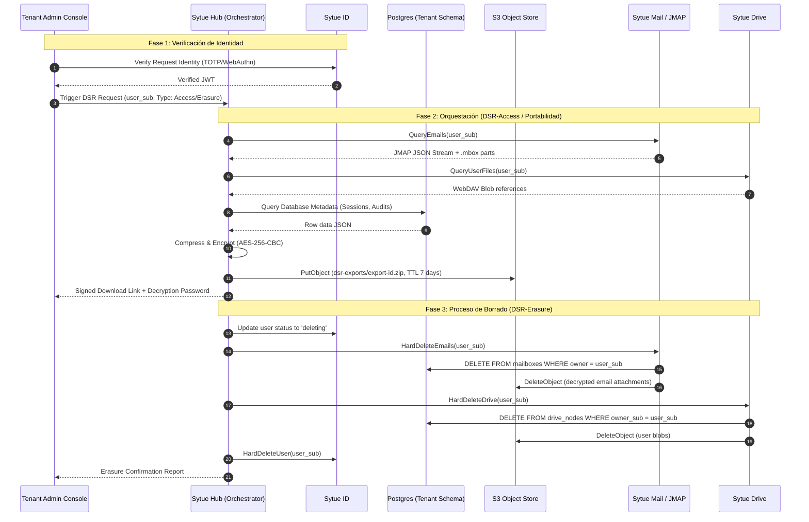

<!-- SPDX-License-Identifier: Apache-2.0 -->
<!-- Copyright (c) 2026 Daniel Delgado Ramos -->

# Seguridad, cumplimiento y licencias — Sytue Suite

Documento único de seguridad de la suite. Cuatro partes:

1. **[Seguridad y RGPD](#1-seguridad-y-rgpd)** — controles por capa, soberanía, secretos,
   IdP, multi-tenancy, correo, backups, hardening, respuesta a incidentes y cumplimiento.
2. **[Modelo de amenazas](#2-modelo-de-amenazas-stride-por-servicio)** — STRIDE por servicio.
3. **[Checklist OWASP ASVS L2](#3-checklist-owasp-asvs-l2)** — mapeada al repositorio.
4. **[Política clean-room y licencias](#4-politica-de-reimplementacion-clean-room)** — cómo se
   reimplementa sin obra derivada, matriz de dependencias y obligaciones.

> Normativo: [`CONVENTIONS.md`](CONVENTIONS.md). Decisiones y su porqué:
> [`decisions.md`](decisions.md). La **auditoría de seguridad externa antes de producción
> sigue siendo obligatoria**.

---

<a id="1-seguridad-y-rgpd"></a>

## 1. Seguridad y RGPD

Seguridad, soberanía y cumplimiento del **RGPD** (Reglamento (UE) 2016/679). Principios
rectores: **100 % Europa sobre Scaleway (solo regiones UE)**; productos **Sytue-native
bajo licencia Apache-2.0** sin motores de terceros AGPL; **stack único Go + Astro/Preact + PostgreSQL**;
**Sytue ID (IdP propio en Go) como pieza nuclear**. Sin proveedores US para datos personales
y sin transferencias fuera de la UE. Cada control técnico se mapea a su **implementación
real** en `platform/pkg/*` y `services/<svc>` para que esto sea verificable, no aspiracional.

> La **auditoría de seguridad independiente de Sytue ID antes de producción es obligatoria**
> por ser código de autenticación propio y crítico (§1.14 y §4).

---

<a id="11-modelo-de-seguridad-por-defecto--mapa-de-controles-conventions-07--implementacion"></a>

### 1.1 Modelo de seguridad por defecto — mapa de controles CONVENTIONS §0.7 → implementación

Esta sección **materializa** cada mínimo no negociable de CONVENTIONS §0.7 con el punto de código
que lo implementa. Es el índice maestro de trazabilidad de "seguridad por defecto".

| Control (CONVENTIONS §0.7)                          | Implementación real (fichero / mecanismo)                                                                                                                                                                                                       | Detalle                                                                                                                                         |
| --------------------------------------------------- | ----------------------------------------------------------------------------------------------------------------------------------------------------------------------------------------------------------------------------------------------- | ----------------------------------------------------------------------------------------------------------------------------------------------- |
| **Deny-by-default (autorización)**                  | `platform/pkg/authn/middleware.go` (`RequireAuth`, `RequireRole`, `RequireScope`); `services/docs/internal/domain/access.go` (`ResolveRole`/`ResolveShare` devuelven "sin acceso" salvo ACL explícita)                                          | Sin token válido → 401; sin rol/scope → 403. El resolver de Docs parte de `Role("")` y solo concede lo explícito.                               |
| **Mínimo privilegio**                               | Roles `owner/admin/member/billing` en `Claims.HasAnyRole`; client OIDC por superficie; rol de BD runtime ≠ rol de migraciones; IAM Scaleway acotado por servicio                                                                                | §5.4. Cada BFF su propio `client_secret`; cada servicio Go sus credenciales PG/S3 acotadas al esquema/prefijo.                                  |
| **RLS multi-tenant (Postgres)**                     | `platform/pkg/pg/tx.go` (`InTenantTx`, `SetTenant` vía `set_config('app.tenant', $1, true)`); `services/*/db/migrations/0001_*.up.sql` (`ENABLE`+`FORCE ROW LEVEL SECURITY`, `POLICY ... USING (tenant = current_setting('app.tenant', true))`) | §5.1. El slug se valida (`tenancy.ValidSlug`) antes de fijar la GUC → sin inyección. `FORCE RLS` aplica incluso al owner de la tabla.           |
| **TLS 1.3 + HSTS**                                  | Terminación en Traefik 3 (edge); HSTS `max-age=63072000; includeSubDomains; preload`; `TLSOption` `default` con suites solo AEAD (`deploy/helm/sytue-one/values.yaml`, `traefik.tlsOptions`)                                                    | §2.1, §9.2. El **mTLS este-oeste NO está**: ver §2.2 y V9.2.1.                                                                                  |
| **Cookies host-only HttpOnly/Secure/SameSite**      | Sesión SSO de Sytue ID (`services/id/internal/http/session.go`) y cookies `__Host-` de cada BFF                                                                                                                                                 | §4.1. Sin `Domain`: las publicaciones `*.apps/preview.sytue.eu` nunca las reciben. `token_hash` (SHA-256) persistido, nunca la cookie en claro. |
| **CSP estricta + cabeceras de seguridad**           | Middleware Traefik (§9.2) + CSP por superficie (§9.3)                                                                                                                                                                                           | `default-src 'self'`, sin scripts/iframes de terceros.                                                                                          |
| **CSRF**                                            | Patrón BFF + `SameSite` + `state`/`nonce` en OIDC (`services/id/internal/http/authorize.go`)                                                                                                                                                    | §4.1, §9.3.                                                                                                                                     |
| **Validación/saneado + consultas parametrizadas**   | `pgx` con args posicionales en todo el acceso a datos (p. ej. `services/id/internal/store/audit.go`); `set_config(...,$1,...)`; `html.EscapeString` en el fallback de login (`services/id/internal/http/login.go`)                              | Sin SQL dinámico concatenado. Slugs validados por regex (`tenancy.slugRe`), `CHECK` en columnas.                                                |
| **Rate-limiting / anti-fuerza-bruta**               | Mensajes de login genéricos (no enumeración) + auditoría de fallos (`auth.login.failed`) en `services/id/internal/http/login.go`; rate-limit del edge (Traefik middleware) + bloqueo progresivo sobre tablas PostgreSQL (§4.3)                  | §4.3. Argon2id encarece cada intento por diseño.                                                                                                |
| **MFA/WebAuthn**                                    | `services/id/internal/webauthn/*` (registro/login FIDO2, `sign_count` anti-clonado); TOTP (RFC 6238) con secreto cifrado; step-up forzado por rol en `authorize.go` (`requiresStepUp`)                                                          | §4.2. `admin`/`owner` obligan MFA (`domain.Role.RequiresMFA`).                                                                                  |
| **Secretos fuera del código/logs**                  | `platform/pkg/config/config.go` (12-factor, solo env; nunca valores en git); Scaleway Secret Manager + sincronización controlada a Kubernetes (§3); logs `slog` sin secretos ni cuerpos                                                         | §3, §7. `.env` ignorado por git; solo placeholders en el repo.                                                                                  |
| **Cifrado en reposo / campos sensibles**            | `services/cloud/internal/crypto/crypto.go` (AES-256-GCM, `Sealer`); columnas cifradas en Sytue ID (`private_pem`, `totp_secrets.secret`, `webauthn`); SSE en S3/RDB                                                                             | §2.2.                                                                                                                                           |
| **Auditoría inmutable**                             | `services/id/internal/store/audit.go` + tabla `audit_log` (append-only, `GENERATED ALWAYS AS IDENTITY`); tablas de auditoría por servicio                                                                                                       | §7.                                                                                                                                             |
| **Logs sin datos personales**                       | `platform/pkg/httpx/middleware.go` (`RequestLogger` registra método/ruta/estado/duración/IP, no cuerpos); política de minimización en auditoría                                                                                                 | §7.                                                                                                                                             |
| **Validación de tokens (JWKS, sin `alg:none`)**     | `platform/pkg/authn/verifier.go` (`jwt.WithValidate`, `WithIssuer`, `WithAudience`, `WithKeySet`, `WithAcceptableSkew`); firma RS256, nunca `none`/HMAC compartido                                                                              | §3.2, §4.1.                                                                                                                                     |
| **PKCE obligatorio + redirect_uri exacto**          | `services/id/internal/http/authorize.go` (`client.RequirePKCE`, `S256` forzado, `ValidRedirectURI`) y `token.go` (`VerifyPKCE`, `HashToken`)                                                                                                    | §4.1. Código de un solo uso; solo el hash se persiste.                                                                                          |
| **Rotación de refresh tokens + detección de reuso** | `services/id/internal/http/token.go` (`grantRefresh`: `RotateRefreshToken`, `RevokeRefreshChain` ante reuso)                                                                                                                                    | §4.4. Reuso → revoca toda la familia + auditoría `oauth.refresh.reuse_detected`.                                                                |
| **Comparaciones en tiempo constante**               | `crypto/subtle.ConstantTimeCompare` (Argon2/PKCE en `services/id/internal/domain/secret.go`); `hmac.Equal` (webhook LiveKit en `services/rooms/internal/media/livekit/token.go`)                                                                | Anti timing-attack en contraseñas, PKCE y firmas.                                                                                               |
| **Contenedores rootless/distroless**                | `services/*/Dockerfile` (multi-stage `golang:1.26` → `gcr.io/distroless/static:nonroot`, `USER nonroot`, `CGO_ENABLED=0`, `-trimpath -ldflags="-s -w"`)                                                                                         | §9.1. Sin shell ni gestor de paquetes. **Una excepción: `services/ocr`** — ver debajo.                                                          |
| **NetworkPolicies deny-by-default**                 | Manifiestos Helm por namespace `tenant-<slug>` (§5.2)                                                                                                                                                                                           | Ingress/egress denegados salvo lo explícito.                                                                                                    |
| **Recovery de panics sin fuga**                     | `platform/pkg/httpx/middleware.go` (`Recoverer` → 500 JSON canónico, stack solo a logs)                                                                                                                                                         | El cliente nunca ve stack traces (§9.4).                                                                                                        |

> **Definition of Done de cada PR:** ningún cambio se fusiona si degrada un control de esta tabla.
> Los `*_test.go` de `platform/pkg/{authn,tenancy,pg}` y de `services/id/internal/*` fijan el
> comportamiento seguro (verificación de firma, aislamiento de tenant, PKCE) como regresión.

---

<a id="12-soberania-residencia-de-datos-ue-y-cifrado"></a>

### 1.2 Soberanía, residencia de datos (UE) y cifrado

#### 2.1 Residencia (solo UE: Scaleway y zona on-premise en Madrid)

| Recurso                                              | Ubicación           | Región Scaleway           | Notas                                                                                                                     |
| ---------------------------------------------------- | ------------------- | ------------------------- | ------------------------------------------------------------------------------------------------------------------------- |
| Cómputo (Kapsule, GA soportada)                      | UE                  | `fr-par` (`fr-par-1/2/3`) | DR en `nl-ams`.                                                                                                           |
| Bases de datos (RDB PostgreSQL)                      | UE                  | `fr-par`                  | Réplica/backup en `nl-ams`. Único datastore (estado + colas + caché).                                                     |
| Object Storage (S3)                                  | UE                  | `fr-par`                  | Buckets versionados, cifrado en reposo (drive/mail/docs-blobs, backups).                                                  |
| Secret Manager                                       | UE                  | `fr-par`                  | Secretos de plataforma (§3).                                                                                              |
| Registry (imágenes)                                  | UE                  | `fr-par`                  | Scaleway Container Registry (escaneado).                                                                                  |
| Correo (Sytue Mail Go, blobs S3)                     | UE                  | `fr-par`                  | Buzones/índices en PostgreSQL; blobs cifrados en S3 UE.                                                                   |
| Medios WebRTC (LiveKit)                              | UE                  | `fr-par`                  | SFU de _Sytue Rooms_ (Apache-2.0), autohospedado en UE.                                                                   |
| DNS / Load Balancer                                  | UE                  | `fr-par`                  | Traefik 3 + cert-manager.                                                                                                 |
| Despliegue on-premise / autohospedado                | UE / Servidor propio| —                         | Clúster Kubernetes (k3s/estándar) o Docker Compose sobre infraestructura propia, con el mismo perímetro y mismas reglas.  |

Reglas de soberanía:

- **Ningún dato personal sale de la UE, con UNA excepción escrita: los avisos con la app o el
  navegador cerrados.** El Web Push (RFC 8291) entrega el contenido **cifrado extremo a
  extremo** —el servicio de push del fabricante no puede leerlo—, pero ve el _endpoint_
  (identificador seudónimo del aparato) y el momento de cada aviso; en iOS, APNs ve el token
  del aparato y el momento, y el aviso va **vacío** (`content-available`, sin título, texto,
  autor ni canal: ver ADR 0039). En Android nativo no interviene ningún tercero —la app
  mantiene el flujo SSE del hub—. Quien no quiera ni esos metadatos puede apagar los avisos.
  Fuera de ahí, no se emplean servicios US (CDN, analítica, IA, correo
  transaccional, etc.) sobre datos personales. Toda dependencia se autohospeda en Kapsule o se
  consume de servicios UE de Scaleway. La resolución DNS del verificador SPF/DMARC de Mail usa
  resolvers UE (`net.DefaultResolver`, ver `services/mail/internal/auth/verify.go`).
- **Subprocesadores:** **Scaleway SAS** (Francia, UE) como infraestructura y **Mollie B.V.** (Países
  Bajos, UE) para el cobro de suscripciones, que solo trata los datos del pago. La zona on-premise de
  Madrid es infraestructura propia, no un subprocesador. La lista de subprocesadores se mantiene en
  el anexo del DPA (§11.3) y se versiona en este repositorio.
- **Sin telemetría externa.** El frontend Astro + Preact no carga scripts de terceros; la
  observabilidad (`slog` estructurado + OpenTelemetry) permanece dentro del clúster.
- **Soberanía operativa:** código de producto **Apache-2.0 (© 2026 Daniel Delgado Ramos (thinkddr))**; dependencias incorporadas
  **permisivas** (MIT/BSD/Apache-2.0/ISC/PostgreSQL/MPL-2.0) → portabilidad y ausencia de lock-in.
  Producto, infraestructura y tooling pasan además el gate independiente de origen UE; GitHub es
  la única excepción temporal, acotada en `roadmap.md` P0.

#### 2.2 Cifrado en tránsito

- **TLS 1.3** obligatorio en todos los `*.sytue.eu`. TLS 1.2 solo como mínimo de respaldo con
  suites AEAD; SSLv3/TLS 1.0/1.1 deshabilitados.
- **Terminación TLS** en Traefik 3; certificados por **cert-manager** (ACME/Let's Encrypt, DNS-01
  sobre DNS de Scaleway). Renovación automática.
- **HSTS** `max-age=63072000; includeSubDomains; preload` en el edge (§9.2).
- **Tráfico este-oeste (servicio↔servicio): HTTP plano dentro del clúster, restringido por
  NetworkPolicy** (§5.2). Es el control VIGENTE y es real: hay NetworkPolicy por chart
  (`deploy/helm/charts/*/templates/networkpolicy.yaml`) y las URL internas son `http://<svc>`
  (`deploy/helm/charts/*/templates/deployment.yaml`). El **mTLS este-oeste es DISEÑO, no está
  desplegado**: no hay malla de servicio en `deploy/` ni en `infra/`, y así figura en V9.2.1 (☐).
  Este documento lo daba por vigente en cuatro sitios y no lo era.
- **Correo (Sytue Mail Go):** SMTP con STARTTLS obligatorio + MTA-STS `enforce` y DANE/TLSA donde
  aplique (§6); IMAP 993 / submission 465/587 sobre TLS.
- **WebRTC (Sytue Rooms):** medios DTLS-SRTP vía LiveKit; el servicio `sytue-rooms` mintea el JWT de
  LiveKit (HS256 con el API secret) **solo tras validar el JWT de Sytue ID** y autorizar al usuario
  (`services/rooms/internal/media/livekit/token.go`, `AccessToken`).
- **Dev local:** TLS con **mkcert** bajo `*.sytue.localhost` vía Traefik (paridad dev/prod).

#### 2.3 Cifrado en reposo

| Capa                              | Mecanismo                                                                                                                                        | Referencia                                 |
| --------------------------------- | ------------------------------------------------------------------------------------------------------------------------------------------------ | ------------------------------------------ |
| Object Storage (S3)               | Cifrado del lado del servidor (SSE) gestionado por Scaleway.                                                                                     | §2.1                                       |
| Block Storage (volúmenes Kapsule) | Cifrado de volumen a nivel de plataforma Scaleway.                                                                                               | —                                          |
| PostgreSQL (RDB)                  | Cifrado en reposo de la instancia gestionada + TLS para conexiones.                                                                              | —                                          |
| **Columnas sensibles**            | **Cifrado de campo**: `signing_keys.private_pem`, `totp_secrets.secret`, secretos de WebAuthn, claves DKIM. Claves de cifrado en Secret Manager. | Sytue ID `0001_core_identity.up.sql`       |
| **Secretos de Sytue Cloud**       | AES-256-GCM (`Sealer`, nonce aleatorio por valor, tag de autenticación) con `SECRET_ENC_KEY` de 32 bytes.                                        | `services/cloud/internal/crypto/crypto.go` |
| Sytue Drive (ficheros)            | Blobs en S3 cifrado (SSE) + metadatos en PostgreSQL; `checksum` SHA-256 por fichero (integridad).                                                | Drive `0001_init.up.sql`                   |
| Sytue Mail (buzones)              | Mensajes/índices en PostgreSQL; cuerpos/adjuntos como blobs en S3 cifrado; claves DKIM cifradas.                                                 | §6                                         |
| Tokens/códigos opacos             | Solo se persiste el **hash** (SHA-256): sesiones, refresh, auth codes, tokens de enlace.                                                         | `domain.HashToken`                         |
| Backups / dumps                   | Cifrados en bucket de backups versionado y aislado (§8).                                                                                         | §8                                         |

> El cifrado en reposo **no sustituye** el control de acceso: las claves de servicio nunca se
> almacenan junto a los datos y rotan según política (§3.2). El `Sealer` usa AEAD (GCM): un
> ciphertext corrupto o con clave incorrecta falla la apertura (`ErrCiphertextInvalid`), no filtra
> el motivo.

---

<a id="13-gestion-de-secretos"></a>

### 1.3 Gestión de secretos

**Regla absoluta:** **ningún secreto en Git.** Solo placeholders y nombres de variables de entorno
en el repositorio (p. ej. `SYTUE_ID_OIDC_SIGNING_KEY`, `MAIL_DKIM_PRIVATE_KEY`, `LIVEKIT_API_SECRET`,
`SCW_SECRET_KEY`, `PG_DSN`, `CLOUD_SECRET_ENC_KEY`), nunca valores. `platform/pkg/config` lee **solo**
del entorno (12-factor); `Require` falla el arranque si falta un secreto obligatorio, de modo que un
servicio nunca arranca en un estado inseguro por configuración ausente.

#### 3.1 Cadena de secretos

```
Scaleway Secret Manager  (fuente de verdad, UE, cifrado, auditado; IAM privilegio mínimo)
        │  (bootstrap idempotente de producción; futuro ESO cuando haya rotación continua)
        ▼
Kubernetes Secret  (montado como env/volumen en pods)
        ▼
Pods de los servicios Go (Sytue ID / Drive / Docs / Mail / Calendar / Contacts /
                          Chat / Meet / Hub / Cloud) + LiveKit
```

- **Scaleway Secret Manager:** secretos de plataforma (DSN de RDB, claves S3, **claves de firma
  OIDC/JWKS de Sytue ID**, claves DKIM de Mail, API key/secret de LiveKit, `SECRET_ENC_KEY` de
  Cloud). Acceso por IAM de Scaleway con privilegio mínimo y auditado (quién/cuándo).
- **Producción inicial:** `deploy/production/02b-secretos.sh` crea o recupera valores en
  Secret Manager y materializa los `Secret` nativos de Kubernetes. No hay Sealed Secrets
  ni valores cifrados en Git: una sola fuente de verdad evita desincronización. Al introducir
  rotación frecuente se sustituirá por External Secrets Operator, conservando los nombres de
  los `Secret` y sin cambiar los charts.
- **Dev:** `.env.example` con placeholders; valores reales en `.env` **ignorado por Git**;
  `SECRET_ENC_KEY` de dev generada localmente (nunca compartida).

#### 3.2 Gestión de claves, JWKS y rotación en Sytue ID

Implementación en `services/id/internal/oidc/keys.go` (`KeyManager`) + tabla `signing_keys`:

- **Bootstrap:** al arrancar, si no hay clave activa se genera una **RSA-2048** y se persiste
  (`Bootstrap`/`generateAndStore`). La clave privada (`private_pem`) se cifra en reposo a nivel de
  columna en prod (KMS/pgcrypto).
- **JWKS público:** `PublicJWKS()` publica **todas** las claves no retiradas en
  `/.well-known/jwks.json`; cada token lleva `kid`. Los servicios validadores cachean el JWKS con
  refresco periódico (`platform/pkg/authn/verifier.go`, `jwk.NewCache` + `WithMinRefreshInterval`,
  15 min por defecto; precarga inicial que **falla rápido** si Sytue ID es inalcanzable).
- **Rotación sin downtime (key rollover):** `Rotate()` marca la clave `active` como `next`, genera
  una nueva `active` en la misma transacción y recarga en memoria. Los tokens ya emitidos siguen
  validando contra la clave `next` (aún publicada en JWKS) hasta expirar; después pasa a `retired`
  y se retira del JWKS. Estados en `signing_keys.status ∈ {active, next, retired}`.
- **Algoritmos:** firma asimétrica **RS256** (ES256/EdDSA admitidos por diseño); **nunca** `none`
  ni HMAC con secreto compartido entre servicios. La clave privada vive solo en Sytue ID; los
  validadores solo ven la pública vía JWKS.
- **Rotación periódica** (≤ 90 días) de claves de firma, credenciales de servicio, client secrets
  OIDC, claves DKIM y secreto de LiveKit; **inmediata** ante sospecha de compromiso (con revocación
  de tokens/sesiones, §4.4).
- **Mínimo privilegio:** cada superficie/BFF su propio client secret OIDC (hash Argon2id en
  `oauth_clients.secret_hash`); cada servicio Go sus credenciales PostgreSQL/S3 acotadas a su
  esquema/prefijo.
- **Operación de rotación:** ejecutada por Sytue Admin / cron con validación previa; auditada
  (`rotación de claves JWKS` en el log de Sytue ID, §7).

---

<a id="14-sytue-id--idp-propio-go-oidcoauth2-mfawebauthn-y-scim"></a>

### 1.4 Sytue ID — IdP propio (Go), OIDC/OAuth2, MFA/WebAuthn y SCIM

#### 4.1 Núcleo OIDC/OAuth2 (`id.sytue.eu`, dev `8081`) — nuclear

- **Servicio Go propio** (no Keycloak), sobre librerías **Apache-2.0/MIT**. Implementa **OIDC/OAuth2**
  (Authorization Code + PKCE, refresh con rotación, **JWKS**, discovery
  `/.well-known/openid-configuration`), **SAML** (opcional), **SCIM** y **MFA/WebAuthn**. Estado en
  **PostgreSQL** (usuarios, clients, grants, sesiones, claves — `0001_core_identity.up.sql`).
- **Authorization endpoint** (`services/id/internal/http/authorize.go`), medidas por defecto:
  - **Validación exacta de `redirect_uri`** contra los registrados del client (`ValidRedirectURI`):
    `client_id` desconocido o `redirect_uri` no registrado → error directo, **sin redirigir**
    (anti open-redirect, OAuth 2.0 Security BCP).
  - **PKCE obligatorio** cuando el client lo exige (`RequirePKCE`, por defecto `true` para todos):
    `code_challenge` presente y `code_challenge_method = S256` (se rechaza `plain`/ausente).
  - **Validación de scopes** contra los permitidos del client (`AllowsScope`); grant permitido
    (`AllowsGrant`); `response_type=code` únicamente.
  - **`state`** (anti-CSRF) y **`nonce`** (OIDC, anti-replay de ID Token) propagados intactos.
  - **Código de un solo uso, corta vida**: se persiste solo `HashToken(code)` (SHA-256), con
    `expires_at` y `consumed_at` (`auth_codes`).
- **Token endpoint** (`token.go`): autenticación de client (§4.5), `grant_type ∈
{authorization_code, refresh_token, client_credentials}`, `Cache-Control: no-store`. Verificación
  PKCE con `VerifyPKCE` (constant-time), comprobación de pertenencia del código al client y al
  `redirect_uri` usado en `/authorize`.
- **Validación distribuida:** ningún producto gestiona credenciales propias; cada servicio Go
  **valida los JWT de Sytue ID vía JWKS** con `platform/pkg/authn` (`RequireAuth`).
- **Clients OIDC confidenciales por superficie (BFF):** `sytue-one`, `sytue-console`, `sytue-cloud`
  (+ `sytue-cloud-api`), `sytue-mail`, `sytue-drive`, `sytue-calendar`, `sytue-contacts`,
  `sytue-docs`, `sytue-rooms`, `sytue-hub`. Sin clients de federación (ya no hay motores).
- **SSO** mediante la sesión host-only de Sytue ID y cookies BFF **host-only `__Host-`**
  (`Secure`, `SameSite`). OAuth hace transparente el salto entre apps; ninguna cookie de
  autenticación se comparte con el apex. El `token_hash` (SHA-256) se persiste, nunca la cookie
  en claro (`sessions`).

#### 4.2 MFA / WebAuthn

- **MFA obligatorio** para roles `admin` y `owner`: `authorize.go` fuerza **step-up**
  (`requiresStepUp`) cuando la sesión no incluye MFA en el `AMR` y el usuario tiene rol elevado
  (`domain.Role.RequiresMFA`).
- **WebAuthn / FIDO2** (passkeys) como segundo factor preferente
  (`services/id/internal/webauthn/*`, `webauthn_credentials`): `public_key` COSE, `sign_count`
  para **detección de clonado**, retos de un solo uso y corta vida (`webauthn_challenges`).
- **TOTP** (RFC 6238) como alternativa, con secreto **cifrado en columna** (`totp_secrets.secret`).
- **Recovery codes** de un solo uso (hash en BD). Contraseñas con **Argon2id**
  (`services/id/internal/domain/secret.go`, perfil OWASP: 64 MiB, t=3, p=2, sal de 16 B, clave de
  32 B, formato PHC), verificación **constant-time** (`subtle.ConstantTimeCompare`).
- **Anti-enumeración de usuarios:** login siempre responde error genérico
  (`services/id/internal/http/login.go`, `loginFail`), tanto si el usuario no existe como si la
  contraseña falla; cada fallo se audita (`auth.login.failed`).

#### 4.3 Rate-limiting y anti-fuerza-bruta

- **Coste computacional por diseño:** Argon2id (64 MiB) encarece cada intento de contraseña.
- **Rate-limit del edge** (Traefik middleware) por IP/ruta para `/login`, `/token`, `/authorize`.
- **Bloqueo progresivo** sobre tablas PostgreSQL (contador de fallos por cuenta/IP con backoff
  incremental), auditado. Los códigos de autorización y sesiones tienen TTL corto e índice de
  expiración para purga (`auth_codes_expires_idx`, `sessions_expires_idx`).

#### 4.4 Baja inmediata (deprovisioning) y revocación

- **Desactivación/borrado en Sytue ID** → `user.Active()` es `false` → deja de emitir/refrescar
  tokens de inmediato (`grantRefresh` rechaza usuario no activo).
- **Rotación y detección de reuso de refresh tokens** (`token.go`, `grantRefresh`): cada refresh
  emite un sucesor y enlaza `rotated_to`; si llega un refresh **ya rotado/revocado**, se marca
  reuso, se **revoca toda la familia** (`RevokeRefreshChain`) y se audita
  `oauth.refresh.reuse_detected`. Los `access_token` de vida corta expiran solos.
- **Mapeo de grupos/roles:** `org/<slug>` y `owner/admin/member/billing` → filas/esquemas por
  tenant en PostgreSQL (RLS), prefijos S3 y namespaces Kapsule `tenant-<slug>` (base del
  aislamiento multi-tenant, §5).

**Interruptor de emergencia (corte global, fuera de banda).** Vive en el binario y no en la
consola a propósito: el escenario en el que se usa es aquel en el que la consola —o la propia
cuenta— es lo que ha fallado. Son **tres piezas y hacen falta las tres**, porque cada una cierra
algo que las otras no:

| Pieza                                              | Qué invalida                                                                                                                                                                                                                                                     | Por qué no basta sola                                                             |
| -------------------------------------------------- | ---------------------------------------------------------------------------------------------------------------------------------------------------------------------------------------------------------------------------------------------------------------- | --------------------------------------------------------------------------------- |
| `id revoke-all`                                    | Todo access/ID token emitido: rota la clave de firma y **retira la anterior en el acto** (sin ventana de gracia), así que ninguna firma previa verifica contra el JWKS                                                                                           | No impide **volver a emitir**: quien tenga la credencial entra un segundo después |
| `02b-secretos.sh <entorno> --rotate-cookie-secret` | La cookie de sesión de las diez superficies (el `cookie-secret` que la sella) y reinicia los frontends, que solo lo leen al arrancar                                                                                                                             | Deja intacta la sesión SSO del IdP y la emisión                                   |
| `id lockdown on --reason "…"`                      | Nada ya emitido: **cierra la emisión**. Marca de fila única (mig `0035`) consultada en la BASE en los dos puntos de emisión —`createSession` (los cinco métodos de login) y el token endpoint (503 `temporarily_unavailable`)—. Un error de consulta **deniega** | No expulsa a quien ya tiene token o cookie: para eso están las otras dos          |

El bloqueo se retira con `id lockdown off --reason "…"`, y **el rescate es la razón de que sea un
subcomando**: con el interruptor puesto nadie abre sesión, así que una consola web para quitarlo
sería una puerta cerrada por dentro con la llave dentro. Solo necesita el DSN. Ambos movimientos
exigen motivo escrito y quedan auditados, por lo mismo que en §4.9: un corte total sin motivo es
indistinguible de un error seis meses después.

Se consulta en la EMISIÓN y no en la validación de cada petición a propósito: la introspección por
petición convertiría al IdP en dependencia dura de toda llamada de todo servicio, y el producto se
dimensiona para cientos de miles de usuarios. Lo ya emitido lo invalida `revoke-all`, que no cuesta
nada en el camino caliente.

#### 4.5 Autenticación de clients (token endpoint)

`services/id/internal/http/clientauth.go`:

- **Confidencial:** `client_secret_basic`/`client_secret_post`; el secreto se compara con
  `oauth_clients.secret_hash` (**Argon2id**) mediante `VerifyPassword` (constant-time). Sin
  `secret_hash` configurado el client queda **deshabilitado** (deny-by-default) hasta que el deploy
  fije su secreto.
- **Público (PKCE puro):** `token_endpoint_auth_method = none`; la seguridad recae en PKCE + el
  `redirect_uri` exacto. `client_credentials` **prohibido** para clients públicos.

#### 4.6 Auditoría de seguridad OBLIGATORIA del IdP propio antes de producción

Por ser **código de autenticación propio** (clean-room), **Sytue ID no se despliega en producción
sin superar una auditoría de seguridad independiente**. Es un **gate de release** (bloquea la
promoción a prod), no una recomendación. Ver el plan detallado en §14. Alcance mínimo:

- **OWASP ASVS** nivel objetivo **L2**, con **L3** para los componentes críticos de
  autenticación/criptografía (gestión de sesión, tokens, claves). Checklist en
  [`docs/security.md#3-checklist-owasp-asvs-l2`](./security.md#3-checklist-owasp-asvs-l2).
- **OWASP Top 10** y, para los flujos OAuth/OIDC, **OAuth 2.0 Security BCP (RFC 9700)** y **OAuth
  2.0 for Browser-Based Apps**: PKCE obligatorio, validación exacta de `redirect_uri`, `state`,
  `nonce`, rotación y detección de reuso de refresh, `no-store` en respuestas de token.
- **Revisión de claves/JWKS:** rotación con rollover, `kid`, algoritmos (RS256, no `alg:none`),
  no HMAC compartido, cifrado en reposo de la clave privada.
- **Revisión criptográfica** del código Go: Argon2id (parámetros), aleatoriedad
  (`crypto/rand`), comparaciones **constant-time** (`subtle`/`hmac.Equal`), formato PHC.
- **Pentest externo** de los endpoints públicos (`/authorize`, `/token`, `/login`, `/userinfo`,
  `/scim`, WebAuthn) + revisión de manejo de sesión (fijación/expiración/rotación).
- **Cierre de los `TODO` de seguridad pendientes** marcados en el código como bloqueantes de prod
  (p. ej. binding de estado del segundo paso MFA en `login.go`/`handleMFAVerify`).

El alcance, hallazgos y su remediación se registran en [`docs/security.md#4-politica-de-reimplementacion-clean-room`](./security.md#4-politica-de-reimplementacion-clean-room)
y en el ROPA/registro de cumplimiento. El resultado (con remediación verificada) es prerrequisito
del primer despliegue prod.

#### 4.7 SCIM y aprovisionamiento interno (un alta = toda la suite)

- **Sytue ID es la fuente de identidad.** Un alta + los **claims de tenant/rol** (`tenant`/`org`,
  `roles`) que viajan en el `access_token` dan acceso inmediato a todos los servicios Go. La
  autorización es **token-driven** (`platform/pkg/authn/claims.go`); no hay proyección a motores.
- **SCIM 2.0** (RFC 7643/7644) en `services/id/internal/scim` para que IdP/directorios corporativos
  del cliente (o la Console) aprovisionen/desaprovisionen cuentas y membresías.
- **Provisión "lazy" por servicio:** en la primera petición autenticada, cada servicio Go crea/
  resuelve el registro local del usuario en su esquema de tenant (idempotente) a partir de los
  claims. Eventos de directorio relevantes se publican vía **Sytue Hub** (p. ej. crear buzón en Mail).

#### 4.8 Controles enterprise de acceso (resumen; SoT en `architecture.md#6-identidad-enterprise-y-cumplimiento`)

Sobre el núcleo anterior, Sytue ID implementa los controles que exige una organización grande.
El **detalle funcional, las rutas y las migraciones** viven en
[`architecture.md#6-identidad-enterprise-y-cumplimiento`](./architecture.md#6-identidad-enterprise-y-cumplimiento); aquí solo su lugar en el modelo de seguridad:

| Control                                                                                               | Migración | Dónde se aplica                                                                                                                                                                                                                                                                          |
| ----------------------------------------------------------------------------------------------------- | --------- | ---------------------------------------------------------------------------------------------------------------------------------------------------------------------------------------------------------------------------------------------------------------------------------------- |
| **Acceso Condicional** (usuario/grupo/IP/cliente/horario/dispositivo → `allow`/`require_mfa`/`block`) | `0018`    | En `createSession`, el **único** punto de creación de sesión de todos los métodos de login ⇒ no hay camino que lo esquive. Gana la regla más restrictiva; sin políticas, `allow`.                                                                                                        |
| **Roles personalizados / admin delegada** (claim `perms`, 9 permisos, `roles.manage` no delegable)    | `0019`    | Middleware `requirePermission` en cada ruta admin; `perms` solo en el **access token**.                                                                                                                                                                                                  |
| **PIM** — elevación _just-in-time_ con justificación y caducidad                                      | `0020`    | Caducidad **perezosa** evaluada en cada emisión de token ⇒ la latencia máxima de una revocación es el TTL del access token (15 min por defecto).                                                                                                                                         |
| **Grupos dinámicos** por reglas de atributos                                                          | `0021`    | Materializados en `group_members` ⇒ el claim `groups` y el SCIM no cambian.                                                                                                                                                                                                              |
| **Dispositivos de confianza** (cookie HMAC derivada de la KEK, `trusted=false` de origen)             | `0022`    | Alimenta la condición `require_trusted_device`. **Decisión explícita:** un fallo del store de dispositivos es **fail-open** (se trata como de confianza) para no dejar a la organización fuera de su suite; tenerlo en cuenta en `security.md#2-modelo-de-amenazas-stride-por-servicio`. |

#### 4.9 Administración de PLATAFORMA (alcance global)

Hasta la migración `0031` no existía ninguna autorización que atravesara organizaciones: cada
decisión se anclaba a una y ningún rol veía más de una. Esa propiedad **sigue intacta para todos
los roles de organización**; lo que se abre es una puerta separada y estrecha para que soporte y
dirección puedan operar la plataforma (altas manuales, suspensión, fusión, medición de uso y
plazas gratuitas).

| Decisión                                                                                                                   | Por qué                                                                                                                                                                                                                                                                                                                                                                                                                                                                                                                                                                                                                                                                                                                                 |
| -------------------------------------------------------------------------------------------------------------------------- | --------------------------------------------------------------------------------------------------------------------------------------------------------------------------------------------------------------------------------------------------------------------------------------------------------------------------------------------------------------------------------------------------------------------------------------------------------------------------------------------------------------------------------------------------------------------------------------------------------------------------------------------------------------------------------------------------------------------------------------- |
| **Allowlist propia (`platform_admins`), no un rol**                                                                        | El robo de una sesión de admin de un cliente sigue sin conceder nada global. «¿Quién tiene plataforma?» se responde con un `SELECT`, no razonando sobre pertenencias.                                                                                                                                                                                                                                                                                                                                                                                                                                                                                                                                                                   |
| **Se consulta la BD en CADA petición** (`requirePlatformAdmin`), no un claim                                               | Retirar el alcance tiene efecto inmediato y no espera a que caduque un token. Un error de consulta **deniega** (fail-closed explícito).                                                                                                                                                                                                                                                                                                                                                                                                                                                                                                                                                                                                 |
| **Segundo factor SIEMPRE**, tenga o no rol elevado                                                                         | Es la superficie más poderosa del producto. Para poder exigirlo, el claim `amr` pasa a emitirse también en el **access token** (antes solo en el ID Token).                                                                                                                                                                                                                                                                                                                                                                                                                                                                                                                                                                             |
| **Y una ELEVACIÓN viva** (`platform_activations`, mig `0043`): estar en la allowlist ya no autoriza, solo permite elevarse | Un alcance concedido «para una migración» seguía vivo meses después sin que nada lo dijera. Ahora `platform_admins` es **elegibilidad** y la autorización la da una activación con motivo y ventana (5 min – 8 h) que **caduca sola**. Las tres rutas de la elevación (`/platform/activation`, `/activate`, `/deactivate`) van **fuera** del gate, o nadie podría elevarse nunca. Los tres candados devuelven 403 con `code` distinto (`forbidden`, `mfa_required`, `activation_required`) porque se arreglan en tres sitios distintos.                                                                                                                                                                                                 |
| **Ninguna API de organización escribe la tabla**                                                                           | El alcance global solo lo concede el bootstrap del despliegue o otro admin global, y ambos quedan auditados con actor y motivo.                                                                                                                                                                                                                                                                                                                                                                                                                                                                                                                                                                                                         |
| **Toda escritura exige motivo** y se audita                                                                                | Una suspensión o veinte plazas regaladas sin motivo escrito son indistinguibles de un error seis meses después.                                                                                                                                                                                                                                                                                                                                                                                                                                                                                                                                                                                                                         |
| **No se puede quedar sin admins**                                                                                          | Revocar al último, o a uno mismo, se rechaza: recuperarlo exigiría volver a ejecutar el bootstrap del despliegue.                                                                                                                                                                                                                                                                                                                                                                                                                                                                                                                                                                                                                       |
| **DOS PERSONAS** (`platform_approvals`, mig `0046`) para suspender, fusionar **y conceder el propio alcance global**       | Repetir el identificador protege del despiste, no de una cuenta comprometida ni de una decisión tomada a solas de madrugada. Pedir crea la solicitud (409 `approval_required`) y **aprobar ejecuta**, revalidando contra el estado de ese momento: entre pedir y firmar cabe un día. Quien pide no puede firmar; rechazar sí, que retirar lo propio no ejecuta nada. Conceder el alcance se sumó porque el riesgo estaba invertido: suspender a UN cliente —reversible— exigía dos firmas y repartir el permiso que suspende a TODOS bastaba con una. Con un solo admin elegible se sigue adelante y queda escrito (`platform.approval.solo`): exigir dos deja la plataforma sin poder actuar nunca, y eso se descubre el día que urge. |
| **Superficie separada**: `platform.<dominio>` (client OIDC `sytue-platform`), no la consola de organización                | Es la misma imagen, pero administrar la plataforma no es administrar una organización. En `admin.<dominio>` la sección **no existe** (404) ni se ofrece en el menú: servirla allí dejaba una pantalla que hacía ocho llamadas para acabar en 403 y le sugería a un admin cliente que hay una puerta a la plataforma desde su consola. La superficie se deriva del `client_id`, que el chart ya fija por despliegue —una bandera aparte se queda sin poner—. **Solo decide qué se ofrece**: quien entra lo siguen decidiendo los cuatro candados de arriba.                                                                                                                                                                              |

**Fusión de organizaciones.** Mueve las filas de las **diez** bases de servicio y después la
identidad. Bajo `FORCE ROW LEVEL SECURITY` una transacción normal no ve las filas del origen, así
que el `UPDATE` afectaría a cero filas **sin fallar**: por eso existe una política `PERMISSIVE`
acotada a la variable propia `app.merge` (no se reutiliza `app.maintenance`, que ampliaría en
silencio lo que puede hacer cualquier transacción de mantenimiento ya escrita) y un **preflight**
que exige esa política en cada tabla con columna `tenant` antes de tocar la primera fila. Las
colisiones de unicidad **fallan**: inventar una desambiguación sería perder datos de un cliente
sin que nadie lo decidiera.

**Y después se cuenta, antes de tocar la identidad.** Que los diez servicios se movieran sin error
no demuestra que no quede nada: cada uno reetiqueta las tablas que el catálogo listaba al abrir su
transacción, y **el origen sigue vivo mientras tanto** —sus usuarios entran y escriben hasta que se
mueve la identidad—, así que una fila insertada después de que su tabla pasara por el `UPDATE` se
queda con el tenant viejo sin que nada falle. `merge.Verify` recorre las diez bases y cuenta lo que
todavía es del origen; si queda algo, la fusión **se para sin mover la identidad** y el fallo nombra
servicio, tabla y filas.

Ese orden es deliberado y es el plan de aborto: hasta la identidad, el origen sigue siendo una
organización operativa y la fusión se puede reanudar —el criterio es `tenant = origen`, así que
barre lo que llegó tarde— o dejar parada sin que nadie se quede fuera. Después de la identidad no
hay vuelta atrás: los usuarios ya están en el destino, el origen queda `merged` y las filas de
ambas organizaciones son indistinguibles. **No existe un «deshacer»**, y por eso la verificación va
donde va. El recuento se hace dentro de `app.merge` por la misma razón que la reescritura: sin esa
variable la RLS filtra las filas del origen y el recuento sale cero, o sea que un verificador
descuidado no es que no compruebe nada — es que **confirma** la fusión. Hay un test que cuenta lo
mismo con y sin la variable y exige que discrepen.

**Lo que no se puede mover: S/MIME.** `smime_authorities` tiene `PRIMARY KEY (tenant)` —una autoridad
por organización—, así que si las dos partes tienen la suya el `UPDATE` choca con la clave primaria y
aborta la fusión. Moverla tampoco arreglaría nada: los dispositivos de la organización resultante
tienen instalado el ancla del **destino**, y un correo firmado por una autoridad que ya no existe se
muestra como no confiable, que es peor que uno sin firmar. La autoridad del origen se **descarta** con
los certificados que emitió, y `smime.Service` los re-emite solo —es perezoso: si un buzón no tiene
certificado, se lo emite al enviar, con la autoridad de su organización, que tras la fusión ya es la
del destino—. Se pierde la clave privada anterior del buzón, y eso se dice explícitamente: no es una
política nueva (la renovación anual ya la sobrescribe) y hoy el servicio solo firma, no descifra, así
que ningún correo deja de poder leerse. Si el destino **no** tiene autoridad no se toca nada y la del
origen se mueve tal cual: es el caso del renombrado de una organización, donde descartar sería tirar
una autoridad válida sin motivo. Cada descarte queda auditado (`platform.merge.discarded`) con el
servicio, el motivo y cuántos buzones afecta: que la decisión sea correcta no la hace invisible.

Esa regla la declara **cada base** en una migración suya, como una función `platform_merge_prepare
(origen, destino)` que el motor llama —si existe— dentro de la misma transacción de fusión. Así el
motor sigue sin saber nada de ningún servicio, que es lo que le permite vivir en Sytue ID sin
endpoints ni credenciales nuevas. La función exige `app.merge` en su primera línea, y **no es
decorativo**: la RLS por sí sola no la protege, porque una conexión de negocio lleva su `app.tenant`
fijado y ve sus propias filas, de modo que sin esa guarda bastaba llamarla con origen = destino =
la propia organización para dejarla sin S/MIME. Un `GRANT` no sirve de defensa aquí: la fusión usa
las mismas credenciales que el servicio.

El preflight reconoce la política por **lo que hace** —ser `PERMISSIVE` sobre todos los comandos y
mirar `app.merge`— y no por cómo se llama. Exigir el nombre `<tabla>_platform_merge` convertía una
convención en un requisito de funcionamiento: una tabla con su política correcta bajo otro nombre
abortaba la fusión entera, y una política con el nombre correcto y la condición equivocada la
pasaba. Que cada tabla nueva traiga la suya no se recuerda, se comprueba: el gate de
`platform/pkg/migcheck` rechaza una migración que dé columna `tenant` a una tabla sin que ninguna
migración de ese servicio le dé política de fusión. La migración de barrido por servicio solo vio
las tablas que existían el día que se escribió, y las creadas después nacían fuera de la fusión sin
que nada lo dijera hasta que alguien intentaba fusionar.

Cumplimiento operativo asociado (legal hold + eDiscovery no destructivos en Mail y Drive,
auditoría unificada con export SIEM): también en
[`architecture.md#6-identidad-enterprise-y-cumplimiento`](./architecture.md#6-identidad-enterprise-y-cumplimiento) §8–§9; complementa §7 (auditoría y logging)
y §8 (retención) de este documento.

---

<a id="15-aislamiento-multi-tenant"></a>

### 1.5 Aislamiento multi-tenant

Modelo: **Organización (tenant) → Workspace → Usuarios**, con correspondencia `org/<slug>`
(Sytue ID) ⇄ `tenant-<slug>` (namespace Kapsule) ⇄ **esquema/filas por tenant en PostgreSQL con
RLS** ⇄ buckets/prefijos S3 dedicados (`tenancy.Tenant` en `platform/pkg/tenancy/tenancy.go` es el
origen único del identificador).

#### 5.1 Datos — RLS en PostgreSQL (defensa principal)

- **Row-Level Security** activada y **forzada** (`FORCE ROW LEVEL SECURITY`, aplica incluso al owner
  de la tabla) en las tablas multi-tenant de cada servicio: política
  `USING (tenant = current_setting('app.tenant', true)) WITH CHECK (...)` — filtra lectura y
  **bloquea escritura** cruzada (ver `services/drive/db/migrations/0001_init.up.sql`, replicado en
  todos los servicios).
- **Propagación segura del tenant:** `RequireAuth` extrae el claim de tenant validado
  (`Claims.TenantOrEmpty`, que valida el slug) y lo pone en contexto (`tenancy.Into`); en cada
  transacción de negocio `pg.InTenantTx` ejecuta `SetTenant`, que fija la GUC vía
  `set_config('app.tenant', $1, true)` **con parámetro** (no interpolación) y **solo tras validar el
  slug** (`tenancy.ValidSlug`) → sin inyección SQL ni fuga entre tenants aunque haya un bug de
  aplicación. El ajuste es `LOCAL`: vive solo dentro de la transacción.
- **Roles de BD** sin `BYPASSRLS`; el rol de migraciones es distinto del rol de runtime. Esquemas/
  instancias separados por tenant donde el contrato lo exija.
- **Los tests lo EJERCITAN de verdad** (`platform/pkg/pgtest`): el Pool conecta como `sytue_app`,
  `NOSUPERUSER NOBYPASSRLS` y con privilegios mínimos. Hasta el 2026-07-28 conectaba como
  superusuario, y PostgreSQL **no evalúa ninguna política RLS para un superusuario**: es decir,
  ninguna política de ninguna migración se ejecutó jamás en los tests, y un test de aislamiento
  verde no demostraba nada. `services/drive/internal/store/rls_scope_integration_test.go` es la red
  de seguridad: habla SQL crudo contra el pool sin pasar por el store, así que lo único que puede
  esconder una fila es la política; falla si alguien la borra de una migración o si el harness
  volviera a ser superusuario.
- **Trampa conocida — `COPY FROM` es incompatible con la RLS.** PostgreSQL rechaza el protocolo
  COPY sobre una tabla con RLS activa para un rol sin `BYPASSRLS`
  («COPY FROM not supported with row-level security», SQLSTATE `0A000`). Como el runtime NO tiene
  `BYPASSRLS`, `pgx.CopyFrom` **falla siempre en producción** sobre cualquier tabla multi-tenant.
  Así estuvo `CopyFolder` de Sytue Drive hasta que el harness dejó de ser superusuario y lo
  destapó. Para insertar en bloque bajo RLS: `INSERT ... SELECT FROM unnest($1::t[], …)`, que es una
  sola ida y vuelta y no consume un parámetro por columna y fila (el tope de PostgreSQL son 65535).
- **S3:** prefijos por tenant (`tenancy.StoragePrefix()` → `tenants/<slug>/`) + credenciales IAM
  acotadas.

#### 5.2 Red — NetworkPolicy

- **Deny-by-default:** cada namespace `tenant-<slug>` tiene una `NetworkPolicy` que **deniega todo
  el ingress/egress** y solo abre lo explícitamente permitido.
- Tráfico entre tenants **bloqueado**; comunicación solo con el ingress (Traefik), los servicios
  compartidos autorizados (Sytue ID, Sytue Hub) y egress controlado (DNS, PostgreSQL, S3, LiveKit).
- Etiquetas `sytue.eu/tenant` y selectores de namespace acotan el alcance.

#### 5.3 Cuotas — ResourceQuota / LimitRange

- **`ResourceQuota`** por namespace (CPU, memoria, almacenamiento, nº de objetos) → previene
  _noisy neighbor_ y agotamiento (defensa DoS interno). En Drive, además, cuota de almacenamiento
  por tenant mantenida transaccionalmente (`quotas.used_bytes`, RLS-aislada).
- **`LimitRange`** para defaults/máximos por pod y contenedor.

#### 5.4 Autorización — RBAC

- **RBAC de Kubernetes** con privilegio mínimo: `Role`/`RoleBinding` por namespace; sin
  `cluster-admin` para cargas de tenant. **ServiceAccounts** dedicadas; tokens SA no auto-montados
  salvo necesidad.
- **RBAC de aplicación** derivado de los roles de Sytue ID, evaluado en cada servicio Go
  (`RequireRole`/`RequireScope` en `platform/pkg/authn`). En Docs, resolución de rol efectivo con
  **deny-by-default** y máximo entre ACL de usuario/grupo/tenant (`ResolveRole`).

<a id="matriz-acl"></a>

#### 5.5 Matriz ACL única: quién puede qué (Docus, Calcus, Diapos, CertiPDF y enlaces de Docs y Drive)

Una sola tabla por superficie, en lugar de leerla de cada manejador. Las de **documentos de
Docs** y de **enlaces** las recorre un test (más abajo), así que no se pueden desviar del
código sin que falle; las de CertiPDF y Drive son lectura del código, con su referencia.

**Roles de un documento** (`domain.Role`, orden estricto): `viewer` < `commenter` < `editor` <
`owner`. Se resuelven por documento: el propietario (`owner_sub`) siempre es `owner`; para los
demás, el **máximo** entre sus permisos de usuario, de grupo y de organización
(`ResolveRole`). Sin ningún permiso: **403** (deny-by-default). Los grupos son los roles de la
sesión más `org/<tenant>`; en la organización anfitriona de un documento (ADR 0052) una persona
externa no es nada más que ella misma. La tabla es **idéntica para los tres tipos**
(Docus `document`, Calcus `spreadsheet`, Diapos `presentation`): lo que cambia por tipo no es
quién puede, sino qué más se comprueba al escribir (ver «Protección dentro del documento»).

##### A. Documentos de Docs (REST, y WebSocket con los mismos roles)

<!-- matriz-acl:documentos:inicio -->

| Ruta                                                | Acción                                | Rol mínimo  | Notas                                                                                                                 |
| --------------------------------------------------- | ------------------------------------- | ----------- | --------------------------------------------------------------------------------------------------------------------- |
| `GET /documents/{id}`                               | Abrir el documento y ver su rol       | `viewer`    |                                                                                                                       |
| `PATCH /documents/{id}`                             | Renombrar                             | `editor`    |                                                                                                                       |
| `DELETE /documents/{id}`                            | Enviar a la papelera                  | `owner`     |                                                                                                                       |
| `PUT /documents/{id}/star`                          | Marcar favorito (por persona)         | `viewer`    |                                                                                                                       |
| `GET /documents/{id}/state`                         | Estado completo                       | `viewer`    | Las contraseñas de protección heredadas en claro salen redactadas                                                     |
| `POST /documents/{id}/ops`                          | Editar (también por WebSocket)        | `editor`    | Reautoriza dentro de la transacción; pasa por la protección de hojas y secciones                                      |
| `GET /documents/{id}/ops`                           | Reproducir operaciones                | `viewer`    | Redactadas igual que el estado                                                                                        |
| `PUT /documents/{id}/presence`                      | Publicar presencia                    | `viewer`    |                                                                                                                       |
| `GET /documents/{id}/versions`                      | Listar versiones                      | `viewer`    |                                                                                                                       |
| `POST /documents/{id}/versions`                     | Crear una versión                     | `editor`    |                                                                                                                       |
| `POST /documents/{id}/versions/{versionId}/restore` | Restaurar una versión                 | `editor`    | Escribe por la misma puerta que `/ops`: la protección también aplica                                                  |
| `GET /documents/{id}/comments`                      | Leer comentarios                      | `viewer`    |                                                                                                                       |
| `POST /documents/{id}/comments`                     | Comentar                              | `commenter` |                                                                                                                       |
| `POST /documents/{id}/comments/import`              | Guardar los comentarios importados    | `commenter` | Los guarda quien importa; no avisa a nadie                                                                            |
| `PUT /documents/{id}/comments/{commentId}/resolve`  | Resolver o reabrir un comentario      | `commenter` |                                                                                                                       |
| `DELETE /documents/{id}/comments/{commentId}`       | Borrar un comentario o respuesta      | `commenter` | Solo su autor; un `editor` o el `owner` borran cualquiera (comentarios importados de Word: su autor es quien importó) |
| `GET /documents/{id}/permissions`                   | Ver quién tiene acceso                | `owner`     |                                                                                                                       |
| `PUT /documents/{id}/permissions`                   | Conceder o cambiar un permiso         | `owner`     |                                                                                                                       |
| `DELETE /documents/{id}/permissions`                | Revocar un permiso                    | `owner`     | Corta el canal en vivo                                                                                                |
| `GET /documents/{id}/shares`                        | Listar enlaces                        | `owner`     |                                                                                                                       |
| `POST /documents/{id}/shares`                       | Crear un enlace                       | `owner`     | `viewer`, `commenter` o `editor`; nunca `owner`                                                                       |
| `DELETE /documents/{id}/shares/{linkId}`            | Revocar un enlace                     | `owner`     | Corta el canal de quien lo canjeó                                                                                     |
| `PUT /documents/{id}/shares/{linkId}/password`      | Poner, cambiar o quitar su contraseña | `owner`     | Se guarda solo el hash (Argon2id); cambiarla invalida lo ya desbloqueado                                              |
| `POST /documents/{id}/edit-requests`                | Pedir permiso de edición              | `viewer`    | Idempotente; quien ya edita recibe `requested: false`                                                                 |
| `GET /documents/{id}/edit-requests`                 | Ver las peticiones                    | `owner`     |                                                                                                                       |
| `POST /documents/{id}/edit-requests/{sub}/grant`    | Conceder una petición                 | `owner`     | Solo a quien la pidió                                                                                                 |
| `DELETE /documents/{id}/edit-requests/{sub}`        | Rechazar una petición                 | `owner`     |                                                                                                                       |
| `GET /documents/{id}/filter-views`                  | Leer mis vistas de filtro (Calcus)    | `viewer`    | Solo las de quien llama: ni el propietario ve las de otra persona                                                     |
| `PUT /documents/{id}/filter-views`                  | Guardar mis vistas de filtro          | `viewer`    | Filtrar es ver: no escribe el modelo; tope de 64 KiB, 256 hojas y 50 vistas/hoja                                      |
| `GET /documents/{id}/exports`                       | Listar exportaciones                  | `viewer`    |                                                                                                                       |
| `POST /documents/{id}/exports`                      | Exportar (OOXML, ODF, PDF, HTML, MD)  | `viewer`    | Lo que ve, lo puede sacar                                                                                             |
| `GET /documents/{id}/exports/{blobId}`              | Descargar una exportación             | `viewer`    |                                                                                                                       |

<!-- matriz-acl:documentos:fin -->

Test: `services/docs/internal/http/matriz_acl_test.go` (`TestMatrizACLDeDocumentosCoincideConElServicio`)
lee esta tabla, ejercita cada ruta con cada rol y cada tipo de documento, y falla si el servicio
concede o deniega algo distinto, o si una ruta existe en la tabla y no en el test (o al revés). La
matriz por WebSocket (`collab.TestOpsRoleMatrix`) y las ediciones (`TestPostOpsRoleMatrix`) tienen
los suyos.

**Protección dentro del documento** (lo que añade restringir a un `editor`; se evalúa en
`store.AppendOps`, dentro de la transacción que bloquea el documento, y por tanto vale para
`/ops`, WebSocket y restaurar versión):

| Tipo   | Qué protege                                                                                                                                                                                                                                                                                                                                                                                        | Quién puede saltársela                                                                                                                                                                                          |
| ------ | -------------------------------------------------------------------------------------------------------------------------------------------------------------------------------------------------------------------------------------------------------------------------------------------------------------------------------------------------------------------------------------------------- | --------------------------------------------------------------------------------------------------------------------------------------------------------------------------------------------------------------- |
| Calcus | Hoja y libro protegidos: celdas bloqueadas, opciones del cuadro «Proteger hoja», estructura del libro                                                                                                                                                                                                                                                                                              | El propietario; un editor solo con la contraseña, verificada en el servidor (se guarda solo su hash SHA-512 con sal, esquema OOXML)                                                                             |
| Calcus | Tablas, tablas dinámicas y datos externos (`tables`, `pivots`, `externalTables`) de una hoja protegida: no tocan celdas, y sin esta regla se reescribían con una escritura directa a la API. No hay permiso que los conceda; las tablas pasan solo con un permiso estructural (insertar o borrar filas o columnas), porque se desplazan con ellas (`domain/proteccion.go`, `camposSiempreVetados`) | El propietario; un editor solo con la contraseña                                                                                                                                                                |
| Calcus | Rangos editables por persona o grupo dentro de una hoja protegida (`protect.ranges`)                                                                                                                                                                                                                                                                                                               | Quien figura en el rango (por `sub` o por grupo) escribe esas celdas; cambiar los rangos es cambiar la protección                                                                                               |
| Docus  | Secciones protegidas (`data-sytue-seccion`, `data-sytue-puede`, `data-sytue-grupos`), en el registro `doc:html` **y en la secuencia por carácter** (insert/delete)                                                                                                                                                                                                                                 | El propietario; en cada sección, solo quien figura. Crear, quitar o cambiar el marcado de una sección es solo del propietario                                                                                   |
| Diapos | Diapositivas bloqueadas (contenido fijo, no se borran), cajas bloqueadas (quedan como están y en su diapositiva) y patrón, diseños, tema y tamaño del lienzo (`SlidesModel.protect`)                                                                                                                                                                                                               | El propietario; un editor solo con la contraseña, verificada en el servidor (solo su hash SHA-512 con sal). Proteger una presentación sin protección es de cualquier editor; cambiar o quitar la protección, no |

Secciones de Docus y operaciones por carácter: el editor refleja el HTML en una secuencia RGA con
un elemento por carácter y los co-editores pintan esa secuencia, de modo que escribir `insert`/
`delete` a mano enseñaba a los demás una sección ajena cambiada (y el guardado de quien sí tiene
permiso la convertía en contenido real). En los documentos con secciones, y solo en ellos, el
almacén guarda una copia de la secuencia (`doc_proteccion.secuencia`, migración 0017); cada lote
con ops por carácter se aplica a una copia y el texto resultante se compara con las secciones con
la misma regla que `doc:html` (`domain/proteccion_secuencia.go`). Cubre teclear dentro de una
sección ajena, partirla, borrarla o saltarla con un `set` limpio de `doc:html` más ops sucias.
Coste: lineal en el tamaño del documento por lote, solo en los documentos con secciones.

Protección de Calcus en ficheros (`domain/proteccion_fichero.go`, `proteccion_ooxml.go`,
`proteccion_ods.go`): el .xlsx lleva `sheetProtection` por hoja y `workbookProtection` (estructura)
y el .ods `table:protected` y `table:structure-protected`, con los permisos del cuadro «Proteger
hoja» y la protección de celda (`locked`/`hidden`). Se invierte el sentido de OOXML (1 = bloqueado)
y todo lo que no cabe se pierde hacia el lado seguro (más bloqueado): los rangos editables por
persona o grupo no salen. **Al exportar no sale ni la contraseña ni su hash**: las exportaciones se
guardan y las descarga cualquier lector, y un hash se ataca sin conexión y sin el límite de intentos
del servicio. **Al importar**, el hash SHA-512 con sal de un .xlsx de Excel (el mismo esquema que
guarda el servicio) se devuelve aparte (`ImportResult.Hashes`) y el cliente lo manda en
`proteccion.hashes` al sembrar el contenido: se trata como una contraseña nueva (de cualquier
editor en un ámbito sin proteger; del propietario o con la contraseña en uno protegido) y las
vueltas se acotan (1 000 000). Un hash de otro tipo (SHA-1, la clave de 16 bits antigua, LibreOffice)
se importa sin contraseña: más vale que la quite quien importa, que es el propietario.

##### B. CertiPDF (PDF y firmas)

No hay ACL por documento: el fichero lo aporta quien llama y no se guarda estado propio. Todas las
rutas `/api/v1/pdf/*` exigen sesión y organización (`RequireAuth` + `RequireTenant`).

| Acción                                                                                                                               | Quién                                                                                                          |
| ------------------------------------------------------------------------------------------------------------------------------------ | -------------------------------------------------------------------------------------------------------------- |
| Operaciones sobre un PDF (páginas, anotar, formulario, proteger, firmar con certificado propio, comparar, herramientas, editar, OCR) | Cualquier persona autenticada de la organización, sobre el fichero que ella misma sube                         |
| Firmar con el certificado del sistema (dos pasos)                                                                                    | La persona autenticada; entre `prepare` y `complete` firma su equipo                                           |
| Pedir firma a otra persona                                                                                                           | Quien pide debe poder ver el fichero (PDF) en Drive; el destinatario puede ser de otra organización (ADR 0057) |
| Firmar, rechazar, abrir, traer lo firmado, bloquear a quien pide                                                                     | Solo el destinatario de la petición (`peticionEnAnfitrion`)                                                    |
| Cancelar una petición                                                                                                                | Quien la pidió                                                                                                 |
| Ver y cambiar la política de la organización para las peticiones de fuera                                                            | Roles `owner` o `admin`                                                                                        |

##### C. Enlaces de Docs

| Propiedad                      | Regla                                                                                                                                                                                                                                                                                                                                                                                                             |
| ------------------------------ | ----------------------------------------------------------------------------------------------------------------------------------------------------------------------------------------------------------------------------------------------------------------------------------------------------------------------------------------------------------------------------------------------------------------- |
| Roles que concede              | `viewer`, `commenter` o `editor`; **nunca** `owner` (se rechaza al crear y al resolver, también ante datos heredados)                                                                                                                                                                                                                                                                                             |
| Quién los crea, lista y revoca | Solo el propietario del documento                                                                                                                                                                                                                                                                                                                                                                                 |
| Credencial                     | Un token opaco de alta entropía; se guarda **solo su hash** y se devuelve en claro una única vez                                                                                                                                                                                                                                                                                                                  |
| Caducidad                      | **Con techo por organización** (`doc_org_politica_enlaces.max_dias`): 365 días si nadie lo ha fijado; lo cambia quien administra la organización (`owner`/`admin`, `PUT /link-policy`), y solo `0` = «sin techo» permite enlaces sin caducidad. Sin fecha, el enlace caduca en el techo; una fecha pasada o más allá del techo se rechaza (`400`). Caduca en el instante exacto: vale mientras `now < expires_at` |
| Sin sesión                     | Con un enlace se **ve** (vista HTML en un iframe con sandbox y sin scripts); no se edita ni se comenta                                                                                                                                                                                                                                                                                                            |
| Con sesión (canje, ADR 0052)   | `commenter` y `editor` se canjean por un permiso `externo` ligado al enlace; cae cuando el enlace caduca, se revoca o se bloquea a la persona                                                                                                                                                                                                                                                                     |
| Contraseña                     | **Opcional**, de 8 a 128 caracteres. Se guarda solo su hash Argon2id con sal (`platform/pkg/clave`, el mismo esquema que Drive); no se devuelve nunca, solo `has_password`. Un enlace con contraseña no se abre con el token solo: la ficha, la vista y el canje exigen la **prueba** que da `POST /share/unlock` a quien acierta (derivada del hash: cambiar o quitar la contraseña la invalida)                 |
| Intentos de contraseña         | Acotados antes de verificar, por enlace (5, y uno más cada 30 s: bloqueo temporal para todos) y por IP (20, uno cada 5 s), con `429` y `Retry-After`; Argon2id simultáneos acotados a 8. En memoria, por réplica                                                                                                                                                                                                  |
| Fallo de contraseña            | La misma respuesta (`403 share_password_wrong`) y el mismo trabajo (un Argon2id) para contraseña errónea, enlace inexistente, caducado, revocado o sin contraseña: no dice si el enlace existe. Fallos, aciertos y bloqueos van al log estructurado con el id del enlace y la IP                                                                                                                                  |

##### D. Enlaces y comparticiones de Drive

| Propiedad                          | Regla                                                                                                                                                                                                                                                                                                                                                   |
| ---------------------------------- | ------------------------------------------------------------------------------------------------------------------------------------------------------------------------------------------------------------------------------------------------------------------------------------------------------------------------------------------------------- |
| Tipos (`kind`)                     | `link` (público), `user` (una persona) y `group` (un grupo)                                                                                                                                                                                                                                                                                             |
| Permisos                           | `read` y `write`; el más fuerte gana si hay varios sobre el mismo recurso                                                                                                                                                                                                                                                                               |
| Enlace público                     | Solo lectura y navegación; el token se guarda hasheado; **contraseña opcional** (Argon2id) y caducidad opcional                                                                                                                                                                                                                                         |
| Etiqueta de sensibilidad           | Una etiqueta con `BlockExternalShare` impide crear el enlace público (`403`); compartir dentro de la organización sigue funcionando                                                                                                                                                                                                                     |
| Escritura en lo compartido contigo | Subir a una carpeta compartida (`SharedUpload`) exige `write`; copiar, restaurar una versión y cambiar la etiqueta también lo exigen en el servicio, y un `read` recibe `ErrPermission`. Las rutas de la unidad propia pasan `write` porque no consultan comparticiones: el aislamiento ahí es el de la organización (RLS), no el de un ACL por fichero |

##### E. Caducidad de los enlaces: dónde se comprueba

La regla es la misma en todo el sistema: una compartición cuenta mientras no esté revocada **y**
`expires_at IS NULL OR expires_at > now()`.

| Lugar                                                                                                         | Comprueba la caducidad                                                                                                         |
| ------------------------------------------------------------------------------------------------------------- | ------------------------------------------------------------------------------------------------------------------------------ |
| Docs: `docs_resolve_share`, `docs_canjear_enlace` (resolver y canjear)                                        | Sí                                                                                                                             |
| Docs: `docs_permiso_vivo`, `docs_anfitrion` (permisos canjeados y organización anfitriona)                    | Sí, a través del enlace de origen                                                                                              |
| Docs: `ShareLink.Active` (dominio)                                                                            | Sí, mismo límite exacto                                                                                                        |
| Drive: enlace público (`ResolveLink`), `recipientPred` (user/group, «compartido conmigo», `ShareForResource`) | Sí                                                                                                                             |
| Drive: avisos históricos de comparticiones                                                                    | Sí                                                                                                                             |
| Drive: **conceder una petición de edición** (`puedeConceder`)                                                 | **No lo hacía; corregido** en esta ola. Quien compartió algo podía seguir concediendo edición con una compartición ya caducada |

**Techo de caducidad (Docs, 2026-10-04).** El techo se aplica en el servidor en tres sitios, para
que ni la interfaz ni el BFF sean quienes lo imponen:

| Dónde                                                                          | Qué hace                                                                                                                                                                                                                                                                                       |
| ------------------------------------------------------------------------------ | ---------------------------------------------------------------------------------------------------------------------------------------------------------------------------------------------------------------------------------------------------------------------------------------------- |
| Al crear (`Service.CreateShare`, `domain.CaducidadDeEnlace`)                   | Pone la caducidad en el techo si no se pide, y rechaza la que lo supera o ya pasó. No recorta en silencio                                                                                                                                                                                      |
| Al comprobar (`docs_resolve_share`, `docs_canjear_enlace`)                     | Un enlace sin caducidad solo vale si su organización está «sin techo». Cubre una fila que escapara de lo anterior (una carrera con un cambio de política, un dato heredado)                                                                                                                    |
| Al cambiar la política (`store.GuardarPoliticaEnlaces`) y en la migración 0024 | Los enlaces vivos que ya no cumplen **no se revocan ni se borran**: pasan a caducar en su techo (contado desde que se crearon) y nunca antes de un plazo de gracia (30 días, o el techo si es menor), y quedan marcados (`ajustado_por_politica_at`) para que el diálogo de compartir lo avise |

Como el techo queda escrito en `expires_at`, lo cumplen sin cambios las comprobaciones de arriba
(`docs_permiso_vivo`, `docs_anfitrion`, `ShareLink.Active`). Subir o quitar el techo no alarga lo ya
acortado. Crear, revocar y cambiar la política dejan traza en el log estructurado (`auditoria=enlace.creado`,
`enlace.revocado`, `enlaces.politica.cambiada`, con actor y organización); Docs no tiene tabla de
auditoría (§1.7), así que no es una traza consultable. Pruebas: `TestTechoDeCaducidadDeEnlaces`,
`TestLaMigracionDelTechoNoRompeLosEnlacesQueYaExistian` (ejecuta el bloque de la migración tal cual),
`TestTechoDeCaducidadPorLaAPI` (API directa) y `apps/frontend/packages/office/test/bff-seguridad.test.ts` (BFF).

**Drive no comparte esta política**: tiene su base, su servicio y ninguna tabla de ajustes por
organización, así que sus enlaces siguen pudiendo no caducar (ver F.4).

##### F. Decisiones propuestas (cambian lo que ve el usuario): lo aplicado y lo que queda

1. **Contraseña en los enlaces de Docs.** **Aplicado (2026-10-04):** opcional, con el mismo esquema
   que Drive (Argon2id, ahora compartido en `platform/pkg/clave`), verificada en el servidor, con
   límite de intentos y sin decir si el enlace existe (ver C). Migración 0025. Pruebas:
   `TestClaveDeEnlacePorLaAPI`, `TestClaveDeEnlaceLimitaLosIntentos` y el bloque de enlaces de
   `apps/frontend/packages/office/test/bff-seguridad.test.ts`. Lo canjeado antes de poner o cambiar la
   contraseña se conserva: la contraseña protege la entrada, no retira permisos ya dados (para eso
   está revocar el enlace).
2. **Borrar comentarios.** ~~Cualquier comentarista borraba cualquier comentario.~~ **Aplicado
   (2026-10-04):** solo lo borra su autor o quien edita o administra el documento; un comentarista
   solo borra los suyos (`store.DeleteComment`: la regla va en la sentencia, sin carrera entre
   comprobar y borrar; prueba `TestBorrarComentariosPorRol`).
3. **ACL por documento de CertiPDF y roles de Drive. NO aplicado: queda fuera por decisión del dueño
   (2026-10-04) y como propuesta.** CertiPDF no tiene ACL por documento (B): el fichero lo aporta
   quien llama y no hay estado que autorizar; solo las peticiones de firma tienen destinatario.
   Drive tiene dos niveles (`read`/`write`) frente a los cuatro de Docs, no existe «comentar», y
   dentro de la unidad propia no hay ACL por fichero (el acceso es el de la organización).
   Propuesta: dejarlo así mientras Drive sea almacén y no edición y CertiPDF no guarde documentos;
   decidir antes de abrir carpetas de equipo con roles (o de que CertiPDF tenga documentos propios)
   si el modelo pasa a ser el de Docs, con su matriz y su test tabulado.
4. **Techo de caducidad de los enlaces.** **Aplicado en Docs (2026-10-04):** máximo por organización,
   365 días por defecto, «sin caducidad» solo si quien administra la organización quita el techo
   (ver C y E). **Queda Drive:** sus enlaces pueden no caducar nunca. Propuesta: la misma regla, con
   una tabla de política por organización en Drive (o una política de enlaces común en Sytue ID que
   lean los dos servicios, que evitaría configurarlo dos veces); es un cambio de producto de Drive y
   no se ha hecho aquí.

---

<a id="16-seguridad-del-correo-sytue-mail--servicio-go"></a>

### 1.6 Seguridad del correo (Sytue Mail — servicio Go)

Servidor **Sytue Mail** (Go: **SMTP/IMAP/JMAP** sobre `emersion/go-smtp`, `go-imap`, `go-message`

- JMAP propio), MX `mx.sytue.eu`. Verificación de entrantes en `services/mail/internal/auth/`.

| Control       | Propósito                      | Implementación                                                                                                              |
| ------------- | ------------------------------ | --------------------------------------------------------------------------------------------------------------------------- |
| **SPF**       | Autoriza orígenes de envío     | `verify.go` (`VerifySPF`, evaluador clean-room RFC 7208 con límite de 10 lookups); registro TXT `v=spf1 ... -all`.          |
| **DKIM**      | Firma criptográfica saliente   | `services/mail/internal/auth/dkim.go`; clave privada como secreto cifrado (§3), firma en el servidor Go.                    |
| **DMARC**     | Alineación SPF/DKIM + política | `verify.go` (`VerifyDMARC`, alineamiento relajado por dominio organizacional); `p=reject` (tras monitorización cuarentena). |
| **MTA-STS**   | Fuerza TLS en SMTP entrante    | Policy `mode: enforce` en `mta-sts.sytue.eu` + TXT.                                                                         |
| **TLS-RPT**   | Informes de fallos TLS         | TXT `v=TLSRPTv1; rua=mailto:...`.                                                                                           |
| **DANE/TLSA** | TLS verificado vía DNSSEC      | TLSA del MX cuando hay DNSSEC.                                                                                              |

- IMAP 993 / submission 465/587 sobre TLS; puerto 25 con STARTTLS para MX. Anti **open relay**:
  auth obligatoria en submission (`services/mail/internal/smtp/submission.go`).
- **Verificación de entrante:** SPF/DKIM/DMARC en recepción (resultados RFC 8601 persistidos),
  filtrado antispam/antimalware y _rate limiting_ de envío.
- Buzones/índices en **PostgreSQL** (UE); cuerpos/adjuntos como blobs en **S3 UE cifrado**. Claves
  DKIM rotadas (§3.2). Consultas DNS a resolvers UE (soberanía, §2.1).

---

<a id="17-auditoria-y-logging-por-componente"></a>

### 1.7 Auditoría y logging por componente

Toda acción relevante de seguridad y tratamiento se registra (`slog` estructurado) con marca de
tiempo, actor, recurso, `request-id` (`platform/pkg/httpx/middleware.go`, cabecera `X-Request-Id`
generada/propagada) y resultado. Logs centralizados en el control plane (UE), sin salida fuera de
la UE. La auditoría de Sytue ID es **append-only** (`audit_log`, `GENERATED ALWAYS AS IDENTITY`,
`store.Audit`); nunca contiene datos personales sensibles en claro.

> **ESTADO POR COMPONENTE (2026-08-14).** La tabla que sigue describe el destino, no
> lo que hay. Medido sobre el código: **traza en base de datos** la escriben hoy
> Sytue ID (amplia), Sytue Cloud (22 puntos: deploys, secretos, servicios gestionados)
> y Sytue Integrations. Sytue **Drive** y Sytue **Mail** tienen la tabla `audit_log`
> con RLS forzada, pero solo la escriben desde **cumplimiento** (legal hold y
> eDiscovery): **el acceso ordinario a datos de cliente —quién descargó, abrió o
> compartió un fichero o un mensaje— NO deja traza**, y como «Mi unidad» es legible
> por toda la organización a propósito, una fuga interna no es reconstruible a
> posteriori. Docs, Rooms, Calendar, Contacts, Hub y Analytics **no tienen tabla de
> auditoría**: lo que hay es el log estructurado del proceso (`slog`), que no es una
> traza consultable ni append-only.
>
> Lo pendiente y su camino —punto de estrangulamiento por servicio, retención y qué
> caminos de descarga cubre— está en el backlog. Se deja escrito aquí porque un
> auditor externo lee esta tabla como una afirmación de control vigente, y para seis
> de los diez servicios **no lo es**.

| Componente (servicio Go)      | Eventos auditados                                                                                                                                                                                                                                                                 | Estado                                         |
| ----------------------------- | --------------------------------------------------------------------------------------------------------------------------------------------------------------------------------------------------------------------------------------------------------------------------------- | ---------------------------------------------- |
| **Sytue ID**                  | Login/logout, MFA/WebAuthn, fallos (`auth.login.failed`), emisión/refresh/rotación/revocación de tokens (`oauth.token.issued`, `oauth.refresh.reuse_detected`), `oauth.authorize`, `oauth.client_credentials`, cambios de cuenta/rol/grupo, admin, SCIM, rotación de claves JWKS. | Implementado                                   |
| **Sytue Drive**               | Accesos a ficheros, compartición, cambios de permisos, operaciones WebDAV, tokens de enlace.                                                                                                                                                                                      | **Solo cumplimiento** (legal hold, eDiscovery) |
| **Sytue Docs**                | Apertura/edición colaborativa, cambios de permisos, exportaciones, tokens de enlace.                                                                                                                                                                                              | **No implementado**                            |
| **Sytue Rooms / Meet**        | Acciones admin, gestión de canales/salas, accesos; minteo/expiración de JWT LiveKit (Meet).                                                                                                                                                                                       | **No implementado**                            |
| **Sytue Mail**                | Autenticación, envío/recepción, decisiones SPF/DKIM/DMARC, TLS, accesos JMAP/IMAP.                                                                                                                                                                                                | **Solo cumplimiento** (eDiscovery)             |
| **Sytue Calendar / Contacts** | Operaciones CalDAV/CardDAV, compartición, cambios de permisos.                                                                                                                                                                                                                    | **No implementado**                            |
| **Sytue Hub**                 | Búsqueda federada, intents cross-app, notificaciones, presencia, autorización de tokens.                                                                                                                                                                                          | **No implementado**                            |
| **Sytue Cloud (PaaS)**        | Deploys, builds (Kaniko), creación de servicios gestionados, accesos/descifrado de secretos.                                                                                                                                                                                      | Implementado                                   |
| **Control plane (Kapsule)**   | API audit log de Kubernetes (RBAC, cambios de recursos).                                                                                                                                                                                                                          | Del proveedor                                  |
| **Edge (Traefik)**            | Accesos, certificados, denegaciones; sin datos sensibles en URL.                                                                                                                                                                                                                  | `accessLog` apagado por defecto                |

Prácticas: retención según §8, integridad (append-only donde sea posible), **minimización** (no se
registran contenidos de mensajes/ficheros ni secretos; `RequestLogger` no vuelca cuerpos) y
correlación por `request-id` / `sytue.eu/tenant`. Almacenamiento de auditoría en PostgreSQL (tablas
append-only) y/o bucket WORM versionado.

---

<a id="18-backups-dr-y-retencion"></a>

### 1.8 Backups, DR y retención

- **Object Storage versionado (S3):** versionado para protección frente a borrado y ransomware;
  ciclo de vida con expiración de versiones antiguas.
- **Dumps de base de datos:** PostgreSQL (RDB) con backups automáticos + dumps lógicos a un
  **bucket de backups aparte, aislado y cifrado** (separación de privilegios). Como **único
  datastore** (estado + colas + caché), su backup cubre también colas y sesiones.
- **DR:** réplica/copia en `nl-ams` (UE) para recuperación regional.
- **Cifrado:** todos los backups cifrados en reposo (SSE) + claves gestionadas como secretos (§3).
- **Pruebas de restauración** periódicas documentadas en [`docs/operations.md#1-runbook-de-operacion`](./operations.md#1-runbook-de-operacion).

#### 8.1 Política de retención (parametrizable por tenant)

| Dato                               | Retención por defecto                 | Acción al expirar               |
| ---------------------------------- | ------------------------------------- | ------------------------------- |
| Backups de BD (PostgreSQL)         | 30 días                               | Rotación/expiración automática. |
| Versiones de objetos S3            | 30–90 días                            | Expiración por ciclo de vida.   |
| Logs de auditoría de seguridad     | 12 meses                              | Archivado/eliminación.          |
| Logs de acceso del edge            | 90 días                               | Eliminación.                    |
| Códigos de autorización / sesiones | TTL corto (min./horas)                | Purga por índice de expiración. |
| Datos de cuenta tras baja          | Hasta solicitud DSR / fin de contrato | Borrado/anonimización (§11.4).  |

> La retención se define caso por caso según base jurídica y obligaciones legales (p. ej. fiscal),
> documentándose en la ROPA (§11.2). Minimización RGPD art. 25 (art. 5.1.b/c/e).

---

<a id="19-hardening"></a>

### 1.9 Hardening

#### 9.1 Kubernetes (CIS Kubernetes Benchmark)

- **Pod Security Admission** `restricted` en namespaces de tenant: contenedores **non-root**,
  `readOnlyRootFilesystem`, `allowPrivilegeEscalation: false`, `drop ALL` capabilities,
  `seccompProfile: RuntimeDefault`, sin `hostNetwork`/`hostPID`/`hostPath`.
- **La excepción a distroless: `services/ocr`.** El motor de reconocimiento es Tesseract 5
  (Apache-2.0), un binario en C con sus datos de idioma, y distroless no trae gestor de
  paquetes con el que instalarlo ([ADR-0034](./decisions.md#0034)). La imagen usa
  `debian:bookworm-slim` **fijada por digest**, con `--no-install-recommends`, sin cachés de
  apt, `USER 65532` (el mismo uid que usa distroless en el resto), `readOnlyRootFilesystem`
  y el temporal de cada página en un `emptyDir` **en memoria**: una nómina escaneada no
  llega a tocar el disco del nodo. Su `NetworkPolicy` solo permite salir hacia Sytue ID
  (JWKS) y Cockpit —el modelo va dentro de la imagen y no hay ninguna llamada a un proveedor
  externo—, así que **tráfico saliente desde ese pod es un incidente, no una configuración
  que falta**. Y no tiene ingress: solo lo alcanza Sytue Docs.
- **Imágenes mínimas:** binarios Go en **`gcr.io/distroless/static:nonroot`** (multi-stage desde
  `golang:1.26`, `CGO_ENABLED=0`, `-trimpath -ldflags="-s -w"`), sin shell ni gestor de paquetes →
  superficie de ataque mínima (`services/*/Dockerfile`).
- **RBAC mínimo** (§5.4); sin `cluster-admin` para cargas; SA tokens no auto-montados por defecto.
- **NetworkPolicy deny-by-default** (§5.2); API audit log habilitado.
- **Imágenes** desde Scaleway Registry (UE), escaneadas (`trivy`/`grype`); builds **Kaniko
  rootless**; pinning por digest (CONVENTIONS §3); sin `latest` en producción.
- Recursos `requests`/`limits` siempre definidos; `ResourceQuota`/`LimitRange` (§5.3).

#### 9.2 Cabeceras de seguridad HTTP (edge / Traefik)

Middleware en Traefik para todas las superficies:

```
Strict-Transport-Security: max-age=63072000; includeSubDomains; preload
X-Content-Type-Options: nosniff
X-Frame-Options: DENY
Referrer-Policy: strict-origin-when-cross-origin
Permissions-Policy: camera=(self), microphone=(self), geolocation=()
Cross-Origin-Opener-Policy: same-origin
Cross-Origin-Resource-Policy: same-origin
```

#### 9.3 CSP del frontend (Astro + Preact)

Política base, ajustada por superficie (Mail, Drive, Docs/colab WS, Meet/WebRTC):

```
Content-Security-Policy:
  default-src 'self';
  script-src 'self';                       # islands Preact; sin inline, nonce si necesario
  style-src 'self' 'unsafe-inline';        # Tailwind v4 / tokens @sytue/ui
  img-src 'self' data: https://*.sytue.eu;
  font-src 'self';
  connect-src 'self' https://*.sytue.eu wss://*.sytue.eu;   # API servicios Go, Hub SSE/WS, JMAP, colab WS, LiveKit WS
  frame-ancestors 'self';
  base-uri 'self';
  form-action 'self' https://id.sytue.eu;                  # OIDC (Sytue ID)
  object-src 'none';
  upgrade-insecure-requests;
```

- **Sin scripts ni iframes de terceros** (coherente con "sin motores AGPL"): los editores (Docs)
  son **propios**; no hay `frame-src` a editores externos.
- WebRTC (Sytue Rooms): se añaden orígenes `connect-src`/`media-src` de **LiveKit** según despliegue.
- **Origin allow-list en WebSocket:** las conexiones WS (Chat, Docs colab) validan el origen contra
  `AllowedOrigins` (`services/rooms/internal/http/ws.go`, `websocket.AcceptOptions.OriginPatterns`)
  → defensa contra Cross-Site WebSocket Hijacking. El token del WS se valida antes de aceptar.
- Cookies de sesión `httpOnly`, `Secure`, `SameSite`; CSRF mitigado por patrón BFF + `SameSite`
  - `state`/`nonce` en OIDC.

#### 9.4 Manejo de errores y superficie de API

- Errores JSON canónicos (`platform/pkg/httpx/errors.go`): mensajes deny-by-default y sin fuga de
  detalles internos; el `Recoverer` convierte panics en 500 sin exponer stack al cliente (queda en
  logs con `request_id`).
- Timeouts de petición y sondas `/healthz` (liveness, no toca dependencias) y `/readyz` (readiness,
  chequeos en paralelo con timeout) — `platform/pkg/httpx/router.go`.

---

<a id="110-plan-de-respuesta-a-incidentes"></a>

### 1.10 Plan de respuesta a incidentes

Ciclo estándar (NIST-like): **preparación → detección → contención → erradicación → recuperación →
lecciones aprendidas**. Detalle operativo (comandos, contactos, plantillas) en
[`docs/operations.md#1-runbook-de-operacion`](./operations.md#1-runbook-de-operacion).

1. **Preparación:** on-call definido; runbook actualizado; secretos rotables (§3); backups probados
   (§8); severidades y SLA de respuesta acordados.
2. **Detección y triaje:** alertas de auditoría/observabilidad (§7), señales como
   `oauth.refresh.reuse_detected`, picos de `auth.login.failed`, anomalías de red. Se asigna
   severidad (SEV1–SEV4) y se abre registro de incidente.
3. **Contención:** revocar sesiones/tokens comprometidos (§4.4), **rotar la clave JWKS afectada**
   (§3.2, `KeyManager.Rotate`), rotar secretos, aislar por NetworkPolicy, deshabilitar un client
   OIDC. Contención sin destruir evidencia (preservar logs append-only).
4. **Erradicación:** parchear la causa raíz; `govulncheck`/`osv-scanner`/`trivy` para localizar la
   vulnerabilidad; invalidar credenciales expuestas.
5. **Recuperación:** restaurar desde backup verificado (§8) si procede; reintroducir servicio con
   monitorización reforzada.
6. **Post-mortem sin culpa:** cronología, impacto, causa raíz, acciones correctivas con dueño y
   fecha. Si el incidente es una **brecha de datos personales**, se dispara §11.5 (72 h).

**Vínculo RGPD:** cualquier incidente que afecte a datos personales activa la evaluación de brecha
(art. 33/34) del §11.5 en paralelo a la respuesta técnica.

---

<a id="111-plan-de-cumplimiento-rgpd"></a>

### 1.11 Plan de cumplimiento RGPD

**Roles:** Sytue es **encargado del tratamiento** (processor) para los datos que los clientes
(responsables/controllers) tratan en la suite, y **responsable** (controller) para los datos
estrictamente necesarios de la relación de cliente (facturación, soporte, cuentas admin).
Subprocesadores: **Scaleway** (UE, infraestructura) y **Mollie** (UE, cobro de suscripciones).

#### 11.1 Base jurídica del tratamiento

| Tratamiento                                            | Base jurídica (art. 6 RGPD)                                     |
| ------------------------------------------------------ | --------------------------------------------------------------- |
| Prestación del servicio a clientes (datos de usuarios) | **Ejecución de contrato** (art. 6.1.b) + DPA (encargado).       |
| Cuentas de administración / autenticación (Sytue ID)   | **Ejecución de contrato** / **interés legítimo** (seguridad).   |
| Logs de seguridad y auditoría                          | **Interés legítimo** (art. 6.1.f): seguridad de la información. |
| Facturación y obligaciones fiscales                    | **Obligación legal** (art. 6.1.c).                              |
| Comunicaciones comerciales (sitio público)             | **Consentimiento** (art. 6.1.a), revocable.                     |

> Categorías especiales (art. 9): no se tratan por defecto; si un cliente las introduce en sus
> datos, es el responsable quien debe disponer de base habilitante (art. 9.2).

#### 11.2 ROPA — Registro de Actividades de Tratamiento (resumen, art. 30)

| Actividad                        | Categorías de datos                                                       | Interesados         | Finalidad                      | Conservación            | Destinatarios                      |
| -------------------------------- | ------------------------------------------------------------------------- | ------------------- | ------------------------------ | ----------------------- | ---------------------------------- |
| Gestión de identidad (Sytue ID)  | Identificadores, credenciales (hash Argon2id), MFA/WebAuthn, grupos/roles | Usuarios de tenants | Autenticación/SSO/autorización | Mientras dure la cuenta | Servicios Go internos (vía claims) |
| Correo (Sytue Mail)              | Contenido de email, metadatos, direcciones                                | Usuarios            | Servicio de correo             | Según política tenant   | Destinatarios del correo           |
| Archivos (Sytue Drive)           | Ficheros, metadatos de compartición                                       | Usuarios            | Almacenamiento/colaboración    | Según política tenant   | Usuarios autorizados               |
| Documentos (Sytue Docs)          | Documentos, historial de colaboración                                     | Usuarios            | Ofimática colaborativa         | Según política tenant   | Colaboradores autorizados          |
| Mensajería (Chat) / Vídeo (Meet) | Mensajes, presencia, metadatos de llamada                                 | Usuarios            | Comunicación de equipo         | Según política tenant   | Miembros del equipo                |
| Calendario / Contactos           | Eventos, asistentes, fichas de contacto                                   | Usuarios            | Agenda/directorio              | Según política tenant   | Usuarios autorizados               |
| PaaS (Sytue Cloud)               | Datos de apps de cliente, secretos (cifrados)                             | Clientes            | Hosting/PaaS                   | Según contrato          | —                                  |
| Logs de seguridad                | IP, user-id, eventos                                                      | Usuarios/admins     | Seguridad/auditoría            | 12 meses (§8.1)         | —                                  |
| Facturación                      | Datos de contacto/fiscales                                                | Clientes            | Facturación legal              | Plazo legal fiscal      | Autoridades (si procede)           |

> La ROPA completa y por tenant se mantiene como documento vivo del DPO; este resumen cumple el
> propósito documental del repositorio.

#### 11.3 DPA con clientes (Data Processing Agreement)

- **Contrato de encargo** (art. 28) por cliente responsable: objeto, duración, naturaleza/finalidad,
  tipos de datos, obligaciones del encargado, **medidas técnicas y organizativas** (este documento),
  **subprocesadores** (Scaleway y Mollie, UE) con autorización y notificación de cambios, asistencia en DSR y
  brechas, y devolución/borrado al finalizar.
- **Soberanía contractual:** sin transferencias internacionales (todo en UE) → no se requieren SCC.
- Anexo de medidas de seguridad = referencia a §§1–10 de este documento.

#### 11.4 Procedimiento DSR (Derechos de los Interesados, arts. 15–22)

Derechos: **acceso, rectificación, supresión ("olvido"), limitación, portabilidad y oposición**.
Canal: solicitud a través del responsable/tenant o `privacy@sytue.eu`.

> **ESTADO: DISEÑO, NO IMPLEMENTADO (2026-08-10).** Lo que sigue —el diagrama de
> secuencia, la orquestación desde `services/hub` y los formatos de exportación—
> describe el circuito **previsto**, no uno que exista hoy en el código: no hay
> endpoint DSR, ni job, ni tabla de solicitudes, ni orquestador; `services/hub`
> no expone ninguna ruta relacionada. Lo único implementado hoy es la **baja
> lógica** de la cuenta (`SetUserStatus`) y la **purga por retención** de cada
> servicio, que no son ni exportación ni supresión.
>
> **Actualización (2026-09-15): la portabilidad en autoservicio SÍ existe.**
> Cualquier persona descarga desde el portal («Tus datos», `/one/datos`) un ZIP
> con todo lo suyo: Sytue Hub (`GET /api/v1/export`) abre a la vez la entrega de
> cada producto (`platform/pkg/portabilidad`: .eml, .ics, .vcf y archivos tal
> cual; las tablas en JSON, CSV o XML, a elección) y las escribe en orden, con un
> `summary` que dice qué salió completo. La salida directa de lo propio a Google
> Workspace o Microsoft 365 (Sytue Admin, Migraciones) lee esas mismas entregas
> con la sesión de quien la lanza: no usa la delegación de la organización ni
> puede leer lo de otra persona. Lo que sigue pendiente es lo que el
> diagrama describe desde el lado del RESPONSABLE: la solicitud en nombre de
> otra persona desde la consola, el borrado físico y el registro de solicitudes.
>
> **Actualización (2026-09-26): la supresión de la PROPIA cuenta también existe**
> ([ADR 0054](./decisions.md#0054)). En `https://id.sytue.eu/account/delete`, con
> reautenticación, cualquiera borra su cuenta: las credenciales al instante, lo que
> los otros servicios guardan de esa persona (avisos, push, borradores...) en minutos
> y, pasados los 30 días de gracia, la ficha se anonimiza. Lo de la organización se
> queda en la organización. Sigue siendo MANUAL el borrado del contenido de una
> cuenta personal (su correo, sus archivos) al vencer la ventana: el barrido lo avisa
> en el log a nivel error.
>
> Se deja escrito porque es el diseño acordado y la ola tiene que construirlo,
> pero un auditor externo lee esta sección como una afirmación de control
> vigente y **no lo es**. Mientras tanto, una solicitud de los arts. 15/17/20 se
> atiende **manualmente** y hay que dejar constancia de ello en la ROPA. El
> seguimiento vive en el backlog.

##### Flujo Detallado de Ejecución y Orquestación de DSR (diseño)



1. **Recepción y verificación de identidad** (vía Sytue ID). El interesado o el administrador inicia la solicitud. Sytue ID requiere autenticación multifactor (MFA WebAuthn) para validar la identidad antes de procesar el DSR.
2. **Localización y Orquestación gRPC/SSE:** El microservicio `services/hub` actúa como el orquestador maestro del DSR. Llama a las APIs internas de cada servicio (`mail`, `drive`, `docs`, `calendar`, `contacts`, `chat`) enviando el identificador del usuario `user_sub`.
3. **Formatos de Salida Estándar para Portabilidad y Acceso:**
   - **Sytue Mail:** Generación de un archivo en formato **MBOX** (RFC 4155) que contiene los mensajes completos junto con un dump en formato JMAP JSON estructurado para el árbol de etiquetas y metadatos.
   - **Sytue Drive & Docs:** Un archivo estructurado **ZIP** con los ficheros binarios organizados por carpetas, convirtiendo los documentos de Sytue Docs de formato interno CRDT a **OpenDocument Format (ODF - .odt, .ods)** o **Office Open XML (OOXML - .docx, .xlsx)**.
   - **Sytue Calendar / Contacts:** Exportación completa de calendarios a archivos **iCalendar (.ics)** (RFC 5545) y agendas a archivos **vCard (.vcf)** (vCard 4.0, RFC 6350).
   - **Sytue ID:** Un archivo JSON con el perfil de usuario, registro de logins y configuraciones de seguridad.
4. **Política de Borrado Físico (Right to be Forgotten - DSR-Erasure):**
   - **PostgreSQL:** Ejecución de transacciones SQL para el borrado duro (`DELETE`) de filas asociadas al `user_sub` en las tablas de negocio principales. Las políticas RLS garantizan que el borrado solo afecte al tenant correspondiente.
   - **S3 Object Storage:** Borrado explícito de todos los blobs en S3 referenciados por los nodos de Drive y los adjuntos de Mail pertenecientes al usuario.
   - **Cachés y colas:** Purga de todas las sesiones activas en Dragonfly y colas en memoria.
   - **Excepciones de Backups:** Conforme a la directiva europea sobre copias de seguridad de solo lectura, la eliminación de backups no se realiza quirúrgicamente por imposibilidad técnica de mutar archivos de backup cifrados. La ROPA documenta que los datos de backups se sobrescriben por ciclo de vida de rotación en 30 días, garantizando la destrucción física definitiva tras este periodo.
5. **Respuesta** al interesado **en 1 mes** (prorrogable 2 meses en casos complejos, art. 12.3).
6. **Registro** de la solicitud y su resolución (auditoría, §7). Runbook en [`docs/operations.md#1-runbook-de-operacion`](./operations.md#1-runbook-de-operacion).

##### 11.4.1 Modelo de Clasificación de Datos y Ciclo de Seguridad de APIs

Para garantizar la confidencialidad en tránsito y reposo según el art. 32 del RGPD, Sytue One implementa cinco niveles de clasificación aplicados a metadatos, adjuntos y transmisiones:

| Nivel de Sensibilidad | Almacenamiento en Reposo                                           | Cifrado en Tránsito                                                             | Restricción de Acceso en API (PEP/PDP)                                                                                     | AI Gateway Policy                                            |
| --------------------- | ------------------------------------------------------------------ | ------------------------------------------------------------------------------- | -------------------------------------------------------------------------------------------------------------------------- | ------------------------------------------------------------ |
| `public`              | S3 / RDB estándar (SSE)                                            | TLS 1.3                                                                         | Acceso público sin token                                                                                                   | Lectura permitida libremente                                 |
| `internal`            | S3 / RDB estándar (SSE)                                            | TLS 1.3                                                                         | Token JWT válido en Sytue ID                                                                                               | Lectura permitida para indexación de búsqueda                |
| `confidential`        | S3 SSE-S3 (AES-256 con clave del proveedor)<sup>(1)</sup> + BD RLS | TLS 1.3 con Cipher Suites Fuertes                                               | Sesión de usuario válida<sup>(2)</sup>                                                                                     | Redacción de PII activa; sin persistencia                    |
| `restricted`          | Cifrado con llave KMS del Tenant                                   | TLS 1.3 + mTLS interno obligatorio _(diseño: el mTLS no está desplegado, §2.2)_ | Requiere `device_trust` `standard` o `managed`. **Móviles sin Sytue Android bloqueados** (reciben solo placeholder/teaser) | Bloqueo absoluto: el API Gateway deniega la llamada de la IA |
| `value_ip`            | Partición física/esquema dedicado + Llaves KMS dedicadas           | TLS 1.3 estricto con curvas elípticas aprobadas                                 | Requiere `device_trust=managed` (exclusivo Sytue Linux o Sytue Android). Bloqueo total de exportación                      | Prohibido: bloqueo duro a nivel de código; IA no puede leer  |

> **QUÉ DE ESTA TABLA ESTÁ IMPLEMENTADO (2026-08-10).** Lo que hay hoy es el
> cifrado en reposo de los buckets, RLS en las bases de los servicios de datos y
> TLS 1.3. Los niveles `restricted` y `value_ip`, el PDP/PEP y las condiciones
> de acceso por antigüedad de sesión o por confianza del dispositivo son
> **diseño**, no control vigente. En detalle:
>
> 1. Los buckets llevan **SSE-S3** (`sse_algorithm = "AES256"`, clave del
>    proveedor), no SSE-KMS con clave propia: no hay ningún `kms_master_key_id`
>    ni recurso de clave en `infra/terraform/`. SSE-KMS en Scaleway es un
>    parámetro del mismo recurso; hasta que se ponga, la celda no puede decir KMS.
> 2. **No existe reautenticación por antigüedad de sesión (step-up)** en ninguna
>    superficie: `auth_time` viaja en el token de Sytue ID pero ningún servicio
>    lo consulta. El control sería un `RequireFreshAuth` en `platform/pkg/authn`.
> 3. El **PDP `services/govern` no existe** como servicio; la autorización real
>    vive en el middleware de cada servicio sobre los claims de Sytue ID.
> 4. `device_trust` **no es un claim emitido ni evaluado** hoy en el código.
>
> Seguimiento en el backlog. Las filas se irán marcando conforme aterricen.

- **PDP (Policy Decision Point) — previsto:** un evaluador de políticas (`services/govern`, sin implementar) resolvería el nivel de sensibilidad del recurso contra los claims de sesión del token JWT (`device_trust`, `auth_strength`, `roles`, `tenant`).
- **PEP (Policy Enforcement Point):** el punto de aplicación **existe** —`platform/pkg/authn/middleware.go` intercepta toda petición autenticada y verifica token, organización y Acceso Condicional—, pero **no aplica niveles de sensibilidad**: la degradación del payload a _teaser_ para un recurso `restricted` en un móvil sin Sytue Android es diseño, no comportamiento actual.

#### 11.5 Notificación de brechas de seguridad (arts. 33–34)

- **Detección** vía monitorización/auditoría (§7) y respuesta a incidentes (§10).
- **Evaluación de riesgo** para los derechos y libertades de los interesados (DPO/equipo).
- **Notificación a la autoridad de control en ≤ 72 h** desde el conocimiento (art. 33), salvo
  improbabilidad de riesgo.
- **Como encargado:** notificación **sin dilación indebida** al cliente responsable para que cumpla
  su plazo de 72 h.
- **Comunicación a los interesados** sin dilación si hay **alto riesgo** (art. 34).
- **Documentación** de toda brecha (hechos, efectos, medidas) en el registro de incidentes (§10).

<a id="116-sello-de-tiempo-izenpe"></a>

#### 11.6 Sello de tiempo cualificado: Izenpe recibe una huella, no datos

Las firmas de CertiPDF llevan un sello de tiempo cualificado (PAdES-B-T) de **Izenpe S.A.**
(`http://tsa.izenpe.com`, sector público vasco, en la lista de confianza de la UE como QTST),
[ADR 0051](decisions.md#0051). Lo que viaja a Izenpe es **una huella SHA-256 del valor de la
firma** y un nonce aleatorio: ni el documento, ni la firma, ni el certificado, ni quién firma ni
desde dónde (la petición sale del servicio de Docs, no del equipo de la persona). De una huella
no se recupera nada de lo anterior, así que **Izenpe no trata datos personales por cuenta de
Sytue y no es subencargado** (art. 28): no entra en la lista de §11.3 ni en la ROPA.

La respuesta se **autentica** contra la raíz de Izenpe fijada en la configuración
(`SELLO_ANCLAS`, obligatoria con `SELLO_URL`): el canal es HTTP plano, como el de todas las
autoridades de sellado, y sin ancla un intermediario podría colar un token fabricado. El token
tiene que declarar SHA-256, sellar la huella pedida y traer el nonce de la petición.

---

<a id="112-cadena-de-suministro-y-verificacion-en-ci"></a>

### 1.12 Cadena de suministro y verificación en CI

- **Dependencias de producto:** política "última estable" (CONVENTIONS §3); solo librerías
  permisivas; Renovate/Dependabot mantienen los pisos. Tooling e infraestructura tienen inventarios
  separados, sin mezclarse con el grafo del artefacto.
- **Gates que rompen el build:** `govulncheck` (Go), `osv-scanner`/`bun audit` (JS), `trivy`/`grype`
  (imágenes), **SBOM CycloneDX/SPDX** por artefacto y gate de licencias del producto (sin
  AGPL/SSPL/BSL en el artefacto).
- **SAST/DAST:** análisis estático (`go vet`, `golangci-lint`, SAST) en cada PR; DAST sobre entornos
  de staging antes de release.
- **Firma de artefactos** y pinning por digest (imágenes) para integridad de la cadena.

<a id="suministro-fyne-upstream"></a>

**2026-10-16 · Manifiesto de auditoría de Fyne (FYP-04).** Se reconcilian en
`compliance/supply-chain/blocked-baseline.tsv` las dos parejas de `proxy.golang.org`
y `sum.golang.org` con `apps/fyne/upstream/go.mod`, omitidas al añadir ese manifiesto
en `ab9fe6355`. El fichero registra los originales de los tres forks para que
OSV detecte sus avisos; no se compila. Ambos canales de Go ya estaban inventariados
para `apps/fyne/go.mod` y conservan el estado `blocked`. La decisión se limita a
esa ruta: el gate sigue rechazando cualquier pareja nueva o referencia obsoleta,
y `GOPRIVATE` mantiene protegidos los módulos privados.

---

<a id="113-matriz-de-controles--articulos-rgpd"></a>

### 1.13 Matriz de controles ↔ artículos RGPD

| Control técnico/organizativo (Sytue One)                                                                        | Sección                                                                                                          | Artículo(s) RGPD                         |
| --------------------------------------------------------------------------------------------------------------- | ---------------------------------------------------------------------------------------------------------------- | ---------------------------------------- |
| Residencia/soberanía UE, sin transferencias                                                                     | §2.1                                                                                                             | Cap. V (arts. 44–49); art. 5.1.f         |
| Cifrado en tránsito (TLS 1.3) y en reposo (SSE-S3 + columnas + AES-GCM; SSE-KMS con clave propia **pendiente**) | §2.2–2.3                                                                                                         | art. 32.1.a; art. 5.1.f                  |
| Gestión de secretos (Secret Manager → Secret de Kubernetes) y JWKS/rotación                                     | §3                                                                                                               | art. 32.1; art. 25 (por diseño)          |
| Sytue ID (IdP Go), OIDC/PKCE, redirect exacto, control de acceso                                                | §4.1                                                                                                             | art. 32.1.b; art. 5.1.f                  |
| MFA/WebAuthn para admin/owner                                                                                   | §4.2                                                                                                             | art. 32.1.b                              |
| Rate-limiting / anti-fuerza-bruta / anti-enumeración                                                            | §4.3                                                                                                             | art. 32.1.b                              |
| Deprovisioning + rotación/reuso de refresh tokens                                                               | §4.4                                                                                                             | art. 5.1.e; art. 17 (supresión); art. 32 |
| Auditoría de seguridad obligatoria del IdP (ASVS/OAuth BCP)                                                     | §4.6, §14                                                                                                        | art. 32.1.d; art. 25                     |
| SCIM + aprovisionamiento token-driven                                                                           | §4.7                                                                                                             | art. 5.1.e; art. 32                      |
| Aislamiento multi-tenant (RLS `FORCE` + NetworkPolicy + Quota + RBAC)                                           | §5                                                                                                               | art. 32.1.b; art. 25.2 (por defecto)     |
| Seguridad del correo (SPF/DKIM/DMARC/MTA-STS/TLS-RPT)                                                           | §6                                                                                                               | art. 32.1; art. 5.1.f                    |
| Auditoría y logging por componente (append-only, sin PII)                                                       | §7                                                                                                               | art. 5.2; art. 30; art. 33               |
| Backups, DR y retención (PostgreSQL + S3)                                                                       | §8                                                                                                               | art. 32.1.c; art. 5.1.e                  |
| Hardening (CIS k8s, distroless, headers, CSP, WS origin)                                                        | §9                                                                                                               | art. 32.1.b; art. 25.1 (por diseño)      |
| Plan de respuesta a incidentes                                                                                  | §10                                                                                                              | art. 32.1.d; art. 33/34                  |
| Cadena de suministro (SBOM, escáneres, SAST/DAST)                                                               | §12                                                                                                              | art. 32.1; art. 25                       |
| Base jurídica del tratamiento                                                                                   | §11.1                                                                                                            | art. 6 (y art. 9 si aplica)              |
| ROPA                                                                                                            | §11.2                                                                                                            | art. 30                                  |
| DPA con clientes / subprocesadores UE                                                                           | §11.3                                                                                                            | art. 28; Cap. V                          |
| Procedimiento DSR — **PENDIENTE**, hoy manual (§11.4 documenta el diseño, no un control vigente)                | §11.4                                                                                                            | arts. 12–22                              |
| Notificación de brechas (72 h)                                                                                  | §11.5                                                                                                            | arts. 33–34                              |
| Modelado de amenazas por servicio (STRIDE)                                                                      | [`security.md#2-modelo-de-amenazas-stride-por-servicio`](./security.md#2-modelo-de-amenazas-stride-por-servicio) | art. 32.1; art. 25.1                     |
| Verificación ASVS L2 mapeada al repo                                                                            | [`security.md#3-checklist-owasp-asvs-l2`](./security.md#3-checklist-owasp-asvs-l2)                               | art. 32.1.d                              |

---

<a id="114-auditoria-de-seguridad-obligatoria-del-idp-propio-antes-de-produccion-plan"></a>

### 1.14 Auditoría de seguridad obligatoria del IdP propio antes de producción (plan)

Sytue ID es la **pieza nuclear** y **código de autenticación propio**; su auditoría es un **gate de
release bloqueante** (CONVENTIONS §0.7). Plan formal:

1. **Alcance:** todo `services/id` (OIDC/OAuth2/JWKS, sesión, MFA/WebAuthn, SCIM), `platform/pkg/authn`
   (verificación distribuida de tokens) y las superficies de login/consent. Objetivo **ASVS L2**
   (L3 en autenticación/criptografía/sesión).
2. **Fase 1 — revisión de diseño y clean-room:** confirmar que no hay código portado de motores AGPL
   (registro en [`docs/security.md#4-politica-de-reimplementacion-clean-room`](./security.md#4-politica-de-reimplementacion-clean-room)); revisar el modelo de amenazas
   del IdP ([`security.md#2-modelo-de-amenazas-stride-por-servicio`](./security.md#2-modelo-de-amenazas-stride-por-servicio) §id).
3. **Fase 2 — revisión de código** guiada por [`security.md#3-checklist-owasp-asvs-l2`](./security.md#3-checklist-owasp-asvs-l2):
   criptografía (Argon2id, `crypto/rand`, `subtle`/`hmac.Equal`, RS256, cifrado de `private_pem`),
   OAuth/OIDC BCP (PKCE, `redirect_uri` exacto, `state`/`nonce`, rotación/reuso de refresh,
   `no-store`), gestión de sesión (httpOnly/Secure/SameSite, expiración, fijación) y RLS de tenant.
4. **Fase 3 — pruebas dinámicas:** DAST + **pentest externo** de endpoints públicos; fuzzing de los
   parsers de token/JWT/WebAuthn; pruebas de rate-limit/anti-fuerza-bruta.
5. **Fase 4 — remediación verificada:** todos los hallazgos **High/Critical** cerrados y
   **re-testeados**; los `TODO` de seguridad marcados como bloqueantes (p. ej. binding del segundo
   paso MFA en `login.go`) resueltos.
6. **Gate:** sin informe de auditoría con remediación verificada, **el pipeline no promueve Sytue ID
   a producción**. El informe y su cierre se archivan en el registro de cumplimiento.

Auditorías recurrentes: repetición ante cambios mayores del núcleo de auth y, como mínimo, anual.

---

<a id="115-resumen-de-responsabilidades"></a>

### 1.15 Resumen de responsabilidades

- **DPO / cumplimiento:** ROPA, DPA, DSR, brechas, contacto con la autoridad de control.
- **Plataforma (SRE):** cifrado, secretos/JWKS, hardening, RLS/NetworkPolicy/Quota/RBAC, backups,
  mTLS interno, respuesta a incidentes (§10), cadena de suministro (§12).
- **Sytue ID (servicio Go):** identidad, MFA/WebAuthn, SCIM, emisión/rotación de claves,
  deprovisioning — pieza nuclear; **auditoría de seguridad obligatoria antes de prod** (§4.6, §14).
- **Cada servicio Go:** validación JWT vía JWKS (`platform/pkg/authn`), RLS por tenant
  (`pg.InTenantTx`), auditoría de su dominio.
- **Sytue Hub (servicio Go):** eventos de directorio, búsqueda federada para DSR, notificaciones,
  presencia e intents — auditoría cross-app.

> Contacto de privacidad: `privacy@sytue.eu`. Operativa de incidentes y DSR en
> [`docs/operations.md#1-runbook-de-operacion`](./operations.md#1-runbook-de-operacion). Modelo de amenazas en [`docs/security.md#2-modelo-de-amenazas-stride-por-servicio`](./security.md#2-modelo-de-amenazas-stride-por-servicio).
> Checklist ASVS L2 en [`docs/security.md#3-checklist-owasp-asvs-l2`](./security.md#3-checklist-owasp-asvs-l2). Matriz de licencias en
> [`docs/security.md#5-licencias-propiedad-y-cumplimiento`](./security.md#5-licencias-propiedad-y-cumplimiento). Política clean-room en [`docs/security.md#4-politica-de-reimplementacion-clean-room`](./security.md#4-politica-de-reimplementacion-clean-room).

---

<a id="2-modelo-de-amenazas-stride-por-servicio"></a>

## 2. Modelo de amenazas (STRIDE por servicio)

> Modelado de amenazas de la suite **Sytue One**, requisito de "seguridad reforzada" de
> [`docs/CONVENTIONS.md`](./CONVENTIONS.md) §0.7. Metodología **STRIDE** (Spoofing, Tampering,
> Repudiation, Information disclosure, Denial of service, Elevation of privilege) aplicada por
> servicio, con la **mitigación real** (fichero/mecanismo) para cada amenaza. Complementa
> [`docs/security.md#1-seguridad-y-rgpd`](./security.md#1-seguridad-y-rgpd) y [`docs/security.md#3-checklist-owasp-asvs-l2`](./security.md#3-checklist-owasp-asvs-l2).

Stack: `Go + Astro/Preact + PostgreSQL`, Scaleway UE, IdP propio **Sytue ID**.
Servicios modelados en detalle: **id, drive, mail, chat, cloud**; el resto (docs, calendar,
contacts, rooms, hub) comparte los controles transversales del §1.

---

<a id="20-alcance-activos-y-confianza"></a>

### 2.0 Alcance, activos y confianza

#### 0.1 Activos a proteger

- **Credenciales e identidad** (contraseñas hash Argon2id, secretos MFA/TOTP, claves WebAuthn).
- **Claves de firma OIDC/JWKS** (RSA privada de Sytue ID) y secretos de plataforma (DKIM, LiveKit,
  `SECRET_ENC_KEY` de Cloud, DSN de PostgreSQL, claves S3).
- **Tokens** (access/ID/refresh, códigos de autorización, tokens de sesión y de enlace).
- **Datos de tenant** (correo, ficheros, documentos, mensajes, calendario, contactos) — aislados por
  tenant (RLS).
- **Auditoría inmutable** (integridad probatoria).

#### 0.2 Límites de confianza (trust boundaries)

```
[ Internet ] ──TLS 1.3──> [ Traefik edge (HSTS, headers, rate-limit) ]
     │                              │
     │                       [ BFF Astro (@sytue/auth, OIDC+PKCE) ]  cookie host-only __Host-
     ▼                              ▼
[ Sytue ID (auth) ] <──JWKS── [ servicios Go: drive/mail/chat/docs/... ]
     │  (PostgreSQL)                │ (RequireAuth → JWT; InTenantTx → RLS)
     └───────── PostgreSQL (RLS, FORCE) ── S3 (prefijos por tenant) ── LiveKit (UE) ─┘
```

Fronteras: Internet↔edge, edge↔BFF, BFF↔Sytue ID, servicio↔servicio (NetworkPolicy; mTLS en diseño,
§2.2), servicio↔PostgreSQL
(RLS), servicio↔S3 (IAM), Cloud↔cargas de cliente (aislamiento de build/deploy), tenant↔tenant
(NetworkPolicy + RLS + prefijos S3).

#### 0.3 Atacantes considerados

Externo anónimo; usuario autenticado de un tenant que intenta acceder a otro; client OIDC malicioso/
comprometido; insider con acceso parcial; adversario en red interna del clúster; remitente de correo
suplantador; código de cliente hostil en Sytue Cloud.

---

<a id="21-controles-transversales-aplican-a-todos-los-servicios"></a>

### 2.1 Controles transversales (aplican a todos los servicios)

| STRIDE | Amenaza genérica                          | Mitigación (implementación)                                                                                                                                                                                                   |
| ------ | ----------------------------------------- | ----------------------------------------------------------------------------------------------------------------------------------------------------------------------------------------------------------------------------- |
| **S**  | Suplantar a un usuario/servicio           | JWT de Sytue ID validados vía JWKS (`platform/pkg/authn/verifier.go`: firma+issuer+audience+exp+skew); `RequireAuth` (deny sin token). Entre servicios, NetworkPolicy por chart — **no** mTLS: está en diseño (§2.2, V9.2.1). |
| **T**  | Manipular petición/datos en tránsito o BD | TLS 1.3 + HSTS (edge); consultas parametrizadas `pgx`; `WITH CHECK` en políticas RLS; checksums SHA-256 (Drive/Mail).                                                                                                         |
| **R**  | Negar una acción realizada                | Auditoría append-only con actor/IP/`request-id` (`platform/pkg/httpx` request-id + `store.Audit`).                                                                                                                            |
| **I**  | Fuga de datos entre tenants o al exterior | RLS `FORCE` por `app.tenant` (`pg.InTenantTx`); prefijos S3 por tenant; logs sin PII/cuerpos; errores JSON sin stack (`Recoverer`).                                                                                           |
| **D**  | Agotar recursos / DoS                     | `ResourceQuota`/`LimitRange`; timeouts de petición; rate-limit del edge; sondas `/readyz`.                                                                                                                                    |
| **E**  | Escalar privilegios                       | `RequireRole`/`RequireScope` (deny-by-default); roles sin `BYPASSRLS`; RBAC k8s mínimo; contenedores non-root distroless.                                                                                                     |

Estas mitigaciones no se repiten abajo salvo matiz específico del servicio.

---

<a id="22-sytue-id--servicio-de-identidad-servicesid--critico"></a>

### 2.2 Sytue ID — servicio de identidad (`services/id`) · CRÍTICO

Superficie más sensible: emite y valida todo. Sujeta a **auditoría de seguridad obligatoria antes de
producción** (security-gdpr §14).

| STRIDE | Amenaza                                                       | Mitigación (implementación)                                                                                                                                                                                                                                                                  |
| ------ | ------------------------------------------------------------- | -------------------------------------------------------------------------------------------------------------------------------------------------------------------------------------------------------------------------------------------------------------------------------------------- |
| **S**  | Robo de credenciales / fuerza bruta / enumeración de usuarios | Argon2id 64 MiB (`domain/secret.go`, encarece cada intento); verificación constant-time (`subtle.ConstantTimeCompare`); respuesta de login **genérica** (`http/login.go` `loginFail`, no enumera); auditoría `auth.login.failed`; rate-limit edge + bloqueo progresivo (security-gdpr §4.3). |
| **S**  | Robo/replay de tokens; `alg:none`; audiencia cruzada          | Firma RS256 con `kid`, **nunca** `none`/HMAC compartido (`oidc/keys.go`); verificación con `WithValidate/WithIssuer/WithAudience` (`authn/verifier.go`); `nonce` OIDC anti-replay de ID Token; ID/access de vida corta.                                                                      |
| **S**  | Open redirect / robo de código vía `redirect_uri`             | Validación **exacta** de `redirect_uri` registrado (`http/authorize.go` `ValidRedirectURI`); `client_id` desconocido → error **sin** redirigir.                                                                                                                                              |
| **S**  | Interceptación del authorization code (client público)        | **PKCE S256 obligatorio** (`RequirePKCE`; se rechaza `plain`/ausente); code de un solo uso; verificación `VerifyPKCE` (constant-time) en `token.go`.                                                                                                                                         |
| **S**  | Client secret robado / client suplantado                      | `client_secret` con hash Argon2id (`clientauth.go` `VerifyPassword`); client sin `secret_hash` **deshabilitado** (deny-by-default); `client_credentials` prohibido a públicos.                                                                                                               |
| **T**  | Manipular código/refresh persistido                           | Solo se persiste el **hash** SHA-256 (`HashToken`) de códigos, sesiones y refresh; `WITH CHECK`/constraints en el esquema.                                                                                                                                                                   |
| **T**  | Falsear membresías/roles                                      | Roles resueltos server-side (`RolesForUserInOrg`) y firmados en el token; el cliente no elige sus roles.                                                                                                                                                                                     |
| **R**  | Negar login/consentimiento/emisión                            | Auditoría append-only (`audit_log`, `GENERATED ALWAYS AS IDENTITY`): `oauth.authorize`, `oauth.token.issued`, `auth.login.*`, rotación JWKS.                                                                                                                                                 |
| **I**  | Filtración de la clave privada de firma o secretos MFA        | `signing_keys.private_pem`, `totp_secrets.secret` y WebAuthn **cifrados en reposo** a nivel de columna (KMS/pgcrypto); clave privada solo en Sytue ID; JWKS expone solo pública.                                                                                                             |
| **I**  | Fuga de tokens en logs/URL                                    | `Cache-Control: no-store` en respuestas de token; logs sin secretos; códigos por query solo en el redirect exacto.                                                                                                                                                                           |
| **D**  | Fuerza bruta / flood a `/token`,`/authorize`,`/login`         | Rate-limit edge; Argon2id como coste; TTL corto + índices de expiración (`auth_codes_expires_idx`, `sessions_expires_idx`) para purga.                                                                                                                                                       |
| **E**  | Elevación por refresh reusado o sesión sin MFA                | **Rotación de refresh + detección de reuso** → revoca la familia (`token.go` `RevokeRefreshChain`, audita `oauth.refresh.reuse_detected`); **step-up MFA** forzado para `owner/admin` (`authorize.go` `requiresStepUp`, `Role.RequiresMFA`).                                                 |
| **E**  | Passkey clonada                                               | `sign_count` monotónico anti-clonado en WebAuthn (`webauthn_credentials`).                                                                                                                                                                                                                   |

**Riesgo abierto (bloqueante de prod):** el binding de estado del segundo paso MFA/TOTP está marcado
como pendiente en `http/login.go`/`handleMFAVerify`; debe cerrarse y re-testearse en la auditoría
(security-gdpr §14, paso 5).

---

<a id="23-sytue-drive--archivos-y-comparticion-servicesdrive"></a>

### 2.3 Sytue Drive — archivos y compartición (`services/drive`)

| STRIDE | Amenaza                                                     | Mitigación (implementación)                                                                                                                                                                                                             |
| ------ | ----------------------------------------------------------- | --------------------------------------------------------------------------------------------------------------------------------------------------------------------------------------------------------------------------------------- |
| **S**  | Acceso con identidad falsa                                  | `RequireAuth` (JWT Sytue ID) en toda la API/WebDAV.                                                                                                                                                                                     |
| **S**  | Adivinar/robar token de enlace público                      | Token de enlace aleatorio de alta entropía indexado solo si activo (`shares_token_idx WHERE token IS NOT NULL AND revoked_at IS NULL`); `password_hash` opcional (Argon2/bcrypt) y `expires_at`; enlace revocado/caducado → sin acceso. |
| **T**  | Alterar ficheros/metadatos o cruzar carpetas de otro tenant | `checksum` SHA-256 por fichero (integridad); RLS `FORCE` (`files/folders/shares/quotas` con `USING`+`WITH CHECK` sobre `app.tenant`); `storage_key` sin el prefijo de tenant (lo añade `objectstore` desde `tenancy.StoragePrefix`).    |
| **R**  | Negar accesos/comparticiones                                | Auditoría de accesos, compartición y cambios de permisos (security-gdpr §7).                                                                                                                                                            |
| **I**  | Leer blobs de otro tenant en S3                             | Prefijos S3 por tenant + credenciales IAM acotadas; SSE en reposo; metadatos aislados por RLS.                                                                                                                                          |
| **I**  | IDOR sobre `file_id`/`folder_id`                            | RLS impide resolver filas fuera del tenant activo; ACL de `shares` por sujeto/grupo/link.                                                                                                                                               |
| **D**  | Llenar el almacenamiento (abuso de cuota)                   | `quotas.limit_bytes`/`used_bytes` por tenant mantenido transaccionalmente (RLS-aislado) + `ResourceQuota` k8s.                                                                                                                          |
| **E**  | Elevar de `read` a `write`                                  | `permission ∈ {read,write}` con `CHECK`; el permiso viaja en la ACL, no en el cliente; validación server-side por operación.                                                                                                            |

Amenaza de contenido: subida de malware → escaneo antimalware y `Content-Type` controlado; los blobs
se sirven con `Content-Disposition` adecuado y CSP estricta (no ejecución en el origen de la app).

---

<a id="24-sytue-mail--correo-servicesmail"></a>

### 2.4 Sytue Mail — correo (`services/mail`)

Servidor SMTP/IMAP/JMAP Go. Amenazas específicas de la mensajería de correo.

| STRIDE | Amenaza                                            | Mitigación (implementación)                                                                                                                                                      |
| ------ | -------------------------------------------------- | -------------------------------------------------------------------------------------------------------------------------------------------------------------------------------- |
| **S**  | Suplantación de remitente (spoofing/phishing)      | Verificación de **SPF** (`auth/verify.go` `VerifySPF`, RFC 7208, 10 lookups máx.), **DKIM** (`auth/dkim.go`) y **DMARC** con alineamiento (`VerifyDMARC`); política `p=reject`.  |
| **S**  | Autenticación de buzón robada                      | Submission con auth obligatoria sobre TLS (`smtp/submission.go`); credenciales validadas contra Sytue ID (`internal/idauth`).                                                    |
| **T**  | Manipular el mensaje en tránsito                   | STARTTLS obligatorio + **MTA-STS `enforce`** + DANE/TLSA (DNSSEC); DKIM firma la integridad del cuerpo saliente.                                                                 |
| **R**  | Negar envío/recepción                              | Persistencia de resultados de autenticación (RFC 8601) y auditoría de envío/recepción/TLS (security-gdpr §7).                                                                    |
| **I**  | Fuga de cuerpos/adjuntos o metadatos entre tenants | Cuerpos/adjuntos como blobs **cifrados en S3 UE**; índices/buzones en PostgreSQL aislados por tenant; DNS a resolvers **UE** (`net.DefaultResolver`) → soberanía.                |
| **D**  | Ser open relay / spam / bomba de recursos          | Anti **open-relay** (auth en submission); rate-limiting de envío; límite de lookups DNS del evaluador SPF (`budget=10`) contra amplificación; antispam/antimalware en recepción. |
| **E**  | Escalar a otro buzón/tenant                        | Autorización por buzón ligada al `sub`/tenant del token; RLS en el esquema de Mail.                                                                                              |

Nota de robustez: el evaluador SPF/DMARC es **clean-room** y cubre el camino feliz + hardening
básico; para prod se recomienda envolver/sustituir por una librería permisiva auditada (documentado
en `auth/verify.go`). Ítem de la auditoría de dependencias.

---

<a id="25-sytue-rooms--mensajeria-y-videollamada-servicesrooms"></a>

### 2.5 Sytue Rooms — mensajería tiempo real (`services/rooms`)

WebSocket + REST. Amenazas propias del canal en tiempo real.

| STRIDE | Amenaza                                                 | Mitigación (implementación)                                                                                                                                                                    |
| ------ | ------------------------------------------------------- | ---------------------------------------------------------------------------------------------------------------------------------------------------------------------------------------------- |
| **S**  | Conexión WS sin/ con identidad falsa                    | El WS valida el JWT **antes** de aceptar (`http/ws.go`: `bearerFromHeader` o `?access_token=`, `verifier.Verify`); token sin tenant válido → 403 (`TenantOrEmpty`).                            |
| **S**  | Cross-Site WebSocket Hijacking (CSWSH)                  | **Allow-list de origen** en el handshake (`websocket.AcceptOptions.OriginPatterns = cfg.AllowedOrigins`).                                                                                      |
| **T**  | Falsear/alterar mensajes o suscribirse a canales ajenos | Autorización de suscripción por tenant + membresía de canal; el token (Bearer) se propaga en contexto (`service.WithBearer`) para resolver adjuntos de Drive con la identidad real.            |
| **R**  | Negar mensajes/acciones admin                           | Auditoría de acciones admin y gestión de canales (security-gdpr §7).                                                                                                                           |
| **I**  | Leer mensajes de otro tenant/canal                      | RLS por tenant en `channels/messages/reactions`; el contexto de la conexión porta tenant fijo (`tenancy.Into`).                                                                                |
| **D**  | Flood de conexiones/mensajes; fan-out abusivo           | Rate-limit por conexión; `ResourceQuota`; fan-out sobre PostgreSQL `LISTEN/NOTIFY` (Valkey opcional solo si mide, §0.1).                                                                       |
| **E**  | Enviar/administrar sin permiso                          | Autorización por rol/membresía server-side; el `access_token` de vida corta expira aunque la conexión persista (`context.WithoutCancel` conserva tenant/token pero no otorga permisos nuevos). |

Riesgo de token en query string: el `?access_token=` es necesario (el navegador no fija cabeceras en
el handshake WS); se mitiga con TLS (no viaja en claro), TTL corto del access token y no registrar la
query con secretos en logs.

---

<a id="26-sytue-cloud--paas--control-plane-servicescloud"></a>

### 2.6 Sytue Cloud — PaaS / control plane (`services/cloud`)

Superficie con la mayor exposición a **código de cliente hostil** (builds/deploys) y secretos de
proyecto.

| STRIDE | Amenaza                                               | Mitigación (implementación)                                                                                                                                                                                                                                                                            |
| ------ | ----------------------------------------------------- | ------------------------------------------------------------------------------------------------------------------------------------------------------------------------------------------------------------------------------------------------------------------------------------------------------ |
| **S**  | Deploy/rollback con identidad falsa; webhook falso    | `RequireAuth` en la API; firma de webhooks **obligatoria y fail-closed** (`internal/service/webhooks.go`: sin secreto se RECHAZA, y `WEBHOOK_SECRET` es requisito de arranque en prod) con secreto **por proyecto** cifrado en reposo; minteo/validación de credenciales acotadas por proyecto/tenant. |
| **T**  | Manipular artefactos de build o inyectar en la imagen | Builds **Kaniko rootless** en Jobs aislados; imágenes a Scaleway Registry (UE) escaneadas; pinning por digest; sin acceso al host.                                                                                                                                                                     |
| **R**  | Negar un deploy/acceso a secretos                     | Auditoría de deploys, builds y **accesos/descifrado de secretos** (security-gdpr §7).                                                                                                                                                                                                                  |
| **I**  | Robo de secretos de proyecto (env/credenciales)       | Secretos cifrados **AES-256-GCM** en reposo (`internal/crypto/crypto.go` `Sealer`, nonce por valor, tag AEAD); `SECRET_ENC_KEY` en Secret Manager; nunca en logs/respuestas; apertura falla cerrada (`ErrCiphertextInvalid`).                                                                          |
| **I**  | Fuga entre proyectos/tenants                          | RLS por tenant; namespaces `tenant-<slug>` con NetworkPolicy deny-by-default; prefijos S3/registry acotados.                                                                                                                                                                                           |
| **D**  | Build/deploy que agota el clúster                     | `ResourceQuota`/`LimitRange` por namespace; Jobs de build con límites; aislamiento de cargas de cliente.                                                                                                                                                                                               |
| **E**  | Escape del sandbox de build a nodo/otros tenants      | Kaniko **rootless** (sin privilegios de root/daemon), `securityContext` restrictivo, PSA `restricted`, sin `hostPath`/`hostNetwork`; RBAC k8s mínimo por namespace.                                                                                                                                    |

Amenaza específica: **SSRF/egress desde código de cliente** → NetworkPolicy de egress controlado
(solo destinos permitidos: DNS, PostgreSQL gestionado, S3, servicios de plataforma), sin salida
lateral a otros tenants.

**Terminal y logs en Kubernetes.** El rol de `cloud-api` es un catálogo sin
`ClusterRoleBinding`: el reconciliador crea `sytue-cloud-runtime` como `RoleBinding`
solo en namespaces `tenant-<slug>` cuya identidad y etiquetas de propiedad coinciden.
También revisa los namespaces existentes en cada ciclo. El controlador tiene `bind`
solo sobre ese rol nominal, sin `escalate`, escritura de `ClusterRoleBindings` ni
`pods/exec` propios. Así, las credenciales de Cloud API no permiten ejecutar en la
plataforma, `kube-system` ni namespaces ajenos al PaaS. Cloud API sigue siendo un
proceso compartido con acceso a los tenants gestionados: se mantienen la autorización
humana admin/owner, la comprobación de tenant/proyecto y el contenedor fijo `app`.

---

<a id="27-servicios-restantes-resumen"></a>

### 2.7 Servicios restantes (resumen)

- **Sytue Docs** (`services/docs`): STRIDE-E cubierto por `ResolveRole`/`ResolveShare`
  (deny-by-default, máximo entre ACL usuario/grupo/tenant; `public` solo por token de enlace). Colab
  WS con las mismas defensas de origen/token que Chat. RLS por tenant en `documents/permissions/
operations/comments`.
- **Sytue Calendar/Contacts:** CalDAV/CardDAV con `RequireAuth`, RLS por tenant, ACL de compartición;
  parsers iCal/vCard robustos (fuzzing en la auditoría).
- **Sytue Rooms** (`services/rooms`): el JWT de LiveKit se mintea **solo tras validar Sytue ID**
  (`livekit/token.go` `AccessToken`, HS256, grants mínimos por sala, TTL); webhooks verificados con
  firma HS256 constant-time (`hmac.Equal`) + hash del cuerpo (anti-replay/integridad).
- **Sytue Hub** (`services/hub`): búsqueda federada/intents con propagación de token; es un punto
  sensible de **agregación** (STRIDE-I) → cada conector reautoriza contra el servicio destino con la
  identidad del usuario; no elude las ACL de los servicios subyacentes.

---

<a id="28-riesgos-residuales-y-seguimiento"></a>

### 2.8 Riesgos residuales y seguimiento

| #   | Riesgo residual                                                           | Estado                             | Acción                                                                            |
| --- | ------------------------------------------------------------------------- | ---------------------------------- | --------------------------------------------------------------------------------- |
| R1  | Binding de estado del segundo paso MFA/TOTP incompleto en Sytue ID        | Abierto (bloqueante prod)          | Cerrar y re-testear en auditoría (security-gdpr §14).                             |
| R2  | Evaluador SPF/DMARC clean-room (cobertura camino feliz)                   | Aceptado con seguimiento           | Evaluar librería permisiva auditada o ampliar cobertura + fuzzing.                |
| R3  | `access_token` por query en handshake WS                                  | Aceptado                           | TLS + TTL corto + no registrar la query; revisar en auditoría.                    |
| R4  | Cifrado de columna sensible depende de despliegue (KMS/pgcrypto)          | Config de prod                     | Verificar que `private_pem`/`totp_secrets`/WebAuthn están cifrados antes de prod. |
| R5  | Egress/SSRF desde cargas de cliente en Cloud                              | Mitigado por NetworkPolicy         | Auditar reglas de egress por tenant en cada release.                              |
| R6  | «Mi cuenta» (app Astro) comparte origen con Sytue ID y recibe sus cookies | Aceptado por el dueño (2026-09-24) | Ver [el riesgo aceptado](#riesgo-aceptado-mi-cuenta-en-el-origen-del-idp).        |

<a id="riesgo-aceptado-mi-cuenta-en-el-origen-del-idp"></a>

#### 2.8.1 Riesgo aceptado: «Mi cuenta» en el origen de Sytue ID

**Qué se acepta.** La app «Mi cuenta» (`apps/frontend/apps/account`, Astro con BFF) se
sirve en `https://id.<dominio>/account`, el mismo origen que el IdP. La cuenta es de la
persona y no de una organización, así que su dirección es global (decisión del dueño,
2026-09-24). Como consecuencia, el navegador le manda las cookies de Sytue ID
—`__Host-sytue_id_session` (la sesión SSO) y `__Host-sytue_device`—, y un script que
llegara a ejecutarse en la app correría en el origen del IdP: podría llamar a
`/oauth2/authorize` con la sesión SSO o enviar los formularios de `/account/*`.

**Cómo se reparte el host** (`deploy/production/tests/ingress-comodin-test.sh` lo
comprueba sobre el render, y falla si una ruta de Go vuelve a caer en la app):

| Ruta en `id.<dominio>`                                                                                                                                           | Quién la sirve                                   | Prioridad en Traefik      |
| ---------------------------------------------------------------------------------------------------------------------------------------------------------------- | ------------------------------------------------ | ------------------------- |
| Las 16 rutas de Go bajo `/account/` (avatar, perfil de Apple, sesiones, perfil, contraseña, MFA, contraseñas de aplicación, passkeys, confianza del dispositivo) | Sytue ID (`id`, `ingress.rutasDeCuenta`)         | 200, exactas              |
| `/account` y el resto de `/account/…` (página, BFF, assets)                                                                                                      | «Mi cuenta» (`sytue-frontend`, `globalHost: id`) | 100                       |
| Todo lo demás (`/login`, `/oauth2`, `/api/v1`, `/avatar`, iconos…)                                                                                               | Sytue ID                                         | 38 (longitud de la regla) |
| `<slug>.<dominio>/account…`                                                                                                                                      | Redirección 302 a `id.<dominio>/account…`        | 2 (comodín)               |

**Lo que depende de nosotros, y está hecho:**

- **El BFF no lee ni reenvía las cookies del IdP.** Todas sus llamadas a Sytue ID van
  por `cabecerasConToken`, que borra la cabecera `cookie` y se autentica solo con el
  token de la sesión de la app. Ningún fichero de la app nombra esas cookies. Lo
  comprueba `apps/frontend/apps/account/src/lib/cabeceras.test.ts`. Marcar de confianza
  «este dispositivo», que exige la cookie de dispositivo, lo hace el navegador contra
  Go (`POST /account/devices/trust`, ruta exacta de Sytue ID), no el BFF.
- **CSP estricta de scripts, sin terceros.** La app activa `security.csp` de Astro:
  `script-src 'self'` más los hashes de los scripts que procesa. Los dos de arranque
  del layout (prefijo de `/api` y tema) se sirven como fichero de este origen
  (`src/pages/arranque.js.ts`) y no en línea. Ningún script de otro origen ni
  inyectado en línea se ejecuta: comprobado en Chromium, con un `<script>` inyectado
  que no corre. Los estilos quedan con
  `'unsafe-inline'`: un estilo no ejecuta código. A esa política se suma la base de
  la suite (`object-src 'none'`, `base-uri 'self'`, `frame-ancestors 'none'`,
  `form-action 'self'`), y el navegador aplica las dos.
- **Las cookies no chocan.** Las de la app se llaman `__Host-sytue_session` y
  `__Host-sytue_oidc_state`, y las del IdP `__Host-sytue_id_*` y `__Host-sytue_device`.
  Todas son host-only, sin `Domain`.
- **Los formularios de Go siguen protegidos por sí mismos:** exigen sesión y `Origin`
  permitido (`account_guard_integration_test.go`), y los que verifican secretos van
  limitados como el login.

**Lo que no se puede evitar.** Con el mismo origen, la política del mismo origen no
separa la app del IdP: la mitigación es que la app no ejecute nada ajeno, no una
frontera del navegador. Si algún día hace falta esa frontera, la salida es servir la
app solo en `account.<dominio>`, donde no le llegan las cookies del IdP.

> Este modelo se **revisa por release mayor** y ante cambios del núcleo de autenticación. Las
> mitigaciones se verifican de forma continua con los `*_test.go` de `platform/pkg/{authn,tenancy,pg}`
> y `services/id/internal/*`, y con los gates de CI (SAST/DAST, `govulncheck`, SBOM) de
> security-gdpr §12.

---

<a id="3-checklist-owasp-asvs-l2"></a>

## 3. Checklist OWASP ASVS L2

> Verificación de seguridad de la suite **Sytue One** contra **OWASP ASVS** (Application Security
> Verification Standard), nivel objetivo **L2** (y **L3** en los componentes críticos de
> autenticación/criptografía de **Sytue ID**), tal como exige [`docs/CONVENTIONS.md`](./CONVENTIONS.md)
> §0.7 y [`docs/security.md#1-seguridad-y-rgpd`](./security.md#1-seguridad-y-rgpd) §4.6/§14. Cada requisito se **mapea a su
> evidencia real** en `platform/pkg/*` / `services/<svc>`.

Estados: **✅ implementado** · **◑ parcial / pendiente de auditoría** · **☐ operativo (infra/CI, no
código de app)**. Este checklist es el guion de la **auditoría de seguridad obligatoria del IdP**
antes de producción y del _Definition of Done_ de seguridad de cada PR. Referencia de dominios ASVS
(V1–V14) numerados de forma estable; la redacción se adapta al alcance de Sytue One.

---

<a id="v1--arquitectura-diseno-y-modelado-de-amenazas"></a>

### V1 — Arquitectura, diseño y modelado de amenazas

| Req   | Verificación                                            | Estado | Evidencia                                                                                                                                                        |
| ----- | ------------------------------------------------------- | ------ | ---------------------------------------------------------------------------------------------------------------------------------------------------------------- |
| V1.1  | Existe un modelo de amenazas por servicio               | ✅     | [`docs/security.md#2-modelo-de-amenazas-stride-por-servicio`](./security.md#2-modelo-de-amenazas-stride-por-servicio) (STRIDE id/drive/mail/chat/cloud + resto). |
| V1.2  | Autenticación centralizada, no reinventada por servicio | ✅     | Sytue ID único IdP; servicios validan JWT vía `platform/pkg/authn`.                                                                                              |
| V1.4  | Confianza aplicada en cada límite (deny-by-default)     | ✅     | `RequireAuth`/`RequireRole`/`RequireScope`; RLS `FORCE`; NetworkPolicy.                                                                                          |
| V1.5  | Datos clasificados y protegidos según sensibilidad      | ✅     | Cifrado de columnas sensibles + AES-GCM Cloud; ROPA (security-gdpr §11.2).                                                                                       |
| V1.9  | Comunicaciones cifradas entre componentes               | ✅/☐   | ✅ TLS 1.3 + HSTS en el edge. ☐ Este-oeste: HTTP plano acotado por NetworkPolicy; el mTLS es diseño (§2.2, V9.2.1).                                              |
| V1.14 | Segregación de componentes/tenants documentada          | ✅     | `tenancy` + RLS + namespaces `tenant-<slug>` (security-gdpr §5).                                                                                                 |

<a id="v2--autenticacion"></a>

### V2 — Autenticación

| Req     | Verificación                                                         | Estado | Evidencia                                                                           |
| ------- | -------------------------------------------------------------------- | ------ | ----------------------------------------------------------------------------------- |
| V2.1.1  | Contraseñas ≥ mínimo, sin límite superior arbitrario                 | ◑      | Política en Sytue ID; verificar en auditoría.                                       |
| V2.1.7  | Sin pistas que permitan enumerar usuarios                            | ✅     | `http/login.go` `loginFail` (mensaje genérico) + `auth.login.failed`.               |
| V2.2.1  | Anti-automatización / anti-fuerza-bruta                              | ◑      | Argon2id como coste; rate-limit edge + bloqueo progresivo (security-gdpr §4.3).     |
| V2.4.1  | Almacenamiento de contraseñas con función de derivación fuerte y sal | ✅     | Argon2id (64 MiB, t=3, p=2, sal 16 B) formato PHC — `id/internal/domain/secret.go`. |
| V2.4.5  | Comparación de contraseñas en tiempo constante                       | ✅     | `subtle.ConstantTimeCompare` en `VerifyPassword`.                                   |
| V2.5.x  | Recuperación de credenciales segura; recovery codes de un solo uso   | ◑      | Recovery codes hasheados de un solo uso (security-gdpr §4.2); flujo a auditar.      |
| V2.8.1  | MFA soportado; segundo factor resistente                             | ✅     | WebAuthn/FIDO2 (`id/internal/webauthn/*`) + TOTP RFC 6238; step-up por rol.         |
| V2.8.4  | Anti-clonado del autenticador                                        | ✅     | `sign_count` monotónico en `webauthn_credentials`.                                  |
| V2.10.x | Secretos de autenticación (TOTP/WebAuthn) protegidos en reposo       | ✅     | `totp_secrets.secret` / WebAuthn cifrados en columna (KMS/pgcrypto).                |

<a id="v3--gestion-de-sesion"></a>

### V3 — Gestión de sesión

| Req    | Verificación                                              | Estado | Evidencia                                                                                    |
| ------ | --------------------------------------------------------- | ------ | -------------------------------------------------------------------------------------------- |
| V3.2.1 | Tokens de sesión generados con CSPRNG                     | ✅     | `domain.GenerateToken` (`crypto/rand`, base64url).                                           |
| V3.2.3 | Solo se almacena el hash del token de sesión              | ✅     | `sessions.token_hash` = SHA-256 (`HashToken`), nunca en claro.                               |
| V3.3.1 | Sesión expira; logout invalida                            | ✅     | `sessions.expires_at`/`revoked_at` + índice de expiración; logout en `http/logout.go`.       |
| V3.4.1 | Cookies `Secure`, `HttpOnly`, `SameSite`, dominio acotado | ✅     | Cookie SSO `.sytue.eu` (security-gdpr §4.1).                                                 |
| V3.5.x | Tokens OAuth: refresh con rotación y detección de reuso   | ✅     | `token.go` `RotateRefreshToken`/`RevokeRefreshChain` + audit `oauth.refresh.reuse_detected`. |
| V3.5.3 | Access tokens de vida corta / revocables                  | ✅     | TTL corto; usuario inactivo rechazado en `grantRefresh`.                                     |

<a id="v4--control-de-acceso"></a>

### V4 — Control de acceso

| Req    | Verificación                                               | Estado | Evidencia                                                                                             |
| ------ | ---------------------------------------------------------- | ------ | ----------------------------------------------------------------------------------------------------- |
| V4.1.1 | Reglas de acceso aplicadas en el servidor, deny-by-default | ✅     | `RequireRole`/`RequireScope`; `docs/.../access.go` `ResolveRole` parte de "sin acceso".               |
| V4.1.3 | Mínimo privilegio por rol                                  | ✅     | Roles `owner/admin/member/billing`; `Role.RequiresMFA` para elevados.                                 |
| V4.2.1 | Protección contra IDOR / referencia directa insegura       | ✅     | RLS por tenant impide resolver filas ajenas (Drive/Docs/etc.).                                        |
| V4.3.1 | Interfaces admin con control reforzado (MFA)               | ✅     | Step-up MFA para `admin/owner` (`authorize.go` `requiresStepUp`).                                     |
| V4.3.x | Aislamiento multi-tenant efectivo                          | ✅     | RLS `ENABLE`+`FORCE` (`services/*/db/migrations/0001_*.up.sql`) sobre `app.tenant` (`pg.InTenantTx`). |

<a id="v5--validacion-saneado-y-codificacion"></a>

### V5 — Validación, saneado y codificación

| Req    | Verificación                                  | Estado | Evidencia                                                                                          |
| ------ | --------------------------------------------- | ------ | -------------------------------------------------------------------------------------------------- |
| V5.1.x | Validación de entrada en servidor             | ✅     | `tenancy.ValidSlug` (regex), `CHECK` en columnas, validación de scopes/redirect en `authorize.go`. |
| V5.2.x | Saneado de contenido / anti-XSS               | ✅     | `html.EscapeString` en fallback de login; frontend Astro/Preact con escape por defecto + CSP.      |
| V5.3.4 | Consultas parametrizadas (anti-SQLi)          | ✅     | `pgx` con args posicionales en todo el store; `set_config(...,$1,...)`; sin SQL dinámico.          |
| V5.3.6 | Protección contra inyección en cabeceras/JSON | ✅     | Respuestas JSON canónicas (`httpx.respond`); sin reflejo directo de entrada.                       |
| V5.5.x | Deserialización segura de tokens/JWT/WebAuthn | ◑      | Parsers `jwx`/CBOR; fuzzing pendiente en auditoría (threat-model R2).                              |

<a id="v6--criptografia-en-reposo"></a>

### V6 — Criptografía en reposo

| Req    | Verificación                                            | Estado | Evidencia                                                                                               |
| ------ | ------------------------------------------------------- | ------ | ------------------------------------------------------------------------------------------------------- |
| V6.1.1 | Datos sensibles cifrados en reposo                      | ✅     | AES-256-GCM (`services/cloud/internal/crypto/crypto.go`); columnas cifradas en Sytue ID; SSE S3/RDB.    |
| V6.2.1 | Algoritmos modernos y modos autenticados (AEAD)         | ✅     | GCM (AEAD, nonce por valor, tag); RS256 firma; Argon2id derivación.                                     |
| V6.2.2 | CSPRNG para claves/nonces/tokens                        | ✅     | `crypto/rand` en `secret.go`, `crypto.go` (`io.ReadFull(rand.Reader,...)`), `keys.go`.                  |
| V6.3.1 | Comparaciones constant-time en cripto                   | ✅     | `subtle.ConstantTimeCompare` (PKCE/pwd), `hmac.Equal` (webhook LiveKit).                                |
| V6.4.1 | Gestión y rotación de claves; secretos fuera del código | ✅     | Secret Manager → Secret de Kubernetes (§3); rotación JWKS `KeyManager.Rotate`; `config` solo desde env. |

<a id="v7--manejo-de-errores-y-logging"></a>

### V7 — Manejo de errores y logging

| Req    | Verificación                                             | Estado | Evidencia                                                                                  |
| ------ | -------------------------------------------------------- | ------ | ------------------------------------------------------------------------------------------ |
| V7.1.1 | Logs no contienen credenciales/datos sensibles           | ✅     | `RequestLogger` (método/ruta/estado/duración/IP, sin cuerpos); auditoría sin PII/secretos. |
| V7.1.2 | Cada log de seguridad con contexto (actor, `request-id`) | ✅     | `X-Request-Id` (`httpx/middleware.go`); `store.Audit` con actor/IP.                        |
| V7.3.1 | Eventos de seguridad auditados de forma íntegra          | ✅     | `audit_log` append-only (`GENERATED ALWAYS AS IDENTITY`); eventos OAuth/login/JWKS.        |
| V7.4.1 | Errores genéricos, sin fuga de detalles internos         | ✅     | Errores JSON canónicos; `Recoverer` → 500 sin stack al cliente.                            |

<a id="v8--proteccion-de-datos-y-privacidad"></a>

### V8 — Protección de datos y privacidad

| Req    | Verificación                              | Estado | Evidencia                                                                        |
| ------ | ----------------------------------------- | ------ | -------------------------------------------------------------------------------- |
| V8.1.1 | Minimización de datos (solo lo necesario) | ✅     | RGPD art. 25 (security-gdpr §1, §11); auditoría sin contenidos.                  |
| V8.2.2 | Caché sin datos sensibles                 | ✅     | `Cache-Control: no-store`/`Pragma: no-cache` en respuestas de token.             |
| V8.3.x | Derechos del interesado (DSR) soportados  | ✅     | Procedimiento DSR + exportación estándar (security-gdpr §11.4).                  |
| V8.3.7 | Borrado/retención con expiración          | ✅     | Retención parametrizable + purga (security-gdpr §8.1); deprovisioning inmediato. |

<a id="v9--comunicaciones"></a>

### V9 — Comunicaciones

| Req    | Verificación                                         | Estado | Evidencia                                                              |
| ------ | ---------------------------------------------------- | ------ | ---------------------------------------------------------------------- |
| V9.1.1 | TLS en todas las conexiones cliente                  | ☐      | TLS 1.3 en edge + HSTS (security-gdpr §2.2).                           |
| V9.1.2 | Suites/versiones seguras; TLS 1.0/1.1 deshabilitados | ☐      | Config Traefik (security-gdpr §2.2).                                   |
| V9.2.1 | Conexiones internas cifradas y autenticadas          | ☐      | mTLS este-oeste + NetworkPolicy (security-gdpr §2.2, §5.2).            |
| V9.2.x | Validación de origen en WebSocket                    | ✅     | `websocket.AcceptOptions.OriginPatterns` (`chat/internal/http/ws.go`). |

<a id="v10--codigo-malicioso-y-cadena-de-suministro"></a>

### V10 — Código malicioso y cadena de suministro

| Req     | Verificación                                              | Estado | Evidencia                                                                                                                                                                                          |
| ------- | --------------------------------------------------------- | ------ | -------------------------------------------------------------------------------------------------------------------------------------------------------------------------------------------------- |
| V10.3.2 | Dependencias verificadas / sin vulnerabilidades conocidas | ☐      | `govulncheck`, `osv-scanner`/`bun audit`, `trivy`/`grype` (gate CI, security-gdpr §12).                                                                                                            |
| V10.3.3 | SBOM por artefacto                                        | ☐      | CycloneDX/SPDX (CONVENTIONS §3).                                                                                                                                                                   |
| V10.x   | Artefactos de producto sin AGPL/SSPL/BSL                  | ✅     | Gate SBOM del perímetro A; el tooling autónomo se controla en inventario separado ([`docs/security.md#5-licencias-propiedad-y-cumplimiento`](./security.md#5-licencias-propiedad-y-cumplimiento)). |

<a id="v11--logica-de-negocio"></a>

### V11 — Lógica de negocio

| Req     | Verificación                         | Estado | Evidencia                                                     |
| ------- | ------------------------------------ | ------ | ------------------------------------------------------------- |
| V11.1.x | Flujos con límites/secuencia forzada | ✅     | Auth code un solo uso; refresh rotación; step-up MFA por rol. |
| V11.1.4 | Anti-abuso / rate-limit por flujo    | ◑      | Rate-limit edge + cuotas; ampliar en auditoría.               |

<a id="v12--ficheros-y-recursos"></a>

### V12 — Ficheros y recursos

| Req     | Verificación                                      | Estado | Evidencia                                                                          |
| ------- | ------------------------------------------------- | ------ | ---------------------------------------------------------------------------------- |
| V12.1.1 | Tamaño/tipo de subida controlados y por cuota     | ✅     | `quotas` por tenant (Drive); `content_type`/`size_bytes` con `CHECK`.              |
| V12.3.x | Rutas/claves de almacenamiento sin path traversal | ✅     | `storage_key` gestionado + prefijo de tenant por `objectstore` (no input directo). |
| V12.4.1 | Ficheros de otro tenant inaccesibles              | ✅     | Prefijos S3 por tenant + RLS de metadatos.                                         |

<a id="v13--api-y-servicios-web"></a>

### V13 — API y servicios web

| Req     | Verificación                                      | Estado | Evidencia                                                                                                 |
| ------- | ------------------------------------------------- | ------ | --------------------------------------------------------------------------------------------------------- |
| V13.1.1 | Autenticación/autorización en todos los endpoints | ✅     | `RequireAuth` + rol/scope; sondas `/healthz`/`/readyz` públicas por diseño.                               |
| V13.1.3 | Métodos HTTP restringidos; 405 canónico           | ✅     | `httpx.NewRouter` (`MethodNotAllowed`, `NotFound`).                                                       |
| V13.2.x | OAuth/OIDC conforme a BCP                         | ◑      | PKCE, `redirect_uri` exacto, `state`/`nonce`, rotación refresh; validación final en auditoría (RFC 9700). |
| V13.4.1 | WebSocket autenticado antes de aceptar            | ✅     | `ws.go`: `verifier.Verify` antes de `websocket.Accept`.                                                   |

<a id="v14--configuracion-y-despliegue"></a>

### V14 — Configuración y despliegue

| Req     | Verificación                               | Estado | Evidencia                                                                                                                                                              |
| ------- | ------------------------------------------ | ------ | ---------------------------------------------------------------------------------------------------------------------------------------------------------------------- |
| V14.1.1 | Build reproducible y endurecido            | ✅/☐   | `-trimpath -ldflags="-s -w"`, `CGO_ENABLED=0` (`services/*/Dockerfile`).                                                                                               |
| V14.1.3 | Contenedores non-root / mínimos            | ✅     | `gcr.io/distroless/static:nonroot`, `USER nonroot`. `services/ocr` va sobre `debian:bookworm-slim` por digest (necesita Tesseract), non-root e igual de acotado: §9.1. |
| V14.2.1 | Sin componentes/versiones EOL o con CVE    | ☐      | Política "última estable" + Renovate + escáneres (CONVENTIONS §3).                                                                                                     |
| V14.3.2 | Cabeceras de seguridad presentes           | ☐      | HSTS/CSP/`X-Content-Type-Options`/`X-Frame-Options`/COOP/CORP (security-gdpr §9.2–9.3).                                                                                |
| V14.4.1 | Secretos gestionados, nunca en git         | ✅     | Secret Manager → Secret de Kubernetes; `config` solo desde env; `.env` ignorado.                                                                                       |
| V14.5.1 | Superficie de red mínima (deny-by-default) | ☐      | NetworkPolicy por namespace (security-gdpr §5.2).                                                                                                                      |

---

<a id="resumen-de-brechas-a-cerrar-antes-de-produccion-sytue-id-objetivo-l2l3"></a>

### Resumen de brechas a cerrar antes de producción (Sytue ID, objetivo L2/L3)

1. **V2.2.1 / V11.1.4** — Formalizar rate-limit/anti-fuerza-bruta y anti-abuso por flujo (bloqueo
   progresivo sobre PostgreSQL) y probarlo. → threat-model R1 relacionado.
2. **V2.5.x / V2.8** — Cerrar el **binding de estado del segundo paso MFA/TOTP** (`http/login.go`,
   `handleMFAVerify`), hoy marcado como pendiente/bloqueante. → **bloqueante de prod**.
3. **V5.5.x** — Fuzzing de los parsers de JWT/token/WebAuthn/CBOR y de iCal/vCard.
4. **V6.1.1 / V6.4.1** — Verificar que el **cifrado de columna** (`private_pem`, `totp_secrets`,
   WebAuthn) está activo en el despliegue de prod (KMS/pgcrypto), no solo previsto. → threat-model R4.
5. **V9.x / V14.x** — Confirmar en staging la aplicación efectiva de TLS/HSTS/CSP, mTLS interno,
   NetworkPolicy deny-by-default y los escáneres/SBOM como **gate de CI**.
6. **V13.2.x** — Revisión final OAuth 2.0 Security BCP (RFC 9700) y OAuth 2.0 for Browser-Based Apps
   sobre `authorize.go`/`token.go`/`clientauth.go`.

> Los ítems ☐ son controles de **infraestructura/CI** (Traefik, Helm, NetworkPolicy, pipelines):
> se verifican en el despliegue de staging antes de promover a producción. Los ítems ◑ son el
> núcleo del alcance de la **auditoría de seguridad obligatoria del IdP** (security-gdpr §14). La
> evidencia de cierre se archiva en el registro de cumplimiento y en
> [`docs/security.md#4-politica-de-reimplementacion-clean-room`](./security.md#4-politica-de-reimplementacion-clean-room).

---

<a id="4-politica-de-reimplementacion-clean-room"></a>

## 4. Política de reimplementación clean-room

> **Documento normativo y vinculante.** Fuente de verdad: [`docs/CONVENTIONS.md`](./CONVENTIONS.md)
> §0.6 y §12. Define **cómo** se construyen los productos Sytue-native: reimplementación **original**
> (clean-room) sobre **estándares abiertos** y **librerías permisivas**, con **firewall** estricto
> frente al código **AGPL/source-available** de terceros, para garantizar que cada producto es **obra
> propia (© Sytue)** y **no obra derivada**.
>
> Matriz de licencias y gate de CI: [`docs/security.md#5-licencias-propiedad-y-cumplimiento`](./security.md#5-licencias-propiedad-y-cumplimiento).

<a id="40-principio-rector"></a>

### 4.0 Principio rector

En **v4 "Sytue Native"** **no se despliega ningún motor de terceros AGPL** (Keycloak, Nextcloud,
OnlyOffice, Stalwart, Mattermost quedan fuera — ver `security.md#5-licencias-propiedad-y-cumplimiento` §6). Cada producto (Sytue ID,
Drive, Docs, Mail, Calendar, Contacts, Chat, Meet, Hub, Cloud) es una **reimplementación limpia**
construida **desde cero** sobre:

- **Estándares y RFCs públicos:** OIDC/OAuth2, SAML, SCIM, WebDAV (RFC 4918), CalDAV (RFC 4791),
  CardDAV (RFC 6352), iCalendar (RFC 5545), vCard (RFC 6350), SMTP (RFC 5321), IMAP (RFC 9051),
  JMAP (RFC 8620/8621), WebSocket (RFC 6455), WebAuthn (W3C), formatos OOXML/ODF (ECMA/ISO).
- **Librerías Go permisivas** (MIT/BSD/Apache-2.0) que implementan esos estándares de forma genérica
  (`emersion/*`, `golang.org/x/net`, `ory/fosite`/`zitadel/oidc`, etc.).

**Regla absoluta:** está **prohibido copiar, traducir, descompilar o portar** código fuente AGPL/GPL
o _source-available_. Quien implementa trabaja **exclusivamente** desde especificaciones y APIs
públicas; **nunca** desde el código fuente de un motor de terceros con licencia incompatible.

---

<a id="41-el-firewall-clean-room"></a>

### 4.1 El firewall clean-room

Para que la reimplementación sea legalmente "limpia", separamos las funciones que pueden contaminarse:

- **Persona que IMPLEMENTA (lado limpio).** Escribe el código Sytue. Su **única entrada** permitida
  son: RFCs/specs públicas, documentación de API/protocolo, mensajes de protocolo observados sobre
  el cable (capturas de tráfico de un cliente estándar contra un servidor estándar), y librerías
  permisivas. **No puede** leer, abrir, clonar ni inspeccionar el **código fuente** de ningún motor
  AGPL/source-available, ni copiar su estructura interna, nombres internos o comentarios.
- **Persona que ESPECIFICA (lado de requisitos), si es necesaria.** Puede observar el
  **comportamiento externo** de un producto de referencia (qué hace, no cómo está escrito) y
  redactar **requisitos funcionales en prosa propia**. Entrega al implementador **solo** specs y
  RFCs, **nunca** fragmentos de código ajeno.
- **Sin contaminación cruzada.** El implementador no recibe código ajeno por ningún canal. Si en una
  revisión surge la duda de "¿de dónde salió esto?", la respuesta debe ser siempre una **fuente
  pública registrada** (§4).

> En la práctica, como reimplementamos sobre **estándares abiertos** con **librerías permisivas que
> ya implementan el protocolo**, el riesgo es bajo: el implementador casi nunca necesita mirar un
> motor de referencia. Cuando deba comprobar un comportamiento, lo hace **probando el protocolo**
> (cliente↔servidor), no leyendo fuente AGPL.

---

<a id="42-que-es-y-que-no-es-protegible-por-copyright"></a>

### 4.2 Qué es y qué NO es protegible por copyright

Distinguir esto es la base de la legalidad del clean-room. **El copyright protege la expresión
concreta del código, no las ideas ni la funcionalidad.**

**NO protegible (libre de reimplementar):**

- **Ideas, conceptos y funcionalidad** (qué hace un producto).
- **Protocolos, formatos de datos y APIs** (interfaces): OIDC, WebDAV, CalDAV, CardDAV, JMAP,
  IMAP/SMTP, OOXML/ODF, los endpoints REST, los nombres de campos del protocolo. Las interfaces de
  interoperabilidad no son copyrightables como expresión.
- **Look & feel y comportamiento de UI** (disposición sidebar+topbar, flujos de usuario): se
  reimplementa con diseño propio Sytue (`@sytue/ui`).
- **Algoritmos y métodos** generales (no patentados).
- **Hechos y estándares** (RFCs, specs).

**SÍ protegible (prohibido usar/copiar):**

- **El código fuente concreto** de cualquier motor de terceros (su redacción específica,
  estructura de archivos no obligada por el estándar, nombres internos, comentarios).
- **Recursos artísticos** de terceros (iconos, ilustraciones, fuentes con licencia restringida,
  cadenas de texto propias del producto ajeno).
- **Marcas y nombres comerciales** de terceros.

> Por tanto: **podemos** implementar JMAP, WebDAV, etc., y emular su **funcionalidad** y su **look &
> feel** moderno; **no podemos** copiar la **expresión** del código de Stalwart, Nextcloud,
> OnlyOffice, Mattermost o Keycloak.

---

<a id="43-marcas-y-atribucion"></a>

### 4.3 Marcas y atribución

- La marca de cara al usuario es **Sytue** en toda la suite. No se usan marcas, logotipos ni nombres
  comerciales de terceros en el producto.
- Los nombres de los protocolos/estándares (OIDC, WebDAV, JMAP…) se usan de forma **descriptiva**,
  no como marca.
- Las **librerías permisivas** incorporadas conservan su atribución (NOTICE/copyright) según
  `security.md#5-licencias-propiedad-y-cumplimiento` §3-§4; eso es atribución de dependencia, no uso de marca de producto.
- No se sugiere afiliación, respaldo ni compatibilidad oficial con ningún motor de terceros.

---

<a id="44-registro-de-fuentes-y-decisiones-audit-trail"></a>

### 4.4 Registro de fuentes y decisiones (audit trail)

Toda reimplementación de un estándar/protocolo deja **rastro auditable**. Por servicio se mantiene un
registro (en el `README` del servicio o en `docs/decisions.md`) con:

| Campo                           | Contenido                                                         |
| ------------------------------- | ----------------------------------------------------------------- |
| **Producto/servicio**           | p. ej. `services/mail`                                            |
| **Estándar/RFC base**           | p. ej. RFC 8620/8621 (JMAP), RFC 5321 (SMTP)                      |
| **Librerías permisivas usadas** | p. ej. `emersion/go-message` (MIT), `emersion/go-smtp` (MIT)      |
| **Fuentes consultadas**         | enlaces a RFC/spec/documentación de API pública                   |
| **Decisiones de diseño**        | resúmenes propios; nunca citas de código ajeno                    |
| **Confirmación de firewall**    | declaración: "no se consultó código fuente AGPL/source-available" |
| **Fecha y autor**               | trazabilidad                                                      |

Este registro permite, ante cualquier disputa, demostrar que la implementación deriva de **fuentes
públicas** y no del código de un motor de terceros.

<a id="441-formatos-de-iwork"></a>

#### 4.4.1 Registro: formatos de iWork (.pages, .numbers, .key) en `services/docs`

Abrir los ficheros de Pages, Numbers y Keynote al convertirlos a Docus, Calcus o Diapos
(`services/docs/internal/domain/import_iwork*.go`). Apple **no publica** el formato de 2013 en
adelante; el de '09 lo documentó en parte.

| Campo                           | Contenido                                                                                                                                                                                                                                                                                                                                                                                                                                                                                                                                                         |
| ------------------------------- | ----------------------------------------------------------------------------------------------------------------------------------------------------------------------------------------------------------------------------------------------------------------------------------------------------------------------------------------------------------------------------------------------------------------------------------------------------------------------------------------------------------------------------------------------------------------- |
| **Producto/servicio**           | `services/docs` (importación)                                                                                                                                                                                                                                                                                                                                                                                                                                                                                                                                     |
| **Estándar base**               | Ninguno oficial para 2013+. Para '09, la _iWork Programming Guide_ de Apple (2005, Keynote 2.x y Pages 1.x, «open, easily accessible file format») y la TN2067 con `APXL.xsd`. Snappy: `format_description.txt` y `framing_format.txt` de Google (BSD-3). Protobuf: la descripción de la codificación de protobuf.dev (CC BY 4.0)                                                                                                                                                                                                                                 |
| **Librerías permisivas usadas** | Ninguna nueva: biblioteca estándar de Go (`archive/zip`, `encoding/binary`, `encoding/xml`, `image/jpeg`)                                                                                                                                                                                                                                                                                                                                                                                                                                                         |
| **Fuentes consultadas**         | Documentación de Sean Patrick O'Brien, `obriensp/iWorkFileFormat` (MIT): disposición del paquete y marco IWA. SheetJS `modules/83_numbers.ts` (Apache-2.0): almacenamiento de las celdas de Numbers. Apache Tika `tika-parser-apple-module` (Apache-2.0): detección y lectura de '09. `dunhamsteve/iwork` (MIT). Como **mapa** de números de campo y de tipos: los esquemas publicados en `psobot/keynote-parser` (MIT), `obriensp/iWorkFileFormat` (MIT) y `dunhamsteve/iwork` (MIT)                                                                             |
| **Decisiones de diseño**        | Ver abajo                                                                                                                                                                                                                                                                                                                                                                                                                                                                                                                                                         |
| **Confirmación de firewall**    | No se consultó código fuente AGPL, GPL, LGPL ni _source-available_. Excluidas a propósito: libetonyek (MPL/LGPL) y los importadores de LibreOffice y Calligra; Stingray-Reader (su `LICENSE` dice MIT y su documentación, CC BY-NC-SA 4.0 con uso comercial de pago); `numbers-parser/docs/api/file-format.rst` (CC BY-NC-SA 4.0) y, por prudencia, el resto del código de numbers-parser, que declara derivar de él; `SheetJS/test_files`, bloqueado en GitHub por datos personales. No se ejecutó ninguna herramienta de extracción sobre los binarios de Apple |
| **Fecha y autor**               | 2026-10-12, Claude (agente) por encargo del dueño                                                                                                                                                                                                                                                                                                                                                                                                                                                                                                                 |

**Los esquemas, solo como mapa (decisión del dueño, 2026-10-12).** Las únicas descripciones
completas de los mensajes de 2013+ —números de campo y tabla de tipos— son descriptores que
terceros extrajeron de los binarios de Apple; la licencia MIT de esos repositorios no cubre ese
material. Por eso:

- **No se incorpora ningún `.proto`** al repositorio **ni se genera código** a partir de ellos.
- Los campos que se leen se escriben a mano, con **nombres propios**. Cada uno se **comprueba**
  contra ficheros de prueba antes de usarlo, y la prueba queda en el repositorio.
- **Base legal.** Los formatos de datos y los nombres de campo no son expresión protegible
  (§4.2 de esta política). El TJUE lo dijo en el asunto **C-406/10, SAS Institute contra World
  Programming**: el formato de los ficheros de datos no está protegido. La **Directiva
  2009/24/CE** permite observar, estudiar y probar el programa (art. 5.3) y descompilar para
  interoperar (art. 6), y anula las cláusulas contractuales que lo impidan (art. 8).
- **Pendiente: la firma del responsable legal (§4.5).** Mientras no esté, este punto sigue
  abierto.

**Fórmulas de Numbers.** La tabla que traduce el índice de cada función a su nombre solo existe
extraída del binario. Se generará **por observación**, con ficheros creados en las propias apps.
Hasta entonces, Numbers se importa con los **valores calculados** y un aviso dentro del documento.

**El escalón que no falla.** Si no se puede convertir, se abre la imagen de muestra que guarda el
propio fichero, con un aviso en el idioma de quien lo abre. Si es un documento con contraseña o
no trae imagen, se abre solo el aviso. El original no se modifica nunca: devolver los cambios al
fichero no está ofrecido para estas extensiones.

---

<a id="45-revision-legal-y-gate-de-ci"></a>

### 4.5 Revisión legal y gate de CI

1. **Revisión legal por producto.** Antes de liberar un servicio nuevo (o un cambio de protocolo
   sustancial), se revisa que: (a) el firewall se respetó; (b) el registro §4 está completo; (c) no
   se incorporó ninguna dependencia no permisiva.
2. **Gate de licencias (SBOM) en CI.** Como en `security.md#5-licencias-propiedad-y-cumplimiento` §4: el árbol de dependencias completo
   se analiza; **falla el build** ante AGPL/GPL/LGPL o _source-available_ (SSPL/BSL/BUSL/RSAL/
   Elastic/MSL). El alcance es cada artefacto de producto: esto **bloquea técnicamente** que entre
   código de un motor retirado sin confundirlo con los ejecutables autónomos del host de CI.
3. **Cabecera SPDX propietaria.** Lint verifica que cada archivo Go lleva
   `SPDX-License-Identifier: Apache-2.0` + `SPDX-FileCopyrightText: <año> Sytue`.
4. **Auditoría de seguridad de la auth crítica.** Sytue ID se somete a auditoría antes de producción
   (CONVENTIONS §10), que también verifica la procedencia clean-room de su implementación.

---

<a id="46-excepcion-livekit-no-aplica-clean-room"></a>

### 4.6 Excepción: LiveKit (no aplica clean-room)

**LiveKit** (Apache-2.0, Go) es la **única aplicación de terceros desplegada en el runtime de
cliente**, como **SFU de medios WebRTC** de _Sytue Rooms_. Reconstruir un SFU de medios no procede y
**Apache-2.0 es permisiva**, por lo que **no requiere** proceso clean-room: se integra conservando
su `NOTICE`. El servicio `sytue-rooms` mintea el JWT de LiveKit tras validar OIDC. Todo lo demás
(señalización, salas, control) es servicio Go propio.

---

<a id="47-referencias"></a>

### 4.7 Referencias

- Contrato canónico: [`docs/CONVENTIONS.md`](./CONVENTIONS.md) (§0.2, §0.6, §12).
- Licencias y gate de CI: [`docs/security.md#5-licencias-propiedad-y-cumplimiento`](./security.md#5-licencias-propiedad-y-cumplimiento).
- Seguridad y soberanía UE: [`docs/security.md#1-seguridad-y-rgpd`](./security.md#1-seguridad-y-rgpd).
- Estrategia de forks (deprecada): [`docs/roadmap.md#7-historico-la-migracion-a-sytue-native`](./roadmap.md#7-historico-la-migracion-a-sytue-native).

---

<a id="5-licencias-propiedad-y-cumplimiento"></a>

## 5. Licencias, propiedad y cumplimiento

> **Documento normativo.** Fuente de verdad: [`docs/CONVENTIONS.md`](./CONVENTIONS.md) §12.
> Modelo **v4 "Sytue Native"**: todos los productos son **obra original y PROPIETARIA de Sytue**
> (© Sytue), reimplementados **clean-room** sobre **estándares abiertos**. Las **dependencias** de
> terceros incorporadas deben llevar una **licencia permisiva aprobada** (Apache-2.0, MIT, BSD,
> ISC, PostgreSQL, MPL-2.0). **Prohibido** incorporar código **AGPL/GPL** o _source-available_
> (SSPL/BSL/BUSL/RSAL/Elastic/MSL). LGPL no pertenece a la allowlist general: solo puede aparecer
> como biblioteca/runtime autónomo del perímetro B con ADR y obligaciones de reemplazo/relink
> satisfechas. El tooling interno autónomo se rige por §5.0.1.
>
> Proceso de reimplementación limpia, firewall y registro de decisiones:
> [`docs/security.md#4-politica-de-reimplementacion-clean-room`](./security.md#4-politica-de-reimplementacion-clean-room).

<a id="50-politica-de-licencias-resumen-ejecutivo"></a>

### 5.0 Política de licencias (resumen ejecutivo)

1. **Código de producto Sytue = Apache-2.0 (© 2026 Daniel Delgado Ramos (thinkddr)).** No copyleft; sin obligación de publicar la
   fuente. Cada archivo Go lleva cabecera SPDX propietaria; cada paquete frontend lleva su `LICENSE`
   propietaria. Ver §2 y §5.
2. **Dependencias de terceros: solo permisivas.** Licencias permitidas para **incorporar** al
   producto: **Apache-2.0**, **MIT**, **BSD (2/3-clause)**, **ISC**, **PostgreSQL License** y
   **MPL-2.0** (copyleft débil por archivo, aceptable). Se conservan avisos (`LICENSE`/`NOTICE`).
3. **Prohibido copyleft fuerte y source-available en producto.** **No** se incorpora, enlaza,
   empaqueta ni redistribuye con el código de producto **AGPL/GPL** ni _source-available_ no OSI
   (**SSPL, BSL/BUSL, RSAL, Elastic License, MSL, Confluent Community**, etc.). **LGPL** es
   copyleft débil, pero queda fuera de la allowlist de A: solo se admite en B como runtime o
   biblioteca autónoma, nunca enlazada estáticamente por código Sytue, con ADR y cumplimiento
   verificable. Esto incluye los motores de terceros AGPL retirados del modelo v4 (ver §6).
4. **Clean-room obligatorio.** Como NO desplegamos motores de terceros, cada producto es una
   **reimplementación original** sobre RFCs/specs/APIs públicas. **Prohibido copiar, traducir o
   portar código AGPL.** El firewall y el registro de fuentes están en
   [`docs/security.md#4-politica-de-reimplementacion-clean-room`](./security.md#4-politica-de-reimplementacion-clean-room).
5. **Única aplicación de terceros en el runtime de cliente: LiveKit (Apache-2.0).** Es el SFU de
   medios WebRTC de _Sytue Rooms_; reconstruir un SFU no procede. Se despliega como dependencia
   permisiva (NOTICE). Las herramientas internas no son aplicaciones del runtime de cliente.
6. **PostgreSQL como fuente de verdad; Valkey OPCIONAL por rendimiento.** El datastore principal es
   **PostgreSQL** (estado, colas y caché por defecto). **Valkey (BSD-3-Clause)** —licencia
   permisiva, **no** incumple la política— **se permite como capa de caché/cola opcional** cuando
   aporte una **mejora de rendimiento medible** (no sustituye a Postgres como fuente de verdad).
   **Redis queda excluido** (licencia no-OSI: RSALv2/SSPL).
7. **Soberanía UE.** Ortogonal a licencias pero obligatoria: solo regiones UE de Scaleway
   (CONVENTIONS §10), sin proveedores US para datos personales.
8. **Avisos.** Para cada dependencia permisiva redistribuida cumplimos sus obligaciones de
   atribución (NOTICE, copyright, no-endoso de BSD). Ver §3 y §4.
9. **Tooling interno separado.** Ejecutables y servicios autónomos de ingeniería pueden usar
   GPL/AGPL bajo los controles de §5.0.1. _Source-available_ sigue bloqueado salvo ADR específico.
10. **Origen UE independiente.** Una licencia aceptable no acredita soberanía: producto,
    infraestructura y tooling pasan por separado el inventario y gate de origen UE.

<a id="501-perimetros-de-licencia"></a>

### 5.0.1 Perímetros de licencia

| Perímetro                           | Incluye                                                                                                                                      | Política                                                                                                                                                                                                                                          |
| ----------------------------------- | -------------------------------------------------------------------------------------------------------------------------------------------- | ------------------------------------------------------------------------------------------------------------------------------------------------------------------------------------------------------------------------------------------------- |
| **A — Producto entregado**          | Código Go/JS Sytue, librerías enlazadas o incluidas, bundles, instaladores y assets redistribuidos                                           | Solo propietario + allowlist permisiva/MPL-2.0 aprobada. Copyleft fuerte y _source-available_ rompen el build.                                                                                                                                    |
| **B — Infraestructura del runtime** | Motores, intérpretes, runtimes y servicios autónomos que atienden peticiones o procesan datos de clientes, incluso si comparten imagen con A | Preferencia permisiva; cualquier excepción exige ADR, términos compatibles, aislamiento, origen UE, inventario y plan de salida. La imagen final solo puede contener A + entradas B aprobadas. No hereda el permiso de C.                         |
| **C — Tooling interno**             | VCS, forja, CI, compiladores, linters, escáneres y administración usados solo por el equipo                                                  | GPL/AGPL permitido únicamente como proceso o servicio autónomo, sin enlace, incorporación ni redistribución con A/B; uso no ofrecido a clientes, versión/origen/licencia inventariados y obligaciones cumplidas. _Source-available_ requiere ADR. |

Controles del perímetro C:

1. **Separación técnica.** La herramienta vive fuera de los módulos de producto y de sus imágenes
   finales. En builds multi-stage se verifica que binarios, librerías y archivos de licencia del
   tooling no aparezcan en la etapa final salvo que estén aprobados para A.
2. **Salida no presumida.** Que una herramienta genere código o binarios no vuelve su salida
   copyleft automáticamente, pero cada herramienta se revisa por sus términos concretos; plantillas,
   runtimes o librerías copiadas por el generador sí entran en el SBOM del producto.
3. **Cumplimiento GPL/AGPL.** Se conserva licencia y copyright; toda modificación se registra. Si
   la licencia obliga a entregar u ofrecer fuente —incluido uso por red bajo AGPL— se proporciona
   el código correspondiente a quienes interactúen con la herramienta. Sin cumplimiento no se usa.
4. **Inventario y aislamiento.** Se registra versión/digest, fuente verificable, usuarios, datos a
   los que accede, modificaciones, obligaciones y responsable. Credenciales de tooling no pasan a
   builds no confiables; runners efímeros y egreso mínimo cuando corresponda.
5. **Doble gate.** El inventario de tooling comprueba licencia, vulnerabilidades y origen UE; el
   SBOM de producto comprueba de forma independiente que nada no permitido haya cruzado el límite.
6. **Firewall clean-room intacto.** Poder ejecutar una herramienta GPL/AGPL no autoriza a consultar,
   copiar, traducir o portar el código de los motores de producto retirados. Las reimplementaciones
   siguen trabajando exclusivamente desde RFCs, especificaciones y APIs públicas documentadas.

---

<a id="51-matriz-de-dependencias--backend-go-servicios-sytue-native"></a>

### 5.1 Matriz de dependencias — backend Go (servicios Sytue-native)

> Todos los **servicios** son código **Apache-2.0 © 2026 Daniel Delgado Ramos (thinkddr)**. La tabla lista las **librerías Go de
> terceros** que se incorporan como dependencias permisivas, y el estándar/RFC sobre el que se
> reimplementa cada producto.

| Dependencia (Go)                            | Uso en Sytue One                                                               | Licencia                 | Tipo      | Obligaciones clave                                               |
| ------------------------------------------- | ------------------------------------------------------------------------------ | ------------------------ | --------- | ---------------------------------------------------------------- |
| `go-chi/chi`                                | Router HTTP de todos los servicios                                             | **MIT**                  | Permisiva | Conservar aviso MIT.                                             |
| `jackc/pgx`                                 | Driver/pool PostgreSQL                                                         | **MIT**                  | Permisiva | Conservar aviso MIT.                                             |
| `sqlc` (gen)                                | Generación de acceso a datos (build-time)                                      | **MIT**                  | Permisiva | Herramienta de build; conservar aviso.                           |
| `pressly/goose` / `golang-migrate/migrate`  | Migraciones SQL                                                                | **MIT**                  | Permisiva | Conservar aviso MIT.                                             |
| `ory/fosite` **o** `zitadel/oidc`           | OIDC/OAuth2 de **Sytue ID**                                                    | **Apache-2.0**           | Permisiva | `LICENSE` + `NOTICE`; documentar cambios; concesión de patentes. |
| `go-webauthn/webauthn`                      | MFA/WebAuthn (Sytue ID)                                                        | **BSD-3-Clause**         | Permisiva | Conservar copyright + no-endoso.                                 |
| `golang.org/x/net` (`webdav`)               | WebDAV (Sytue Drive)                                                           | **BSD-3-Clause**         | Permisiva | Conservar copyright Google + no-endoso.                          |
| `emersion/go-webdav`                        | WebDAV/CalDAV/CardDAV helpers                                                  | **MIT**                  | Permisiva | Conservar aviso MIT.                                             |
| `emersion/go-ical`, `emersion/go-vcard`     | iCalendar/vCard (Calendar/Contacts)                                            | **MIT**                  | Permisiva | Conservar aviso MIT.                                             |
| `emersion/go-smtp`, `go-imap`, `go-message` | SMTP/IMAP/MIME (Sytue Mail)                                                    | **MIT**                  | Permisiva | Conservar aviso MIT.                                             |
| `coder/websocket` (o `gorilla/websocket`)   | WebSocket (Chat, Docs colab, Hub SSE/WS)                                       | **MIT** (Gorilla: BSD-3) | Permisiva | Conservar aviso.                                                 |
| `aws/aws-sdk-go-v2` (S3)                    | Object Storage S3 (Scaleway/MinIO)                                             | **Apache-2.0**           | Permisiva | `LICENSE` + `NOTICE`.                                            |
| `livekit/protocol`, `livekit/server-sdk-go` | Minteo de JWT y control de LiveKit (Meet)                                      | **Apache-2.0**           | Permisiva | `LICENSE` + `NOTICE`.                                            |
| `golang-jwt/jwt`                            | Validación/firma de JWT (authn middleware)                                     | **MIT**                  | Permisiva | Conservar aviso MIT.                                             |
| `redis/go-redis/v9`                         | Cliente del cache/pub-sub efímero (`platform/pkg/cache` → DragonflyDB por red) | **BSD-2-Clause**         | Permisiva | Conservar copyright + aviso BSD.                                 |
| `alicebob/miniredis/v2`                     | Servidor Redis en memoria SOLO para tests de `platform/pkg/cache`              | **MIT**                  | Permisiva | Conservar aviso MIT (no se distribuye; test-only).               |

---

<a id="52-matriz-de-dependencias--frontend-infra-y-tooling"></a>

### 5.2 Matriz de dependencias — frontend, infra y tooling

| Dependencia                            | Uso                                                                        | Licencia                                                                                                            | Tipo                                                            | Obligaciones                                                                                                                                                                                                                                                                                                                         |
| -------------------------------------- | -------------------------------------------------------------------------- | ------------------------------------------------------------------------------------------------------------------- | --------------------------------------------------------------- | ------------------------------------------------------------------------------------------------------------------------------------------------------------------------------------------------------------------------------------------------------------------------------------------------------------------------------------ |
| **Astro** 7.x                          | Framework de superficies web                                               | **MIT**                                                                                                             | Permisiva                                                       | Conservar aviso MIT.                                                                                                                                                                                                                                                                                                                 |
| **Preact** 10.29.x                     | Islands UI                                                                 | **MIT**                                                                                                             | Permisiva                                                       | Conservar aviso MIT.                                                                                                                                                                                                                                                                                                                 |
| **Tailwind CSS** 4.x                   | Estilos / tokens `@sytue/ui`                                               | **MIT**                                                                                                             | Permisiva                                                       | Conservar aviso MIT.                                                                                                                                                                                                                                                                                                                 |
| **Bun** (última estable)               | Runtime de producción (B) + gestor/bundler interno (C)                     | **MIT**; [enlaza estáticamente JavaScriptCore/WebKit LGPL-2](https://bun.sh/docs/project/license) y otras librerías | **Excepción cerrada: solo `v0.1.6` interna; expira 2026-10-01** | [ADR 0027](./decisions.md#0027) permite el binario oficial sin modificar únicamente para la primera validación interna (máximo diez testers, sin clientes). Licencia/fuente/instrucciones de relink, SBOM y firma son obligatorios. Bun pertenece a Anthropic (EE. UU.); sigue bloqueado para cualquier release posterior y para GA. |
| **TypeScript**                         | Tipado FE (build)                                                          | **Apache-2.0**                                                                                                      | Permisiva                                                       | NOTICE. Herramienta de build.                                                                                                                                                                                                                                                                                                        |
| **LiveKit web SDK** (`livekit-client`) | Cliente WebRTC de Sytue Rooms                                              | **Apache-2.0**                                                                                                      | Permisiva                                                       | NOTICE + atribución.                                                                                                                                                                                                                                                                                                                 |
| **LiveKit** (servidor SFU)             | SFU de medios de Sytue Rooms (única app de terceros en runtime de cliente) | **Apache-2.0**                                                                                                      | Permisiva                                                       | NOTICE; autohospedado en UE. JWT minteado por `sytue-rooms`.                                                                                                                                                                                                                                                                         |
| **PostgreSQL** 16                      | Datastore único (estado/colas/caché)                                       | **PostgreSQL License** (estilo BSD/MIT)                                                                             | Permisiva                                                       | Conservar aviso del PostgreSQL Global Development Group.                                                                                                                                                                                                                                                                             |
| **Traefik** 3.x                        | Ingress/TLS (canónico)                                                     | **MIT**                                                                                                             | Permisiva                                                       | Conservar aviso MIT.                                                                                                                                                                                                                                                                                                                 |
| **cert-manager** 1.16                  | Emisión de certificados TLS                                                | **Apache-2.0**                                                                                                      | Permisiva                                                       | NOTICE + atribución.                                                                                                                                                                                                                                                                                                                 |
| **Kubernetes / Kapsule** 1.31          | Orquestación (servicio gestionado Scaleway, UE)                            | **Apache-2.0**                                                                                                      | Permisiva                                                       | NOTICE + atribución.                                                                                                                                                                                                                                                                                                                 |
| **Helm** 3.x                           | Empaquetado de despliegue                                                  | **Apache-2.0**                                                                                                      | Permisiva                                                       | NOTICE (herramienta).                                                                                                                                                                                                                                                                                                                |
| **Kaniko**                             | Build de imágenes del PaaS (rootless)                                      | **Apache-2.0**                                                                                                      | Permisiva                                                       | NOTICE + atribución.                                                                                                                                                                                                                                                                                                                 |
| **Git**                                | Control de versiones interno                                               | **GPL-2.0-only**                                                                                                    | Tooling interno (perímetro C)                                   | Ejecutable autónomo; no se enlaza ni redistribuye con Sytue. Inventariar versión, origen y licencia; verificar que no entra en artefactos.                                                                                                                                                                                           |
| **MinIO** (solo dev)                   | Object Storage S3 en dev                                                   | **AGPL-3.0** ⇒ **NO redistribuido**                                                                                 | Copyleft de red                                                 | Solo **dev local**, sin modificar ni redistribuir; en prod = **Scaleway Object Storage** (gestionado). No se incorpora al producto. Alternativa: SeaweedFS (Apache-2.0) si se quiere dev 100% permisivo.                                                                                                                             |
| **DragonflyDB**                        | Cache/pub-sub **efímero** interno (presencia TTL, fan-out)                 | **BSL 1.1** (⇒ Apache-2.0 en su Change Date)                                                                        | Source-available (imagen de **infra**, NO código incorporado)   | Uso **interno**, nunca as-a-service (Additional Use Grant); sin modificar. Ver sección «DragonflyDB (componente de infra)» abajo.                                                                                                                                                                                                    |
| **provider `scaleway/scaleway`**       | IaC (Terraform/OpenTofu)                                                   | **MPL-2.0**                                                                                                         | Copyleft débil por archivo                                      | Conservar avisos; publicar solo los archivos MPL que modifiquemos (no el proyecto).                                                                                                                                                                                                                                                  |
| **OpenTofu**                           | CLI IaC (recomendado, 100% OSI)                                            | **MPL-2.0**                                                                                                         | Copyleft débil                                                  | Herramienta de orquestación; no se redistribuye. Preferida frente a Terraform CLI (BUSL-1.1, no OSI). Ver §5.                                                                                                                                                                                                                        |

| Paquete/servicio PROPIETARIO © Sytue                                                                                    | Licencia                             |
| ----------------------------------------------------------------------------------------------------------------------- | ------------------------------------ |
| `@sytue/ui`, `@sytue/shell`, `@sytue/auth`, `@sytue/api-clients`, `@sytue/config`                                       | **Propietaria © 2026 Daniel Delgado Ramos (thinkddr)** (Apache-2.0) |
| Apps Astro (`portal`, `console`, `cloud-dashboard`, `mail`, `drive`, `calendar`, `contacts`, `docs`, `rooms`, `www`)    | **Propietaria © Sytue**              |
| Servicios Go (`id`, `drive`, `docs`, `mail`, `calendar`, `contacts`, `chat`, `meet`, `hub`, `cloud`) y `platform/pkg/*` | **Propietaria © Sytue**              |
| Módulos Terraform/Helm propios                                                                                          | **Propietaria © Sytue**              |

#### DragonflyDB (componente de infra)

**DragonflyDB** es el almacén en memoria que Sytue One usa como **cache/pub-sub efímero**
(presencia con claves TTL, fan-out pub/sub entre réplicas). Licencia: **BSL 1.1**
(_Business Source License_, **source-available**, no OSI): cada versión **revierte a
Apache-2.0** al llegar su _Change Date_. Su **Additional Use Grant** permite usar el software
**salvo ofrecer Dragonfly como servicio de base de datos a terceros** (un «Database Service»
gestionado/comercial). **Sytue lo usa exclusivamente como cache/pub-sub INTERNO de su propia
plataforma** —jamás se ofrece a clientes acceso a Dragonfly como producto— por lo que el uso
**cumple el grant**.

Encuadre en la política de licencias:

- Es un **servicio de RED** (imagen Docker `docker.dragonflydb.io/dragonflydb/dragonfly`, tag
  fija), desplegado como Postgres/MinIO/LiveKit y hablado por red vía **protocolo Redis**. **NO
  es una dependencia de código linkeada**: no se compila, enlaza ni redistribuye código BSL en
  ningún binario Sytue.
- El **código** solo depende del **cliente `redis/go-redis/v9` (BSD-2-Clause, permisiva)** —
  ver §1. Nunca se incorpora un cliente no-permisivo.
- La regla «solo permisivas / sin _source-available_» (§0.2–0.3) aplica al **perímetro A**: las
  dependencias y artefactos incorporados al producto. Dragonfly pertenece al **perímetro B** y su
  imagen de infraestructura se documenta y aprueba **caso por caso** en este documento. No debe
  confundirse con la autorización limitada del tooling interno del perímetro C.
- **Redis (el servidor)** sigue **excluido** (RSALv2/SSPL). Dragonfly es la elección para la capa
  efímera; **PostgreSQL sigue siendo la única fuente de verdad** (estado durable, colas, outbox
  transaccional en `platform/pkg/events`). `platform/pkg/cache` **degrada a no-op** si Dragonfly
  no está configurado o cae: ningún servicio depende de él para funcionar.
- **Vigilancia:** al fijar versión nueva se revisa que el grant no cambie (§5); si algún día se
  quisiera ofrecer un data-store gestionado a terceros, Dragonfly quedaría fuera de ese producto.

---

<a id="53-obligaciones-por-tipo-de-licencia-solo-permisivas--propietaria"></a>
<a id="53-obligaciones-por-perimetro-y-tipo-de-licencia"></a>

### 5.3 Obligaciones por perímetro y tipo de licencia

#### Permisivas incorporadas (Apache-2.0, MIT, BSD, ISC, PostgreSQL, MPL-2.0)

- **MIT / BSD / ISC / PostgreSQL:** conservar el aviso de copyright y el texto de licencia en las
  distribuciones (incluido el aviso de **no-endoso/no-promoción** en BSD-3-Clause).
- **Apache-2.0:** conservar `LICENSE` y, si existe, `NOTICE`; documentar cambios significativos en
  los archivos modificados; **no eliminar** la concesión de patentes.
- **MPL-2.0** (provider Scaleway): copyleft **por archivo** — si modificamos un archivo MPL,
  publicamos ese archivo modificado bajo MPL-2.0; el resto del proyecto sigue **propietario**.

#### Código Apache-2.0 © 2026 Daniel Delgado Ramos (thinkddr)

- **Cabecera SPDX por archivo Go:** `SPDX-License-Identifier: Apache-2.0` +
  `SPDX-FileCopyrightText: <año> Sytue`. Paquetes frontend con `LICENSE` propietaria.
- **Sin obligación de oferta de fuente** (no es copyleft). El binario distribuido es cerrado.
- **Compatibilidad:** las licencias permisivas (Apache/MIT/BSD/ISC/PostgreSQL/MPL) **sí** pueden
  combinarse dentro de un producto propietario conservando sus avisos. **NUNCA** se mezcla código
  AGPL/GPL. LGPL solo puede aprobarse como componente autónomo de B bajo §5.0.1; no se enlaza
  estáticamente con código Sytue.

#### GPL/AGPL en tooling interno autónomo

- Se ejecuta como proceso o servicio separado; no se enlaza, incorpora, empaqueta ni redistribuye
  con los binarios, imágenes, instaladores o assets del producto.
- Se conserva la licencia y el copyright, se registran las modificaciones y se facilita el código
  fuente correspondiente cuando la licencia lo exija, incluido el uso por red cubierto por AGPL.
- No se ofrece la herramienta como función a clientes. Su versión, artefacto, procedencia, origen y
  licencia constan en el inventario de tooling; el origen UE sigue siendo un gate independiente.
- Un build multi-stage demuestra que la herramienta y sus librerías no llegan a la etapa final. Las
  licencias de sus **salidas** se evalúan por el contenido generado, no se heredan automáticamente.

#### Compatibilidad con la cláusula de patentes (Apache-2.0)

Las dependencias Apache-2.0 (fosite/zitadel, LiveKit, cert-manager, AWS SDK, Kubernetes/Helm/Kaniko,
TypeScript) incluyen una concesión de patentes que se conserva intacta; no se redistribuyen
modificadas sin documentar el cambio.

---

<a id="54-plan-de-cumplimiento-operativo"></a>

### 5.4 Plan de cumplimiento operativo

1. **Inventario SBOM del producto (gate de licencias en CI).** Generar un SBOM **CycloneDX/SPDX** por imagen y
   por app en CI (Go: `cyclonedx-gomod`; JS: `cyclonedx-npm`). **Fallar el build** si aparece
   cualquier licencia fuera de la allowlist (Apache-2.0, MIT, BSD-2/3, ISC, PostgreSQL, MPL-2.0,
   `MIT`). **Denylist explícita:** AGPL/GPL/LGPL, SSPL, BSL/BUSL, RSAL,
   Elastic, MSL, Confluent Community.
2. **Cabeceras SPDX.** Todo archivo de código propio lleva la cabecera propietaria (§3). Lint de CI
   verifica su presencia.
3. **THIRD_PARTY_NOTICES.** Agregar automáticamente los `LICENSE`/`NOTICE` de las dependencias
   permisivas en un fichero de avisos por artefacto/imagen distribuida (Go: `go-licenses`).
4. **NOTICE de LiveKit y Apache-2.0.** Incluir el `NOTICE` de LiveKit y demás dependencias
   Apache-2.0 en los artefactos de Meet y de cada servicio que las use.
5. **Verificación por release.** Antes de cada release se confirma que las versiones fijadas
   (CONVENTIONS §3) **no han cambiado de licencia upstream** (ver §5).
6. **Registro clean-room.** Toda reimplementación de un protocolo/estándar registra sus fuentes
   (RFC/spec/API) en el log de [`docs/security.md#4-politica-de-reimplementacion-clean-room`](./security.md#4-politica-de-reimplementacion-clean-room); el gate de CI
   no acepta dependencias derivadas de motores AGPL.
7. **Inventario de tooling e infraestructura.** Mantener separado del SBOM de producto el
   inventario de ejecutables/servicios de build, VCS, forja, CI y operación: versión, licencia,
   origen, hash, modificaciones, obligaciones y responsable. El gate comprueba que están aprobados,
   que la evidencia sigue vigente y que ningún fichero suyo entra en la imagen o instalador final.
8. **Soberanía de origen.** Aplicar el gate de origen UE por separado a los perímetros A, B y C. Una
   licencia permitida no compensa un origen no aprobado, ni un origen UE compensa una licencia o
   forma de uso incompatible.
9. **Marcas.** La marca de cara al usuario es **Sytue**; no se usan marcas de terceros salvo
   atribución descriptiva exigida por una licencia permisiva.

---

<a id="541-gifs-libres-de-rooms"></a>

### 5.4.1 Biblioteca de GIF de Rooms

La biblioteca web y nativa consulta el índice completo de Wikimedia Commons bajo
búsqueda y paginación, sin mantener una lista fija de GIF ni cargarla en memoria.
Commons tiene licencias distintas por archivo: se exige **CC0 1.0**, una URI de
licencia válida, `AttributionRequired=false` y ninguna restricción declarada.
Se excluyen CC-BY/CC-BY-SA y «Public domain» sin jurisdicción acreditada. La guía
[de reutilización de Commons](https://commons.wikimedia.org/wiki/Commons:Reusing_content_outside_Wikimedia/en)
y la [dedicación CC0](https://creativecommons.org/publicdomain/zero/1.0/)
son las fuentes de este filtro; no se interpreta «estar en Commons» como permiso
uniforme. La ficha de origen y la licencia siguen visibles antes de elegir.

Rooms hace de proxy con los límites SSRF compartidos: solo los hosts fijados de
Commons y sus originales, sin reenvío de identidad, cookies, mensajes ni archivos
de una organización. Se envían únicamente los términos que la persona busca.
Ambos hosts quedan inventariados como proveedores fuera de la UE con su baseline.
Las páginas contienen como máximo 24 resultados; las miniaturas permanecen quietas
y únicamente se anima el GIF que la persona abre. La caché conserva hasta 256
metadatos durante cinco minutos, nunca originales. Cada archivo debe ser GIF
realmente animado, de hasta 8 MiB, 1024 px por lado y 16 millones de píxeles de
lienzo compuesto. La importación reutiliza Drive y el catálogo de emoji del tenant:
el GIF elegido queda disponible para el equipo y se envía como su atajo existente.

---

<a id="55-riesgos-y-vigilancia-de-licencias-upstream"></a>

### 5.5 Riesgos y vigilancia de licencias upstream

- **Cambios de licencia upstream.** Si una dependencia incorporada al producto migra a
  SSPL/BSL/Elastic/AGPL se trata como bloqueante: se **congela** en la última versión permisiva y se
  evalúa alternativa, o se sustituye. Un cambio equivalente en tooling o infraestructura fuerza
  una nueva revisión de su perímetro y forma de uso; nunca queda aprobado automáticamente.
- **Terraform CLI (BUSL-1.1, no OSI).** No se redistribuye, pero por alineación estricta con la
  política se usa **OpenTofu (MPL-2.0)** como CLI de IaC. Decisión registrada como ADR.
- **MinIO (AGPL) en dev.** Solo herramienta de desarrollo local; nunca se redistribuye ni se expone
  como servicio de producto. En prod se usa Scaleway Object Storage (gestionado). Si se requiere dev
  100% permisivo se evalúa SeaweedFS (Apache-2.0).
- **fosite vs zitadel/oidc.** Ambas Apache-2.0; la elección se fija en un ADR. Vigilar que no
  introduzcan dependencias transitivas copyleft.
- **Dependencias transitivas.** El gate SBOM analiza el **árbol completo del artefacto**, no solo
  las directas; una transitiva AGPL/GPL incorporada bloquea el build igual que una directa. Las
  dependencias de una herramienta autónoma se controlan en su inventario, sin contaminar el SBOM
  del producto y sin permitir que lleguen a la etapa final de la imagen.

---

<a id="56-motores-de-terceros-agpl--retirados-del-modelo-v4"></a>

### 5.6 Motores de terceros AGPL — **RETIRADOS** del modelo v4

> En versiones previas la suite envolvía motores de terceros bajo **AGPL-3.0** (con clientes
> clean-room y/o tematización). En **v4 "Sytue Native"** estos motores se **RETIRARON por completo**:
> ya **no se despliega, compila ni ejecuta ninguno en el runtime de producto**. Su funcionalidad la dan **servicios
> Sytue-native en Go** reimplementados clean-room sobre estándares abiertos + **PostgreSQL**.

| Motor retirado   | Antes cubría            | Licencia (motivo de retirada)      | Reemplazo Sytue-native (Go, propietario)                              |
| ---------------- | ----------------------- | ---------------------------------- | --------------------------------------------------------------------- |
| **Keycloak**     | Identidad/SSO           | Apache-2.0, pero motor de terceros | **Sytue ID** (Go: OIDC/OAuth2/SAML/SCIM con `fosite`/`zitadel/oidc`)  |
| **Nextcloud**    | Drive/Calendar/Contacts | **AGPL-3.0**                       | **Sytue Drive/Calendar/Contacts** (Go: WebDAV/CalDAV/CardDAV propios) |
| **OnlyOffice**   | Ofimática (Docs)        | **AGPL-3.0**                       | **Sytue Docs** (Go + editor propio, colab CRDT/OT)                    |
| **Stalwart**     | Correo (SMTP/IMAP/JMAP) | **AGPL-3.0**                       | **Sytue Mail** (Go: `emersion/*` MIT + JMAP propio)                   |
| **Mattermost**   | Chat                    | **AGPL-3.0** (+ `enterprise/` MSL) | **Sytue Rooms** (Go: WebSocket + API REST propia)                     |
| **Redis/Valkey** | Cache/colas             | (técnico + licencia)               | **PostgreSQL** (LISTEN/NOTIFY, colas sobre Postgres)                  |

> **Nota:** Keycloak es Apache-2.0 (no AGPL), pero se retira por el principio v4 de **no desplegar
> motores de terceros**; Sytue ID es obra propia. El resto se retiran adicionalmente por su licencia
> **AGPL** (incompatible con la política del runtime de producto). Toda la antigua matriz de obligaciones AGPL §13
> (oferta de _corresponding source_ de Nextcloud/OnlyOffice/Stalwart/Mattermost/MinIO) queda
> **derogada**: ya no hay motores AGPL en el producto.

---

<a id="57-resumen-de-cumplimiento"></a>

### 5.7 Resumen de cumplimiento

- **Código de producto:** **PROPIETARIO © Sytue** — sin copyleft, con cabeceras SPDX, sin oferta de
  fuente.
- **Incorporado al producto:** únicamente dependencias **permisivas** (Apache-2.0, MIT, BSD, ISC,
  PostgreSQL, MPL-2.0). Única app de terceros en el runtime de cliente: **LiveKit (Apache-2.0)**.
- **Prohibido en el perímetro A:** AGPL/GPL/LGPL y _source-available_
  (SSPL/BSL/BUSL/RSAL/Elastic/MSL). Verificado por el **gate de licencias SBOM** en CI (§4).
- **Perímetro B:** un runtime autónomo con LGPL u otra excepción no permisiva requiere ADR, origen
  UE, cumplimiento y salida; Bun está bloqueado hasta resolver ambos gates.
- **Tooling interno:** GPL/AGPL puede usarse como ejecutable o servicio autónomo bajo §5.0.1,
  inventariado, sin ofrecerse a clientes ni entrar en artefactos; _source-available_ requiere ADR.
- **Origen UE:** gate independiente para producto, infraestructura y tooling; no se deduce de la
  licencia ni de la región donde se aloje.
- **Motores AGPL:** **RETIRADOS** (§6); reemplazados por servicios Go Sytue-native sobre PostgreSQL.
- **Sin Redis (servidor):** estado/colas/outbox sobre **PostgreSQL**; lo **efímero**
  (presencia TTL, fan-out) sobre **DragonflyDB** como servicio de infra interno (BSL 1.1 con
  Additional Use Grant cumplido; código solo con cliente `go-redis` BSD-2 — ver §2).
- **Clean-room:** reimplementación original desde RFCs/specs; firewall y registro en
  [`docs/security.md#4-politica-de-reimplementacion-clean-room`](./security.md#4-politica-de-reimplementacion-clean-room).

> Cualquier incorporación nueva debe pasar el **gate de licencias** de CI (§4). Ver también
> [`docs/security.md#4-politica-de-reimplementacion-clean-room`](./security.md#4-politica-de-reimplementacion-clean-room) (proceso de reimplementación) y
> [`docs/security.md#1-seguridad-y-rgpd`](./security.md#1-seguridad-y-rgpd) (soberanía UE).

---
