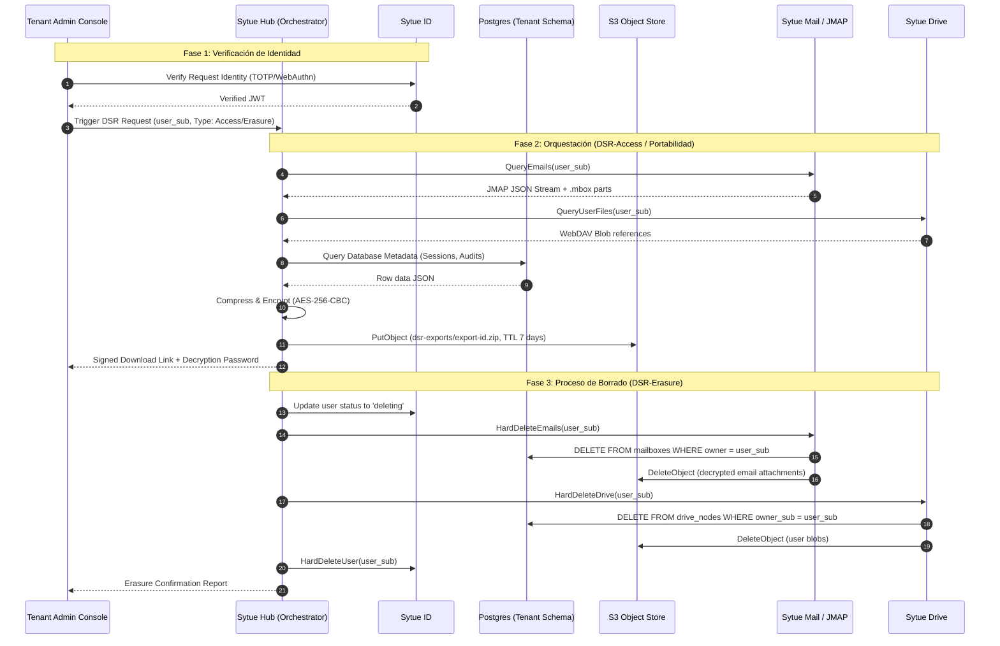

<!-- SPDX-License-Identifier: Apache-2.0 -->
<!-- Copyright (c) 2026 Daniel Delgado Ramos -->

<a id="seguridad-cumplimiento-y-licencias--sytue-suite"></a>

# Security, compliance and licensing — Sytue Suite

The suite's single security document. Four parts:

1. **[Security and GDPR](#1-seguridad-y-rgpd)** — controls per layer, sovereignty, secrets,
   IdP, multi-tenancy, mail, backups, hardening, incident response and compliance.
2. **[Threat model](#2-modelo-de-amenazas-stride-por-servicio)** — STRIDE per service.
3. **[OWASP ASVS L2 checklist](#3-checklist-owasp-asvs-l2)** — mapped to the repository.
4. **[Clean-room policy and licensing](#4-politica-de-reimplementacion-clean-room)** — how
   reimplementation is done without derivative works, dependency matrix and obligations.

> Normative: [`CONVENTIONS.md`](CONVENTIONS.md). Decisions and their rationale:
> [`decisions.md`](decisions.md). The **external security audit before production
> remains mandatory**.

---

<a id="1-seguridad-y-rgpd"></a>

## 1. Security and GDPR

Security, sovereignty and compliance with the **GDPR** (Regulation (EU) 2016/679). Guiding
principles: **100 % Europe on Scaleway (EU regions only)**; **Sytue-native products
under the Apache-2.0 license** with no third-party AGPL engines; **single Go + Astro/Preact + PostgreSQL stack**;
**Sytue ID (in-house IdP in Go) as the core piece**. No US providers for personal data
and no transfers outside the EU. Each technical control is mapped to its **actual
implementation** in `platform/pkg/*` and `services/<svc>` so that this is verifiable, not aspirational.

> The **independent security audit of Sytue ID before production is mandatory**
> because it is in-house, critical authentication code (§1.14 and §4).

---

<a id="11-modelo-de-seguridad-por-defecto--mapa-de-controles-conventions-07--implementacion"></a>

<a id="11-modelo-de-seguridad-por-defecto--mapa-de-controles-conventions-07--implementación"></a>

### 1.1 Secure-by-default model — map of CONVENTIONS §0.7 controls → implementation

This section **materializes** each non-negotiable minimum in CONVENTIONS §0.7 with the code point
that implements it. It is the master traceability index for "security by default".

| Control (CONVENTIONS §0.7)                          | Actual implementation (file / mechanism)                                                                                                                                                                                                        | Detail                                                                                                                                                 |
| --------------------------------------------------- | ----------------------------------------------------------------------------------------------------------------------------------------------------------------------------------------------------------------------------------------------- | ------------------------------------------------------------------------------------------------------------------------------------------------------ |
| **Deny-by-default (authorization)**                 | `platform/pkg/authn/middleware.go` (`RequireAuth`, `RequireRole`, `RequireScope`); `services/docs/internal/domain/access.go` (`ResolveRole`/`ResolveShare` return "no access" unless there is an explicit ACL)                                  | No valid token → 401; no role/scope → 403. The Docs resolver starts from `Role("")` and only grants what is explicit.                                  |
| **Least privilege**                                 | Roles `owner/admin/member/billing` in `Claims.HasAnyRole`; one OIDC client per surface; runtime DB role ≠ migrations role; Scaleway IAM scoped per service                                                                                      | §5.4. Each BFF has its own `client_secret`; each Go service has its PG/S3 credentials scoped to its schema/prefix.                                     |
| **Multi-tenant RLS (Postgres)**                     | `platform/pkg/pg/tx.go` (`InTenantTx`, `SetTenant` via `set_config('app.tenant', $1, true)`); `services/*/db/migrations/0001_*.up.sql` (`ENABLE`+`FORCE ROW LEVEL SECURITY`, `POLICY ... USING (tenant = current_setting('app.tenant', true))`) | §5.1. The slug is validated (`tenancy.ValidSlug`) before setting the GUC → no injection. `FORCE RLS` applies even to the table owner.                  |
| **TLS 1.3 + HSTS**                                  | Termination in Traefik 3 (edge); HSTS `max-age=63072000; includeSubDomains; preload`; `TLSOption` `default` with AEAD-only suites (`deploy/helm/sytue-one/values.yaml`, `traefik.tlsOptions`)                                                   | §2.1, §9.2. **East-west mTLS is NOT in place**: see §2.2 and V9.2.1.                                                                                   |
| **Host-only HttpOnly/Secure/SameSite cookies**      | Sytue ID SSO session (`services/id/internal/http/session.go`) and each BFF's `__Host-` cookies                                                                                                                                                  | §4.1. No `Domain`: the `*.apps/preview.sytue.eu` publications never receive them. `token_hash` (SHA-256) is persisted, never the cookie in clear text. |
| **Strict CSP + security headers**                   | Traefik middleware (§9.2) + CSP per surface (§9.3)                                                                                                                                                                                              | `default-src 'self'`, no third-party scripts/iframes.                                                                                                  |
| **CSRF**                                            | BFF pattern + `SameSite` + `state`/`nonce` in OIDC (`services/id/internal/http/authorize.go`)                                                                                                                                                   | §4.1, §9.3.                                                                                                                                            |
| **Validation/sanitization + parameterized queries** | `pgx` with positional args in all data access (e.g. `services/id/internal/store/audit.go`); `set_config(...,$1,...)`; `html.EscapeString` in the login fallback (`services/id/internal/http/login.go`)                                          | No concatenated dynamic SQL. Slugs validated by regex (`tenancy.slugRe`), `CHECK` on columns.                                                          |
| **Rate limiting / anti-brute-force**                | Generic login messages (no enumeration) + auditing of failures (`auth.login.failed`) in `services/id/internal/http/login.go`; edge rate limit (Traefik middleware) + progressive lockout on PostgreSQL tables (§4.3)                            | §4.3. Argon2id makes each attempt expensive by design.                                                                                                 |
| **MFA/WebAuthn**                                    | `services/id/internal/webauthn/*` (FIDO2 registration/login, anti-cloning `sign_count`); TOTP (RFC 6238) with encrypted secret; step-up enforced by role in `authorize.go` (`requiresStepUp`)                                                   | §4.2. `admin`/`owner` require MFA (`domain.Role.RequiresMFA`).                                                                                         |
| **Secrets out of code/logs**                        | `platform/pkg/config/config.go` (12-factor, env only; never values in git); Scaleway Secret Manager + controlled sync to Kubernetes (§3); `slog` logs without secrets or bodies                                                                 | §3, §7. `.env` ignored by git; only placeholders in the repo.                                                                                          |
| **Encryption at rest / sensitive fields**           | `services/cloud/internal/crypto/crypto.go` (AES-256-GCM, `Sealer`); encrypted columns in Sytue ID (`private_pem`, `totp_secrets.secret`, `webauthn`); SSE in S3/RDB                                                                             | §2.2.                                                                                                                                                  |
| **Immutable audit**                                 | `services/id/internal/store/audit.go` + `audit_log` table (append-only, `GENERATED ALWAYS AS IDENTITY`); audit tables per service                                                                                                               | §7.                                                                                                                                                    |
| **Logs without personal data**                      | `platform/pkg/httpx/middleware.go` (`RequestLogger` records method/path/status/duration/IP, not bodies); minimization policy in auditing                                                                                                        | §7.                                                                                                                                                    |
| **Token validation (JWKS, no `alg:none`)**          | `platform/pkg/authn/verifier.go` (`jwt.WithValidate`, `WithIssuer`, `WithAudience`, `WithKeySet`, `WithAcceptableSkew`); RS256 signature, never `none`/shared HMAC                                                                              | §3.2, §4.1.                                                                                                                                            |
| **Mandatory PKCE + exact redirect_uri**             | `services/id/internal/http/authorize.go` (`client.RequirePKCE`, `S256` enforced, `ValidRedirectURI`) and `token.go` (`VerifyPKCE`, `HashToken`)                                                                                                 | §4.1. Single-use code; only the hash is persisted.                                                                                                     |
| **Refresh token rotation + reuse detection**        | `services/id/internal/http/token.go` (`grantRefresh`: `RotateRefreshToken`, `RevokeRefreshChain` on reuse)                                                                                                                                      | §4.4. Reuse → revokes the whole family + `oauth.refresh.reuse_detected` audit.                                                                         |
| **Constant-time comparisons**                       | `crypto/subtle.ConstantTimeCompare` (Argon2/PKCE in `services/id/internal/domain/secret.go`); `hmac.Equal` (LiveKit webhook in `services/rooms/internal/media/livekit/token.go`)                                                                | Anti timing attack on passwords, PKCE and signatures.                                                                                                  |
| **Rootless/distroless containers**                  | `services/*/Dockerfile` (multi-stage `golang:1.26` → `gcr.io/distroless/static:nonroot`, `USER nonroot`, `CGO_ENABLED=0`, `-trimpath -ldflags="-s -w"`)                                                                                         | §9.1. No shell or package manager. **One exception: `services/ocr`** — see below.                                                                      |
| **Deny-by-default NetworkPolicies**                 | Helm manifests per `tenant-<slug>` namespace (§5.2)                                                                                                                                                                                             | Ingress/egress denied except what is explicit.                                                                                                         |
| **Panic recovery without leaks**                    | `platform/pkg/httpx/middleware.go` (`Recoverer` → canonical JSON 500, stack only to logs)                                                                                                                                                       | The client never sees stack traces (§9.4).                                                                                                             |

> **Definition of Done for every PR:** no change is merged if it degrades a control in this table.
> The `*_test.go` files of `platform/pkg/{authn,tenancy,pg}` and of `services/id/internal/*` pin the
> secure behavior (signature verification, tenant isolation, PKCE) as regression tests.

---

<a id="12-soberania-residencia-de-datos-ue-y-cifrado"></a>

<a id="12-soberanía-residencia-de-datos-ue-y-cifrado"></a>

### 1.2 Sovereignty, data residency (EU) and encryption

<a id="21-residencia-solo-ue-scaleway-y-zona-on-premise-en-madrid"></a>

#### 2.1 Residency (EU only: Scaleway and on-premise zone in Madrid)

| Resource                            | Location        | Scaleway region           | Notes                                                                                                                  |
| ----------------------------------- | --------------- | ------------------------- | ---------------------------------------------------------------------------------------------------------------------- |
| Compute (Kapsule, supported GA)     | EU              | `fr-par` (`fr-par-1/2/3`) | DR in `nl-ams`.                                                                                                        |
| Databases (RDB PostgreSQL)          | EU              | `fr-par`                  | Replica/backup in `nl-ams`. Single datastore (state + queues + cache).                                                 |
| Object Storage (S3)                 | EU              | `fr-par`                  | Versioned buckets, encryption at rest (drive/mail/docs-blobs, backups).                                                |
| Secret Manager                      | EU              | `fr-par`                  | Platform secrets (§3).                                                                                                 |
| Registry (images)                   | EU              | `fr-par`                  | Scaleway Container Registry (scanned).                                                                                 |
| Mail (Sytue Mail Go, S3 blobs)      | EU              | `fr-par`                  | Mailboxes/indexes in PostgreSQL; encrypted blobs in EU S3.                                                             |
| WebRTC media (LiveKit)              | EU              | `fr-par`                  | _Sytue Rooms_ SFU (Apache-2.0), self-hosted in the EU.                                                                 |
| DNS / Load Balancer                 | EU              | `fr-par`                  | Traefik 3 + cert-manager.                                                                                              |
| On-premise / self-hosted deployment | EU / Own server | —                         | Kubernetes cluster (k3s/standard) or Docker Compose on own infrastructure, with the same perimeter and the same rules. |

Sovereignty rules:

- **No personal data leaves the EU, with ONE written exception: notifications with the app or the
  browser closed.** Web Push (RFC 8291) delivers the content **end-to-end
  encrypted** —the vendor's push service cannot read it—, but it sees the _endpoint_
  (pseudonymous device identifier) and the time of each notification; on iOS, APNs sees the device
  token and the time, and the notification is **empty** (`content-available`, no title, text,
  author or channel: see ADR 0039). On native Android no third party is involved —the app
  keeps the hub's SSE stream—. Anyone who does not want even that metadata can turn notifications off.
  Beyond that, no US services (CDN, analytics, AI, transactional
  email, etc.) are used on personal data. Every dependency is self-hosted on Kapsule or
  consumed from Scaleway EU services. DNS resolution for Mail's SPF/DMARC verifier uses
  EU resolvers (`net.DefaultResolver`, see `services/mail/internal/auth/verify.go`).
- **Subprocessors:** **Scaleway SAS** (France, EU) as infrastructure and **Mollie B.V.** (the
  Netherlands, EU) for subscription billing, which only processes payment data. The Madrid on-premise
  zone is own infrastructure, not a subprocessor. The list of subprocessors is maintained in
  the DPA annex (§11.3) and versioned in this repository.
- **No external telemetry.** The Astro + Preact frontend loads no third-party scripts;
  observability (structured `slog` + OpenTelemetry) stays inside the cluster.
- **Operational sovereignty:** product code **Apache-2.0 (© 2026 Daniel Delgado Ramos (thinkddr))**; incorporated
  dependencies are **permissive** (MIT/BSD/Apache-2.0/ISC/PostgreSQL/MPL-2.0) → portability and no lock-in.
  Product, infrastructure and tooling also pass the independent EU-origin gate; GitHub is
  the only temporary exception, scoped in `roadmap.md` P0.

<a id="22-cifrado-en-tránsito"></a>

#### 2.2 Encryption in transit

- **TLS 1.3** mandatory on all `*.sytue.eu`. TLS 1.2 only as a fallback minimum with
  AEAD suites; SSLv3/TLS 1.0/1.1 disabled.
- **TLS termination** in Traefik 3; certificates by **cert-manager** (ACME/Let's Encrypt, DNS-01
  on Scaleway DNS). Automatic renewal.
- **HSTS** `max-age=63072000; includeSubDomains; preload` at the edge (§9.2).
- **East-west traffic (service↔service): plain HTTP inside the cluster, restricted by
  NetworkPolicy** (§5.2). This is the CURRENT control and it is real: there is a NetworkPolicy per chart
  (`deploy/helm/charts/*/templates/networkpolicy.yaml`) and internal URLs are `http://<svc>`
  (`deploy/helm/charts/*/templates/deployment.yaml`). **East-west mTLS is DESIGN, not
  deployed**: there is no service mesh in `deploy/` or in `infra/`, and that is how V9.2.1 (☐) records it.
  This document claimed it was in force in four places and it was not.
- **Mail (Sytue Mail Go):** SMTP with mandatory STARTTLS + MTA-STS `enforce` and DANE/TLSA where
  applicable (§6); IMAP 993 / submission 465/587 over TLS.
- **WebRTC (Sytue Rooms):** DTLS-SRTP media via LiveKit; the `sytue-rooms` service mints the LiveKit
  JWT (HS256 with the API secret) **only after validating the Sytue ID JWT** and authorizing the user
  (`services/rooms/internal/media/livekit/token.go`, `AccessToken`).
- **Local dev:** TLS with **mkcert** under `*.sytue.localhost` via Traefik (dev/prod parity).

<a id="23-cifrado-en-reposo"></a>

#### 2.3 Encryption at rest

| Layer                           | Mechanism                                                                                                                                | Reference                                  |
| ------------------------------- | ---------------------------------------------------------------------------------------------------------------------------------------- | ------------------------------------------ |
| Object Storage (S3)             | Server-side encryption (SSE) managed by Scaleway.                                                                                        | §2.1                                       |
| Block Storage (Kapsule volumes) | Volume encryption at the Scaleway platform level.                                                                                        | —                                          |
| PostgreSQL (RDB)                | Encryption at rest of the managed instance + TLS for connections.                                                                        | —                                          |
| **Sensitive columns**           | **Field encryption**: `signing_keys.private_pem`, `totp_secrets.secret`, WebAuthn secrets, DKIM keys. Encryption keys in Secret Manager. | Sytue ID `0001_core_identity.up.sql`       |
| **Sytue Cloud secrets**         | AES-256-GCM (`Sealer`, random nonce per value, authentication tag) with a 32-byte `SECRET_ENC_KEY`.                                      | `services/cloud/internal/crypto/crypto.go` |
| Sytue Drive (files)             | Blobs in encrypted S3 (SSE) + metadata in PostgreSQL; SHA-256 `checksum` per file (integrity).                                           | Drive `0001_init.up.sql`                   |
| Sytue Mail (mailboxes)          | Messages/indexes in PostgreSQL; bodies/attachments as blobs in encrypted S3; encrypted DKIM keys.                                        | §6                                         |
| Opaque tokens/codes             | Only the **hash** (SHA-256) is persisted: sessions, refresh, auth codes, link tokens.                                                    | `domain.HashToken`                         |
| Backups / dumps                 | Encrypted in a versioned, isolated backup bucket (§8).                                                                                   | §8                                         |

> Encryption at rest **does not replace** access control: service keys are never
> stored alongside the data and they rotate according to policy (§3.2). The `Sealer` uses AEAD (GCM): a
> corrupt ciphertext or one with the wrong key fails to open (`ErrCiphertextInvalid`), without leaking
> the reason.

---

<a id="13-gestion-de-secretos"></a>

<a id="13-gestión-de-secretos"></a>

### 1.3 Secrets management

**Absolute rule:** **no secrets in Git.** Only placeholders and environment variable names
in the repository (e.g. `SYTUE_ID_OIDC_SIGNING_KEY`, `MAIL_DKIM_PRIVATE_KEY`, `LIVEKIT_API_SECRET`,
`SCW_SECRET_KEY`, `PG_DSN`, `CLOUD_SECRET_ENC_KEY`), never values. `platform/pkg/config` reads **only**
from the environment (12-factor); `Require` fails startup if a mandatory secret is missing, so a
service never starts in an insecure state because of missing configuration.

<a id="31-cadena-de-secretos"></a>

#### 3.1 Secrets chain

```
Scaleway Secret Manager  (fuente de verdad, UE, cifrado, auditado; IAM privilegio mínimo)
        │  (bootstrap idempotente de producción; futuro ESO cuando haya rotación continua)
        ▼
Kubernetes Secret  (montado como env/volumen en pods)
        ▼
Pods de los servicios Go (Sytue ID / Drive / Docs / Mail / Calendar / Contacts /
                          Chat / Meet / Hub / Cloud) + LiveKit
```

- **Scaleway Secret Manager:** platform secrets (RDB DSN, S3 keys, **Sytue ID OIDC/JWKS signing
  keys**, Mail DKIM keys, LiveKit API key/secret, Cloud's
  `SECRET_ENC_KEY`). Access through Scaleway IAM with least privilege and audited (who/when).
- **Initial production:** `deploy/production/02b-secretos.sh` creates or retrieves values in
  Secret Manager and materializes the native Kubernetes `Secret`s. There are no Sealed Secrets
  or encrypted values in Git: a single source of truth avoids drift. When frequent
  rotation is introduced it will be replaced by External Secrets Operator, keeping the names of
  the `Secret`s and without changing the charts.
- **Dev:** `.env.example` with placeholders; real values in `.env`, **ignored by Git**;
  dev `SECRET_ENC_KEY` generated locally (never shared).

<a id="32-gestión-de-claves-jwks-y-rotación-en-sytue-id"></a>

#### 3.2 Key management, JWKS and rotation in Sytue ID

Implementation in `services/id/internal/oidc/keys.go` (`KeyManager`) + `signing_keys` table:

- **Bootstrap:** at startup, if there is no active key an **RSA-2048** key is generated and persisted
  (`Bootstrap`/`generateAndStore`). The private key (`private_pem`) is encrypted at rest at the
  column level in prod (KMS/pgcrypto).
- **Public JWKS:** `PublicJWKS()` publishes **all** non-retired keys at
  `/.well-known/jwks.json`; every token carries a `kid`. Validating services cache the JWKS with
  periodic refresh (`platform/pkg/authn/verifier.go`, `jwk.NewCache` + `WithMinRefreshInterval`,
  15 min by default; initial preload that **fails fast** if Sytue ID is unreachable).
- **Zero-downtime rotation (key rollover):** `Rotate()` marks the `active` key as `next`, generates
  a new `active` one in the same transaction and reloads it in memory. Already-issued tokens keep
  validating against the `next` key (still published in the JWKS) until they expire; afterwards it becomes `retired`
  and is removed from the JWKS. States in `signing_keys.status ∈ {active, next, retired}`.
- **Algorithms:** asymmetric **RS256** signing (ES256/EdDSA supported by design); **never** `none`
  or HMAC with a secret shared between services. The private key lives only in Sytue ID;
  validators only see the public key via JWKS.
- **Periodic rotation** (≤ 90 days) of signing keys, service credentials, OIDC client
  secrets, DKIM keys and the LiveKit secret; **immediate** upon suspected compromise (with revocation
  of tokens/sessions, §4.4).
- **Least privilege:** each surface/BFF has its own OIDC client secret (Argon2id hash in
  `oauth_clients.secret_hash`); each Go service has its PostgreSQL/S3 credentials scoped to its
  schema/prefix.
- **Rotation operation:** run by Sytue Admin / cron with prior validation; audited
  (`rotación de claves JWKS` in the Sytue ID log, §7).

---

<a id="14-sytue-id--idp-propio-go-oidcoauth2-mfawebauthn-y-scim"></a>

### 1.4 Sytue ID — in-house IdP (Go), OIDC/OAuth2, MFA/WebAuthn and SCIM

<a id="41-núcleo-oidcoauth2-idsytueeu-dev-8081--nuclear"></a>

#### 4.1 OIDC/OAuth2 core (`id.sytue.eu`, dev `8081`) — core

- **In-house Go service** (not Keycloak), on **Apache-2.0/MIT** libraries. It implements **OIDC/OAuth2**
  (Authorization Code + PKCE, refresh with rotation, **JWKS**, discovery
  `/.well-known/openid-configuration`), **SAML** (optional), **SCIM** and **MFA/WebAuthn**. State in
  **PostgreSQL** (users, clients, grants, sessions, keys — `0001_core_identity.up.sql`).
- **Authorization endpoint** (`services/id/internal/http/authorize.go`), default measures:
  - **Exact `redirect_uri` validation** against the client's registered ones (`ValidRedirectURI`):
    unknown `client_id` or unregistered `redirect_uri` → direct error, **no redirect**
    (anti open-redirect, OAuth 2.0 Security BCP).
  - **Mandatory PKCE** when the client requires it (`RequirePKCE`, `true` by default for all):
    `code_challenge` present and `code_challenge_method = S256` (`plain`/missing is rejected).
  - **Scope validation** against the client's allowed scopes (`AllowsScope`); allowed grant
    (`AllowsGrant`); `response_type=code` only.
  - **`state`** (anti-CSRF) and **`nonce`** (OIDC, ID Token anti-replay) propagated intact.
  - **Single-use, short-lived code**: only `HashToken(code)` (SHA-256) is persisted, with
    `expires_at` and `consumed_at` (`auth_codes`).
- **Token endpoint** (`token.go`): client authentication (§4.5), `grant_type ∈
{authorization_code, refresh_token, client_credentials}`, `Cache-Control: no-store`. PKCE
  verification with `VerifyPKCE` (constant-time), check that the code belongs to the client and to the
  `redirect_uri` used in `/authorize`.
- **Distributed validation:** no product manages its own credentials; each Go service
  **validates Sytue ID JWTs via JWKS** with `platform/pkg/authn` (`RequireAuth`).
- **Confidential OIDC clients per surface (BFF):** `sytue-one`, `sytue-console`, `sytue-cloud`
  (+ `sytue-cloud-api`), `sytue-mail`, `sytue-drive`, `sytue-calendar`, `sytue-contacts`,
  `sytue-docs`, `sytue-rooms`, `sytue-hub`. No federation clients (there are no engines anymore).
- **SSO** through the Sytue ID host-only session and **host-only `__Host-`** BFF cookies
  (`Secure`, `SameSite`). OAuth makes the jump between apps transparent; no
  authentication cookie is shared with the apex. The `token_hash` (SHA-256) is persisted, never the cookie
  in clear text (`sessions`).

#### 4.2 MFA / WebAuthn

- **Mandatory MFA** for the `admin` and `owner` roles: `authorize.go` forces **step-up**
  (`requiresStepUp`) when the session does not include MFA in the `AMR` and the user has an elevated role
  (`domain.Role.RequiresMFA`).
- **WebAuthn / FIDO2** (passkeys) as the preferred second factor
  (`services/id/internal/webauthn/*`, `webauthn_credentials`): COSE `public_key`, `sign_count`
  for **clone detection**, single-use, short-lived challenges (`webauthn_challenges`).
- **TOTP** (RFC 6238) as an alternative, with the secret **encrypted in its column** (`totp_secrets.secret`).
- Single-use **recovery codes** (hashed in the DB). Passwords with **Argon2id**
  (`services/id/internal/domain/secret.go`, OWASP profile: 64 MiB, t=3, p=2, 16 B salt, 32 B
  key, PHC format), **constant-time** verification (`subtle.ConstantTimeCompare`).
- **User anti-enumeration:** login always responds with a generic error
  (`services/id/internal/http/login.go`, `loginFail`), whether the user does not exist or the
  password is wrong; every failure is audited (`auth.login.failed`).

<a id="43-rate-limiting-y-anti-fuerza-bruta"></a>

#### 4.3 Rate limiting and anti-brute-force

- **Computational cost by design:** Argon2id (64 MiB) makes each password attempt expensive.
- **Edge rate limit** (Traefik middleware) per IP/route for `/login`, `/token`, `/authorize`.
- **Progressive lockout** on PostgreSQL tables (failure counter per account/IP with incremental
  backoff), audited. Authorization codes and sessions have a short TTL and an expiry
  index for purging (`auth_codes_expires_idx`, `sessions_expires_idx`).

<a id="44-baja-inmediata-deprovisioning-y-revocación"></a>

#### 4.4 Immediate offboarding (deprovisioning) and revocation

- **Deactivation/deletion in Sytue ID** → `user.Active()` is `false` → it immediately stops issuing/refreshing
  tokens (`grantRefresh` rejects an inactive user).
- **Refresh token rotation and reuse detection** (`token.go`, `grantRefresh`): each refresh
  issues a successor and links `rotated_to`; if an **already rotated/revoked** refresh arrives, reuse is
  flagged, the **whole family is revoked** (`RevokeRefreshChain`) and
  `oauth.refresh.reuse_detected` is audited. Short-lived `access_token`s expire on their own.
- **Group/role mapping:** `org/<slug>` and `owner/admin/member/billing` → rows/schemas per
  tenant in PostgreSQL (RLS), S3 prefixes and Kapsule `tenant-<slug>` namespaces (the basis of
  multi-tenant isolation, §5).

**Emergency switch (global cut-off, out of band).** It lives in the binary and not in the
console on purpose: the scenario in which it is used is the one in which the console —or the
account itself— is what has failed. There are **three pieces and all three are needed**, because each one closes
something the others do not:

| Piece                                              | What it invalidates                                                                                                                                                                                                                                           | Why it is not enough on its own                                                                |
| -------------------------------------------------- | ------------------------------------------------------------------------------------------------------------------------------------------------------------------------------------------------------------------------------------------------------------- | ---------------------------------------------------------------------------------------------- |
| `id revoke-all`                                    | Every issued access/ID token: it rotates the signing key and **retires the previous one on the spot** (no grace window), so no earlier signature verifies against the JWKS                                                                                    | It does not prevent **issuing again**: whoever holds the credential gets in a second later     |
| `02b-secretos.sh <entorno> --rotate-cookie-secret` | The session cookie of the ten surfaces (the `cookie-secret` that seals it) and restarts the frontends, which only read it at startup                                                                                                                          | It leaves the IdP's SSO session and issuance intact                                            |
| `id lockdown on --reason "…"`                      | Nothing already issued: it **closes issuance**. A single-row flag (mig `0035`) checked in the DATABASE at the two issuance points —`createSession` (the five login methods) and the token endpoint (503 `temporarily_unavailable`)—. A query error **denies** | It does not kick out whoever already has a token or cookie: that is what the other two are for |

The lockdown is lifted with `id lockdown off --reason "…"`, and **the rescue is the reason it is a
subcommand**: with the switch on nobody can sign in, so a web console to turn it off
would be a door locked from the inside with the key inside. It only needs the DSN. Both actions
require a written reason and are audited, for the same reason as in §4.9: a total cut-off without a reason is
indistinguishable from a mistake six months later.

It is checked at ISSUANCE and not when validating each request, on purpose: per-request
introspection would turn the IdP into a hard dependency of every call from every service, and the product is
sized for hundreds of thousands of users. What has already been issued is invalidated by `revoke-all`, which costs
nothing on the hot path.

<a id="45-autenticación-de-clients-token-endpoint"></a>

#### 4.5 Client authentication (token endpoint)

`services/id/internal/http/clientauth.go`:

- **Confidential:** `client_secret_basic`/`client_secret_post`; the secret is compared with
  `oauth_clients.secret_hash` (**Argon2id**) through `VerifyPassword` (constant-time). Without a
  configured `secret_hash` the client stays **disabled** (deny-by-default) until the deployment
  sets its secret.
- **Public (pure PKCE):** `token_endpoint_auth_method = none`; security rests on PKCE + the
  exact `redirect_uri`. `client_credentials` is **forbidden** for public clients.

<a id="46-auditoría-de-seguridad-obligatoria-del-idp-propio-antes-de-producción"></a>

#### 4.6 MANDATORY security audit of the in-house IdP before production

Because it is **in-house authentication code** (clean-room), **Sytue ID is not deployed to production
without passing an independent security audit**. It is a **release gate** (it blocks
promotion to prod), not a recommendation. See the detailed plan in §14. Minimum scope:

- **OWASP ASVS** target level **L2**, with **L3** for the critical
  authentication/cryptography components (session management, tokens, keys). Checklist in
  [`docs/security.md#3-checklist-owasp-asvs-l2`](./security.md#3-checklist-owasp-asvs-l2).
- **OWASP Top 10** and, for the OAuth/OIDC flows, **OAuth 2.0 Security BCP (RFC 9700)** and **OAuth
  2.0 for Browser-Based Apps**: mandatory PKCE, exact `redirect_uri` validation, `state`,
  `nonce`, refresh rotation and reuse detection, `no-store` on token responses.
- **Key/JWKS review:** rotation with rollover, `kid`, algorithms (RS256, no `alg:none`),
  no shared HMAC, encryption at rest of the private key.
- **Cryptographic review** of the Go code: Argon2id (parameters), randomness
  (`crypto/rand`), **constant-time** comparisons (`subtle`/`hmac.Equal`), PHC format.
- **External pentest** of the public endpoints (`/authorize`, `/token`, `/login`, `/userinfo`,
  `/scim`, WebAuthn) + review of session handling (fixation/expiry/rotation).
- **Closing the pending security `TODO`s** marked in the code as prod blockers
  (e.g. state binding for the second MFA step in `login.go`/`handleMFAVerify`).

The scope, findings and their remediation are recorded in [`docs/security.md#4-politica-de-reimplementacion-clean-room`](./security.md#4-politica-de-reimplementacion-clean-room)
and in the ROPA/compliance register. The result (with verified remediation) is a prerequisite
for the first prod deployment.

<a id="47-scim-y-aprovisionamiento-interno-un-alta--toda-la-suite"></a>

#### 4.7 SCIM and internal provisioning (one sign-up = the whole suite)

- **Sytue ID is the identity source.** A sign-up + the **tenant/role claims** (`tenant`/`org`,
  `roles`) that travel in the `access_token` give immediate access to all Go services.
  Authorization is **token-driven** (`platform/pkg/authn/claims.go`); there is no projection into engines.
- **SCIM 2.0** (RFC 7643/7644) in `services/id/internal/scim` so that the customer's corporate IdPs/directories
  (or the Console) can provision/deprovision accounts and memberships.
- **"Lazy" provisioning per service:** on the first authenticated request, each Go service creates/
  resolves the user's local record in its tenant schema (idempotent) from the
  claims. Relevant directory events are published via **Sytue Hub** (e.g. creating a mailbox in Mail).

<a id="48-controles-enterprise-de-acceso-resumen-sot-en-architecturemd6-identidad-enterprise-y-cumplimiento"></a>

#### 4.8 Enterprise access controls (summary; SoT in `architecture.md#6-identidad-enterprise-y-cumplimiento`)

On top of the core above, Sytue ID implements the controls that a large organization requires.
The **functional detail, routes and migrations** live in
[`architecture.md#6-identidad-enterprise-y-cumplimiento`](./architecture.md#6-identidad-enterprise-y-cumplimiento); here only their place in the security model:

| Control                                                                                         | Migration | Where it is applied                                                                                                                                                                                                                                                             |
| ----------------------------------------------------------------------------------------------- | --------- | ------------------------------------------------------------------------------------------------------------------------------------------------------------------------------------------------------------------------------------------------------------------------------- |
| **Conditional Access** (user/group/IP/client/schedule/device → `allow`/`require_mfa`/`block`)   | `0018`    | In `createSession`, the **only** session-creation point for all login methods ⇒ there is no path that bypasses it. The most restrictive rule wins; without policies, `allow`.                                                                                                   |
| **Custom roles / delegated admin** (`perms` claim, 9 permissions, `roles.manage` not delegable) | `0019`    | `requirePermission` middleware on every admin route; `perms` only in the **access token**.                                                                                                                                                                                      |
| **PIM** — _just-in-time_ elevation with justification and expiry                                | `0020`    | **Lazy** expiry evaluated on every token issuance ⇒ the maximum latency of a revocation is the access token TTL (15 min by default).                                                                                                                                            |
| **Dynamic groups** by attribute rules                                                           | `0021`    | Materialized in `group_members` ⇒ the `groups` claim and SCIM do not change.                                                                                                                                                                                                    |
| **Trusted devices** (HMAC cookie derived from the KEK, `trusted=false` initially)               | `0022`    | Feeds the `require_trusted_device` condition. **Explicit decision:** a failure of the device store is **fail-open** (treated as trusted) so as not to lock the organization out of its suite; take this into account in `security.md#2-modelo-de-amenazas-stride-por-servicio`. |

<a id="49-administración-de-plataforma-alcance-global"></a>

#### 4.9 PLATFORM administration (global scope)

Until migration `0031` there was no authorization that crossed organizations: every
decision was anchored to one and no role saw more than one. That property **remains intact for all
organization roles**; what opens is a separate, narrow door so that support and
management can operate the platform (manual sign-ups, suspension, merging, usage metering and
free seats).

| Decision                                                                                                                             | Why                                                                                                                                                                                                                                                                                                                                                                                                                                                                                                                                                                                                                                                                                                                                                                                                                                  |
| ------------------------------------------------------------------------------------------------------------------------------------ | ------------------------------------------------------------------------------------------------------------------------------------------------------------------------------------------------------------------------------------------------------------------------------------------------------------------------------------------------------------------------------------------------------------------------------------------------------------------------------------------------------------------------------------------------------------------------------------------------------------------------------------------------------------------------------------------------------------------------------------------------------------------------------------------------------------------------------------ |
| **Its own allowlist (`platform_admins`), not a role**                                                                                | Stealing a customer admin's session still grants nothing global. "Who has platform access?" is answered with a `SELECT`, not by reasoning about memberships.                                                                                                                                                                                                                                                                                                                                                                                                                                                                                                                                                                                                                                                                         |
| **The DB is checked on EVERY request** (`requirePlatformAdmin`), not a claim                                                         | Removing the scope takes effect immediately and does not wait for a token to expire. A query error **denies** (explicit fail-closed).                                                                                                                                                                                                                                                                                                                                                                                                                                                                                                                                                                                                                                                                                                |
| **Second factor ALWAYS**, whether or not the user has an elevated role                                                               | It is the most powerful surface in the product. To be able to require it, the `amr` claim is now also issued in the **access token** (previously only in the ID Token).                                                                                                                                                                                                                                                                                                                                                                                                                                                                                                                                                                                                                                                              |
| **And a LIVE ELEVATION** (`platform_activations`, mig `0043`): being on the allowlist no longer authorizes, it only allows elevating | A scope granted "for a migration" was still alive months later without anything saying so. Now `platform_admins` is **eligibility** and authorization is given by an activation with a reason and a window (5 min – 8 h) that **expires on its own**. The three elevation routes (`/platform/activation`, `/activate`, `/deactivate`) sit **outside** the gate, or nobody could ever elevate. The three locks return 403 with a different `code` (`forbidden`, `mfa_required`, `activation_required`) because they are fixed in three different places.                                                                                                                                                                                                                                                                              |
| **No organization API writes the table**                                                                                             | Global scope is only granted by the deployment bootstrap or another global admin, and both are audited with actor and reason.                                                                                                                                                                                                                                                                                                                                                                                                                                                                                                                                                                                                                                                                                                        |
| **Every write requires a reason** and is audited                                                                                     | A suspension or twenty seats given away without a written reason are indistinguishable from a mistake six months later.                                                                                                                                                                                                                                                                                                                                                                                                                                                                                                                                                                                                                                                                                                              |
| **It cannot be left without admins**                                                                                                 | Revoking the last one, or oneself, is rejected: recovering would require running the deployment bootstrap again.                                                                                                                                                                                                                                                                                                                                                                                                                                                                                                                                                                                                                                                                                                                     |
| **TWO PEOPLE** (`platform_approvals`, mig `0046`) to suspend, merge **and grant global scope itself**                                | Repeating the identifier protects against carelessness, not against a compromised account or a decision taken alone in the middle of the night. Requesting creates the request (409 `approval_required`) and **approving executes**, revalidating against the state at that moment: a day can pass between requesting and signing. The requester cannot sign; they can reject, since withdrawing one's own request executes nothing. Granting the scope was added because the risk was inverted: suspending ONE customer —reversible— required two signatures, while handing out the permission that suspends EVERYONE needed only one. With a single eligible admin it goes ahead and is recorded (`platform.approval.solo`): requiring two leaves the platform unable to ever act, and that is discovered on the day it is urgent. |
| **Separate surface**: `platform.<dominio>` (OIDC client `sytue-platform`), not the organization console                              | It is the same image, but administering the platform is not administering an organization. On `admin.<dominio>` the section **does not exist** (404) and is not offered in the menu: serving it there left a screen that made eight calls only to end in 403 and suggested to a customer admin that there is a door to the platform from their console. The surface is derived from the `client_id`, which the chart already sets per deployment —a separate flag ends up unset—. **It only decides what is offered**: who gets in is still decided by the four locks above.                                                                                                                                                                                                                                                         |

**Organization merging.** It moves the rows of the **ten** service databases and then the
identity. Under `FORCE ROW LEVEL SECURITY` a normal transaction does not see the source's rows, so
the `UPDATE` would affect zero rows **without failing**: that is why there is a `PERMISSIVE` policy
scoped to its own variable `app.merge` (`app.maintenance` is not reused, since it would silently
broaden what any already-written maintenance transaction can do) and a **preflight**
that requires that policy on every table with a `tenant` column before touching the first row.
Uniqueness collisions **fail**: inventing a disambiguation would mean losing a customer's data
without anyone deciding it.

**And then it counts, before touching the identity.** That the ten services moved without error
does not prove that nothing is left: each one relabels the tables that the catalog listed when opening its
transaction, and **the source is still alive in the meantime** —its users sign in and write until the
identity is moved—, so a row inserted after its table went through the `UPDATE`
keeps the old tenant without anything failing. `merge.Verify` walks the ten databases and counts what
still belongs to the source; if anything is left, the merge **stops without moving the identity** and the failure names
service, table and rows.

That order is deliberate and it is the abort plan: until the identity, the source is still an
operational organization and the merge can be resumed —the criterion is `tenant = origen`, so it
sweeps up what arrived late— or left stopped without anyone being locked out. After the identity there
is no going back: the users are already in the destination, the source becomes `merged` and the rows of
both organizations are indistinguishable. **There is no "undo"**, and that is why verification goes
where it goes. The count is done inside `app.merge` for the same reason as the rewrite: without that
variable RLS filters out the source's rows and the count comes out zero, meaning that a
careless verifier does not merely check nothing — it **confirms** the merge. There is a test that counts the
same thing with and without the variable and requires them to disagree.

**What cannot be moved: S/MIME.** `smime_authorities` has `PRIMARY KEY (tenant)` —one authority
per organization—, so if both parties have their own the `UPDATE` collides with the primary key and
aborts the merge. Moving it would not fix anything either: the devices of the resulting organization
have the **destination's** anchor installed, and a mail signed by an authority that no longer exists is
shown as untrusted, which is worse than an unsigned one. The source's authority is **discarded** along with
the certificates it issued, and `smime.Service` re-issues them by itself —it is lazy: if a mailbox has no
certificate, it issues one when sending, with its organization's authority, which after the merge is already
the destination's—. The mailbox's previous private key is lost, and this is stated explicitly: it is not a
new policy (the yearly renewal already overwrites it) and today the service only signs, it does not decrypt, so
no mail becomes unreadable. If the destination does **not** have an authority nothing is touched and the
source's one is moved as is: that is the case of an organization being renamed, where discarding would mean throwing away
a valid authority for no reason. Each discard is audited (`platform.merge.discarded`) with the
service, the reason and how many mailboxes it affects: the decision being correct does not make it invisible.

That rule is declared by **each database** in a migration of its own, as a function `platform_merge_prepare
(origen, destino)` that the engine calls —if it exists— inside the same merge transaction. That way the
engine still knows nothing about any service, which is what allows it to live in Sytue ID without
new endpoints or credentials. The function requires `app.merge` on its first line, and **it is not
decorative**: RLS alone does not protect it, because a business connection carries its `app.tenant`
set and sees its own rows, so without that guard it was enough to call it with source = destination =
one's own organization to strip it of S/MIME. A `GRANT` is no defense here: the merge uses
the same credentials as the service.

The preflight recognizes the policy by **what it does** —being `PERMISSIVE` on all commands and
looking at `app.merge`— and not by what it is called. Requiring the name `<tabla>_platform_merge` turned a
convention into an operational requirement: a table with its correct policy under another name
aborted the whole merge, and a policy with the right name and the wrong condition
passed it. That every new table brings its own is not remembered, it is checked: the
`platform/pkg/migcheck` gate rejects a migration that gives a `tenant` column to a table unless some
migration of that service gives it a merge policy. The per-service sweep migration only saw
the tables that existed on the day it was written, and those created later were born outside the merge without
anything saying so until someone tried to merge.

Associated operational compliance (non-destructive legal hold + eDiscovery in Mail and Drive,
unified audit with SIEM export): also in
[`architecture.md#6-identidad-enterprise-y-cumplimiento`](./architecture.md#6-identidad-enterprise-y-cumplimiento) §8–§9; it complements §7 (auditing and logging)
and §8 (retention) of this document.

---

<a id="15-aislamiento-multi-tenant"></a>

### 1.5 Multi-tenant isolation

Model: **Organization (tenant) → Workspace → Users**, with the mapping `org/<slug>`
(Sytue ID) ⇄ `tenant-<slug>` (Kapsule namespace) ⇄ **per-tenant schema/rows in PostgreSQL with
RLS** ⇄ dedicated S3 buckets/prefixes (`tenancy.Tenant` in `platform/pkg/tenancy/tenancy.go` is the
single origin of the identifier).

<a id="51-datos--rls-en-postgresql-defensa-principal"></a>

#### 5.1 Data — RLS in PostgreSQL (primary defense)

- **Row-Level Security** enabled and **forced** (`FORCE ROW LEVEL SECURITY`, applies even to the table
  owner) on each service's multi-tenant tables: policy
  `USING (tenant = current_setting('app.tenant', true)) WITH CHECK (...)` — it filters reads and
  **blocks cross-tenant writes** (see `services/drive/db/migrations/0001_init.up.sql`, replicated in
  all services).
- **Safe tenant propagation:** `RequireAuth` extracts the validated tenant claim
  (`Claims.TenantOrEmpty`, which validates the slug) and puts it in the context (`tenancy.Into`); in every
  business transaction `pg.InTenantTx` runs `SetTenant`, which sets the GUC via
  `set_config('app.tenant', $1, true)` **with a parameter** (no interpolation) and **only after validating the
  slug** (`tenancy.ValidSlug`) → no SQL injection or leakage between tenants even if there is an
  application bug. The setting is `LOCAL`: it lives only inside the transaction.
- **DB roles** without `BYPASSRLS`; the migrations role is different from the runtime role. Separate schemas/
  instances per tenant where the contract requires it.
- **The tests really EXERCISE it** (`platform/pkg/pgtest`): the Pool connects as `sytue_app`,
  `NOSUPERUSER NOBYPASSRLS` and with minimal privileges. Until 2026-07-28 it connected as a
  superuser, and PostgreSQL **does not evaluate any RLS policy for a superuser**: that is,
  no policy from any migration was ever executed in the tests, and a green isolation test
  proved nothing. `services/drive/internal/store/rls_scope_integration_test.go` is the safety
  net: it speaks raw SQL against the pool without going through the store, so the only thing that can
  hide a row is the policy; it fails if someone removes it from a migration or if the harness
  went back to being a superuser.
- **Known trap — `COPY FROM` is incompatible with RLS.** PostgreSQL rejects the COPY
  protocol on a table with active RLS for a role without `BYPASSRLS`
  («COPY FROM not supported with row-level security», SQLSTATE `0A000`). Since the runtime does NOT have
  `BYPASSRLS`, `pgx.CopyFrom` **always fails in production** on any multi-tenant table.
  That is how Sytue Drive's `CopyFolder` was until the harness stopped being a superuser and
  uncovered it. To bulk insert under RLS: `INSERT ... SELECT FROM unnest($1::t[], …)`, which is a
  single round trip and does not consume one parameter per column and row (PostgreSQL's cap is 65535).
- **S3:** per-tenant prefixes (`tenancy.StoragePrefix()` → `tenants/<slug>/`) + scoped IAM
  credentials.

<a id="52-red--networkpolicy"></a>

#### 5.2 Network — NetworkPolicy

- **Deny-by-default:** each `tenant-<slug>` namespace has a `NetworkPolicy` that **denies all
  ingress/egress** and only opens what is explicitly allowed.
- Traffic between tenants is **blocked**; communication only with the ingress (Traefik), the authorized shared
  services (Sytue ID, Sytue Hub) and controlled egress (DNS, PostgreSQL, S3, LiveKit).
- `sytue.eu/tenant` labels and namespace selectors limit the scope.

<a id="53-cuotas--resourcequota--limitrange"></a>

#### 5.3 Quotas — ResourceQuota / LimitRange

- **`ResourceQuota`** per namespace (CPU, memory, storage, number of objects) → prevents
  _noisy neighbor_ and exhaustion (internal DoS defense). In Drive, in addition, a per-tenant storage
  quota maintained transactionally (`quotas.used_bytes`, RLS-isolated).
- **`LimitRange`** for defaults/maximums per pod and container.

<a id="54-autorización--rbac"></a>

#### 5.4 Authorization — RBAC

- **Kubernetes RBAC** with least privilege: `Role`/`RoleBinding` per namespace; no
  `cluster-admin` for tenant workloads. Dedicated **ServiceAccounts**; SA tokens not auto-mounted
  unless needed.
- **Application RBAC** derived from Sytue ID roles, evaluated in each Go service
  (`RequireRole`/`RequireScope` in `platform/pkg/authn`). In Docs, effective role resolution with
  **deny-by-default** and the maximum among user/group/tenant ACLs (`ResolveRole`).

<a id="matriz-acl"></a>

<a id="55-matriz-acl-única-quién-puede-qué-docus-calcus-diapos-certipdf-y-enlaces-de-docs-y-drive"></a>

#### 5.5 Single ACL matrix: who can do what (Docus, Calcus, Diapos, CertiPDF and Docs and Drive links)

One single table per surface, instead of reading it from each handler. The ones for **Docs
documents** and for **links** are walked by a test (below), so they cannot drift from the
code without it failing; the CertiPDF and Drive ones are readings of the code, with their reference.

**Roles of a document** (`domain.Role`, strict order): `viewer` < `commenter` < `editor` <
`owner`. They are resolved per document: the owner (`owner_sub`) is always `owner`; for
everyone else, the **maximum** among their user, group and organization permissions
(`ResolveRole`). Without any permission: **403** (deny-by-default). The groups are the session's
roles plus `org/<tenant>`; in a document's host organization (ADR 0052) an external
person is nothing more than themselves. The table is **identical for the three types**
(Docus `document`, Calcus `spreadsheet`, Diapos `presentation`): what changes by type is not
who can, but what else is checked when writing (see “Protection inside the document”).

<a id="a-documentos-de-docs-rest-y-websocket-con-los-mismos-roles"></a>

##### A. Docs documents (REST, and WebSocket with the same roles)

<!-- matriz-acl:documentos:inicio -->

| Route                                               | Action                               | Minimum role | Notes                                                                                                                       |
| --------------------------------------------------- | ------------------------------------ | ------------ | --------------------------------------------------------------------------------------------------------------------------- |
| `GET /documents/{id}`                               | Open the document and see one's role | `viewer`     |                                                                                                                             |
| `PATCH /documents/{id}`                             | Rename                               | `editor`     |                                                                                                                             |
| `DELETE /documents/{id}`                            | Move to trash                        | `owner`      |                                                                                                                             |
| `PUT /documents/{id}/star`                          | Mark as favorite (per person)        | `viewer`     |                                                                                                                             |
| `PUT /documents/{id}/vault-anchor`                  | Anchor to its vault file             | `owner`      | Only «vault:<uuid>», from no anchor or another vault one, comparing with the current one (ADR 0086)                         |
| `GET /documents/{id}/state`                         | Full state                           | `viewer`     | Inherited protection passwords in clear text come out redacted                                                              |
| `POST /documents/{id}/ops`                          | Edit (also over WebSocket)           | `editor`     | Reauthorizes inside the transaction; goes through sheet and section protection                                              |
| `GET /documents/{id}/ops`                           | Replay operations                    | `viewer`     | Redacted the same way as the state                                                                                          |
| `PUT /documents/{id}/presence`                      | Publish presence                     | `viewer`     |                                                                                                                             |
| `GET /documents/{id}/versions`                      | List versions                        | `viewer`     |                                                                                                                             |
| `POST /documents/{id}/versions`                     | Create a version                     | `editor`     |                                                                                                                             |
| `POST /documents/{id}/versions/{versionId}/restore` | Restore a version                    | `editor`     | Writes through the same door as `/ops`: protection also applies                                                             |
| `GET /documents/{id}/comments`                      | Read comments                        | `viewer`     |                                                                                                                             |
| `POST /documents/{id}/comments`                     | Comment                              | `commenter`  |                                                                                                                             |
| `POST /documents/{id}/comments/import`              | Save imported comments               | `commenter`  | Saved by whoever imports; notifies nobody                                                                                   |
| `PUT /documents/{id}/comments/{commentId}/resolve`  | Resolve or reopen a comment          | `commenter`  |                                                                                                                             |
| `DELETE /documents/{id}/comments/{commentId}`       | Delete a comment or reply            | `commenter`  | Only its author; an `editor` or the `owner` delete any (comments imported from Word: their author is whoever imported them) |
| `GET /documents/{id}/permissions`                   | See who has access                   | `owner`      |                                                                                                                             |
| `PUT /documents/{id}/permissions`                   | Grant or change a permission         | `owner`      |                                                                                                                             |
| `DELETE /documents/{id}/permissions`                | Revoke a permission                  | `owner`      | Cuts the live channel                                                                                                       |
| `GET /documents/{id}/shares`                        | List links                           | `owner`      |                                                                                                                             |
| `POST /documents/{id}/shares`                       | Create a link                        | `owner`      | `viewer`, `commenter` or `editor`; never `owner`                                                                            |
| `DELETE /documents/{id}/shares/{linkId}`            | Revoke a link                        | `owner`      | Cuts the channel of whoever redeemed it                                                                                     |
| `PUT /documents/{id}/shares/{linkId}/password`      | Set, change or remove its password   | `owner`      | Only the hash is stored (Argon2id); changing it invalidates what was already unlocked                                       |
| `POST /documents/{id}/edit-requests`                | Request edit permission              | `viewer`     | Idempotent; whoever already edits gets `requested: false`                                                                   |
| `GET /documents/{id}/edit-requests`                 | See the requests                     | `owner`      |                                                                                                                             |
| `POST /documents/{id}/edit-requests/{sub}/grant`    | Grant a request                      | `owner`      | Only to whoever requested it                                                                                                |
| `DELETE /documents/{id}/edit-requests/{sub}`        | Reject a request                     | `owner`      |                                                                                                                             |
| `GET /documents/{id}/filter-views`                  | Read my filter views (Calcus)        | `viewer`     | Only the caller's: not even the owner sees another person's                                                                 |
| `PUT /documents/{id}/filter-views`                  | Save my filter views                 | `viewer`     | Filtering is viewing: it does not write the model; cap of 64 KiB, 256 sheets and 50 views/sheet                             |
| `GET /documents/{id}/exports`                       | List exports                         | `viewer`     |                                                                                                                             |
| `POST /documents/{id}/exports`                      | Export (OOXML, ODF, PDF, HTML, MD)   | `viewer`     | What you can see, you can take out                                                                                          |
| `GET /documents/{id}/exports/{blobId}`              | Download an export                   | `viewer`     |                                                                                                                             |

<!-- matriz-acl:documentos:fin -->

Test: `services/docs/internal/http/matriz_acl_test.go` (`TestMatrizACLDeDocumentosCoincideConElServicio`)
reads this table, exercises each route with each role and each document type, and fails if the service
grants or denies anything different, or if a route exists in the table and not in the test (or vice versa). The
WebSocket matrix (`collab.TestOpsRoleMatrix`) and edits (`TestPostOpsRoleMatrix`) have
their own.

**Protection inside the document** (what restricting an `editor` adds; it is evaluated in
`store.AppendOps`, inside the transaction that locks the document, and therefore applies to
`/ops`, WebSocket and version restore):

| Type   | What it protects                                                                                                                                                                                                                                                                                                                                                                                       | Who can bypass it                                                                                                                                                                                          |
| ------ | ------------------------------------------------------------------------------------------------------------------------------------------------------------------------------------------------------------------------------------------------------------------------------------------------------------------------------------------------------------------------------------------------------ | ---------------------------------------------------------------------------------------------------------------------------------------------------------------------------------------------------------- |
| Calcus | Protected sheet and workbook: locked cells, options of the «Proteger hoja» (Protect sheet) dialog, workbook structure                                                                                                                                                                                                                                                                                  | The owner; an editor only with the password, verified on the server (only its salted SHA-512 hash is stored, OOXML scheme)                                                                                 |
| Calcus | Tables, pivot tables and external data (`tables`, `pivots`, `externalTables`) of a protected sheet: they do not touch cells, and without this rule they were rewritten with a direct write to the API. No permission grants them; tables only pass with a structural permission (inserting or deleting rows or columns), because they shift with them (`domain/proteccion.go`, `camposSiempreVetados`) | The owner; an editor only with the password                                                                                                                                                                |
| Calcus | Ranges editable per person or group inside a protected sheet (`protect.ranges`)                                                                                                                                                                                                                                                                                                                        | Whoever is listed in the range (by `sub` or by group) writes those cells; changing the ranges is changing the protection                                                                                   |
| Docus  | Protected sections (`data-sytue-seccion`, `data-sytue-puede`, `data-sytue-grupos`), in the `doc:html` register **and in the per-character sequence** (insert/delete)                                                                                                                                                                                                                                   | The owner; in each section, only whoever is listed. Creating, removing or changing the markup of a section is for the owner only                                                                           |
| Diapos | Locked slides (fixed content, cannot be deleted), locked boxes (they stay as they are and on their slide) and master, layouts, theme and canvas size (`SlidesModel.protect`)                                                                                                                                                                                                                           | The owner; an editor only with the password, verified on the server (only its salted SHA-512 hash). Protecting an unprotected presentation is up to any editor; changing or removing the protection is not |

Docus sections and per-character operations: the editor mirrors the HTML into an RGA sequence with
one element per character and co-editors render that sequence, so writing `insert`/
`delete` by hand showed the others a changed section that belonged to someone else (and the save of someone who does have
permission turned it into real content). In documents with sections, and only in them, the
store keeps a copy of the sequence (`doc_proteccion.secuencia`, migration 0017); each batch
with per-character ops is applied to a copy and the resulting text is compared with the sections using
the same rule as `doc:html` (`domain/proteccion_secuencia.go`). It covers typing inside someone else's
section, splitting it, deleting it or skipping it with a clean `set` of `doc:html` plus dirty ops.
Cost: linear in the document size per batch, only in documents with sections.

Calcus protection in files (`domain/proteccion_fichero.go`, `proteccion_ooxml.go`,
`proteccion_ods.go`): the .xlsx carries `sheetProtection` per sheet and `workbookProtection` (structure)
and the .ods carries `table:protected` and `table:structure-protected`, with the permissions of the «Proteger
hoja» dialog and cell protection (`locked`/`hidden`). The OOXML sense is inverted (1 = locked)
and everything that does not fit is lost toward the safe side (more locked): ranges editable per
person or group are not exported. **On export neither the password nor its hash is included**: exports are
stored and any reader can download them, and a hash can be attacked offline and without the service's
attempt limit. **On import**, the salted SHA-512 hash of an Excel .xlsx (the same scheme that
the service stores) is returned separately (`ImportResult.Hashes`) and the client sends it in
`proteccion.hashes` when seeding the content: it is treated as a new password (from any
editor in an unprotected scope; from the owner or with the password in a protected one) and the
iterations are capped (1 000 000). A hash of another type (SHA-1, the old 16-bit key, LibreOffice)
is imported without a password: better that it is removed by whoever imports, who is the owner.

<a id="b-certipdf-pdf-y-firmas"></a>

##### B. CertiPDF (PDF and signatures)

There is no per-document ACL: the file is supplied by the caller and no state of its own is stored. All
`/api/v1/pdf/*` routes require a session and an organization (`RequireAuth` + `RequireTenant`).

| Action                                                                                                           | Who                                                                                                                    |
| ---------------------------------------------------------------------------------------------------------------- | ---------------------------------------------------------------------------------------------------------------------- |
| Operations on a PDF (pages, annotate, form, protect, sign with one's own certificate, compare, tools, edit, OCR) | Any authenticated person in the organization, on the file they upload themselves                                       |
| Sign with the system certificate (two steps)                                                                     | The authenticated person; between `prepare` and `complete` their device signs                                          |
| Request a signature from another person                                                                          | The requester must be able to see the file (PDF) in Drive; the recipient may belong to another organization (ADR 0057) |
| Sign, reject, open, fetch the signed result, block the requester                                                 | Only the recipient of the request (`peticionEnAnfitrion`)                                                              |
| Cancel a request                                                                                                 | Whoever requested it                                                                                                   |
| See and change the organization's policy for requests from outside                                               | `owner` or `admin` roles                                                                                               |

<a id="c-enlaces-de-docs"></a>

##### C. Docs links

| Property                              | Rule                                                                                                                                                                                                                                                                                                                                                                                                                                              |
| ------------------------------------- | ------------------------------------------------------------------------------------------------------------------------------------------------------------------------------------------------------------------------------------------------------------------------------------------------------------------------------------------------------------------------------------------------------------------------------------------------- |
| Roles it grants                       | `viewer`, `commenter` or `editor`; **never** `owner` (rejected on creation and on resolution, also for legacy data)                                                                                                                                                                                                                                                                                                                               |
| Who creates, lists and revokes them   | Only the document owner                                                                                                                                                                                                                                                                                                                                                                                                                           |
| Credential                            | A high-entropy opaque token; **only its hash** is stored and it is returned in clear text exactly once                                                                                                                                                                                                                                                                                                                                            |
| Expiry                                | **With a per-organization ceiling** (`doc_org_politica_enlaces.max_dias`): 365 days if nobody has set it; it is changed by whoever administers the organization (`owner`/`admin`, `PUT /link-policy`), and only `0` = “no ceiling” allows links without expiry. Without a date, the link expires at the ceiling; a past date or one beyond the ceiling is rejected (`400`). It expires at the exact instant: it is valid while `now < expires_at` |
| Without a session                     | With a link you can **view** (HTML view in a sandboxed iframe without scripts); you cannot edit or comment                                                                                                                                                                                                                                                                                                                                        |
| With a session (redemption, ADR 0052) | `commenter` and `editor` are redeemed for an `externo` permission tied to the link; it falls when the link expires, is revoked or the person is blocked                                                                                                                                                                                                                                                                                           |
| Password                              | **Optional**, 8 to 128 characters. Only its salted Argon2id hash is stored (`platform/pkg/clave`, the same scheme as Drive); it is never returned, only `has_password`. A password-protected link does not open with the token alone: the details page, the view and redemption require the **proof** that `POST /share/unlock` gives to whoever gets it right (derived from the hash: changing or removing the password invalidates it)          |
| Password attempts                     | Capped before verifying, per link (5, and one more every 30 s: temporary lockout for everyone) and per IP (20, one every 5 s), with `429` and `Retry-After`; concurrent Argon2id capped at 8. In memory, per replica                                                                                                                                                                                                                              |
| Password failure                      | The same response (`403 share_password_wrong`) and the same work (one Argon2id) for a wrong password, nonexistent link, expired, revoked or without a password: it does not say whether the link exists. Failures, successes and lockouts go to the structured log with the link id and the IP                                                                                                                                                    |

<a id="d-enlaces-y-comparticiones-de-drive"></a>

##### D. Drive links and shares

| Property                           | Rule                                                                                                                                                                                                                                                                                                                                                    |
| ---------------------------------- | ------------------------------------------------------------------------------------------------------------------------------------------------------------------------------------------------------------------------------------------------------------------------------------------------------------------------------------------------------- |
| Types (`kind`)                     | `link` (public), `user` (one person) and `group` (a group)                                                                                                                                                                                                                                                                                              |
| Permissions                        | `read` and `write`; the strongest wins if there are several on the same resource                                                                                                                                                                                                                                                                        |
| Public link                        | Read-only and browsing; the token is stored hashed; **optional password** (Argon2id) and optional expiry                                                                                                                                                                                                                                                |
| Sensitivity label                  | A label with `BlockExternalShare` prevents creating the public link (`403`); sharing within the organization keeps working                                                                                                                                                                                                                              |
| Writing to what is shared with you | Uploading to a shared folder (`SharedUpload`) requires `write`; copying, restoring a version and changing the label also require it in the service, and a `read` gets `ErrPermission`. The routes of one's own drive pass `write` because they do not consult shares: the isolation there is that of the organization (RLS), not that of a per-file ACL |

<a id="e-caducidad-de-los-enlaces-dónde-se-comprueba"></a>

##### E. Link expiry: where it is checked

The rule is the same throughout the system: a share counts while it is not revoked **and**
`expires_at IS NULL OR expires_at > now()`.

| Place                                                                                                  | Checks expiry                                                                                                                      |
| ------------------------------------------------------------------------------------------------------ | ---------------------------------------------------------------------------------------------------------------------------------- |
| Docs: `docs_resolve_share`, `docs_canjear_enlace` (resolve and redeem)                                 | Yes                                                                                                                                |
| Docs: `docs_permiso_vivo`, `docs_anfitrion` (redeemed permissions and host organization)               | Yes, through the originating link                                                                                                  |
| Docs: `ShareLink.Active` (domain)                                                                      | Yes, same exact boundary                                                                                                           |
| Drive: public link (`ResolveLink`), `recipientPred` (user/group, “shared with me”, `ShareForResource`) | Yes                                                                                                                                |
| Drive: historical share notifications                                                                  | Yes                                                                                                                                |
| Drive: **granting an edit request** (`puedeConceder`)                                                  | **It did not; fixed** in this wave. Someone who had shared something could keep granting edit access with an already expired share |

**Expiry ceiling (Docs, 2026-10-04).** The ceiling is enforced on the server in three places, so
that neither the interface nor the BFF is what imposes it:

| Where                                                                         | What it does                                                                                                                                                                                                                                                                                                           |
| ----------------------------------------------------------------------------- | ---------------------------------------------------------------------------------------------------------------------------------------------------------------------------------------------------------------------------------------------------------------------------------------------------------------------- |
| On creation (`Service.CreateShare`, `domain.CaducidadDeEnlace`)               | Sets the expiry at the ceiling if none is requested, and rejects one that exceeds it or has already passed. It does not silently trim                                                                                                                                                                                  |
| On checking (`docs_resolve_share`, `docs_canjear_enlace`)                     | A link without expiry is only valid if its organization has “no ceiling”. It covers a row that escaped the above (a race with a policy change, legacy data)                                                                                                                                                            |
| On changing the policy (`store.GuardarPoliticaEnlaces`) and in migration 0024 | Live links that no longer comply **are neither revoked nor deleted**: they are set to expire at their ceiling (counted from when they were created) and never before a grace period (30 days, or the ceiling if smaller), and they are flagged (`ajustado_por_politica_at`) so that the share dialog can warn about it |

Since the ceiling is written into `expires_at`, the checks above comply with it without changes
(`docs_permiso_vivo`, `docs_anfitrion`, `ShareLink.Active`). Raising or removing the ceiling does not lengthen what has already been
shortened. Creating, revoking and changing the policy leave a trace in the structured log (`auditoria=enlace.creado`,
`enlace.revocado`, `enlaces.politica.cambiada`, with actor and organization); Docs has no audit
table (§1.7), so it is not a queryable trace. Tests: `TestTechoDeCaducidadDeEnlaces`,
`TestLaMigracionDelTechoNoRompeLosEnlacesQueYaExistian` (runs the migration block as is),
`TestTechoDeCaducidadPorLaAPI` (direct API) and `apps/frontend/packages/office/test/bff-seguridad.test.ts` (BFF).

**Drive does not share this policy**: it has its own database, its own service and no per-organization
settings table, so its links can still never expire (see F.4).

<a id="f-decisiones-propuestas-cambian-lo-que-ve-el-usuario-lo-aplicado-y-lo-que-queda"></a>

##### F. Proposed decisions (they change what the user sees): what was applied and what remains

1. **Password on Docs links.** **Applied (2026-10-04):** optional, with the same scheme
   as Drive (Argon2id, now shared in `platform/pkg/clave`), verified on the server, with
   an attempt limit and without saying whether the link exists (see C). Migration 0025. Tests:
   `TestClaveDeEnlacePorLaAPI`, `TestClaveDeEnlaceLimitaLosIntentos` and the links block of
   `apps/frontend/packages/office/test/bff-seguridad.test.ts`. What was redeemed before setting or changing the
   password is kept: the password protects the entrance, it does not withdraw permissions already given (that is what
   revoking the link is for).
2. **Deleting comments.** ~~Any commenter could delete any comment.~~ **Applied
   (2026-10-04):** only its author or whoever edits or administers the document can delete it; a commenter
   only deletes their own (`store.DeleteComment`: the rule is in the statement, with no race between
   checking and deleting; test `TestBorrarComentariosPorRol`).
3. **Per-document ACL for CertiPDF and Drive roles. NOT applied: left out by the owner's decision
   (2026-10-04) and kept as a proposal.** CertiPDF has no per-document ACL (B): the file is supplied
   by the caller and there is no state to authorize; only signature requests have a recipient.
   Drive has two levels (`read`/`write`) compared with Docs' four, there is no “comment”, and
   within one's own drive there is no per-file ACL (access is that of the organization).
   Proposal: leave it like this while Drive is storage and not editing and CertiPDF does not store documents;
   decide before opening team folders with roles (or before CertiPDF has documents of its own)
   whether the model becomes that of Docs, with its matrix and its tabulated test.
4. **Link expiry ceiling.** **Applied in Docs (2026-10-04):** a per-organization maximum,
   365 days by default, “no expiry” only if whoever administers the organization removes the ceiling
   (see C and E). **Drive remains:** its links may never expire. Proposal: the same rule, with
   a per-organization policy table in Drive (or a common link policy in Sytue ID that
   both services read, which would avoid configuring it twice); it is a Drive product change and
   has not been done here.

---

<a id="16-seguridad-del-correo-sytue-mail--servicio-go"></a>

### 1.6 Mail security (Sytue Mail — Go service)

**Sytue Mail** server (Go: **SMTP/IMAP/JMAP** on `emersion/go-smtp`, `go-imap`, `go-message`

- in-house JMAP), MX `mx.sytue.eu`. Inbound verification in `services/mail/internal/auth/`.

| Control       | Purpose                          | Implementation                                                                                                     |
| ------------- | -------------------------------- | ------------------------------------------------------------------------------------------------------------------ |
| **SPF**       | Authorizes sending origins       | `verify.go` (`VerifySPF`, clean-room RFC 7208 evaluator with a limit of 10 lookups); TXT record `v=spf1 ... -all`. |
| **DKIM**      | Outbound cryptographic signature | `services/mail/internal/auth/dkim.go`; private key as an encrypted secret (§3), signing in the Go server.          |
| **DMARC**     | SPF/DKIM alignment + policy      | `verify.go` (`VerifyDMARC`, relaxed alignment by organizational domain); `p=reject` (after quarantine monitoring). |
| **MTA-STS**   | Forces TLS on inbound SMTP       | Policy `mode: enforce` at `mta-sts.sytue.eu` + TXT.                                                                |
| **TLS-RPT**   | TLS failure reports              | TXT `v=TLSRPTv1; rua=mailto:...`.                                                                                  |
| **DANE/TLSA** | TLS verified via DNSSEC          | TLSA for the MX when there is DNSSEC.                                                                              |

- IMAP 993 / submission 465/587 over TLS; port 25 with STARTTLS for MX. Anti **open relay**:
  mandatory auth on submission (`services/mail/internal/smtp/submission.go`).
- **Inbound verification:** SPF/DKIM/DMARC on reception (RFC 8601 results persisted),
  anti-spam/anti-malware filtering and sending _rate limiting_.
- Mailboxes/indexes in **PostgreSQL** (EU); bodies/attachments as blobs in **encrypted EU S3**. DKIM
  keys rotated (§3.2). DNS queries to EU resolvers (sovereignty, §2.1).

---

<a id="17-auditoria-y-logging-por-componente"></a>

<a id="17-auditoría-y-logging-por-componente"></a>

### 1.7 Auditing and logging per component

Every relevant security and processing action is logged (structured `slog`) with a
timestamp, actor, resource, `request-id` (`platform/pkg/httpx/middleware.go`, `X-Request-Id` header
generated/propagated) and result. Logs centralized in the control plane (EU), never leaving
the EU. The Sytue ID audit is **append-only** (`audit_log`, `GENERATED ALWAYS AS IDENTITY`,
`store.Audit`); it never contains sensitive personal data in clear text.

> **STATUS PER COMPONENT (2026-08-14).** The table below describes the target, not
> what exists. Measured against the code: a **database trail** is written today by
> Sytue ID (extensive), Sytue Cloud (22 points: deploys, secrets, managed services)
> and Sytue Integrations. Sytue **Drive** and Sytue **Mail** have the `audit_log` table
> with forced RLS, but only write to it from **compliance** (legal hold and
> eDiscovery): **ordinary access to customer data —who downloaded, opened or
> shared a file or a message— leaves NO trail**, and since «Mi unidad» (My drive) is readable
> by the whole organization on purpose, an internal leak cannot be reconstructed
> after the fact. Docs, Rooms, Calendar, Contacts, Hub and Analytics **have no audit
> table**: what exists is the process's structured log (`slog`), which is not a
> queryable or append-only trail.
>
> What is pending and its path —choke point per service, retention and which
> download paths it covers— is in the backlog. It is written down here because an
> external auditor reads this table as a statement of a control in force, and for six
> of the ten services **it is not**.

| Component (Go service)        | Audited events                                                                                                                                                                                                                                                            | Status                                       |
| ----------------------------- | ------------------------------------------------------------------------------------------------------------------------------------------------------------------------------------------------------------------------------------------------------------------------- | -------------------------------------------- |
| **Sytue ID**                  | Login/logout, MFA/WebAuthn, failures (`auth.login.failed`), token issuance/refresh/rotation/revocation (`oauth.token.issued`, `oauth.refresh.reuse_detected`), `oauth.authorize`, `oauth.client_credentials`, account/role/group changes, admin, SCIM, JWKS key rotation. | Implemented                                  |
| **Sytue Drive**               | File access, sharing, permission changes, WebDAV operations, link tokens.                                                                                                                                                                                                 | **Compliance only** (legal hold, eDiscovery) |
| **Sytue Docs**                | Collaborative opening/editing, permission changes, exports, link tokens.                                                                                                                                                                                                  | **Not implemented**                          |
| **Sytue Rooms / Meet**        | Admin actions, channel/room management, access; minting/expiry of LiveKit JWTs (Meet).                                                                                                                                                                                    | **Not implemented**                          |
| **Sytue Mail**                | Authentication, sending/receiving, SPF/DKIM/DMARC decisions, TLS, JMAP/IMAP access.                                                                                                                                                                                       | **Compliance only** (eDiscovery)             |
| **Sytue Calendar / Contacts** | CalDAV/CardDAV operations, sharing, permission changes.                                                                                                                                                                                                                   | **Not implemented**                          |
| **Sytue Hub**                 | Federated search, cross-app intents, notifications, presence, token authorization.                                                                                                                                                                                        | **Not implemented**                          |
| **Sytue Cloud (PaaS)**        | Deploys, builds (Kaniko), creation of managed services, access to/decryption of secrets.                                                                                                                                                                                  | Implemented                                  |
| **Control plane (Kapsule)**   | Kubernetes API audit log (RBAC, resource changes).                                                                                                                                                                                                                        | From the provider                            |
| **Edge (Traefik)**            | Access, certificates, denials; no sensitive data in URLs.                                                                                                                                                                                                                 | `accessLog` off by default                   |

Practices: retention according to §8, integrity (append-only where possible), **minimization** (message/file
contents and secrets are not logged; `RequestLogger` does not dump bodies) and
correlation by `request-id` / `sytue.eu/tenant`. Audit storage in PostgreSQL (append-only
tables) and/or a versioned WORM bucket.

---

<a id="18-backups-dr-y-retencion"></a>

<a id="18-backups-dr-y-retención"></a>

### 1.8 Backups, DR and retention

- **Versioned Object Storage (S3):** versioning for protection against deletion and ransomware;
  lifecycle with expiry of old versions.
- **Database dumps:** PostgreSQL (RDB) with automatic backups + logical dumps to a
  **separate, isolated and encrypted backup bucket** (separation of privileges). As the **single
  datastore** (state + queues + cache), its backup also covers queues and sessions.
- **DR:** replica/copy in `nl-ams` (EU) for regional recovery.
- **Encryption:** all backups encrypted at rest (SSE) + keys managed as secrets (§3).
- Periodic **restore tests** documented in [`docs/operations.md#1-runbook-de-operacion`](./operations.md#1-runbook-de-operacion).

<a id="81-política-de-retención-parametrizable-por-tenant"></a>

#### 8.1 Retention policy (configurable per tenant)

| Data                           | Default retention                     | Action on expiry                |
| ------------------------------ | ------------------------------------- | ------------------------------- |
| DB backups (PostgreSQL)        | 30 days                               | Automatic rotation/expiry.      |
| S3 object versions             | 30–90 days                            | Expiry by lifecycle.            |
| Security audit logs            | 12 months                             | Archiving/deletion.             |
| Edge access logs               | 90 days                               | Deletion.                       |
| Authorization codes / sessions | Short TTL (min./hours)                | Purge by expiry index.          |
| Account data after offboarding | Until a DSR request / end of contract | Deletion/anonymization (§11.4). |

> Retention is defined case by case according to the legal basis and legal obligations (e.g. tax),
> and documented in the ROPA (§11.2). GDPR minimization art. 25 (art. 5.1.b/c/e).

---

<a id="19-hardening"></a>

### 1.9 Hardening

#### 9.1 Kubernetes (CIS Kubernetes Benchmark)

- **Pod Security Admission** `restricted` in tenant namespaces: **non-root** containers,
  `readOnlyRootFilesystem`, `allowPrivilegeEscalation: false`, `drop ALL` capabilities,
  `seccompProfile: RuntimeDefault`, no `hostNetwork`/`hostPID`/`hostPath`.
- **The exception to distroless: `services/ocr`.** The recognition engine is Tesseract 5
  (Apache-2.0), a C binary with its language data, and distroless has no package
  manager to install it with ([ADR-0034](./decisions.md#0034)). The image uses
  `debian:bookworm-slim` **pinned by digest**, with `--no-install-recommends`, no apt
  caches, `USER 65532` (the same uid distroless uses elsewhere), `readOnlyRootFilesystem`
  and each page's temporary file in an **in-memory** `emptyDir`: a scanned payslip never
  touches the node's disk. Its `NetworkPolicy` only allows egress to Sytue ID
  (JWKS) and Cockpit —the model is inside the image and there is no call to an external
  provider—, so **outbound traffic from that pod is an incident, not a missing
  configuration**. And it has no ingress: only Sytue Docs reaches it.
- **Minimal images:** Go binaries on **`gcr.io/distroless/static:nonroot`** (multi-stage from
  `golang:1.26`, `CGO_ENABLED=0`, `-trimpath -ldflags="-s -w"`), no shell or package manager →
  minimal attack surface (`services/*/Dockerfile`).
- **Minimal RBAC** (§5.4); no `cluster-admin` for workloads; SA tokens not auto-mounted by default.
- **Deny-by-default NetworkPolicy** (§5.2); API audit log enabled.
- **Images** from Scaleway Registry (EU), scanned (`trivy`/`grype`); **rootless Kaniko**
  builds; pinning by digest (CONVENTIONS §3); no `latest` in production.
- `requests`/`limits` resources always defined; `ResourceQuota`/`LimitRange` (§5.3).

<a id="92-cabeceras-de-seguridad-http-edge--traefik"></a>

#### 9.2 HTTP security headers (edge / Traefik)

Traefik middleware for all surfaces:

```
Strict-Transport-Security: max-age=63072000; includeSubDomains; preload
X-Content-Type-Options: nosniff
X-Frame-Options: DENY
Referrer-Policy: strict-origin-when-cross-origin
Permissions-Policy: camera=(self), microphone=(self), geolocation=()
Cross-Origin-Opener-Policy: same-origin
Cross-Origin-Resource-Policy: same-origin
```

<a id="93-csp-del-frontend-astro--preact"></a>

#### 9.3 Frontend CSP (Astro + Preact)

Base policy, adjusted per surface (Mail, Drive, Docs/collab WS, Meet/WebRTC):

```
Content-Security-Policy:
  default-src 'self';
  script-src 'self';                       # islands Preact; sin inline, nonce si necesario
  style-src 'self' 'unsafe-inline';        # Tailwind v4 / tokens @sytue/ui
  img-src 'self' data: https://*.sytue.eu;
  font-src 'self';
  connect-src 'self' https://*.sytue.eu wss://*.sytue.eu;   # API servicios Go, Hub SSE/WS, JMAP, colab WS, LiveKit WS
  frame-ancestors 'self';
  base-uri 'self';
  form-action 'self' https://id.sytue.eu;                  # OIDC (Sytue ID)
  object-src 'none';
  upgrade-insecure-requests;
```

- **No third-party scripts or iframes** (consistent with "no AGPL engines"): the editors (Docs)
  are **in-house**; there is no `frame-src` to external editors.
- WebRTC (Sytue Rooms): **LiveKit** `connect-src`/`media-src` origins are added depending on the deployment.
- **Origin allow-list on WebSocket:** WS connections (Chat, Docs collab) validate the origin against
  `AllowedOrigins` (`services/rooms/internal/http/ws.go`, `websocket.AcceptOptions.OriginPatterns`)
  → defense against Cross-Site WebSocket Hijacking. The WS token is validated before accepting.
- `httpOnly`, `Secure`, `SameSite` session cookies; CSRF mitigated by the BFF pattern + `SameSite`
  - `state`/`nonce` in OIDC.

<a id="94-manejo-de-errores-y-superficie-de-api"></a>

#### 9.4 Error handling and API surface

- Canonical JSON errors (`platform/pkg/httpx/errors.go`): deny-by-default messages with no leakage of
  internal details; the `Recoverer` turns panics into 500 without exposing the stack to the client (it stays in
  logs with `request_id`).
- Request timeouts and `/healthz` probes (liveness, does not touch dependencies) and `/readyz` (readiness,
  parallel checks with timeout) — `platform/pkg/httpx/router.go`.

---

<a id="110-plan-de-respuesta-a-incidentes"></a>

### 1.10 Incident response plan

Standard cycle (NIST-like): **preparation → detection → containment → eradication → recovery →
lessons learned**. Operational detail (commands, contacts, templates) in
[`docs/operations.md#1-runbook-de-operacion`](./operations.md#1-runbook-de-operacion).

1. **Preparation:** defined on-call; up-to-date runbook; rotatable secrets (§3); tested backups
   (§8); agreed severities and response SLAs.
2. **Detection and triage:** audit/observability alerts (§7), signals such as
   `oauth.refresh.reuse_detected`, spikes in `auth.login.failed`, network anomalies. A
   severity (SEV1–SEV4) is assigned and an incident record is opened.
3. **Containment:** revoke compromised sessions/tokens (§4.4), **rotate the affected JWKS key**
   (§3.2, `KeyManager.Rotate`), rotate secrets, isolate via NetworkPolicy, disable an OIDC
   client. Containment without destroying evidence (preserve append-only logs).
4. **Eradication:** patch the root cause; `govulncheck`/`osv-scanner`/`trivy` to locate the
   vulnerability; invalidate exposed credentials.
5. **Recovery:** restore from a verified backup (§8) if applicable; reintroduce the service with
   reinforced monitoring.
6. **Blameless post-mortem:** timeline, impact, root cause, corrective actions with an owner and a
   date. If the incident is a **personal data breach**, §11.5 is triggered (72 h).

**GDPR link:** any incident that affects personal data triggers the breach assessment
(art. 33/34) of §11.5 in parallel with the technical response.

---

<a id="111-plan-de-cumplimiento-rgpd"></a>

### 1.11 GDPR compliance plan

**Roles:** Sytue is the **processor** for the data that customers
(controllers) process in the suite, and the **controller** for the data
strictly necessary for the customer relationship (billing, support, admin accounts).
Subprocessors: **Scaleway** (EU, infrastructure) and **Mollie** (EU, subscription billing).

<a id="111-base-jurídica-del-tratamiento"></a>

#### 11.1 Legal basis for processing

| Processing                                          | Legal basis (art. 6 GDPR)                                           |
| --------------------------------------------------- | ------------------------------------------------------------------- |
| Provision of the service to customers (user data)   | **Performance of a contract** (art. 6.1.b) + DPA (processor).       |
| Administration / authentication accounts (Sytue ID) | **Performance of a contract** / **legitimate interest** (security). |
| Security and audit logs                             | **Legitimate interest** (art. 6.1.f): information security.         |
| Billing and tax obligations                         | **Legal obligation** (art. 6.1.c).                                  |
| Commercial communications (public site)             | **Consent** (art. 6.1.a), revocable.                                |

> Special categories (art. 9): not processed by default; if a customer introduces them into their
> data, it is the controller who must have an enabling basis (art. 9.2).

<a id="112-ropa--registro-de-actividades-de-tratamiento-resumen-art-30"></a>

#### 11.2 ROPA — Record of Processing Activities (summary, art. 30)

| Activity                        | Data categories                                                      | Data subjects | Purpose                          | Retention                       | Recipients                        |
| ------------------------------- | -------------------------------------------------------------------- | ------------- | -------------------------------- | ------------------------------- | --------------------------------- |
| Identity management (Sytue ID)  | Identifiers, credentials (Argon2id hash), MFA/WebAuthn, groups/roles | Tenant users  | Authentication/SSO/authorization | For the lifetime of the account | Internal Go services (via claims) |
| Mail (Sytue Mail)               | Email content, metadata, addresses                                   | Users         | Mail service                     | Per tenant policy               | Mail recipients                   |
| Files (Sytue Drive)             | Files, sharing metadata                                              | Users         | Storage/collaboration            | Per tenant policy               | Authorized users                  |
| Documents (Sytue Docs)          | Documents, collaboration history                                     | Users         | Collaborative office suite       | Per tenant policy               | Authorized collaborators          |
| Messaging (Chat) / Video (Meet) | Messages, presence, call metadata                                    | Users         | Team communication               | Per tenant policy               | Team members                      |
| Calendar / Contacts             | Events, attendees, contact cards                                     | Users         | Calendar/directory               | Per tenant policy               | Authorized users                  |
| PaaS (Sytue Cloud)              | Customer app data, secrets (encrypted)                               | Customers     | Hosting/PaaS                     | Per contract                    | —                                 |
| Security logs                   | IP, user-id, events                                                  | Users/admins  | Security/auditing                | 12 months (§8.1)                | —                                 |
| Billing                         | Contact/tax data                                                     | Customers     | Legal invoicing                  | Legal tax period                | Authorities (if applicable)       |

> The complete per-tenant ROPA is maintained as a living document by the DPO; this summary fulfills the
> repository's documentation purpose.

<a id="113-dpa-con-clientes-data-processing-agreement"></a>

#### 11.3 DPA with customers (Data Processing Agreement)

- **Processing contract** (art. 28) per controller customer: subject matter, duration, nature/purpose,
  data types, processor obligations, **technical and organizational measures** (this document),
  **subprocessors** (Scaleway and Mollie, EU) with authorization and notification of changes, assistance with DSRs and
  breaches, and return/deletion at termination.
- **Contractual sovereignty:** no international transfers (everything in the EU) → no SCCs required.
- Security measures annex = reference to §§1–10 of this document.

<a id="114-procedimiento-dsr-derechos-de-los-interesados-arts-1522"></a>

#### 11.4 DSR procedure (Data Subject Rights, arts. 15–22)

Rights: **access, rectification, erasure ("to be forgotten"), restriction, portability and objection**.
Channel: request through the controller/tenant or `privacy@sytue.eu`.

> **STATUS: DESIGN, NOT IMPLEMENTED (2026-08-10).** What follows —the sequence
> diagram, the orchestration from `services/hub` and the export formats—
> describes the **planned** circuit, not one that exists in the code today: there is no
> DSR endpoint, job, request table or orchestrator; `services/hub`
> exposes no related route. The only things implemented today are the account's **logical
> deactivation** (`SetUserStatus`) and each service's **retention purge**,
> which are neither export nor erasure.
>
> **Update (2026-09-15): self-service portability DOES exist.**
> Anyone can download from the portal («Tus datos» (Your data), `/one/datos`) a ZIP
> with everything of theirs: Sytue Hub (`GET /api/v1/export`) opens each product's
> delivery at once (`platform/pkg/portabilidad`: .eml, .ics, .vcf and files as
> they are; tables in JSON, CSV or XML, as chosen) and writes them in order, with a
> `summary` that says what came out complete. The direct export of one's own data to Google
> Workspace or Microsoft 365 (Sytue Admin, Migrations) reads those same deliveries
> with the session of whoever launches it: it does not use the organization's delegation and
> cannot read another person's data. What remains pending is what the
> diagram describes from the CONTROLLER's side: the request on behalf of
> another person from the console, physical deletion and the request register.
>
> **Update (2026-09-26): erasure of one's OWN account also exists**
> ([ADR 0054](./decisions.md#0054)). At `https://id.sytue.eu/account/delete`, with
> reauthentication, anyone can delete their account: credentials instantly, what
> the other services keep about that person (notifications, push, drafts...) within minutes
> and, after the 30-day grace period, the profile is anonymized. What belongs to the organization
> stays with the organization. Deleting the content of a
> personal account (its mail, its files) when the window expires is still MANUAL: the sweep reports it
> in the log at error level.
>
> It is written down because it is the agreed design and the wave has to build it,
> but an external auditor reads this section as a statement of a control
> in force and **it is not**. Meanwhile, a request under arts. 15/17/20 is
> handled **manually** and this must be recorded in the ROPA. The
> follow-up lives in the backlog.

<a id="flujo-detallado-de-ejecución-y-orquestación-de-dsr-diseño"></a>

##### Detailed DSR execution and orchestration flow (design)



1. **Reception and identity verification** (via Sytue ID). The data subject or the administrator starts the request. Sytue ID requires multi-factor authentication (WebAuthn MFA) to validate the identity before processing the DSR.
2. **gRPC/SSE location and orchestration:** The `services/hub` microservice acts as the master DSR orchestrator. It calls the internal APIs of each service (`mail`, `drive`, `docs`, `calendar`, `contacts`, `chat`) sending the user identifier `user_sub`.
3. **Standard output formats for portability and access:**
   - **Sytue Mail:** Generation of a file in **MBOX** format (RFC 4155) containing the full messages together with a dump in structured JMAP JSON format for the label tree and metadata.
   - **Sytue Drive & Docs:** A structured **ZIP** archive with the binary files organized by folders, converting Sytue Docs documents from the internal CRDT format to **OpenDocument Format (ODF - .odt, .ods)** or **Office Open XML (OOXML - .docx, .xlsx)**.
   - **Sytue Calendar / Contacts:** Full export of calendars to **iCalendar (.ics)** files (RFC 5545) and address books to **vCard (.vcf)** files (vCard 4.0, RFC 6350).
   - **Sytue ID:** A JSON file with the user profile, login record and security settings.
4. **Physical deletion policy (Right to be Forgotten - DSR-Erasure):**
   - **PostgreSQL:** Execution of SQL transactions for the hard deletion (`DELETE`) of rows associated with the `user_sub` in the main business tables. RLS policies guarantee that the deletion only affects the corresponding tenant.
   - **S3 Object Storage:** Explicit deletion of all S3 blobs referenced by the user's Drive nodes and Mail attachments.
   - **Caches and queues:** Purge of all active sessions in Dragonfly and in-memory queues.
   - **Backup exceptions:** In accordance with the European directive on read-only backups, deletion from backups is not performed surgically because it is technically impossible to mutate encrypted backup files. The ROPA documents that backup data is overwritten by the 30-day rotation lifecycle, guaranteeing definitive physical destruction after this period.
5. **Response** to the data subject **within 1 month** (extendable by 2 months in complex cases, art. 12.3).
6. **Recording** of the request and its resolution (auditing, §7). Runbook in [`docs/operations.md#1-runbook-de-operacion`](./operations.md#1-runbook-de-operacion).

<a id="1141-modelo-de-clasificación-de-datos-y-ciclo-de-seguridad-de-apis"></a>

##### 11.4.1 Data classification model and API security lifecycle

To guarantee confidentiality in transit and at rest under art. 32 GDPR, Sytue One implements five classification levels applied to metadata, attachments and transmissions:

| Sensitivity level | Storage at rest                                              | Encryption in transit                                                    | API access restriction (PEP/PDP)                                                                                                           | AI Gateway Policy                                    |
| ----------------- | ------------------------------------------------------------ | ------------------------------------------------------------------------ | ------------------------------------------------------------------------------------------------------------------------------------------ | ---------------------------------------------------- |
| `public`          | Standard S3 / RDB (SSE)                                      | TLS 1.3                                                                  | Public access without a token                                                                                                              | Reading freely allowed                               |
| `internal`        | Standard S3 / RDB (SSE)                                      | TLS 1.3                                                                  | Valid JWT token in Sytue ID                                                                                                                | Reading allowed for search indexing                  |
| `confidential`    | S3 SSE-S3 (AES-256 with provider key)<sup>(1)</sup> + DB RLS | TLS 1.3 with strong cipher suites                                        | Valid user session<sup>(2)</sup>                                                                                                           | PII redaction active; no persistence                 |
| `restricted`      | Encrypted with the tenant's KMS key                          | TLS 1.3 + mandatory internal mTLS _(design: mTLS is not deployed, §2.2)_ | Requires `device_trust` `standard` or `managed`. **Mobile devices without Sytue Android blocked** (they only receive a placeholder/teaser) | Absolute block: the API Gateway denies the AI's call |
| `value_ip`        | Physical partition/dedicated schema + dedicated KMS keys     | Strict TLS 1.3 with approved elliptic curves                             | Requires `device_trust=managed` (Sytue Linux or Sytue Android only). Total export block                                                    | Forbidden: hard block at code level; AI cannot read  |

> **WHAT IN THIS TABLE IS IMPLEMENTED (2026-08-10).** What exists today is
> encryption at rest of the buckets, RLS in the data services' databases and
> TLS 1.3. The `restricted` and `value_ip` levels, the PDP/PEP and the access
> conditions based on session age or device trust are
> **design**, not a control in force. In detail:
>
> 1. The buckets carry **SSE-S3** (`sse_algorithm = "AES256"`, provider
>    key), not SSE-KMS with an own key: there is no `kms_master_key_id`
>    or key resource in `infra/terraform/`. SSE-KMS on Scaleway is a
>    parameter of the same resource; until it is set, the cell cannot say KMS.
> 2. **There is no reauthentication based on session age (step-up)** on any
>    surface: `auth_time` travels in the Sytue ID token but no service
>    checks it. The control would be a `RequireFreshAuth` in `platform/pkg/authn`.
> 3. The **`services/govern` PDP does not exist** as a service; real authorization
>    lives in each service's middleware on top of the Sytue ID claims.
> 4. `device_trust` **is not a claim issued or evaluated** in the code today.
>
> Follow-up in the backlog. The rows will be checked off as they land.

- **PDP (Policy Decision Point) — planned:** a policy evaluator (`services/govern`, not implemented) would resolve the resource's sensitivity level against the session claims of the JWT token (`device_trust`, `auth_strength`, `roles`, `tenant`).
- **PEP (Policy Enforcement Point):** the enforcement point **exists** —`platform/pkg/authn/middleware.go` intercepts every authenticated request and verifies token, organization and Conditional Access—, but it **does not apply sensitivity levels**: degrading the payload to a _teaser_ for a `restricted` resource on a mobile device without Sytue Android is design, not current behavior.

<a id="115-notificación-de-brechas-de-seguridad-arts-3334"></a>

#### 11.5 Security breach notification (arts. 33–34)

- **Detection** via monitoring/auditing (§7) and incident response (§10).
- **Risk assessment** for the rights and freedoms of data subjects (DPO/team).
- **Notification to the supervisory authority within ≤ 72 h** of becoming aware (art. 33), unless
  a risk is unlikely.
- **As processor:** notification **without undue delay** to the controller customer so that it can meet
  its 72 h deadline.
- **Communication to data subjects** without delay if there is a **high risk** (art. 34).
- **Documentation** of every breach (facts, effects, measures) in the incident register (§10).

<a id="116-sello-de-tiempo-izenpe"></a>

<a id="116-sello-de-tiempo-cualificado-izenpe-recibe-una-huella-no-datos"></a>

#### 11.6 Qualified timestamp: Izenpe receives a fingerprint, not data

CertiPDF signatures carry a qualified timestamp (PAdES-B-T) from **Izenpe S.A.**
(`http://tsa.izenpe.com`, Basque public sector, on the EU trusted list as a QTST),
[ADR 0051](decisions.md#0051). What travels to Izenpe is **a SHA-256 fingerprint of the signature
value** and a random nonce: not the document, the signature, the certificate, who signs or
from where (the request leaves from the Docs service, not from the person's device). Nothing of the above
can be recovered from a fingerprint, so **Izenpe does not process personal data on behalf of
Sytue and is not a sub-processor** (art. 28): it is not in the §11.3 list or in the ROPA.

The response is **authenticated** against the Izenpe root pinned in the configuration
(`SELLO_ANCLAS`, mandatory with `SELLO_URL`): the channel is plain HTTP, like that of all
timestamping authorities, and without an anchor an intermediary could slip in a fabricated token. The token
must declare SHA-256, stamp the requested fingerprint and carry the request's nonce.

---

<a id="112-cadena-de-suministro-y-verificacion-en-ci"></a>

<a id="112-cadena-de-suministro-y-verificación-en-ci"></a>

### 1.12 Supply chain and verification in CI

- **Product dependencies:** "latest stable" policy (CONVENTIONS §3); only permissive
  libraries; Renovate/Dependabot maintain the floors. Tooling and infrastructure have separate
  inventories, not mixed with the artifact's graph.
- **Build-breaking gates:** `govulncheck` (Go), `osv-scanner`/`bun audit` (JS), `trivy`/`grype`
  (images), **CycloneDX/SPDX SBOM** per artifact and the product license gate (no
  AGPL/SSPL/BSL in the artifact).
- **SAST/DAST:** static analysis (`go vet`, `golangci-lint`, SAST) on every PR; DAST on staging
  environments before release.
- **Artifact signing** and pinning by digest (images) for supply chain integrity.

<a id="suministro-fyne-upstream"></a>

**2026-10-16 · Fyne audit manifest (FYP-04).** The two `proxy.golang.org`
and `sum.golang.org` pairs for `apps/fyne/upstream/go.mod`, omitted when that manifest was added
in `ab9fe6355`, are reconciled in `compliance/supply-chain/blocked-baseline.tsv`. The file records the originals of the three forks so that
OSV detects their advisories; it is not compiled. Both Go channels were already inventoried
for `apps/fyne/go.mod` and keep the `blocked` status. The decision is limited to
that path: the gate still rejects any new pair or stale reference,
and `GOPRIVATE` keeps private modules protected.

---

<a id="113-matriz-de-controles--articulos-rgpd"></a>

<a id="113-matriz-de-controles--artículos-rgpd"></a>

### 1.13 Controls ↔ GDPR articles matrix

| Technical/organizational control (Sytue One)                                                               | Section                                                                                                          | GDPR article(s)                        |
| ---------------------------------------------------------------------------------------------------------- | ---------------------------------------------------------------------------------------------------------------- | -------------------------------------- |
| EU residency/sovereignty, no transfers                                                                     | §2.1                                                                                                             | Ch. V (arts. 44–49); art. 5.1.f        |
| Encryption in transit (TLS 1.3) and at rest (SSE-S3 + columns + AES-GCM; SSE-KMS with own key **pending**) | §2.2–2.3                                                                                                         | art. 32.1.a; art. 5.1.f                |
| Secrets management (Secret Manager → Kubernetes Secret) and JWKS/rotation                                  | §3                                                                                                               | art. 32.1; art. 25 (by design)         |
| Sytue ID (Go IdP), OIDC/PKCE, exact redirect, access control                                               | §4.1                                                                                                             | art. 32.1.b; art. 5.1.f                |
| MFA/WebAuthn for admin/owner                                                                               | §4.2                                                                                                             | art. 32.1.b                            |
| Rate limiting / anti-brute-force / anti-enumeration                                                        | §4.3                                                                                                             | art. 32.1.b                            |
| Deprovisioning + refresh token rotation/reuse                                                              | §4.4                                                                                                             | art. 5.1.e; art. 17 (erasure); art. 32 |
| Mandatory security audit of the IdP (ASVS/OAuth BCP)                                                       | §4.6, §14                                                                                                        | art. 32.1.d; art. 25                   |
| SCIM + token-driven provisioning                                                                           | §4.7                                                                                                             | art. 5.1.e; art. 32                    |
| Multi-tenant isolation (`FORCE` RLS + NetworkPolicy + Quota + RBAC)                                        | §5                                                                                                               | art. 32.1.b; art. 25.2 (by default)    |
| Mail security (SPF/DKIM/DMARC/MTA-STS/TLS-RPT)                                                             | §6                                                                                                               | art. 32.1; art. 5.1.f                  |
| Auditing and logging per component (append-only, no PII)                                                   | §7                                                                                                               | art. 5.2; art. 30; art. 33             |
| Backups, DR and retention (PostgreSQL + S3)                                                                | §8                                                                                                               | art. 32.1.c; art. 5.1.e                |
| Hardening (CIS k8s, distroless, headers, CSP, WS origin)                                                   | §9                                                                                                               | art. 32.1.b; art. 25.1 (by design)     |
| Incident response plan                                                                                     | §10                                                                                                              | art. 32.1.d; art. 33/34                |
| Supply chain (SBOM, scanners, SAST/DAST)                                                                   | §12                                                                                                              | art. 32.1; art. 25                     |
| Legal basis for processing                                                                                 | §11.1                                                                                                            | art. 6 (and art. 9 if applicable)      |
| ROPA                                                                                                       | §11.2                                                                                                            | art. 30                                |
| DPA with customers / EU subprocessors                                                                      | §11.3                                                                                                            | art. 28; Ch. V                         |
| DSR procedure — **PENDING**, manual today (§11.4 documents the design, not a control in force)             | §11.4                                                                                                            | arts. 12–22                            |
| Breach notification (72 h)                                                                                 | §11.5                                                                                                            | arts. 33–34                            |
| Threat modeling per service (STRIDE)                                                                       | [`security.md#2-modelo-de-amenazas-stride-por-servicio`](./security.md#2-modelo-de-amenazas-stride-por-servicio) | art. 32.1; art. 25.1                   |
| ASVS L2 verification mapped to the repo                                                                    | [`security.md#3-checklist-owasp-asvs-l2`](./security.md#3-checklist-owasp-asvs-l2)                               | art. 32.1.d                            |

---

<a id="114-auditoria-de-seguridad-obligatoria-del-idp-propio-antes-de-produccion-plan"></a>

<a id="114-auditoría-de-seguridad-obligatoria-del-idp-propio-antes-de-producción-plan"></a>

### 1.14 Mandatory security audit of the in-house IdP before production (plan)

Sytue ID is the **core piece** and **in-house authentication code**; its audit is a **blocking release
gate** (CONVENTIONS §0.7). Formal plan:

1. **Scope:** all of `services/id` (OIDC/OAuth2/JWKS, session, MFA/WebAuthn, SCIM), `platform/pkg/authn`
   (distributed token verification) and the login/consent surfaces. Target **ASVS L2**
   (L3 in authentication/cryptography/session).
2. **Phase 1 — design and clean-room review:** confirm there is no code ported from AGPL engines
   (record in [`docs/security.md#4-politica-de-reimplementacion-clean-room`](./security.md#4-politica-de-reimplementacion-clean-room)); review the IdP's threat
   model ([`security.md#2-modelo-de-amenazas-stride-por-servicio`](./security.md#2-modelo-de-amenazas-stride-por-servicio) §id).
3. **Phase 2 — code review** guided by [`security.md#3-checklist-owasp-asvs-l2`](./security.md#3-checklist-owasp-asvs-l2):
   cryptography (Argon2id, `crypto/rand`, `subtle`/`hmac.Equal`, RS256, `private_pem` encryption),
   OAuth/OIDC BCP (PKCE, exact `redirect_uri`, `state`/`nonce`, refresh rotation/reuse,
   `no-store`), session management (httpOnly/Secure/SameSite, expiry, fixation) and tenant RLS.
4. **Phase 3 — dynamic testing:** DAST + **external pentest** of public endpoints; fuzzing of the
   token/JWT/WebAuthn parsers; rate-limit/anti-brute-force tests.
5. **Phase 4 — verified remediation:** all **High/Critical** findings closed and
   **re-tested**; the security `TODO`s marked as blockers (e.g. binding of the second
   MFA step in `login.go`) resolved.
6. **Gate:** without an audit report with verified remediation, **the pipeline does not promote Sytue ID
   to production**. The report and its closure are archived in the compliance register.

Recurring audits: repeated upon major changes to the auth core and, at a minimum, yearly.

---

<a id="115-resumen-de-responsabilidades"></a>

### 1.15 Summary of responsibilities

- **DPO / compliance:** ROPA, DPA, DSR, breaches, contact with the supervisory authority.
- **Platform (SRE):** encryption, secrets/JWKS, hardening, RLS/NetworkPolicy/Quota/RBAC, backups,
  internal mTLS, incident response (§10), supply chain (§12).
- **Sytue ID (Go service):** identity, MFA/WebAuthn, SCIM, key issuance/rotation,
  deprovisioning — core piece; **mandatory security audit before prod** (§4.6, §14).
- **Each Go service:** JWT validation via JWKS (`platform/pkg/authn`), per-tenant RLS
  (`pg.InTenantTx`), auditing of its domain.
- **Sytue Hub (Go service):** directory events, federated search for DSR, notifications,
  presence and intents — cross-app auditing.

> Privacy contact: `privacy@sytue.eu`. Incident and DSR operations in
> [`docs/operations.md#1-runbook-de-operacion`](./operations.md#1-runbook-de-operacion). Threat model in [`docs/security.md#2-modelo-de-amenazas-stride-por-servicio`](./security.md#2-modelo-de-amenazas-stride-por-servicio).
> ASVS L2 checklist in [`docs/security.md#3-checklist-owasp-asvs-l2`](./security.md#3-checklist-owasp-asvs-l2). License matrix in
> [`docs/security.md#5-licencias-propiedad-y-cumplimiento`](./security.md#5-licencias-propiedad-y-cumplimiento). Clean-room policy in [`docs/security.md#4-politica-de-reimplementacion-clean-room`](./security.md#4-politica-de-reimplementacion-clean-room).

---

<a id="2-modelo-de-amenazas-stride-por-servicio"></a>

## 2. Threat model (STRIDE per service)

> Threat modeling of the **Sytue One** suite, a "hardened security" requirement of
> [`docs/CONVENTIONS.md`](./CONVENTIONS.md) §0.7. **STRIDE** methodology (Spoofing, Tampering,
> Repudiation, Information disclosure, Denial of service, Elevation of privilege) applied per
> service, with the **actual mitigation** (file/mechanism) for each threat. It complements
> [`docs/security.md#1-seguridad-y-rgpd`](./security.md#1-seguridad-y-rgpd) and [`docs/security.md#3-checklist-owasp-asvs-l2`](./security.md#3-checklist-owasp-asvs-l2).

Stack: `Go + Astro/Preact + PostgreSQL`, Scaleway EU, in-house IdP **Sytue ID**.
Services modeled in detail: **id, drive, mail, chat, cloud**; the rest (docs, calendar,
contacts, rooms, hub) share the cross-cutting controls of §1.

---

<a id="20-alcance-activos-y-confianza"></a>

### 2.0 Scope, assets and trust

<a id="01-activos-a-proteger"></a>

#### 0.1 Assets to protect

- **Credentials and identity** (Argon2id-hashed passwords, MFA/TOTP secrets, WebAuthn keys).
- **OIDC/JWKS signing keys** (Sytue ID's private RSA key) and platform secrets (DKIM, LiveKit,
  Cloud's `SECRET_ENC_KEY`, PostgreSQL DSN, S3 keys).
- **Tokens** (access/ID/refresh, authorization codes, session and link tokens).
- **Tenant data** (mail, files, documents, messages, calendar, contacts) — isolated per
  tenant (RLS).
- **Immutable audit** (evidentiary integrity).

<a id="02-límites-de-confianza-trust-boundaries"></a>

#### 0.2 Trust boundaries

```
[ Internet ] ──TLS 1.3──> [ Traefik edge (HSTS, headers, rate-limit) ]
     │                              │
     │                       [ BFF Astro (@sytue/auth, OIDC+PKCE) ]  cookie host-only __Host-
     ▼                              ▼
[ Sytue ID (auth) ] <──JWKS── [ servicios Go: drive/mail/chat/docs/... ]
     │  (PostgreSQL)                │ (RequireAuth → JWT; InTenantTx → RLS)
     └───────── PostgreSQL (RLS, FORCE) ── S3 (prefijos por tenant) ── LiveKit (UE) ─┘
```

Boundaries: Internet↔edge, edge↔BFF, BFF↔Sytue ID, service↔service (NetworkPolicy; mTLS in design,
§2.2), service↔PostgreSQL
(RLS), service↔S3 (IAM), Cloud↔customer workloads (build/deploy isolation), tenant↔tenant
(NetworkPolicy + RLS + S3 prefixes).

<a id="03-atacantes-considerados"></a>

#### 0.3 Attackers considered

Anonymous external attacker; authenticated user of one tenant trying to access another; malicious/
compromised OIDC client; insider with partial access; adversary on the cluster's internal network; spoofing
mail sender; hostile customer code in Sytue Cloud.

---

<a id="21-controles-transversales-aplican-a-todos-los-servicios"></a>

### 2.1 Cross-cutting controls (apply to all services)

| STRIDE | Generic threat                                        | Mitigation (implementation)                                                                                                                                                                                                              |
| ------ | ----------------------------------------------------- | ---------------------------------------------------------------------------------------------------------------------------------------------------------------------------------------------------------------------------------------- |
| **S**  | Impersonating a user/service                          | Sytue ID JWTs validated via JWKS (`platform/pkg/authn/verifier.go`: signature+issuer+audience+exp+skew); `RequireAuth` (deny without a token). Between services, NetworkPolicy per chart — **not** mTLS: it is in design (§2.2, V9.2.1). |
| **T**  | Tampering with a request/data in transit or in the DB | TLS 1.3 + HSTS (edge); parameterized `pgx` queries; `WITH CHECK` in RLS policies; SHA-256 checksums (Drive/Mail).                                                                                                                        |
| **R**  | Denying an action that was performed                  | Append-only audit with actor/IP/`request-id` (`platform/pkg/httpx` request-id + `store.Audit`).                                                                                                                                          |
| **I**  | Data leakage between tenants or to the outside        | `FORCE` RLS by `app.tenant` (`pg.InTenantTx`); per-tenant S3 prefixes; logs without PII/bodies; JSON errors without stack (`Recoverer`).                                                                                                 |
| **D**  | Exhausting resources / DoS                            | `ResourceQuota`/`LimitRange`; request timeouts; edge rate limit; `/readyz` probes.                                                                                                                                                       |
| **E**  | Escalating privileges                                 | `RequireRole`/`RequireScope` (deny-by-default); roles without `BYPASSRLS`; minimal k8s RBAC; non-root distroless containers.                                                                                                             |

These mitigations are not repeated below unless there is a service-specific nuance.

---

<a id="22-sytue-id--servicio-de-identidad-servicesid--critico"></a>

<a id="22-sytue-id--servicio-de-identidad-servicesid--crítico"></a>

### 2.2 Sytue ID — identity service (`services/id`) · CRITICAL

The most sensitive surface: it issues and validates everything. Subject to a **mandatory security audit before
production** (security-gdpr §14).

| STRIDE | Threat                                                            | Mitigation (implementation)                                                                                                                                                                                                                                                                         |
| ------ | ----------------------------------------------------------------- | --------------------------------------------------------------------------------------------------------------------------------------------------------------------------------------------------------------------------------------------------------------------------------------------------- |
| **S**  | Credential theft / brute force / user enumeration                 | Argon2id 64 MiB (`domain/secret.go`, makes each attempt expensive); constant-time verification (`subtle.ConstantTimeCompare`); **generic** login response (`http/login.go` `loginFail`, does not enumerate); `auth.login.failed` audit; edge rate limit + progressive lockout (security-gdpr §4.3). |
| **S**  | Token theft/replay; `alg:none`; cross-audience                    | RS256 signature with `kid`, **never** `none`/shared HMAC (`oidc/keys.go`); verification with `WithValidate/WithIssuer/WithAudience` (`authn/verifier.go`); OIDC `nonce` for ID Token anti-replay; short-lived ID/access tokens.                                                                     |
| **S**  | Open redirect / code theft via `redirect_uri`                     | **Exact** validation of the registered `redirect_uri` (`http/authorize.go` `ValidRedirectURI`); unknown `client_id` → error **without** redirecting.                                                                                                                                                |
| **S**  | Interception of the authorization code (public client)            | **Mandatory PKCE S256** (`RequirePKCE`; `plain`/missing is rejected); single-use code; `VerifyPKCE` verification (constant-time) in `token.go`.                                                                                                                                                     |
| **S**  | Stolen client secret / impersonated client                        | `client_secret` with Argon2id hash (`clientauth.go` `VerifyPassword`); client without `secret_hash` **disabled** (deny-by-default); `client_credentials` forbidden for public clients.                                                                                                              |
| **T**  | Tampering with a persisted code/refresh token                     | Only the SHA-256 **hash** (`HashToken`) of codes, sessions and refresh tokens is persisted; `WITH CHECK`/constraints in the schema.                                                                                                                                                                 |
| **T**  | Forging memberships/roles                                         | Roles resolved server-side (`RolesForUserInOrg`) and signed in the token; the client does not choose its roles.                                                                                                                                                                                     |
| **R**  | Denying login/consent/issuance                                    | Append-only audit (`audit_log`, `GENERATED ALWAYS AS IDENTITY`): `oauth.authorize`, `oauth.token.issued`, `auth.login.*`, JWKS rotation.                                                                                                                                                            |
| **I**  | Leakage of the private signing key or MFA secrets                 | `signing_keys.private_pem`, `totp_secrets.secret` and WebAuthn **encrypted at rest** at the column level (KMS/pgcrypto); private key only in Sytue ID; JWKS exposes only the public one.                                                                                                            |
| **I**  | Token leakage in logs/URLs                                        | `Cache-Control: no-store` on token responses; logs without secrets; codes in the query string only on the exact redirect.                                                                                                                                                                           |
| **D**  | Brute force / flooding `/token`,`/authorize`,`/login`             | Edge rate limit; Argon2id as a cost; short TTL + expiry indexes (`auth_codes_expires_idx`, `sessions_expires_idx`) for purging.                                                                                                                                                                     |
| **E**  | Elevation through a reused refresh token or a session without MFA | **Refresh rotation + reuse detection** → revokes the family (`token.go` `RevokeRefreshChain`, audits `oauth.refresh.reuse_detected`); **MFA step-up** enforced for `owner/admin` (`authorize.go` `requiresStepUp`, `Role.RequiresMFA`).                                                             |
| **E**  | Cloned passkey                                                    | Monotonic anti-cloning `sign_count` in WebAuthn (`webauthn_credentials`).                                                                                                                                                                                                                           |

**Open risk (prod blocker):** the state binding of the second MFA/TOTP step is marked
as pending in `http/login.go`/`handleMFAVerify`; it must be closed and re-tested in the audit
(security-gdpr §14, step 5).

---

<a id="23-sytue-drive--archivos-y-comparticion-servicesdrive"></a>

<a id="23-sytue-drive--archivos-y-compartición-servicesdrive"></a>

### 2.3 Sytue Drive — files and sharing (`services/drive`)

| STRIDE | Threat                                                            | Mitigation (implementation)                                                                                                                                                                                                   |
| ------ | ----------------------------------------------------------------- | ----------------------------------------------------------------------------------------------------------------------------------------------------------------------------------------------------------------------------- |
| **S**  | Access with a false identity                                      | `RequireAuth` (Sytue ID JWT) across the whole API/WebDAV.                                                                                                                                                                     |
| **S**  | Guessing/stealing a public link token                             | Random high-entropy link token indexed only if active (`shares_token_idx WHERE token IS NOT NULL AND revoked_at IS NULL`); optional `password_hash` (Argon2/bcrypt) and `expires_at`; revoked/expired link → no access.       |
| **T**  | Altering files/metadata or crossing into another tenant's folders | SHA-256 `checksum` per file (integrity); `FORCE` RLS (`files/folders/shares/quotas` with `USING`+`WITH CHECK` on `app.tenant`); `storage_key` without the tenant prefix (`objectstore` adds it from `tenancy.StoragePrefix`). |
| **R**  | Denying access/shares                                             | Auditing of access, sharing and permission changes (security-gdpr §7).                                                                                                                                                        |
| **I**  | Reading another tenant's blobs in S3                              | Per-tenant S3 prefixes + scoped IAM credentials; SSE at rest; metadata isolated by RLS.                                                                                                                                       |
| **I**  | IDOR on `file_id`/`folder_id`                                     | RLS prevents resolving rows outside the active tenant; `shares` ACL by subject/group/link.                                                                                                                                    |
| **D**  | Filling up storage (quota abuse)                                  | Per-tenant `quotas.limit_bytes`/`used_bytes` maintained transactionally (RLS-isolated) + k8s `ResourceQuota`.                                                                                                                 |
| **E**  | Elevating from `read` to `write`                                  | `permission ∈ {read,write}` with `CHECK`; the permission travels in the ACL, not in the client; server-side validation per operation.                                                                                         |

Content threat: malware upload → anti-malware scanning and controlled `Content-Type`; blobs
are served with an appropriate `Content-Disposition` and strict CSP (no execution in the app's origin).

---

<a id="24-sytue-mail--correo-servicesmail"></a>

### 2.4 Sytue Mail — mail (`services/mail`)

Go SMTP/IMAP/JMAP server. Threats specific to email messaging.

| STRIDE | Threat                                                    | Mitigation (implementation)                                                                                                                                                      |
| ------ | --------------------------------------------------------- | -------------------------------------------------------------------------------------------------------------------------------------------------------------------------------- |
| **S**  | Sender impersonation (spoofing/phishing)                  | **SPF** verification (`auth/verify.go` `VerifySPF`, RFC 7208, max 10 lookups), **DKIM** (`auth/dkim.go`) and **DMARC** with alignment (`VerifyDMARC`); `p=reject` policy.        |
| **S**  | Stolen mailbox authentication                             | Submission with mandatory auth over TLS (`smtp/submission.go`); credentials validated against Sytue ID (`internal/idauth`).                                                      |
| **T**  | Tampering with the message in transit                     | Mandatory STARTTLS + **MTA-STS `enforce`** + DANE/TLSA (DNSSEC); DKIM signs the integrity of the outbound body.                                                                  |
| **R**  | Denying sending/receiving                                 | Persistence of authentication results (RFC 8601) and auditing of sending/receiving/TLS (security-gdpr §7).                                                                       |
| **I**  | Leakage of bodies/attachments or metadata between tenants | Bodies/attachments as blobs **encrypted in EU S3**; indexes/mailboxes in PostgreSQL isolated per tenant; DNS to **EU** resolvers (`net.DefaultResolver`) → sovereignty.          |
| **D**  | Being an open relay / spam / resource bomb                | Anti **open-relay** (auth on submission); sending rate limiting; DNS lookup limit in the SPF evaluator (`budget=10`) against amplification; anti-spam/anti-malware on reception. |
| **E**  | Escalating to another mailbox/tenant                      | Per-mailbox authorization tied to the token's `sub`/tenant; RLS in the Mail schema.                                                                                              |

Robustness note: the SPF/DMARC evaluator is **clean-room** and covers the happy path + basic
hardening; for prod it is recommended to wrap/replace it with an audited permissive library (documented
in `auth/verify.go`). An item of the dependency audit.

---

<a id="25-sytue-rooms--mensajeria-y-videollamada-servicesrooms"></a>

<a id="25-sytue-rooms--mensajería-tiempo-real-servicesrooms"></a>

### 2.5 Sytue Rooms — real-time messaging (`services/rooms`)

WebSocket + REST. Threats specific to the real-time channel.

| STRIDE | Threat                                                              | Mitigation (implementation)                                                                                                                                                                      |
| ------ | ------------------------------------------------------------------- | ------------------------------------------------------------------------------------------------------------------------------------------------------------------------------------------------ |
| **S**  | WS connection without / with a false identity                       | The WS validates the JWT **before** accepting (`http/ws.go`: `bearerFromHeader` or `?access_token=`, `verifier.Verify`); token without a valid tenant → 403 (`TenantOrEmpty`).                   |
| **S**  | Cross-Site WebSocket Hijacking (CSWSH)                              | **Origin allow-list** in the handshake (`websocket.AcceptOptions.OriginPatterns = cfg.AllowedOrigins`).                                                                                          |
| **T**  | Forging/altering messages or subscribing to other people's channels | Subscription authorization by tenant + channel membership; the token (Bearer) is propagated in context (`service.WithBearer`) to resolve Drive attachments with the real identity.               |
| **R**  | Denying messages/admin actions                                      | Auditing of admin actions and channel management (security-gdpr §7).                                                                                                                             |
| **I**  | Reading another tenant's/channel's messages                         | Per-tenant RLS on `channels/messages/reactions`; the connection context carries a fixed tenant (`tenancy.Into`).                                                                                 |
| **D**  | Flooding connections/messages; abusive fan-out                      | Per-connection rate limit; `ResourceQuota`; fan-out over PostgreSQL `LISTEN/NOTIFY` (Valkey optional only if it measures, §0.1).                                                                 |
| **E**  | Sending/administering without permission                            | Server-side authorization by role/membership; the short-lived `access_token` expires even if the connection persists (`context.WithoutCancel` keeps tenant/token but grants no new permissions). |

Token-in-query-string risk: `?access_token=` is necessary (the browser does not set headers on
the WS handshake); it is mitigated with TLS (it does not travel in clear text), the short access token TTL and not logging the
query with secrets.

---

<a id="26-sytue-cloud--paas--control-plane-servicescloud"></a>

### 2.6 Sytue Cloud — PaaS / control plane (`services/cloud`)

The surface with the greatest exposure to **hostile customer code** (builds/deploys) and project
secrets.

| STRIDE | Threat                                                     | Mitigation (implementation)                                                                                                                                                                                                                                                                                      |
| ------ | ---------------------------------------------------------- | ---------------------------------------------------------------------------------------------------------------------------------------------------------------------------------------------------------------------------------------------------------------------------------------------------------------- |
| **S**  | Deploy/rollback with a false identity; fake webhook        | `RequireAuth` on the API; webhook signature **mandatory and fail-closed** (`internal/service/webhooks.go`: without a secret it is REJECTED, and `WEBHOOK_SECRET` is a startup requirement in prod) with a **per-project** secret encrypted at rest; minting/validation of credentials scoped per project/tenant. |
| **T**  | Tampering with build artifacts or injecting into the image | **Rootless Kaniko** builds in isolated Jobs; images to Scaleway Registry (EU), scanned; pinning by digest; no host access.                                                                                                                                                                                       |
| **R**  | Denying a deploy/secret access                             | Auditing of deploys, builds and **access to/decryption of secrets** (security-gdpr §7).                                                                                                                                                                                                                          |
| **I**  | Theft of project secrets (env/credentials)                 | Secrets encrypted with **AES-256-GCM** at rest (`internal/crypto/crypto.go` `Sealer`, nonce per value, AEAD tag); `SECRET_ENC_KEY` in Secret Manager; never in logs/responses; opening fails closed (`ErrCiphertextInvalid`).                                                                                    |
| **I**  | Leakage between projects/tenants                           | Per-tenant RLS; `tenant-<slug>` namespaces with deny-by-default NetworkPolicy; scoped S3/registry prefixes.                                                                                                                                                                                                      |
| **D**  | Build/deploy that exhausts the cluster                     | `ResourceQuota`/`LimitRange` per namespace; build Jobs with limits; isolation of customer workloads.                                                                                                                                                                                                             |
| **E**  | Escape from the build sandbox to the node/other tenants    | **Rootless** Kaniko (no root/daemon privileges), restrictive `securityContext`, PSA `restricted`, no `hostPath`/`hostNetwork`; minimal k8s RBAC per namespace.                                                                                                                                                   |

Specific threat: **SSRF/egress from customer code** → controlled egress NetworkPolicy
(only allowed destinations: DNS, managed PostgreSQL, S3, platform services), no
lateral egress to other tenants.

**Terminal and logs in Kubernetes.** The `cloud-api` role is a catalog without a
`ClusterRoleBinding`: the reconciler creates `sytue-cloud-runtime` as a `RoleBinding`
only in `tenant-<slug>` namespaces whose identity and ownership labels match.
It also reviews existing namespaces on every cycle. The controller has `bind`
only on that named role, without `escalate`, writing of `ClusterRoleBindings` or
its own `pods/exec`. Thus, the Cloud API credentials do not allow executing in the
platform, `kube-system` or namespaces outside the PaaS. Cloud API is still a
shared process with access to the managed tenants: human admin/owner
authorization, the tenant/project check and the fixed `app` container are kept.

---

<a id="27-servicios-restantes-resumen"></a>

### 2.7 Remaining services (summary)

- **Sytue Docs** (`services/docs`): STRIDE-E covered by `ResolveRole`/`ResolveShare`
  (deny-by-default, maximum among user/group/tenant ACLs; `public` only through a link token). Collab
  WS with the same origin/token defenses as Chat. Per-tenant RLS on `documents/permissions/
operations/comments`.
- **Sytue Calendar/Contacts:** CalDAV/CardDAV with `RequireAuth`, per-tenant RLS, sharing ACL;
  robust iCal/vCard parsers (fuzzing in the audit).
- **Sytue Rooms** (`services/rooms`): the LiveKit JWT is minted **only after validating Sytue ID**
  (`livekit/token.go` `AccessToken`, HS256, minimal per-room grants, TTL); webhooks verified with a
  constant-time HS256 signature (`hmac.Equal`) + body hash (anti-replay/integrity).
- **Sytue Hub** (`services/hub`): federated search/intents with token propagation; it is a sensitive
  **aggregation** point (STRIDE-I) → each connector reauthorizes against the target service with the
  user's identity; it does not bypass the ACLs of the underlying services.

---

<a id="28-riesgos-residuales-y-seguimiento"></a>

### 2.8 Residual risks and follow-up

| #   | Residual risk                                                                               | Status                             | Action                                                                       |
| --- | ------------------------------------------------------------------------------------------- | ---------------------------------- | ---------------------------------------------------------------------------- |
| R1  | Incomplete state binding of the second MFA/TOTP step in Sytue ID                            | Open (prod blocker)                | Close and re-test in the audit (security-gdpr §14).                          |
| R2  | Clean-room SPF/DMARC evaluator (happy-path coverage)                                        | Accepted with follow-up            | Evaluate an audited permissive library or expand coverage + fuzzing.         |
| R3  | `access_token` in the query string on the WS handshake                                      | Accepted                           | TLS + short TTL + not logging the query; review in the audit.                |
| R4  | Sensitive column encryption depends on the deployment (KMS/pgcrypto)                        | Prod config                        | Verify that `private_pem`/`totp_secrets`/WebAuthn are encrypted before prod. |
| R5  | Egress/SSRF from customer workloads in Cloud                                                | Mitigated by NetworkPolicy         | Audit per-tenant egress rules on every release.                              |
| R6  | «Mi cuenta» (My account, Astro app) shares an origin with Sytue ID and receives its cookies | Accepted by the owner (2026-09-24) | See [the accepted risk](#riesgo-aceptado-mi-cuenta-en-el-origen-del-idp).    |

<a id="riesgo-aceptado-mi-cuenta-en-el-origen-del-idp"></a>

<a id="281-riesgo-aceptado-mi-cuenta-en-el-origen-de-sytue-id"></a>

#### 2.8.1 Accepted risk: «Mi cuenta» (My account) on the Sytue ID origin

**What is accepted.** The «Mi cuenta» app (`apps/frontend/apps/account`, Astro with a BFF) is
served at `https://id.<dominio>/account`, the same origin as the IdP. The account belongs to the
person and not to an organization, so its address is global (owner's decision,
2026-09-24). As a consequence, the browser sends it the Sytue ID cookies
—`__Host-sytue_id_session` (the SSO session) and `__Host-sytue_device`—, and a script that
managed to run in the app would run on the IdP's origin: it could call
`/oauth2/authorize` with the SSO session or submit the `/account/*` forms.

**How the host is split** (`deploy/production/tests/ingress-comodin-test.sh`
checks it on the render, and fails if a Go route falls into the app again):

| Route on `id.<dominio>`                                                                                                             | Who serves it                                    | Priority in Traefik |
| ----------------------------------------------------------------------------------------------------------------------------------- | ------------------------------------------------ | ------------------- |
| The 16 Go routes under `/account/` (avatar, Apple profile, sessions, profile, password, MFA, app passwords, passkeys, device trust) | Sytue ID (`id`, `ingress.rutasDeCuenta`)         | 200, exact          |
| `/account` and the rest of `/account/…` (page, BFF, assets)                                                                         | «Mi cuenta» (`sytue-frontend`, `globalHost: id`) | 100                 |
| Everything else (`/login`, `/oauth2`, `/api/v1`, `/avatar`, icons…)                                                                 | Sytue ID                                         | 38 (rule length)    |
| `<slug>.<dominio>/account…`                                                                                                         | 302 redirect to `id.<dominio>/account…`          | 2 (wildcard)        |

**What depends on us, and is done:**

- **The BFF neither reads nor forwards the IdP's cookies.** All its calls to Sytue ID go
  through `cabecerasConToken`, which removes the `cookie` header and authenticates only with the
  app session's token. No file in the app names those cookies. This is
  checked by `apps/frontend/apps/account/src/lib/cabeceras.test.ts`. Marking
  “this device” as trusted, which requires the device cookie, is done by the browser against
  Go (`POST /account/devices/trust`, an exact Sytue ID route), not by the BFF.
- **Strict script CSP, no third parties.** The app enables Astro's `security.csp`:
  `script-src 'self'` plus the hashes of the scripts it processes. The layout's two bootstrap
  scripts (`/api` prefix and theme) are served as a file from this origin
  (`src/pages/arranque.js.ts`) and not inline. No script from another origin or
  injected inline runs: verified in Chromium, with an injected `<script>`
  that does not run. Styles keep
  `'unsafe-inline'`: a style does not execute code. On top of that policy comes the suite's
  base policy (`object-src 'none'`, `base-uri 'self'`, `frame-ancestors 'none'`,
  `form-action 'self'`), and the browser applies both.
- **The cookies do not collide.** The app's are called `__Host-sytue_session` and
  `__Host-sytue_oidc_state`, and the IdP's `__Host-sytue_id_*` and `__Host-sytue_device`.
  All are host-only, without `Domain`.
- **The Go forms are still protected on their own:** they require a session and an allowed
  `Origin` (`account_guard_integration_test.go`), and those that verify secrets are
  rate-limited like the login.

**What cannot be avoided.** With the same origin, the same-origin policy does not
separate the app from the IdP: the mitigation is that the app runs nothing foreign, not a
browser boundary. If that boundary is ever needed, the way out is to serve the
app only on `account.<dominio>`, where the IdP's cookies do not reach it.

> This model is **reviewed on every major release** and upon changes to the authentication core. The
> mitigations are verified continuously with the `*_test.go` files of `platform/pkg/{authn,tenancy,pg}`
> and `services/id/internal/*`, and with the CI gates (SAST/DAST, `govulncheck`, SBOM) of
> security-gdpr §12.

---

<a id="3-checklist-owasp-asvs-l2"></a>

## 3. OWASP ASVS L2 checklist

> Security verification of the **Sytue One** suite against **OWASP ASVS** (Application Security
> Verification Standard), target level **L2** (and **L3** for the critical
> authentication/cryptography components of **Sytue ID**), as required by [`docs/CONVENTIONS.md`](./CONVENTIONS.md)
> §0.7 and [`docs/security.md#1-seguridad-y-rgpd`](./security.md#1-seguridad-y-rgpd) §4.6/§14. Each requirement is **mapped to its
> actual evidence** in `platform/pkg/*` / `services/<svc>`.

Statuses: **✅ implemented** · **◑ partial / pending audit** · **☐ operational (infra/CI, not
app code)**. This checklist is the script for the **mandatory security audit of the IdP**
before production and for each PR's security _Definition of Done_. ASVS domain references
(V1–V14) are numbered stably; the wording is adapted to the scope of Sytue One.

---

<a id="v1--arquitectura-diseno-y-modelado-de-amenazas"></a>

<a id="v1--arquitectura-diseño-y-modelado-de-amenazas"></a>

### V1 — Architecture, design and threat modeling

| Req   | Verification                                           | Status | Evidence                                                                                                                                                        |
| ----- | ------------------------------------------------------ | ------ | --------------------------------------------------------------------------------------------------------------------------------------------------------------- |
| V1.1  | A threat model exists per service                      | ✅     | [`docs/security.md#2-modelo-de-amenazas-stride-por-servicio`](./security.md#2-modelo-de-amenazas-stride-por-servicio) (STRIDE id/drive/mail/chat/cloud + rest). |
| V1.2  | Centralized authentication, not reinvented per service | ✅     | Sytue ID as the single IdP; services validate JWTs via `platform/pkg/authn`.                                                                                    |
| V1.4  | Trust enforced at every boundary (deny-by-default)     | ✅     | `RequireAuth`/`RequireRole`/`RequireScope`; `FORCE` RLS; NetworkPolicy.                                                                                         |
| V1.5  | Data classified and protected according to sensitivity | ✅     | Encryption of sensitive columns + Cloud AES-GCM; ROPA (security-gdpr §11.2).                                                                                    |
| V1.9  | Encrypted communications between components            | ✅/☐   | ✅ TLS 1.3 + HSTS at the edge. ☐ East-west: plain HTTP restricted by NetworkPolicy; mTLS is design (§2.2, V9.2.1).                                              |
| V1.14 | Segregation of components/tenants documented           | ✅     | `tenancy` + RLS + `tenant-<slug>` namespaces (security-gdpr §5).                                                                                                |

<a id="v2--autenticacion"></a>

<a id="v2--autenticación"></a>

### V2 — Authentication

| Req     | Verification                                                   | Status | Evidence                                                                            |
| ------- | -------------------------------------------------------------- | ------ | ----------------------------------------------------------------------------------- |
| V2.1.1  | Passwords ≥ minimum, no arbitrary upper limit                  | ◑      | Policy in Sytue ID; verify in the audit.                                            |
| V2.1.7  | No hints that allow user enumeration                           | ✅     | `http/login.go` `loginFail` (generic message) + `auth.login.failed`.                |
| V2.2.1  | Anti-automation / anti-brute-force                             | ◑      | Argon2id as a cost; edge rate limit + progressive lockout (security-gdpr §4.3).     |
| V2.4.1  | Password storage with a strong, salted key derivation function | ✅     | Argon2id (64 MiB, t=3, p=2, 16 B salt) PHC format — `id/internal/domain/secret.go`. |
| V2.4.5  | Constant-time password comparison                              | ✅     | `subtle.ConstantTimeCompare` in `VerifyPassword`.                                   |
| V2.5.x  | Secure credential recovery; single-use recovery codes          | ◑      | Hashed single-use recovery codes (security-gdpr §4.2); flow to be audited.          |
| V2.8.1  | MFA supported; resistant second factor                         | ✅     | WebAuthn/FIDO2 (`id/internal/webauthn/*`) + TOTP RFC 6238; step-up by role.         |
| V2.8.4  | Authenticator anti-cloning                                     | ✅     | Monotonic `sign_count` in `webauthn_credentials`.                                   |
| V2.10.x | Authentication secrets (TOTP/WebAuthn) protected at rest       | ✅     | `totp_secrets.secret` / WebAuthn encrypted at the column level (KMS/pgcrypto).      |

<a id="v3--gestion-de-sesion"></a>

<a id="v3--gestión-de-sesión"></a>

### V3 — Session management

| Req    | Verification                                            | Status | Evidence                                                                                     |
| ------ | ------------------------------------------------------- | ------ | -------------------------------------------------------------------------------------------- |
| V3.2.1 | Session tokens generated with a CSPRNG                  | ✅     | `domain.GenerateToken` (`crypto/rand`, base64url).                                           |
| V3.2.3 | Only the hash of the session token is stored            | ✅     | `sessions.token_hash` = SHA-256 (`HashToken`), never in clear text.                          |
| V3.3.1 | Session expires; logout invalidates                     | ✅     | `sessions.expires_at`/`revoked_at` + expiry index; logout in `http/logout.go`.               |
| V3.4.1 | `Secure`, `HttpOnly`, `SameSite` cookies, scoped domain | ✅     | `.sytue.eu` SSO cookie (security-gdpr §4.1).                                                 |
| V3.5.x | OAuth tokens: refresh with rotation and reuse detection | ✅     | `token.go` `RotateRefreshToken`/`RevokeRefreshChain` + `oauth.refresh.reuse_detected` audit. |
| V3.5.3 | Short-lived / revocable access tokens                   | ✅     | Short TTL; inactive user rejected in `grantRefresh`.                                         |

<a id="v4--control-de-acceso"></a>

### V4 — Access control

| Req    | Verification                                               | Status | Evidence                                                                                           |
| ------ | ---------------------------------------------------------- | ------ | -------------------------------------------------------------------------------------------------- |
| V4.1.1 | Access rules enforced on the server, deny-by-default       | ✅     | `RequireRole`/`RequireScope`; `docs/.../access.go` `ResolveRole` starts from "no access".          |
| V4.1.3 | Least privilege per role                                   | ✅     | Roles `owner/admin/member/billing`; `Role.RequiresMFA` for elevated ones.                          |
| V4.2.1 | Protection against IDOR / insecure direct object reference | ✅     | Per-tenant RLS prevents resolving other tenants' rows (Drive/Docs/etc.).                           |
| V4.3.1 | Admin interfaces with reinforced control (MFA)             | ✅     | MFA step-up for `admin/owner` (`authorize.go` `requiresStepUp`).                                   |
| V4.3.x | Effective multi-tenant isolation                           | ✅     | RLS `ENABLE`+`FORCE` (`services/*/db/migrations/0001_*.up.sql`) on `app.tenant` (`pg.InTenantTx`). |

<a id="v5--validacion-saneado-y-codificacion"></a>

<a id="v5--validación-saneado-y-codificación"></a>

### V5 — Validation, sanitization and encoding

| Req    | Verification                                | Status | Evidence                                                                                         |
| ------ | ------------------------------------------- | ------ | ------------------------------------------------------------------------------------------------ |
| V5.1.x | Server-side input validation                | ✅     | `tenancy.ValidSlug` (regex), `CHECK` on columns, scope/redirect validation in `authorize.go`.    |
| V5.2.x | Content sanitization / anti-XSS             | ✅     | `html.EscapeString` in the login fallback; Astro/Preact frontend with escaping by default + CSP. |
| V5.3.4 | Parameterized queries (anti-SQLi)           | ✅     | `pgx` with positional args throughout the store; `set_config(...,$1,...)`; no dynamic SQL.       |
| V5.3.6 | Protection against header/JSON injection    | ✅     | Canonical JSON responses (`httpx.respond`); no direct reflection of input.                       |
| V5.5.x | Safe deserialization of tokens/JWT/WebAuthn | ◑      | `jwx`/CBOR parsers; fuzzing pending in the audit (threat-model R2).                              |

<a id="v6--criptografia-en-reposo"></a>

<a id="v6--criptografía-en-reposo"></a>

### V6 — Cryptography at rest

| Req    | Verification                                         | Status | Evidence                                                                                             |
| ------ | ---------------------------------------------------- | ------ | ---------------------------------------------------------------------------------------------------- |
| V6.1.1 | Sensitive data encrypted at rest                     | ✅     | AES-256-GCM (`services/cloud/internal/crypto/crypto.go`); encrypted columns in Sytue ID; SSE S3/RDB. |
| V6.2.1 | Modern algorithms and authenticated modes (AEAD)     | ✅     | GCM (AEAD, nonce per value, tag); RS256 signing; Argon2id derivation.                                |
| V6.2.2 | CSPRNG for keys/nonces/tokens                        | ✅     | `crypto/rand` in `secret.go`, `crypto.go` (`io.ReadFull(rand.Reader,...)`), `keys.go`.               |
| V6.3.1 | Constant-time comparisons in crypto                  | ✅     | `subtle.ConstantTimeCompare` (PKCE/pwd), `hmac.Equal` (LiveKit webhook).                             |
| V6.4.1 | Key management and rotation; secrets out of the code | ✅     | Secret Manager → Kubernetes Secret (§3); JWKS rotation `KeyManager.Rotate`; `config` only from env.  |

<a id="v7--manejo-de-errores-y-logging"></a>

### V7 — Error handling and logging

| Req    | Verification                                         | Status | Evidence                                                                                |
| ------ | ---------------------------------------------------- | ------ | --------------------------------------------------------------------------------------- |
| V7.1.1 | Logs do not contain credentials/sensitive data       | ✅     | `RequestLogger` (method/path/status/duration/IP, no bodies); audit without PII/secrets. |
| V7.1.2 | Each security log with context (actor, `request-id`) | ✅     | `X-Request-Id` (`httpx/middleware.go`); `store.Audit` with actor/IP.                    |
| V7.3.1 | Security events audited with integrity               | ✅     | Append-only `audit_log` (`GENERATED ALWAYS AS IDENTITY`); OAuth/login/JWKS events.      |
| V7.4.1 | Generic errors, no leakage of internal details       | ✅     | Canonical JSON errors; `Recoverer` → 500 without stack to the client.                   |

<a id="v8--proteccion-de-datos-y-privacidad"></a>

<a id="v8--protección-de-datos-y-privacidad"></a>

### V8 — Data protection and privacy

| Req    | Verification                               | Status | Evidence                                                                       |
| ------ | ------------------------------------------ | ------ | ------------------------------------------------------------------------------ |
| V8.1.1 | Data minimization (only what is necessary) | ✅     | GDPR art. 25 (security-gdpr §1, §11); audit without contents.                  |
| V8.2.2 | Cache without sensitive data               | ✅     | `Cache-Control: no-store`/`Pragma: no-cache` on token responses.               |
| V8.3.x | Data subject rights (DSR) supported        | ✅     | DSR procedure + standard export (security-gdpr §11.4).                         |
| V8.3.7 | Deletion/retention with expiry             | ✅     | Configurable retention + purge (security-gdpr §8.1); immediate deprovisioning. |

<a id="v9--comunicaciones"></a>

### V9 — Communications

| Req    | Verification                                     | Status | Evidence                                                               |
| ------ | ------------------------------------------------ | ------ | ---------------------------------------------------------------------- |
| V9.1.1 | TLS on all client connections                    | ☐      | TLS 1.3 at the edge + HSTS (security-gdpr §2.2).                       |
| V9.1.2 | Secure suites/versions; TLS 1.0/1.1 disabled     | ☐      | Traefik config (security-gdpr §2.2).                                   |
| V9.2.1 | Encrypted and authenticated internal connections | ☐      | East-west mTLS + NetworkPolicy (security-gdpr §2.2, §5.2).             |
| V9.2.x | Origin validation on WebSocket                   | ✅     | `websocket.AcceptOptions.OriginPatterns` (`chat/internal/http/ws.go`). |

<a id="v10--codigo-malicioso-y-cadena-de-suministro"></a>

<a id="v10--código-malicioso-y-cadena-de-suministro"></a>

### V10 — Malicious code and supply chain

| Req     | Verification                                     | Status | Evidence                                                                                                                                                                                         |
| ------- | ------------------------------------------------ | ------ | ------------------------------------------------------------------------------------------------------------------------------------------------------------------------------------------------ |
| V10.3.2 | Verified dependencies / no known vulnerabilities | ☐      | `govulncheck`, `osv-scanner`/`bun audit`, `trivy`/`grype` (CI gate, security-gdpr §12).                                                                                                          |
| V10.3.3 | SBOM per artifact                                | ☐      | CycloneDX/SPDX (CONVENTIONS §3).                                                                                                                                                                 |
| V10.x   | Product artifacts without AGPL/SSPL/BSL          | ✅     | Perimeter A SBOM gate; standalone tooling is controlled in a separate inventory ([`docs/security.md#5-licencias-propiedad-y-cumplimiento`](./security.md#5-licencias-propiedad-y-cumplimiento)). |

<a id="v11--logica-de-negocio"></a>

<a id="v11--lógica-de-negocio"></a>

### V11 — Business logic

| Req     | Verification                        | Status | Evidence                                                     |
| ------- | ----------------------------------- | ------ | ------------------------------------------------------------ |
| V11.1.x | Flows with limits/enforced sequence | ✅     | Single-use auth code; refresh rotation; MFA step-up by role. |
| V11.1.4 | Anti-abuse / rate limit per flow    | ◑      | Edge rate limit + quotas; expand in the audit.               |

<a id="v12--ficheros-y-recursos"></a>

### V12 — Files and resources

| Req     | Verification                                     | Status | Evidence                                                                  |
| ------- | ------------------------------------------------ | ------ | ------------------------------------------------------------------------- |
| V12.1.1 | Upload size/type controlled and subject to quota | ✅     | Per-tenant `quotas` (Drive); `content_type`/`size_bytes` with `CHECK`.    |
| V12.3.x | Storage paths/keys without path traversal        | ✅     | Managed `storage_key` + tenant prefix by `objectstore` (no direct input). |
| V12.4.1 | Another tenant's files inaccessible              | ✅     | Per-tenant S3 prefixes + metadata RLS.                                    |

<a id="v13--api-y-servicios-web"></a>

### V13 — API and web services

| Req     | Verification                                  | Status | Evidence                                                                                                 |
| ------- | --------------------------------------------- | ------ | -------------------------------------------------------------------------------------------------------- |
| V13.1.1 | Authentication/authorization on all endpoints | ✅     | `RequireAuth` + role/scope; `/healthz`/`/readyz` probes public by design.                                |
| V13.1.3 | Restricted HTTP methods; canonical 405        | ✅     | `httpx.NewRouter` (`MethodNotAllowed`, `NotFound`).                                                      |
| V13.2.x | OAuth/OIDC compliant with the BCP             | ◑      | PKCE, exact `redirect_uri`, `state`/`nonce`, refresh rotation; final validation in the audit (RFC 9700). |
| V13.4.1 | WebSocket authenticated before accepting      | ✅     | `ws.go`: `verifier.Verify` before `websocket.Accept`.                                                    |

<a id="v14--configuracion-y-despliegue"></a>

<a id="v14--configuración-y-despliegue"></a>

### V14 — Configuration and deployment

| Req     | Verification                                 | Status | Evidence                                                                                                                                                                        |
| ------- | -------------------------------------------- | ------ | ------------------------------------------------------------------------------------------------------------------------------------------------------------------------------- |
| V14.1.1 | Reproducible and hardened build              | ✅/☐   | `-trimpath -ldflags="-s -w"`, `CGO_ENABLED=0` (`services/*/Dockerfile`).                                                                                                        |
| V14.1.3 | Non-root / minimal containers                | ✅     | `gcr.io/distroless/static:nonroot`, `USER nonroot`. `services/ocr` runs on `debian:bookworm-slim` pinned by digest (it needs Tesseract), non-root and equally restricted: §9.1. |
| V14.2.1 | No EOL components/versions or ones with CVEs | ☐      | "Latest stable" policy + Renovate + scanners (CONVENTIONS §3).                                                                                                                  |
| V14.3.2 | Security headers present                     | ☐      | HSTS/CSP/`X-Content-Type-Options`/`X-Frame-Options`/COOP/CORP (security-gdpr §9.2–9.3).                                                                                         |
| V14.4.1 | Managed secrets, never in git                | ✅     | Secret Manager → Kubernetes Secret; `config` only from env; `.env` ignored.                                                                                                     |
| V14.5.1 | Minimal network surface (deny-by-default)    | ☐      | NetworkPolicy per namespace (security-gdpr §5.2).                                                                                                                               |

---

<a id="resumen-de-brechas-a-cerrar-antes-de-produccion-sytue-id-objetivo-l2l3"></a>

<a id="resumen-de-brechas-a-cerrar-antes-de-producción-sytue-id-objetivo-l2l3"></a>

### Summary of gaps to close before production (Sytue ID, target L2/L3)

1. **V2.2.1 / V11.1.4** — Formalize rate limiting/anti-brute-force and per-flow anti-abuse (progressive
   lockout on PostgreSQL) and test it. → related to threat-model R1.
2. **V2.5.x / V2.8** — Close the **state binding of the second MFA/TOTP step** (`http/login.go`,
   `handleMFAVerify`), currently marked as pending/blocking. → **prod blocker**.
3. **V5.5.x** — Fuzzing of the JWT/token/WebAuthn/CBOR parsers and of iCal/vCard.
4. **V6.1.1 / V6.4.1** — Verify that **column encryption** (`private_pem`, `totp_secrets`,
   WebAuthn) is active in the prod deployment (KMS/pgcrypto), not just planned. → threat-model R4.
5. **V9.x / V14.x** — Confirm in staging the effective application of TLS/HSTS/CSP, internal mTLS,
   deny-by-default NetworkPolicy and the scanners/SBOM as a **CI gate**.
6. **V13.2.x** — Final review against OAuth 2.0 Security BCP (RFC 9700) and OAuth 2.0 for Browser-Based Apps
   of `authorize.go`/`token.go`/`clientauth.go`.

> The ☐ items are **infrastructure/CI** controls (Traefik, Helm, NetworkPolicy, pipelines):
> they are verified in the staging deployment before promoting to production. The ◑ items are the
> core of the scope of the **mandatory security audit of the IdP** (security-gdpr §14). The
> closure evidence is archived in the compliance register and in
> [`docs/security.md#4-politica-de-reimplementacion-clean-room`](./security.md#4-politica-de-reimplementacion-clean-room).

---

<a id="4-politica-de-reimplementacion-clean-room"></a>

<a id="4-política-de-reimplementación-clean-room"></a>

## 4. Clean-room reimplementation policy

> **Normative and binding document.** Source of truth: [`docs/CONVENTIONS.md`](./CONVENTIONS.md)
> §0.6 and §12. It defines **how** Sytue-native products are built: **original** reimplementation
> (clean-room) on **open standards** and **permissive libraries**, with a strict **firewall**
> against third-party **AGPL/source-available** code, to guarantee that each product is **our own
> work (© Sytue)** and **not a derivative work**.
>
> License matrix and CI gate: [`docs/security.md#5-licencias-propiedad-y-cumplimiento`](./security.md#5-licencias-propiedad-y-cumplimiento).

<a id="40-principio-rector"></a>

### 4.0 Guiding principle

In **v4 "Sytue Native"** **no third-party AGPL engine is deployed** (Keycloak, Nextcloud,
OnlyOffice, Stalwart, Mattermost are out — see `security.md#5-licencias-propiedad-y-cumplimiento` §6). Each product (Sytue ID,
Drive, Docs, Mail, Calendar, Contacts, Chat, Meet, Hub, Cloud) is a **clean reimplementation**
built **from scratch** on:

- **Public standards and RFCs:** OIDC/OAuth2, SAML, SCIM, WebDAV (RFC 4918), CalDAV (RFC 4791),
  CardDAV (RFC 6352), iCalendar (RFC 5545), vCard (RFC 6350), SMTP (RFC 5321), IMAP (RFC 9051),
  JMAP (RFC 8620/8621), WebSocket (RFC 6455), WebAuthn (W3C), OOXML/ODF formats (ECMA/ISO).
- **Permissive Go libraries** (MIT/BSD/Apache-2.0) that implement those standards generically
  (`emersion/*`, `golang.org/x/net`, `ory/fosite`/`zitadel/oidc`, etc.).

**Absolute rule:** it is **forbidden to copy, translate, decompile or port** AGPL/GPL
or _source-available_ source code. Whoever implements works **exclusively** from public specifications and
APIs; **never** from the source code of a third-party engine with an incompatible license.

---

<a id="41-el-firewall-clean-room"></a>

### 4.1 The clean-room firewall

For the reimplementation to be legally "clean", we separate the roles that can become contaminated:

- **The person who IMPLEMENTS (clean side).** Writes the Sytue code. Their **only** permitted inputs
  are: public RFCs/specs, API/protocol documentation, protocol messages observed on
  the wire (traffic captures of a standard client against a standard server), and permissive
  libraries. They **may not** read, open, clone or inspect the **source code** of any
  AGPL/source-available engine, nor copy its internal structure, internal names or comments.
- **The person who SPECIFIES (requirements side), if needed.** May observe the
  **external behavior** of a reference product (what it does, not how it is written) and
  write **functional requirements in their own prose**. They hand the implementer **only** specs and
  RFCs, **never** fragments of someone else's code.
- **No cross-contamination.** The implementer receives no foreign code through any channel. If in a
  review the question "where did this come from?" arises, the answer must always be a **registered public
  source** (§4).

> In practice, since we reimplement on **open standards** with **permissive libraries that
> already implement the protocol**, the risk is low: the implementer almost never needs to look at a
> reference engine. When they must check a behavior, they do it by **testing the protocol**
> (client↔server), not by reading AGPL source.

---

<a id="42-que-es-y-que-no-es-protegible-por-copyright"></a>

<a id="42-qué-es-y-qué-no-es-protegible-por-copyright"></a>

### 4.2 What is and is NOT protectable by copyright

Distinguishing this is the basis of the clean-room's legality. **Copyright protects the concrete
expression of the code, not ideas or functionality.**

**NOT protectable (free to reimplement):**

- **Ideas, concepts and functionality** (what a product does).
- **Protocols, data formats and APIs** (interfaces): OIDC, WebDAV, CalDAV, CardDAV, JMAP,
  IMAP/SMTP, OOXML/ODF, the REST endpoints, the protocol's field names. Interoperability
  interfaces are not copyrightable as expression.
- **Look & feel and UI behavior** (sidebar+topbar layout, user flows): it is
  reimplemented with Sytue's own design (`@sytue/ui`).
- General **algorithms and methods** (not patented).
- **Facts and standards** (RFCs, specs).

**Protectable (forbidden to use/copy):**

- **The concrete source code** of any third-party engine (its specific wording,
  file structure not dictated by the standard, internal names, comments).
- Third-party **artistic assets** (icons, illustrations, fonts with a restricted license,
  text strings specific to the other product).
- Third-party **trademarks and trade names**.

> Therefore: we **can** implement JMAP, WebDAV, etc., and emulate their **functionality** and their modern **look &
> feel**; we **cannot** copy the **expression** of the code of Stalwart, Nextcloud,
> OnlyOffice, Mattermost or Keycloak.

---

<a id="43-marcas-y-atribucion"></a>

<a id="43-marcas-y-atribución"></a>

### 4.3 Trademarks and attribution

- The user-facing brand is **Sytue** across the whole suite. No third-party trademarks, logos or trade
  names are used in the product.
- The names of protocols/standards (OIDC, WebDAV, JMAP…) are used **descriptively**,
  not as a brand.
- Incorporated **permissive libraries** keep their attribution (NOTICE/copyright) according to
  `security.md#5-licencias-propiedad-y-cumplimiento` §3-§4; that is dependency attribution, not use of a product trademark.
- No affiliation, endorsement or official compatibility with any third-party engine is suggested.

---

<a id="44-registro-de-fuentes-y-decisiones-audit-trail"></a>

### 4.4 Record of sources and decisions (audit trail)

Every reimplementation of a standard/protocol leaves an **auditable trail**. For each service a
record is kept (in the service's `README` or in `docs/decisions.md`) with:

| Field                         | Content                                                         |
| ----------------------------- | --------------------------------------------------------------- |
| **Product/service**           | e.g. `services/mail`                                            |
| **Base standard/RFC**         | e.g. RFC 8620/8621 (JMAP), RFC 5321 (SMTP)                      |
| **Permissive libraries used** | e.g. `emersion/go-message` (MIT), `emersion/go-smtp` (MIT)      |
| **Sources consulted**         | links to RFCs/specs/public API documentation                    |
| **Design decisions**          | own summaries; never quotes of foreign code                     |
| **Firewall confirmation**     | statement: "no AGPL/source-available source code was consulted" |
| **Date and author**           | traceability                                                    |

This record makes it possible, in any dispute, to show that the implementation derives from **public
sources** and not from a third-party engine's code.

<a id="441-formatos-de-iwork"></a>

<a id="441-registro-formatos-de-iwork-pages-numbers-key-en-servicesdocs"></a>

#### 4.4.1 Record: iWork formats (.pages, .numbers, .key) in `services/docs`

Opening Pages, Numbers and Keynote files by converting them to Docus, Calcus or Diapos
(`services/docs/internal/domain/import_iwork*.go`). Apple **does not publish** the format from 2013
onward; it partly documented the '09 one.

| Field                         | Content                                                                                                                                                                                                                                                                                                                                                                                                                                                                                                                                        |
| ----------------------------- | ---------------------------------------------------------------------------------------------------------------------------------------------------------------------------------------------------------------------------------------------------------------------------------------------------------------------------------------------------------------------------------------------------------------------------------------------------------------------------------------------------------------------------------------------- |
| **Product/service**           | `services/docs` (import)                                                                                                                                                                                                                                                                                                                                                                                                                                                                                                                       |
| **Base standard**             | None official for 2013+. For '09, Apple's _iWork Programming Guide_ (2005, Keynote 2.x and Pages 1.x, «open, easily accessible file format») and TN2067 with `APXL.xsd`. Snappy: Google's `format_description.txt` and `framing_format.txt` (BSD-3). Protobuf: the description of the protobuf encoding at protobuf.dev (CC BY 4.0)                                                                                                                                                                                                            |
| **Permissive libraries used** | No new ones: Go standard library (`archive/zip`, `encoding/binary`, `encoding/xml`, `image/jpeg`)                                                                                                                                                                                                                                                                                                                                                                                                                                              |
| **Sources consulted**         | Documentation by Sean Patrick O'Brien, `obriensp/iWorkFileFormat` (MIT): package layout and IWA framing. SheetJS `modules/83_numbers.ts` (Apache-2.0): storage of Numbers cells. Apache Tika `tika-parser-apple-module` (Apache-2.0): detection and reading of '09. `dunhamsteve/iwork` (MIT). As a **map** of field numbers and types: the schemas published in `psobot/keynote-parser` (MIT), `obriensp/iWorkFileFormat` (MIT) and `dunhamsteve/iwork` (MIT)                                                                                 |
| **Design decisions**          | See below                                                                                                                                                                                                                                                                                                                                                                                                                                                                                                                                      |
| **Firewall confirmation**     | No AGPL, GPL, LGPL or _source-available_ source code was consulted. Deliberately excluded: libetonyek (MPL/LGPL) and the LibreOffice and Calligra importers; Stingray-Reader (its `LICENSE` says MIT and its documentation CC BY-NC-SA 4.0 with paid commercial use); `numbers-parser/docs/api/file-format.rst` (CC BY-NC-SA 4.0) and, out of caution, the rest of the numbers-parser code, which states that it derives from it; `SheetJS/test_files`, blocked on GitHub due to personal data. No extraction tool was run on Apple's binaries |
| **Date and author**           | 2026-10-12, Claude (agent) on behalf of the owner                                                                                                                                                                                                                                                                                                                                                                                                                                                                                              |

**The schemas, only as a map (owner's decision, 2026-10-12).** The only complete
descriptions of the 2013+ messages —field numbers and type table— are descriptors that
third parties extracted from Apple's binaries; the MIT license of those repositories does not cover that
material. Therefore:

- **No `.proto` is incorporated** into the repository **and no code is generated** from them.
- The fields that are read are written by hand, with **our own names**. Each one is **checked**
  against test files before being used, and the test stays in the repository.
- **Legal basis.** Data formats and field names are not protectable expression
  (§4.2 of this policy). The CJEU said so in case **C-406/10, SAS Institute v World
  Programming**: the format of data files is not protected. **Directive
  2009/24/EC** allows observing, studying and testing the program (art. 5.3) and decompiling in order to
  interoperate (art. 6), and voids contractual clauses that prevent it (art. 8).
- **Pending: the legal officer's sign-off (§4.5).** Until it is in place, this point remains
  open.

**Numbers formulas.** The table that maps each function's index to its name only exists
extracted from the binary. It will be generated **by observation**, with files created in the apps themselves.
Until then, Numbers is imported with the **calculated values** and a notice inside the document.

**The fallback step that never fails.** If it cannot be converted, the preview image that the
file itself stores is opened, with a notice in the language of whoever opens it. If it is a password-protected document or
it has no image, only the notice is opened. The original is never modified: writing changes back to the
file is not offered for these extensions.

---

<a id="45-revision-legal-y-gate-de-ci"></a>

<a id="45-revisión-legal-y-gate-de-ci"></a>

### 4.5 Legal review and CI gate

1. **Legal review per product.** Before releasing a new service (or a substantial protocol
   change), it is reviewed that: (a) the firewall was respected; (b) the §4 record is complete; (c) no
   non-permissive dependency was incorporated.
2. **License gate (SBOM) in CI.** As in `security.md#5-licencias-propiedad-y-cumplimiento` §4: the complete dependency tree
   is analyzed; **the build fails** on AGPL/GPL/LGPL or _source-available_ (SSPL/BSL/BUSL/RSAL/
   Elastic/MSL). The scope is each product artifact: this **technically blocks** code from a
   retired engine from coming in, without confusing it with the CI host's standalone executables.
3. **Proprietary SPDX header.** Lint verifies that each Go file carries
   `SPDX-License-Identifier: Apache-2.0` + `SPDX-FileCopyrightText: <año> Sytue`.
4. **Security audit of critical auth.** Sytue ID undergoes an audit before production
   (CONVENTIONS §10), which also verifies the clean-room provenance of its implementation.

---

<a id="46-excepcion-livekit-no-aplica-clean-room"></a>

<a id="46-excepción-livekit-no-aplica-clean-room"></a>

### 4.6 Exception: LiveKit (clean-room does not apply)

**LiveKit** (Apache-2.0, Go) is the **only third-party application deployed in the customer
runtime**, as the **WebRTC media SFU** of _Sytue Rooms_. Rebuilding a media SFU is not warranted and
**Apache-2.0 is permissive**, so it **does not require** a clean-room process: it is integrated keeping
its `NOTICE`. The `sytue-rooms` service mints the LiveKit JWT after validating OIDC. Everything else
(signaling, rooms, control) is an in-house Go service.

---

<a id="47-referencias"></a>

### 4.7 References

- Canonical contract: [`docs/CONVENTIONS.md`](./CONVENTIONS.md) (§0.2, §0.6, §12).
- Licensing and CI gate: [`docs/security.md#5-licencias-propiedad-y-cumplimiento`](./security.md#5-licencias-propiedad-y-cumplimiento).
- EU security and sovereignty: [`docs/security.md#1-seguridad-y-rgpd`](./security.md#1-seguridad-y-rgpd).
- Forks strategy (deprecated): [`docs/roadmap.md#7-historico-la-migracion-a-sytue-native`](./roadmap.md#7-historico-la-migracion-a-sytue-native).

---

<a id="5-licencias-propiedad-y-cumplimiento"></a>

## 5. Licensing, ownership and compliance

> **Normative document.** Source of truth: [`docs/CONVENTIONS.md`](./CONVENTIONS.md) §12.
> **v4 "Sytue Native"** model: all products are **original and PROPRIETARY works of Sytue**
> (© Sytue), reimplemented **clean-room** on **open standards**. Incorporated third-party
> **dependencies** must carry an **approved permissive license** (Apache-2.0, MIT, BSD,
> ISC, PostgreSQL, MPL-2.0). It is **forbidden** to incorporate **AGPL/GPL** or _source-available_ code
> (SSPL/BSL/BUSL/RSAL/Elastic/MSL). LGPL is not on the general allowlist: it may only appear
> as a standalone library/runtime of perimeter B with an ADR and with the replacement/relink obligations
> satisfied. Standalone internal tooling is governed by §5.0.1.
>
> Clean reimplementation process, firewall and decision record:
> [`docs/security.md#4-politica-de-reimplementacion-clean-room`](./security.md#4-politica-de-reimplementacion-clean-room).

<a id="50-politica-de-licencias-resumen-ejecutivo"></a>

<a id="50-política-de-licencias-resumen-ejecutivo"></a>

### 5.0 License policy (executive summary)

1. **Sytue product code = Apache-2.0 (© 2026 Daniel Delgado Ramos (thinkddr)).** No copyleft; no obligation to publish the
   source. Each Go file carries a proprietary SPDX header; each frontend package carries its proprietary
   `LICENSE`. See §2 and §5.
2. **Third-party dependencies: permissive only.** Licenses allowed to be **incorporated** into the
   product: **Apache-2.0**, **MIT**, **BSD (2/3-clause)**, **ISC**, **PostgreSQL License** and
   **MPL-2.0** (weak per-file copyleft, acceptable). Notices (`LICENSE`/`NOTICE`) are kept.
3. **Strong copyleft and source-available forbidden in the product.** **AGPL/GPL** or non-OSI _source-available_
   code (**SSPL, BSL/BUSL, RSAL, Elastic License, MSL, Confluent Community**, etc.) is **not** incorporated, linked,
   packaged or redistributed with the product code. **LGPL** is
   weak copyleft, but it is outside the allowlist of A: it is only accepted in B as a standalone runtime or
   library, never statically linked by Sytue code, with an ADR and verifiable
   compliance. This includes the third-party AGPL engines retired from the v4 model (see §6).
4. **Mandatory clean-room.** Since we do NOT deploy third-party engines, each product is an
   **original reimplementation** on public RFCs/specs/APIs. **It is forbidden to copy, translate or
   port AGPL code.** The firewall and the source record are in
   [`docs/security.md#4-politica-de-reimplementacion-clean-room`](./security.md#4-politica-de-reimplementacion-clean-room).
5. **Only third-party application in the customer runtime: LiveKit (Apache-2.0).** It is the WebRTC media
   SFU of _Sytue Rooms_; rebuilding an SFU is not warranted. It is deployed as a permissive
   dependency (NOTICE). Internal tools are not customer-runtime applications.
6. **PostgreSQL as the source of truth; Valkey OPTIONAL for performance.** The main datastore is
   **PostgreSQL** (state, queues and cache by default). **Valkey (BSD-3-Clause)** —a permissive
   license, it does **not** breach the policy— **is allowed as an optional cache/queue layer** when it
   brings a **measurable performance improvement** (it does not replace Postgres as the source of truth).
   **Redis is excluded** (non-OSI license: RSALv2/SSPL).
7. **EU sovereignty.** Orthogonal to licensing but mandatory: only Scaleway EU regions
   (CONVENTIONS §10), no US providers for personal data.
8. **Notices.** For each redistributed permissive dependency we fulfill its
   attribution obligations (NOTICE, copyright, BSD non-endorsement). See §3 and §4.
9. **Separate internal tooling.** Standalone engineering executables and services may use
   GPL/AGPL under the controls of §5.0.1. _Source-available_ remains blocked unless there is a specific ADR.
10. **Independent EU origin.** An acceptable license does not establish sovereignty: product,
    infrastructure and tooling separately go through the EU-origin inventory and gate.

<a id="501-perimetros-de-licencia"></a>

<a id="501-perímetros-de-licencia"></a>

### 5.0.1 License perimeters

| Perimeter                      | Includes                                                                                                                                 | Policy                                                                                                                                                                                                                                               |
| ------------------------------ | ---------------------------------------------------------------------------------------------------------------------------------------- | ---------------------------------------------------------------------------------------------------------------------------------------------------------------------------------------------------------------------------------------------------- |
| **A — Delivered product**      | Sytue Go/JS code, linked or included libraries, bundles, installers and redistributed assets                                             | Only proprietary + approved permissive/MPL-2.0 allowlist. Strong copyleft and _source-available_ break the build.                                                                                                                                    |
| **B — Runtime infrastructure** | Engines, interpreters, runtimes and standalone services that serve requests or process customer data, even if they share an image with A | Permissive preferred; any exception requires an ADR, compatible terms, isolation, EU origin, inventory and an exit plan. The final image may only contain A + approved B entries. It does not inherit C's permission.                                |
| **C — Internal tooling**       | VCS, forge, CI, compilers, linters, scanners and administration used only by the team                                                    | GPL/AGPL allowed only as a standalone process or service, without linking, incorporation or redistribution with A/B; use not offered to customers, version/origin/license inventoried and obligations fulfilled. _Source-available_ requires an ADR. |

Perimeter C controls:

1. **Technical separation.** The tool lives outside the product modules and their final
   images. In multi-stage builds it is verified that the tooling's binaries, libraries and license files
   do not appear in the final stage unless they are approved for A.
2. **Output not presumed.** That a tool generates code or binaries does not automatically make its output
   copyleft, but each tool is reviewed for its specific terms; templates,
   runtimes or libraries copied by the generator do go into the product SBOM.
3. **GPL/AGPL compliance.** License and copyright are kept; every modification is recorded. If
   the license requires delivering or offering the source —including network use under AGPL— the
   corresponding code is provided to those who interact with the tool. Without compliance it is not used.
4. **Inventory and isolation.** Version/digest, verifiable source, users, data it
   accesses, modifications, obligations and owner are recorded. Tooling credentials do not pass into
   untrusted builds; ephemeral runners and minimal egress where appropriate.
5. **Double gate.** The tooling inventory checks license, vulnerabilities and EU origin; the
   product SBOM independently checks that nothing disallowed has crossed the boundary.
6. **Clean-room firewall intact.** Being able to run a GPL/AGPL tool does not authorize consulting,
   copying, translating or porting the code of the retired product engines. Reimplementations
   keep working exclusively from RFCs, specifications and documented public APIs.

---

<a id="51-matriz-de-dependencias--backend-go-servicios-sytue-native"></a>

### 5.1 Dependency matrix — Go backend (Sytue-native services)

> All **services** are **Apache-2.0 © 2026 Daniel Delgado Ramos (thinkddr)** code. The table lists the **third-party Go
> libraries** that are incorporated as permissive dependencies, and the standard/RFC on which
> each product is reimplemented.

| Dependency (Go)                             | Use in Sytue One                                                                             | License                  | Type       | Key obligations                                       |
| ------------------------------------------- | -------------------------------------------------------------------------------------------- | ------------------------ | ---------- | ----------------------------------------------------- |
| `go-chi/chi`                                | HTTP router for all services                                                                 | **MIT**                  | Permissive | Keep MIT notice.                                      |
| `jackc/pgx`                                 | PostgreSQL driver/pool                                                                       | **MIT**                  | Permissive | Keep MIT notice.                                      |
| `sqlc` (gen)                                | Data access generation (build-time)                                                          | **MIT**                  | Permissive | Build tool; keep notice.                              |
| `pressly/goose` / `golang-migrate/migrate`  | SQL migrations                                                                               | **MIT**                  | Permissive | Keep MIT notice.                                      |
| `ory/fosite` **or** `zitadel/oidc`          | OIDC/OAuth2 for **Sytue ID**                                                                 | **Apache-2.0**           | Permissive | `LICENSE` + `NOTICE`; document changes; patent grant. |
| `go-webauthn/webauthn`                      | MFA/WebAuthn (Sytue ID)                                                                      | **BSD-3-Clause**         | Permissive | Keep copyright + non-endorsement.                     |
| `golang.org/x/net` (`webdav`)               | WebDAV (Sytue Drive)                                                                         | **BSD-3-Clause**         | Permissive | Keep Google copyright + non-endorsement.              |
| `emersion/go-webdav`                        | WebDAV/CalDAV/CardDAV helpers                                                                | **MIT**                  | Permissive | Keep MIT notice.                                      |
| `emersion/go-ical`, `emersion/go-vcard`     | iCalendar/vCard (Calendar/Contacts)                                                          | **MIT**                  | Permissive | Keep MIT notice.                                      |
| `emersion/go-smtp`, `go-imap`, `go-message` | SMTP/IMAP/MIME (Sytue Mail)                                                                  | **MIT**                  | Permissive | Keep MIT notice.                                      |
| `coder/websocket` (or `gorilla/websocket`)  | WebSocket (Chat, Docs collab, Hub SSE/WS)                                                    | **MIT** (Gorilla: BSD-3) | Permissive | Keep notice.                                          |
| `aws/aws-sdk-go-v2` (S3)                    | S3 Object Storage (Scaleway/MinIO)                                                           | **Apache-2.0**           | Permissive | `LICENSE` + `NOTICE`.                                 |
| `livekit/protocol`, `livekit/server-sdk-go` | JWT minting and LiveKit control (Meet)                                                       | **Apache-2.0**           | Permissive | `LICENSE` + `NOTICE`.                                 |
| `golang-jwt/jwt`                            | JWT validation/signing (authn middleware)                                                    | **MIT**                  | Permissive | Keep MIT notice.                                      |
| `redis/go-redis/v9`                         | Client for the ephemeral cache/pub-sub (`platform/pkg/cache` → DragonflyDB over the network) | **BSD-2-Clause**         | Permissive | Keep copyright + BSD notice.                          |
| `alicebob/miniredis/v2`                     | In-memory Redis server ONLY for `platform/pkg/cache` tests                                   | **MIT**                  | Permissive | Keep MIT notice (not distributed; test-only).         |

---

<a id="52-matriz-de-dependencias--frontend-infra-y-tooling"></a>

### 5.2 Dependency matrix — frontend, infra and tooling

| Dependency                             | Use                                                                      | License                                                                                                           | Type                                                             | Obligations                                                                                                                                                                                                                                                                                                    |
| -------------------------------------- | ------------------------------------------------------------------------ | ----------------------------------------------------------------------------------------------------------------- | ---------------------------------------------------------------- | -------------------------------------------------------------------------------------------------------------------------------------------------------------------------------------------------------------------------------------------------------------------------------------------------------------- |
| **Astro** 7.x                          | Web surfaces framework                                                   | **MIT**                                                                                                           | Permissive                                                       | Keep MIT notice.                                                                                                                                                                                                                                                                                               |
| **Preact** 10.29.x                     | UI islands                                                               | **MIT**                                                                                                           | Permissive                                                       | Keep MIT notice.                                                                                                                                                                                                                                                                                               |
| **Tailwind CSS** 4.x                   | Styles / `@sytue/ui` tokens                                              | **MIT**                                                                                                           | Permissive                                                       | Keep MIT notice.                                                                                                                                                                                                                                                                                               |
| **Bun** (latest stable)                | Production runtime (B) + internal package manager/bundler (C)            | **MIT**; [statically links JavaScriptCore/WebKit LGPL-2](https://bun.sh/docs/project/license) and other libraries | **Closed exception: internal `v0.1.6` only; expires 2026-10-01** | [ADR 0027](./decisions.md#0027) allows the unmodified official binary solely for the first internal validation (maximum ten testers, no customers). License/source/relink instructions, SBOM and signature are mandatory. Bun belongs to Anthropic (USA); it remains blocked for any later release and for GA. |
| **TypeScript**                         | FE typing (build)                                                        | **Apache-2.0**                                                                                                    | Permissive                                                       | NOTICE. Build tool.                                                                                                                                                                                                                                                                                            |
| **LiveKit web SDK** (`livekit-client`) | Sytue Rooms WebRTC client                                                | **Apache-2.0**                                                                                                    | Permissive                                                       | NOTICE + attribution.                                                                                                                                                                                                                                                                                          |
| **LiveKit** (SFU server)               | Sytue Rooms media SFU (the only third-party app in the customer runtime) | **Apache-2.0**                                                                                                    | Permissive                                                       | NOTICE; self-hosted in the EU. JWT minted by `sytue-rooms`.                                                                                                                                                                                                                                                    |
| **PostgreSQL** 16                      | Single datastore (state/queues/cache)                                    | **PostgreSQL License** (BSD/MIT style)                                                                            | Permissive                                                       | Keep the PostgreSQL Global Development Group notice.                                                                                                                                                                                                                                                           |
| **Traefik** 3.x                        | Ingress/TLS (canonical)                                                  | **MIT**                                                                                                           | Permissive                                                       | Keep MIT notice.                                                                                                                                                                                                                                                                                               |
| **cert-manager** 1.16                  | TLS certificate issuance                                                 | **Apache-2.0**                                                                                                    | Permissive                                                       | NOTICE + attribution.                                                                                                                                                                                                                                                                                          |
| **Kubernetes / Kapsule** 1.31          | Orchestration (Scaleway managed service, EU)                             | **Apache-2.0**                                                                                                    | Permissive                                                       | NOTICE + attribution.                                                                                                                                                                                                                                                                                          |
| **Helm** 3.x                           | Deployment packaging                                                     | **Apache-2.0**                                                                                                    | Permissive                                                       | NOTICE (tool).                                                                                                                                                                                                                                                                                                 |
| **Kaniko**                             | PaaS image builds (rootless)                                             | **Apache-2.0**                                                                                                    | Permissive                                                       | NOTICE + attribution.                                                                                                                                                                                                                                                                                          |
| **Git**                                | Internal version control                                                 | **GPL-2.0-only**                                                                                                  | Internal tooling (perimeter C)                                   | Standalone executable; not linked or redistributed with Sytue. Inventory version, origin and license; verify that it does not enter artifacts.                                                                                                                                                                 |
| **MinIO** (dev only)                   | S3 Object Storage in dev                                                 | **AGPL-3.0** ⇒ **NOT redistributed**                                                                              | Network copyleft                                                 | Only **local dev**, unmodified and not redistributed; in prod = **Scaleway Object Storage** (managed). Not incorporated into the product. Alternative: SeaweedFS (Apache-2.0) if a 100% permissive dev setup is wanted.                                                                                        |
| **DragonflyDB**                        | Internal **ephemeral** cache/pub-sub (TTL presence, fan-out)             | **BSL 1.1** (⇒ Apache-2.0 on its Change Date)                                                                     | Source-available (**infra** image, NOT incorporated code)        | **Internal** use, never as-a-service (Additional Use Grant); unmodified. See the “DragonflyDB (infrastructure component)” section below.                                                                                                                                                                       |
| **provider `scaleway/scaleway`**       | IaC (Terraform/OpenTofu)                                                 | **MPL-2.0**                                                                                                       | Weak per-file copyleft                                           | Keep notices; publish only the MPL files we modify (not the project).                                                                                                                                                                                                                                          |
| **OpenTofu**                           | IaC CLI (recommended, 100% OSI)                                          | **MPL-2.0**                                                                                                       | Weak copyleft                                                    | Orchestration tool; not redistributed. Preferred over the Terraform CLI (BUSL-1.1, not OSI). See §5.                                                                                                                                                                                                           |

| PROPRIETARY package/service © Sytue                                                                                      | License                                                             |
| ------------------------------------------------------------------------------------------------------------------------ | ------------------------------------------------------------------- |
| `@sytue/ui`, `@sytue/shell`, `@sytue/auth`, `@sytue/api-clients`, `@sytue/config`                                        | **Proprietary © 2026 Daniel Delgado Ramos (thinkddr)** (Apache-2.0) |
| Astro apps (`portal`, `console`, `cloud-dashboard`, `mail`, `drive`, `calendar`, `contacts`, `docs`, `rooms`, `www`)     | **Proprietary © Sytue**                                             |
| Go services (`id`, `drive`, `docs`, `mail`, `calendar`, `contacts`, `chat`, `meet`, `hub`, `cloud`) and `platform/pkg/*` | **Proprietary © Sytue**                                             |
| Own Terraform/Helm modules                                                                                               | **Proprietary © Sytue**                                             |

<a id="dragonflydb-componente-de-infra"></a>

#### DragonflyDB (infrastructure component)

**DragonflyDB** is the in-memory store that Sytue One uses as an **ephemeral cache/pub-sub**
(presence with TTL keys, pub/sub fan-out between replicas). License: **BSL 1.1**
(_Business Source License_, **source-available**, not OSI): each version **reverts to
Apache-2.0** when it reaches its _Change Date_. Its **Additional Use Grant** allows using the software
**except offering Dragonfly as a database service to third parties** (a managed/commercial
“Database Service”). **Sytue uses it exclusively as an INTERNAL cache/pub-sub of its own
platform** —customers are never offered access to Dragonfly as a product— so the use
**complies with the grant**.

Fit within the license policy:

- It is a **NETWORK service** (Docker image `docker.dragonflydb.io/dragonflydb/dragonfly`, pinned
  tag), deployed like Postgres/MinIO/LiveKit and spoken to over the network via the **Redis protocol**. It is **NOT
  a linked code dependency**: no BSL code is compiled, linked or redistributed in
  any Sytue binary.
- The **code** only depends on the **`redis/go-redis/v9` client (BSD-2-Clause, permissive)** —
  see §1. A non-permissive client is never incorporated.
- The “permissive only / no _source-available_” rule (§0.2–0.3) applies to **perimeter A**: the
  dependencies and artifacts incorporated into the product. Dragonfly belongs to **perimeter B** and its
  infrastructure image is documented and approved **case by case** in this document. It must not be
  confused with the limited authorization for internal tooling in perimeter C.
- **Redis (the server)** remains **excluded** (RSALv2/SSPL). Dragonfly is the choice for the ephemeral
  layer; **PostgreSQL remains the single source of truth** (durable state, queues, transactional
  outbox in `platform/pkg/events`). `platform/pkg/cache` **degrades to a no-op** if Dragonfly
  is not configured or goes down: no service depends on it to work.
- **Monitoring:** when pinning a new version it is checked that the grant has not changed (§5); if someday
  we wanted to offer a managed data store to third parties, Dragonfly would stay out of that product.

---

<a id="53-obligaciones-por-tipo-de-licencia-solo-permisivas--propietaria"></a>
<a id="53-obligaciones-por-perimetro-y-tipo-de-licencia"></a>

<a id="53-obligaciones-por-perímetro-y-tipo-de-licencia"></a>

### 5.3 Obligations by perimeter and license type

<a id="permisivas-incorporadas-apache-20-mit-bsd-isc-postgresql-mpl-20"></a>

#### Incorporated permissive licenses (Apache-2.0, MIT, BSD, ISC, PostgreSQL, MPL-2.0)

- **MIT / BSD / ISC / PostgreSQL:** keep the copyright notice and the license text in
  distributions (including the **non-endorsement/non-promotion** notice in BSD-3-Clause).
- **Apache-2.0:** keep `LICENSE` and, if present, `NOTICE`; document significant changes in
  the modified files; **do not remove** the patent grant.
- **MPL-2.0** (Scaleway provider): **per-file** copyleft — if we modify an MPL file,
  we publish that modified file under MPL-2.0; the rest of the project remains **proprietary**.

<a id="código-apache-20--2026-daniel-delgado-ramos-thinkddr"></a>

#### Apache-2.0 code © 2026 Daniel Delgado Ramos (thinkddr)

- **SPDX header per Go file:** `SPDX-License-Identifier: Apache-2.0` +
  `SPDX-FileCopyrightText: <año> Sytue`. Frontend packages with a proprietary `LICENSE`.
- **No obligation to offer source** (it is not copyleft). The distributed binary is closed.
- **Compatibility:** permissive licenses (Apache/MIT/BSD/ISC/PostgreSQL/MPL) **can** be
  combined within a proprietary product while keeping their notices. AGPL/GPL code is **NEVER**
  mixed in. LGPL can only be approved as a standalone B component under §5.0.1; it is not statically
  linked with Sytue code.

<a id="gplagpl-en-tooling-interno-autónomo"></a>

#### GPL/AGPL in standalone internal tooling

- It runs as a separate process or service; it is not linked, incorporated, packaged or redistributed
  with the product's binaries, images, installers or assets.
- The license and copyright are kept, modifications are recorded and the corresponding source
  code is provided when the license requires it, including network use covered by AGPL.
- The tool is not offered as a feature to customers. Its version, artifact, provenance, origin and
  license are recorded in the tooling inventory; EU origin remains an independent gate.
- A multi-stage build demonstrates that the tool and its libraries do not reach the final stage. The
  licenses of its **outputs** are assessed by the generated content, they are not inherited automatically.

<a id="compatibilidad-con-la-cláusula-de-patentes-apache-20"></a>

#### Compatibility with the patent clause (Apache-2.0)

Apache-2.0 dependencies (fosite/zitadel, LiveKit, cert-manager, AWS SDK, Kubernetes/Helm/Kaniko,
TypeScript) include a patent grant that is kept intact; they are not redistributed
modified without documenting the change.

---

<a id="54-plan-de-cumplimiento-operativo"></a>

### 5.4 Operational compliance plan

1. **Product SBOM inventory (license gate in CI).** Generate a **CycloneDX/SPDX** SBOM per image and
   per app in CI (Go: `cyclonedx-gomod`; JS: `cyclonedx-npm`). **Fail the build** if
   any license outside the allowlist appears (Apache-2.0, MIT, BSD-2/3, ISC, PostgreSQL, MPL-2.0,
   `MIT`). **Explicit denylist:** AGPL/GPL/LGPL, SSPL, BSL/BUSL, RSAL,
   Elastic, MSL, Confluent Community.
2. **SPDX headers.** Every file of our own code carries the proprietary header (§3). A CI lint
   verifies its presence.
3. **THIRD_PARTY_NOTICES.** Automatically aggregate the `LICENSE`/`NOTICE` files of the permissive
   dependencies into a notices file per distributed artifact/image (Go: `go-licenses`).
4. **LiveKit and Apache-2.0 NOTICE.** Include the `NOTICE` of LiveKit and the other
   Apache-2.0 dependencies in the artifacts of Meet and of every service that uses them.
5. **Per-release verification.** Before each release it is confirmed that the pinned versions
   (CONVENTIONS §3) **have not changed license upstream** (see §5).
6. **Clean-room record.** Every reimplementation of a protocol/standard records its sources
   (RFC/spec/API) in the log of [`docs/security.md#4-politica-de-reimplementacion-clean-room`](./security.md#4-politica-de-reimplementacion-clean-room); the CI gate
   does not accept dependencies derived from AGPL engines.
7. **Tooling and infrastructure inventory.** Keep separate from the product SBOM the
   inventory of build, VCS, forge, CI and operations executables/services: version, license,
   origin, hash, modifications, obligations and owner. The gate checks that they are approved,
   that the evidence is still current and that none of their files enters the final image or installer.
8. **Origin sovereignty.** Apply the EU-origin gate separately to perimeters A, B and C. An
   allowed license does not compensate for an unapproved origin, nor does an EU origin compensate for an incompatible license or
   form of use.
9. **Trademarks.** The user-facing brand is **Sytue**; third-party trademarks are not used except for
   descriptive attribution required by a permissive license.

---

<a id="541-gifs-libres-de-rooms"></a>

<a id="541-biblioteca-de-gif-de-rooms"></a>

### 5.4.1 Rooms GIF library

The web and native library queries the full Wikimedia Commons index through
search and pagination, without keeping a fixed list of GIFs or loading it into memory.
Commons has different licenses per file: **CC0 1.0**, a valid license
URI, `AttributionRequired=false` and no declared restriction are required.
CC-BY/CC-BY-SA and “Public domain” without an established jurisdiction are excluded. The
[Commons reuse guide](https://commons.wikimedia.org/wiki/Commons:Reusing_content_outside_Wikimedia/en)
and the [CC0 dedication](https://creativecommons.org/publicdomain/zero/1.0/)
are the sources of this filter; “being on Commons” is not interpreted as a uniform
permission. The source page and the license remain visible before choosing.

Rooms acts as a proxy with the shared SSRF limits: only the pinned
Commons hosts and their originals, without forwarding identity, cookies, messages or files
of an organization. Only the terms the person searches for are sent.
Both hosts are inventoried as non-EU providers with their baseline.
Pages contain at most 24 results; thumbnails stay still
and only the GIF the person opens is animated. The cache keeps up to 256
metadata entries for five minutes, never originals. Each file must be a GIF
that is actually animated, up to 8 MiB, 1024 px per side and 16 million pixels of
composited canvas. Importing reuses Drive and the tenant's emoji catalog:
the chosen GIF becomes available to the team and is sent as its existing shortcut.

---

<a id="55-riesgos-y-vigilancia-de-licencias-upstream"></a>

### 5.5 Risks and monitoring of upstream licenses

- **Upstream license changes.** If a dependency incorporated into the product moves to
  SSPL/BSL/Elastic/AGPL it is treated as blocking: it is **frozen** at the last permissive version and an
  alternative is evaluated, or it is replaced. An equivalent change in tooling or infrastructure forces
  a new review of its perimeter and form of use; it is never approved automatically.
- **Terraform CLI (BUSL-1.1, not OSI).** It is not redistributed, but for strict alignment with the
  policy **OpenTofu (MPL-2.0)** is used as the IaC CLI. Decision recorded as an ADR.
- **MinIO (AGPL) in dev.** Only a local development tool; it is never redistributed or exposed
  as a product service. In prod Scaleway Object Storage (managed) is used. If a 100% permissive dev
  setup is required, SeaweedFS (Apache-2.0) is evaluated.
- **fosite vs zitadel/oidc.** Both Apache-2.0; the choice is fixed in an ADR. Watch that they do not
  introduce copyleft transitive dependencies.
- **Transitive dependencies.** The SBOM gate analyzes the **artifact's complete tree**, not only
  direct ones; an incorporated AGPL/GPL transitive dependency blocks the build just like a direct one. The
  dependencies of a standalone tool are controlled in its inventory, without contaminating the product
  SBOM and without allowing them to reach the final stage of the image.

---

<a id="56-motores-de-terceros-agpl--retirados-del-modelo-v4"></a>

### 5.6 Third-party AGPL engines — **RETIRED** from the v4 model

> In previous versions the suite wrapped third-party engines under **AGPL-3.0** (with clean-room
> clients and/or theming). In **v4 "Sytue Native"** these engines were **RETIRED completely**:
> **none of them is deployed, compiled or run in the product runtime** anymore. Their functionality is provided by **Sytue-native
> services in Go** reimplemented clean-room on open standards + **PostgreSQL**.

| Retired engine   | Previously covered      | License (reason for retirement)      | Sytue-native replacement (Go, proprietary)                             |
| ---------------- | ----------------------- | ------------------------------------ | ---------------------------------------------------------------------- |
| **Keycloak**     | Identity/SSO            | Apache-2.0, but a third-party engine | **Sytue ID** (Go: OIDC/OAuth2/SAML/SCIM with `fosite`/`zitadel/oidc`)  |
| **Nextcloud**    | Drive/Calendar/Contacts | **AGPL-3.0**                         | **Sytue Drive/Calendar/Contacts** (Go: in-house WebDAV/CalDAV/CardDAV) |
| **OnlyOffice**   | Office suite (Docs)     | **AGPL-3.0**                         | **Sytue Docs** (Go + in-house editor, CRDT/OT collab)                  |
| **Stalwart**     | Mail (SMTP/IMAP/JMAP)   | **AGPL-3.0**                         | **Sytue Mail** (Go: `emersion/*` MIT + in-house JMAP)                  |
| **Mattermost**   | Chat                    | **AGPL-3.0** (+ `enterprise/` MSL)   | **Sytue Rooms** (Go: WebSocket + in-house REST API)                    |
| **Redis/Valkey** | Cache/queues            | (technical + license)                | **PostgreSQL** (LISTEN/NOTIFY, queues on Postgres)                     |

> **Note:** Keycloak is Apache-2.0 (not AGPL), but it is retired because of the v4 principle of **not deploying
> third-party engines**; Sytue ID is our own work. The rest are additionally retired because of their
> **AGPL** license (incompatible with the product runtime policy). The whole former AGPL obligations matrix §13
> (offering the _corresponding source_ of Nextcloud/OnlyOffice/Stalwart/Mattermost/MinIO) is
> **repealed**: there are no longer AGPL engines in the product.

---

<a id="57-resumen-de-cumplimiento"></a>

### 5.7 Compliance summary

- **Product code:** **PROPRIETARY © Sytue** — no copyleft, with SPDX headers, no source
  offer.
- **Incorporated into the product:** only **permissive** dependencies (Apache-2.0, MIT, BSD, ISC,
  PostgreSQL, MPL-2.0). The only third-party app in the customer runtime: **LiveKit (Apache-2.0)**.
- **Forbidden in perimeter A:** AGPL/GPL/LGPL and _source-available_
  (SSPL/BSL/BUSL/RSAL/Elastic/MSL). Verified by the **SBOM license gate** in CI (§4).
- **Perimeter B:** a standalone runtime with LGPL or another non-permissive exception requires an ADR, EU
  origin, compliance and an exit; Bun is blocked until both gates are resolved.
- **Internal tooling:** GPL/AGPL may be used as a standalone executable or service under §5.0.1,
  inventoried, without being offered to customers or entering artifacts; _source-available_ requires an ADR.
- **EU origin:** an independent gate for product, infrastructure and tooling; it is not inferred from the
  license or from the region where it is hosted.
- **AGPL engines:** **RETIRED** (§6); replaced by Sytue-native Go services on PostgreSQL.
- **No Redis (server):** state/queues/outbox on **PostgreSQL**; the **ephemeral** layer
  (TTL presence, fan-out) on **DragonflyDB** as an internal infra service (BSL 1.1 with the
  Additional Use Grant complied with; code only with the BSD-2 `go-redis` client — see §2).
- **Clean-room:** original reimplementation from RFCs/specs; firewall and record in
  [`docs/security.md#4-politica-de-reimplementacion-clean-room`](./security.md#4-politica-de-reimplementacion-clean-room).

> Any new addition must pass the CI **license gate** (§4). See also
> [`docs/security.md#4-politica-de-reimplementacion-clean-room`](./security.md#4-politica-de-reimplementacion-clean-room) (reimplementation process) and
> [`docs/security.md#1-seguridad-y-rgpd`](./security.md#1-seguridad-y-rgpd) (EU sovereignty).

---
